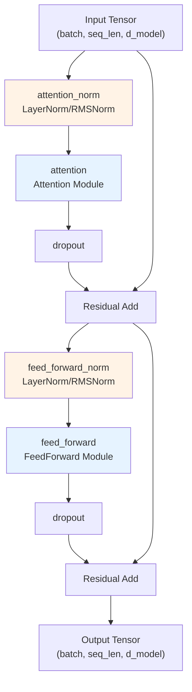
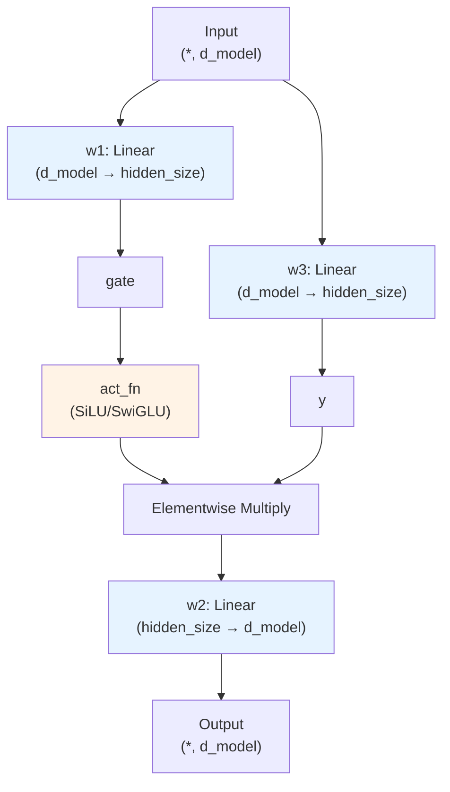
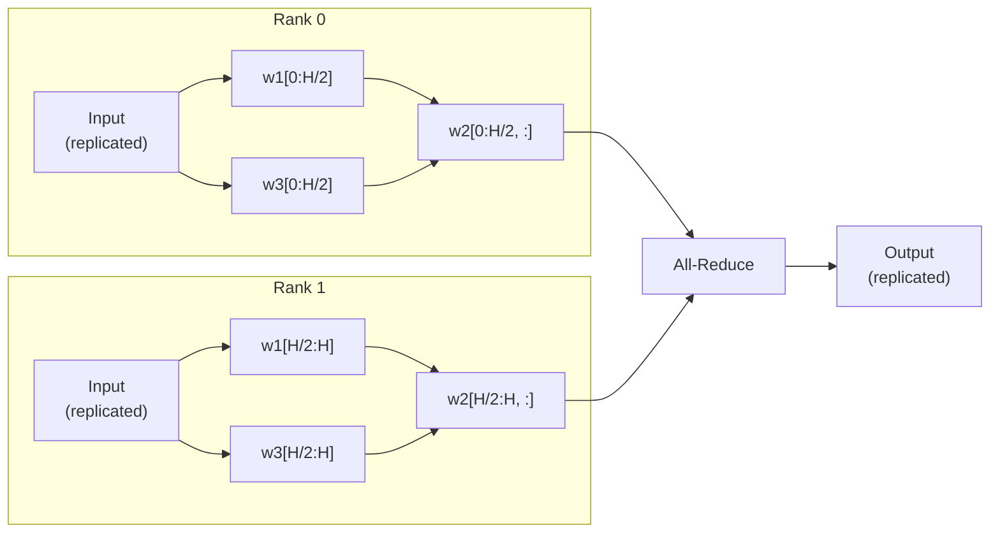
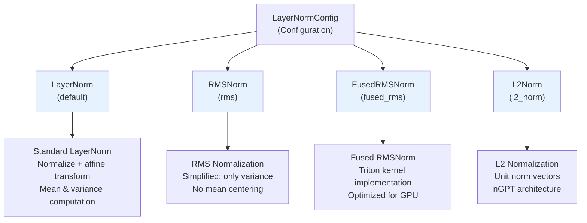
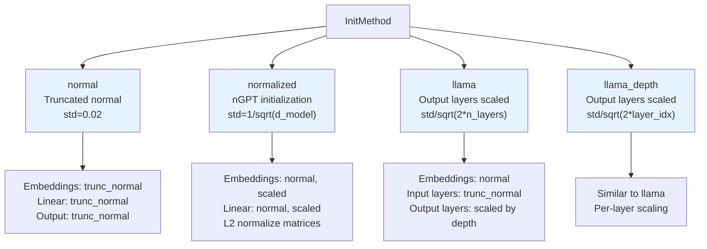
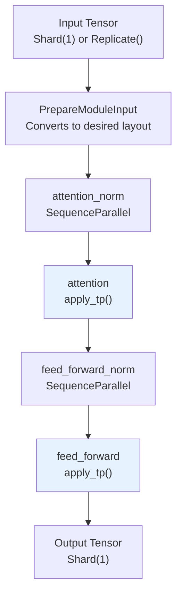

<!-- source: DeepWiki mcp.deepwiki.com · repo allenai/bolmo-core · page 2.3 Attention and Feed-Forward · fetched 2026-10-26 -->

# Attention and Feed-Forward

<details>
<summary>Relevant source files</summary>

The following files were used as context for generating this wiki page:

- [src/olmo_core/nn/feed_forward.py](src/olmo_core/nn/feed_forward.py)
- [src/olmo_core/nn/layer_norm.py](src/olmo_core/nn/layer_norm.py)
- [src/olmo_core/nn/lm_head.py](src/olmo_core/nn/lm_head.py)
- [src/olmo_core/nn/transformer/__init__.py](src/olmo_core/nn/transformer/__init__.py)
- [src/olmo_core/nn/transformer/block.py](src/olmo_core/nn/transformer/block.py)
- [src/olmo_core/nn/transformer/init.py](src/olmo_core/nn/transformer/init.py)
- [src/test/nn/layer_norm_test.py](src/test/nn/layer_norm_test.py)
- [src/test/nn/lm_head_test.py](src/test/nn/lm_head_test.py)
- [src/test/nn/transformer/model_test.py](src/test/nn/transformer/model_test.py)

</details>


## Purpose and Scope

This page documents the core neural network components that compose transformer blocks: **attention mechanisms**, **feed-forward networks**, and **layer normalization**. These modules are the fundamental building blocks used within each transformer layer.

For information about how these components are assembled into complete transformer blocks, see [Transformer Blocks](#2.2). For the complete model architecture including embeddings and language model heads, see [Transformer Models](#2.1).

## Overview

Transformer blocks follow a consistent pattern of applying attention and feed-forward transformations with residual connections and layer normalization. The standard architecture consists of:

1. **Attention sub-layer**: Multi-head attention with pre-normalization
2. **Feed-forward sub-layer**: Position-wise MLP with pre-normalization
3. **Residual connections**: Around both sub-layers
4. **Dropout**: Optional regularization after each sub-layer

### Component Composition in Transformer Blocks



**Sources:** [src/olmo_core/nn/transformer/block.py:94-141]()

The forward pass in `TransformerBlock` implements this pattern:

```python
# Line 139-140 in block.py
h = x + self.dropout(self.attention(self.attention_norm(x), **kwargs))
return h + self.dropout(self.feed_forward(self.feed_forward_norm(h)))
```

## Feed-Forward Networks

Feed-forward networks in OLMo-Core implement position-wise transformations using the SwiGLU activation function. Each network consists of three linear projections arranged to enable gated activations.

### FeedForward Architecture



**Sources:** [src/olmo_core/nn/feed_forward.py:105-140]()

### Feed-Forward Implementations

| Class | Type | Key Features | Bias | Use Case |
|-------|------|--------------|------|----------|
| `FeedForward` | default | SwiGLU activation, standard 3-layer MLP | Configurable | Standard transformer blocks |
| `NormalizedFeedForward` | normalized | L2-normalized weights, learnable scaling factors | No | nGPT architecture |

**Sources:** [src/olmo_core/nn/feed_forward.py:22-36](), [src/olmo_core/nn/feed_forward.py:105-173](), [src/olmo_core/nn/feed_forward.py:176-241]()

### FeedForward Implementation

The default `FeedForward` module implements the SwiGLU gated activation:

```python
# Conceptual forward pass from line 133-139 in feed_forward.py
output = w2(act_fn(w1(x), w3(x)))
```

Configuration and construction:

```python
# Example from FeedForwardConfig
config = FeedForwardConfig(
    hidden_size=4096,  # Typically 4 * d_model
    bias=False,
    act_name="silu"  # or "swiglu" for fused implementation
)
feed_forward = config.build(d_model=1024)
```

**Sources:** [src/olmo_core/nn/feed_forward.py:38-101](), [src/olmo_core/nn/feed_forward.py:105-173]()

### NormalizedFeedForward for nGPT

The `NormalizedFeedForward` variant implements the nGPT architecture with L2-normalized weight matrices and learnable scaling parameters:

- **Weight normalization**: All weight matrices are L2-normalized along embedding dimensions
- **Scaling factors**: Learnable `sw1` and `sw3` parameters control activation magnitudes
- **Matrix re-normalization**: Weights are re-normalized after each optimizer step via `normalize_matrices()`

**Sources:** [src/olmo_core/nn/feed_forward.py:176-241]()

### Tensor Parallelism for Feed-Forward

Feed-forward layers support column-wise and row-wise tensor parallelism:

- **w1, w3**: Column-wise parallel (output sharded across TP ranks)
- **w2**: Row-wise parallel (input sharded, local outputs optionally accumulated)



**Sources:** [src/olmo_core/nn/feed_forward.py:141-173]()

## Layer Normalization

Layer normalization is applied before attention and feed-forward transformations in transformer blocks. OLMo-Core provides multiple implementations optimized for different use cases.

### Layer Norm Variants



**Sources:** [src/olmo_core/nn/layer_norm.py:15-36](), [src/olmo_core/nn/layer_norm.py:38-102]()

### LayerNorm Implementations

| Class | Type | Formula | Affine | Bias | Full Precision |
|-------|------|---------|--------|------|----------------|
| `LayerNorm` | default | Standard layer norm with mean and variance | Optional | Optional | Optional |
| `RMSNorm` | rms | Root mean square, no mean centering | Optional | Optional | Optional |
| `FusedRMSNorm` | fused_rms | Triton-accelerated RMS norm | Yes | Optional | Yes |
| `L2Norm` | l2_norm | L2 normalize to unit vectors | No | No | N/A |

**Sources:** [src/olmo_core/nn/layer_norm.py:104-291]()

### LayerNorm

Standard PyTorch layer normalization with optional full precision computation:

```python
# Forward pass conceptually (lines 165-185 in layer_norm.py)
# Normalize with mean and variance
x = (x - mean) / sqrt(variance + eps)
# Optional affine transform
x = weight * x + bias
```

Configuration:
```python
config = LayerNormConfig(
    name=LayerNormType.default,
    eps=1e-5,
    elementwise_affine=True,
    bias=True,
    full_precision=True  # Cast to float32 internally
)
layer_norm = config.build(size=d_model)
```

**Sources:** [src/olmo_core/nn/layer_norm.py:104-186]()

### RMSNorm

Simplified layer normalization that omits mean centering, computing only root mean square:

```python
# Forward pass conceptually (lines 193-214 in layer_norm.py)
# Compute variance (no mean centering)
variance = x.pow(2).mean(-1, keepdim=True)
# Normalize
x = x * rsqrt(variance + eps)
# Optional affine transform
x = weight * x + bias
```

RMSNorm is faster than standard LayerNorm due to the simplified computation, while maintaining comparable performance in practice.

**Sources:** [src/olmo_core/nn/layer_norm.py:188-215]()

### FusedRMSNorm

Triton-kernel implementation from flash-attention that fuses RMSNorm computation for improved performance on GPU:

- Requires `flash-attn` package
- Always uses full precision internally
- Requires `elementwise_affine=True`

**Sources:** [src/olmo_core/nn/layer_norm.py:217-272]()

### L2Norm for nGPT

The `L2Norm` variant normalizes vectors to unit L2 norm, as used in the nGPT architecture:

```python
# Forward pass: normalize to unit vectors
x = x / ||x||_2
```

This normalization has no learnable parameters and is used in conjunction with `NormalizedFeedForward` and `NormalizedAttention` in the nGPT model variant.

**Sources:** [src/olmo_core/nn/layer_norm.py:274-291]()

## Attention Mechanisms

Attention modules are configured via `AttentionConfig` and built within transformer blocks. The attention implementation supports:

- **Multi-head attention**: Standard parallel attention heads
- **Grouped-query attention (GQA)**: Shared key-value heads across query groups
- **Rotary position embeddings (RoPE)**: Relative position encoding
- **Flash Attention**: Memory-efficient attention computation
- **Sliding window attention**: Local attention patterns
- **Context parallelism**: Sequence-parallel attention via ring communication

Attention configuration is specified in transformer block configs and instantiated at [src/olmo_core/nn/transformer/block.py:123-125](). For detailed documentation of attention mechanisms, see the attention module documentation.

**Sources:** [src/olmo_core/nn/transformer/block.py:19](), [src/olmo_core/nn/transformer/block.py:123-125]()

## Component Integration

### Transformer Block Assembly

The `TransformerBlock` class assembles these components:

```python
# From TransformerBlock.__init__ (lines 107-129 in block.py)
self.attention = attention.build(d_model, layer_idx=block_idx, ...)
self.attention_norm = layer_norm.build(d_model, ...)
self.feed_forward = feed_forward.build(d_model=d_model, ...)
self.feed_forward_norm = layer_norm.build(d_model, ...)
self.dropout = nn.Dropout(dropout)
```

Configuration example:

```python
from olmo_core.nn.attention import AttentionConfig
from olmo_core.nn.feed_forward import FeedForwardConfig
from olmo_core.nn.layer_norm import LayerNormConfig, LayerNormType

block_config = TransformerBlockConfig(
    attention=AttentionConfig(n_heads=32, rope=RoPEConfig()),
    feed_forward=FeedForwardConfig(hidden_size=4096, bias=False),
    layer_norm=LayerNormConfig(name=LayerNormType.rms, bias=False)
)
```

**Sources:** [src/olmo_core/nn/transformer/block.py:94-141]()

### Block Variants

Different block types compose these components with architectural variations:

| Block Type | Normalization Order | Feed-Forward Type | Special Features |
|------------|-------------------|-------------------|------------------|
| `TransformerBlock` | Pre-norm | Dense FFN | Standard Llama-style |
| `ReorderedNormTransformerBlock` | Post-norm | Dense FFN | Norm after sublayer |
| `LayerNormScaledTransformerBlock` | Pre-norm with scaling | Dense FFN | Layer-dependent scaling factor |
| `NormalizedTransformerBlock` | L2 norm with lerp | Normalized FFN | nGPT architecture |
| `MoETransformerBlock` | Pre-norm | MoE | Sparse experts |
| `MoEHybridTransformerBlock` | Pre-norm | Dense + MoE | Both dense and sparse |

**Sources:** [src/olmo_core/nn/transformer/block.py:94-978]()

## Weight Initialization

The `InitMethod` enum defines initialization strategies for attention and feed-forward components:



**Sources:** [src/olmo_core/nn/transformer/init.py:29-52]()

### Initialization Methods

#### Attention Initialization

```python
# From init.py lines 103-135
def init_attention(
    m: AttentionBase,
    d_model: int,
    block_idx: int,
    num_blocks: int,
    std: float = 0.02,
):
    # Initialize Q, K, V projections
    self._init_linear(m.w_q, std=std)
    self._init_linear(m.w_k, std=std)
    self._init_linear(m.w_v, std=std)
    
    # Scale output projection based on depth
    if method == "llama":
        std = std / (2 * num_blocks) ** 0.5
    elif method == "llama_depth":
        std = std / (2 * (block_idx + 1)) ** 0.5
    
    self._init_linear(m.w_out, std=std)
```

**Sources:** [src/olmo_core/nn/transformer/init.py:103-135]()

#### Feed-Forward Initialization

```python
# From init.py lines 136-162
def init_feed_forward(
    m: FeedForward,
    d_model: int,
    block_idx: int,
    num_blocks: int,
    std: float = 0.02,
):
    # Initialize input projections (w1, w3)
    self._init_linear(m.w1, std=std)
    
    # Scale output projection (w2) based on depth
    if method == "llama":
        std = std / (2 * num_blocks) ** 0.5
    elif method == "llama_depth":
        std = std / (2 * (block_idx + 1)) ** 0.5
    
    self._init_linear(m.w3, std=std)
    self._init_linear(m.w2, std=std)
```

**Sources:** [src/olmo_core/nn/transformer/init.py:136-162]()

### nGPT Initialization

For normalized architectures, weights are initialized and then normalized to unit vectors:

```python
# Initialization uses std = d_model ** -0.5
# After optimizer steps, weights are re-normalized:
block.normalize_matrices()  # For NormalizedTransformerBlock
feed_forward.normalize_matrices()  # For NormalizedFeedForward
```

**Sources:** [src/olmo_core/nn/transformer/block.py:389-402](), [src/olmo_core/nn/feed_forward.py:229-241]()

## Parallelism Support

### Tensor Parallelism

Attention and feed-forward modules support tensor parallelism with automatic layout management:



**Sources:** [src/olmo_core/nn/transformer/block.py:142-179]()

### TP Application in Blocks

The `apply_tp()` method on transformer blocks coordinates tensor parallelism across all components:

1. **Input preparation**: Convert input layout to sequence-parallel (Shard(1))
2. **Layer norm**: Apply sequence parallelism to normalization layers
3. **Attention**: Shard Q/K/V projections column-wise, output projection row-wise
4. **Feed-forward**: Shard w1/w3 column-wise, w2 row-wise
5. **Dropout**: Maintain sequence parallelism

**Sources:** [src/olmo_core/nn/transformer/block.py:142-179]()

### Context Parallelism

Attention modules also support context parallelism for processing long sequences:

```python
# Apply CP to attention (line 186 in block.py)
self.attention.apply_cp(cp_mesh, load_balancer, head_stride=head_stride)
```

Context parallelism shards the sequence dimension across ranks, enabling training on sequences longer than fit in single-GPU memory.

**Sources:** [src/olmo_core/nn/transformer/block.py:180-187]()

---

