<!-- source: DeepWiki mcp.deepwiki.com · repo allenai/bolmo-core · page 2.5 Weight Initialization · fetched 2026-10-26 -->

# Weight Initialization

<details>
<summary>Relevant source files</summary>

The following files were used as context for generating this wiki page:

- [src/olmo_core/nn/feed_forward.py](src/olmo_core/nn/feed_forward.py)
- [src/olmo_core/nn/layer_norm.py](src/olmo_core/nn/layer_norm.py)
- [src/olmo_core/nn/lm_head.py](src/olmo_core/nn/lm_head.py)
- [src/olmo_core/nn/transformer/__init__.py](src/olmo_core/nn/transformer/__init__.py)
- [src/olmo_core/nn/transformer/block.py](src/olmo_core/nn/transformer/block.py)
- [src/olmo_core/nn/transformer/init.py](src/olmo_core/nn/transformer/init.py)
- [src/test/nn/layer_norm_test.py](src/test/nn/layer_norm_test.py)
- [src/test/nn/lm_head_test.py](src/test/nn/lm_head_test.py)
- [src/test/nn/transformer/model_test.py](src/test/nn/transformer/model_test.py)

</details>


This document describes the weight initialization strategies used across transformer models in OLMo-Core and Bolmo. For model architecture details, see [Model Architecture](#2). For training configuration and model building, see [Transformer Models](#2.1).

## Overview

Weight initialization is a critical aspect of training deep neural networks that determines the initial values of model parameters. OLMo-Core provides four distinct initialization strategies through the `InitMethod` enum, each optimized for different architectural variants and training objectives. The initialization system handles standard PyTorch tensors as well as distributed tensors (DTensor) used in tensor-parallel training.

The initialization framework supports:
- Multiple initialization strategies (`normal`, `llama`, `llama_depth`, `normalized`)
- Component-specific initialization for embeddings, attention, feed-forward, and LM heads
- Distributed tensor-aware initialization for tensor parallelism
- Special handling for normalized architectures (nGPT)

**Sources:** [src/olmo_core/nn/transformer/init.py:1-216]()

## Initialization Methods

### InitMethod Enum

The `InitMethod` enum defines four distinct initialization strategies, each with specific use cases and mathematical properties:

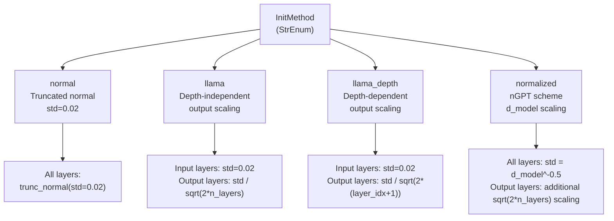

**Sources:** [src/olmo_core/nn/transformer/init.py:29-52]()

### Method Characteristics

| Method | Input Layer Std | Output Layer Std | Use Case |
|--------|----------------|------------------|----------|
| `normal` | `0.02` | `0.02` | Simple baseline, uniform initialization |
| `llama` | `0.02` | `0.02 / sqrt(2 * n_layers)` | Llama-style models, depth-independent scaling |
| `llama_depth` | `0.02` | `0.02 / sqrt(2 * (block_idx + 1))` | Per-layer scaling, varies by depth |
| `normalized` | `d_model^-0.5` | `d_model^-0.5 / sqrt(2 * n_layers)` | nGPT normalized architectures |

**Sources:** [src/olmo_core/nn/transformer/init.py:29-52]()

## Component-Specific Initialization

### Initialization Flow

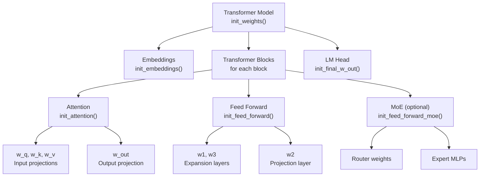

**Sources:** [src/olmo_core/nn/transformer/init.py:68-216](), [src/olmo_core/nn/transformer/model.py:200-300]()

### Embedding Initialization

The `init_embeddings()` method initializes token embedding matrices with strategy-specific standard deviations:

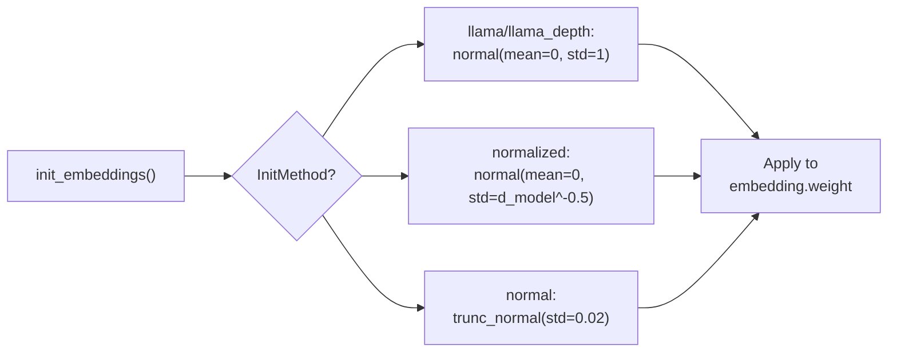

**Sources:** [src/olmo_core/nn/transformer/init.py:68-89]()

### Attention Layer Initialization

Attention layers consist of query, key, value projections and an output projection. The initialization strategy differs for input vs. output projections:

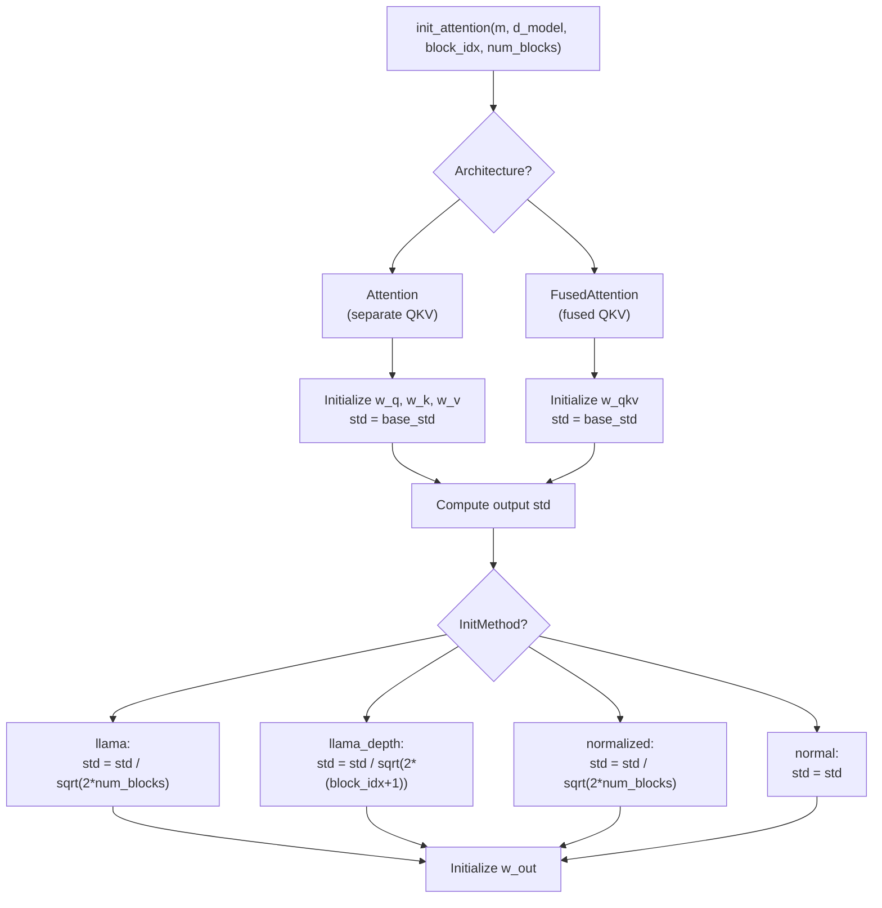

**Notes:**
- For `normalized` method, `base_std = d_model^-0.5`
- For other methods, `base_std = 0.02` (default)
- Output projection scaling compensates for residual connection accumulation

**Sources:** [src/olmo_core/nn/transformer/init.py:103-134]()

### Feed-Forward Initialization

Feed-forward networks use SwiGLU activation with three weight matrices (`w1`, `w2`, `w3`). Different matrices receive different scaling:

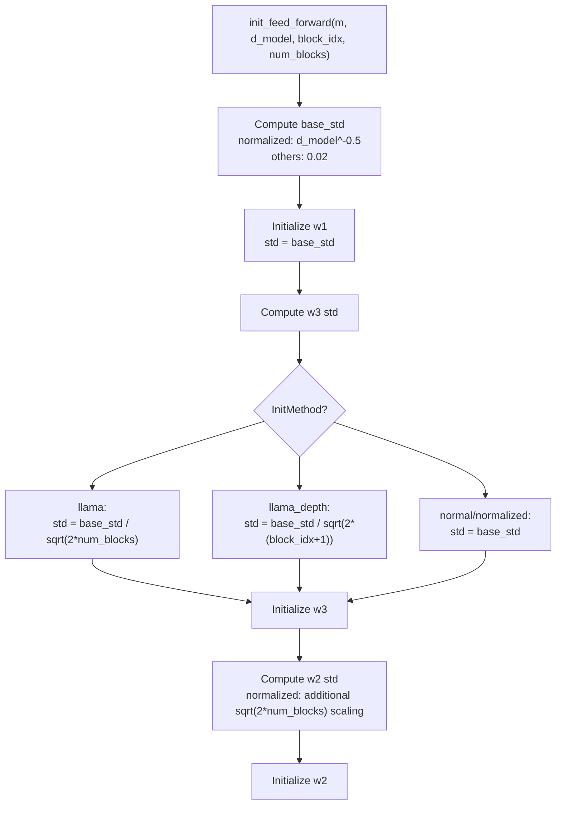

**Notes:**
- `w1` and `w3` are expansion/gate matrices (d_model → hidden_size)
- `w2` is the projection matrix (hidden_size → d_model)
- Output scaling on `w2` and `w3` helps with gradient flow through deep networks

**Sources:** [src/olmo_core/nn/transformer/init.py:136-161]()

### MoE Initialization

Mixture-of-experts layers initialize the router and expert MLPs:

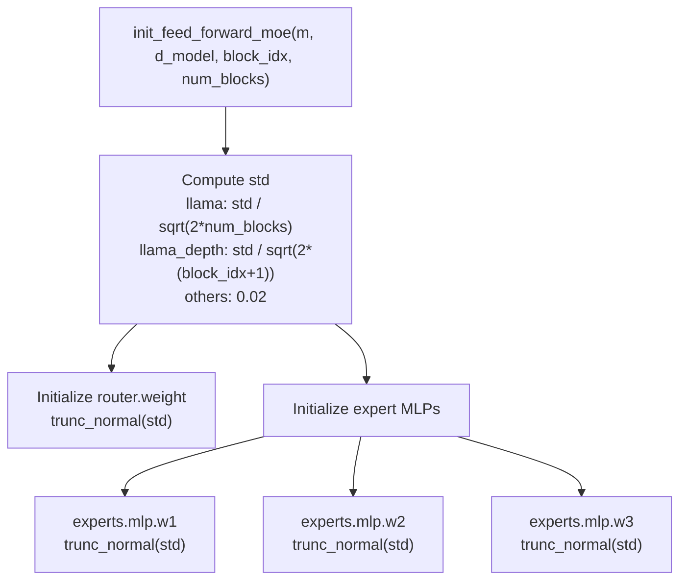

**Sources:** [src/olmo_core/nn/transformer/init.py:163-215]()

### LM Head Initialization

The final language modeling head is initialized with special attention to the vocabulary projection:

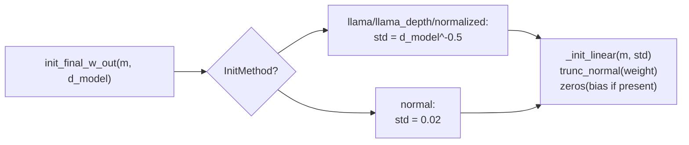

**Sources:** [src/olmo_core/nn/transformer/init.py:91-101]()

## Distributed Tensor Handling

### DTensor Initialization

When using tensor parallelism, model weights are represented as `DTensor` objects that are sharded across multiple devices. The initialization system handles this transparently:

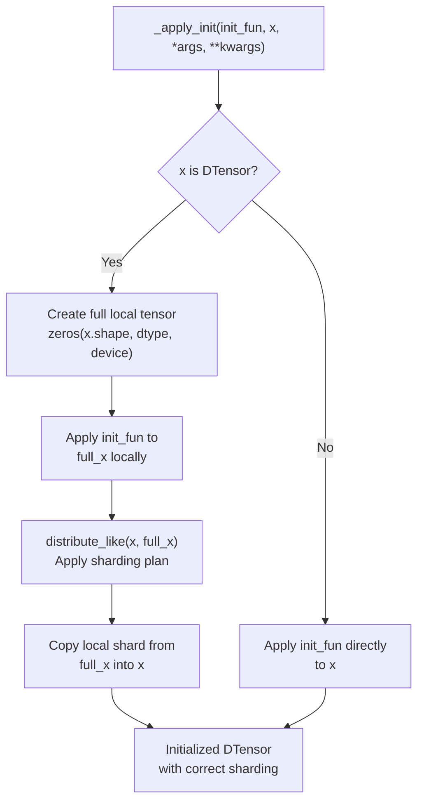

**Key Implementation Details:**
1. For regular tensors, initialization functions are applied directly
2. For DTensor:
   - Create a full (unsharded) version locally
   - Apply initialization to the full tensor
   - Distribute the full tensor according to DTensor's sharding plan
   - Copy the appropriate shard into the DTensor

This ensures consistent initialization across all ranks regardless of sharding strategy.

**Sources:** [src/olmo_core/nn/transformer/init.py:15-26]()

## Normalized Architectures

### nGPT-Specific Initialization

Normalized architectures (nGPT) require special initialization procedures beyond standard weight initialization. These involve learnable scaling parameters that modulate the interaction between normalized hidden states.

#### NormalizedTransformerBlock

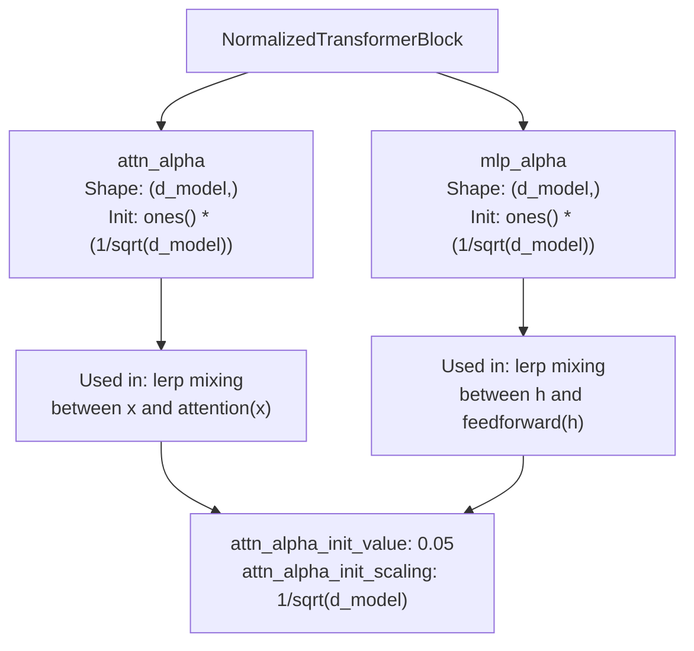

**Sources:** [src/olmo_core/nn/transformer/block.py:303-319]()

#### NormalizedFeedForward

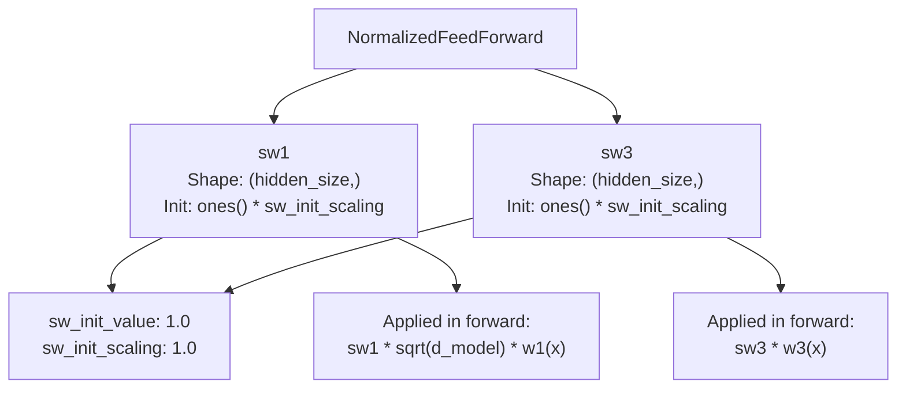

**Sources:** [src/olmo_core/nn/feed_forward.py:196-208]()

#### NormalizedLMHead

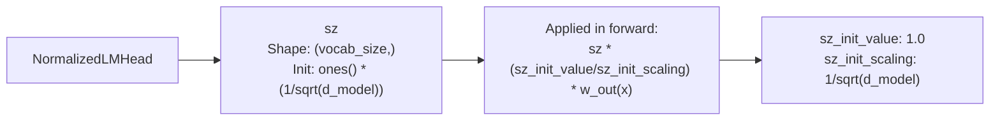

**Sources:** [src/olmo_core/nn/lm_head.py:448-459]()

### Weight Normalization

Normalized architectures require periodic weight normalization after optimizer steps. Each component has a `normalize_matrices()` method:

| Component | Method | Matrices Normalized |
|-----------|--------|-------------------|
| `NormalizedTransformerBlock` | `normalize_matrices()` | Calls `attention.normalize_matrices()` and `feed_forward.normalize_matrices()` |
| `NormalizedFeedForward` | `normalize_matrices()` | `w1.weight` (dim=-1), `w2.weight` (dim=0), `w3.weight` (dim=-1) |
| `NormalizedLMHead` | `normalize_matrices()` | `w_out.weight` (dim=-1) |

Weight normalization applies L2 normalization: `w.copy_(l2_normalize(w, dim=dim))`

**Sources:** [src/olmo_core/nn/transformer/block.py:388-401](), [src/olmo_core/nn/feed_forward.py:229-240](), [src/olmo_core/nn/lm_head.py:555-560]()

## Initialization in Practice

### Model Building and Initialization

The typical initialization flow when building a transformer model:

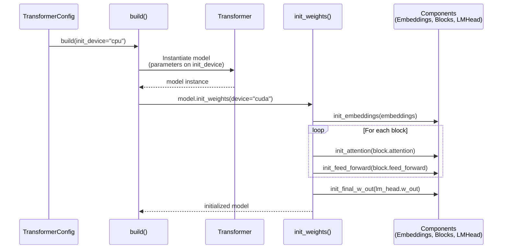

**Sources:** [src/olmo_core/nn/transformer/model.py:200-300]()

### Example: Standard Transformer

For a standard transformer using `llama` initialization:

```python
# From configuration
config = TransformerConfig.llama2_271M(
    vocab_size=50257,
    init_method=InitMethod.llama
)

# Build on CPU, then move to GPU and initialize
model = config.build(init_device="cpu")
model.init_weights(device=torch.device("cuda"))
```

The `init_weights()` method:
1. Initializes embeddings with `normal(mean=0, std=1.0)`
2. For each block (0 to n_layers-1):
   - Attention input projections: `trunc_normal(std=0.02)`
   - Attention output projection: `trunc_normal(std=0.02 / sqrt(2*n_layers))`
   - FFN w1: `trunc_normal(std=0.02)`
   - FFN w3: `trunc_normal(std=0.02 / sqrt(2*n_layers))`
   - FFN w2: `trunc_normal(std=0.02 / sqrt(2*n_layers))`
3. LM head output projection: `trunc_normal(std=d_model^-0.5)`

**Sources:** [src/test/nn/transformer/model_test.py:60-84]()

### Example: Normalized Transformer (nGPT)

For normalized transformers:

```python
config = TransformerConfig.ngpt_271M(
    vocab_size=50257,
    # init_method is automatically set to InitMethod.normalized
)

model = config.build(init_device="cpu")
model.init_weights(device=torch.device("cuda"))

# After each optimizer step, re-normalize weights
optimizer.step()
model.normalize_matrices()
```

The normalized initialization:
1. All weight matrices: `normal(std=d_model^-0.5)`
2. Output projections: additional `sqrt(2*n_layers)` scaling
3. Learnable scaling parameters (alphas, sz, sw1, sw3): initialized with specific values
4. After training steps: explicit L2 normalization of all weight matrices

**Sources:** [src/test/nn/transformer/model_test.py:114-156]()

### Initialization with FSDP

When using Fully Sharded Data Parallel (FSDP), initialization must occur after FSDP wrapping:

```python
# Build on meta device
model = config.build(init_device="meta")

# Apply FSDP
model.apply_fsdp(mesh)

# Initialize weights (FSDP-aware)
model.init_weights(max_seq_len=1024, device=get_default_device())
```

The initialization system ensures that:
- All replicas receive identical parameter values
- DTensor sharding is properly handled
- Initialization is deterministic across the process group

**Sources:** [src/test/nn/transformer/model_test.py:304-336]()

---

