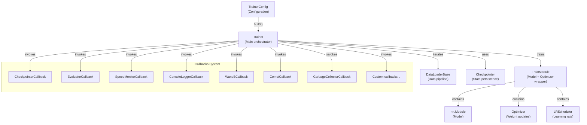
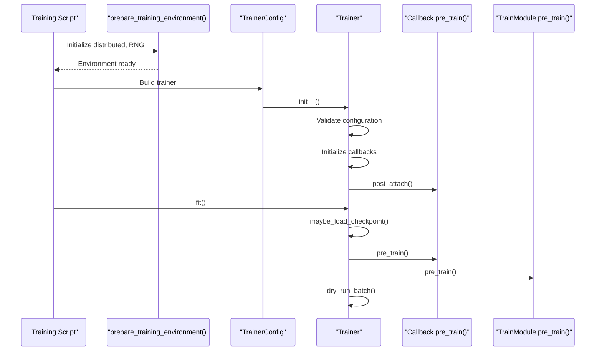
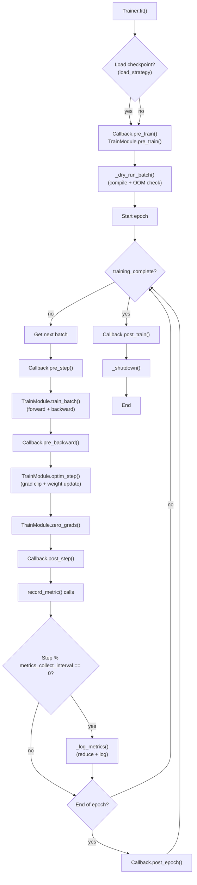

<!-- source: DeepWiki mcp.deepwiki.com · repo allenai/bolmo-core · page 3 Training System · fetched 2026-10-26 -->

# Training System

<details>
<summary>Relevant source files</summary>

The following files were used as context for generating this wiki page:

- [CHANGELOG.md](CHANGELOG.md)
- [src/olmo_core/train/__init__.py](src/olmo_core/train/__init__.py)
- [src/olmo_core/train/callbacks/evaluator_callback.py](src/olmo_core/train/callbacks/evaluator_callback.py)
- [src/olmo_core/train/common.py](src/olmo_core/train/common.py)
- [src/olmo_core/train/config.py](src/olmo_core/train/config.py)
- [src/olmo_core/train/train_module/train_module.py](src/olmo_core/train/train_module/train_module.py)
- [src/olmo_core/train/trainer.py](src/olmo_core/train/trainer.py)
- [src/olmo_core/version.py](src/olmo_core/version.py)

</details>


## Purpose and Scope

The training system provides the infrastructure for training language models in OLMo-Core. It orchestrates the training loop, manages checkpointing, coordinates distributed training, and provides extensibility through callbacks. This page covers the high-level architecture and how the major components interact.

For detailed information about specific components:
- Trainer implementation details: see [Trainer](#3.1)
- TrainModule abstraction and implementations: see [Training Modules](#3.2)
- Callback system and built-in callbacks: see [Callbacks](#3.3)
- Optimizer configurations: see [Optimizers](#3.4)
- Learning rate scheduling: see [Learning Rate Schedulers](#3.5)
- Metric recording and logging: see [Metrics and Logging](#3.6)

For distributed training infrastructure: see [Distributed Training](#5)

For checkpoint management: see [Checkpointing](#5.3)

Sources: [src/olmo_core/train/__init__.py:1-41]()

## Architecture Overview

The training system is built around three core abstractions that work together:

1. **`Trainer`** - The main training loop orchestrator that manages the overall training lifecycle
2. **`TrainModule`** - An abstraction that encapsulates a model and optimizer together
3. **`Callback`** - Extension points for customizing training behavior

### Component Relationships



Sources: [src/olmo_core/train/trainer.py:88-380](), [src/olmo_core/train/train_module/train_module.py:72-225](), [src/olmo_core/train/config.py:25-202]()

## Core Components

### Trainer

The `Trainer` class [src/olmo_core/train/trainer.py:88-295]() is the central orchestrator. It manages:

- **Training loop execution** via `fit()` method
- **Step counting** through `global_step` and `global_train_tokens_seen`
- **Checkpoint loading/saving** through integration with `Checkpointer`
- **Metric collection and reduction** via `record_metric()` methods
- **Callback orchestration** by invoking callbacks at specific lifecycle points
- **Distributed coordination** using process groups and barriers

Key properties:
- `global_batch_size`: Total batch size in tokens across all ranks
- `max_steps`: Maximum training steps determined by `max_duration`
- `training_complete`: Boolean indicating if training should stop
- `training_progress`: Current progress with estimated time remaining

### TrainModule

The `TrainModule` abstraction [src/olmo_core/train/train_module/train_module.py:72-225]() provides a unified interface for different training paradigms:

```python
class TrainModule(Stateful, metaclass=ABCMeta):
    def train_batch(self, batch: Dict[str, Any], dry_run: bool = False):
        """Run forward and backward pass on a training batch."""
        
    def eval_batch(self, batch: Dict[str, Any], labels: Optional[Any] = None) -> Any:
        """Run forward pass on eval batch."""
        
    def optim_step(self):
        """Run optimizer step."""
        
    def zero_grads(self):
        """Zero-out gradients."""
        
    def state_dict(self, *, optim: Optional[bool] = None) -> Dict[str, Any]:
        """Get state dict to save or load."""
```

The `BasicTrainModule` [src/olmo_core/train/train_module/train_module.py:227-389]() provides a reference implementation, while `TransformerTrainModule` (see [Training Modules](#3.2)) extends this for transformer-specific features like gradient accumulation, loss compilation, and Z-loss.

### DataLoader

The `DataLoaderBase` [src/olmo_core/data/data_loader.py]() provides batches to the trainer. Key responsibilities:

- **Distributed sampling** across data parallel ranks
- **State persistence** for resumption via `state_dict()` and `load_state_dict()`
- **Epoch management** and batch counting
- **Fingerprinting** for data mix validation

### Checkpointer

The `Checkpointer` [src/olmo_core/train/checkpoint.py]() handles distributed checkpoint I/O:

- **Async saving** to avoid blocking training
- **Topology-agnostic loading** allowing checkpoint reuse across different parallelism configurations
- **Remote storage support** via unified I/O layer

Sources: [src/olmo_core/train/trainer.py:88-380](), [src/olmo_core/train/train_module/train_module.py:72-389]()

## Training Lifecycle

### Initialization and Setup



The training lifecycle begins with `prepare_training_environment()` [src/olmo_core/train/__init__.py:85-149](), which:

1. Sets multiprocessing start method to "spawn"
2. Initializes distributed process groups via `init_distributed()`
3. Configures logging and CLI environment
4. Seeds RNG states across all ranks

Sources: [src/olmo_core/train/__init__.py:85-149](), [src/olmo_core/train/trainer.py:628-703]()

### Main Training Loop



The main training loop [src/olmo_core/train/trainer.py:704-726]() operates as follows:

1. **Epoch iteration**: Loops over epochs until `training_complete` returns `True`
2. **Batch processing**: For each batch:
   - Invoke `Callback.pre_step()`
   - Execute `TrainModule.train_batch()` (forward + backward)
   - Invoke `Callback.pre_backward()`
   - Execute `TrainModule.optim_step()` (gradient clipping + optimizer step)
   - Zero gradients via `TrainModule.zero_grads()`
   - Invoke `Callback.post_step()`
3. **Metric logging**: Every `metrics_collect_interval` steps, reduce and log accumulated metrics
4. **Epoch completion**: Invoke `Callback.post_epoch()` at the end of each epoch

Sources: [src/olmo_core/train/trainer.py:628-726]()

### Training Completion Criteria

The `training_complete` property [src/olmo_core/train/trainer.py:399-417]() determines when training stops:

| Condition | Check Method |
|-----------|--------------|
| Max duration reached | `_duration_due(self.max_duration)` |
| Hard stop reached | `_duration_due(self.hard_stop)` if set |
| Run canceled | `check_if_canceled()` called every `cancel_check_interval` steps |
| Error occurred | `self._error` is not None |

The `max_duration` can be specified in multiple units via the `Duration` class [src/olmo_core/train/common.py:35-105]():
- `Duration.steps(n)` - train for n steps
- `Duration.epochs(n)` - train for n epochs
- `Duration.tokens(n)` - train for n tokens
- `Duration.chinchilla_tokens(multiple, model_params=...)` - train for a multiple of Chinchilla-optimal tokens

Sources: [src/olmo_core/train/trainer.py:399-417](), [src/olmo_core/train/common.py:35-105]()

### Checkpointing in the Training Loop

Checkpointing is managed by the `CheckpointerCallback` [src/olmo_core/train/callbacks/checkpointer_callback.py]() which:

1. **Determines when to save** based on `save_interval` and `save_interval_ephemeral`
2. **Saves asynchronously** via `save_checkpoint_async()` [src/olmo_core/train/trainer.py:1084-1145]()
3. **Manages ephemeral checkpoints** - temporary checkpoints that are cleaned up after a permanent checkpoint is saved
4. **Handles final checkpoint** on training completion

The async save operation uses a thread pool to avoid blocking training:

```mermaid
sequenceDiagram
    participant Loop as "Training Loop"
    participant Callback as "CheckpointerCallback"
    participant Trainer as "Trainer"
    participant Thread as "Thread Pool"
    participant CP as "Checkpointer"
    
    Loop->>Callback: post_step()
    Callback->>Callback: Check if save needed
    Callback->>Trainer: save_checkpoint_async()
    Trainer->>Thread: Submit save task
    Thread->>CP: save()
    Trainer-->>Callback: Future returned
    Callback-->>Loop: Continue training
    
    Note over Thread,CP: Checkpoint save happens<br/>in background
    
    Thread-->>CP: Save complete
    Thread-->>Callback: Callback.post_checkpoint_saved()
```

Sources: [src/olmo_core/train/trainer.py:1084-1145]()

## Configuration

The `TrainerConfig` [src/olmo_core/train/config.py:25-202]() provides a declarative way to construct trainers:

```python
trainer_config = TrainerConfig(
    save_folder="s3://bucket/checkpoints",
    max_duration=Duration.tokens(1_000_000_000_000),  # 1T tokens
    metrics_collect_interval=5,
    checkpointer=CheckpointerConfig(
        save_interval=1000,
        save_interval_ephemeral=100,
    ),
    callbacks={
        "wandb": WandBCallback(project="my-project"),
        "speed": SpeedMonitorCallback(),
    }
)

trainer = trainer_config.build(train_module, data_loader)
```

### Key Configuration Fields

| Field | Type | Description |
|-------|------|-------------|
| `save_folder` | `str` | Checkpoint save location (local path or URL) |
| `work_dir` | `Optional[str]` | Local working directory for temporary files |
| `max_duration` | `Duration` | Training duration (steps/epochs/tokens) |
| `load_path` | `Optional[str]` | Alternative checkpoint load location |
| `load_strategy` | `LoadStrategy` | When to load checkpoints (if_available/always/never) |
| `metrics_collect_interval` | `int` | Steps between metric reduction and logging |
| `cancel_check_interval` | `int` | Steps between checking if run is canceled |
| `callbacks` | `Dict[str, Callback]` | Named callbacks to attach |
| `checkpointer` | `CheckpointerConfig` | Checkpointer configuration |
| `async_bookkeeping` | `Optional[bool]` | Enable async metric reduction (requires CPU backend) |
| `no_checkpoints` | `bool` | Disable checkpointing (for benchmarking) |
| `no_evals` | `bool` | Disable evaluators (for benchmarking) |

Sources: [src/olmo_core/train/config.py:25-202]()

### Adding Callbacks

The `TrainerConfig` provides convenience methods for adding callbacks:

```python
config = (
    TrainerConfig(save_folder="...")
    .with_callback("slack", SlackNotifierCallback(webhook_url="..."))
    .with_callbacks({
        "profiler": ProfilerCallback(wait=5, warmup=5, active=10),
        "garbage_collector": GarbageCollectorCallback(),
    })
)
```

Or use `with_recommended_evals()` to add standard evaluation callbacks:

```python
config = config.with_recommended_evals(
    tokenizer=tokenizer_config,
    sequence_length=2048,
    cluster="jupiter",
    task_set="full",  # or "fast"
    eval_interval=10_000,
)
```

Sources: [src/olmo_core/train/config.py:56-134]()

## Key Features

### Async Bookkeeping

When a CPU-only backend (like GLOO) is available, the trainer can run bookkeeping operations asynchronously:

- **Metric reduction**: Collecting and reducing metrics across ranks
- **Cancel checking**: Checking if any rank has canceled the run
- **Logging**: Writing metrics to loggers

This is enabled automatically when `backend_supports_cpu()` returns `True` [src/olmo_core/train/trainer.py:349-357](). Operations are queued and executed in a background thread pool, avoiding blocking the main training loop.

### Metric Recording and Reduction

Metrics can be recorded at any point during training:

```python
# From TrainModule
self.record_metric("train/my_metric", value, reduce_type=ReduceType.mean)

# From Trainer
trainer.record_metric("custom/metric", value, namespace="myapp")
```

Metrics are:
1. **Accumulated** in `_metrics` dict [src/olmo_core/train/trainer.py:278]()
2. **Reduced** across ranks every `metrics_collect_interval` steps
3. **Passed to callbacks** via `Callback.log_metrics()` method
4. **Cleared** after logging

The `ReduceType` [src/olmo_core/train/common.py:130-155]() determines how metrics are reduced:
- `mean`: Average across ranks
- `sum`: Sum across ranks
- `max`: Maximum across ranks
- `l2_norm`: Correctly reduce L2 norms

Sources: [src/olmo_core/train/trainer.py:1164-1254](), [src/olmo_core/train/common.py:130-155]()

### Step Skipping

Training can skip specific step ranges via `steps_to_skip` [src/olmo_core/train/trainer.py:271-274]():

```python
TrainerConfig(
    steps_to_skip=[
        StepSkipRange(start=100, stop=200),  # Skip steps 100-199
        StepSkipRange(start=500, stop=600),  # Skip steps 500-599
    ]
)
```

This is useful for debugging or continuing training with different data.

### Signal Handling

The trainer installs SIGTERM and SIGINT handlers [src/olmo_core/train/trainer.py:685-687]() that:
1. Mark the run as canceled via `cancel_run()`
2. Allow callbacks to handle the cancellation (e.g., save checkpoint)
3. Perform cleanup via `_shutdown()`

This enables graceful handling of preemption on clusters.

### Dry Run Batch

Before starting training, the trainer executes a dry run batch [src/olmo_core/train/trainer.py:702]() to:
1. **Trigger compilation** if using `torch.compile()`
2. **Catch OOM errors** early before potentially wasting time
3. **Validate batch shapes** and data pipeline

Sources: [src/olmo_core/train/trainer.py:271-274](), [src/olmo_core/train/trainer.py:685-702]()

### State Management

The trainer maintains comprehensive state in `TrainerStateDict` [src/olmo_core/train/trainer.py:77-86]():

```python
{
    "global_step": int,           # Current training step
    "global_train_tokens_seen": int,  # Total tokens processed
    "max_steps": int,             # Maximum steps to train for
    "data_loader": Dict,          # Data loader state
    "epoch": int,                 # Current epoch
    "world_size": int,            # Global world size
    "rng": Dict,                  # RNG states for all libraries
    "callbacks": Dict,            # Per-callback state
}
```

This state is saved with checkpoints and restored on load, enabling exact training resumption including:
- Random number generator states (PyTorch, NumPy, Python)
- Data loader position within epoch
- Callback-specific state (e.g., best metric values)

Sources: [src/olmo_core/train/trainer.py:77-86](), [src/olmo_core/train/trainer.py:740-800]()

## Integration with Other Systems

### Data Pipeline Integration

The trainer expects a `DataLoaderBase` [src/olmo_core/data/data_loader.py]() that provides:

```python
class DataLoaderBase:
    @property
    def global_batch_size(self) -> int:
        """Total batch size in tokens."""
        
    @property
    def total_batches(self) -> Optional[int]:
        """Total batches per epoch, if known."""
        
    def __iter__(self) -> Iterator[Dict[str, Any]]:
        """Iterate over batches."""
        
    def state_dict(self) -> Dict[str, Any]:
        """Get state for checkpointing."""
```

The trainer validates that the data loader's configuration matches expected values [src/olmo_core/train/trainer.py:359-374]().

### Distributed Training Integration

The trainer coordinates with distributed infrastructure:

- **Process groups**: Accepts a `dp_process_group` for data parallel operations
- **Barriers**: Uses `barrier()` for synchronization at critical points
- **Checkpointer process group**: Can use a separate process group for checkpoint I/O

The trainer automatically handles single-GPU and multi-GPU configurations.

Sources: [src/olmo_core/train/trainer.py:359-380]()

---

