<!-- source: DeepWiki mcp.deepwiki.com · repo allenai/bolmo-core · page 3.1 Trainer · fetched 2026-10-26 -->

# Trainer

<details>
<summary>Relevant source files</summary>

The following files were used as context for generating this wiki page:

- [CHANGELOG.md](CHANGELOG.md)
- [src/olmo_core/train/__init__.py](src/olmo_core/train/__init__.py)
- [src/olmo_core/train/common.py](src/olmo_core/train/common.py)
- [src/olmo_core/train/config.py](src/olmo_core/train/config.py)
- [src/olmo_core/train/trainer.py](src/olmo_core/train/trainer.py)
- [src/olmo_core/version.py](src/olmo_core/version.py)

</details>


## Purpose and Scope

The `Trainer` class is the central orchestrator for language model training in OLMo-Core. It manages the training loop, coordinates callbacks, handles checkpoint loading and saving, tracks training state, and manages distributed synchronization. This page documents the `Trainer` class structure, lifecycle, state management, and integration points.

For information about the `TrainModule` that wraps the model and optimizer, see [Training Modules](#3.2). For details on callbacks that extend trainer functionality, see [Callbacks](#3.3). For checkpoint persistence mechanisms, see [Checkpointing](#5.3).

---

## Overview

The `Trainer` is responsible for:

- Executing the training loop over epochs and batches
- Managing training state (steps, tokens, epochs)
- Coordinating callbacks at specific lifecycle hooks
- Loading and saving checkpoints
- Collecting, reducing, and logging metrics
- Handling distributed synchronization and bookkeeping
- Managing cancellation and error handling

The `Trainer` is typically constructed via `TrainerConfig.build()` rather than directly instantiated.

**Sources:** [src/olmo_core/train/trainer.py:89-380](), [src/olmo_core/train/__init__.py:1-41]()

---

## Trainer Architecture

```mermaid
graph TB
    subgraph "Trainer Core Components"
        Trainer["Trainer"]
        TrainModule["TrainModule<br/>(model + optimizer)"]
        DataLoader["DataLoaderBase"]
        Checkpointer["Checkpointer"]
        Callbacks["Dict[str, Callback]"]
    end
    
    subgraph "State Management"
        GlobalStep["global_step: int"]
        GlobalTokens["global_train_tokens_seen: int"]
        Epoch["epoch: int"]
        Canceled["_canceled: bool"]
        Metrics["_metrics: Dict[int, Dict[str, Tensor]]"]
    end
    
    subgraph "Configuration"
        SaveFolder["save_folder: str"]
        WorkDir["work_dir: Path"]
        MaxDuration["max_duration: Duration"]
        LoadStrategy["load_strategy: LoadStrategy"]
        MetricsInterval["metrics_collect_interval: int"]
    end
    
    subgraph "Distributed Setup"
        Device["device: torch.device"]
        DPProcessGroup["dp_process_group: ProcessGroup"]
        BookkeepingPG["_bookkeeping_pg: ProcessGroup"]
    end
    
    subgraph "Execution Pools"
        MultiThreadPool["_multi_thread_pool: ThreadPoolExecutor"]
        SingleThreadPool["_single_thread_pool: ThreadPoolExecutor"]
        BookkeepingQueue["_bookkeeping_queue: Dict"]
    end
    
    Trainer --> TrainModule
    Trainer --> DataLoader
    Trainer --> Checkpointer
    Trainer --> Callbacks
    
    Trainer --> GlobalStep
    Trainer --> GlobalTokens
    Trainer --> Epoch
    Trainer --> Canceled
    Trainer --> Metrics
    
    Trainer --> SaveFolder
    Trainer --> WorkDir
    Trainer --> MaxDuration
    Trainer --> LoadStrategy
    Trainer --> MetricsInterval
    
    Trainer --> Device
    Trainer --> DPProcessGroup
    Trainer --> BookkeepingPG
    
    Trainer --> MultiThreadPool
    Trainer --> SingleThreadPool
    Trainer --> BookkeepingQueue
```

**Trainer Component Structure**

The `Trainer` class contains several key component categories:

| Category | Key Attributes | Purpose |
|----------|----------------|---------|
| **Core Components** | `train_module`, `data_loader`, `checkpointer`, `callbacks` | Primary training objects |
| **State Management** | `global_step`, `global_train_tokens_seen`, `epoch`, `_metrics` | Training progress tracking |
| **Configuration** | `save_folder`, `work_dir`, `max_duration`, `load_strategy` | Training parameters |
| **Distributed Setup** | `device`, `dp_process_group`, `_bookkeeping_pg` | Distributed training configuration |
| **Execution Pools** | `_multi_thread_pool`, `_single_thread_pool`, `_bookkeeping_queue` | Async operation management |

**Sources:** [src/olmo_core/train/trainer.py:89-294]()

---

## Trainer Lifecycle

```mermaid
flowchart TD
    Start["Trainer Construction<br/>TrainerConfig.build()"]
    
    Start --> PostInit["__post_init__()<br/>- Validate configuration<br/>- Create default callbacks<br/>- Sort callbacks by priority<br/>- Setup process groups"]
    
    PostInit --> Fit["fit()"]
    
    Fit --> MaybeLoad{"load_strategy?"}
    
    MaybeLoad -->|"if_available"| TryLoad["maybe_load_checkpoint()<br/>from save_folder"]
    MaybeLoad -->|"always"| RequireLoad["load_checkpoint()<br/>or error"]
    MaybeLoad -->|"never"| PreTrain
    
    TryLoad --> CheckLoaded{"Checkpoint<br/>loaded?"}
    CheckLoaded -->|No| TryLoadPath["maybe_load_checkpoint()<br/>from load_path"]
    CheckLoaded -->|Yes| PreTrain
    TryLoadPath --> PreTrain
    RequireLoad --> PreTrain
    
    PreTrain["Pre-Train Phase<br/>- Callback.pre_train()<br/>- TrainModule.pre_train()"]
    
    PreTrain --> DryRun["_dry_run_batch()<br/>Compile and check OOM"]
    
    DryRun --> EpochLoop["While not training_complete:<br/>_fit_epoch()"]
    
    EpochLoop --> BatchLoop["For batch in data_loader:<br/>_fit_batch()"]
    
    BatchLoop --> Forward["Forward Pass<br/>train_module.forward(batch)"]
    Forward --> Backward["Backward Pass<br/>train_module.backward(loss)"]
    Backward --> Step["Optimizer Step<br/>train_module.step()"]
    
    Step --> RecordMetrics["record_metric()<br/>Loss, LR, etc."]
    RecordMetrics --> Callbacks["Invoke Callbacks<br/>- post_batch()<br/>- maybe save checkpoint<br/>- maybe evaluate"]
    
    Callbacks --> CheckComplete{"training_complete?"}
    CheckComplete -->|No| BatchLoop
    CheckComplete -->|Yes| EndEpoch["data_loader.end_epoch()"]
    
    EndEpoch --> CheckDone{"training_complete?"}
    CheckDone -->|No| EpochLoop
    CheckDone -->|Yes| PostTrain
    
    PostTrain["Post-Train Phase<br/>Callback.post_train()"]
    
    PostTrain --> Shutdown["_shutdown()<br/>- Log final metrics<br/>- Close callbacks<br/>- Shutdown thread pools<br/>- Garbage collect"]
    
    Shutdown --> End["End"]
```

**Key Lifecycle Methods**

| Method | Description | Called By |
|--------|-------------|-----------|
| `fit()` | Main entry point for training | User script |
| `_fit_epoch()` | Execute one epoch of training | `fit()` |
| `_fit_batch()` | Execute one training step on a batch | `_fit_epoch()` |
| `_dry_run_batch()` | Test forward/backward with mock batch | `fit()` |
| `_shutdown()` | Clean up resources at end of training | `fit()` |

**Sources:** [src/olmo_core/train/trainer.py:628-739](), [src/olmo_core/train/trainer.py:1110-1211]()

---

## State Management

The `Trainer` maintains several types of state that can be saved and restored:

### State Dictionary Structure

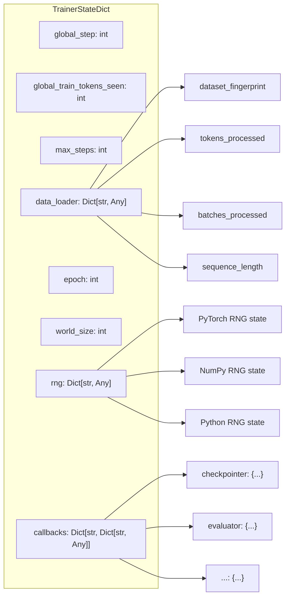

### State Methods

| Method | Purpose | Returns |
|--------|---------|---------|
| `state_dict()` | Create saveable state dictionary | `TrainerStateDict` |
| `load_state_dict(state_dict)` | Restore trainer state from dict | `None` |
| `checkpoint_loaded` property | Check if checkpoint was loaded | `bool` |

**Tracked State Variables**

- **`global_step`**: Current training step (1-based, initialized to 0)
- **`global_train_tokens_seen`**: Total tokens processed across all steps
- **`epoch`**: Current epoch number (1-based)
- **`max_steps`**: Maximum steps determined by `max_duration`
- **`_canceled`**: Whether training has been canceled
- **`_metrics`**: Pending metrics awaiting reduction and logging

**Sources:** [src/olmo_core/train/trainer.py:740-799](), [src/olmo_core/train/trainer.py:77-86]()

---

## Configuration and Construction

### TrainerConfig

The `TrainerConfig` class provides a convenient builder pattern for constructing `Trainer` instances:

```python
@dataclass
class TrainerConfig(Config):
    save_folder: str
    work_dir: Optional[str] = None
    load_path: Optional[str] = None
    load_strategy: LoadStrategy = LoadStrategy.if_available
    max_duration: Duration = Duration.epochs(1)
    checkpointer: CheckpointerConfig = CheckpointerConfig()
    callbacks: Dict[str, Callback] = field(default_factory=dict)
    # ... additional fields
```

### Building a Trainer

```python
trainer = trainer_config.build(
    train_module=train_module,
    data_loader=data_loader,
    dp_process_group=dp_pg,  # optional
    checkpointer_pg=checkpointer_pg  # optional
)
```

**Configuration Flow**

```mermaid
flowchart LR
    Config["TrainerConfig"]
    
    Config --> Validate["Validate Configuration<br/>- Check save_folder<br/>- Check work_dir<br/>- Verify shared filesystem"]
    
    Validate --> BuildCheckpointer["Build Checkpointer<br/>from CheckpointerConfig"]
    
    BuildCheckpointer --> BuildCallbacks["Build Callbacks<br/>from CallbackConfigs"]
    
    BuildCallbacks --> InstantiateTrainer["Instantiate Trainer<br/>with all components"]
    
    InstantiateTrainer --> AddDefaults["Add Default Callbacks<br/>- ConsoleLoggerCallback<br/>- CheckpointerCallback<br/>- SpeedMonitorCallback<br/>- GarbageCollectorCallback"]
    
    AddDefaults --> Attach["Attach Callbacks<br/>callback.post_attach()"]
    
    Attach --> AttachTrainModule["train_module._attach_trainer()"]
    
    AttachTrainModule --> TrainerReady["Trainer Ready"]
```

**Sources:** [src/olmo_core/train/config.py:26-201](), [src/olmo_core/train/trainer.py:295-378]()

---

## Callback Integration

The `Trainer` coordinates with callbacks at specific points in the training lifecycle:

### Callback Invocation Points

| Hook Method | When Invoked | Purpose |
|-------------|--------------|---------|
| `post_attach()` | After callback attached to trainer | Initialize callback state |
| `pre_train()` | Before training loop starts | Setup resources |
| `pre_batch(batch)` | Before processing batch | Modify batch data |
| `post_batch(batch, loss)` | After processing batch | Record metrics, log |
| `post_checkpoint_saved(checkpoint_dir)` | After checkpoint saved | Cleanup, notify |
| `post_checkpoint_loaded(checkpoint_dir)` | After checkpoint loaded | Adjust state |
| `log_metrics(step, metrics)` | When metrics ready | Log to external systems |
| `post_train()` | After training completes | Final cleanup |
| `on_error(exc)` | When error occurs | Handle failure |
| `close()` | Always at end (even on error) | Release resources |

### Callback Ordering

Callbacks are sorted by `(priority, name)` to ensure consistent execution order across ranks. Lower priority values execute first.

```python
def _sort_callbacks(self):
    self.callbacks = dict(sorted(self.callbacks.items(), key=lambda x: (x[1].priority, x[0])))
```

**Sources:** [src/olmo_core/train/trainer.py:334-342](), [src/olmo_core/train/callbacks/__init__.py]()

---

## Metrics Collection and Logging

The `Trainer` implements an efficient metrics collection system that minimizes host-device syncs:

### Metrics Recording Flow

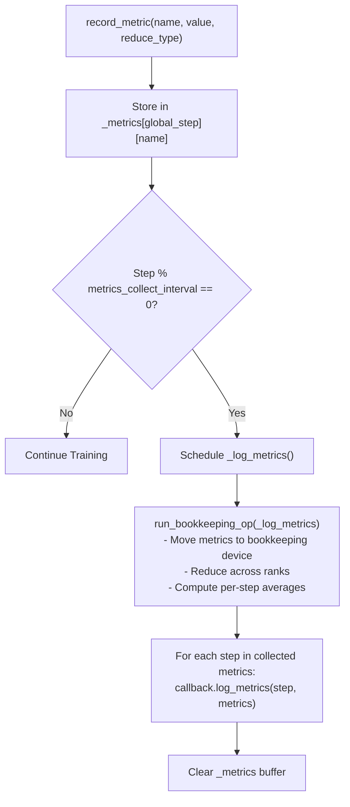

### Metric Recording API

| Method | Purpose | Parameters |
|--------|---------|------------|
| `record_metric(name, value, reduce_type, merge_strategy)` | Record a metric for current step | Name, tensor value, how to reduce, merge strategy |
| `get_metric(name, step=None)` | Retrieve recorded metric | Metric name, optional step |
| `get_loss(step=None)` | Get training CE loss | Optional step |
| `get_zloss(step=None)` | Get z-loss | Optional step |

**Reduce Types**

- **`mean`**: Average across data parallel ranks
- **`sum`**: Sum across data parallel ranks
- **`max`**: Maximum across data parallel ranks
- **`l2_norm`**: Compute global L2 norm from per-rank norms

**Sources:** [src/olmo_core/train/trainer.py:1266-1382](), [src/olmo_core/train/common.py:130-155]()

---

## Checkpoint Loading

The `Trainer` supports flexible checkpoint loading strategies:

### Load Strategy Behavior

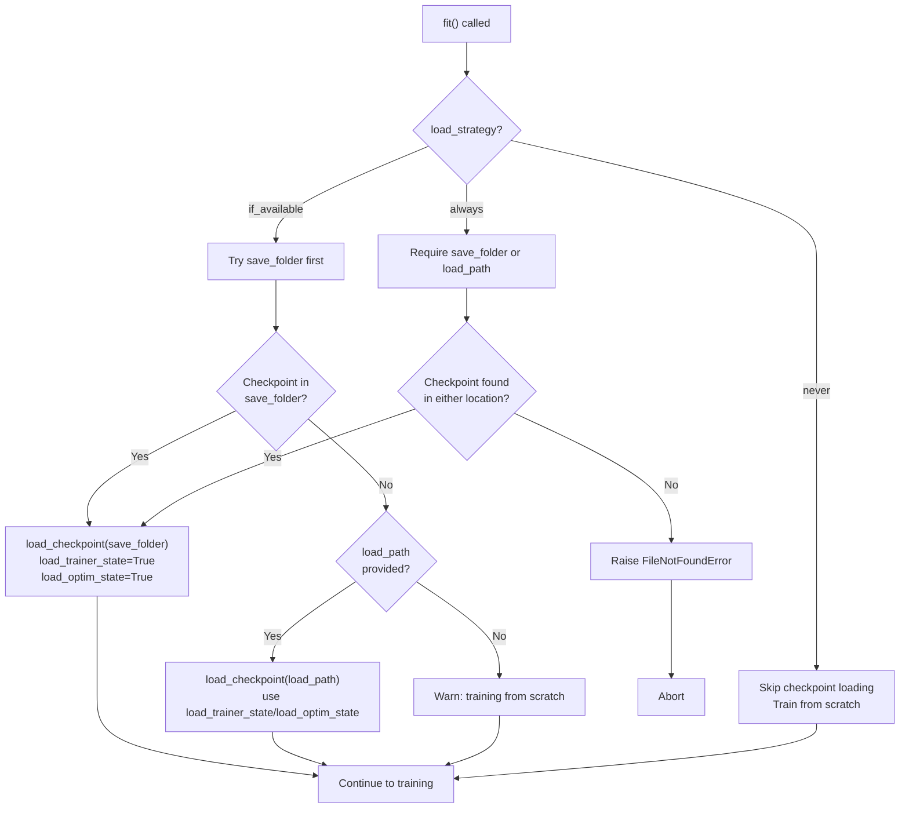

### Checkpoint Loading Methods

| Method | Purpose | Parameters |
|--------|---------|------------|
| `load_checkpoint(dir, load_trainer_state, load_optim_state)` | Load checkpoint from path | Directory, state flags |
| `maybe_load_checkpoint(dir, load_trainer_state, load_optim_state)` | Load if exists, else warn | Directory, state flags |

**State Loading Options**

- **`load_trainer_state=True`**: Restore data loader state, RNG states, training progress
- **`load_trainer_state=None`**: Load if available, ignore if missing
- **`load_trainer_state=False`**: Never load trainer state

- **`load_optim_state=True`**: Restore optimizer state
- **`load_optim_state=None`**: Load if available, ignore if missing
- **`load_optim_state=False`**: Never load optimizer state

**Sources:** [src/olmo_core/train/trainer.py:801-907]()

---

## Bookkeeping Operations

The `Trainer` can execute non-training operations asynchronously using a separate CPU-backed process group:

### Async Bookkeeping Architecture

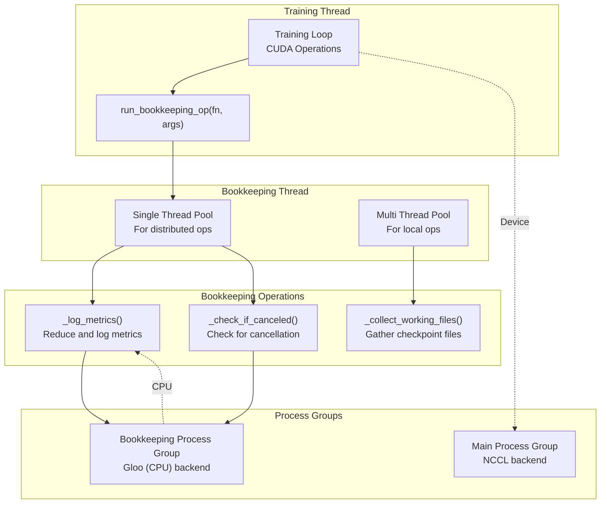

### Bookkeeping API

| Method | Purpose | Thread Pool |
|--------|---------|-------------|
| `run_bookkeeping_op(fn, *args, allow_multiple=True)` | Schedule async operation | Single-threaded |
| `run_bookkeeping_op_in_multi_thread_pool(fn, *args)` | Schedule local operation | Multi-threaded |

**Key Properties**

- **`async_bookkeeping`**: Enable/disable async operations (auto-detected based on CPU backend availability)
- **`bookkeeping_pg`**: Separate process group for collectives (`_bookkeeping_pg`)
- **`bookkeeping_device`**: Device for bookkeeping operations (CPU if async enabled)
- **`bookkeeping_soft_timeout`**: Warning threshold for slow operations (default 30s)

**Sources:** [src/olmo_core/train/trainer.py:1383-1517](), [src/olmo_core/train/trainer.py:245-255]()

---

## Training Progress and Completion

### Progress Tracking

The `Trainer` provides detailed progress information through the `training_progress` property:

```python
@dataclass
class TrainingProgress:
    current_step: int
    total_steps: int
    time_remaining: Optional[timedelta] = None
```

### Completion Conditions

Training completes when any of these conditions are met:

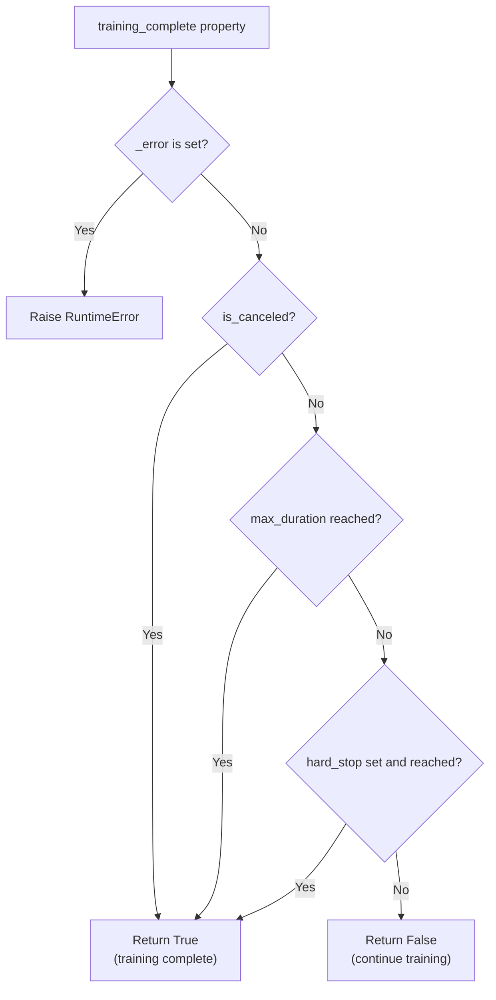

**Duration Conversion**

The trainer converts `Duration` objects to steps/tokens based on the unit:

| Duration Unit | Conversion Logic |
|---------------|------------------|
| `steps` | Directly use value |
| `epochs` | Multiply by `steps_per_epoch` |
| `tokens` | Divide by `tokens_per_batch`, round up |

**Sources:** [src/olmo_core/train/trainer.py:398-477](), [src/olmo_core/train/common.py:35-105]()

---

## Error Handling and Cancellation

### Cancellation Mechanism

The `Trainer` supports graceful cancellation through distributed coordination:

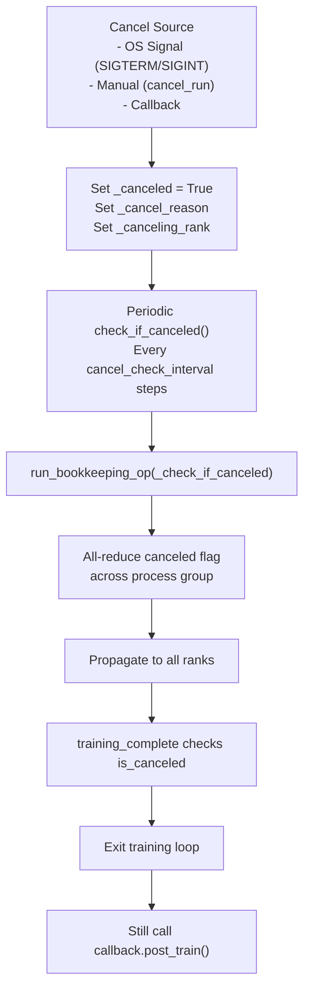

### Signal Handling

The trainer installs signal handlers for graceful shutdown:

```python
og_sigterm_handler = signal.signal(signal.SIGTERM, self._handle_os_signal)
og_sigint_handler = signal.signal(signal.SIGINT, self._handle_os_signal)
```

When a signal is received, the trainer marks the run as canceled and allows the current step to complete before exiting.

### Error Recovery

On exceptions, the trainer:
1. Logs the error
2. Calls `callback.on_error(exc)` for all callbacks
3. Calls `callback.close()` for all callbacks
4. Re-raises the exception

**Sources:** [src/olmo_core/train/trainer.py:600-627](), [src/olmo_core/train/trainer.py:685-718](), [src/olmo_core/train/trainer.py:1576-1597]()

---

## Properties and Computed Values

### Key Properties

| Property | Type | Description |
|----------|------|-------------|
| `global_batch_size` | `int` | Total tokens per batch across all ranks |
| `rank_batch_size` | `int` | Tokens per batch for this rank |
| `tokens_per_batch` | `int` | Alias for `global_batch_size` |
| `steps_per_epoch` | `Optional[int]` | Total steps in epoch (if data loader knows) |
| `tokens_per_epoch` | `Optional[int]` | Total tokens in epoch |
| `max_steps` | `int` | Maximum steps based on `max_duration` |
| `max_tokens` | `int` | Maximum tokens based on `max_duration` |
| `training_complete` | `bool` | Whether training should stop |
| `is_canceled` | `bool` | Whether run has been canceled |
| `checkpoint_loaded` | `bool` | Whether a checkpoint was loaded |
| `training_progress` | `TrainingProgress` | Current progress with ETA |

### Utility Methods

| Method | Purpose |
|--------|---------|
| `convert_duration_to_steps(duration)` | Convert a `Duration` to step count |
| `has_callback(callback_type)` | Check if callback type is registered |
| `get_callback(callback_type)` | Get callback instance of type |
| `add_callback(name, callback)` | Add new callback at runtime |

**Sources:** [src/olmo_core/train/trainer.py:381-599]()

---

## Integration with Other Components

### TrainModule Integration

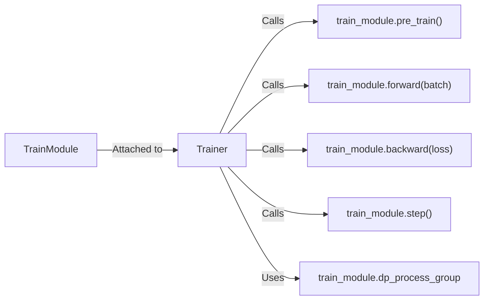

### DataLoader Integration

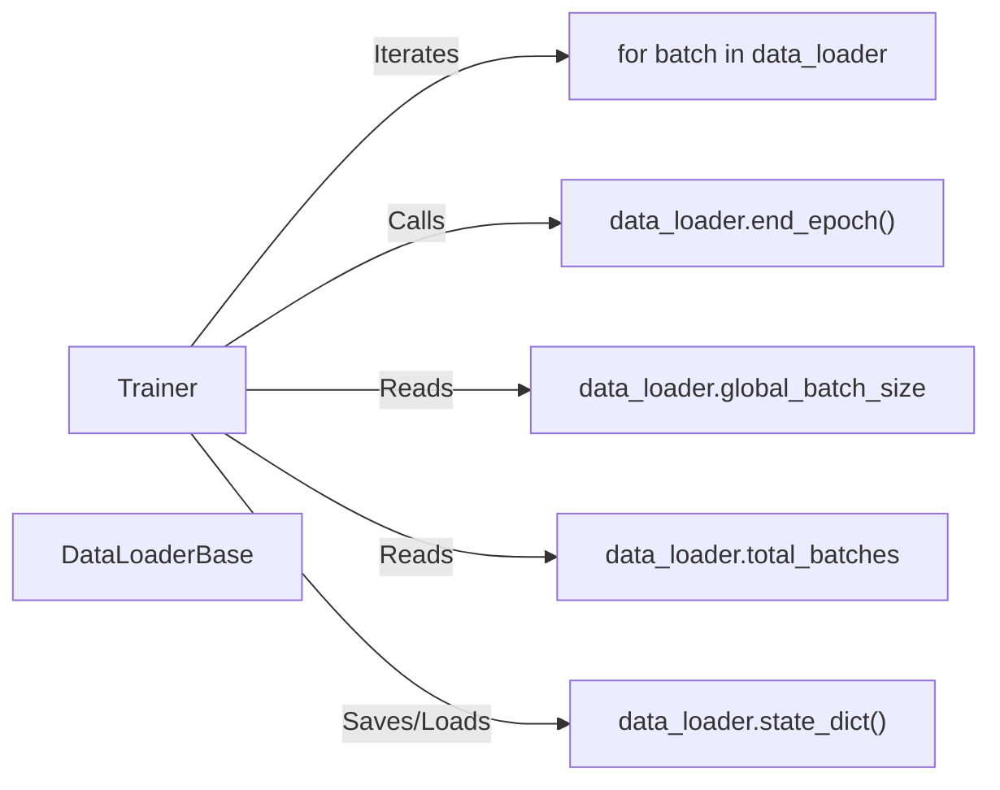

### Checkpointer Integration

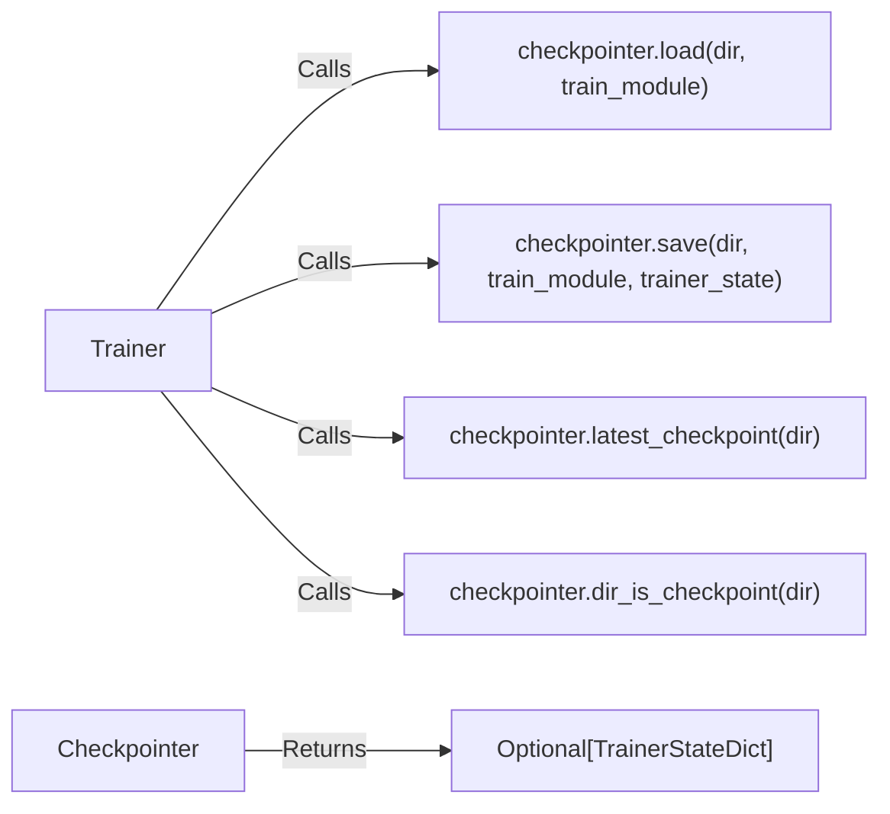

**Sources:** [src/olmo_core/train/trainer.py:628-907](), [src/olmo_core/train/trainer.py:1110-1265]()

---

