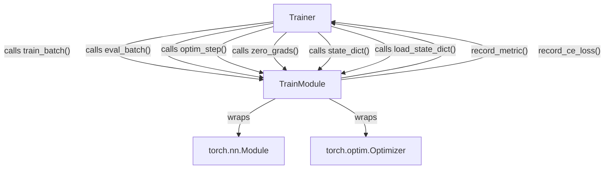
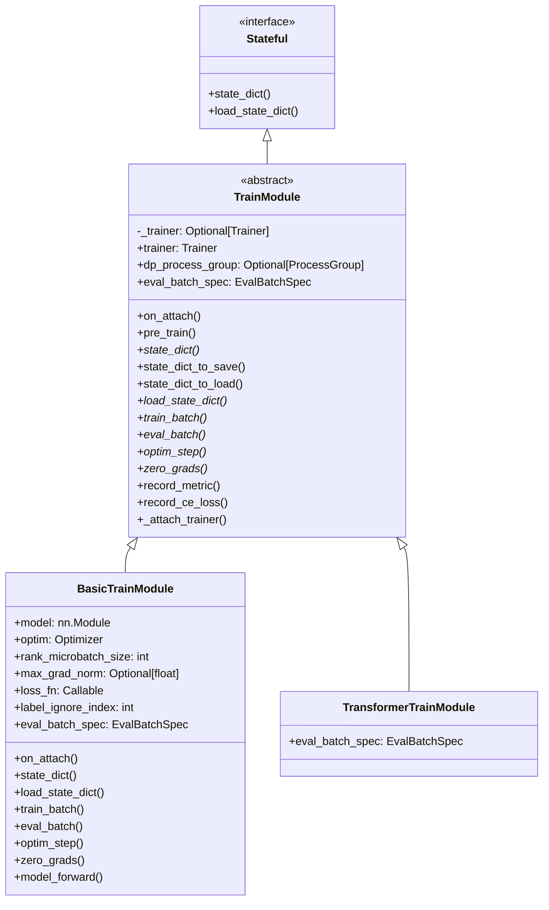
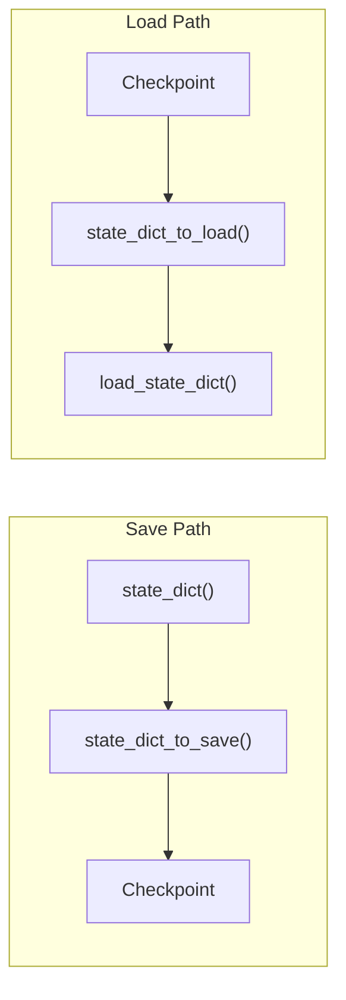
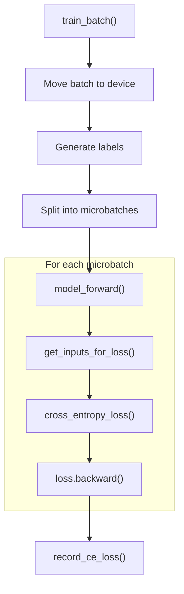
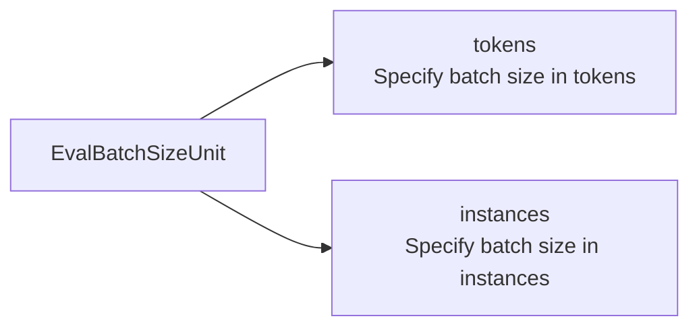
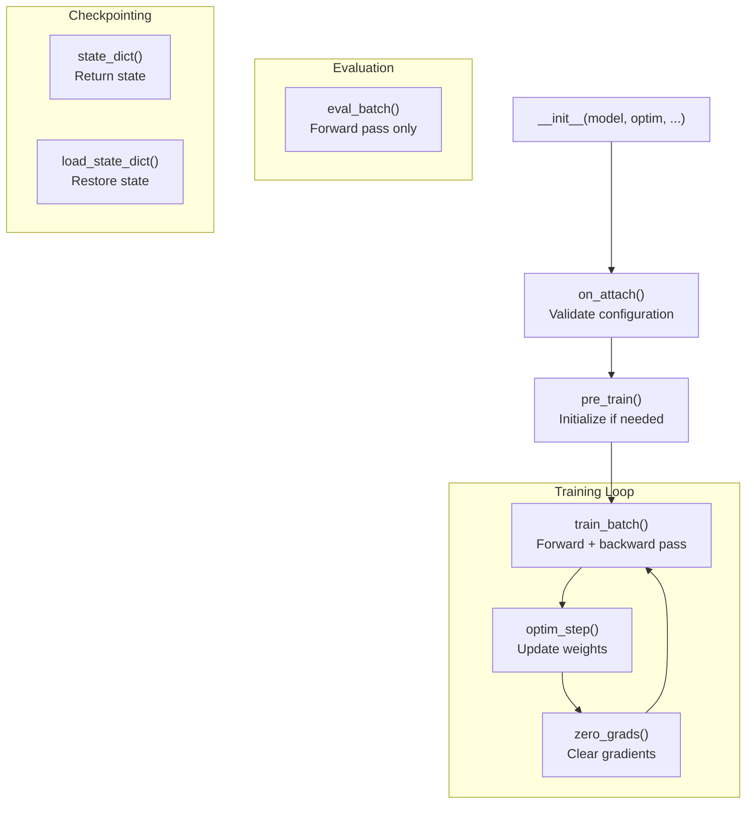

<!-- source: DeepWiki mcp.deepwiki.com · repo allenai/bolmo-core · page 3.2 Training Modules · fetched 2026-10-26 -->

# Training Modules

<details>
<summary>Relevant source files</summary>

The following files were used as context for generating this wiki page:

- [src/olmo_core/train/callbacks/evaluator_callback.py](src/olmo_core/train/callbacks/evaluator_callback.py)
- [src/olmo_core/train/train_module/train_module.py](src/olmo_core/train/train_module/train_module.py)

</details>


## Purpose and Scope

This document explains the `TrainModule` abstraction, which wraps a model and optimizer to provide a unified API for the `Trainer`. Training modules are responsible for executing forward/backward passes, optimizer steps, metric recording, and state management for checkpointing.

For information about the `Trainer` that orchestrates training modules, see [Trainer](#3.1). For information about optimizer implementations, see [Optimizers](#3.4). For information about callbacks that extend training functionality, see [Callbacks](#3.3).

---

## Core Concepts

### TrainModule Abstraction

A `TrainModule` encapsulates a `torch.nn.Module` and a `torch.optim.Optimizer` to provide a unified interface for training. This abstraction allows the `Trainer` to remain agnostic to specific training paradigms, model architectures, and optimization strategies.

The key responsibilities of a `TrainModule` are:

| Responsibility | Description |
|---------------|-------------|
| **Batch Processing** | Execute forward and backward passes on training batches |
| **Optimizer Management** | Handle optimizer steps and gradient zeroing |
| **State Management** | Provide state dictionaries for checkpointing |
| **Metric Recording** | Record training metrics like loss and gradient norms |
| **Evaluation** | Execute forward passes on evaluation batches |
| **Configuration** | Define evaluation batch specifications |

**Sources:** [src/olmo_core/train/train_module/train_module.py:72-84]()

### Relationship to Trainer



**Diagram: TrainModule and Trainer Interaction**

The `Trainer` calls methods on the `TrainModule` to drive the training loop, while the `TrainModule` calls back to the `Trainer` to record metrics.

**Sources:** [src/olmo_core/train/train_module/train_module.py:72-225]()

---

## TrainModule Base Class

### Class Hierarchy



**Diagram: TrainModule Class Hierarchy**

**Sources:** [src/olmo_core/train/train_module/train_module.py:72-389]()

### Abstract Methods

All `TrainModule` implementations must define these abstract methods:

| Method | Signature | Purpose |
|--------|-----------|---------|
| `eval_batch_spec` | `@property` → `EvalBatchSpec` | Define how evaluation batches should be sized |
| `state_dict` | `(optim: Optional[bool])` → `Dict[str, Any]` | Return state dictionary for checkpointing |
| `load_state_dict` | `(state_dict: Dict[str, Any])` → `None` | Load state from dictionary |
| `train_batch` | `(batch: Dict[str, Any], dry_run: bool)` | Execute forward/backward pass on training batch |
| `eval_batch` | `(batch: Dict[str, Any], labels: Optional[Any])` → `Any` | Execute forward pass on evaluation batch |
| `optim_step` | `()` | Run optimizer step |
| `zero_grads` | `()` | Zero out gradients |

**Sources:** [src/olmo_core/train/train_module/train_module.py:110-193]()

### Properties

#### trainer

Provides access to the attached `Trainer` instance. This property can only be accessed after the trainer has been attached via `_attach_trainer()`.

```python
@property
def trainer(self) -> "Trainer":
    if self._trainer is None:
        raise RuntimeError("trainer has not yet been assigned the train module")
    return self._trainer
```

**Sources:** [src/olmo_core/train/train_module/train_module.py:89-99]()

#### dp_process_group

Should return the data parallel process group if it differs from the default process group. This is used by the `Trainer` to correctly reduce metrics and synchronize across data parallel ranks.

**Sources:** [src/olmo_core/train/train_module/train_module.py:102-107]()

### Lifecycle Hooks

#### on_attach()

Called immediately after the `Trainer` has been attached to the `TrainModule`. This is where validation of configuration (e.g., batch sizes) should occur.

**Sources:** [src/olmo_core/train/train_module/train_module.py:119-122]()

#### pre_train()

Called before the training loop starts, after `pre_train()` has been called on all callbacks. This can be used for initialization that depends on the trainer being fully set up.

**Sources:** [src/olmo_core/train/train_module/train_module.py:124-128]()

### State Management



**Diagram: State Dict Flow**

The `TrainModule` provides three methods for state management:

- **`state_dict(optim: Optional[bool])`**: Returns the base state dictionary. If `optim=False`, optimizer state is excluded.
- **`state_dict_to_save(optim: Optional[bool])`**: Can be overridden if the state to save differs from the state to load. By default, calls `state_dict()`.
- **`state_dict_to_load(metadata: Metadata, optim: Optional[bool])`**: Can be overridden to handle topology-agnostic loading. By default, calls `state_dict()`.

**Sources:** [src/olmo_core/train/train_module/train_module.py:131-158]()

### Metric Recording

The `TrainModule` provides convenience methods to record metrics:

#### record_metric()

```python
def record_metric(
    self,
    name: str,
    value: Union[float, torch.Tensor],
    reduce_type: Optional[ReduceType] = None,
    namespace: Optional[str] = None,
    merge_strategy: MetricMergeStrategy = MetricMergeStrategy.warn,
):
```

Records a metric by delegating to `Trainer.record_metric()`.

**Sources:** [src/olmo_core/train/train_module/train_module.py:195-212]()

#### record_ce_loss()

```python
def record_ce_loss(
    self, value: Union[float, torch.Tensor], reduce_type: Optional[ReduceType] = None
):
```

Convenience method specifically for recording cross-entropy loss.

**Sources:** [src/olmo_core/train/train_module/train_module.py:214-220]()

---

## BasicTrainModule

`BasicTrainModule` is a straightforward implementation of `TrainModule` that demonstrates the essential patterns. It is primarily used for testing and as a reference implementation.

### Constructor Parameters

| Parameter | Type | Description |
|-----------|------|-------------|
| `model` | `nn.Module` | The model to train |
| `optim` | `Optimizer` | The optimizer |
| `rank_microbatch_size` | `int` | Microbatch size in tokens per rank for gradient accumulation |
| `max_grad_norm` | `Optional[float]` | Maximum gradient norm for clipping (default: `None`) |
| `label_ignore_index` | `int` | Index to ignore in loss computation (default: `-100`) |

**Sources:** [src/olmo_core/train/train_module/train_module.py:227-257]()

### Training Flow



**Diagram: BasicTrainModule Training Flow**

**Sources:** [src/olmo_core/train/train_module/train_module.py:298-355]()

### Gradient Accumulation

The `BasicTrainModule` implements gradient accumulation by splitting each batch into microbatches based on `rank_microbatch_size`. The key implementation details:

1. **Batch Splitting**: The batch is split such that each microbatch contains `rank_microbatch_size // seq_len` instances.
2. **Loss Reduction**: Uses `"sum"` reduction and divides by the total number of tokens across all microbatches to avoid bias when microbatches have different sizes.
3. **Gradient Accumulation**: Gradients accumulate across microbatches since `optim.zero_grad()` is not called between microbatches.

**Sources:** [src/olmo_core/train/train_module/train_module.py:310-346]()

### Optimizer Step

The `optim_step()` method implements gradient clipping and optimizer stepping:

```python
def optim_step(self):
    # Maybe clip gradients.
    if self.max_grad_norm is not None:
        grad_norm = nn.utils.clip_grad_norm_(self.model.parameters(), self.max_grad_norm)
        self.trainer.record_metric(
            "total grad norm", grad_norm, reduce_type=None, namespace="optim"
        )
    
    # Step optimizer.
    self.optim.step()
```

Note that the gradient norm is already reduced over ranks by PyTorch, so `reduce_type=None` is used.

**Sources:** [src/olmo_core/train/train_module/train_module.py:372-382]()

### State Dict Structure

The `BasicTrainModule` uses PyTorch's distributed checkpoint APIs for state management:

```python
def state_dict(self, *, optim: Optional[bool] = None) -> Dict[str, Any]:
    sd_options = dist_cp_sd.StateDictOptions(full_state_dict=False, cpu_offload=True)
    state_dict: Dict[str, Any] = {
        "model": dist_cp_sd.get_model_state_dict(self.model, options=sd_options),
    }
    if optim is not False:
        state_dict["optim"] = dist_cp_sd.get_optimizer_state_dict(
            self.model, self.optim, options=sd_options
        )
    return state_dict
```

Key features:
- Uses `full_state_dict=False` for distributed checkpointing (each rank only saves its shard)
- Uses `cpu_offload=True` to reduce GPU memory pressure
- Conditionally includes optimizer state based on the `optim` parameter

**Sources:** [src/olmo_core/train/train_module/train_module.py:275-296]()

---

## TransformerTrainModule

While the full implementation is not shown in the provided files, `TransformerTrainModule` is a more sophisticated implementation designed specifically for transformer models. It is used by evaluation callbacks and provides enhanced functionality beyond `BasicTrainModule`.

### Usage in Evaluation

The `EvaluatorCallback` requires a `TransformerTrainModule`:

```python
def post_attach(self):
    if not isinstance(self.trainer.train_module, TransformerTrainModule):
        raise OLMoConfigurationError(
            f"'{self.__class__.__name__}' only suports the '{TransformerTrainModule.__name__}' train module"
        )
```

**Sources:** [src/olmo_core/train/callbacks/evaluator_callback.py:90-94]()

### Evaluation Batch Handling

The `TransformerTrainModule` provides a more sophisticated `eval_batch()` method that returns structured output:

```python
output = self.trainer.train_module.eval_batch(batch, labels=labels)
assert isinstance(output, LMOutputWithLoss)
logits, _, ce_loss, _ = output
```

This returns an `LMOutputWithLoss` tuple containing logits and unreduced cross-entropy loss, which is used by evaluators to compute metrics.

**Sources:** [src/olmo_core/train/callbacks/evaluator_callback.py:131-133]()

---

## Evaluation Batch Specification

### EvalBatchSpec

The `EvalBatchSpec` dataclass defines how evaluation batches should be constructed:

```python
@dataclass
class EvalBatchSpec:
    rank_batch_size: int
    batch_size_unit: EvalBatchSizeUnit = EvalBatchSizeUnit.tokens
    max_sequence_length: Optional[int] = None
    fixed_sequence_length: bool = False
```

| Field | Type | Description |
|-------|------|-------------|
| `rank_batch_size` | `int` | Size of eval batches per rank |
| `batch_size_unit` | `EvalBatchSizeUnit` | Unit for `rank_batch_size` (tokens or instances) |
| `max_sequence_length` | `Optional[int]` | Maximum allowed sequence length |
| `fixed_sequence_length` | `bool` | Whether all batches have fixed sequence length |

**Sources:** [src/olmo_core/train/train_module/train_module.py:41-69]()

### EvalBatchSizeUnit



**Diagram: EvalBatchSizeUnit Options**

The `EvalBatchSizeUnit` enum determines how `rank_batch_size` is interpreted:

- **`tokens`**: The batch size is specified in total tokens
- **`instances`**: The batch size is specified in number of instances/examples

**Sources:** [src/olmo_core/train/train_module/train_module.py:26-38]()

### Usage in Evaluation Callbacks

Evaluation callbacks use `eval_batch_spec` to determine how to construct evaluation batches:

```python
batch_spec = trainer.train_module.eval_batch_spec

global_eval_batch_size: int
if batch_spec.batch_size_unit == EvalBatchSizeUnit.tokens:
    global_eval_batch_size = batch_spec.rank_batch_size * get_world_size(
        trainer.dp_process_group
    )
elif batch_spec.batch_size_unit == EvalBatchSizeUnit.instances:
    global_eval_batch_size = (
        batch_spec.rank_batch_size
        * dataset_max_sequence_length
        * get_world_size(trainer.dp_process_group)
    )
```

**Sources:** [src/olmo_core/train/callbacks/evaluator_callback.py:261-273]()

---

## Implementation Guide

### Creating a Custom TrainModule

To implement a custom `TrainModule`, follow these steps:

1. **Inherit from TrainModule**: Subclass the `TrainModule` base class
2. **Implement Abstract Methods**: Define all required abstract methods
3. **Initialize Model and Optimizer**: Store references in `__init__`
4. **Validate Configuration**: Use `on_attach()` to validate batch sizes and other configuration
5. **Handle State Management**: Implement `state_dict()` and `load_state_dict()` for checkpointing
6. **Record Metrics**: Use `record_metric()` and `record_ce_loss()` during training

### Minimal Example Structure



**Diagram: TrainModule Implementation Flow**

**Sources:** [src/olmo_core/train/train_module/train_module.py:72-389]()

### Key Considerations

1. **Batch Size Validation**: Ensure global batch size is divisible by `rank_microbatch_size * dp_world_size` in `on_attach()`.
2. **Loss Reduction**: When using gradient accumulation, use sum reduction and normalize by total tokens to avoid bias.
3. **Metric Reduction**: Specify appropriate `reduce_type` when recording metrics (e.g., `ReduceType.mean` for per-token loss).
4. **State Dict Options**: Use `full_state_dict=False` and `cpu_offload=True` for efficient distributed checkpointing.
5. **Gradient Clipping**: Remember that gradient norms returned by `clip_grad_norm_` are already reduced over ranks.

**Sources:** [src/olmo_core/train/train_module/train_module.py:227-389]()

---

