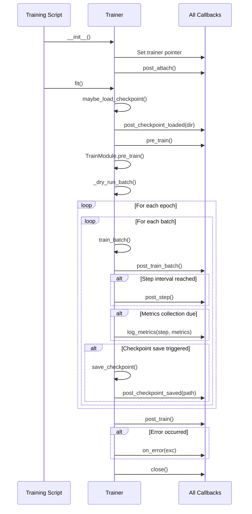

<!-- source: DeepWiki mcp.deepwiki.com · repo allenai/bolmo-core · page 3.3 Callbacks · fetched 2026-10-26 -->

# Callbacks

<details>
<summary>Relevant source files</summary>

The following files were used as context for generating this wiki page:

- [CHANGELOG.md](CHANGELOG.md)
- [src/olmo_core/io.py](src/olmo_core/io.py)
- [src/olmo_core/train/__init__.py](src/olmo_core/train/__init__.py)
- [src/olmo_core/train/callbacks/checkpointer.py](src/olmo_core/train/callbacks/checkpointer.py)
- [src/olmo_core/train/callbacks/evaluator_callback.py](src/olmo_core/train/callbacks/evaluator_callback.py)
- [src/olmo_core/train/common.py](src/olmo_core/train/common.py)
- [src/olmo_core/train/config.py](src/olmo_core/train/config.py)
- [src/olmo_core/train/train_module/train_module.py](src/olmo_core/train/train_module/train_module.py)
- [src/olmo_core/train/trainer.py](src/olmo_core/train/trainer.py)
- [src/olmo_core/version.py](src/olmo_core/version.py)
- [src/test/conftest.py](src/test/conftest.py)
- [src/test/io_test.py](src/test/io_test.py)
- [src/test/launch/beaker_test.py](src/test/launch/beaker_test.py)

</details>


This page documents the callback system in OLMo-Core's training framework. Callbacks provide a flexible mechanism for extending and customizing the training loop without modifying the core `Trainer` class. They enable functionality such as checkpointing, logging, evaluation, and custom training behaviors through well-defined hook methods.

For information about the `Trainer` class itself, see [3.1](#3.1). For checkpoint management specifically, see [5.3](#5.3).

---

## Purpose and Architecture

Callbacks implement an observer pattern where multiple callback objects can hook into different points of the training lifecycle. The `Trainer` maintains a dictionary of named callbacks and invokes their hook methods at specific points during training, allowing modular extensions to the training loop.

Sources: [src/olmo_core/train/trainer.py:142-145](), [src/olmo_core/train/__init__.py:1-14]()

### Callback Integration with Trainer

```mermaid
graph TB
    Trainer[Trainer]
    CallbackDict["callbacks: Dict[str, Callback]"]
    
    subgraph "Callback Lifecycle Hooks"
        PostAttach["post_attach()"]
        PreTrain["pre_train()"]
        PostTrainBatch["post_train_batch()"]
        PostStep["post_step()"]
        LogMetrics["log_metrics()"]
        PostCheckpointSaved["post_checkpoint_saved()"]
        PostCheckpointLoaded["post_checkpoint_loaded()"]
        OnError["on_error()"]
        PostTrain["post_train()"]
        Close["close()"]
    end
    
    subgraph "Default Callbacks"
        ConsoleLogger["ConsoleLoggerCallback"]
        Checkpointer["CheckpointerCallback"]
        SpeedMonitor["SpeedMonitorCallback"]
        GarbageCollector["GarbageCollectorCallback"]
    end
    
    subgraph "Optional Callbacks"
        Evaluator["EvaluatorCallback"]
        WandB["WandBCallback"]
        Comet["CometCallback"]
        Beaker["BeakerCallback"]
        Slack["SlackNotifierCallback"]
        GAP["GAPMonitorCallback"]
    end
    
    Trainer --> CallbackDict
    CallbackDict --> ConsoleLogger
    CallbackDict --> Checkpointer
    CallbackDict --> SpeedMonitor
    CallbackDict --> GarbageCollector
    CallbackDict --> Evaluator
    CallbackDict --> WandB
    CallbackDict --> Comet
    CallbackDict --> Beaker
    CallbackDict --> Slack
    CallbackDict --> GAP
    
    ConsoleLogger -.implements.-> PostAttach
    ConsoleLogger -.implements.-> PreTrain
    ConsoleLogger -.implements.-> LogMetrics
    
    Checkpointer -.implements.-> PreTrain
    Checkpointer -.implements.-> PostTrainBatch
    Checkpointer -.implements.-> PostTrain
    
    Evaluator -.implements.-> PostAttach
    Evaluator -.implements.-> PreTrain
    Evaluator -.implements.-> PostStep
```



Sources: [src/olmo_core/train/trainer.py:322-342](), [src/olmo_core/train/trainer.py:376-377](), [CHANGELOG.md:17-19]()

---

## Callback Base Class

All callbacks inherit from the `Callback` base class and have access to the `Trainer` instance through the `self.trainer` property. Callbacks can also define a `priority` class variable to control their execution order relative to other callbacks.

### Key Properties

| Property | Type | Description |
|----------|------|-------------|
| `trainer` | `Trainer` | Reference to the trainer instance |
| `priority` | `int` (class var) | Controls callback ordering (lower = earlier) |
| `step` | `int` | Current training step (via `self.trainer.global_step`) |

Callbacks are sorted by `(priority, name)` to ensure consistent execution order across all ranks in distributed training.

Sources: [src/olmo_core/train/trainer.py:338-342](), [src/olmo_core/train/callbacks/checkpointer.py:61]()

---

## Callback Lifecycle

The following diagram shows when each callback hook is invoked during the training process:



Sources: [src/olmo_core/train/trainer.py:628-726](), [src/olmo_core/train/trainer.py:854]()

### Hook Methods

| Hook Method | When Called | Common Uses |
|-------------|-------------|-------------|
| `post_attach()` | After callback is attached to trainer | Initialization, validation |
| `pre_train()` | Before training loop starts | Setup, initial checkpointing |
| `post_train_batch()` | After each training batch | Per-batch actions, incremental saves |
| `post_step()` | After completing a step | Periodic evaluations, logging |
| `log_metrics(step, metrics)` | When metrics are collected | Logging to W&B, Comet, console |
| `post_checkpoint_saved(path)` | After checkpoint saved | Notifications, metadata saving |
| `post_checkpoint_loaded(dir)` | After checkpoint loaded | State restoration |
| `on_error(exc)` | When training encounters error | Error notifications, cleanup |
| `post_train()` | After training completes | Final checkpointing, summary |
| `close()` | Always at exit (even on error) | Resource cleanup, finalization |

Sources: [src/olmo_core/train/trainer.py:376-377](), [src/olmo_core/train/trainer.py:690-726](), [CHANGELOG.md:83]()

---

## Built-in Callbacks

### Default Callbacks

These callbacks are automatically added if not explicitly configured:

#### ConsoleLoggerCallback

Logs training metrics to the console at regular intervals. Uses `metrics_log_interval` parameter to control frequency.

Sources: [src/olmo_core/train/trainer.py:322-326]()

#### CheckpointerCallback

Manages checkpoint saving and removal during training.

**Key Features:**
- Saves permanent checkpoints at `save_interval` 
- Optionally saves ephemeral checkpoints at `ephemeral_save_interval` (removed when new checkpoint saved)
- Supports async checkpointing with separate CPU backend
- Configurable removal strategy for old checkpoints

**Configuration:**

| Field | Type | Default | Description |
|-------|------|---------|-------------|
| `save_interval` | `int` | 250 | Steps between permanent checkpoints |
| `ephemeral_save_interval` | `Optional[int]` | None | Steps between temporary checkpoints |
| `save_async` | `Optional[bool]` | Auto | Enable async checkpointing |
| `remove` | `CheckpointRemovalStrategy` | ephemeral_only | Old checkpoint removal strategy |
| `pre_train_checkpoint` | `Optional[bool]` | Auto | Save checkpoint before training |

**Removal Strategies:**
- `ephemeral_only`: Only remove ephemeral checkpoints
- `all_non_permanent`: Remove all non-permanent checkpoints
- `never`: Never remove old checkpoints

Sources: [src/olmo_core/train/callbacks/checkpointer.py:49-274](), [src/olmo_core/train/trainer.py:327-328]()

#### SpeedMonitorCallback

Tracks training throughput metrics like batches per second and tokens per second.

Sources: [src/olmo_core/train/trainer.py:329-330]()

#### GarbageCollectorCallback

Manages Python garbage collection to prevent memory buildup during training.

Sources: [src/olmo_core/train/trainer.py:331-332](), [CHANGELOG.md:45-46]()

### Evaluation Callbacks

#### EvaluatorCallback

Runs in-loop evaluations periodically during training. Supports custom `Evaluator` implementations.

**Key Features:**
- Runs multiple evaluators in sequence
- Supports both LM evaluation and downstream tasks
- Configurable evaluation frequency and duration
- Optional result saving to disk

**Configuration:**

| Field | Type | Default | Description |
|-------|------|---------|-------------|
| `evaluators` | `List[Evaluator]` | [] | List of evaluators to run |
| `eval_interval` | `int` | 1000 | Steps between evaluations |
| `eval_on_startup` | `bool` | False | Run evaluation before training |
| `cancel_after_first_eval` | `bool` | False | Cancel run after first eval |
| `eval_duration` | `Duration` | epochs(1) | How long to run each evaluator |
| `save_results` | `bool` | False | Save per-example results |

Sources: [src/olmo_core/train/callbacks/evaluator_callback.py:48-229]()

#### LMEvaluatorCallbackConfig

Configuration builder for language model evaluation on padded FSL datasets.

Sources: [src/olmo_core/train/callbacks/evaluator_callback.py:232-301]()

#### DownstreamEvaluatorCallbackConfig

Configuration builder for downstream task evaluation (MCQA, classification, etc.) using `olmo-eval` tasks.

Sources: [src/olmo_core/train/callbacks/evaluator_callback.py:437-505]()

### Logging Callbacks

#### WandBCallback

Logs metrics and artifacts to Weights & Biases.

Sources: [CHANGELOG.md:522]()

#### CometCallback

Logs metrics and artifacts to Comet.ml. Supports auto-resume for continuing existing runs.

Sources: [CHANGELOG.md:182](), [CHANGELOG.md:390]()

#### BeakerCallback

Saves configuration and requirements to Beaker results dataset.

Sources: [CHANGELOG.md:108](), [CHANGELOG.md:267]()

#### SlackNotifierCallback

Sends Slack notifications for training events and checkpoints.

Sources: [CHANGELOG.md:59-60](), [CHANGELOG.md:284]()

### Monitoring Callbacks

#### GAPMonitorCallback

Monitors gradients, activations, and parameters during training for debugging and analysis.

Sources: [CHANGELOG.md:17]()

#### ProfilerCallback

Profiles the training loop using PyTorch's profiler module for performance analysis.

Sources: [CHANGELOG.md:482]()

---

## Creating Custom Callbacks

To create a custom callback, subclass `Callback` and override the desired hook methods:

```python
from olmo_core.train.callbacks import Callback

class MyCustomCallback(Callback):
    priority = 10  # Optional: control execution order
    
    def __init__(self, config_param: int):
        super().__init__()
        self.config_param = config_param
    
    def post_attach(self):
        """Called when callback is attached to trainer."""
        # Validate configuration
        if self.trainer.global_batch_size < self.config_param:
            raise ValueError("Invalid configuration")
    
    def pre_train(self):
        """Called before training starts."""
        print(f"Starting training with {self.trainer.max_steps} steps")
    
    def post_step(self):
        """Called after each training step."""
        if self.step % 100 == 0:
            # Do something every 100 steps
            pass
    
    def log_metrics(self, step: int, metrics: Dict[str, torch.Tensor]):
        """Called when metrics are collected."""
        # Log metrics to your custom backend
        pass
    
    def close(self):
        """Always called at exit, even on error."""
        # Clean up resources
        pass
```

### Callback Configuration Classes

For callbacks that need complex configuration, create a `CallbackConfig` subclass:

```python
from dataclasses import dataclass
from olmo_core.train.callbacks import CallbackConfig

@dataclass
class MyCustomCallbackConfig(CallbackConfig):
    config_param: int
    enabled: bool = True
    
    def build(self, trainer: "Trainer") -> Optional[Callback]:
        if not self.enabled:
            return None
        return MyCustomCallback(config_param=self.config_param)
```

This allows callbacks to be configured declaratively and built lazily after the trainer is constructed.

Sources: [src/olmo_core/train/callbacks/evaluator_callback.py:232-301](), [src/olmo_core/train/config.py:180-199]()

---

## Callback Configuration

### Adding Callbacks to Trainer

Callbacks can be added in several ways:

**1. Through TrainerConfig dictionary:**

```python
trainer_config = TrainerConfig(
    save_folder="./checkpoints",
    callbacks={
        "my_callback": MyCustomCallback(config_param=42),
        "wandb": WandBCallback(project="my-project"),
    }
)
```

**2. Using configuration builders:**

```python
trainer_config = TrainerConfig(
    save_folder="./checkpoints",
    callbacks={
        "evaluator": DownstreamEvaluatorCallbackConfig(
            tasks=["mmlu", "gsm8k"],
            tokenizer=tokenizer_config,
            eval_interval=1000,
        ),
    }
)
```

**3. Through helper methods:**

```python
trainer_config = trainer_config.with_callback(
    "my_callback", 
    MyCustomCallback(config_param=42)
)

trainer_config = trainer_config.with_recommended_evals(
    tokenizer=tokenizer_config,
    sequence_length=2048,
    cluster="jupiter",
    task_set="fast",
)
```

Sources: [src/olmo_core/train/config.py:56-90](), [src/olmo_core/train/config.py:92-134]()

### Callback Execution Order

Callbacks are executed in order determined by:
1. **Priority** (lower numbers first)
2. **Name** (alphabetically, for consistent ordering across ranks)

Default callback priorities:
- `CheckpointerCallback`: priority 1
- Most other callbacks: default priority (unspecified, typically 0 or comparable)

This ordering ensures that:
- Checkpointing happens early to capture state before other callbacks modify it
- Callback execution is deterministic and consistent across distributed ranks
- Callbacks making distributed synchronization calls execute in the same order

Sources: [src/olmo_core/train/trainer.py:338-342](), [src/olmo_core/train/callbacks/checkpointer.py:61]()

---

## Distributed Considerations

Callbacks must be aware of distributed training contexts:

### Rank-Aware Operations

Some operations should only run on specific ranks:

```python
from olmo_core.distributed.utils import get_rank, get_fs_local_rank

def post_checkpoint_saved(self, path: str):
    # Only rank 0 should upload metadata
    if get_rank() == 0:
        upload_metadata(path)
    
    # Only one rank per node should clean local cache
    if get_fs_local_rank() == 0:
        clear_local_cache()
```

### Collective Operations

Callbacks using collective operations must ensure all ranks participate:

```python
def post_train_batch(self):
    # This must be called from all ranks at the same point
    if self.step % self.interval == 0:
        # All ranks must participate in barrier/broadcast/etc
        self.trainer.run_bookkeeping_op(self._sync_operation)
```

### Async Bookkeeping

The trainer supports asynchronous bookkeeping operations when a CPU backend is available:

```python
def post_step(self):
    # Run operation asynchronously without blocking training
    self.trainer.run_bookkeeping_op(
        self._expensive_operation,
        op_name="my_operation",
        distributed=True,  # Requires collective communication
    )
```

Sources: [src/olmo_core/train/trainer.py:245-255](), [src/olmo_core/train/callbacks/checkpointer.py:158-176]()

---

## Common Patterns

### Conditional Execution

```python
def post_step(self):
    # Only run every N steps
    if self.step % self.interval != 0:
        return
    
    # Skip on first step
    if self.step <= 1:
        return
    
    self._perform_action()
```

### Recording Metrics

```python
def post_train_batch(self):
    value = compute_metric()
    
    # Record with automatic reduction across ranks
    self.trainer.record_metric(
        "my_metric",
        value,
        reduce_type=ReduceType.mean,  # Average across ranks
        namespace="custom",  # Optional namespace
    )
```

### State Persistence

```python
def state_dict(self) -> Dict[str, Any]:
    """Return state to save in checkpoint."""
    return {
        "counter": self.counter,
        "history": self.history,
    }

def load_state_dict(self, state_dict: Dict[str, Any]):
    """Restore state from checkpoint."""
    self.counter = state_dict["counter"]
    self.history = state_dict["history"]
```

Sources: [src/olmo_core/train/trainer.py:740-753](), [src/olmo_core/train/trainer.py:783-785]()

---

