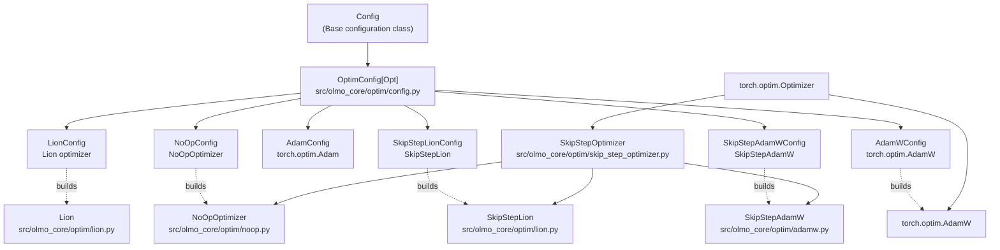
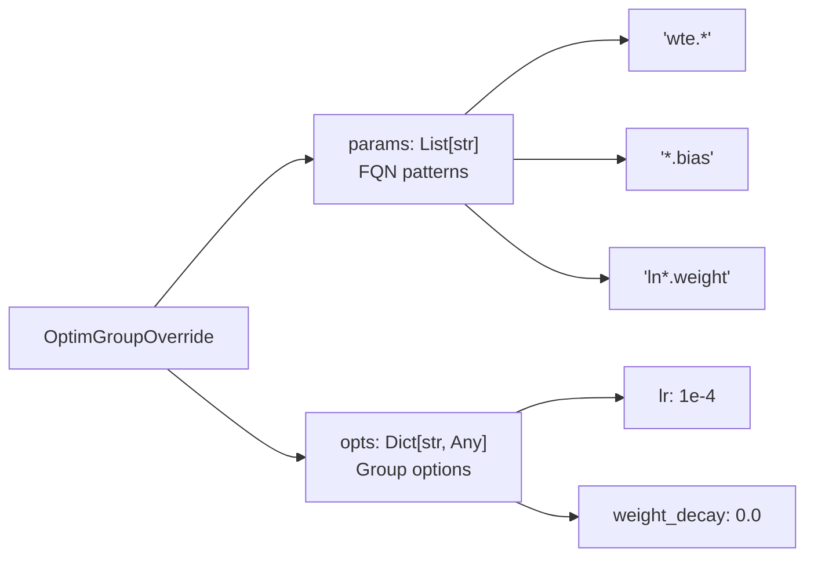
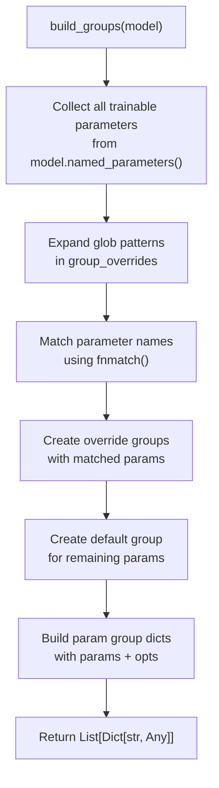
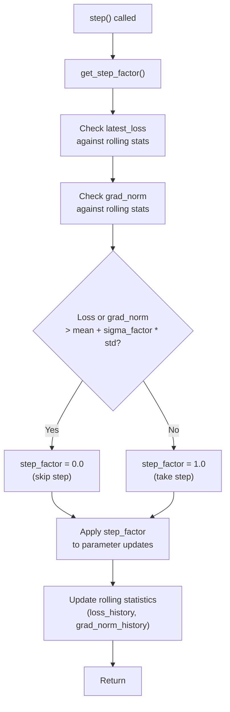
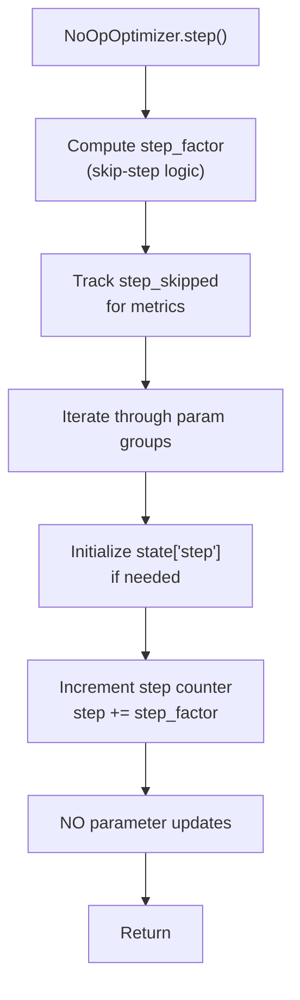
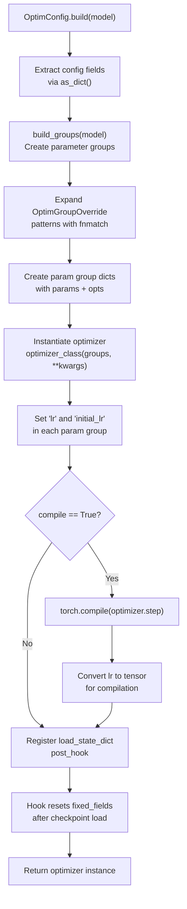
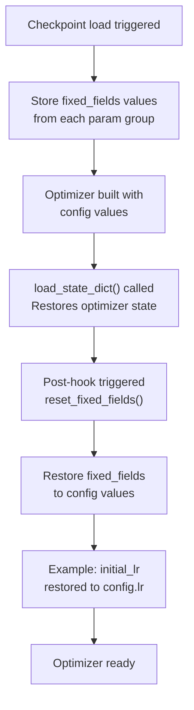

<!-- source: DeepWiki mcp.deepwiki.com · repo allenai/bolmo-core · page 3.4 Optimizers · fetched 2026-10-26 -->

# Optimizers

<details>
<summary>Relevant source files</summary>

The following files were used as context for generating this wiki page:

- [src/olmo_core/optim/__init__.py](src/olmo_core/optim/__init__.py)
- [src/olmo_core/optim/adamw.py](src/olmo_core/optim/adamw.py)
- [src/olmo_core/optim/config.py](src/olmo_core/optim/config.py)
- [src/olmo_core/optim/noop.py](src/olmo_core/optim/noop.py)
- [src/olmo_core/optim/scheduler.py](src/olmo_core/optim/scheduler.py)
- [src/olmo_core/train/callbacks/list_checkpointer.py](src/olmo_core/train/callbacks/list_checkpointer.py)
- [src/test/optim/adamw_test.py](src/test/optim/adamw_test.py)
- [src/test/optim/noop_test.py](src/test/optim/noop_test.py)
- [src/test/optim/scheduler_test.py](src/test/optim/scheduler_test.py)
- [src/test/optim/skip_step_optimizer_test.py](src/test/optim/skip_step_optimizer_test.py)

</details>


This page documents the optimizer system in OLMo-Core, covering optimizer configurations, parameter groups, standard optimizers (AdamW, Lion), skip-step optimizers for handling training instabilities, and the no-op optimizer for gathering statistics. For learning rate scheduling strategies, see [Learning Rate Schedulers](#3.5).

## Overview

The optimizer system in OLMo-Core follows a configuration-based pattern where optimizer settings are defined in dataclass configs that can build optimizer instances. All optimizer configurations inherit from `OptimConfig`, which provides common functionality for:

- Building parameter groups with per-group overrides
- Compiling optimizer steps for performance
- Managing fixed fields that persist across checkpoint loads
- Supporting distributed training with various parallelism strategies

**Optimizer Class Hierarchy**



Sources: [src/olmo_core/optim/config.py:54-224](), [src/olmo_core/optim/adamw.py:233-290](), [src/olmo_core/optim/noop.py:68-94]()

## OptimConfig Base Class

The `OptimConfig` class serves as the base for all optimizer configurations. It is a generic class parameterized by the optimizer type `Opt`.

**Key Responsibilities:**
- Building parameter groups with customizable overrides
- Instantiating optimizer instances via the `build()` method
- Managing optimizer compilation
- Handling fixed fields that should not be overridden during checkpoint loading

**Core Fields:**

| Field | Type | Default | Description |
|-------|------|---------|-------------|
| `group_overrides` | `Optional[List[OptimGroupOverride]]` | `None` | Parameter group overrides for custom learning rates or weight decay |
| `compile` | `bool` | `False` | Whether to compile the optimizer step (beta feature) |
| `fixed_fields` | `Tuple[str, ...]` | `(INITIAL_LR_FIELD,)` | Fields that persist across checkpoint loads |

**Abstract Methods:**

The `OptimConfig` class requires subclasses to implement:
- `optimizer()`: Returns the optimizer class type

Sources: [src/olmo_core/optim/config.py:54-81]()

## Parameter Groups and Overrides

Optimizer parameter groups allow different parameters to have different hyperparameters (e.g., different learning rates or weight decay values). This is commonly used to exclude biases and layer norms from weight decay, or to apply different learning rates to different layers.

**OptimGroupOverride Structure**



**Parameter Group Building Process:**



**Example Usage:**

```python
config = AdamWConfig(
    lr=1e-3,
    weight_decay=0.01,
    group_overrides=[
        OptimGroupOverride(
            params=["wte.*"],  # Embedding weights
            opts={"weight_decay": 0.0}
        ),
        OptimGroupOverride(
            params=["*.bias", "ln*.weight"],  # Biases and layer norms
            opts={"weight_decay": 0.0}
        )
    ]
)
```

The `build_groups()` method processes these overrides by:
1. Collecting all trainable parameters from the model
2. Expanding glob patterns using `fnmatch()` to match parameter names
3. Creating separate parameter groups for each override
4. Creating a default group for any parameters not matched by overrides

Sources: [src/olmo_core/optim/config.py:42-52](), [src/olmo_core/optim/config.py:86-152](), [src/test/optim/adamw_test.py:45-62]()

## Standard Optimizers

### AdamW

The `AdamWConfig` builds PyTorch's standard `torch.optim.AdamW` optimizer with decoupled weight decay.

**Configuration Fields:**

| Field | Type | Default | Description |
|-------|------|---------|-------------|
| `lr` | `float` | `1e-3` | Learning rate |
| `betas` | `Tuple[float, float]` | `(0.9, 0.999)` | Coefficients for computing running averages |
| `eps` | `float` | `1e-8` | Term added to denominator for numerical stability |
| `weight_decay` | `float` | `1e-2` | Weight decay coefficient (L2 penalty) |
| `foreach` | `Optional[bool]` | `None` | Use multi-tensor (foreach) implementation |
| `fused` | `Optional[bool]` | `None` | Use fused kernel implementation |

**Example:**

```python
config = AdamWConfig(
    lr=1e-3,
    betas=(0.9, 0.999),
    eps=1e-8,
    weight_decay=0.01
)
optimizer = config.build(model)
```

Sources: [src/olmo_core/optim/adamw.py:233-248](), [src/test/optim/adamw_test.py:33-43]()

### Lion Optimizer

The `LionConfig` builds the Lion optimizer, an alternative to AdamW that uses sign-based updates and often requires less memory.

Sources: [src/olmo_core/optim/__init__.py:4]()

## Skip-Step Optimizers

Skip-step optimizers automatically detect and skip training steps with abnormally high losses or gradient norms, helping to recover from training instabilities without manual intervention. This is particularly useful for large-scale pretraining where occasional spikes can derail training.

### SkipStepOptimizer Base Class

The `SkipStepOptimizer` class provides the core skip-step logic that tracks rolling statistics of loss and gradient norm to determine when to skip a step.

**Skip-Step Mechanism:**



**Key Methods and Properties:**

| Method/Property | Description |
|----------------|-------------|
| `latest_loss` | Property to set/get the current loss value (must be set before `step()`) |
| `latest_grad_norm` | Property to set/get the current gradient norm |
| `get_step_factor()` | Returns 0.0 if step should be skipped, 1.0 otherwise |
| `step_skipped` | Boolean tensor indicating whether the last step was skipped |

**Configuration Parameters:**

| Parameter | Type | Default | Description |
|-----------|------|---------|-------------|
| `rolling_interval_length` | `int` | `128` | Length of rolling window for computing statistics |
| `sigma_factor` | `int` | `6` | Number of standard deviations above mean to trigger skip |

The skip logic triggers when:
```
loss > mean(loss_history) + sigma_factor * std(loss_history)
OR
grad_norm > mean(grad_norm_history) + sigma_factor * std(grad_norm_history)
```

Sources: [src/olmo_core/optim/skip_step_optimizer.py]()

### SkipStepAdamW

`SkipStepAdamW` combines AdamW optimization with skip-step logic. It implements the AdamW algorithm using a `step_factor` that multiplies all updates, effectively zeroing them out when a step should be skipped.

**AdamW Update with Step Factor:**

The update rule applies `step_factor` to all components:
1. Weight decay: `p *= (1 - step_factor * lr * weight_decay)`
2. First moment: `exp_avg = lerp(exp_avg, grad, step_factor * (1 - beta1))`
3. Second moment: `exp_avg_sq = exp_avg_sq * (1 - step_factor * (1 - beta2)) + step_factor * grad^2 * (1 - beta2)`
4. Parameter update: `p += -step_size * exp_avg / sqrt(exp_avg_sq / bias_correction2) + eps * step_factor`

**Configuration Fields:**

| Field | Type | Default | Description |
|-------|------|---------|-------------|
| `lr` | `float` | `1e-3` | Learning rate |
| `betas` | `Tuple[float, float]` | `(0.9, 0.999)` | AdamW beta coefficients |
| `eps` | `float` | `1e-8` | Numerical stability term |
| `weight_decay` | `float` | `1e-2` | Weight decay coefficient |
| `dtype` | `Optional[DType]` | `None` | Data type for optimizer state (exp_avg, exp_avg_sq) |
| `foreach` | `bool` | `True` | Use multi-tensor foreach kernels (faster) |
| `step_increment_bugfix` | `bool` | `True` | Fix for step increment bug |
| `rolling_interval_length` | `int` | `128` | Rolling window length |
| `sigma_factor` | `int` | `6` | Standard deviations for skip threshold |

**Foreach Implementation:**

The `foreach=True` option uses PyTorch's multi-tensor kernels (`torch._foreach_*`) which process multiple tensors in a single kernel launch, providing significant speedups:

```python
# Instead of looping over parameters:
for p in params:
    p.mul_(1 - step_factor * lr * weight_decay)

# Foreach processes all at once:
torch._foreach_mul_(params, 1 - step_factor * (lr * weight_decay))
```

Sources: [src/olmo_core/optim/adamw.py:105-231](), [src/olmo_core/optim/adamw.py:252-290](), [src/test/optim/adamw_test.py:87-123]()

### Step Increment Bugfix

The `step_increment_bugfix` flag addresses a bug in early SkipStepAdamW implementations where the step counter was not incremented, causing:
- Effective learning rate 2.2x higher than specified
- No bias correction applied

When `step_increment_bugfix=True` (default), the step counter is correctly incremented with `step_factor`:
```python
step.add_(step_factor)
```

When `False`, maintains backward compatibility with the buggy behavior.

Sources: [src/olmo_core/optim/adamw.py:268-275](), [src/olmo_core/optim/adamw.py:46-47](), [src/olmo_core/optim/adamw.py:101-102]()

## NoOpOptimizer

The `NoOpOptimizer` is a special optimizer that performs no parameter updates but maintains all skip-step logic and statistics tracking. This is useful for:
- Gathering loss and gradient statistics without modifying parameters
- Testing skip-step thresholds
- Analyzing training stability without actually training

**Behavior:**



**Configuration:**

| Field | Type | Default | Description |
|-------|------|---------|-------------|
| `lr` | `float` | `1e-3` | Learning rate (unused, for compatibility) |
| `rolling_interval_length` | `int` | `128` | Rolling window length |
| `sigma_factor` | `int` | `6` | Standard deviations for skip threshold |

**Example:**

```python
config = NoOpConfig(
    rolling_interval_length=128,
    sigma_factor=6
)
optimizer = config.build(model)

# Use like a normal optimizer, but no updates occur
optimizer.zero_grad()
loss.backward()
optimizer.latest_loss = loss.detach()
optimizer.step()  # No parameter changes, but skip logic tracked
```

Sources: [src/olmo_core/optim/noop.py:10-66](), [src/olmo_core/optim/noop.py:68-94](), [src/test/optim/noop_test.py:86-111]()

## Optimizer Build Process

The complete flow from configuration to optimizer instance:



**Key Steps:**

1. **Extract Configuration:** Convert config to dictionary, removing special fields (`group_overrides`, `compile`, `fixed_fields`)

2. **Build Parameter Groups:** Process `group_overrides` to create separate parameter groups with custom hyperparameters

3. **Instantiate Optimizer:** Call the optimizer class constructor with parameter groups and hyperparameters

4. **Set Learning Rates:** 
   - Set `lr` field in each group (as float or tensor if compiling)
   - Set `initial_lr` to preserve the original learning rate

5. **Compile (Optional):** If `compile=True`, compile the optimizer's `step()` method using `torch.compile()`

6. **Register Hook:** Register a post-hook that resets `fixed_fields` after loading state from checkpoint

Sources: [src/olmo_core/optim/config.py:162-224]()

## Optimizer Compilation

Optimizer compilation uses PyTorch's `torch.compile()` to optimize the optimizer's `step()` method, potentially providing significant speedups. This is still a beta feature.

**How to Enable:**

```python
config = AdamWConfig(
    lr=1e-3,
    compile=True  # Enable compilation
)
optimizer = config.build(model)
```

**Important Considerations:**

1. **Learning Rate as Tensor:** When compiling, the learning rate must be a tensor rather than a float:
   ```python
   # Without compilation: group['lr'] = 1e-3  (float)
   # With compilation: group['lr'] = torch.tensor(1e-3)  (tensor)
   ```

2. **Checkpoint Compatibility:** Loading a checkpoint from a non-compiled run into a compiled run (or vice versa) can cause issues because the LR type changes between float and tensor.

3. **Beta Status:** Optimizer compilation is still in beta and may not work with all optimizers or parallelism strategies.

4. **Fixed Fields:** The `fixed_fields` mechanism ensures that critical fields like `initial_lr` are restored correctly after checkpoint loading.

Sources: [src/olmo_core/optim/config.py:65-74](), [src/olmo_core/optim/config.py:188-193](), [src/olmo_core/optim/config.py:213-215]()

## Checkpoint Loading and Fixed Fields

The `fixed_fields` mechanism ensures certain optimizer fields remain unchanged when loading from a checkpoint. By default, `initial_lr` is protected.

**Fixed Fields Post-Hook:**



**Why Fixed Fields Matter:**

1. **Learning Rate Schedules:** The `initial_lr` is used by schedulers to compute the current learning rate. If it gets overwritten by a checkpoint value, the schedule will be incorrect.

2. **Configuration Changes:** When resuming training with a modified config (e.g., changed learning rate), the fixed fields ensure the new values take effect.

3. **Compilation Compatibility:** When switching between compiled and non-compiled modes, fixed fields help maintain consistency.

**Implementation:**

```python
# During optimizer build:
fixed_fields_per_group = []
for group in optim.param_groups:
    fixed_fields = {}
    for k in self.fixed_fields:  # default: ('initial_lr',)
        if k in group:
            fixed_fields[k] = group[k]
    fixed_fields_per_group.append(fixed_fields)

# Register post-hook:
def reset_fixed_fields(opt: torch.optim.Optimizer):
    for fixed_fields, group in zip(fixed_fields_per_group, opt.param_groups):
        group.update(fixed_fields)

optim.register_load_state_dict_post_hook(reset_fixed_fields)
```

Sources: [src/olmo_core/optim/config.py:76-80](), [src/olmo_core/optim/config.py:179-223](), [src/test/optim/adamw_test.py:78-84]()

## Optimizer Equivalence Testing

The codebase includes extensive tests to ensure custom optimizers (like `SkipStepAdamW`) produce identical results to PyTorch's standard optimizers when skip logic is not triggered.

**Test Coverage:**

| Test | Purpose |
|------|---------|
| `test_adamw_equivalence` | Verifies SkipStepAdamW (both foreach and non-foreach) matches torch.optim.AdamW exactly |
| `test_noop_vs_zero_lr_adamw` | Verifies NoOpOptimizer produces same output as AdamW with lr=0 |
| `test_skip_step_optimizer` | Verifies skip logic triggers correctly for outlier losses |

The equivalence tests compare:
- Parameter values after each step
- Optimizer state (`exp_avg`, `exp_avg_sq`, `step`)
- Numerical precision (atol=1e-5, rtol=1e-7)

Sources: [src/test/optim/adamw_test.py:130-192](), [src/test/optim/noop_test.py:20-83](), [src/test/optim/skip_step_optimizer_test.py:23-52]()

## Usage in Training

Optimizers are typically configured and built as part of the `TrainModule` setup. See [Training Modules](#3.2) for details on how optimizers integrate with the training system.

**Typical Usage Pattern:**

```python
# Define optimizer config
optim_config = SkipStepAdamWConfig(
    lr=1e-3,
    betas=(0.9, 0.999),
    weight_decay=0.01,
    dtype=DType.bfloat16,
    foreach=True,
    rolling_interval_length=128,
    sigma_factor=6,
    group_overrides=[
        OptimGroupOverride(
            params=["wte.*", "*.bias"],
            opts={"weight_decay": 0.0}
        )
    ]
)

# Build optimizer from model
optimizer = optim_config.build(model)

# In training loop, set loss before step
optimizer.latest_loss = loss.detach()
optimizer.step()

# Check if step was skipped
if optimizer.step_skipped:
    log.info("Step skipped due to outlier loss")
```

Sources: [src/olmo_core/optim/__init__.py:1-48]()

---

