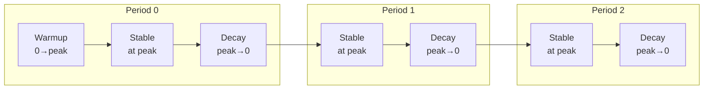
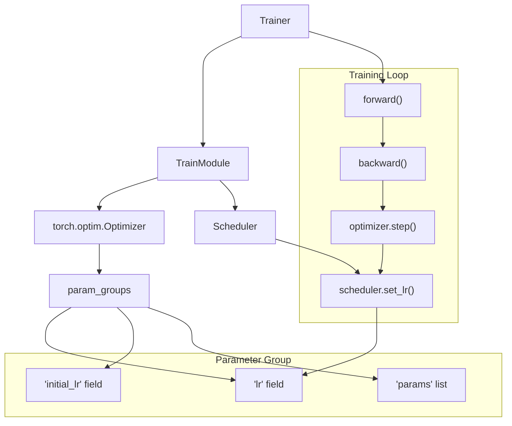

<!-- source: DeepWiki mcp.deepwiki.com · repo allenai/bolmo-core · page 3.5 Learning Rate Schedulers · fetched 2026-10-26 -->

# Learning Rate Schedulers

<details>
<summary>Relevant source files</summary>

The following files were used as context for generating this wiki page:

- [src/olmo_core/optim/__init__.py](src/olmo_core/optim/__init__.py)
- [src/olmo_core/optim/adamw.py](src/olmo_core/optim/adamw.py)
- [src/olmo_core/optim/config.py](src/olmo_core/optim/config.py)
- [src/olmo_core/optim/noop.py](src/olmo_core/optim/noop.py)
- [src/olmo_core/optim/scheduler.py](src/olmo_core/optim/scheduler.py)
- [src/olmo_core/train/callbacks/list_checkpointer.py](src/olmo_core/train/callbacks/list_checkpointer.py)
- [src/test/optim/adamw_test.py](src/test/optim/adamw_test.py)
- [src/test/optim/noop_test.py](src/test/optim/noop_test.py)
- [src/test/optim/scheduler_test.py](src/test/optim/scheduler_test.py)
- [src/test/optim/skip_step_optimizer_test.py](src/test/optim/skip_step_optimizer_test.py)

</details>


This document describes the learning rate scheduler system in OLMo-Core. Learning rate schedulers dynamically adjust the learning rate during training according to predefined schedules. The scheduler system supports warmup phases, various decay strategies, and specialized schedulers for continual pretraining scenarios.

For information about optimizers themselves, see [Optimizers](#3.4). For metrics tracking during training, see [Metrics and Logging](#3.6). For the overall training loop, see [Trainer](#3.1).

## Overview

The scheduler system is built around a `Scheduler` base class that defines the interface for computing learning rates at each training step or token count. Schedulers are configured as part of the `TrainModule` and are called after each optimizer step to update the learning rate in optimizer parameter groups.

All schedulers support two modes of operation:
- **Step-based**: Learning rate is computed based on training steps
- **Token-based**: Learning rate is computed based on tokens processed

Sources: [src/olmo_core/optim/scheduler.py:21-89]()

## Scheduler Architecture

```mermaid
graph TB
    Scheduler["Scheduler (base)"]
    
    subgraph "Simple Schedulers"
        ConstantScheduler["ConstantScheduler"]
        ConstantWithWarmup["ConstantWithWarmup"]
    end
    
    subgraph "Warmup + Decay"
        LinearWithWarmup["LinearWithWarmup"]
        InvSqrtWithWarmup["InvSqrtWithWarmup"]
        CosWithWarmup["CosWithWarmup"]
        HalfCosWithWarmup["HalfCosWithWarmup"]
    end
    
    subgraph "Advanced Schedulers"
        WSD["WSD<br/>(Warmup-Stable-Decay)"]
        WSDS["WSDS<br/>(for continual pretraining)"]
        CosWithWarmupAndLinearDecay["CosWithWarmupAndLinearDecay"]
        SequentialScheduler["SequentialScheduler"]
    end
    
    subgraph "Configuration"
        SchedulerUnits["SchedulerUnits<br/>steps | tokens"]
        Config["Config fields<br/>lr_field, initial_lr_field, units"]
    end
    
    Scheduler --> ConstantScheduler
    Scheduler --> ConstantWithWarmup
    Scheduler --> LinearWithWarmup
    Scheduler --> InvSqrtWithWarmup
    Scheduler --> CosWithWarmup
    Scheduler --> HalfCosWithWarmup
    Scheduler --> WSD
    Scheduler --> WSDS
    Scheduler --> CosWithWarmupAndLinearDecay
    Scheduler --> SequentialScheduler
    
    Scheduler --> SchedulerUnits
    Scheduler --> Config
```



**Scheduler Class Hierarchy**: All schedulers inherit from the `Scheduler` base class and implement the `get_lr()` method to compute learning rates. The system includes simple constant schedules, various warmup and decay strategies, and advanced schedulers for continual pretraining scenarios.

Sources: [src/olmo_core/optim/scheduler.py:26-684](), [src/olmo_core/optim/__init__.py:6-18]()

## Base Scheduler Class

The `Scheduler` base class defines the core interface that all learning rate schedulers must implement.

### Key Methods

| Method | Purpose |
|--------|---------|
| `get_lr(initial_lr, current, t_max)` | Compute the learning rate given initial LR, current step/token count, and maximum steps/tokens |
| `set_lr(group, trainer)` | Update the learning rate on an optimizer parameter group based on trainer state |

### Configuration Fields

| Field | Type | Default | Description |
|-------|------|---------|-------------|
| `lr_field` | `str` | `"lr"` | The field name in optimizer param groups to update |
| `initial_lr_field` | `str` | `"initial_lr"` | The field name storing the initial learning rate |
| `units` | `SchedulerUnits` | `steps` | Whether to use steps or tokens for scheduling |

The `set_lr()` method automatically determines whether to use `trainer.global_step` or `trainer.global_train_tokens_seen` based on the `units` configuration.

Sources: [src/olmo_core/optim/scheduler.py:26-89](), [src/olmo_core/optim/config.py:37-38]()

## Scheduler Variants

### Constant Schedulers

#### ConstantScheduler

A no-op scheduler that maintains a constant learning rate throughout training.

```python
scheduler = ConstantScheduler()
```

Sources: [src/olmo_core/optim/scheduler.py:91-102]()

#### ConstantWithWarmup

Maintains a constant learning rate after a linear warmup phase.

```python
scheduler = ConstantWithWarmup(
    warmup=3000,           # warmup for 3000 steps
    warmup_min_lr=0.0,     # start from 0
)
# or use fraction of total training
scheduler = ConstantWithWarmup(
    warmup_fraction=0.03,  # warmup for 3% of training
    warmup_min_lr=0.0,
)
```

**Configuration:**
- `warmup` or `warmup_fraction`: Length of warmup (exactly one must be specified)
- `warmup_min_lr`: Starting learning rate during warmup

Sources: [src/olmo_core/optim/scheduler.py:104-145]()

### Linear and Inverse Square Root Decay

#### LinearWithWarmup

Linear warmup followed by linear decay to a minimum learning rate.

```python
scheduler = LinearWithWarmup(
    warmup=1000,
    alpha_f=0.1,          # decay to 10% of peak LR
    warmup_min_lr=0.0,
)
```

**Configuration:**
- `warmup` or `warmup_fraction`: Warmup period
- `alpha_f`: Final learning rate as fraction of initial LR
- `t_max`: Optional override for maximum steps (defaults to trainer's max)
- `warmup_min_lr`: Starting learning rate

Sources: [src/olmo_core/optim/scheduler.py:239-289]()

#### InvSqrtWithWarmup

Linear warmup followed by inverse square root decay.

```python
scheduler = InvSqrtWithWarmup(
    warmup=3000,
    alpha_f=0.1,          # minimum LR = 10% of peak
    warmup_min_lr=0.0,
)
```

The learning rate follows: `lr = eta_min + (initial_lr - eta_min) * sqrt(warmup / current)` after warmup.

Sources: [src/olmo_core/optim/scheduler.py:291-334]()

### Cosine Schedulers

#### CosWithWarmup

Linear warmup followed by cosine decay.

```python
scheduler = CosWithWarmup(
    warmup=2000,
    alpha_f=0.1,          # decay to 10% of peak LR
    warmup_min_lr=0.0,
)
```

The learning rate follows a cosine curve: `lr = eta_min + (initial_lr - eta_min) * (1 + cos(π * t / T)) / 2`

Sources: [src/olmo_core/optim/scheduler.py:336-386]()

#### HalfCosWithWarmup

Uses only the second half of a cosine curve, with warmup before it. The peak LR specified should be for the full cosine schedule.

```python
scheduler = HalfCosWithWarmup(
    warmup=1000,
    alpha_f=0.1,
    warmup_min_lr=0.0,
)
```

Sources: [src/olmo_core/optim/scheduler.py:388-442]()

#### CosWithWarmupAndLinearDecay

Cosine decay that is cut short and followed by a linear decay phase. Useful for ending training with a smoother transition to the minimum learning rate.

```python
scheduler = CosWithWarmupAndLinearDecay(
    warmup=2000,
    alpha_f=0.1,
    decay=1000,           # final 1000 steps are linear decay
    decay_min_lr=0.0,
)
```

Sources: [src/olmo_core/optim/scheduler.py:444-486]()

### WSD: Warmup-Stable-Decay

The `WSD` scheduler implements a three-phase schedule with warmup, stable training at peak LR, and decay.

```python
scheduler = WSD(
    warmup=2000,          # warmup for 2000 steps
    decay=1000,           # decay for 1000 steps
    decay_min_lr=0.0,
    warmup_min_lr=0.0,
    decay_kind="linear",  # or "inv_sqrt"
)
```

**Phases:**
1. **Warmup**: Linear increase from `warmup_min_lr` to peak LR
2. **Stable**: Constant learning rate at peak LR
3. **Decay**: Linear or inverse square root decay to `decay_min_lr`

**Configuration:**
- `warmup` or `warmup_fraction`: Warmup period
- `decay` or `decay_fraction`: Decay period
- `decay_kind`: `"linear"` or `"inv_sqrt"`
- `decay_min_lr` or `decay_min_lr_ratio`: Target minimum LR
- `cosine_decay_alpha`: Parameter for inverse square root decay

Sources: [src/olmo_core/optim/scheduler.py:147-237]()

### WSDS: Warmup-Stable-Decay-Simplified

The `WSDS` scheduler is designed for continual pretraining with multiple training periods. It implements the Warmup-Stable-Decay-Simplified schedule from [arXiv:2410.05192](https://arxiv.org/abs/2410.05192).



**WSDS Multi-Period Schedule**: Each period has a stable phase at peak LR followed by decay to minimum LR. Only the first period includes warmup. The LR resets to peak at the start of each new period.

```python
scheduler = WSDS(
    period_lengths=[10000, 10000, 10000],  # three periods
    warmup=1000,                            # only in first period
    decay_fraction=0.1,                     # decay for 10% of each period
    warmup_min_lr=0.0,
    decay_min_lr=0.0,
)
```

**Key Features:**
- Only the first period includes warmup
- Each period ends with a decay phase
- Learning rate resets to peak at the start of each new period (after decay)
- Warmup is subtracted from the first period length when computing phases

**Implementation Details:**

The scheduler pre-computes adjusted period lengths by subtracting the warmup from the first period:
```
adjusted_periods = [period_0 - warmup, period_1, period_2, ...]
```

For any step `current`:
1. If in warmup phase: apply linear warmup
2. Otherwise, find which adjusted period the step falls in
3. Within each period:
   - If in stable phase: return peak LR
   - If in decay phase: apply linear decay to `decay_min_lr`

**Validation:**
- Warmup + decay must not exceed the first period length
- Decay must not exceed any individual period length
- All period lengths must be positive

Sources: [src/olmo_core/optim/scheduler.py:570-684]()

### SequentialScheduler

Chains multiple schedulers together, running them sequentially during training.

```python
scheduler = SequentialScheduler(
    schedulers=[
        InvSqrtWithWarmup(warmup=1000, alpha_f=0.5),
        CosWithWarmup(warmup=0),
        LinearWithWarmup(t_max=3000, warmup=0),
    ],
    schedulers_max=[2500, 4000],  # transition points
)
```

**Behavior:**
- The initial LR of each scheduler is set to the final LR of the previous scheduler
- The last scheduler runs until the end of training
- `schedulers_max` specifies when to switch between schedulers (excluding the last)

Sources: [src/olmo_core/optim/scheduler.py:508-568]()

## Learning Rate Curves

```mermaid
graph TB
    subgraph "ConstantWithWarmup"
        CW_Start["t=0<br/>LR=warmup_min_lr"]
        CW_Peak["t=warmup<br/>LR=peak"]
        CW_Stable["t>warmup<br/>LR=peak"]
        CW_Start --> CW_Peak --> CW_Stable
    end
    
    subgraph "LinearWithWarmup"
        LW_Start["t=0<br/>LR=warmup_min_lr"]
        LW_Peak["t=warmup<br/>LR=peak"]
        LW_Decay["t>warmup<br/>linear decay"]
        LW_End["t=t_max<br/>LR=alpha_f*peak"]
        LW_Start --> LW_Peak --> LW_Decay --> LW_End
    end
    
    subgraph "CosWithWarmup"
        COS_Start["t=0<br/>LR=warmup_min_lr"]
        COS_Peak["t=warmup<br/>LR=peak"]
        COS_Decay["t>warmup<br/>cosine decay"]
        COS_End["t=t_max<br/>LR=alpha_f*peak"]
        COS_Start --> COS_Peak --> COS_Decay --> COS_End
    end
    
    subgraph "WSD"
        WSD_Warmup["Warmup<br/>0→peak"]
        WSD_Stable["Stable<br/>at peak"]
        WSD_Decay["Decay<br/>peak→min"]
        WSD_Warmup --> WSD_Stable --> WSD_Decay
    end
```



**Learning Rate Trajectory Patterns**: Different schedulers produce different learning rate curves. All support warmup phases, but differ in their decay strategies: linear, cosine, inverse square root, or stable-then-decay patterns.

Sources: [src/olmo_core/optim/scheduler.py:1-684]()

## Integration with Training



**Scheduler Integration in Training Loop**: Schedulers interact with the optimizer's parameter groups to update learning rates after each optimizer step. The scheduler reads trainer state (step count or token count) and updates the `lr` field in each parameter group.

### Scheduler Execution

The scheduler's `set_lr()` method is called after each optimizer step:

1. **Read trainer state**: Get `trainer.global_step` or `trainer.global_train_tokens_seen`
2. **Compute new LR**: Call `get_lr(initial_lr, current, t_max)`
3. **Update param groups**: Set the `lr_field` in each optimizer parameter group

### Units: Steps vs Tokens

Schedulers support two units via the `SchedulerUnits` enum:

| Unit | Description | Trainer Field Used |
|------|-------------|-------------------|
| `steps` | Schedule based on training steps | `trainer.global_step` |
| `tokens` | Schedule based on tokens processed | `trainer.global_train_tokens_seen` |

When using token-based scheduling, `t_max` should be set to `trainer.max_tokens` instead of `trainer.max_steps`.

Sources: [src/olmo_core/optim/scheduler.py:46-89](), [src/olmo_core/optim/scheduler.py:21-24]()

## Configuration Examples

### Basic Cosine Schedule

```python
from olmo_core.optim import CosWithWarmup

scheduler = CosWithWarmup(
    warmup=2000,
    alpha_f=0.1,
    warmup_min_lr=0.0,
)
```

### Token-Based Scheduling

```python
from olmo_core.optim import LinearWithWarmup, SchedulerUnits

scheduler = LinearWithWarmup(
    warmup=10_000_000,      # 10M tokens warmup
    alpha_f=0.1,
    units=SchedulerUnits.tokens,
)
```

### WSD Schedule for Single Run

```python
from olmo_core.optim import WSD

scheduler = WSD(
    warmup_fraction=0.01,   # 1% warmup
    decay_fraction=0.1,     # 10% decay
    decay_min_lr=0.0,
    warmup_min_lr=0.0,
    decay_kind="linear",
)
```

### WSDS for Continual Pretraining

```python
from olmo_core.optim import WSDS

scheduler = WSDS(
    period_lengths=[100_000, 100_000, 100_000],  # three 100K step periods
    warmup=5_000,                                 # 5K steps warmup
    decay_fraction=0.1,                           # 10% decay per period
    warmup_min_lr=0.0,
    decay_min_lr=0.0,
)
```

This scheduler is particularly useful for continual pretraining scenarios where you want to train on multiple data distributions sequentially, resetting the learning rate at the start of each new distribution.

Sources: [src/olmo_core/optim/scheduler.py:1-684]()

## Optimizer Compilation and Schedulers

When using optimizer compilation (`compile=True` in optimizer config), the `lr` field in parameter groups becomes a `torch.Tensor` instead of a `float`. The scheduler's `set_lr()` method handles this automatically:

```python
if isinstance(current_lr := group.get(self.lr_field), torch.Tensor):
    current_lr.fill_(new_lr)
else:
    group[self.lr_field] = new_lr
```

This ensures compatibility with compiled optimizers while maintaining correct learning rate updates.

Sources: [src/olmo_core/optim/scheduler.py:83-87](), [src/olmo_core/optim/config.py:65-74]()

## Helper Functions

The scheduler module provides two internal helper functions for common operations:

| Function | Purpose |
|----------|---------|
| `_linear_warmup(initial_lr, current, warmup, warmup_min_lr)` | Compute linearly interpolated LR during warmup |
| `_linear_decay(initial_lr, step_from_end, decay, decay_min_lr)` | Compute linearly decaying LR based on steps remaining |

These are used by multiple scheduler implementations to ensure consistent warmup and decay behavior.

Sources: [src/olmo_core/optim/scheduler.py:488-506]()

## Testing

The scheduler system includes comprehensive tests covering:
- Correct learning rate computation at various training phases
- Warmup and decay behavior
- Sequential scheduler transitions
- WSDS multi-period behavior with validation
- Edge cases and configuration validation

Sources: [src/test/optim/scheduler_test.py:1-349]()

---

