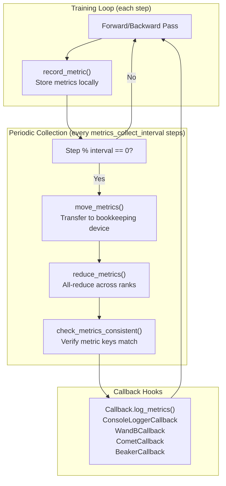
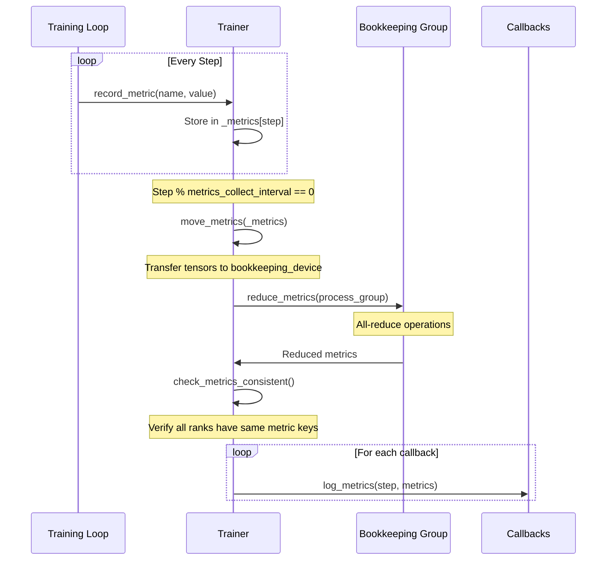
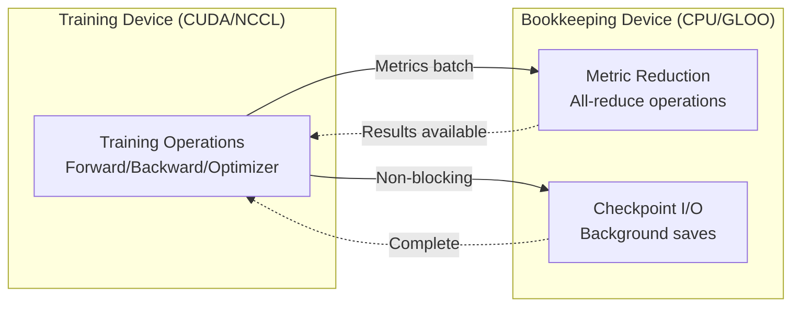
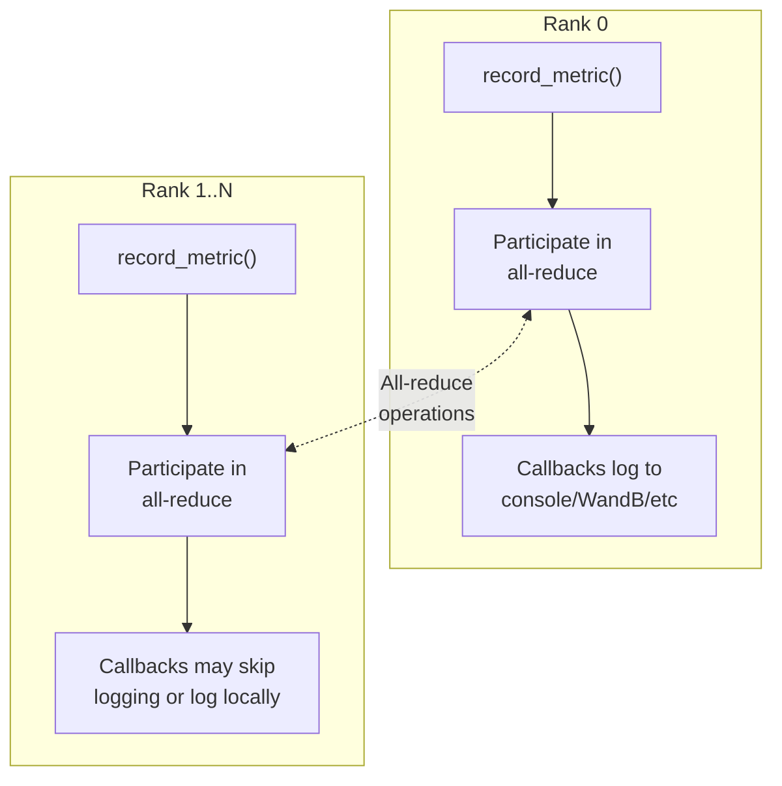

<!-- source: DeepWiki mcp.deepwiki.com · repo allenai/bolmo-core · page 3.6 Metrics and Logging · fetched 2026-10-26 -->

# Metrics and Logging

<details>
<summary>Relevant source files</summary>

The following files were used as context for generating this wiki page:

- [CHANGELOG.md](CHANGELOG.md)
- [src/olmo_core/train/__init__.py](src/olmo_core/train/__init__.py)
- [src/olmo_core/train/common.py](src/olmo_core/train/common.py)
- [src/olmo_core/train/config.py](src/olmo_core/train/config.py)
- [src/olmo_core/train/trainer.py](src/olmo_core/train/trainer.py)
- [src/olmo_core/version.py](src/olmo_core/version.py)

</details>


## Purpose and Scope

This page documents the metrics recording and logging system in OLMo-Core. The system provides facilities for recording training metrics, reducing them across distributed ranks, and logging them through various callback mechanisms. The design prioritizes throughput by batching metric collection and performing asynchronous reductions.

For information about the overall training lifecycle and callback system, see [Trainer](#3.1) and [Callbacks](#3.3). For distributed communication primitives used in metric reduction, see [Distributed Training](#5).

---

## Overview

The metrics and logging system is integrated into the `Trainer` class and operates through a three-stage pipeline:

1. **Recording**: Metrics are recorded during training steps and stored locally per rank
2. **Collection and Reduction**: Metrics are periodically collected, moved to the bookkeeping device, and reduced across ranks
3. **Logging**: Reduced metrics are passed to callback hooks where they can be logged to various destinations

This batched approach minimizes host-device synchronization and distributed communication overhead during training.



**Sources:** [src/olmo_core/train/trainer.py:189-206](), [src/olmo_core/train/trainer.py:278-279]()

---

## Metric Recording

### Recording Metrics

The `Trainer` class provides the `record_metric()` method for recording scalar metrics during training:

[src/olmo_core/train/trainer.py:1007-1085]()

**Key Parameters:**
- `name`: The metric name (string identifier)
- `value`: The metric value (float or torch.Tensor)
- `reduce_type`: How to reduce across ranks (optional, defaults to `ReduceType.mean`)
- `namespace`: Optional namespace prefix for the metric name
- `merge_strategy`: How to handle duplicate metrics in the same step

Metrics are stored in the trainer's internal `_metrics` dictionary, indexed by step number.

### Standard Metrics

The system defines several standard metric names:

| Metric Name | Constant | Description |
|-------------|----------|-------------|
| `train/CE loss` | `TRAIN_CE_LOSS_METRIC` | Cross-entropy loss |
| `train/PPL` | `TRAIN_PPL_METRIC` | Perplexity |
| `train/Z loss` | `TRAIN_Z_LOSS_METRIC` | Z-loss regularization |

**Sources:** [src/olmo_core/train/common.py:11-13]()

### Reduce Types

The `ReduceType` enum defines how metrics are aggregated across distributed ranks:

| Reduce Type | Behavior |
|-------------|----------|
| `mean` | Average the metric across all ranks |
| `sum` | Sum the metric across all ranks |
| `max` | Take the maximum value across all ranks |
| `l2_norm` | Correctly reduce L2 norms computed per-rank to produce global L2 norm |

**Sources:** [src/olmo_core/train/common.py:130-155]()

### Merge Strategies

When the same metric is recorded multiple times in a single step, the `MetricMergeStrategy` controls how duplicates are handled:

| Strategy | Behavior |
|----------|----------|
| `warn` | Emit a warning and keep the current value |
| `latest` | Use the most recently recorded value |
| `oldest` | Use the first recorded value |
| `mean` | Average the duplicate values |
| `sum` | Sum the duplicate values |
| `max` | Take the maximum of the duplicates |
| `min` | Take the minimum of the duplicates |

**Sources:** [src/olmo_core/train/common.py:157-196]()

---

## Metric Collection and Reduction

### Collection Interval

The trainer collects and reduces metrics every `metrics_collect_interval` steps (default: 5). This batching strategy improves throughput by reducing the frequency of host-device synchronization and distributed communication.



**Configuration:**

[src/olmo_core/train/trainer.py:189-206]()

Increasing `metrics_collect_interval` can improve throughput but delays metric visibility.

**Sources:** [src/olmo_core/train/trainer.py:189-206](), [src/olmo_core/train/trainer.py:1087-1144]()

### Asynchronous Bookkeeping

The trainer supports asynchronous metric reduction when a separate CPU-only backend (e.g., GLOO) is available:

- **`async_bookkeeping`**: Enable/disable async operations (default: auto-detected based on backend support)
- **`bookkeeping_device`**: CPU for async mode, otherwise the main training device
- **`bookkeeping_pg`**: Separate process group for bookkeeping collectives



When async bookkeeping is enabled, metric reduction happens on a separate thread using the CPU backend, allowing training to continue without blocking.

**Sources:** [src/olmo_core/train/trainer.py:245-255](), [src/olmo_core/train/trainer.py:520-529](), [src/olmo_core/train/trainer.py:346-357]()

### Metric Reduction Functions

The core reduction logic is implemented in utility functions:

**`move_metrics(metrics, device)`** [src/olmo_core/train/utils.py]()
- Transfers metric tensors from training device to bookkeeping device
- Handles conversion to float32 for numerical stability

**`reduce_metrics(metrics, reduce_types, process_group)`** [src/olmo_core/train/utils.py]()
- Performs all-reduce operations based on each metric's `ReduceType`
- Supports mean, sum, max, and L2 norm reductions

**`check_metrics_consistent(metrics, process_group)`** [src/olmo_core/train/utils.py]()
- Verifies that all ranks have recorded the same set of metric names
- Raises an error if inconsistencies are detected to prevent silent failures

**Sources:** [src/olmo_core/train/utils.py]() (referenced in trainer.py line 69)

---

## Logging Through Callbacks

### Callback Interface

Callbacks receive reduced metrics through the `log_metrics()` hook:

```python
def log_metrics(self, step: int, metrics: Dict[str, float]) -> None:
    """
    Called after metrics are collected and reduced.
    
    :param step: The training step
    :param metrics: Dictionary mapping metric names to values
    """
    pass
```

The callback system allows metrics to be logged to multiple destinations simultaneously.

### Built-in Logging Callbacks

| Callback | Purpose | Key Features |
|----------|---------|--------------|
| `ConsoleLoggerCallback` | Terminal output | Formatted console logging with configurable interval |
| `WandBCallback` | Weights & Biases | Cloud-based experiment tracking |
| `CometCallback` | Comet.ml | Experiment tracking with auto-resume support |
| `BeakerCallback` | Beaker platform | Saves config and metrics to Beaker results dataset |
| `SpeedMonitorCallback` | Throughput tracking | Records batches/sec, tokens/sec, MFU |
| `GAPMonitorCallback` | Gradient/activation/parameter stats | Monitors norms and distributions |

**Sources:** [CHANGELOG.md:17](), [src/olmo_core/train/callbacks.py]() (referenced in trainer.py imports)

### ConsoleLoggerCallback

The default console logger formats metrics for human-readable terminal output:

[src/olmo_core/train/callbacks.py]() (referenced in [src/olmo_core/train/trainer.py:322-326]())

**Configuration:**
- `metrics_log_interval`: How often to log to console (inherits from `Trainer.metrics_collect_interval` by default)

The console logger is automatically added if not present in the callbacks dictionary.

### SpeedMonitorCallback

Tracks training throughput and efficiency metrics:

- **Batches per second (BPS)**: Training steps per wall-clock second
- **Tokens per second**: Total tokens processed per second across all ranks
- **Model FLOPs Utilization (MFU)**: Percentage of theoretical peak FLOPs achieved

[src/olmo_core/train/callbacks.py]() (referenced in [src/olmo_core/train/trainer.py:329-330]())

The speed monitor maintains exponential moving averages of throughput metrics and is used internally by the trainer to estimate remaining training time.

**Sources:** [src/olmo_core/train/trainer.py:580-584]()

### GAPMonitorCallback

Added in v2.3.0, this callback monitors gradients, activations, and parameters during training:

- Tracks L2 norms
- Records distribution statistics (mean, std, min, max)
- Useful for debugging training instabilities

**Sources:** [CHANGELOG.md:17]()

---

## Integration with Distributed Training

### Rank-Specific Logging

In distributed training, metrics are recorded on all ranks but only logged from specific ranks:



Most callbacks implement rank-specific behavior, typically logging only from rank 0 to avoid duplicate entries in cloud services.

**Sources:** Inferred from distributed training patterns

### Metric Consistency Checking

The system verifies that all ranks record the same set of metrics at each step. This prevents silent failures where different ranks have diverged:

**`check_metrics_consistent()`** [src/olmo_core/train/utils.py]()
- Gathers metric names from all ranks
- Raises an error if any rank has a different set of metrics

This check can be optionally disabled via `Trainer._metrics_consistent` for performance if consistency is guaranteed by the training code.

**Sources:** [src/olmo_core/train/trainer.py:293](), [src/olmo_core/train/utils.py]() (referenced in trainer.py line 69)

---

## Configuration and Best Practices

### Optimal Metrics Collection Interval

The `metrics_collect_interval` parameter trades off between visibility and throughput:

| Interval | Visibility | Overhead |
|----------|------------|----------|
| 1 | Real-time | High (sync every step) |
| 5 (default) | Delayed by ~5 steps | Low |
| 10+ | Delayed significantly | Minimal |

**Recommendation**: Use the default value of 5 for most training runs. Increase to 10-20 for maximum throughput on very fast training loops (small models, large clusters).

**Sources:** [src/olmo_core/train/trainer.py:189-206]()

### Custom Metrics

Record custom metrics using `trainer.record_metric()`:

```python
# Example: Record gradient norm
grad_norm = torch.nn.utils.clip_grad_norm_(model.parameters(), max_norm=1.0)
trainer.record_metric("train/grad_norm", grad_norm, reduce_type=ReduceType.max)

# Example: Record per-layer statistics
for name, param in model.named_parameters():
    if param.grad is not None:
        trainer.record_metric(
            f"grad_norm/{name}",
            param.grad.norm(),
            reduce_type=ReduceType.l2_norm,
            namespace="debug"
        )
```

**Best Practices:**
- Use namespaces (`namespace="train"`, `namespace="eval"`) to organize related metrics
- Choose appropriate `ReduceType` for your metric semantics
- Avoid recording metrics that require expensive computation every step

**Sources:** [src/olmo_core/train/trainer.py:1007-1085]()

### Logging Configuration Example

Configure multiple logging destinations through callbacks:

```python
from olmo_core.train import TrainerConfig
from olmo_core.train.callbacks import WandBCallback, ConsoleLoggerCallback

trainer_config = TrainerConfig(
    save_folder="checkpoints/",
    metrics_collect_interval=5,
    callbacks={
        "console": ConsoleLoggerCallback(metrics_log_interval=5),
        "wandb": WandBCallback(
            project="my-project",
            name="experiment-001"
        ),
    }
)
```

**Sources:** [src/olmo_core/train/config.py:26-91]()

### Throughput Considerations

The metrics system is designed to minimize training overhead:

1. **Batched Collection**: Reduces host-device syncs by collecting multiple steps at once
2. **Async Bookkeeping**: Uses separate CPU backend when available to avoid blocking
3. **Lazy Tensor Movement**: Only moves tensors to bookkeeping device when needed
4. **Configurable Intervals**: Allows tuning the visibility/performance tradeoff

**Bookkeeping Timeout**: If bookkeeping operations take longer than `bookkeeping_soft_timeout` (default: 30 seconds), a warning is emitted. This helps identify performance bottlenecks.

**Sources:** [src/olmo_core/train/trainer.py:250-255]()

---

## Advanced Topics

### Manual Metric Logging

For advanced use cases, you can access the trainer's internal metrics directly:

[src/olmo_core/train/trainer.py:1146-1176]()

The `get_metric()`, `get_loss()`, and `get_zloss()` methods provide programmatic access to metric values.

### Metric Namespaces

Namespaces provide hierarchical organization of metrics:

```python
trainer.record_metric("loss", value, namespace="train")  # → "train/loss"
trainer.record_metric("loss", value, namespace="eval")   # → "eval/loss"
```

This allows the same metric name to be used in different contexts without conflicts.

**Sources:** [src/olmo_core/train/trainer.py:1007-1085]()

### Integration with Evaluators

The `EvaluatorCallback` automatically records evaluation metrics with the `"eval"` namespace, distinguishing them from training metrics. See [Callbacks](#3.3) for details on evaluation integration.

**Sources:** Referenced in [src/olmo_core/train/trainer.py:52]()

---

