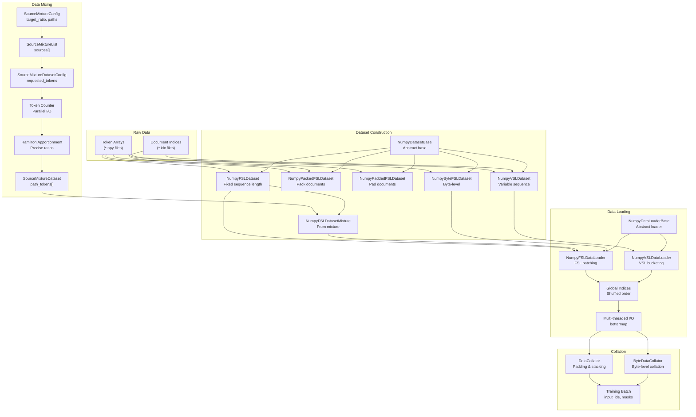
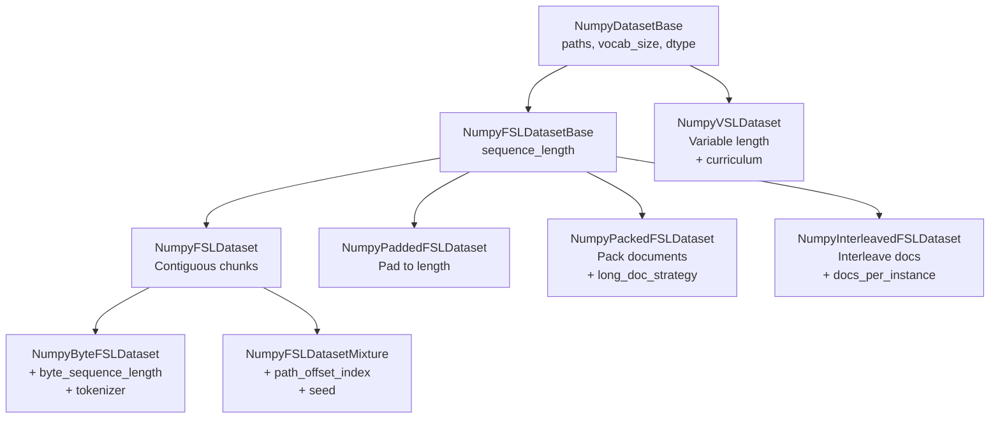
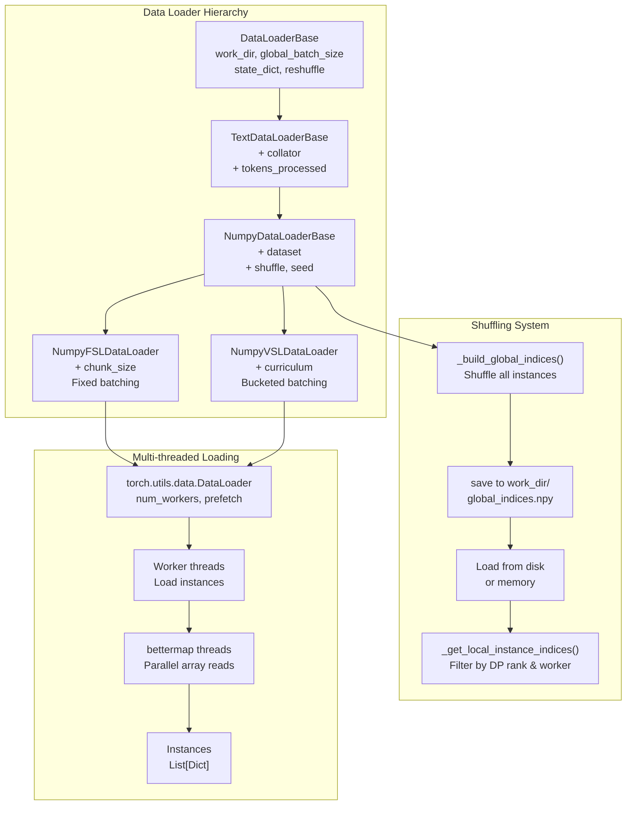
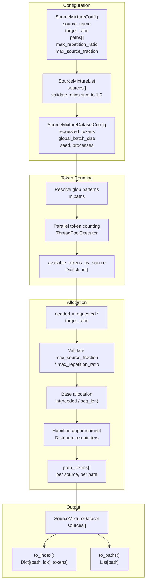

<!-- source: DeepWiki mcp.deepwiki.com · repo allenai/bolmo-core · page 4 Data Pipeline · fetched 2026-10-26 -->

# Data Pipeline

<details>
<summary>Relevant source files</summary>

The following files were used as context for generating this wiki page:

- [docs/source/guides/data_mixing.rst](docs/source/guides/data_mixing.rst)
- [src/olmo_core/data/__init__.py](src/olmo_core/data/__init__.py)
- [src/olmo_core/data/collator.py](src/olmo_core/data/collator.py)
- [src/olmo_core/data/data_loader.py](src/olmo_core/data/data_loader.py)
- [src/olmo_core/data/numpy_dataset.py](src/olmo_core/data/numpy_dataset.py)
- [src/olmo_core/data/source_mixture.py](src/olmo_core/data/source_mixture.py)
- [src/olmo_core/data/types.py](src/olmo_core/data/types.py)
- [src/olmo_core/distributed/parallel/data_parallel.py](src/olmo_core/distributed/parallel/data_parallel.py)
- [src/test/data/data_loader_test.py](src/test/data/data_loader_test.py)
- [src/test/data/fixtures.py](src/test/data/fixtures.py)
- [src/test/data/numpy_dataset_test.py](src/test/data/numpy_dataset_test.py)
- [src/test/data/source_mixture_test.py](src/test/data/source_mixture_test.py)

</details>


## Purpose and Scope

This document covers the data pipeline system that transforms raw tokenized data into training batches consumed by the Trainer. The pipeline handles dataset construction from numpy arrays, distributed data loading with deterministic shuffling, sophisticated data mixing across multiple sources, and batch collation with padding strategies.

For training system integration, see [Training System](#3). For model architecture details, see [Model Architecture](#2). For distributed training infrastructure, see [Distributed Training](#5).

## Overview

The data pipeline progresses through four main stages:

1. **Data Preparation**: Token IDs are stored in numpy arrays on disk (`.npy` files), with optional metadata files tracking document boundaries
2. **Data Mixing**: Multiple data sources are combined according to target ratios using Hamilton's apportionment method to achieve precise mixing
3. **Dataset Construction**: Arrays are wrapped by dataset classes that define how instances are formed (fixed-length chunks, packed documents, variable-length sequences, etc.)
4. **Batch Loading**: Distributed data loaders shuffle, sample, and collate instances into batches for training

Sources: [src/olmo_core/data/__init__.py:1-14](), [src/olmo_core/data/numpy_dataset.py:104-121]()

## Pipeline Architecture



Sources: [src/olmo_core/data/numpy_dataset.py:65-88](), [src/olmo_core/data/data_loader.py:38-45](), [src/olmo_core/data/source_mixture.py:20-24](), [src/olmo_core/data/collator.py:12]()

## Dataset Types

The pipeline supports multiple dataset types, each suited for different use cases:

### Dataset Class Hierarchy



Sources: [src/olmo_core/data/numpy_dataset.py:104-364](), [src/olmo_core/data/numpy_dataset.py:449-687](), [src/olmo_core/data/numpy_dataset.py:821-949]()

### NumpyDatasetBase

The abstract base class at [src/olmo_core/data/numpy_dataset.py:104-362]() defines the core interface:

| Property/Method | Purpose |
|----------------|---------|
| `paths: Tuple[PathOrStr, ...]` | Paths to numpy token arrays |
| `pad_token_id: int` | Padding token ID |
| `eos_token_id: int` | End-of-sequence token ID |
| `vocab_size: int` | Vocabulary size |
| `dtype: NumpyUIntTypes` | Array dtype (uint8/16/32/64) |
| `max_sequence_length: int` | Maximum sequence length |
| `fingerprint: str` | Content hash for reproducibility |
| `__len__() -> int` | Number of instances |
| `__getitem__(index) -> Dict` | Get instance by index |
| `prepare()` | Prepare dataset (pre-compute indices) |

Sources: [src/olmo_core/data/numpy_dataset.py:104-362]()

### Fixed Sequence Length Datasets

**NumpyFSLDataset** at [src/olmo_core/data/numpy_dataset.py:449-687]() chunks arrays into fixed-length sequences:
- Concatenates all arrays and splits into `sequence_length` chunks
- Discards remainder tokens that don't fit into a complete chunk
- No special tokens added (must be in source arrays)
- Supports `max_target_sequence_length` for sequence length warmup

**NumpyPaddedFSLDataset** at [src/olmo_core/data/numpy_dataset.py:1052-1347]() pads documents to `sequence_length`:
- Each document becomes a separate instance
- Pads short documents with `pad_token_id`
- Generates `label_mask` to exclude padding from loss
- Requires document indices via `prepare()`

**NumpyPackedFSLDataset** at [src/olmo_core/data/numpy_dataset.py:1350-1830]() packs multiple documents into instances:
- Fills each instance with complete documents
- Handles long documents via `LongDocStrategy` (truncate or fragment)
- Optionally groups documents by source with `source_group_size`
- Generates `label_mask` for packed boundaries

**NumpyInterleavedFSLDataset** at [src/olmo_core/data/numpy_dataset.py:1833-2212]() interleaves document chunks:
- Splits documents into chunks
- Interleaves chunks from multiple documents
- Configured with `docs_per_instance` and `chunks_per_doc`

Sources: [src/olmo_core/data/numpy_dataset.py:449-2212]()

### Variable Sequence Length Dataset

**NumpyVSLDataset** at [src/olmo_core/data/numpy_dataset.py:2289-2742]() supports variable-length instances:
- Each document is a separate instance (length = document length)
- Groups instances into buckets by length (powers of 2)
- Supports curriculum learning via `VSLCurriculum` classes
- Requires document indices pre-computed via `prepare()`

Curriculum types:
- `VSLNaturalCurriculum`: Natural document length distribution
- `VSLGrowthCurriculum`: Gradual increase in sequence length
- `VSLGrowP2Curriculum`: Power-of-2 bucket cycling
- `VSLGrowLinearCurriculum`: Linear length increase

Sources: [src/olmo_core/data/numpy_dataset.py:2289-2742](), [src/olmo_core/data/numpy_dataset.py:2215-2286]()

### Byte-Level Dataset

**NumpyByteFSLDataset** at [src/olmo_core/data/numpy_dataset.py:821-949]() extends `NumpyFSLDataset` for byte-level models:
- Reads subword token sequences
- Converts to byte sequences via `ByteTokenizer`
- Tracks patch lengths (bytes per subword token)
- Supports merge computation for compression
- Configured with `byte_sequence_length` and `tokenizer_config`

The conversion process at [src/olmo_core/data/numpy_dataset.py:688-819]():
1. Removes FIM tokens if present
2. Converts subword tokens to bytes via `tokenizer.get_tokens_and_patch_lengths()`
3. Computes space patch lengths
4. Truncates or pads to `byte_sequence_length`
5. Generates `patch_lens` tensor tracking byte boundaries

Sources: [src/olmo_core/data/numpy_dataset.py:688-949]()

## Data Loading

### Data Loader Architecture



Sources: [src/olmo_core/data/data_loader.py:52-257](), [src/olmo_core/data/data_loader.py:316-431](), [src/olmo_core/data/data_loader.py:644-805]()

### DataLoaderBase

The abstract base at [src/olmo_core/data/data_loader.py:52-257]() defines the data loader interface:

| Property/Method | Purpose |
|----------------|---------|
| `global_batch_size: int` | Total tokens per batch across all ranks |
| `dp_world_size: int` | Data parallel world size |
| `dp_rank: int` | Local data parallel rank |
| `batches_processed: int` | Batches processed in current epoch |
| `epoch: int` | Current epoch (1-based) |
| `total_batches: Optional[int]` | Total batches per epoch if known |
| `rank_batch_size: int` | Batch size per rank |
| `reshuffle(epoch)` | Shuffle for new epoch |
| `__iter__()` | Iterate over batches |
| `state_dict()` | Get checkpoint state |
| `load_state_dict(state)` | Restore from checkpoint |
| `reset()` | Reset epoch bookkeeping |

Sources: [src/olmo_core/data/data_loader.py:52-257]()

### NumpyDataLoaderBase

The base class for numpy datasets at [src/olmo_core/data/data_loader.py:316-642]() adds:

- **Deterministic shuffling**: Global instance order is shuffled once per epoch based on `seed + epoch`, saved to disk as `global_indices.npy`
- **Distributed sampling**: Global indices are partitioned by DP rank and worker ID
- **State management**: Fingerprint validation ensures checkpoint/dataset consistency
- **Multi-threading**: Configurable via `num_threads` for array reads and `num_workers` for batch loading

Key methods:
- `_build_global_indices()` at [src/olmo_core/data/data_loader.py:477-481](): Creates shuffled instance order
- `_get_local_instance_indices()` at [src/olmo_core/data/data_loader.py:483-488](): Filters to local rank's subset
- `build_and_save_global_indices()` at [src/olmo_core/data/data_loader.py:501-524](): Writes shuffle to disk

Sources: [src/olmo_core/data/data_loader.py:316-642]()

### NumpyFSLDataLoader

Fixed sequence length loader at [src/olmo_core/data/data_loader.py:644-803]():

**Batching logic**:
1. Compute instances per batch: `global_batch_size // dataset.sequence_length`
2. Reshape global indices to `(num_batches, instances_per_batch)`
3. Skip already processed batches: `indices[batches_processed:]`
4. Partition by worker: `indices[worker_id::num_workers]`
5. Partition by DP rank: `indices[:, dp_rank::dp_world_size]`

**Chunk size support**: The `chunk_size` parameter enables sequence length warmup by treating `chunk_size` consecutive instances as a unit during shuffling, maintaining document order within chunks.

Sources: [src/olmo_core/data/data_loader.py:644-803]()

### NumpyVSLDataLoader

Variable sequence length loader at [src/olmo_core/data/data_loader.py:805-999]():

**Bucket-based batching**:
1. Dataset groups instances into buckets by length
2. Shuffle instances within each bucket
3. Sample batches that fill `global_batch_size` tokens
4. Apply curriculum to control bucket sampling order

**Curriculum scheduling**: The `step()` method at [src/olmo_core/data/data_loader.py:883-923]() advances the curriculum, potentially changing which buckets are sampled and their relative weights.

Sources: [src/olmo_core/data/data_loader.py:805-999]()

## Data Mixing

### Source Mixture System



Sources: [src/olmo_core/data/source_mixture.py:29-124](), [src/olmo_core/data/source_mixture.py:239-455]()

### SourceMixtureConfig

Defines a single data source at [src/olmo_core/data/source_mixture.py:29-124]():

| Field | Purpose |
|-------|---------|
| `source_name: str` | Identifier for the source |
| `target_ratio: float` | Fraction of total tokens from this source (0 < ratio ≤ 1) |
| `paths: List[str]` | File paths or glob patterns |
| `max_repetition_ratio: float` | Allow upsampling (default 1.0 = no repeats) |
| `max_source_fraction: float` | Limit fraction of source used (default 1.0 = all) |

The `resolved_paths` property at [src/olmo_core/data/source_mixture.py:80-123]() expands globs and validates file existence.

Sources: [src/olmo_core/data/source_mixture.py:29-124]()

### SourceMixtureDatasetConfig

Orchestrates mixture construction at [src/olmo_core/data/source_mixture.py:239-455]():

**Token counting** at [src/olmo_core/data/source_mixture.py:290-303]():
- Parallel file size queries via `ThreadPoolExecutor`
- Converts bytes to tokens: `file_size // dtype.itemsize`

**Allocation algorithm** at [src/olmo_core/data/source_mixture.py:305-407]():
1. Compute needed tokens per source: `needed = requested_tokens * target_ratio`
2. Validate capacity: `max_tokens = population * max_source_fraction * max_repetition_ratio`
3. Raise error if `max_tokens < needed`
4. Allocate base instances: `base = needed // sequence_length`
5. Apply Hamilton's method to distribute remainder instances proportionally
6. Ensure final allocations respect `max_tokens` constraints

**Repetition handling** at [src/olmo_core/data/source_mixture.py:474-494]():
- When `take_ratio > 1.0`, split into full passes plus fractional pass
- Each path is repeated up to `max_repetition_ratio` times

Sources: [src/olmo_core/data/source_mixture.py:239-494]()

### NumpyFSLDatasetMixture

Consumes the mixture at [src/olmo_core/data/numpy_dataset.py:951-1049]():

**Construction**:
- Takes `path_offset_index: Dict[(path, idx), tokens]` from `SourceMixtureDataset.to_index()`
- Builds cumulative offsets for instance indexing
- Shuffles according to `seed` while respecting path token limits

**Instance retrieval**:
- Maps global instance index to (path, local_index) pair
- Reads from appropriate array at correct offset
- Applies token limit from path_offset_index

Sources: [src/olmo_core/data/numpy_dataset.py:951-1049]()

## Collation

### DataCollator

The default collator at [src/olmo_core/data/collator.py:24-159]() batches instances:

**Processing steps**:
1. Determine max length across instances
2. Pad `input_ids` to max length (left or right via `pad_direction`)
3. Pad optional fields: `attention_mask`, `attention_bias`, `label_mask`, `doc_lens`
4. Stack all tensors along batch dimension
5. Preserve `metadata` as list

**Padding configuration**:
- `pad_token_id: int` - Token used for padding
- `pad_direction: PaddingDirection` - Left or right padding
- `label_ignore_index: int` - Value for masked positions (default -100)

Output batch keys:
- `input_ids: Tensor[B, L]` - Padded token IDs
- `attention_mask: Tensor[B, L]` - Optional attention mask
- `attention_bias: Tensor[B, 1, L, L]` - Optional attention bias
- `label_mask: Tensor[B, L]` - Optional label mask
- `doc_lens: Tensor[B, D]` - Optional document lengths
- `metadata: List[Dict]` - Optional metadata per instance

Sources: [src/olmo_core/data/collator.py:24-159]()

### ByteDataCollator

Extends `DataCollator` for byte-level data at [src/olmo_core/data/collator.py:162-259]():

**Additional fields**:
- `original_input_ids: Tensor[B, P]` - Subword token sequences
- `expanded_input_ids: Tensor[B, L]` - Expanded byte IDs
- `patch_lens: Tensor[B, P]` - Bytes per patch
- `space_patch_lens: Tensor[B, P]` - Space-aware patch lengths
- `bpe_merges: Tensor[B, M]` - BPE merge indices

The byte collator pads both the byte-level sequences (to max byte length) and patch-level sequences (to max patch length) across the batch.

Sources: [src/olmo_core/data/collator.py:162-259]()

## Configuration Builders

### Dataset Configuration

All dataset types have corresponding config builders that inherit from `NumpyDatasetConfigBase`:

**NumpyFSLDatasetConfig** at [src/olmo_core/data/numpy_dataset.py:2745-2995]():
```python
@dataclass
class NumpyFSLDatasetConfig(Config):
    paths: Optional[List[PathOrStr]] = None
    sequence_length: int
    tokenizer: TokenizerConfig
    metadata: Optional[Union[List[Dict], Dict]] = None
    generate_doc_lengths: bool = False
    max_target_sequence_length: Optional[int] = None
    source_mixture_config: Optional[SourceMixtureDatasetConfig] = None
    # ... additional fields
    
    def build(self) -> NumpyFSLDatasetBase:
        # Constructs dataset from paths or source mixture
```

**Factory methods**:
- `from_src_mix()` at [src/olmo_core/data/numpy_dataset.py:2876-2922](): Build from `SourceMixtureDatasetConfig`
- `glob()` at [src/olmo_core/data/numpy_dataset.py:2945-2966](): Build from glob pattern

Sources: [src/olmo_core/data/numpy_dataset.py:2745-3627]()

### Data Loader Configuration

**NumpyDataLoaderConfig** at [src/olmo_core/data/data_loader.py:1002-1153]():
```python
@dataclass
class NumpyDataLoaderConfig(Config):
    global_batch_size: int
    num_workers: int = 0
    num_threads: Optional[int] = None
    seed: int = 0
    shuffle: bool = True
    # ... additional fields
    
    def build(self, dataset: NumpyDatasetBase) -> NumpyDataLoaderBase:
        # Wraps dataset with appropriate loader
```

The `build()` method automatically selects `NumpyFSLDataLoader` or `NumpyVSLDataLoader` based on dataset type.

Sources: [src/olmo_core/data/data_loader.py:1002-1153]()

## Key Implementation Details

### Fingerprinting

Dataset fingerprints at [src/olmo_core/data/numpy_dataset.py:209-221]() ensure reproducibility:
- Hash includes class name, configuration fields, file paths, and file sizes
- Data loaders validate fingerprint on checkpoint restore
- Mismatch raises error unless `ignore_fingerprint_mismatch=True`

Sources: [src/olmo_core/data/numpy_dataset.py:209-221](), [src/olmo_core/data/data_loader.py:442-458]()

### Multi-threaded Loading

Instance loading at [src/olmo_core/data/data_loader.py:599-627]() uses:
- PyTorch's `DataLoader` with `num_workers` processes for batch parallelism
- `bettermap.ordered_map_per_thread` with `num_threads` for array I/O parallelism within each batch
- Pinned memory when `target_device_type="cuda"` and `num_workers > 0`

Sources: [src/olmo_core/data/data_loader.py:599-642]()

### Batch Size Changes

Data loaders support mid-training batch size changes at [src/olmo_core/data/data_loader.py:114-139]():
- Batch size can increase by integer factor if `batches_processed` is divisible by the ratio
- Batch size can decrease by integer factor anytime
- `batches_processed` is adjusted to maintain correct data position

Sources: [src/olmo_core/data/data_loader.py:114-139]()

### Work Directory

The `work_dir` parameter specifies where preprocessing artifacts are cached:
- Global shuffle indices: `{work_dir}/global_indices_{seed}_{epoch}.npy`
- Document indices: `{work_dir}/dataset-common/{name}-{seq_len}-{hash}.npy`
- Must be a local path shared among filesystem-local ranks

Sources: [src/olmo_core/data/data_loader.py:82-95](), [src/olmo_core/data/numpy_dataset.py:232-252]()

---

