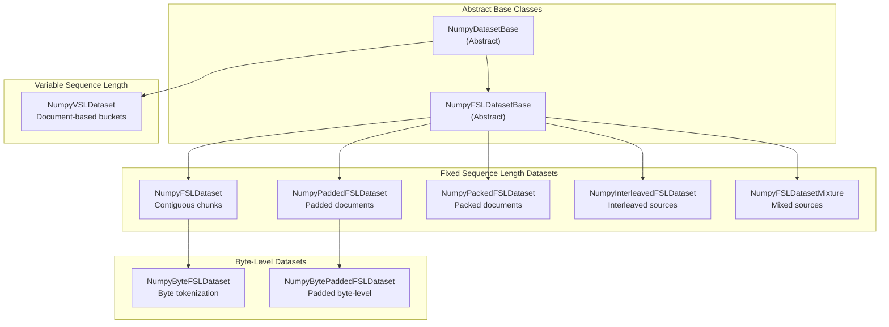
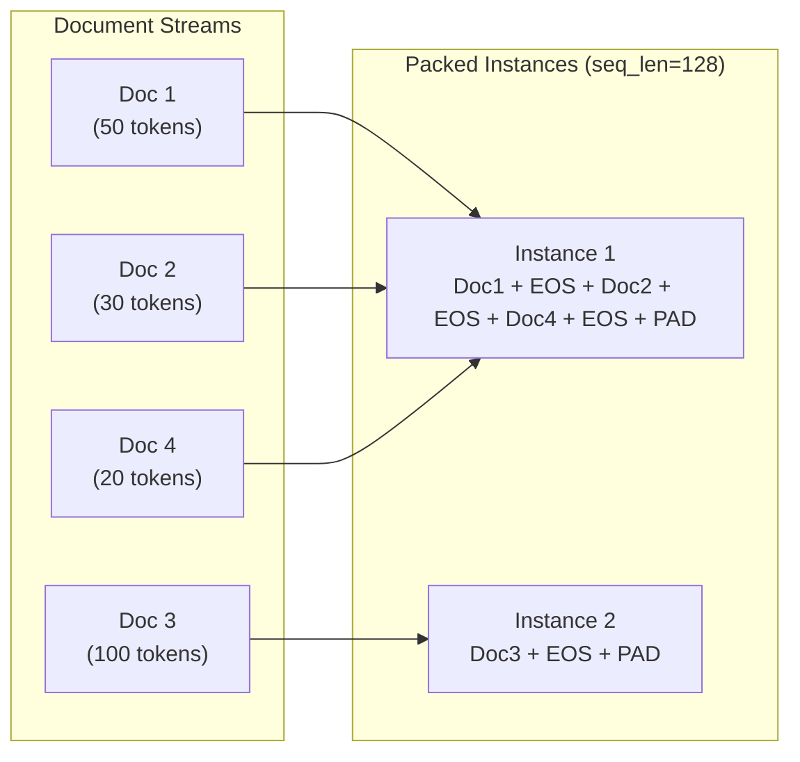
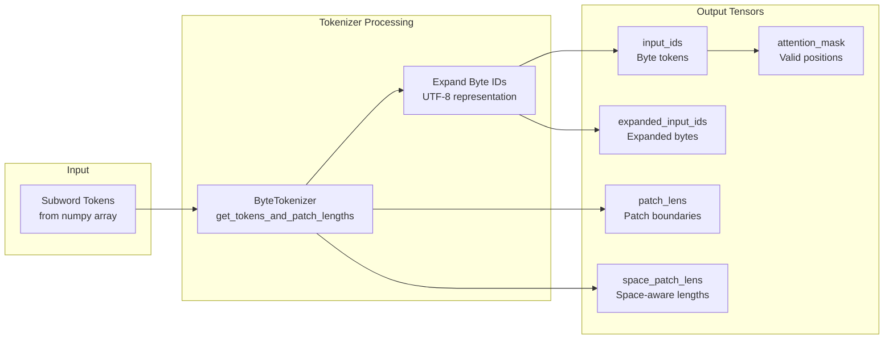
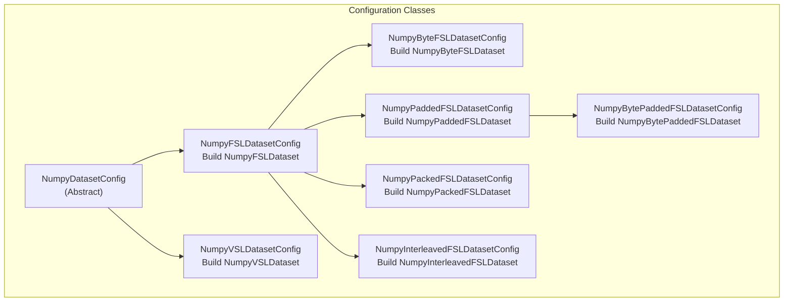
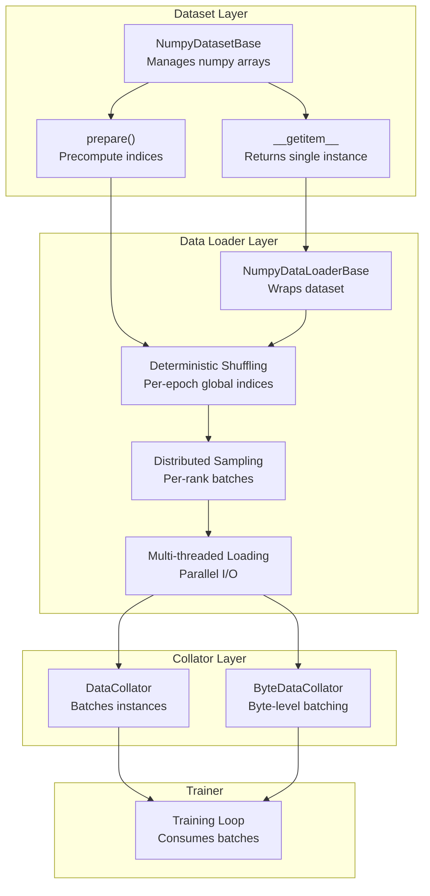

<!-- source: DeepWiki mcp.deepwiki.com · repo allenai/bolmo-core · page 4.1 Datasets · fetched 2026-10-26 -->

# Datasets

<details>
<summary>Relevant source files</summary>

The following files were used as context for generating this wiki page:

- [src/olmo_core/data/__init__.py](src/olmo_core/data/__init__.py)
- [src/olmo_core/data/collator.py](src/olmo_core/data/collator.py)
- [src/olmo_core/data/data_loader.py](src/olmo_core/data/data_loader.py)
- [src/olmo_core/data/numpy_dataset.py](src/olmo_core/data/numpy_dataset.py)
- [src/test/data/data_loader_test.py](src/test/data/data_loader_test.py)

</details>


This page documents the dataset classes in OLMo-Core, which are responsible for loading tokenized text data from numpy arrays on disk. These datasets serve as the foundation of the data pipeline, providing structured access to pre-tokenized training data.

For information about data loaders that wrap these datasets for distributed training, see [Data Loaders](#4.2). For data mixing and source configuration, see [Data Mixing](#4.3). For batch collation, see [Data Collation](#4.4).

## Overview

OLMo-Core datasets are built around numpy arrays containing token IDs stored on disk. All dataset classes inherit from `NumpyDatasetBase` and implement PyTorch's `Dataset` interface. The primary distinction between dataset types is how they chunk token arrays into training instances:

- **Fixed Sequence Length (FSL)** datasets chunk data into fixed-size sequences
- **Variable Sequence Length (VSL)** datasets create sequences of varying lengths based on document boundaries
- **Packed** datasets pack multiple documents into single instances
- **Padded** datasets ensure documents aren't split across instances
- **Byte-level** datasets handle Bolmo's hierarchical byte-to-patch tokenization

Sources:
- [src/olmo_core/data/numpy_dataset.py:104-362]()
- [src/olmo_core/data/__init__.py:1-14]()

## Dataset Class Hierarchy



Sources:
- [src/olmo_core/data/numpy_dataset.py:104-122]()
- [src/olmo_core/data/numpy_dataset.py:364-426]()
- [src/olmo_core/data/numpy_dataset.py:449-687]()

## NumpyDatasetBase

`NumpyDatasetBase` is the abstract foundation for all numpy-backed datasets. It manages paths to numpy arrays, provides common properties, and defines the interface for subclasses.

### Key Properties and Methods

| Property/Method | Description |
|-----------------|-------------|
| `paths` | Tuple of paths or URLs to numpy arrays |
| `file_sizes` | Size in bytes of each array |
| `pad_token_id` | Padding token ID |
| `eos_token_id` | End-of-sequence token ID |
| `bos_token_id` | Beginning-of-sequence token ID (optional) |
| `vocab_size` | Vocabulary size |
| `dtype` | Numpy datatype (e.g., `np.uint16`) |
| `max_sequence_length` | Maximum sequence length (abstract) |
| `fingerprint` | Content-based hash for dataset versioning |
| `work_dir` | Local working directory for preprocessed data |
| `fs_local_rank` | Filesystem-local rank for distributed setup |
| `prepare()` | Perform preparation (e.g., precompute indices) |
| `map()` | Apply function to all paths with parallelism |

The `fingerprint` property generates a SHA-256 hash based on dataset class, configuration fields, paths, and file sizes. This enables detecting dataset changes when loading checkpoints.

Sources:
- [src/olmo_core/data/numpy_dataset.py:104-362]()
- [src/olmo_core/data/numpy_dataset.py:196-221]()

### Working Directory and Distributed Setup

Datasets use `work_dir` to cache preprocessed data like instance indices. In distributed settings, this should be a shared filesystem path accessible by all local ranks:

```python
dataset = NumpyFSLDataset(
    "s3://bucket/tokens.npy",
    sequence_length=2048,
    pad_token_id=0,
    eos_token_id=1,
    vocab_size=50257,
)
dataset.work_dir = "/shared/cache"
dataset.fs_local_rank = get_fs_local_rank()
dataset.prepare()  # Call from main process before training
```

Sources:
- [src/olmo_core/data/numpy_dataset.py:232-252]()
- [src/olmo_core/data/numpy_dataset.py:326-334]()

## Fixed Sequence Length Datasets

### NumpyFSLDataset

`NumpyFSLDataset` is the standard fixed sequence length dataset. It concatenates all token arrays and chunks them into contiguous blocks of `sequence_length` tokens. Documents may be split across multiple instances.

#### Key Features

- **Contiguous chunking**: Token arrays are concatenated and divided into fixed-size windows
- **No special token insertion**: EOS tokens between documents must already be in the arrays
- **Remainder handling**: If array length is not divisible by `sequence_length`, remainder tokens are dropped
- **Sequence length warmup**: `max_target_sequence_length` parameter enables deterministic instance ordering across different sequence lengths

#### Instance Structure

Each instance returned by `__getitem__()` is a dictionary containing:

| Field | Type | Description |
|-------|------|-------------|
| `input_ids` | `torch.Tensor` | Token IDs of shape `(sequence_length,)` |
| `label_mask` | `torch.Tensor` | Optional mask for supervised fine-tuning |
| `metadata` | `Dict[str, Any]` | Optional source metadata |
| `doc_lens` | `torch.Tensor` | Optional document length information |
| `instance_mask` | `bool` | Optional validity mask for filtering |

Sources:
- [src/olmo_core/data/numpy_dataset.py:449-687]()
- [src/olmo_core/data/numpy_dataset.py:577-621]()

#### Sequence Length Warmup

The `max_target_sequence_length` parameter enables sequence length curriculum learning. When set, instances are computed based on this larger length, ensuring consistent data ordering when switching sequence lengths:

```python
# Stage 1: Train with shorter sequences
dataset1 = NumpyFSLDataset(
    "tokens.npy",
    sequence_length=512,
    max_target_sequence_length=2048,  # Plan to increase to 2048 later
    pad_token_id=0,
    eos_token_id=1,
    vocab_size=50257,
)

# Stage 2: Increase sequence length while maintaining data order
dataset2 = NumpyFSLDataset(
    "tokens.npy",
    sequence_length=2048,
    max_target_sequence_length=2048,
    pad_token_id=0,
    eos_token_id=1,
    vocab_size=50257,
)
# Both datasets see tokens in the same order
```

Sources:
- [src/olmo_core/data/numpy_dataset.py:479-484]()
- [src/olmo_core/data/numpy_dataset.py:517-524]()
- [src/olmo_core/data/numpy_dataset.py:668-687]()

### NumpyPaddedFSLDataset

`NumpyPaddedFSLDataset` ensures documents are never split across instances by padding the end of each document to fill the sequence length. This is useful for tasks where document boundaries are semantically important.

#### Document Handling Strategies

The `long_doc_strategy` parameter controls how documents longer than `sequence_length` are handled:

| Strategy | Description |
|----------|-------------|
| `LongDocStrategy.drop` | Drop long documents entirely |
| `LongDocStrategy.truncate` | Truncate long documents to fit |
| `LongDocStrategy.split` | Split long documents into multiple instances |

Documents are identified by the `eos_token_id` in the token arrays.

Sources:
- [src/olmo_core/data/numpy_dataset.py:1054-1278]()

### NumpyPackedFSLDataset

`NumpyPackedFSLDataset` packs multiple documents into single instances to minimize padding waste. Documents are packed greedily to fill each `sequence_length`-token window, separated by EOS tokens.

#### Packing Process



Sources:
- [src/olmo_core/data/numpy_dataset.py:1280-1582]()
- [src/olmo_core/data/utils.py:440-490]()

### NumpyInterleavedFSLDataset

`NumpyInterleavedFSLDataset` maintains multiple FSL datasets and interleaves instances from them in a deterministic pattern. This is useful for mixing data sources while preserving their individual shuffling orders.

Sources:
- [src/olmo_core/data/numpy_dataset.py:1584-1712]()

### NumpyFSLDatasetMixture

`NumpyFSLDatasetMixture` implements precise data mixing using Hamilton's apportionment method. It takes a `path_offset_index` dictionary that specifies how many instances to take from each source path to achieve desired mixing ratios.

This class is typically constructed via `SourceMixtureDatasetConfig` rather than directly.

Sources:
- [src/olmo_core/data/numpy_dataset.py:951-1052]()

## Variable Sequence Length Datasets

### NumpyVSLDataset

`NumpyVSLDataset` implements document-based variable sequence length training with curriculum learning. Instead of chunking arbitrarily, it creates instances that respect document boundaries and groups them into buckets by sequence length.

#### Architecture

```mermaid
graph TB
    subgraph "Input"
        Arrays["Numpy Arrays<br/>with EOS markers"]
    end
    
    subgraph "Document Segmentation"
        DocExtract["Extract Documents<br/>Split on EOS"]
        DocBucket["Bucket by Length<br/>min_seq_len to max_seq_len"]
    end
    
    subgraph "Instance Buckets"
        B2["Bucket: seq_len=2<br/>Short documents"]
        B4["Bucket: seq_len=4<br/>Medium documents"]
        B8["Bucket: seq_len=8<br/>Long documents"]
    end
    
    subgraph "Curriculum"
        Curriculum["VSLCurriculum<br/>Defines sampling schedule"]
        Batches["Batch Generation<br/>Sample from buckets"]
    end
    
    Arrays --> DocExtract
    DocExtract --> DocBucket
    DocBucket --> B2
    DocBucket --> B4
    DocBucket --> B8
    
    B2 --> Curriculum
    B4 --> Curriculum
    B8 --> Curriculum
    Curriculum --> Batches
```

Sources:
- [src/olmo_core/data/numpy_dataset.py:1714-2069]()

#### VSL Curriculum Types

The curriculum determines the order in which sequence length buckets are sampled:

| Curriculum | Description |
|------------|-------------|
| `VSLNaturalCurriculum` | Sample proportional to token count in each bucket |
| `VSLGrowthCurriculum` | Start with shorter sequences, gradually increase length |
| `VSLGrowP2Curriculum` | Grow length in powers of 2 (e.g., 128→256→512→1024) |
| `VSLGrowLinearCurriculum` | Grow length linearly across training |

```python
from olmo_core.data import NumpyVSLDataset, VSLGrowP2Curriculum

dataset = NumpyVSLDataset(
    "tokens.npy",
    pad_token_id=0,
    eos_token_id=1,
    vocab_size=50257,
    min_sequence_length=128,
    max_sequence_length=2048,
    curriculum=VSLGrowP2Curriculum(num_cycles=2, balanced=True),
)
```

Sources:
- [src/olmo_core/data/numpy_dataset.py:1714-1760]()
- [src/olmo_core/data/numpy_dataset.py:2071-2396]()

## Byte-Level Datasets

### NumpyByteFSLDataset

`NumpyByteFSLDataset` extends `NumpyFSLDataset` for Bolmo's hierarchical byte-level models. It reads subword token arrays and converts them to byte-level representations with patch length information.

#### Byte-Level Transformation Pipeline



Sources:
- [src/olmo_core/data/numpy_dataset.py:821-949]()
- [src/olmo_core/data/numpy_dataset.py:688-819]()

#### Key Properties

| Property | Description |
|----------|-------------|
| `patch_sequence_length` | Sequence length in subword/patch space |
| `byte_sequence_length` | Sequence length in byte space |
| `sequence_length` | Returns `byte_sequence_length` (overrides parent) |
| `tokenizer` | `ByteTokenizer` instance for conversion |

The dataset reads `patch_sequence_length` subword tokens from disk, then converts them to `byte_sequence_length` byte tokens. The `patch_lens` tensor maps patch boundaries in byte space.

Sources:
- [src/olmo_core/data/numpy_dataset.py:822-825]()
- [src/olmo_core/data/numpy_dataset.py:938-948]()

#### BPE Merge Computation

`NumpyByteFSLDataset` optionally computes BPE merges for dynamic compression:

```python
dataset = NumpyByteFSLDataset(
    "tokens.npy",
    sequence_length=2048,
    byte_sequence_length=8192,
    tokenizer_config=ByteTokenizerConfig(...),
    pad_token_id=0,
    eos_token_id=1,
    vocab_size=50257,
)

# Enable entropy-based merge computation
dataset.enable_compute_merges(
    kind="entropy",
    entropy_path_replace=("tokens", "entropies")
)
```

Sources:
- [src/olmo_core/data/numpy_dataset.py:846-853]()
- [src/olmo_core/data/numpy_dataset.py:782-818]()

### NumpyBytePaddedFSLDataset

`NumpyBytePaddedFSLDataset` combines byte-level processing with document padding, ensuring documents aren't split while maintaining byte-to-patch mappings.

Sources:
- [src/olmo_core/data/numpy_dataset.py:2398-2526]()

## Dataset Configuration

Datasets are typically instantiated through configuration classes that handle parameter validation and provide builder patterns.

### Configuration Class Hierarchy



Sources:
- [src/olmo_core/data/numpy_dataset.py:2528-2881]()

### Building Datasets from Configuration

Configuration classes provide `build()` methods that construct dataset instances:

```python
from olmo_core.data import NumpyFSLDatasetConfig

config = NumpyFSLDatasetConfig(
    paths=["s3://bucket/data1.npy", "s3://bucket/data2.npy"],
    sequence_length=2048,
    tokenizer=TokenizerConfig(identifier="allenai/gpt-neox-olmo-dolma-v1_5"),
    metadata=[{"source": "web"}, {"source": "books"}],
)

dataset = config.build()
```

Sources:
- [src/olmo_core/data/numpy_dataset.py:2617-2670]()

### Source Mixture Integration

For complex data mixing, use `SourceMixtureDatasetConfig`:

```python
from olmo_core.data.source_mixture import SourceMixtureDatasetConfig

config = SourceMixtureDatasetConfig(
    source_configs=[
        SourceConfig(paths=["web.npy"], target_ratio=0.7),
        SourceConfig(paths=["books.npy"], target_ratio=0.3),
    ],
    sequence_length=2048,
    tokenizer=TokenizerConfig(...),
    max_tokens=1_000_000_000,
)

dataset = config.build()  # Returns NumpyFSLDatasetMixture
```

Sources:
- [src/olmo_core/data/source_mixture.py:1-100]() (referenced but not in provided files)

## Instance Filtering

Datasets support filtering instances based on repetitive patterns using `InstanceFilterConfig`:

```python
from olmo_core.data import InstanceFilterConfig

filter_config = InstanceFilterConfig(
    repetition_max_period=13,      # Maximum pattern length to check
    repetition_min_period=1,        # Minimum pattern length to check
    repetition_max_count=32,        # Maximum repetitions allowed
)

dataset = NumpyFSLDataset(
    "tokens.npy",
    sequence_length=2048,
    pad_token_id=0,
    eos_token_id=1,
    vocab_size=50257,
    instance_filter_config=filter_config,
)

# Instances will include 'instance_mask' field indicating validity
```

The filter detects periodic sequences (e.g., "123123123...") and marks instances with excessive repetition. The `instance_mask` field in each instance is `True` for valid instances, `False` for those with excessive repetition.

Sources:
- [src/olmo_core/data/numpy_dataset.py:97-102]()
- [src/olmo_core/data/numpy_dataset.py:351-361]()
- [src/olmo_core/data/numpy_dataset.py:609-610]()

## Label Masking for Supervised Fine-Tuning

Datasets support label masks for supervised fine-tuning scenarios where only part of each sequence should be used for loss computation:

```python
dataset = NumpyFSLDataset(
    "tokens.npy",
    sequence_length=2048,
    pad_token_id=0,
    eos_token_id=1,
    vocab_size=50257,
    label_mask_paths=["label_masks.npy"],  # Boolean array matching tokens.npy
)

# Each instance includes 'label_mask' tensor indicating which positions to compute loss on
```

The label mask arrays must be boolean numpy arrays with the same shape as the corresponding token arrays. During training, positions where `label_mask` is `False` are typically assigned a loss ignore index.

Sources:
- [src/olmo_core/data/numpy_dataset.py:382-418]()
- [src/olmo_core/data/numpy_dataset.py:603-607]()

## Document Length Tracking

When `generate_doc_lengths=True`, datasets compute document boundary information for each instance:

```python
dataset = NumpyFSLDataset(
    "tokens.npy",
    sequence_length=2048,
    pad_token_id=0,
    eos_token_id=1,
    vocab_size=50257,
    bos_token_id=2,
    generate_doc_lengths=True,
)

instance = dataset[0]
# instance["doc_lens"] contains tensor with document lengths in this instance
```

This is useful for models that need document boundary awareness or for metrics that track per-document statistics.

Sources:
- [src/olmo_core/data/numpy_dataset.py:379]()
- [src/olmo_core/data/numpy_dataset.py:616-619]()

## Dataset and Data Loader Integration



Datasets are wrapped by data loaders (see [Data Loaders](#4.2)) which handle:
- Distributed sampling across data parallel ranks
- Deterministic shuffling per epoch
- Multi-threaded instance loading
- Batch collation via `DataCollator` or `ByteDataCollator`

Sources:
- [src/olmo_core/data/data_loader.py:316-431]()
- [src/olmo_core/data/data_loader.py:599-627]()

## Performance Considerations

### Memory-Mapped Arrays

Datasets use memory-mapped numpy arrays (`np.memmap`) to avoid loading entire arrays into RAM. Token IDs are read on-demand as instances are accessed:

```python
# Efficient: Only reads requested slice
input_ids = load_array_slice_into_tensor(
    path="s3://bucket/tokens.npy",
    start_idx=index * sequence_length,
    end_idx=(index + 1) * sequence_length,
    dtype=np.uint16,
)
```

Sources:
- [src/olmo_core/data/numpy_dataset.py:659-666]()
- [src/olmo_core/data/utils.py:133-157]()

### Parallel Path Operations

The `map()` method processes multiple paths in parallel using thread or process pools:

```python
# Count total tokens across all arrays in parallel
total_tokens = sum(dataset.map(
    lambda path, idx: get_file_size(path) // np.uint16(0).itemsize,
    max_workers=16,
    method="threads"
))
```

Sources:
- [src/olmo_core/data/numpy_dataset.py:286-324]()

### Index Caching

FSL and VSL datasets precompute and cache global instance indices to `work_dir`. This avoids recomputing expensive shuffling operations:

```python
# Cached indices file structure:
# work_dir/
#   dataset-common/
#     instance-indices-<fingerprint>.npy
#   dataset-<fingerprint>/
#     <curriculum>/
#       global_batch_indices_seed<N>_epoch<M>_bz<B>.npy
```

Sources:
- [src/olmo_core/data/numpy_dataset.py:431-446]()
- [src/olmo_core/data/data_loader.py:501-524]()

---

