<!-- source: DeepWiki mcp.deepwiki.com · repo allenai/bolmo-core · page 4.2 Data Loaders · fetched 2026-10-26 -->

# Data Loaders

<details>
<summary>Relevant source files</summary>

The following files were used as context for generating this wiki page:

- [src/olmo_core/data/__init__.py](src/olmo_core/data/__init__.py)
- [src/olmo_core/data/collator.py](src/olmo_core/data/collator.py)
- [src/olmo_core/data/data_loader.py](src/olmo_core/data/data_loader.py)
- [src/olmo_core/data/numpy_dataset.py](src/olmo_core/data/numpy_dataset.py)
- [src/test/data/data_loader_test.py](src/test/data/data_loader_test.py)

</details>


Data loaders in OLMo-Core provide distributed, deterministic, stateful iterators over datasets for training. They handle distributed sampling across data parallel ranks, deterministic shuffling per epoch, checkpoint/resume functionality, and multi-threaded data loading with prefetching.

For information about the underlying datasets that data loaders wrap, see [Datasets](#4.1). For batch preparation from individual instances, see [Data Collation](#4.4). For mixing multiple data sources, see [Data Mixing](#4.3).

## Architecture Overview

The data loader system is organized as a hierarchy of abstract and concrete classes:

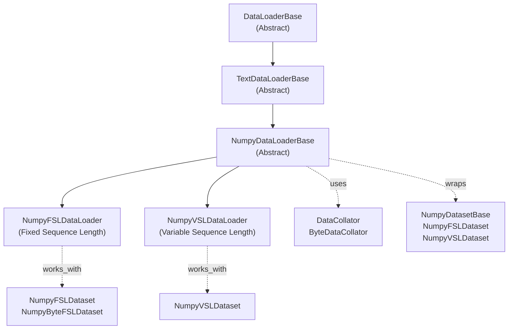

**Sources:** [src/olmo_core/data/data_loader.py:52-257]()

## DataLoaderBase

`DataLoaderBase` is the abstract base class that defines the interface for all data loaders used by the [Trainer](#3.1).

### Core Interface

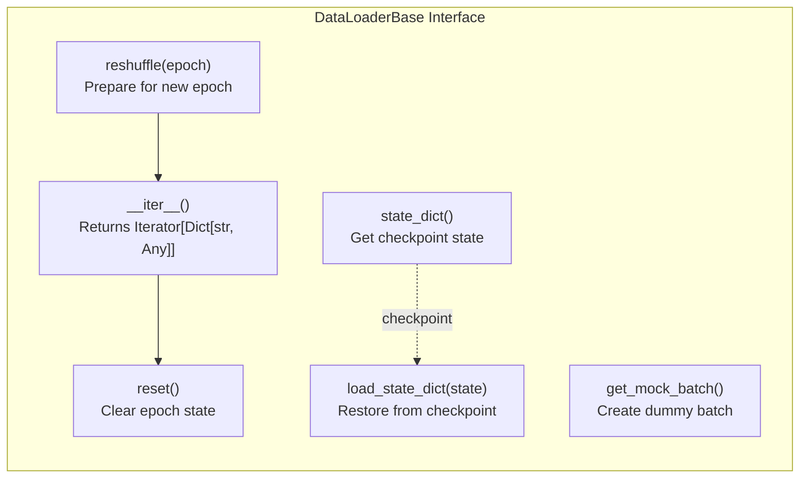

### Key Properties and Methods

| Property/Method | Purpose |
|-----------------|---------|
| `work_dir` | Local directory for caching shuffled indices |
| `global_batch_size` | Total batch size across all ranks |
| `dp_world_size` | Number of data parallel replicas |
| `dp_rank` | Local data parallel rank |
| `batches_processed` | Number of batches processed in current epoch |
| `epoch` | Current epoch number (1-based) |
| `total_batches` | Total batches per epoch (if known) |
| `rank_batch_size` | Batch size for local rank |

The `global_batch_size` property is mutable and can be changed during training. When changed, the data loader automatically adjusts `batches_processed` to maintain consistency with `tokens_processed`:

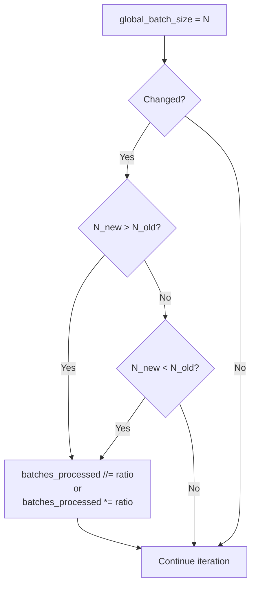

**Sources:** [src/olmo_core/data/data_loader.py:52-257]()

## TextDataLoaderBase

`TextDataLoaderBase` extends `DataLoaderBase` for text-based data loaders. It adds token counting and integrates with a `DataCollator` for batch preparation.

### Additional Features

| Property/Method | Purpose |
|-----------------|---------|
| `collator` | `DataCollator` instance for batching |
| `tokens_processed` | Total tokens processed in current epoch |
| `global_num_tokens_in_batch()` | Returns global token count per batch |

The class validates that each batch has exactly `rank_batch_size` tokens and automatically tracks `tokens_processed` alongside `batches_processed`.

**Sources:** [src/olmo_core/data/data_loader.py:259-314]()

## NumpyDataLoaderBase

`NumpyDataLoaderBase` is the base class for data loaders that work with `NumpyDatasetBase` implementations. It provides distributed sampling, deterministic shuffling, and state management.

### Construction

The recommended way to construct a data loader is via the `wrap_numpy_dataset()` class method, which automatically selects the appropriate loader type:

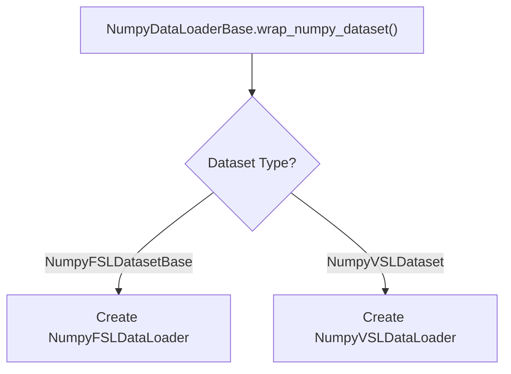

### Key Configuration Parameters

| Parameter | Purpose | Default |
|-----------|---------|---------|
| `dataset` | The `NumpyDatasetBase` to load from | Required |
| `global_batch_size` | Global batch size in tokens | Required |
| `seed` | Random seed for shuffling | 0 |
| `shuffle` | Whether to shuffle data | `True` |
| `num_threads` | Threads for loading instances | `None` |
| `num_workers` | Worker processes for batch loading | 0 |
| `prefetch_factor` | Batches to prefetch per worker | `None` |
| `target_device_type` | Target device ("cpu" or "cuda") | "cpu" |

### Global Index Generation

Data loaders generate and cache global shuffled indices for each epoch. This ensures deterministic data order across training runs:

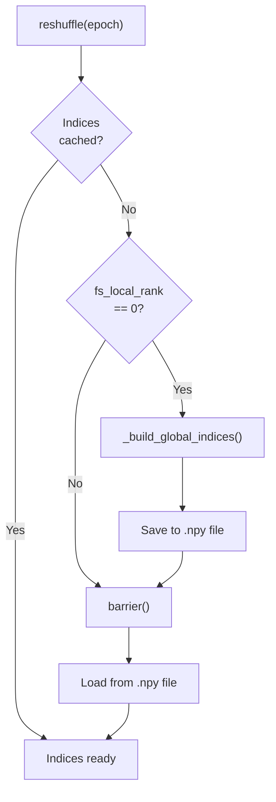

Indices are cached in `work_dir` with filenames encoding:
- Dataset fingerprint or size
- Seed (if shuffling)
- Epoch (if shuffling)
- Chunk size (for FSL with warmup)

**Sources:** [src/olmo_core/data/data_loader.py:316-642]()

## NumpyFSLDataLoader

`NumpyFSLDataLoader` implements a fixed sequence length data loader for use with `NumpyFSLDataset` and related dataset types.

### Instance Batching

The data loader chunks dataset instances into batches:

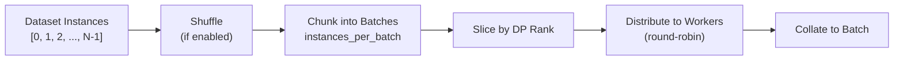

### Sequence Length Warmup

The `chunk_size` parameter enables sequence length warmup (curriculum learning with increasing sequence lengths):

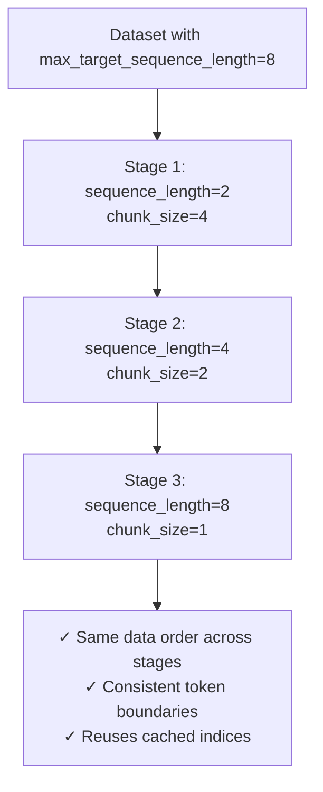

When `chunk_size > 1`, consecutive instances are treated as a chunk and shuffled as a unit. This ensures that increasing sequence length during warmup maintains the same underlying data order.

### Key Properties

| Property | Description |
|----------|-------------|
| `total_size` | Total instances produced per epoch |
| `total_batches` | Total batches per epoch |
| `chunk_size` | Number of instances per chunk (for warmup) |

**Sources:** [src/olmo_core/data/data_loader.py:644-803]()

## NumpyVSLDataLoader

`NumpyVSLDataLoader` implements variable sequence length loading with curriculum support for `NumpyVSLDataset`. It implements sequence length-based curriculum learning as described in [Dataset Decomposition: Faster LLM Training with Variable Sequence Length Curriculum](https://arxiv.org/pdf/2405.13226).

### Bucket-Based Loading

The data loader organizes instances into sequence length buckets and processes them according to a curriculum:

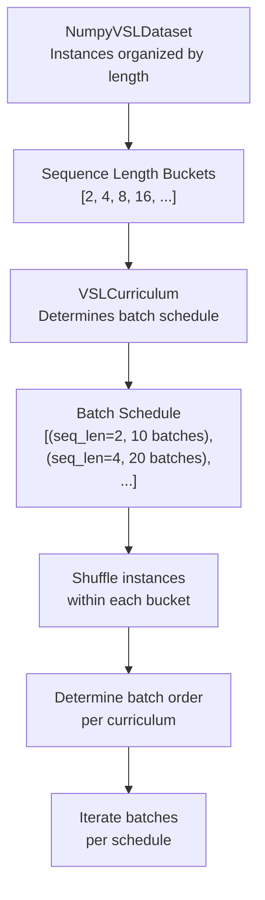

### Curriculum Types

The data loader supports multiple curriculum strategies through `VSLCurriculum`:

| Curriculum | Behavior |
|------------|----------|
| `VSLNaturalCurriculum` | Process buckets in natural order (shortest to longest) |
| `VSLGrowP2Curriculum` | Gradually increase average sequence length over cycles |
| `VSLGrowthCurriculum` | Linear growth in average sequence length |
| `VSLGrowLinearCurriculum` | Another linear growth variant |

### Bucket Index Caching

For each bucket, the data loader caches shuffled instance indices separately:

```
work_dir/
  dataset-{fingerprint}/
    {curriculum.short_str}/
      instance_indices_bucket2_seed{seed}_epoch{epoch}.npy
      instance_indices_bucket4_seed{seed}_epoch{epoch}.npy
      ...
      global_batch_indices_seed{seed}_epoch{epoch}_bz{batch_size}.npy
```

### Key Properties

| Property | Description |
|----------|-------------|
| `buckets` | Tuple of sequence lengths |
| `batches_per_bucket` | `(seq_len, num_batches)` pairs |
| `total_batches` | Sum of batches across all buckets |

**Sources:** [src/olmo_core/data/data_loader.py:805-1047]()

## Distributed Sampling

Data loaders distribute batches across data parallel ranks to avoid duplicate processing:

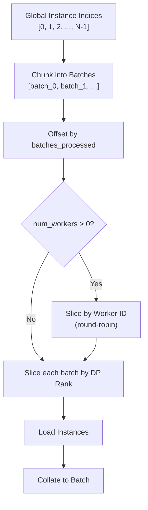

### Rank Slicing Logic

For FSL data loaders, each batch is sliced across DP ranks:

```python
# From global instance indices
instances_per_batch = global_batch_size // sequence_length
indices = indices.reshape(-1, instances_per_batch)

# Slice for local DP rank
indices = indices[:, dp_rank::dp_world_size]
```

For VSL data loaders, slicing occurs per sequence length bucket:

```python
instances_per_batch = global_batch_size // bucket_seq_len
instances_per_rank = instances_per_batch // dp_world_size
instance_start_index += dp_rank * instances_per_rank
```

**Sources:** [src/olmo_core/data/data_loader.py:745-772](), [src/olmo_core/data/data_loader.py:974-992]()

## Shuffling and Determinism

Data loaders ensure deterministic shuffling based on epoch and seed:

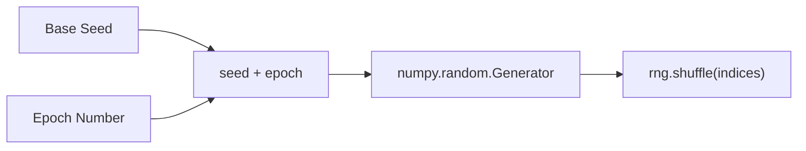

### Reproducibility Guarantees

| Scenario | Behavior |
|----------|----------|
| Same seed + same epoch | Identical data order |
| Different epoch | Different shuffle order |
| No shuffle | Natural dataset order |
| Resume from checkpoint | Continues from correct position |

The seed can also vary per bucket for VSL loaders:

```python
# VSL bucket shuffling
rng = get_rng(seed + epoch + seq_len)
bucket_indices = rng.permutation(bucket_indices)
```

**Sources:** [src/olmo_core/data/data_loader.py:692-714](), [src/olmo_core/data/data_loader.py:881-888]()

## Multi-threaded and Multi-worker Loading

Data loaders support two levels of parallelism:

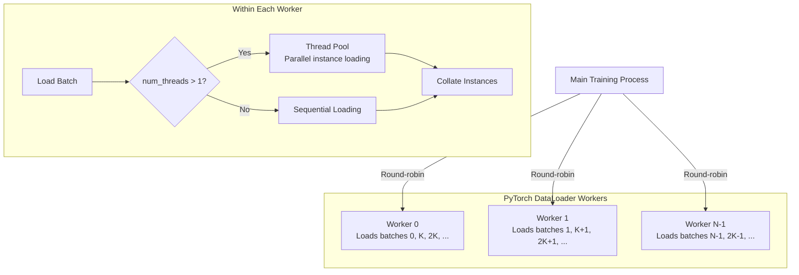

### Configuration Recommendations

| Scenario | `num_workers` | `num_threads` | `prefetch_factor` |
|----------|---------------|---------------|-------------------|
| CPU training | 0 | 4-8 | N/A |
| GPU training | 2-4 | None or 2 | 2-4 |
| Fast storage (WEKA) | 4-8 | None | 4 |
| Slow storage (S3) | 4-8 | 2 | 2 |

When `num_workers > 0`, batches are loaded in separate processes and transferred to the main process. The `prefetch_factor` controls how many batches each worker loads ahead.

When `num_workers == 0`, all loading happens in the main thread. Setting `num_threads > 1` uses a thread pool to load instances in parallel within each batch.

**Sources:** [src/olmo_core/data/data_loader.py:599-626](), [src/olmo_core/data/data_loader.py:735-741]()

## State Management and Checkpointing

Data loaders maintain state for checkpoint/resume:

### State Dictionary Contents

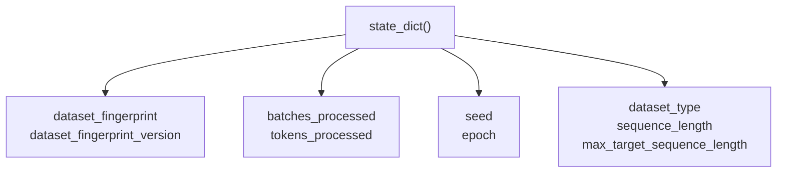

### Loading State

When loading a state dict:

1. **Fingerprint Validation**: Checks dataset fingerprint matches to ensure data hasn't changed
2. **Seed Restoration**: Uses seed from checkpoint to maintain data order
3. **Progress Restoration**: Sets `batches_processed` and `tokens_processed`
4. **Batch Size Adjustment**: Recalculates `batches_processed` if batch size changed

```python
# Automatic batch size adjustment
self.batches_processed = self.tokens_processed // self.global_batch_size
```

The `ignore_fingerprint_mismatch` parameter allows loading state even when fingerprints don't match (useful for debugging or intentional data changes).

**Sources:** [src/olmo_core/data/data_loader.py:432-469](), [src/olmo_core/data/data_loader.py:774-803]()

## Worker Initialization

The data loader uses a custom worker initialization function to optimize thread usage:

```python
def _worker_init_fn(worker_id):
    torch.set_num_threads(4)
```

This limits the number of threads per worker process to avoid over-subscription when using multiple workers.

**Sources:** [src/olmo_core/data/data_loader.py:49-50]()

## Practical Usage Pattern

The recommended pattern for using data loaders:

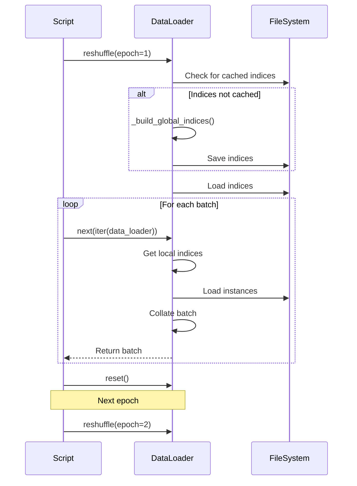

**Important:** Always call `reshuffle()` before iterating and `reset()` after the epoch completes. The [Trainer](#3.1) handles this automatically.

**Sources:** [src/olmo_core/data/data_loader.py:52-80]()

## Configuration Builder

The `NumpyDataLoaderConfig` provides a builder for constructing data loaders from configuration:

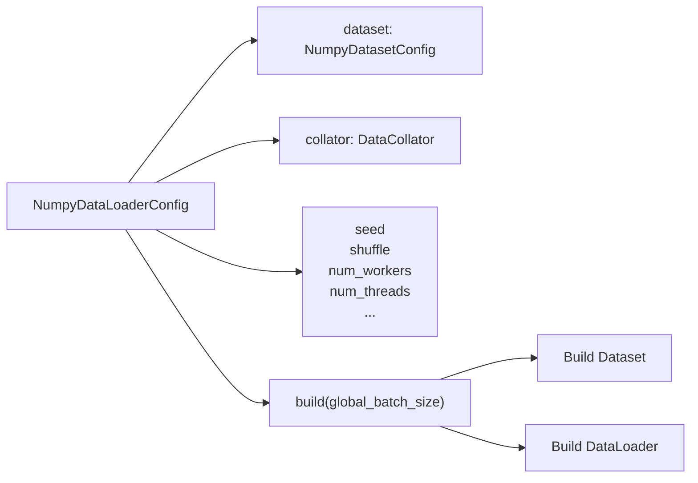

The config automatically:
- Builds the dataset from its config
- Selects the appropriate loader type (FSL vs VSL)
- Sets up distributed parameters from environment
- Configures the work directory

**Sources:** [src/olmo_core/data/data_loader.py:1050-1134]()

---

