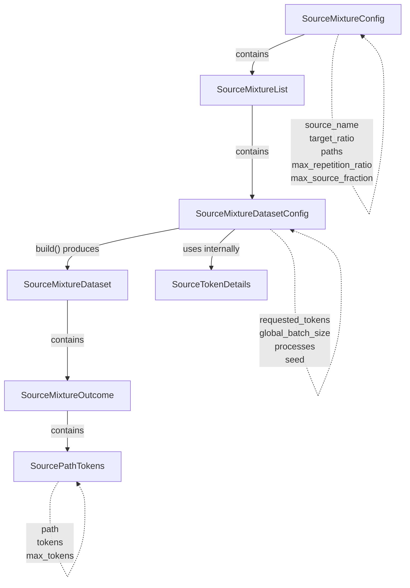
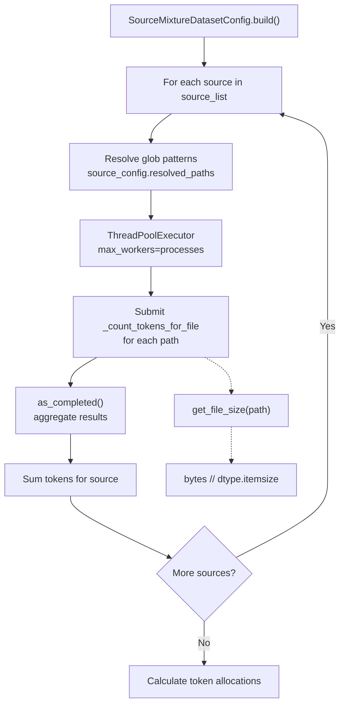
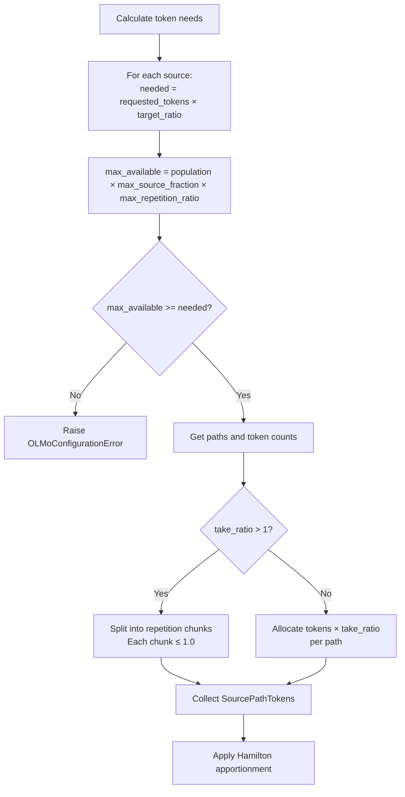
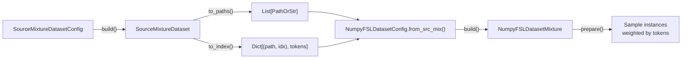

<!-- source: DeepWiki mcp.deepwiki.com · repo allenai/bolmo-core · page 4.3 Data Mixing · fetched 2026-10-26 -->

# Data Mixing

<details>
<summary>Relevant source files</summary>

The following files were used as context for generating this wiki page:

- [docs/source/guides/data_mixing.rst](docs/source/guides/data_mixing.rst)
- [src/olmo_core/data/source_mixture.py](src/olmo_core/data/source_mixture.py)
- [src/olmo_core/data/types.py](src/olmo_core/data/types.py)
- [src/olmo_core/distributed/parallel/data_parallel.py](src/olmo_core/distributed/parallel/data_parallel.py)
- [src/test/data/fixtures.py](src/test/data/fixtures.py)
- [src/test/data/numpy_dataset_test.py](src/test/data/numpy_dataset_test.py)
- [src/test/data/source_mixture_test.py](src/test/data/source_mixture_test.py)

</details>


## Purpose and Scope

This document describes the data mixing system for combining multiple pre-tokenized data sources according to specified target ratios. The system ensures precise mixing proportions through parallel token counting and Hamilton's apportionment method.

For information about the dataset implementations that consume mixed data, see [Datasets](#4.1). For information about how data is loaded during training, see [Data Loaders](#4.2). For information about batch preparation, see [Data Collation](#4.4).

## Overview

The data mixing system solves the problem of creating training datasets from multiple sources while maintaining precise target ratios. Given a requested number of tokens and per-source target ratios, the system:

1. Counts available tokens in each source
2. Calculates token allocations based on target ratios
3. Validates that sources have sufficient data (considering repetition limits)
4. Applies Hamilton's apportionment to distribute tokens precisely across instances
5. Produces a `SourceMixtureDataset` with exact token counts per file

The system supports upsampling through controlled repetition and downsampling through source fraction limits.

Sources: [src/olmo_core/data/source_mixture.py:1-592]()

## Core Components

### Component Architecture



**Diagram: Data Mixing Component Relationships**

Sources: [src/olmo_core/data/source_mixture.py:29-148](), [src/olmo_core/data/source_mixture.py:183-236](), [src/olmo_core/data/source_mixture.py:239-287]()

### SourceMixtureConfig

The `SourceMixtureConfig` class defines how a single data source should be sampled within a mixture.

| Field | Type | Description |
|-------|------|-------------|
| `source_name` | `str` | Identifier for the source |
| `target_ratio` | `float` | Desired proportion of tokens from this source (0 < ratio ≤ 1) |
| `paths` | `List[str]` | Paths to `.npy` token files (supports glob patterns) |
| `max_repetition_ratio` | `float` | Maximum repetition factor for upsampling (default: 1.0) |
| `max_source_fraction` | `float` | Maximum fraction of source data to use (default: 1.0) |

The `resolved_paths` property expands glob patterns and validates file existence, caching results for subsequent access.

Sources: [src/olmo_core/data/source_mixture.py:29-124]()

### SourceMixtureList

The `SourceMixtureList` wraps a collection of `SourceMixtureConfig` objects and validates that target ratios sum to 1.0. This separation allows defining source lists independently from dataset materialization parameters like `requested_tokens` or `global_batch_size`.

Sources: [src/olmo_core/data/source_mixture.py:126-149]()

### SourceMixtureDatasetConfig

The `SourceMixtureDatasetConfig` orchestrates the mixture building process.

| Field | Type | Description |
|-------|------|-------------|
| `source_list` | `SourceMixtureList` | Collection of source configurations |
| `requested_tokens` | `int` | Desired dataset size in tokens |
| `global_batch_size` | `int` | Tokens per training step (must be multiple of sequence_length) |
| `processes` | `int` | Worker threads for parallel token counting (default: 1) |
| `seed` | `int` | Random seed for deterministic instance sampling (default: 42) |
| `render_tables` | `bool` | Display outcome summary tables (default: True) |

The `build()` method performs token counting, allocation, and validation, producing a `SourceMixtureDataset`.

Sources: [src/olmo_core/data/source_mixture.py:239-287]()

### SourceMixtureDataset

The `SourceMixtureDataset` is the final output containing per-path token allocations. It provides:

- `to_index()`: Returns `Dict[(path, idx), tokens]` mapping each path to its allocated token count
- `to_paths()`: Returns ordered list of paths for dataset construction

Each `SourceMixtureOutcome` contains a list of `SourcePathTokens` objects specifying:
- `path`: File path
- `tokens`: Number of tokens to use from this file
- `max_tokens`: Maximum available tokens in the file

Sources: [src/olmo_core/data/source_mixture.py:202-236]()

## Token Counting Process

### Parallel Token Counting



**Diagram: Parallel Token Counting Flow**

The token counting process uses `ThreadPoolExecutor` to scan files in parallel. For each file:

1. `get_file_size()` retrieves the file size in bytes
2. Token count = `num_bytes // npdtype(0).itemsize` where `npdtype` is the numpy dtype (uint8, uint16, uint32, or uint64)
3. Results are aggregated per source

This parallel approach significantly speeds up counting for large source collections.

Sources: [src/olmo_core/data/source_mixture.py:511-548]()

## Token Allocation and Hamilton Apportionment

### Allocation Strategy

Once token counts are available, the system calculates allocations:



**Diagram: Token Allocation Process**

Sources: [src/olmo_core/data/source_mixture.py:305-331](), [src/olmo_core/data/source_mixture.py:457-509]()

### Hamilton's Apportionment Method

The system must allocate tokens such that:
- Total instances = `ceil(requested_tokens / global_batch_size) × (global_batch_size / sequence_length)`
- Each instance has exactly `sequence_length` tokens
- Target ratios are preserved as closely as possible

Hamilton's method achieves this by:

1. **Calculate base allocations**: For each path, compute `base_instances = floor(desired_tokens / sequence_length)` (respecting `max_tokens` constraints)

2. **Calculate remainders**: `remainder = (desired_tokens % sequence_length) / sequence_length` for paths with remaining capacity

3. **Distribute shortfall**:
   - If `sum(base_instances) < requested_instances`:
   - First distribute evenly among eligible paths
   - Then allocate remaining instances to paths with largest remainders
   - Always respect `max_tokens // sequence_length` capacity limits

4. **Final token counts**: `tokens = instances × sequence_length`

This approach minimizes deviation from target ratios while ensuring exact instance counts.

Sources: [src/olmo_core/data/source_mixture.py:354-416]()

### Hamilton Apportionment Implementation

```mermaid
flowchart TD
    Start["All SourcePathTokens collected"]
    Start --> CalcBase["For each path:<br/>base_instances = min(desired_tokens // seq_len, max_tokens // seq_len)"]
    CalcBase --> CalcRemainder["remainder = (desired_tokens % seq_len) / seq_len<br/>if below capacity"]
    CalcRemainder --> CheckShortfall{sum(base_instances) < requested_instances?}
    CheckShortfall -->|No| FinalTokens["final_tokens = instances × seq_len"]
    CheckShortfall -->|Yes| FindEligible["eligible = paths with capacity"]
    FindEligible --> DistributeBase["Distribute base_amount evenly<br/>among eligible paths"]
    DistributeBase --> RecalcShortfall["Recalculate shortfall"]
    RecalcShortfall --> SortRemainders["Sort eligible by remainder (descending)"]
    SortRemainders --> DistributeTop["Distribute +1 instance to<br/>top N paths by remainder"]
    DistributeTop --> FinalTokens
    FinalTokens --> UpdateObjects["Update SourcePathTokens.tokens"]
```

**Diagram: Hamilton Apportionment Algorithm**

Sources: [src/olmo_core/data/source_mixture.py:354-416]()

## Repetition and Source Fraction Controls

### Repetition Ratio

When `max_repetition_ratio > 1.0`, the system allows upsampling a source by repeating its data. The implementation splits repetitions into chunks:

```python
# Example: max_repetition_ratio=2.5, take_ratio=2.3
take_ratios = [1.0, 1.0, 0.3]  # Three passes through the data

for ratio in take_ratios:
    for path in resolved_paths:
        tokens_to_keep = ceil(available_tokens × ratio)
        path_tokens.append(SourcePathTokens(path, tokens_to_keep, available_tokens))
```

This creates multiple `SourcePathTokens` entries for the same path, allowing the dataset to read different portions on each repetition.

Sources: [src/olmo_core/data/source_mixture.py:474-495]()

### Source Fraction

The `max_source_fraction` parameter limits how much of a source's available data can be used. This is useful for:
- Reserving held-out data for evaluation
- Preventing exhaustion of smaller sources
- Creating consistent training/validation splits

The effective maximum tokens for a source = `population × max_source_fraction × max_repetition_ratio`

Sources: [src/olmo_core/data/source_mixture.py:312-321]()

## Integration with Dataset Implementations

### Connection to NumpyFSLDataset

The `SourceMixtureDataset` integrates with `NumpyFSLDatasetConfig` through the `from_src_mix()` constructor:



**Diagram: Integration with NumpyFSLDataset**

The dataset uses the token allocations to:
1. Determine which files to include
2. Weight sampling proportionally to allocated tokens
3. Apply deterministic shuffling based on seed

Sources: [src/olmo_core/data/source_mixture.py:217-236](), [src/test/data/numpy_dataset_test.py:418-479]()

## Validation and Error Handling

The system validates configurations at multiple points:

| Validation | Location | Error Type |
|------------|----------|------------|
| `target_ratio` in (0, 1] | `SourceMixtureConfig.validate()` | `OLMoConfigurationError` |
| `max_repetition_ratio >= 1` | `SourceMixtureConfig.validate()` | `OLMoConfigurationError` |
| `max_source_fraction` in [0, 1] | `SourceMixtureConfig.validate()` | `OLMoConfigurationError` |
| Target ratios sum to 1.0 | `SourceMixtureList.validate()` | `OLMoConfigurationError` |
| Paths exist | `SourceMixtureConfig.resolved_paths` | `FileNotFoundError` |
| Sufficient tokens available | `build()` | `OLMoConfigurationError` |
| `global_batch_size % sequence_length == 0` | `build()` | `AssertionError` |

Special handling for unavailable files in OLMo-mix-0625 provides guidance to switch to newer mixes.

Sources: [src/olmo_core/data/source_mixture.py:64-123](), [src/olmo_core/data/source_mixture.py:141-148](), [src/olmo_core/data/source_mixture.py:318-321]()

## Configuration Example

### Basic Three-Source Mix

```python
from olmo_core.data.source_mixture import (
    SourceMixtureConfig,
    SourceMixtureDatasetConfig,
    SourceMixtureList,
)
from olmo_core.data import NumpyFSLDatasetConfig, TokenizerConfig
from olmo_core.data.types import NumpyDatasetDType

# Define sources
source_list = SourceMixtureList([
    SourceMixtureConfig(
        source_name="web_crawl",
        target_ratio=0.5,
        paths=["/data/web/*.npy"],
    ),
    SourceMixtureConfig(
        source_name="books",
        target_ratio=0.3,
        paths=["/data/books/*.npy"],
        max_repetition_ratio=1.5,  # Allow upsampling
    ),
    SourceMixtureConfig(
        source_name="code",
        target_ratio=0.2,
        paths=["/data/code/*.npy"],
        max_source_fraction=0.8,  # Reserve 20% for validation
    ),
])

# Configure mixture
sequence_length = 2048
global_batch_size = sequence_length * 512

mixture_config = SourceMixtureDatasetConfig(
    source_list=source_list,
    requested_tokens=1_000_000_000,
    global_batch_size=global_batch_size,
    processes=16,  # Parallel token counting
    seed=42,
    render_tables=True,
)

# Build dataset
dataset_config = NumpyFSLDatasetConfig.from_src_mix(
    src_mix=mixture_config,
    tokenizer=TokenizerConfig.dolma2(),
    sequence_length=sequence_length,
    dtype=NumpyDatasetDType.uint32,
)

dataset = dataset_config.build()
dataset.prepare()
```

Sources: [src/test/data/numpy_dataset_test.py:418-479](), [src/test/data/source_mixture_test.py:20-72]()

## Logging and Diagnostics

When `render_tables=True`, the system logs detailed outcome tables:

### Per-Source Outcome Table

| Column | Description |
|--------|-------------|
| `source_name` | Source identifier |
| `source_population` | Total available tokens |
| `num_selected` | Tokens allocated to this source |
| `target_ratio` | Requested proportion |
| `max_repetition_ratio` | Repetition limit |
| `max_source_fraction` | Usage fraction limit |
| `observed_source_ratio` | Actual usage: selected / population |
| `observed_global_ratio` | Actual proportion: selected / total |

### Global Outcome Table

| Column | Description |
|--------|-------------|
| `total_tokens` | Sum of all source populations |
| `selected_tokens` | Total tokens in final mixture |
| `observed_global_ratio` | selected / total |

The system also logs per-path token selections and ratio deviations from targets.

Sources: [src/olmo_core/data/source_mixture.py:549-591](), [src/olmo_core/data/source_mixture.py:170-180]()

---

