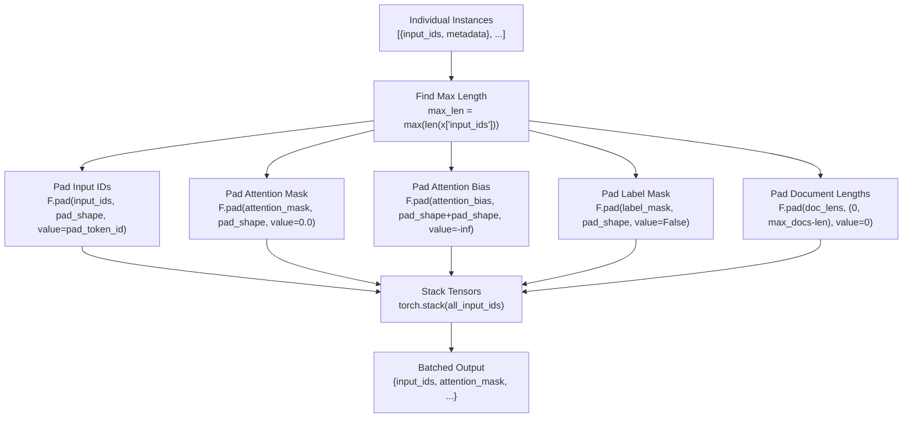
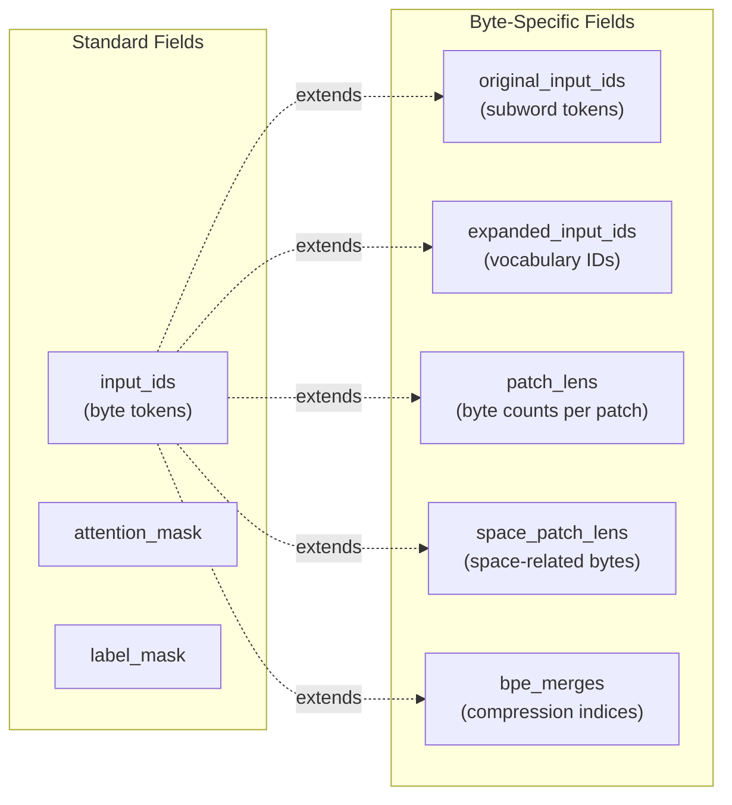
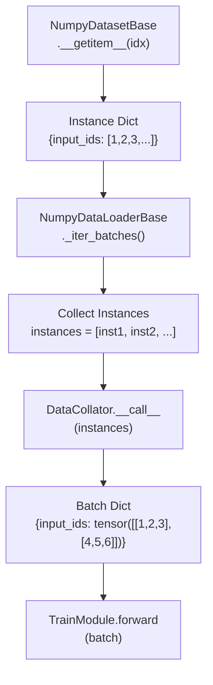

<!-- source: DeepWiki mcp.deepwiki.com · repo allenai/bolmo-core · page 4.4 Data Collation · fetched 2026-10-26 -->

# Data Collation

<details>
<summary>Relevant source files</summary>

The following files were used as context for generating this wiki page:

- [src/olmo_core/data/__init__.py](src/olmo_core/data/__init__.py)
- [src/olmo_core/data/collator.py](src/olmo_core/data/collator.py)
- [src/olmo_core/data/data_loader.py](src/olmo_core/data/data_loader.py)
- [src/olmo_core/data/numpy_dataset.py](src/olmo_core/data/numpy_dataset.py)
- [src/test/data/data_loader_test.py](src/test/data/data_loader_test.py)

</details>


Data collation transforms individual dataset instances into batched tensors suitable for model training. The collator handles padding sequences to uniform lengths, stacking tensors, and preparing auxiliary fields like attention masks and metadata. For information about datasets that produce instances, see [Datasets](#4.1). For data loaders that orchestrate collation, see [Data Loaders](#4.2).

---

## Overview

The data collation system sits between individual dataset instances and the training module. Each dataset instance contains token IDs and optional metadata (attention masks, label masks, document lengths, etc.). The collator's responsibility is to:

1. Pad sequences to a uniform length within each batch
2. Stack individual tensors into batch tensors
3. Preserve metadata and auxiliary fields
4. Handle special requirements for byte-level models

Two main collator classes exist:
- **`DataCollator`**: Standard collation for token-based models
- **`ByteDataCollator`**: Extended collation for Bolmo byte-level models

Sources: [src/olmo_core/data/collator.py:1-259]()

---

## DataCollator Class

### Configuration

The `DataCollator` is configured with three key parameters:

| Parameter | Type | Purpose |
|-----------|------|---------|
| `pad_token_id` | `int` | Token ID used for padding shorter sequences |
| `pad_direction` | `PaddingDirection` | Whether to pad on the left or right side |
| `label_ignore_index` | `int` | Index used for ignored positions in loss computation (default: -100) |

```python
@dataclass
class DataCollator:
    pad_token_id: int
    pad_direction: PaddingDirection = PaddingDirection.right
    label_ignore_index: int = -100
```

Sources: [src/olmo_core/data/collator.py:24-32]()

### Padding Direction

The `PaddingDirection` enum specifies where to add padding:

- **`PaddingDirection.right`**: Pad at the end of sequences (most common for causal language modeling)
- **`PaddingDirection.left`**: Pad at the beginning of sequences (used for certain inference scenarios)

Sources: [src/olmo_core/data/collator.py:15-22]()

### Collation Process

**Collation Flow Diagram**



Sources: [src/olmo_core/data/collator.py:34-158]()

### Batch Fields

The collator handles multiple optional fields from dataset instances:

| Field | Type | Description | Padding Value |
|-------|------|-------------|---------------|
| `input_ids` | `torch.Tensor` | Token IDs (required) | `pad_token_id` |
| `attention_mask` | `torch.Tensor` | Binary mask for valid tokens | `0.0` |
| `attention_bias` | `torch.Tensor` | Bias added to attention scores | `-inf` (or `False` for bool) |
| `label_mask` | `torch.Tensor` | Binary mask for loss computation | `False` |
| `index` | `torch.Tensor` | Dataset instance indices | N/A (collected, not padded) |
| `instance_mask` | `torch.Tensor` | Validity mask for filtering | N/A (collected, not padded) |
| `doc_lens` | `torch.Tensor` | Document boundary lengths | `0` |
| `max_doc_lens` | `list[int]` | Maximum document length per instance | N/A (collected, not padded) |
| `metadata` | `list[dict]` | Instance metadata | N/A (collected, not padded) |

The collator only processes fields present in the input instances. If a field is missing, it won't appear in the output batch.

Sources: [src/olmo_core/data/collator.py:40-158]()

### Input IDs Padding Logic

```python
# Determine pad shape based on direction
pad_shape = (
    (max_len - len(input_ids), 0)  # Left padding
    if self.pad_direction == PaddingDirection.left
    else (0, max_len - len(input_ids))  # Right padding
)

# Apply padding
padded_input_ids = F.pad(
    input_ids.to(dtype=torch.long),
    pad_shape,
    value=self.pad_token_id,
)
```

Sources: [src/olmo_core/data/collator.py:60-73]()

---

## ByteDataCollator

`ByteDataCollator` extends `DataCollator` to handle additional fields required by Bolmo byte-level models. These models use a hierarchical representation where bytes are grouped into patches, requiring extra metadata about patch boundaries and byte-to-token mappings.

### Additional Fields

**Byte-Level Batch Fields**



Sources: [src/olmo_core/data/collator.py:161-259]()

### Byte-Specific Collation

The `ByteDataCollator` performs additional padding operations:

1. **`original_input_ids`**: The original subword tokens before byte conversion. Padded to `max_original_len`.
2. **`expanded_input_ids`**: Expanded byte vocabulary IDs. Padded to match `input_ids` shape.
3. **`patch_lens`**: Number of bytes in each patch. Padded to `max_original_len` with zeros.
4. **`space_patch_lens`**: Number of space-related bytes per patch. Padded to `max_original_len` with zeros.
5. **`bpe_merges`**: Indices for BPE-style byte merging during training. Padded to `max_bpe_merges_len` with `-1`.

```python
# Pad original input IDs and patch lengths
pad_shape = (
    (max_original_len - len(original_input_ids), 0)
    if self.pad_direction == PaddingDirection.left
    else (0, max_original_len - len(original_input_ids))
)

all_original_input_ids.append(
    F.pad(original_input_ids.to(dtype=torch.long), pad_shape, value=self.pad_token_id)
)
all_patch_lengths.append(
    F.pad(patch_lengths.to(dtype=torch.long), pad_shape, value=0)
)
```

Sources: [src/olmo_core/data/collator.py:212-246]()

---

## Integration with Data Pipeline

### Data Loader Usage

Data loaders use collators to transform lists of instances into batches. The collator is passed to the data loader at construction time and called internally during batch iteration.

**Collator in Data Loading Pipeline**



Sources: [src/olmo_core/data/data_loader.py:270-289](), [src/olmo_core/data/data_loader.py:599-627]()

### Example: NumpyFSLDataLoader

The `NumpyFSLDataLoader` calls the collator when building batches:

```python
# Get instances for the batch
instances = list(map_fn(lambda idx: self._get_dataset_item(int(idx)), indices[index]))

# Collate into batch
return self.collator(instances)
```

Sources: [src/olmo_core/data/data_loader.py:734-743]()

### Configuration Example

```python
from olmo_core.data import DataCollator, NumpyFSLDataLoader, NumpyFSLDataset

# Create dataset
dataset = NumpyFSLDataset(
    "path/to/tokens.npy",
    sequence_length=2048,
    pad_token_id=0,
    eos_token_id=50279,
    vocab_size=50280,
)

# Create collator
collator = DataCollator(
    pad_token_id=0,
    pad_direction=PaddingDirection.right,
)

# Create data loader with collator
data_loader = NumpyFSLDataLoader(
    dataset,
    collator=collator,
    global_batch_size=4096,  # in tokens
    work_dir="/tmp/data",
)
```

Sources: [src/test/data/data_loader_test.py:48-66]()

---

## Byte-Level Example

For Bolmo models using byte-level tokenization, use `ByteDataCollator`:

```python
from olmo_core.data import ByteDataCollator, NumpyByteFSLDataset

# Byte dataset with byte_sequence_length
dataset = NumpyByteFSLDataset(
    "path/to/tokens.npy",
    tokenizer_config=ByteTokenizerConfig(...),
    sequence_length=2048,  # patch sequence length
    byte_sequence_length=8192,  # byte sequence length
    pad_token_id=0,
    eos_token_id=50279,
    vocab_size=50280,
)

# Byte collator handles patch_lens, bpe_merges, etc.
collator = ByteDataCollator(
    pad_token_id=0,
    pad_direction=PaddingDirection.right,
)
```

Sources: [src/olmo_core/data/numpy_dataset.py:821-949](), [src/olmo_core/data/collator.py:161-259]()

---

## Key Implementation Details

### Attention Bias Padding

Attention biases are 2D or 3D tensors that get added to attention scores. When padding, the collator:

1. Reshapes to `(1, seq_len, seq_len)` if needed
2. Pads both dimensions (rows and columns) symmetrically
3. Uses `-inf` for float tensors or `False` for boolean tensors to mask invalid positions

```python
# Reshape to (1, seq_len, seq_len)
while len(attention_bias.shape) < 3:
    attention_bias = attention_bias.unsqueeze(0)

pad_value = False if attention_bias.dtype == torch.bool else float("-inf")
all_attention_bias.append(
    F.pad(attention_bias, pad_shape + pad_shape, value=pad_value)
)
```

Sources: [src/olmo_core/data/collator.py:88-103]()

### Document Length Padding

When instances contain document boundary information (`doc_lens`), the collator:

1. Finds the maximum number of documents across all instances
2. Pads shorter `doc_lens` tensors with zeros
3. Records the maximum document length per instance in `max_doc_lens`

This enables models to respect document boundaries during training.

Sources: [src/olmo_core/data/collator.py:51-53](), [src/olmo_core/data/collator.py:129-133]()

### Thread Safety

Collators are stateless and thread-safe. Multiple data loader workers can share the same collator instance without synchronization issues.

Sources: [src/olmo_core/data/data_loader.py:599-627]()

---

