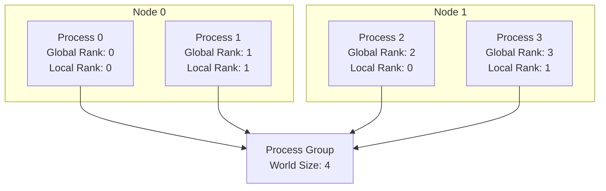
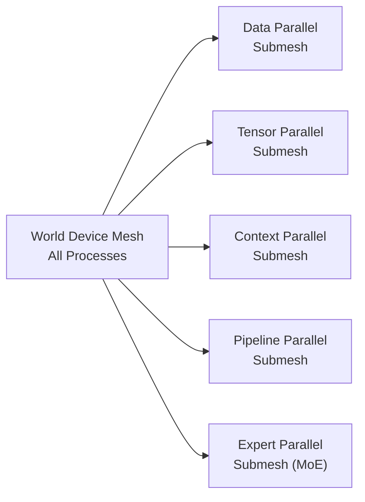
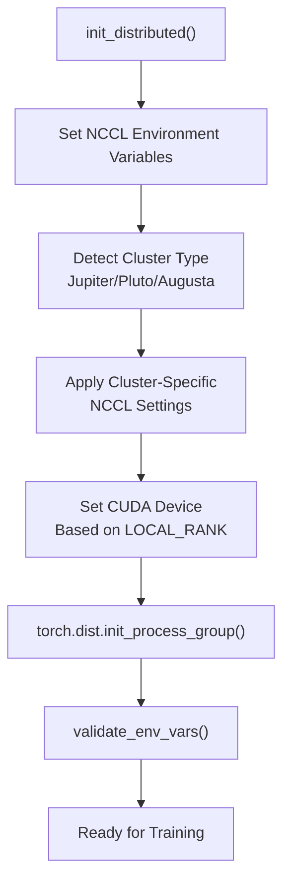
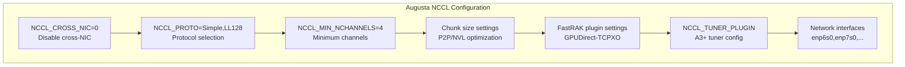
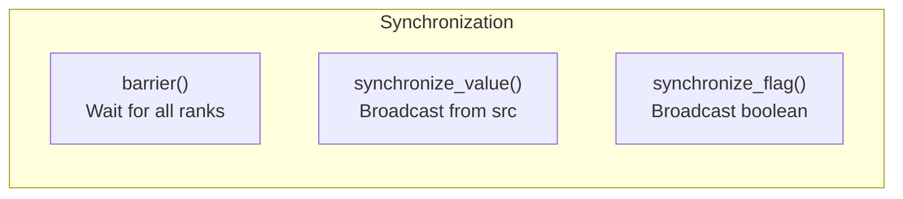
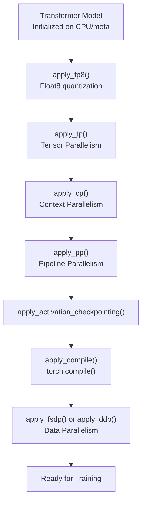
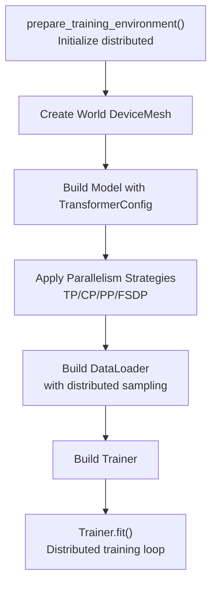

<!-- source: DeepWiki mcp.deepwiki.com · repo allenai/bolmo-core · page 5 Distributed Training · fetched 2026-10-26 -->

# Distributed Training

<details>
<summary>Relevant source files</summary>

The following files were used as context for generating this wiki page:

- [.github/actions/setup-venv/action.yml](.github/actions/setup-venv/action.yml)
- [.github/workflows/docker.yml](.github/workflows/docker.yml)
- [.github/workflows/main.yml](.github/workflows/main.yml)
- [.github/workflows/pr_checks.yml](.github/workflows/pr_checks.yml)
- [Makefile](Makefile)
- [pyproject.toml](pyproject.toml)
- [src/Dockerfile](src/Dockerfile)
- [src/olmo_core/data/tokenizer.py](src/olmo_core/data/tokenizer.py)
- [src/olmo_core/distributed/utils.py](src/olmo_core/distributed/utils.py)
- [src/olmo_core/nn/transformer/config.py](src/olmo_core/nn/transformer/config.py)
- [src/olmo_core/nn/transformer/model.py](src/olmo_core/nn/transformer/model.py)

</details>


This page provides an overview of the distributed training infrastructure in OLMo-Core, including how distributed processes are initialized, coordinated, and synchronized across multiple GPUs and nodes. 

For detailed information about specific parallelism strategies (TP, CP, PP, FSDP, EP), see [Parallelism Strategies](#5.1). For checkpointing in distributed settings, see [Checkpointing](#5.3). For distributed I/O operations, see [I/O System](#5.4).

## Overview

OLMo-Core's distributed training system is built on PyTorch's `torch.distributed` module and supports multi-GPU, multi-node training on various cluster configurations. The system handles:

- **Process Group Initialization**: Setting up distributed communication backends (NCCL, Gloo)
- **Device Mesh Management**: Organizing processes into logical topologies for different parallelism strategies
- **Cluster-Specific Configuration**: Optimizing network settings for different hardware (Jupiter, Pluto, Augusta)
- **Communication Primitives**: All-reduce, all-gather, broadcast, and other collective operations
- **Synchronization**: Barriers and coordination across distributed processes

The distributed infrastructure is initialized via `init_distributed()` and configured through environment variables set by launch tools like `torchrun` or Beaker.

Sources: [src/olmo_core/distributed/utils.py:30-131]()

## Distributed Process Organization

### Process Groups and Ranks

In a distributed training job, each process is assigned several rank identifiers:

- **Global Rank**: Unique identifier across all processes (0 to world_size - 1)
- **Local Rank**: Rank within a single node (0 to local_world_size - 1)
- **Filesystem Local Rank**: Rank for I/O coordination, depends on shared filesystem setup



**Key Functions:**
- `get_rank()`: Returns global rank
- `get_local_rank()`: Returns local rank within node
- `get_fs_local_rank()`: Returns filesystem-aware local rank
- `get_world_size()`: Returns total number of processes
- `get_num_nodes()`: Returns number of nodes

Sources: [src/olmo_core/distributed/utils.py:189-293]()

### Device Meshes

A `DeviceMesh` organizes processes into multi-dimensional grids for different parallelism strategies. The transformer model uses device meshes to apply tensor parallelism, context parallelism, and other strategies.



**Device Mesh Coordinates:**
- `get_mesh_coordinates()`: Get coordinates of a rank on a device mesh
- Meshes can be subdivided along different dimensions for different parallelism types

Sources: [src/olmo_core/distributed/utils.py:391-403](), [src/olmo_core/nn/transformer/model.py:23-26]()

## Initialization and Configuration

### Distributed Initialization

The `init_distributed()` function sets up the distributed environment:



**Key Parameters:**
- `backend`: Communication backend ("nccl" for GPU, "gloo" for CPU)
- `timeout`: Timeout for collective operations (default: 30 minutes)
- `shared_filesystem`: Whether nodes share a filesystem

Sources: [src/olmo_core/distributed/utils.py:30-131]()

### Required Environment Variables

| Variable | Purpose | Set By |
|----------|---------|--------|
| `LOCAL_RANK` | Local rank within node | torchrun, Beaker |
| `RANK` | Global rank | torchrun, Beaker |
| `WORLD_SIZE` | Total number of processes | torchrun, Beaker |
| `LOCAL_WORLD_SIZE` | Processes per node | torchrun, Beaker |
| `NUM_NODES` | Number of nodes | Beaker |
| `MASTER_ADDR` | Address of rank 0 | torchrun, Beaker |
| `MASTER_PORT` | Port for communication | torchrun, Beaker |
| `OLMO_SHARED_FS` | Shared filesystem flag | User/Script |
| `FS_LOCAL_RANK` | Filesystem local rank | User/Script |

Sources: [src/olmo_core/distributed/utils.py:19-24](), [src/olmo_core/distributed/utils.py:133-156]()

## Cluster-Specific Settings

OLMo-Core automatically detects and configures NCCL settings for different cluster types based on the hostname:

### Jupiter Cluster

```python
# InfiniBand configuration for Jupiter nodes
NCCL_IB_HCA = "^=mlx5_bond_0"
NCCL_SOCKET_IFNAME = "ib"  # Multi-node only
```

Sources: [src/olmo_core/distributed/utils.py:58-62]()

### Pluto Cluster

```python
# InfiniBand configuration for Pluto nodes
NCCL_IB_HCA = "^=mlx5_1,mlx5_2"
```

Sources: [src/olmo_core/distributed/utils.py:63-64]()

### Augusta Cluster (A3+ GPUs)

Augusta requires extensive NCCL tuning for optimal performance with GPUDirect-TCPXO:



**Key Augusta Settings:**
- FastRAK enabled for GPUDirect-TCPXO acceleration
- SNAP and LLCM for low-latency communication
- Specific network interface names (enp6s0, enp7s0, etc.)
- Tuner configuration at `/var/lib/tcpxo/lib64/a3plus_tuner_config_ll128.textproto`

Sources: [src/olmo_core/distributed/utils.py:65-112]()

## Communication Primitives

The distributed utilities provide wrappers around PyTorch's collective operations:

### Synchronization Operations



**Usage:**
- `barrier()`: Block until all processes in group reach this point
- `synchronize_value()`: Ensure all ranks have the same value
- `synchronize_flag()`: Synchronize boolean flags across ranks

Sources: [src/olmo_core/distributed/utils.py:181-324]()

### Collective Operations

| Operation | Function | Purpose |
|-----------|----------|---------|
| **All-Reduce** | `all_reduce_value()` | Sum/max/min values across all ranks |
| **All-Gather** | `all_gather()`, `all_gather_object()` | Gather tensors/objects from all ranks |
| **Scatter** | `scatter_object()` | Distribute objects from source rank |
| **Broadcast** | Inside `synchronize_value()` | Send value from one rank to all |

Sources: [src/olmo_core/distributed/utils.py:327-388]()

### Coordinated Execution

The `do_n_at_a_time()` function allows controlled concurrent execution:

```python
# Example: Save checkpoints from N ranks at a time to avoid I/O contention
result = do_n_at_a_time(
    lambda: save_checkpoint(...),
    n=num_nodes  # One rank per node at a time
)
```

Sources: [src/olmo_core/distributed/utils.py:475-505]()

## Applying Parallelism to Models

The `Transformer` model provides methods to apply different parallelism strategies:



**Order Matters:** Parallelism methods must be applied in a specific order:
1. Float8 quantization (if enabled)
2. Pipeline parallelism (if enabled)
3. Tensor parallelism (if enabled)
4. Context parallelism (if enabled)
5. Activation checkpointing (if enabled)
6. Compilation (if enabled)
7. Data parallelism (FSDP or DDP) - must be last

Sources: [src/olmo_core/nn/transformer/model.py:539-846]()

### Key Model Methods

| Method | Purpose | Input |
|--------|---------|-------|
| `apply_fp8()` | Enable FP8 training | `Float8Config` |
| `apply_tp()` | Apply tensor parallelism | `DeviceMesh` |
| `apply_cp()` | Apply context parallelism | `DeviceMesh`, load balancer |
| `apply_pp()` | Prepare for pipeline parallelism | `DeviceMesh` |
| `apply_fsdp()` | Apply FSDP data parallelism | `DeviceMesh`, wrapping strategy |
| `apply_ddp()` | Apply DDP data parallelism | `DeviceMesh` |

Sources: [src/olmo_core/nn/transformer/model.py:539-846]()

### Distributed Tensor Operations

When working with distributed tensors:

```python
# Get local shard of a DTensor
local_tensor = get_local_tensor(dtensor)

# Get full tensor (gather all shards)
full_tensor = get_full_tensor(dtensor)

# Redistribute tensor to match another's distribution
redistributed = distribute_like(source_dtensor, target_tensor)
```

Sources: [src/olmo_core/distributed/utils.py:441-472]()

## Backend Support

Different backends support different tensor types:

| Backend | CUDA Support | CPU Support | Use Case |
|---------|-------------|-------------|----------|
| **nccl** | ✓ | ✗ | GPU training (default) |
| **gloo** | ✗ | ✓ | CPU-only operations |
| **mpi** | ✗ | ✓ | HPC environments |

**Helper Functions:**
- `backend_supports_cuda()`: Check if backend supports CUDA tensors
- `backend_supports_cpu()`: Check if backend supports CPU tensors

Sources: [src/olmo_core/distributed/utils.py:406-431]()

## Integration with Training

The distributed infrastructure integrates with the training system:



**Key Integration Points:**
- Data loaders use distributed samplers to partition data across ranks
- Checkpointer uses distributed checkpoint saving/loading
- Metrics are reduced across ranks before logging
- Callbacks may be rank-aware (execute only on rank 0)

Sources: [src/olmo_core/nn/transformer/model.py:96-160]()

## Docker and CI/CD

The distributed training infrastructure is tested in CI using Docker images with CUDA support:

**Docker Image Components:**
- CUDA toolkit matching cluster configuration
- PyTorch with distributed support
- NCCL for GPU communication
- InfiniBand drivers (MLNX OFED) for high-speed networking

**CI Testing:**
- GPU tests run on Beaker with 2 GPUs
- Distributed checkpoint tests verify save/load across ranks
- Transformer tests verify parallelism strategies work correctly

Sources: [Makefile:72-111](), [.github/workflows/main.yml:120-217](), [src/Dockerfile:1-138]()

---

