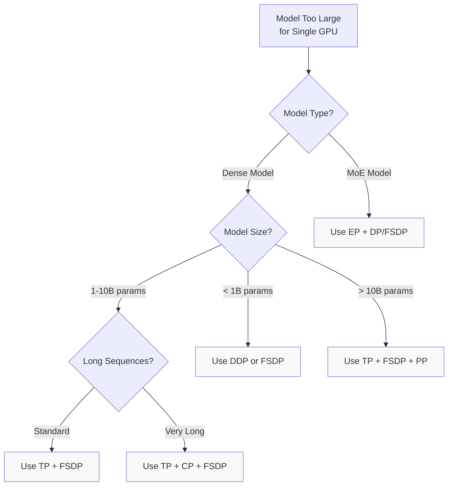
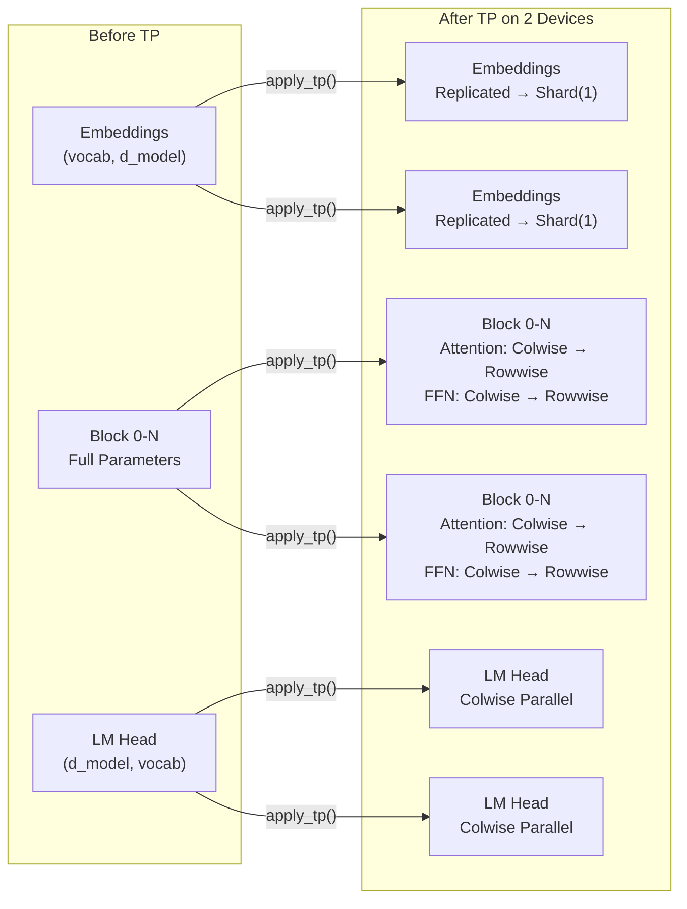
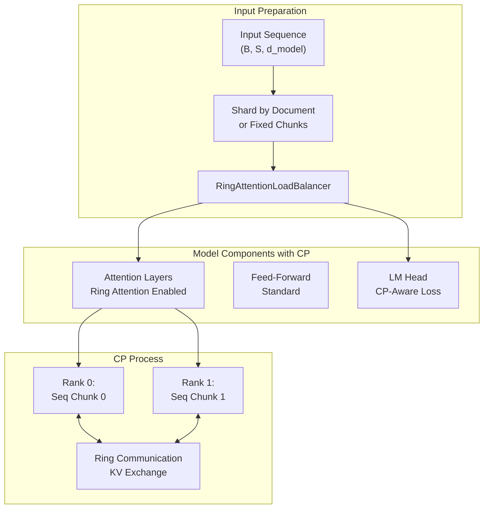
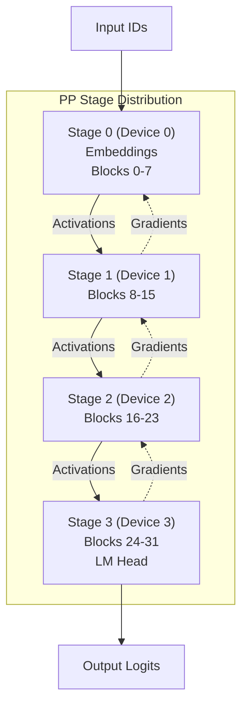
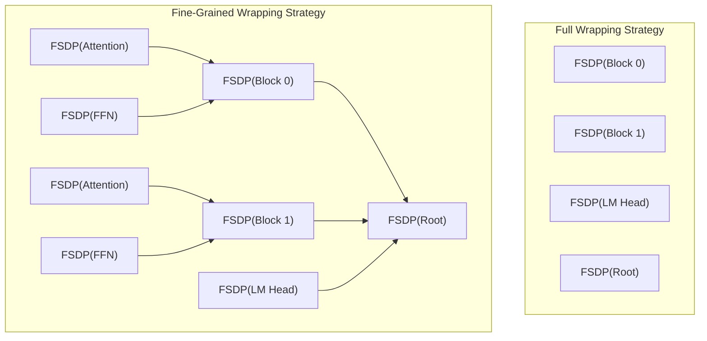
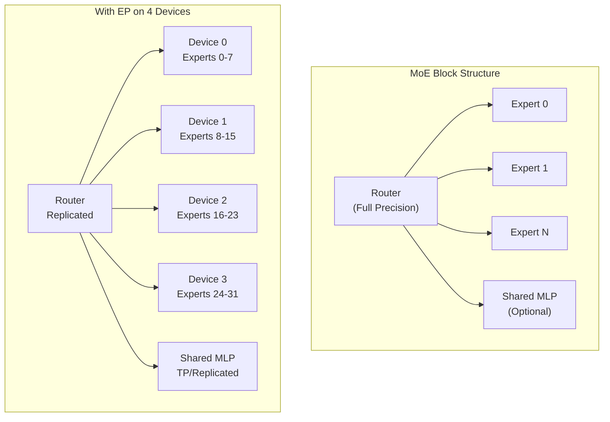
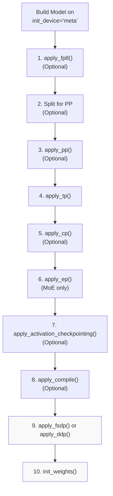

<!-- source: DeepWiki mcp.deepwiki.com · repo allenai/bolmo-core · page 5.1 Parallelism Strategies · fetched 2026-10-26 -->

# Parallelism Strategies

<details>
<summary>Relevant source files</summary>

The following files were used as context for generating this wiki page:

- [src/olmo_core/data/tokenizer.py](src/olmo_core/data/tokenizer.py)
- [src/olmo_core/nn/feed_forward.py](src/olmo_core/nn/feed_forward.py)
- [src/olmo_core/nn/layer_norm.py](src/olmo_core/nn/layer_norm.py)
- [src/olmo_core/nn/lm_head.py](src/olmo_core/nn/lm_head.py)
- [src/olmo_core/nn/transformer/__init__.py](src/olmo_core/nn/transformer/__init__.py)
- [src/olmo_core/nn/transformer/block.py](src/olmo_core/nn/transformer/block.py)
- [src/olmo_core/nn/transformer/config.py](src/olmo_core/nn/transformer/config.py)
- [src/olmo_core/nn/transformer/init.py](src/olmo_core/nn/transformer/init.py)
- [src/olmo_core/nn/transformer/model.py](src/olmo_core/nn/transformer/model.py)
- [src/test/nn/layer_norm_test.py](src/test/nn/layer_norm_test.py)
- [src/test/nn/lm_head_test.py](src/test/nn/lm_head_test.py)
- [src/test/nn/transformer/model_test.py](src/test/nn/transformer/model_test.py)

</details>


This page documents the parallelism strategies available in OLMo-Core for distributed training of transformer models. These strategies enable training large models across multiple GPUs and nodes by partitioning model parameters, activations, or computation in different ways.

For information about initializing distributed training environments, see [Distributed Initialization](#5.2). For checkpoint management with parallelism, see [Checkpointing](#5.3).

## Overview

OLMo-Core supports five complementary parallelism strategies that can be combined to scale training:

| Strategy | Abbreviation | Purpose | Shards |
|----------|-------------|---------|--------|
| Tensor Parallelism | TP | Shard weights within layers | Model parameters across feature dimension |
| Context Parallelism | CP | Shard sequences across attention | Sequence dimension using ring attention |
| Pipeline Parallelism | PP | Shard layers across stages | Transformer layers across devices |
| Fully Sharded Data Parallel | FSDP | Shard all parameters | All parameters with flexible wrapping |
| Expert Parallelism | EP | Shard MoE experts | Expert weights across devices |

**Parallelism Strategy Selection**



Sources: [src/olmo_core/nn/transformer/model.py:567-813](), [src/olmo_core/nn/transformer/block.py:142-203]()

## Tensor Parallelism (TP)

Tensor Parallelism shards weight matrices and activations across the feature dimension. Linear layers are split either column-wise or row-wise to distribute computation while maintaining mathematical correctness.

### TP Application

The `Transformer.apply_tp()` method applies tensor parallelism to the entire model:



**Key Implementation Details**

| Component | Parallelization Strategy | Input Layout | Output Layout |
|-----------|-------------------------|--------------|---------------|
| Embeddings | `RowwiseParallel` | `Replicate()` | `Shard(1)` |
| Attention (`w_q`, `w_k`, `w_v`) | `ColwiseParallel` | `Shard(1)` | `Shard(1)` |
| Attention (`w_out`) | `RowwiseParallel` | `Shard(1)` | `Shard(1)` |
| FFN (`w1`, `w3`) | `ColwiseParallel` | `Shard(1)` | `Shard(1)` |
| FFN (`w2`) | `RowwiseParallel` | `Shard(1)` | `Shard(1)` |
| LM Head | `ColwiseParallel` | `Shard(1)` | `Shard(1)` |
| Layer Norms | `SequenceParallel` | `Shard(1)` | `Shard(1)` |

The model shards data on the sequence dimension (`Shard(1)`) throughout the forward pass, enabling efficient sequence-parallel computation.

Sources: [src/olmo_core/nn/transformer/model.py:567-602](), [src/olmo_core/nn/transformer/block.py:142-178]()

### TP with Float8

When using FP8 training, tensor parallelism must account for the float8 dtypes:

```python
# From apply_tp() signature
def apply_tp(self, tp_mesh: DeviceMesh, float8_enabled: Optional[bool] = None):
    if float8_enabled is None:
        float8_enabled = self.fp8_enabled
```

The `float8_enabled` flag is propagated through all `apply_tp()` calls to use appropriate tensor parallel wrappers for FP8 linear layers.

Sources: [src/olmo_core/nn/transformer/model.py:567-602](), [src/olmo_core/nn/feed_forward.py:141-172]()

## Context Parallelism (CP)

Context Parallelism uses ring attention to shard sequences across devices, enabling training with very long context lengths that exceed single-GPU memory limits.

### CP Application



**Load Balancers**

OLMo-Core provides different load balancing strategies via `RingAttentionLoadBalancerType`:

| Strategy | Description | Use Case |
|----------|-------------|----------|
| `zig_zag` | Alternating forward/backward distribution | General purpose |
| `fair_and_packed` | Packed document-aware balancing | Multi-document batches |
| `unidirectional` | Single-direction ring | Simple sequential data |

The load balancer is configured through `Transformer.apply_cp()`:

```python
def apply_cp(
    self,
    cp_mesh: DeviceMesh,
    load_balancer: RingAttentionLoadBalancerType,
    head_stride: int = 1,
):
    self._cp_load_balancer = load_balancer.build(cp_mesh)
    for block in self.blocks.values():
        cast(TransformerBlockBase, block).apply_cp(
            cp_mesh, load_balancer, head_stride=head_stride
        )
```

### CP with Document Boundaries

When using intra-document masking with CP, inputs must be sharded by document boundaries:

```python
# From _prepare_inputs() in model.py
if cu_doc_lens is not None:
    if B != 1:
        raise RuntimeError(
            f"Rank micro-batches must consist of a single instance when using "
            f"context parallelism with intra-document masking (got {B} instances)"
        )
    inputs, additional_inputs = cp_load_balancer.batch_shard_by_document(
        inputs=inputs,
        seq_dims=seq_dims,
        cu_doc_lens=cu_doc_lens,
        pad_values=pad_values,
        length_multiple=16,
    )
```

Sources: [src/olmo_core/nn/transformer/model.py:603-622](), [src/olmo_core/nn/transformer/model.py:372-441](), [src/olmo_core/nn/transformer/block.py:180-186]()

## Pipeline Parallelism (PP)

Pipeline Parallelism distributes transformer layers across multiple devices, with each device processing a stage of the model. This is particularly useful for very large models where even with TP/FSDP, the model is too large.

### PP Application



**PP-Specific Considerations**

After splitting the model into stages, `apply_pp()` must be called:

```python
def apply_pp(self, pp_mesh: DeviceMesh):
    """
    Prepare the model for pipeline parallelism after it's been split into stages.
    """
    for block in self.blocks.values():
        block = cast(TransformerBlockBase, block)
        block.apply_pp(pp_mesh)
    self._pp_enabled = True
    self._pp_group_size = pp_mesh.size()
```

PP affects initialization - each stage uses a different random seed based on its rank:

```python
# From init_weights()
seed = self.init_seed
if world_mesh is not None and self.pp_enabled:
    seed += get_pp_mesh(world_mesh).get_local_rank()
```

PP also affects how parameters are handled - some stages may not have embeddings or the LM head:

```python
# From forward()
h = self.embeddings(input_ids) if self.embeddings is not None else input_ids
# ... blocks processing ...
if self.lm_head is not None:
    return self.lm_head(h, **lm_head_kwargs)
else:
    return h  # Pass through for PP
```

Sources: [src/olmo_core/nn/transformer/model.py:557-565](), [src/olmo_core/nn/transformer/model.py:249-251](), [src/olmo_core/nn/transformer/model.py:512-537]()

## Fully Sharded Data Parallel (FSDP)

FSDP (also called FSDP2 in the codebase) shards all model parameters, gradients, and optimizer states across data parallel ranks. This is the most memory-efficient data parallel strategy.

### FSDP Wrapping Strategies

FSDP provides flexible wrapping strategies via `TransformerDataParallelWrappingStrategy`:

| Strategy | Description | When to Use |
|----------|-------------|-------------|
| `full` | Wrap each block and LM head separately | Standard training, balanced memory/speed |
| `blocks` | Wrap each block, but not LM head | When LM head is small |
| `fine_grained` | Wrap attention and FFN within blocks | Maximum memory efficiency, higher communication |



### FSDP Application

```python
def apply_fsdp(
    self,
    dp_mesh: Optional[DeviceMesh] = None,
    param_dtype: Optional[torch.dtype] = None,
    reduce_dtype: torch.dtype = torch.float32,
    pp_enabled: bool = False,
    prefetch_factor: int = 0,
    wrapping_strategy: TransformerDataParallelWrappingStrategy = TransformerDataParallelWrappingStrategy.full,
):
```

**Key Parameters:**

- `param_dtype`: Materialize parameters in this dtype (e.g., `bfloat16` for memory savings)
- `reduce_dtype`: Use this dtype for gradient reduction (typically `float32` for stability)
- `pp_enabled`: If `True`, disables `reshard_after_forward` to avoid per-microbatch all-gathers
- `prefetch_factor`: Controls aggressive prefetching (0=default, higher=more aggressive)

### FSDP with Pipeline Parallelism

When combining FSDP with PP:

```python
# From apply_fsdp()
# For PP, do not reshard after forward to avoid per-microbatch all-gathers,
# which can be expensive and non-overlapped
reshard_after_forward = False if pp_enabled else True
```

This optimization prevents resharding between pipeline stages, improving throughput.

### FSDP Prefetching

FSDP supports forward prefetching to overlap communication with computation:

```python
if prefetch_factor > 0:
    blocks = cast(List[FSDPModule], list(self.blocks.values()))
    for i in range(len(blocks)):
        block = blocks[i]
        if i + 1 < len(blocks):
            block.set_modules_to_forward_prefetch(blocks[i + 1 : i + 1 + prefetch_factor])
        elif isinstance(self.lm_head, FSDPModule):
            block.set_modules_to_forward_prefetch([self.lm_head])
```

Sources: [src/olmo_core/nn/transformer/model.py:739-813](), [src/olmo_core/nn/transformer/config.py:37-56](), [src/olmo_core/nn/transformer/block.py:188-203]()

## Expert Parallelism (EP)

Expert Parallelism is specific to Mixture-of-Experts (MoE) models, sharding expert weights across devices while keeping routing and shared components replicated or otherwise parallelized.

### EP Application

EP is applied to `MoETransformerBlock` instances:



**EP Implementation**

```python
# From MoETransformerBlock
def apply_ep(self, ep_mesh: DeviceMesh, **kwargs):
    self.feed_forward_moe.apply_ep(ep_mesh, **kwargs)
    self._ep_enabled = True
```

The router remains in full precision even with FSDP:

```python
# From MoEHybridTransformerBlockBase.apply_fsdp()
from torch.distributed.fsdp import MixedPrecisionPolicy

# Force router to be full-precision.
fsdp_router = cast(
    FSDPModule,
    fully_shard(
        self.feed_forward_moe.router,
        mesh=dp_mesh,
        mp_policy=MixedPrecisionPolicy(param_dtype=torch.float32),
    ),
)
```

### MoE Hybrid Blocks

Hybrid MoE blocks combine dense FFN with sparse MoE. They have two forward modes:

1. **Sequential Mode** (default without EP/TP): Compute sparse and dense paths separately
2. **Combined Mode** (with EP/TP): Fuse computation for efficiency

```python
@property
def use_combined_forward(self) -> bool:
    if self._use_combined_forward is not None:
        return self._use_combined_forward
    elif not self.ep_enabled and not self.tp_enabled:
        return False
    else:
        return True
```

Sources: [src/olmo_core/nn/transformer/block.py:490-492](), [src/olmo_core/nn/transformer/block.py:604-684](), [src/olmo_core/nn/transformer/block.py:709-719]()

## Combining Parallelism Strategies

Multiple parallelism strategies can be combined using multi-dimensional device meshes. The order of application matters.

### Recommended Application Order



**Critical Ordering Constraints:**

1. `apply_compile()` must be called **after** `apply_activation_checkpointing()` but **before** `apply_fsdp()`/`apply_ddp()`
2. `init_weights()` must be called **last**, after all parallelism is configured
3. FP8 should be applied first to ensure all subsequent operations use FP8-aware wrappers

### Multi-Dimensional Mesh Example

```python
from olmo_core.distributed.parallel import build_world_mesh, DataParallelConfig

# Build 3D mesh: DP x TP x CP
mesh = build_world_mesh(
    dp=DataParallelConfig(name=DataParallelType.fsdp),
    tp_size=4,
    cp_size=2,
)

# Apply parallelism
model.apply_tp(mesh["tp"])
model.apply_cp(mesh["cp"], load_balancer=RingAttentionLoadBalancerType.zig_zag)
model.apply_fsdp(mesh["dp"])
```

For MoE models with EP:

```python
# Build 4D mesh: DP x TP x EP
mesh = build_world_mesh(
    dp=DataParallelConfig(name=DataParallelType.fsdp),
    tp_size=2,
    ep_size=8,
)

model.apply_tp(mesh["tp"])
model.apply_ep(mesh["ep"])
model.apply_fsdp(mesh["dp"])
```

Sources: [src/olmo_core/nn/transformer/model.py:567-813](), [src/olmo_core/nn/transformer/model.py:721-738](), [src/test/nn/transformer/model_test.py:195-245]()

## Activation Checkpointing

Activation checkpointing reduces memory usage by recomputing activations during the backward pass instead of storing them. This is configured via `TransformerActivationCheckpointingMode`:

| Mode | Description | Granularity |
|------|-------------|-------------|
| `full` | Checkpoint every block | Block-level |
| `selected_blocks` | Checkpoint blocks at intervals | Configurable block-level |
| `selected_modules` | Checkpoint specific module patterns | Module-level (glob patterns) |
| `selected_ops` | Checkpoint specific operations | Op-level |
| `budget` | Checkpoint based on memory budget | Automatic |

```python
model.apply_activation_checkpointing(
    mode=TransformerActivationCheckpointingMode.selected_blocks,
    block_interval=2,  # Checkpoint every 2nd block
)
```

**Important:** Activation checkpointing must be applied before `apply_compile()` and `apply_fsdp()`.

Sources: [src/olmo_core/nn/transformer/model.py:623-720](), [src/olmo_core/nn/transformer/config.py:58-74]()

## DDP Alternative

For smaller models or when FSDP overhead is unnecessary, standard DDP (DistributedDataParallel) can be used:

```python
model.apply_ddp(
    dp_mesh=dp_mesh,
    param_dtype=torch.bfloat16,
    compile_enabled=True,
    autograd_compile_enabled=False,
)
```

DDP replicates the entire model on each device and synchronizes gradients via all-reduce. It's simpler than FSDP but requires each device to hold the full model.

Sources: [src/olmo_core/nn/transformer/model.py:815-846]()

---

