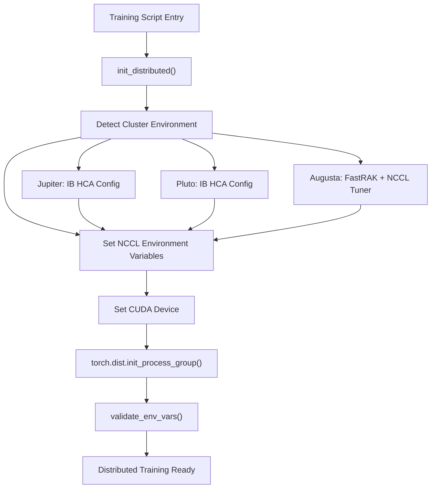
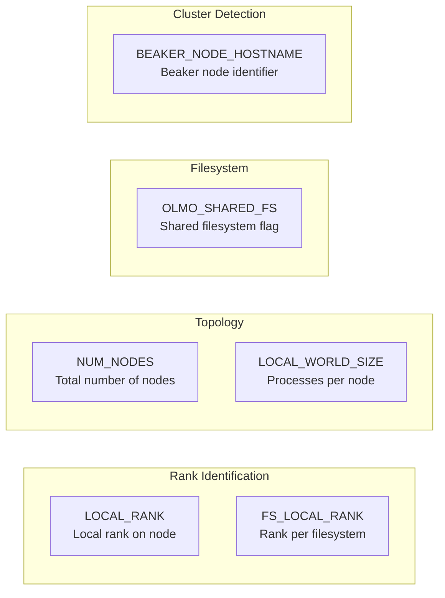
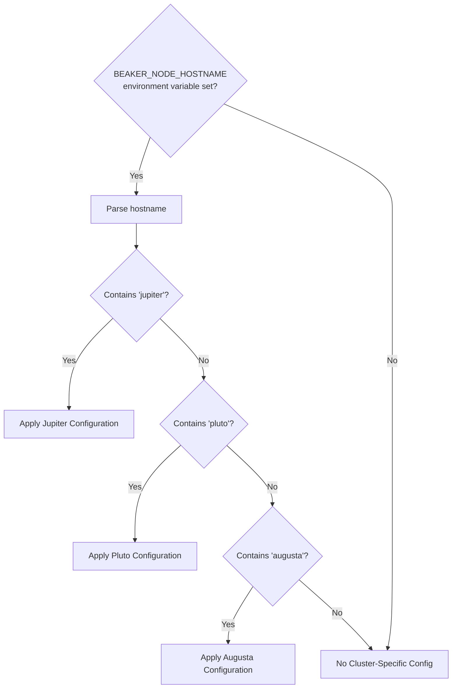
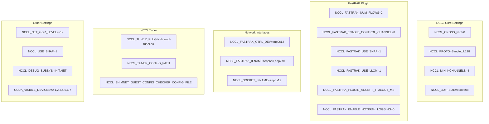
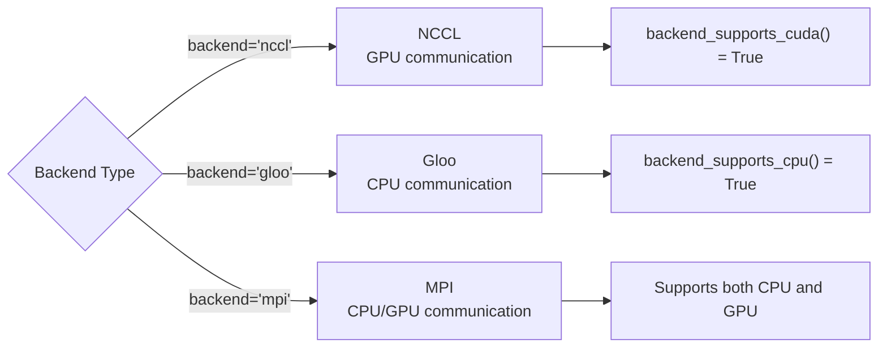
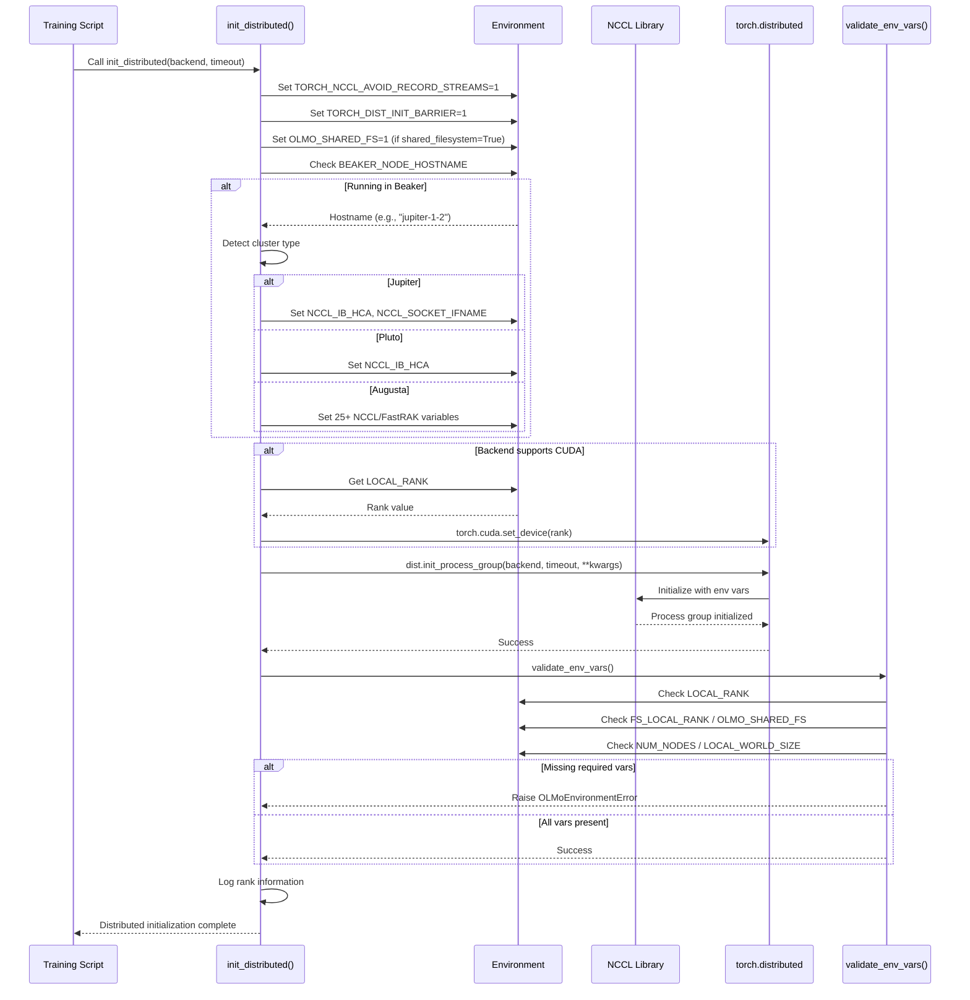
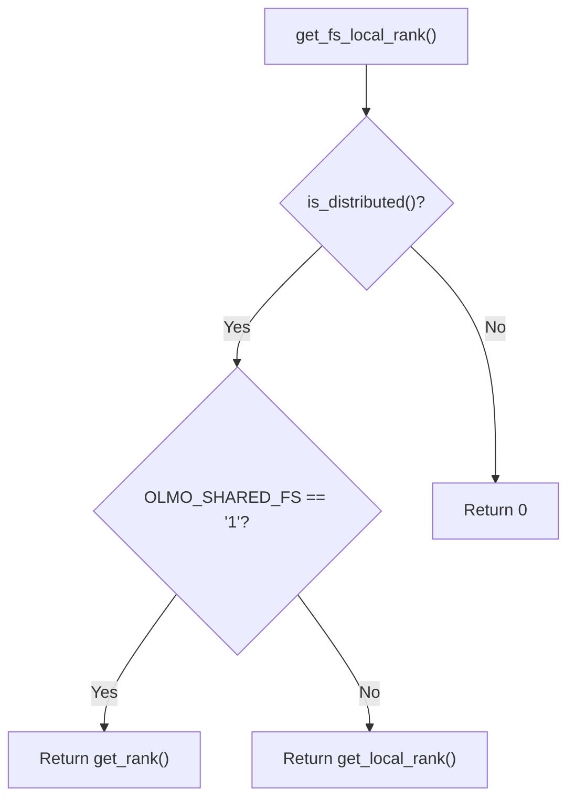

<!-- source: DeepWiki mcp.deepwiki.com · repo allenai/bolmo-core · page 5.2 Distributed Initialization · fetched 2026-10-26 -->

# Distributed Initialization

<details>
<summary>Relevant source files</summary>

The following files were used as context for generating this wiki page:

- [.github/actions/setup-venv/action.yml](.github/actions/setup-venv/action.yml)
- [.github/workflows/docker.yml](.github/workflows/docker.yml)
- [.github/workflows/main.yml](.github/workflows/main.yml)
- [.github/workflows/pr_checks.yml](.github/workflows/pr_checks.yml)
- [Makefile](Makefile)
- [pyproject.toml](pyproject.toml)
- [src/Dockerfile](src/Dockerfile)
- [src/olmo_core/distributed/utils.py](src/olmo_core/distributed/utils.py)

</details>


## Purpose and Scope

This page documents the distributed process group initialization system in OLMo-Core, focusing on the `init_distributed` function, environment variable management, NCCL configuration, and cluster-specific networking setup. For information about parallelism strategies that are applied after initialization, see [Parallelism Strategies](#5.1). For checkpoint operations in distributed contexts, see [Checkpointing](#5.3).

## Overview

The distributed initialization system prepares the training environment for multi-node, multi-GPU execution by:
- Initializing PyTorch's distributed process group with appropriate backends
- Setting environment variables for NCCL communication optimization
- Applying cluster-specific networking configurations for Jupiter, Pluto, and Augusta clusters
- Validating that required environment variables are present
- Setting CUDA devices for GPU-based training



**Sources:** [src/olmo_core/distributed/utils.py:30-131]()

## The `init_distributed` Function

The `init_distributed` function is the primary entry point for setting up distributed training. It is defined in [src/olmo_core/distributed/utils.py:30-131]() and performs several critical initialization steps.

### Function Signature

```python
def init_distributed(
    backend: str = "nccl",
    timeout: timedelta = timedelta(minutes=30),
    shared_filesytem: Optional[bool] = True,
    **kwargs,
):
```

### Parameters

| Parameter | Type | Default | Description |
|-----------|------|---------|-------------|
| `backend` | `str` | `"nccl"` | Distributed backend to use (`"nccl"`, `"gloo"`, etc.) |
| `timeout` | `timedelta` | `30 minutes` | Timeout for distributed operations |
| `shared_filesytem` | `Optional[bool]` | `True` | Whether nodes share a filesystem |
| `**kwargs` | | | Additional arguments passed to `torch.dist.init_process_group()` |

### Core Functionality

The function executes the following sequence:

1. **Memory Optimization:** Sets `TORCH_NCCL_AVOID_RECORD_STREAMS=1` to mitigate memory issues with async collective operations
2. **Synchronization:** Sets `TORCH_DIST_INIT_BARRIER=1` to force process synchronization at initialization
3. **Filesystem Configuration:** Sets `OLMO_SHARED_FS` environment variable if shared filesystem is enabled
4. **Cluster Detection:** Detects Beaker cluster environment and applies cluster-specific configurations
5. **CUDA Device Setup:** Sets the CUDA device for GPU-enabled backends
6. **Process Group Initialization:** Calls `torch.distributed.init_process_group()`
7. **Validation:** Validates that all required environment variables are set

**Sources:** [src/olmo_core/distributed/utils.py:30-131]()

## Environment Variables

The distributed initialization system relies on several environment variables to coordinate processes and configure networking.

### Required Environment Variables



### Environment Variable Table

| Variable | Purpose | Set By | Required |
|----------|---------|--------|----------|
| `LOCAL_RANK` | Local rank within the node (0 to LOCAL_WORLD_SIZE-1) | `torchrun` | Yes |
| `FS_LOCAL_RANK` | Local rank per filesystem (for non-shared filesystems) | User/Launch script | Conditional |
| `NUM_NODES` | Total number of nodes in the job | User/Launch script | Conditional* |
| `LOCAL_WORLD_SIZE` | Number of processes per node | `torchrun` | Conditional* |
| `OLMO_SHARED_FS` | Set to "1" if filesystem is shared across nodes | `init_distributed` | No |
| `BEAKER_NODE_HOSTNAME` | Hostname of Beaker node (e.g., "jupiter-1-2") | Beaker | No |

*Either `NUM_NODES` or `LOCAL_WORLD_SIZE` must be set.

### Validation Logic

The `validate_env_vars` function [src/olmo_core/distributed/utils.py:133-156]() checks:

1. `LOCAL_RANK` must be set in distributed contexts
2. For non-shared filesystems, either `FS_LOCAL_RANK` or `LOCAL_RANK` must be set (or `OLMO_SHARED_FS=1` must be set)
3. Either `NUM_NODES` or `LOCAL_WORLD_SIZE` must be set to determine cluster topology

**Sources:** [src/olmo_core/distributed/utils.py:19-25](), [src/olmo_core/distributed/utils.py:133-156]()

## Cluster-Specific Configuration

OLMo-Core automatically detects and configures settings for three specific compute clusters at AI2: Jupiter, Pluto, and Augusta. Detection is based on the `BEAKER_NODE_HOSTNAME` environment variable pattern.

### Cluster Detection



**Sources:** [src/olmo_core/distributed/utils.py:52-113]()

### Jupiter Cluster Configuration

Jupiter uses InfiniBand networking and requires specific HCA (Host Channel Adapter) configuration.

**Configuration:**
- `NCCL_IB_HCA`: Set to `^=mlx5_bond_0` to exclude specific InfiniBand adapters
- `NCCL_SOCKET_IFNAME`: Set to `ib` for multi-node jobs to use InfiniBand networking

**Applied when:** Hostname contains `"jupiter"`

**Sources:** [src/olmo_core/distributed/utils.py:58-62]()

### Pluto Cluster Configuration

Pluto also uses InfiniBand but with a different HCA exclusion pattern.

**Configuration:**
- `NCCL_IB_HCA`: Set to `^=mlx5_1,mlx5_2` to exclude specific InfiniBand devices

**Applied when:** Hostname contains `"pluto"`

**Sources:** [src/olmo_core/distributed/utils.py:63-64]()

### Augusta Cluster Configuration

Augusta is a Google Cloud cluster with Hyperdisk ML and requires extensive NCCL tuning for optimal performance with the FastRAK networking plugin.



**Key Settings:**

| Setting | Value | Purpose |
|---------|-------|---------|
| `NCCL_CROSS_NIC` | `0` | Disable cross-NIC communication |
| `NCCL_PROTO` | `Simple,LL128` | Enable specific NCCL protocols |
| `NCCL_MIN_NCHANNELS` | `4` | Minimum number of channels |
| `NCCL_P2P_NET_CHUNKSIZE` | `524288` | Network P2P chunk size |
| `NCCL_P2P_PCI_CHUNKSIZE` | `524288` | PCIe P2P chunk size |
| `NCCL_P2P_NVL_CHUNKSIZE` | `1048576` | NVLink P2P chunk size |
| `NCCL_NVLSTREE_MAX_CHUNKSIZE` | `131072` | NVLink tree max chunk size |
| `NCCL_FASTRAK_NUM_FLOWS` | `2` | Number of FastRAK flows |
| `NCCL_FASTRAK_ENABLE_CONTROL_CHANNEL` | `0` | Disable control channel |
| `NCCL_BUFFSIZE` | `8388608` | Buffer size (8MB) |
| `NCCL_FASTRAK_USE_SNAP` | `1` | Enable SNAP for FastRAK |
| `CUDA_VISIBLE_DEVICES` | `0,1,2,3,4,5,6,7` | All 8 GPUs visible |
| `NCCL_NET_GDR_LEVEL` | `PIX` | GPUDirect RDMA level |
| `NCCL_FASTRAK_USE_LLCM` | `1` | Use LLCM device |
| `NCCL_FASTRAK_LLCM_DEVICE_DIRECTORY` | `/dev/aperture_devices` | LLCM device directory |
| `NCCL_TUNER_PLUGIN` | `libnccl-tuner.so` | NCCL tuner plugin |
| `NCCL_TUNER_CONFIG_PATH` | `/var/lib/tcpxo/lib64/a3plus_tuner_config_ll128.textproto` | Tuner config |
| `NCCL_SHIMNET_GUEST_CONFIG_CHECKER_CONFIG_FILE` | `/var/lib/tcpxo/lib64/a3plus_guest_config_ll128.textproto` | Guest config |
| `NCCL_FASTRAK_CTRL_DEV` | `enp0s12` | Control device interface |
| `NCCL_FASTRAK_IFNAME` | `enp6s0,enp7s0,enp13s0,enp14s0,enp134s0,enp135s0,enp141s0,enp142s0` | Data interfaces |
| `NCCL_SOCKET_IFNAME` | `enp0s12` | Socket interface |
| `NCCL_DEBUG_SUBSYS` | `INIT,NET` | Debug subsystems |

**Note:** Augusta requires host networking to be enabled so that ethernet interface names remain consistent. The `NCCL_FASTRAK_PLUGIN_ACCEPT_TIMEOUT_MS` is dynamically set based on the `timeout` parameter passed to `init_distributed`.

**Applied when:** Hostname contains `"augusta"`

**Sources:** [src/olmo_core/distributed/utils.py:65-113]()

## Backend and Device Configuration

### Backend Selection

OLMo-Core supports different distributed backends, with NCCL being the default for GPU training.



The helper functions `backend_supports_cuda` [src/olmo_core/distributed/utils.py:406-418]() and `backend_supports_cpu` [src/olmo_core/distributed/utils.py:420-431]() determine whether a backend supports CUDA or CPU tensors:

- **NCCL:** Supports CUDA tensors, optimal for GPU-to-GPU communication
- **Gloo:** Supports CPU tensors, useful for CPU-based operations
- **MPI:** Supports both CPU and CUDA tensors

**Sources:** [src/olmo_core/distributed/utils.py:406-431]()

### CUDA Device Setup

For CUDA-enabled backends, `init_distributed` sets the CUDA device before initializing the process group to prevent race conditions where multiple ranks try to initialize on GPU 0.

**Device Assignment Logic:**
```python
# Set CUDA device based on LOCAL_RANK environment variable
device = torch.device(f"cuda:{int(os.environ[OLMO_LOCAL_RANK_ENV_VAR])}")
torch.cuda.set_device(device)
```

This ensures each process on a node uses its designated GPU:
- Rank 0 on a node → GPU 0
- Rank 1 on a node → GPU 1
- Rank N on a node → GPU N

**Important:** This step happens *before* `dist.init_process_group()` is called to avoid other ranks initializing CUDA on GPU 0.

**Sources:** [src/olmo_core/distributed/utils.py:114-121]()

## Initialization Flow

### Complete Initialization Sequence



**Sources:** [src/olmo_core/distributed/utils.py:30-131]()

## Utility Functions

### Rank and Size Queries

The module provides several utility functions for querying rank and size information:

| Function | Returns | Description |
|----------|---------|-------------|
| `is_distributed()` | `bool` | Whether distributed training is active |
| `get_rank(group)` | `int` | Global rank within process group (0 if not distributed) |
| `get_local_rank()` | `int` | Local rank on current node |
| `get_fs_local_rank(group)` | `int` | Local rank per filesystem |
| `get_world_size(group)` | `int` | Total number of processes in group |
| `get_local_world_size()` | `int` | Number of processes on current node |
| `get_num_nodes()` | `int` | Total number of nodes |
| `get_global_rank(group_rank, group)` | `int` | Translate group rank to global rank |

### Filesystem Local Rank

The `get_fs_local_rank` function [src/olmo_core/distributed/utils.py:225-246]() is particularly important for I/O operations:

- **Shared Filesystem:** Returns the global rank (only one process per filesystem needs to perform I/O)
- **Non-Shared Filesystem:** Returns the local rank (one process per node needs to perform I/O)

This abstraction allows checkpoint and data loading code to work correctly regardless of filesystem topology.



**Sources:** [src/olmo_core/distributed/utils.py:189-293]()

## Integration with Training

### Usage in Training Scripts

Training scripts typically call `init_distributed` early in their execution, before building models or data loaders:

```python
from olmo_core.distributed.utils import init_distributed

# Initialize distributed training
init_distributed(
    backend="nccl",
    timeout=timedelta(minutes=30),
    shared_filesytem=True
)

# Now safe to build models, load data, etc.
```

### Docker and CI/CD Integration

The Docker images built for OLMo-Core [src/Dockerfile:1-138]() include all necessary dependencies for distributed training:
- CUDA toolkit for GPU communication
- MLNX OFED drivers for InfiniBand networking on Jupiter and Pluto
- PyTorch with NCCL backend support

The CI/CD pipeline [.github/workflows/main.yml:1-278]() tests distributed functionality using Beaker, which automatically sets the required environment variables (`LOCAL_RANK`, `NUM_NODES`, etc.) through its job orchestration.

**Sources:** [src/Dockerfile:1-138](), [.github/workflows/main.yml:1-278]()

## Common Issues and Troubleshooting

### Missing Environment Variables

If `init_distributed` raises an `OLMoEnvironmentError`, check that:
1. You're using `torchrun` or another launcher that sets `LOCAL_RANK`
2. For non-shared filesystems, either `FS_LOCAL_RANK` is set or `OLMO_SHARED_FS=1` is set
3. Either `NUM_NODES` or `LOCAL_WORLD_SIZE` is set

### NCCL Timeout Issues

If you encounter NCCL timeouts during initialization:
1. Increase the `timeout` parameter to `init_distributed`
2. For Augusta, ensure host networking is enabled (required for stable interface names)
3. Check that firewall rules allow NCCL traffic on required ports

### Cluster-Specific Issues

**Jupiter/Pluto:** Ensure InfiniBand drivers are installed and operational  
**Augusta:** Verify that:
- Host networking is enabled
- All FastRAK/NCCL tuner libraries are present in `/var/lib/tcpxo/lib64/`
- The aperture devices directory `/dev/aperture_devices` exists

**Sources:** [src/olmo_core/distributed/utils.py:133-156]()

---

