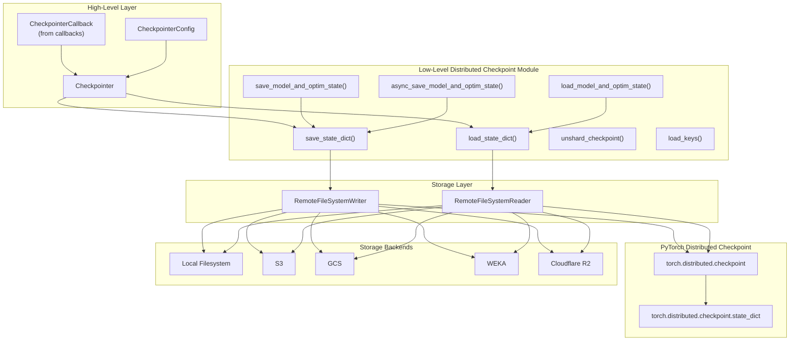
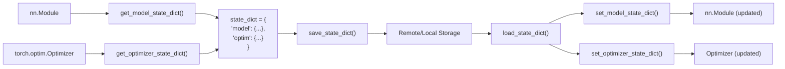
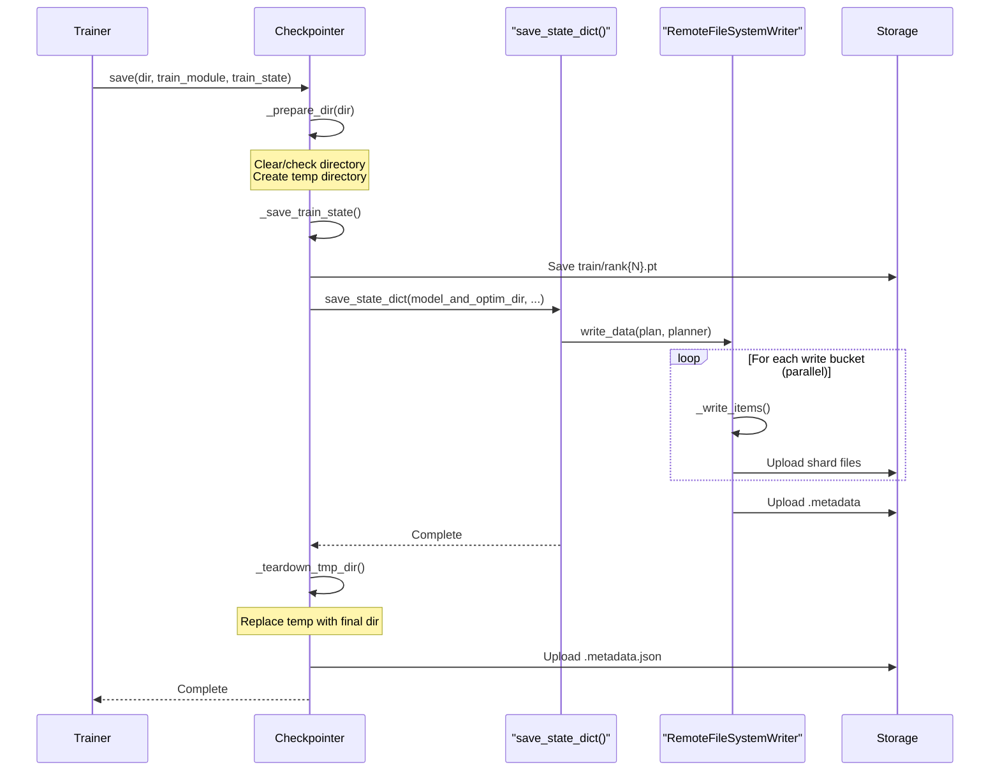
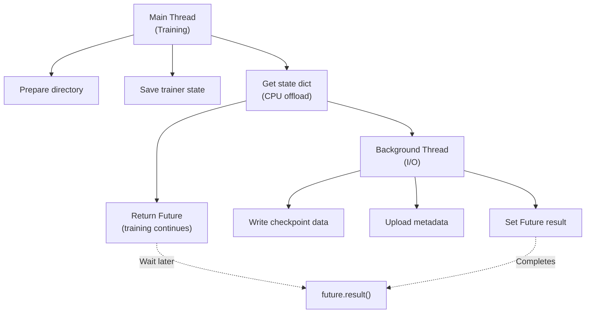
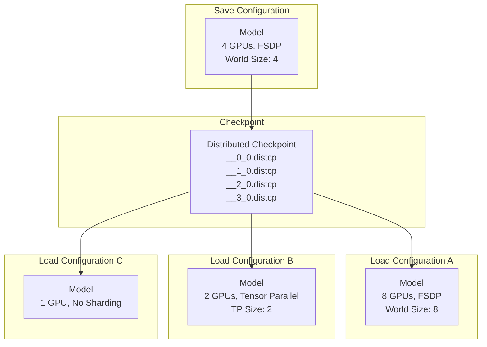

<!-- source: DeepWiki mcp.deepwiki.com · repo allenai/bolmo-core · page 5.3 Checkpointing · fetched 2026-10-26 -->

# Checkpointing

<details>
<summary>Relevant source files</summary>

The following files were used as context for generating this wiki page:

- [src/olmo_core/distributed/checkpoint/__init__.py](src/olmo_core/distributed/checkpoint/__init__.py)
- [src/olmo_core/distributed/checkpoint/filesystem.py](src/olmo_core/distributed/checkpoint/filesystem.py)
- [src/olmo_core/train/checkpoint.py](src/olmo_core/train/checkpoint.py)
- [src/olmo_core/utils.py](src/olmo_core/utils.py)
- [src/test/distributed/checkpoint_test.py](src/test/distributed/checkpoint_test.py)

</details>


## Purpose and Scope

This page documents the checkpointing system in OLMo-Core, which provides functionality for saving and loading model, optimizer, and training state during distributed training. The checkpointing system supports:

- **Topology-agnostic loading**: Load checkpoints saved with one distributed configuration (e.g., world size, sharding strategy) into a different configuration
- **Remote storage**: Save and load directly to/from S3, GCS, WEKA, and other remote storage systems
- **Async checkpointing**: Save checkpoints asynchronously without blocking training
- **Checkpoint unsharding**: Convert distributed checkpoints to standard PyTorch format

For information about the callback that integrates checkpointing into the training loop, see [Callbacks](#3.3). For inference-specific checkpoint loading, see [Checkpoint Loading for Inference](#6.3). For the underlying I/O operations, see [I/O System](#5.4).

**Sources:** [src/olmo_core/train/checkpoint.py:1-451](), [src/olmo_core/distributed/checkpoint/__init__.py:1-68]()

## System Architecture

The checkpointing system consists of two layers: a high-level `Checkpointer` class for trainer integration and a low-level distributed checkpoint module for storage operations.



**Diagram: Checkpointing System Architecture**

The high-level `Checkpointer` manages checkpoint directories and coordinates with the training loop, while the low-level module provides storage-agnostic save/load operations through PyTorch's distributed checkpoint framework.

**Sources:** [src/olmo_core/train/checkpoint.py:49-68](), [src/olmo_core/distributed/checkpoint/__init__.py:52-67](), [src/olmo_core/distributed/checkpoint/filesystem.py:154-293]()

## Core Components

### Checkpointer Class

The `Checkpointer` class provides trainer-level checkpointing functionality with directory management, metadata handling, and integration with the training loop.

| Component | Type | Purpose |
|-----------|------|---------|
| `Checkpointer` | Class | Main checkpointer for trainer integration |
| `CheckpointerConfig` | Config | Configuration for building Checkpointer instances |
| `CheckpointMetadata` | Dataclass | Version and metadata information |
| `work_dir` | Path | Local working directory for temporary files |
| `save_overwrite` | bool | Whether to overwrite existing checkpoints |
| `pre_download` | bool | Pre-download remote files before loading |

**Key Methods:**

- `save()`: Synchronously save checkpoint to a directory
- `save_async()`: Asynchronously save checkpoint returning a `Future`
- `load()`: Load checkpoint from a directory
- `write_file()`: Write arbitrary files to checkpoint directory
- `dir_is_checkpoint()`: Check if a directory contains a valid checkpoint
- `find_checkpoints()`: Find all checkpoints in a directory
- `latest_checkpoint()`: Find the most recent checkpoint
- `checkpoint_dirname()`: Generate standard checkpoint directory name

**Sources:** [src/olmo_core/train/checkpoint.py:76-451]()

#### Checkpoint Directory Structure

A checkpoint saved by `Checkpointer` has the following structure:

```
step{N}/
├── .metadata.json           # Checkpoint metadata (version, etc.)
├── train/
│   ├── rank0.pt            # Trainer state for rank 0
│   ├── rank1.pt            # Trainer state for rank 1
│   └── ...
└── model_and_optim/
    ├── .metadata           # Distributed checkpoint metadata
    ├── __0_0.distcp        # Shard data files
    ├── __1_0.distcp
    └── ...
```

- **train/**: Contains per-rank trainer state (current step, epoch, RNG state, etc.)
- **model_and_optim/**: Contains distributed model and optimizer state using PyTorch's distributed checkpoint format
- **.metadata.json**: Top-level metadata file with version information

**Sources:** [src/olmo_core/train/checkpoint.py:81-83](), [src/olmo_core/train/checkpoint.py:336-346]()

### Distributed Checkpoint Functions

The low-level distributed checkpoint module provides functions that work directly with PyTorch modules and optimizers.

| Function | Purpose | Returns |
|----------|---------|---------|
| `save_model_and_optim_state()` | Save model and optimizer state | None |
| `async_save_model_and_optim_state()` | Async version of save | `Future[None]` |
| `load_model_and_optim_state()` | Load model and optimizer state in-place | `_IncompatibleKeys` |
| `save_state_dict()` | Save arbitrary state dict | None |
| `async_save_state_dict()` | Async version for state dicts | `Future[None]` |
| `load_state_dict()` | Load arbitrary state dict in-place | None |
| `unshard_checkpoint()` | Convert to unsharded format | `(Path, Optional[Path])` |
| `load_keys()` | Load specific keys from checkpoint | `Generator[Any, None, None]` |
| `get_checkpoint_metadata()` | Read checkpoint metadata | `Metadata` |

**Sources:** [src/olmo_core/distributed/checkpoint/__init__.py:72-668]()

#### Model and Optimizer State Management

The checkpoint module uses PyTorch's `torch.distributed.checkpoint.state_dict` API to obtain distributed-aware state dictionaries:



**Diagram: State Dictionary Flow**

The module automatically handles FSDP, tensor parallel, and other distributed topologies by using PyTorch's state dict APIs, which understand how to shard and gather tensors appropriately.

**Sources:** [src/olmo_core/distributed/checkpoint/__init__.py:704-724](), [src/olmo_core/distributed/checkpoint/__init__.py:346-395]()

### Storage Writers and Readers

The `RemoteFileSystemWriter` and `RemoteFileSystemReader` classes provide the interface between PyTorch's distributed checkpoint framework and storage backends.

#### RemoteFileSystemWriter

Implements `torch.distributed.checkpoint.StorageWriter` to write checkpoint data.

**Key Features:**
- Writes directly to local or remote storage (S3, GCS, WEKA, R2)
- Multi-threaded writing for parallel I/O
- Optional upload throttling to avoid overwhelming storage systems
- Splits write items by size and type for balanced parallel execution

**Configuration:**

| Parameter | Type | Purpose |
|-----------|------|---------|
| `path` | PathOrStr | Target directory path or URL |
| `thread_count` | Optional[int] | Number of I/O threads (default: from `get_default_thread_count()`) |
| `process_group` | Optional[ProcessGroup] | Process group for coordination |
| `throttle_uploads` | bool | Limit concurrent uploads per node |

**Sources:** [src/olmo_core/distributed/checkpoint/filesystem.py:154-293]()

#### RemoteFileSystemReader

Implements `torch.distributed.checkpoint.StorageReader` to read checkpoint data.

**Key Features:**
- Reads from local or remote storage with byte-range requests
- Multi-threaded reading for parallel I/O
- Optional pre-download of checkpoint files to local cache
- Each rank only downloads the data it needs (sparse reads)

**Configuration:**

| Parameter | Type | Purpose |
|-----------|------|---------|
| `path` | PathOrStr | Checkpoint directory path or URL |
| `thread_count` | Optional[int] | Number of I/O threads |
| `pre_download` | bool | Download files to cache before reading |
| `work_dir` | Optional[PathOrStr] | Local cache directory |

**Sources:** [src/olmo_core/distributed/checkpoint/filesystem.py:295-430]()

## Save Operations

### Synchronous Save

The standard save operation blocks until the checkpoint is fully written to storage.



**Diagram: Synchronous Save Sequence**

**Usage Example:**

```python
checkpointer = Checkpointer(
    work_dir=Path("./checkpoints"),
    save_overwrite=False
)

checkpointer.save(
    dir="s3://bucket/experiment/step1000",
    train_module=train_module,
    train_state={"step": 1000, "epoch": 1}
)
```

**Sources:** [src/olmo_core/train/checkpoint.py:97-121](), [src/olmo_core/distributed/checkpoint/__init__.py:183-246]()

### Asynchronous Save

The async save operation offloads checkpoint writing to a background thread, allowing training to continue while the checkpoint is being written.



**Diagram: Asynchronous Save Flow**

**Key Implementation Details:**

1. State dictionaries are CPU-offloaded before writing begins
2. The `Future` is returned immediately after CPU offload
3. Writing happens in a background thread pool
4. Metadata is written only after all data is uploaded

**Usage Example:**

```python
# Start async save
future = checkpointer.save_async(
    dir="s3://bucket/experiment/step2000",
    train_module=train_module,
    train_state={"step": 2000, "epoch": 2}
)

# Training continues here...
for batch in data_loader:
    # ... training step ...
    pass

# Wait for save to complete before next checkpoint
future.result()
```

**Sources:** [src/olmo_core/train/checkpoint.py:122-161](), [src/olmo_core/distributed/checkpoint/__init__.py:249-287]()

### Process Group Requirements

Async checkpointing requires a dedicated process group to avoid interfering with training collectives:

```python
# In training setup
checkpoint_pg = dist.new_group()

checkpointer = Checkpointer(
    work_dir=Path("./checkpoints"),
    process_group=checkpoint_pg
)
```

Without a separate process group, async saves can cause deadlocks or errors because NCCL collectives from training and checkpointing may conflict.

**Sources:** [src/olmo_core/train/checkpoint.py:128-131]()

## Load Operations

### Topology-Agnostic Loading

A key feature of the distributed checkpoint system is the ability to load checkpoints saved with one distributed topology into a model with a different topology.



**Diagram: Topology-Agnostic Loading**

The system handles:
- **Different world sizes**: Save with N ranks, load with M ranks
- **Different sharding strategies**: Save with FSDP, load with TP or no sharding
- **Different parallelism configs**: Save with TP=2, load with TP=4

**Implementation:**

The PyTorch distributed checkpoint framework analyzes the metadata and determines which portions of each tensor each rank needs, then loads only those portions via byte-range requests.

**Sources:** [src/olmo_core/distributed/checkpoint/__init__.py:8-12](), [src/olmo_core/distributed/checkpoint/__init__.py:290-395]()

### Load Process

```mermaid
sequenceDiagram
    participant Caller
    participant Checkpointer
    participant LoadFunc as "load_model_and_optim_state()"
    participant Reader as "RemoteFileSystemReader"
    participant Storage
    
    Caller->>Checkpointer: load(dir, train_module)
    
    Checkpointer->>Storage: Load train/rank{N}.pt
    Note over Checkpointer: Try current rank first,<br/>fallback to rank 0
    
    Checkpointer->>Reader: read_metadata()
    Reader->>Storage: Download .metadata
    Reader-->>Checkpointer: Metadata
    
    Checkpointer->>Checkpointer: train_module.state_dict_to_load(metadata)
    Note over Checkpointer: Create state dict skeleton<br/>with correct shapes
    
    Checkpointer->>LoadFunc: load_state_dict(dir, state_dict)
    LoadFunc->>Reader: read_data(plan, planner)
    
    loop For each rank (parallel)
        Reader->>Storage: Byte-range request for shard
        Reader->>Reader: Narrow tensor to correct slice
        Reader->>Reader: Copy into target tensor
    end
    
    Reader-->>LoadFunc: Complete
    LoadFunc->>LoadFunc: set_model_state_dict()
    LoadFunc->>LoadFunc: set_optimizer_state_dict()
    LoadFunc-->>Checkpointer: incompatible_keys
    
    Checkpointer->>Checkpointer: train_module.load_state_dict()
    Checkpointer-->>Caller: trainer_state
```



**Diagram: Load Sequence**

**Key Steps:**

1. **Load trainer state**: Each rank loads its own trainer state, or rank 0's state if restoring with different world size
2. **Read metadata**: Rank 0 reads checkpoint metadata and broadcasts to all ranks
3. **Prepare state dict skeleton**: Create state dict with correct tensor shapes for current topology
4. **Parallel loading**: Each rank downloads only the portions of tensors it needs
5. **Set state**: Apply loaded state to model and optimizer

**Sources:** [src/olmo_core/train/checkpoint.py:162-221](), [src/olmo_core/distributed/checkpoint/__init__.py:290-395]()

### Key Mapping

When parameter names differ between the saved checkpoint and the current model, key mapping allows loading under different names:

```python
load_model_and_optim_state(
    dir="path/to/checkpoint",
    model=model,
    optim=optim,
    key_mapping={
        "fc_out.weight": "w2.weight",  # Map current name to checkpoint name
        "fc_out.bias": "w2.bias"
    }
)
```

The key mapping:
- Maps current model parameter names to checkpoint parameter names
- Applies to both model and optimizer state
- Handles both flattened and nested optimizer state dicts

**Sources:** [src/olmo_core/distributed/checkpoint/__init__.py:337-344](), [src/olmo_core/distributed/checkpoint/__init__.py:726-773]()

## Checkpoint Unsharding

The `unshard_checkpoint()` function converts a distributed checkpoint to standard PyTorch format that can be loaded without the distributed checkpoint framework.

### Unsharding Strategies

| Strategy | Description | Use Case |
|----------|-------------|----------|
| `one_file` | Single file for model, single file for optimizer | Default, simple loading |
| `one_file_per_tensor` | Each tensor in its own file | Very large models that don't fit in memory |
| `chunks` | Group tensors into files by size limit | Balance between file count and memory usage |

**Usage Examples:**

```python
# One file strategy (default)
model_path, optim_path = unshard_checkpoint(
    dir="s3://bucket/experiment/step1000",
    target_dir="./unsharded",
    unshard_strategy=UnshardStrategy.one_file()
)
# Creates: ./unsharded/model.pt and ./unsharded/optim.pt

# One file per tensor
model_dir, _ = unshard_checkpoint(
    dir="s3://bucket/experiment/step1000",
    target_dir="./unsharded",
    optim=False,
    unshard_strategy=UnshardStrategy.one_file_per_tensor()
)
# Creates: ./unsharded/model/w1-weight.pt, ./unsharded/model/w1-bias.pt, etc.

# Chunks strategy
model_dir, _ = unshard_checkpoint(
    dir="s3://bucket/experiment/step1000",
    target_dir="./unsharded",
    optim=False,
    unshard_strategy=UnshardStrategy.chunks(chunk_size_in_bytes=1_000_000_000)  # 1GB chunks
)
# Creates: ./unsharded/model/chunk-00000.pt, ./unsharded/model/chunk-00001.pt, etc.
```

**Sources:** [src/olmo_core/distributed/checkpoint/__init__.py:467-622]()

### Safetensors Support

Checkpoints can be unsharded to safetensors format for safer loading and better interoperability:

```python
model_path, _ = unshard_checkpoint(
    dir="s3://bucket/experiment/step1000",
    target_dir="./unsharded",
    optim=False,  # safetensors doesn't support optimizer state
    use_safetensors=True
)
# Creates: ./unsharded/model.safetensors
```

**Note:** Safetensors format cannot save optimizer state because it only supports tensors, not arbitrary Python objects.

**Sources:** [src/olmo_core/distributed/checkpoint/__init__.py:473-502]()

### Loading Specific Keys

For memory-efficient loading of specific tensors without unsharding the entire checkpoint:

```python
# Load specific parameters
tensors = list(load_keys(
    dir="s3://bucket/experiment/step1000",
    keys=["model.transformer.blocks.0.attn.w_q.weight", "model.transformer.blocks.0.attn.w_k.weight"]
))

# tensors[0] contains the query weight
# tensors[1] contains the key weight
```

This is useful for:
- Analyzing specific layers
- Extracting embeddings
- Partial model inspection

**Sources:** [src/olmo_core/distributed/checkpoint/__init__.py:624-657]()

## Working with Remote Storage

### Remote Save Configuration

```python
checkpointer = Checkpointer(
    work_dir=Path("./local_tmp"),  # Local temp dir for staging
    save_overwrite=False,
    save_thread_count=16,  # Parallel upload threads
    throttle_uploads=True  # Limit concurrent uploads per node
)

# Save to S3
checkpointer.save(
    dir="s3://my-bucket/experiments/run1/step1000",
    train_module=train_module,
    train_state=state
)

# Save to GCS
checkpointer.save(
    dir="gs://my-bucket/experiments/run1/step2000",
    train_module=train_module,
    train_state=state
)
```

**Sources:** [src/olmo_core/train/checkpoint.py:84-91]()

### Remote Load Configuration

```python
checkpointer = Checkpointer(
    work_dir=Path("./cache"),
    pre_download=True,  # Download files before reading
    load_thread_count=32  # Parallel download threads
)

checkpointer.load(
    dir="s3://my-bucket/experiments/run1/step1000",
    train_module=train_module
)
```

**Optimization Tips:**

1. **Pre-download**: Set `pre_download=True` when loading from slow storage to download all needed files upfront
2. **Thread count**: Increase `load_thread_count` for faster parallel downloads
3. **Work dir**: Use fast local storage (e.g., NVMe) for `work_dir`
4. **Throttle uploads**: Enable `throttle_uploads=True` to avoid overwhelming object stores during multi-node saves

**Sources:** [src/olmo_core/train/checkpoint.py:84-91](), [src/olmo_core/distributed/checkpoint/filesystem.py:301-318]()

### Byte-Range Reading

When loading from remote storage, the reader uses byte-range requests to fetch only the needed portions of each file:

```python
# Each rank only downloads its shard
# Rank 0 might read bytes 0-1000 of __0_0.distcp
# Rank 1 might read bytes 1000-2000 of __0_0.distcp
# etc.
```

This dramatically reduces network traffic and memory usage compared to downloading entire checkpoint files.

**Sources:** [src/olmo_core/distributed/checkpoint/filesystem.py:320-330]()

## Checkpoint Finding and Management

### Finding Checkpoints

The `Checkpointer` provides utilities for finding and managing checkpoints:

```python
# Check if a directory contains a checkpoint
if Checkpointer.dir_is_checkpoint("./checkpoints/step1000"):
    print("Valid checkpoint found")

# Find all checkpoints in a directory
for step, path in Checkpointer.find_checkpoints("./checkpoints"):
    print(f"Found checkpoint at step {step}: {path}")

# Get the latest checkpoint
try:
    latest = Checkpointer.latest_checkpoint("./checkpoints")
    print(f"Latest checkpoint: {latest}")
except FileNotFoundError:
    print("No checkpoints found")
```

**Sources:** [src/olmo_core/train/checkpoint.py:268-334]()

### Standard Checkpoint Naming

By default, checkpoints are named `step{N}` where N is the training step:

```python
dirname = Checkpointer.checkpoint_dirname(step=1000)
# Returns: "step1000"

checkpoint_path = f"{base_dir}/{dirname}"
# e.g., "/mnt/checkpoints/step1000"
```

**Sources:** [src/olmo_core/train/checkpoint.py:263-265](), [src/olmo_core/train/checkpoint.py:82]()

## Integration with Training

The checkpointing system integrates with the trainer through the `CheckpointerCallback`:

```python
from olmo_core.train import Trainer, TrainerConfig
from olmo_core.train.callbacks import CheckpointerCallback

trainer = Trainer(
    TrainerConfig(
        save_folder="./checkpoints",
        save_interval=1000,  # Save every 1000 steps
        # ... other config ...
    ),
    callbacks=[
        CheckpointerCallback(
            checkpointer_config=CheckpointerConfig(
                work_dir="./tmp",
                save_overwrite=False,
                save_thread_count=16
            )
        )
    ]
)
```

The callback handles:
- Periodic checkpoint saves during training
- Loading checkpoints when resuming training
- Managing checkpoint rotation and cleanup

For details on the callback implementation, see [Callbacks](#3.3).

**Sources:** [src/olmo_core/train/checkpoint.py:49-68]()

## Error Handling

### Common Issues

| Issue | Cause | Solution |
|-------|-------|----------|
| `FileExistsError` | Directory not empty | Set `save_overwrite=True` or clear directory |
| Missing keys on load | Model architecture changed | Use `key_mapping` or `strict=False` |
| Deadlock on async save | No process group | Create separate process group for checkpointer |
| Slow remote loads | Sequential downloads | Increase `load_thread_count` |

### Validation

The checkpoint system validates checkpoint structure before loading:

```python
# Check if directory contains valid checkpoint
try:
    metadata = get_checkpoint_metadata("path/to/checkpoint")
    print(f"Valid checkpoint with {len(metadata.state_dict_metadata)} keys")
except FileNotFoundError as e:
    print(f"Invalid checkpoint: {e}")
```

**Sources:** [src/olmo_core/distributed/checkpoint/__init__.py:659-668]()

## Examples

### Basic Save and Load

```python
from olmo_core.train.checkpoint import Checkpointer
from pathlib import Path

# Create checkpointer
checkpointer = Checkpointer(work_dir=Path("./work"))

# Save checkpoint
checkpointer.save(
    dir="./checkpoints/step1000",
    train_module=train_module,
    train_state={"step": 1000, "epoch": 1}
)

# Load checkpoint
trainer_state = checkpointer.load(
    dir="./checkpoints/step1000",
    train_module=train_module
)
print(f"Resumed from step {trainer_state['step']}")
```

### Async Checkpointing

```python
# Start async save
future = checkpointer.save_async(
    dir="s3://bucket/experiment/step2000",
    train_module=train_module,
    train_state={"step": 2000}
)

# Continue training
for i in range(100):
    train_step()

# Ensure save completed before exit
future.result()
```

### Loading with Different Topology

```python
# Checkpoint was saved with 4 GPUs, FSDP
# Now loading with 8 GPUs, FSDP

checkpointer.load(
    dir="s3://bucket/experiment/step1000",
    train_module=train_module_8gpu
)
# Automatically handles resharding
```

### Unsharding for HuggingFace

```python
from olmo_core.distributed.checkpoint import unshard_checkpoint

# Convert to standard PyTorch format
model_path, _ = unshard_checkpoint(
    dir="s3://bucket/experiment/step5000",
    target_dir="./huggingface_model",
    optim=False,
    use_safetensors=True
)

# Load with HuggingFace
from transformers import AutoModel
model = AutoModel.from_pretrained("./huggingface_model")
```

**Sources:** [src/test/distributed/checkpoint_test.py:29-91](), [src/test/distributed/checkpoint_test.py:105-168](), [src/test/distributed/checkpoint_test.py:217-311]()

---

