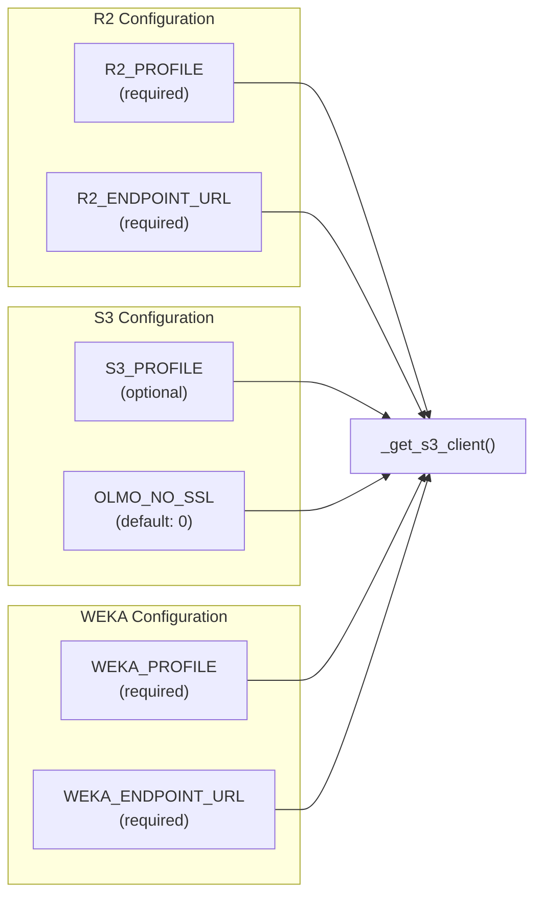
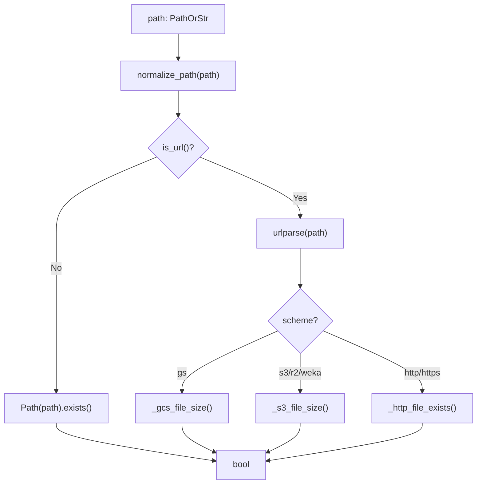
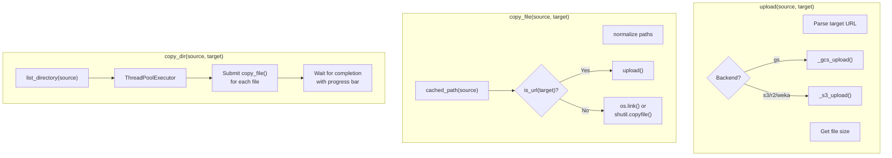
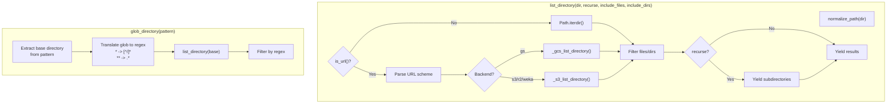
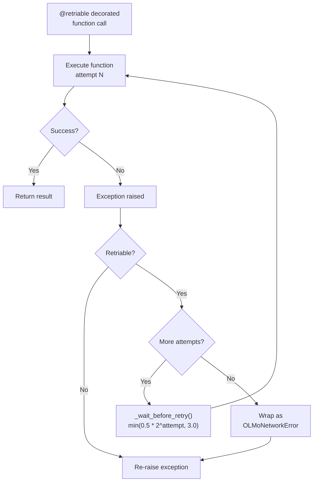
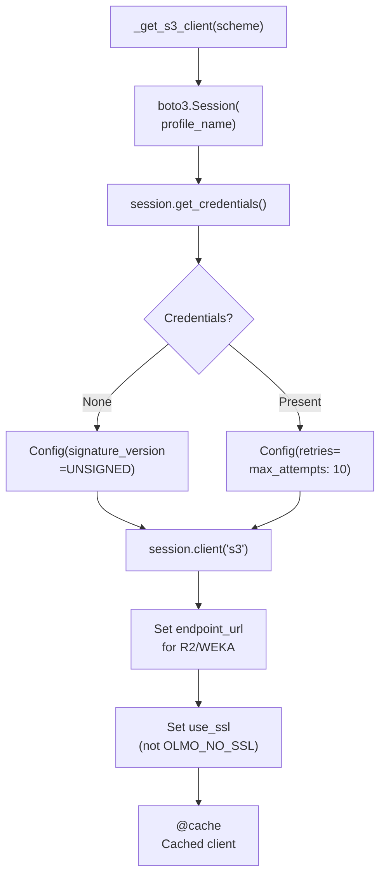
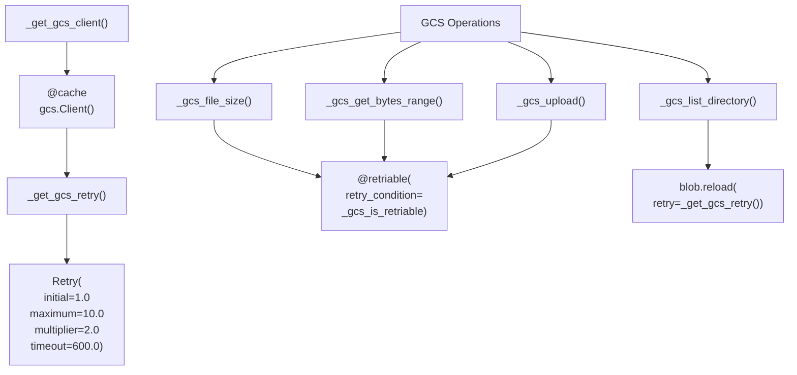
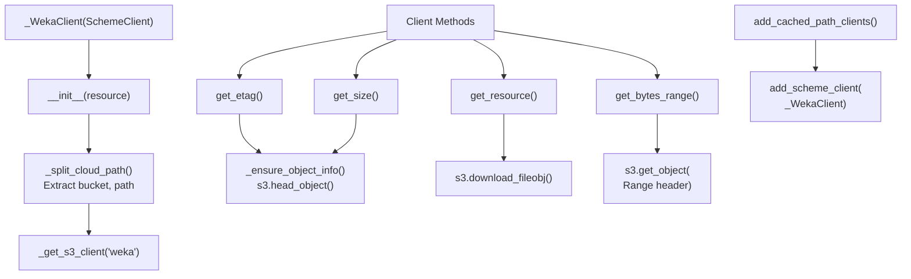
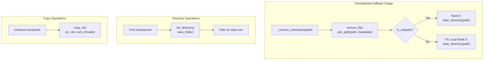

<!-- source: DeepWiki mcp.deepwiki.com · repo allenai/bolmo-core · page 5.4 I/O System · fetched 2026-10-26 -->

# I/O System

<details>
<summary>Relevant source files</summary>

The following files were used as context for generating this wiki page:

- [src/olmo_core/io.py](src/olmo_core/io.py)
- [src/olmo_core/train/callbacks/checkpointer.py](src/olmo_core/train/callbacks/checkpointer.py)
- [src/test/conftest.py](src/test/conftest.py)
- [src/test/io_test.py](src/test/io_test.py)
- [src/test/launch/beaker_test.py](src/test/launch/beaker_test.py)

</details>


The I/O system provides a unified interface for file operations across local filesystems and remote storage backends including S3, GCS, WEKA, and R2. This abstraction enables transparent access to training data, checkpoints, and other artifacts regardless of their physical location.

**Scope**: This page covers the file I/O utilities in [src/olmo_core/io.py](). For checkpoint-specific operations and distributed state management, see [Checkpointing](#5.3).

## Architecture Overview

The I/O system consists of three layers: a unified API that abstracts storage location differences, backend-specific implementations for each storage type, and retry/error handling logic for reliability.

```mermaid
graph TB
    subgraph "Unified API Layer"
        normalize_path["normalize_path()"]
        is_url["is_url()"]
        join_path["join_path()"]
    end
    
    subgraph "File Operations"
        file_exists["file_exists()"]
        get_file_size["get_file_size()"]
        get_bytes_range["get_bytes_range()"]
        remove_file["remove_file()"]
    end
    
    subgraph "Directory Operations"
        list_directory["list_directory()"]
        glob_directory["glob_directory()"]
        clear_directory["clear_directory()"]
        dir_is_empty["dir_is_empty()"]
    end
    
    subgraph "Transfer Operations"
        upload["upload()"]
        copy_file["copy_file()"]
        copy_dir["copy_dir()"]
        resource_path["resource_path()"]
    end
    
    subgraph "Backend Implementations"
        LocalFS["Local Filesystem<br/>Path operations"]
        S3Client["S3/R2/WEKA<br/>boto3 client"]
        GCSClient["GCS<br/>google.cloud.storage"]
        HTTPClient["HTTP/HTTPS<br/>requests"]
    end
    
    subgraph "Retry & Error Handling"
        retriable["@retriable decorator"]
        _wait_before_retry["_wait_before_retry()"]
        OLMoNetworkError["OLMoNetworkError"]
    end
    
    normalize_path --> file_exists
    normalize_path --> get_file_size
    normalize_path --> list_directory
    normalize_path --> upload
    
    is_url --> file_exists
    is_url --> get_file_size
    is_url --> copy_file
    
    file_exists --> LocalFS
    file_exists --> S3Client
    file_exists --> GCSClient
    file_exists --> HTTPClient
    
    get_bytes_range --> LocalFS
    get_bytes_range --> S3Client
    get_bytes_range --> GCSClient
    get_bytes_range --> HTTPClient
    
    upload --> S3Client
    upload --> GCSClient
    
    copy_file --> resource_path
    copy_dir --> list_directory
    copy_dir --> copy_file
    
    retriable --> S3Client
    retriable --> GCSClient
    retriable --> HTTPClient
    retriable --> _wait_before_retry
    retriable --> OLMoNetworkError
```



**Sources**: [src/olmo_core/io.py:40-438]()

## Supported Storage Backends

The I/O system supports five storage backend types, each with specific configuration requirements and capabilities.

| Backend | URL Scheme | Configuration | Primary Use Case |
|---------|-----------|---------------|------------------|
| Local Filesystem | `file://` or path | None | Development, local testing |
| AWS S3 | `s3://` | `S3_PROFILE` (optional) | Production checkpoints, datasets |
| Cloudflare R2 | `r2://` | `R2_PROFILE`, `R2_ENDPOINT_URL` | S3-compatible storage |
| WEKA | `weka://` | `WEKA_PROFILE`, `WEKA_ENDPOINT_URL` | High-performance cluster storage |
| Google Cloud Storage | `gs://` | Google Cloud credentials | GCS-hosted data |
| HTTP/HTTPS | `http://`, `https://` | None | Read-only public data |

**Sources**: [src/olmo_core/io.py:77-176](), [src/olmo_core/io.py:824-868]()

### Environment Variables



**Sources**: [src/olmo_core/io.py:803-868]()

## Core File Operations

The unified API provides consistent file operations across all storage backends.

### File Metadata and Existence



**Implementation Details**:

- `file_exists(path)` [src/olmo_core/io.py:284-316](): Returns `True` if file exists, `False` otherwise
- `get_file_size(path)` [src/olmo_core/io.py:87-111](): Returns file size in bytes
- `get_bytes_range(path, bytes_start, num_bytes)` [src/olmo_core/io.py:113-145](): Retrieves specific byte range from file

**Sources**: [src/olmo_core/io.py:284-316](), [src/olmo_core/io.py:87-111](), [src/olmo_core/io.py:113-145]()

### File Transfer Operations

The system provides three levels of file transfer: single file upload, single file copy, and directory copy.



**Key Functions**:
- `upload(source, target, save_overwrite, quiet)` [src/olmo_core/io.py:147-179](): Upload local file to remote storage
- `copy_file(source, target, save_overwrite, quiet)` [src/olmo_core/io.py:181-213](): Copy between any locations
- `copy_dir(source, target, save_overwrite, num_threads, quiet)` [src/olmo_core/io.py:215-268](): Parallel directory copy

**Sources**: [src/olmo_core/io.py:147-268]()

## Directory Operations

Directory operations support both immediate listing and recursive traversal.

### Listing and Pattern Matching



**Functions**:
- `list_directory(dir, recurse, include_files, include_dirs)` [src/olmo_core/io.py:385-438](): Enumerate directory contents
- `glob_directory(pattern)` [src/olmo_core/io.py:440-469](): Pattern-based file matching with `*` and `**` wildcards

**Sources**: [src/olmo_core/io.py:385-469]()

### Directory Management

| Function | Purpose | Safety Features |
|----------|---------|-----------------|
| `dir_is_empty(dir)` | Check if directory is empty | Returns `True` for non-existent directories |
| `clear_directory(dir, force)` | Remove all contents | Requires `force=True` for remote paths <2 levels deep |
| `remove_file(path)` | Delete single file | Raises `FileNotFoundError` if missing |

**Sources**: [src/olmo_core/io.py:270-340](), [src/olmo_core/io.py:342-383]()

## Retry Logic and Error Handling

Network operations use a decorator-based retry mechanism with exponential backoff.



**Configuration**:

The `@retriable` decorator [src/olmo_core/io.py:526-567]() accepts:
- `max_attempts`: Maximum retry attempts (default: 3)
- `retriable_errors`: Tuple of exception types that trigger retries
- `retry_condition`: Custom function to determine if an exception is retriable

**Default Retriable Errors**:
- `requests.exceptions.ConnectionError`
- `requests.exceptions.Timeout`
- `requests.exceptions.ChunkedEncodingError`

**Backend-Specific Retry Conditions**:
- S3/R2/WEKA: `botocore.exceptions.ClientError`, `HTTPClientError`, `ConnectionError` [src/olmo_core/io.py:871-876]()
- GCS: Uses `google.api_core.retry.if_transient_error()` [src/olmo_core/io.py:630-643]()

**Sources**: [src/olmo_core/io.py:514-567](), [src/olmo_core/io.py:630-656](), [src/olmo_core/io.py:871-876]()

## Backend Implementation Details

### S3-Compatible Storage (S3, R2, WEKA)

All S3-compatible backends share common client initialization through `_get_s3_client(scheme)` [src/olmo_core/io.py:803-822]().



**Client Methods** (all decorated with `@retriable`):
- `_s3_file_size(scheme, bucket_name, key)` [src/olmo_core/io.py:880-890]()
- `_s3_get_bytes_range(scheme, bucket_name, key, bytes_start, num_bytes)` [src/olmo_core/io.py:906-930]()
- `_s3_upload(source, scheme, bucket_name, key, save_overwrite)` [src/olmo_core/io.py:933-955]()
- `_s3_list_directory(scheme, bucket_name, prefix, recurse, include_files, include_dirs)` [src/olmo_core/io.py:977-1005]()

**Sources**: [src/olmo_core/io.py:803-1005]()

### Google Cloud Storage

GCS operations use the `google.cloud.storage.Client` with custom retry configuration.



**GCS-Specific Retry Condition** [src/olmo_core/io.py:630-643]():
- `google.api_core.retry.if_transient_error()`
- `requests.exceptions.Timeout`
- `BadRequest` (Google throws this transiently)
- `GatewayTimeout`
- `RefreshError`

**Sources**: [src/olmo_core/io.py:623-796]()

### Custom WEKA Client for cached_path

The system includes a custom `SchemeClient` implementation for WEKA URLs to work with the `cached_path` library.



**Sources**: [src/olmo_core/io.py:1012-1074]()

## Serialization Utilities

The I/O system provides utilities for serializing Python objects to tensors for distributed operations.

| Function | Purpose | Implementation |
|----------|---------|----------------|
| `serialize_to_tensor(x)` | Pickle object to byte tensor | `pickle.dumps()` → `torch.frombuffer()` [src/olmo_core/io.py:489-497]() |
| `deserialize_from_tensor(data)` | Unpickle object from byte tensor | `pickle.loads()` from uint8 tensor [src/olmo_core/io.py:499-507]() |

These functions are used internally for passing objects between distributed processes when direct object passing isn't possible.

**Sources**: [src/olmo_core/io.py:489-507]()

## Integration with Checkpointing

The checkpoint system relies heavily on the I/O layer for distributed state management. The `CheckpointerCallback` demonstrates typical usage patterns.



**Key Integration Points**:

1. **Checkpoint Removal** [src/olmo_core/train/callbacks/checkpointer.py:154-177]():
   - Uses `remove_file()` to invalidate checkpoint metadata
   - Uses `clear_directory()` to delete checkpoint contents
   - Handles distributed coordination (rank 0 or FS-local rank 0)

2. **Checkpoint Discovery**:
   - Uses `list_directory()` to find existing checkpoints
   - Filters based on step numbers and intervals

3. **Async Execution**:
   - I/O operations run in separate thread pool for non-blocking saves
   - Checkpoint callback awaits futures before cleanup operations

**Sources**: [src/olmo_core/train/callbacks/checkpointer.py:154-177](), [src/olmo_core/io.py:18]()

## Thread Safety and Initialization

For multi-threaded data loading, backend clients should be initialized per-thread to avoid boto3 threading issues.

```python
# Initialize client for the current thread
init_client("s3://bucket/path")
init_client("weka://bucket/path")
```

The `init_client(remote_path)` function [src/olmo_core/io.py:471-482]() creates a client for the appropriate backend, which is then cached thread-locally through the `@cache` decorator on client factory functions.

**Sources**: [src/olmo_core/io.py:471-482](), [src/olmo_core/io.py:14-17](), [src/olmo_core/io.py:623](), [src/olmo_core/io.py:803]()

---

