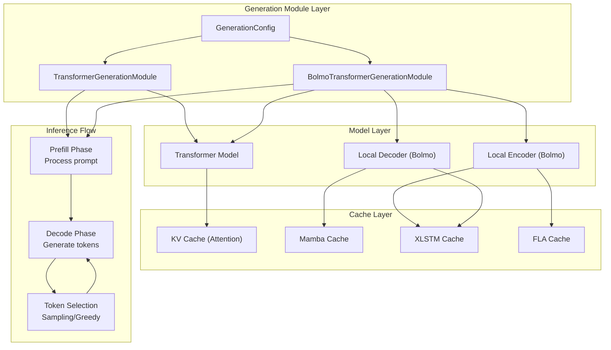
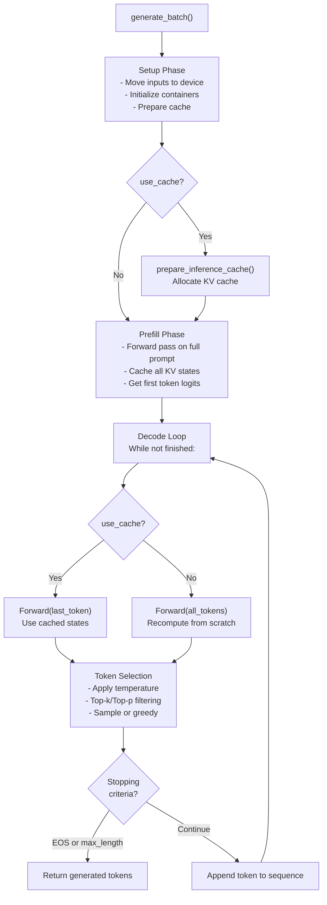
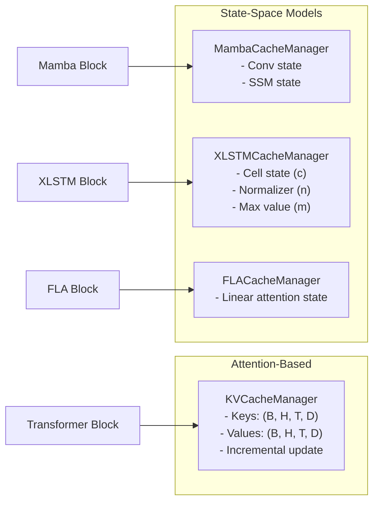
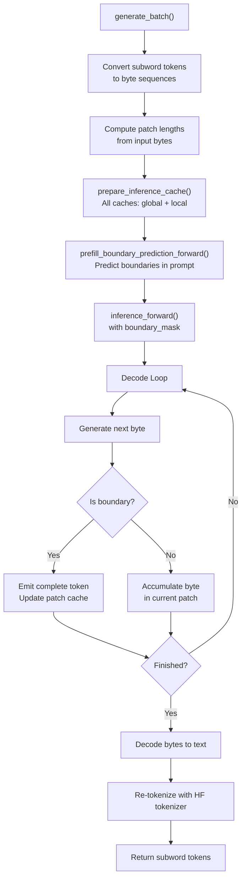

<!-- source: DeepWiki mcp.deepwiki.com · repo allenai/bolmo-core · page 6 Inference and Generation · fetched 2026-10-26 -->

# Inference and Generation

<details>
<summary>Relevant source files</summary>

The following files were used as context for generating this wiki page:

- [src/olmo_core/generate/generation_module/transformer/generation_module.py](src/olmo_core/generate/generation_module/transformer/generation_module.py)
- [src/olmo_core/nn/xlstm.py](src/olmo_core/nn/xlstm.py)

</details>


This document covers the inference and text generation system in OLMo-Core. It explains the autoregressive generation architecture, cache management strategies, and specialized handling for byte-level Bolmo models. For details on specific components, see [Generation Module](#6.1), [Cache Management](#6.2), and [Checkpoint Loading for Inference](#6.3). For information about the model architectures themselves, see [Model Architecture](#2).

## Overview

The inference system enables autoregressive text generation from trained transformer models. The core abstraction is the `GenerationModule`, which manages the generation lifecycle including cache initialization, prefill and decode phases, token selection, and output processing.

**Key Components:**

| Component | Purpose | File Location |
|-----------|---------|---------------|
| `TransformerGenerationModule` | Standard transformer generation | [src/olmo_core/generate/generation_module/transformer/generation_module.py:55-673]() |
| `BolmoTransformerGenerationModule` | Byte-level generation with boundary detection | [src/olmo_core/generate/generation_module/transformer/generation_module.py:675-1624]() |
| `GenerationConfig` | Generation parameters and settings | [src/olmo_core/generate/generation_module/__init__.py]() |
| Cache Managers | State management for different architectures | Multiple files in `src/olmo_core/nn/` |

**Sources:** [src/olmo_core/generate/generation_module/transformer/generation_module.py:1-52]()

## Generation Architecture

The generation system follows a modular architecture with clear separation between model execution, cache management, and token selection.



**Sources:** [src/olmo_core/generate/generation_module/transformer/generation_module.py:55-99]()

## Transformer Generation Module

The `TransformerGenerationModule` is the primary interface for text generation with standard transformer models. It handles model parallelization, cache management, and the generation loop.

### Initialization

The module is initialized with a transformer model and generation configuration:

[src/olmo_core/generate/generation_module/transformer/generation_module.py:58-99]()

Key initialization parameters:
- `model`: The `Transformer` instance to use for generation
- `generation_config`: Generation parameters (temperature, top-k, max_length, etc.)
- `compile_model`: Whether to compile the model with `torch.compile`
- `dp_config`: Data parallelism configuration for distributed inference
- `device`: Target device for inference

### Generation Process

The generation process proceeds through distinct phases: setup, prefill, and decode.



**Sources:** [src/olmo_core/generate/generation_module/transformer/generation_module.py:243-464]()

### Prefill and Decode Phases

The generation process has two distinct phases with different computational characteristics:

**Prefill Phase:**
- Processes the entire prompt in parallel
- Populates KV cache for all prompt positions
- Returns logits for next token prediction
- Happens once at the start of generation

[src/olmo_core/generate/generation_module/transformer/generation_module.py:360-366]()

**Decode Phase:**
- Processes one token at a time
- Uses cached KV states from previous positions
- Appends new KV states to cache
- Loops until stopping criteria are met

[src/olmo_core/generate/generation_module/transformer/generation_module.py:348-404]()

### Token Selection

Token selection supports multiple strategies for determining the next token:

| Strategy | Description | Parameters |
|----------|-------------|------------|
| Greedy | Select argmax token | `do_sample=False` |
| Temperature Sampling | Scale logits before sampling | `temperature` (default: 1.0) |
| Top-K Filtering | Keep only top-k highest probability tokens | `top_k` |
| Top-P (Nucleus) | Keep tokens with cumulative probability ≥ p | `top_p` |

[src/olmo_core/generate/generation_module/transformer/generation_module.py:368-374]()

The token selection is implemented in `select_next_token`:

[src/olmo_core/generate/sampling.py]()

**Sources:** [src/olmo_core/generate/generation_module/transformer/generation_module.py:243-464](), [src/olmo_core/generate/sampling.py]()

## Cache Management

Different model architectures require different cache management strategies. The generation module handles cache lifecycle for all supported architectures.

### Cache Initialization

Cache initialization happens before generation begins:

[src/olmo_core/generate/generation_module/transformer/generation_module.py:118-133]()

For standard transformers, this initializes KV caches for all attention layers. For Bolmo models, it also initializes caches for local encoder/decoder blocks, which may use Mamba, XLSTM, or FLA layers.

### Cache Types



**Sources:** [src/olmo_core/generate/generation_module/transformer/generation_module.py:118-133](), [src/olmo_core/nn/xlstm.py:174-197]()

### Cache Lifecycle

Cache managers support the following operations:

| Operation | Purpose | When Used |
|-----------|---------|-----------|
| `init_*_cache_manager()` | Create cache manager instance | Before first generation |
| `reset()` | Clear cache or reallocate | Between generation batches |
| `is_reusable()` | Check if cache can be reused | Before reset |
| `reallocate()` | Allocate new cache tensors | When batch size changes |
| `zero_cache()` | Zero out cache values | When reusing cache |

For XLSTM caches specifically:

[src/olmo_core/nn/xlstm.py:174-197]()

The XLSTM cache stores three state tensors that are maintained across generation steps.

**Sources:** [src/olmo_core/nn/xlstm.py:174-197](), [src/olmo_core/generate/generation_module/transformer/generation_module.py:118-133]()

## Bolmo Byte-Level Generation

`BolmoTransformerGenerationModule` extends the standard generation module with specialized handling for byte-level models. Bolmo operates on UTF-8 bytes rather than subword tokens, requiring additional logic for boundary detection.

### Architectural Differences

Bolmo generation differs from standard generation in several key aspects:

| Aspect | Standard Generation | Bolmo Generation |
|--------|---------------------|------------------|
| Granularity | Subword tokens | UTF-8 bytes |
| Cache Scope | Global transformer only | Global + local encoder/decoder |
| Boundary Detection | N/A | Required for complete tokens |
| Output Processing | Direct detokenization | Byte decoding → detokenization |

[src/olmo_core/generate/generation_module/transformer/generation_module.py:675-704]()

### Bolmo Generation Flow



**Sources:** [src/olmo_core/generate/generation_module/transformer/generation_module.py:951-1495]()

### Boundary Detection

Boundary detection is a critical component of Bolmo generation. A boundary marks the completion of a token (patch) in the byte sequence.

**Boundary Prediction in Prefill:**

[src/olmo_core/generate/generation_module/transformer/generation_module.py:1054-1060]()

The model predicts which byte positions in the prompt correspond to token boundaries.

**Boundary Tracking During Decode:**

During decoding, the model must track whether each generated byte is a boundary:

[src/olmo_core/generate/generation_module/transformer/generation_module.py:1322-1333]()

The `boundary_state` tracks which sequences have just completed a token. The model uses this to:
1. Prevent consecutive boundaries
2. Update the global transformer cache only at boundaries
3. Accumulate bytes into complete tokens

### Cache Preparation for Bolmo

Bolmo requires cache management across multiple model components:

[src/olmo_core/generate/generation_module/transformer/generation_module.py:706-741]()

This method:
1. Initializes caches for all global transformer blocks
2. Initializes caches for local encoder blocks (which may use XLSTM, FLA, or Mamba)
3. Initializes caches for local decoder blocks
4. Handles different cache types based on block architecture

**Sources:** [src/olmo_core/generate/generation_module/transformer/generation_module.py:675-1495]()

## Generation Configuration

Generation behavior is controlled by `GenerationConfig`, which supports the following parameters:

| Parameter | Type | Description | Default |
|-----------|------|-------------|---------|
| `max_length` | `Optional[int]` | Maximum total sequence length | `None` |
| `max_new_tokens` | `Optional[int]` | Maximum tokens to generate | `None` |
| `do_sample` | `bool` | Use sampling instead of greedy | `False` |
| `temperature` | `float` | Sampling temperature | `1.0` |
| `top_k` | `Optional[int]` | Top-k filtering | `None` |
| `top_p` | `Optional[float]` | Nucleus sampling threshold | `None` |
| `use_cache` | `bool` | Use KV caching | `True` |
| `eos_token_id` | `int` | End-of-sequence token ID | Required |
| `pad_token_id` | `int` | Padding token ID | Required |
| `stop_token_ids` | `Optional[List[int]]` | Additional stop tokens | `None` |
| `until` | `Optional[List[str]]` | Stop on string matches | `None` |

### Usage Example

```python
from olmo_core.generate import GenerationConfig

config = GenerationConfig(
    max_new_tokens=100,
    do_sample=True,
    temperature=0.8,
    top_p=0.95,
    eos_token_id=tokenizer.eos_token_id,
    pad_token_id=tokenizer.pad_token_id,
)
```

The configuration can be overridden at generation time:

[src/olmo_core/generate/generation_module/transformer/generation_module.py:278]()

**Sources:** [src/olmo_core/generate/generation_module/__init__.py]()

## Loading from Checkpoints

The generation module provides a convenient `from_checkpoint` class method that handles model initialization and checkpoint loading:

### Standard Models

[src/olmo_core/generate/generation_module/transformer/generation_module.py:525-672]()

This method:
1. Loads `TransformerConfig` from checkpoint's `config.json`
2. Builds the model from the configuration
3. Creates the generation module
4. Loads model weights using distributed checkpoint loading
5. Returns the ready-to-use generation module

### Bolmo Models

Bolmo models have a specialized loading path:

[src/olmo_core/generate/generation_module/transformer/generation_module.py:1497-1624]()

Key differences for Bolmo:
1. Loads `BolmoConfig` in addition to transformer and tokenizer configs
2. Builds `ByteTokenizer` for byte-level processing
3. Creates `BolmoTransformerGenerationModule` with tokenizer and Bolmo config
4. Handles byte-level specific configuration

### Distributed Loading

Checkpoint loading supports distributed inference with automatic rank coordination:

[src/olmo_core/generate/generation_module/transformer/generation_module.py:466-523]()

The loading process:
1. Rank 0 discovers checkpoint metadata
2. Metadata is broadcast to all ranks
3. All ranks load their shard of the model state
4. Supports topology-agnostic loading (can load TP-sharded checkpoint on single GPU)

**Sources:** [src/olmo_core/generate/generation_module/transformer/generation_module.py:466-672](), [src/olmo_core/generate/generation_module/transformer/generation_module.py:1497-1624]()

## Benchmarking

Both generation modules provide a `benchmark` method for performance testing:

### Standard Transformer Benchmarking

[src/olmo_core/generate/generation_module/transformer/generation_module.py:152-241]()

Parameters:
- `batch_size`: Number of sequences to generate in parallel
- `n_prefill`: Length of synthetic prompt
- `n_generate`: Number of tokens to generate
- `profile`: Enable PyTorch profiler
- `prefill_only`: Only benchmark prefill phase

Returns timing statistics:
- `cache_prepare_time`: Time to allocate caches
- `prefill_time`: Time for prefill forward pass
- `generate_time`: Time for decode loop

### Bolmo Benchmarking

[src/olmo_core/generate/generation_module/transformer/generation_module.py:819-949]()

Bolmo benchmarking differs:
- Works with bytes rather than tokens
- Simulates random boundary positions
- Accounts for `avg_bytes_per_token` ratio
- Measures byte-level throughput

**Sources:** [src/olmo_core/generate/generation_module/transformer/generation_module.py:152-241](), [src/olmo_core/generate/generation_module/transformer/generation_module.py:819-949]()

## Performance Monitoring

The generation process includes detailed timing and throughput statistics:

### Statistics Reported

Both generation modules log comprehensive statistics after generation:

| Metric | Description | Unit |
|--------|-------------|------|
| Batch size | Number of sequences generated | sequences |
| Prompt length | Input sequence length | tokens/bytes |
| Tokens generated | Output length per sequence | tokens/bytes |
| Setup time | Initialization overhead | seconds |
| Prefill time | Time to process prompt | seconds |
| Decode time | Time for autoregressive generation | seconds |
| Overall TPS/BPS | Total throughput | tokens or bytes per second |
| Prefill TPS/BPS | Prefill throughput | tokens or bytes per second |
| Completion TPS/BPS | Decode throughput | tokens or bytes per second |
| TTFT | Time to first token | seconds |
| TPOT | Time per output token | seconds |

[src/olmo_core/generate/generation_module/transformer/generation_module.py:416-455]()

For Bolmo models, statistics are reported in bytes per second (BPS) rather than tokens per second (TPS):

[src/olmo_core/generate/generation_module/transformer/generation_module.py:1427-1464]()

**Sources:** [src/olmo_core/generate/generation_module/transformer/generation_module.py:416-455](), [src/olmo_core/generate/generation_module/transformer/generation_module.py:1427-1464]()

---

