<!-- source: DeepWiki mcp.deepwiki.com · repo allenai/bolmo-core · page 6.1 Generation Module · fetched 2026-10-26 -->

# Generation Module

<details>
<summary>Relevant source files</summary>

The following files were used as context for generating this wiki page:

- [src/olmo_core/generate/generation_module/transformer/generation_module.py](src/olmo_core/generate/generation_module/transformer/generation_module.py)
- [src/olmo_core/nn/xlstm.py](src/olmo_core/nn/xlstm.py)

</details>


The Generation Module provides autoregressive text generation capabilities for transformer models in OLMo-Core. It handles the complete inference pipeline including model initialization, checkpoint loading, cache management, and token-by-token generation with various sampling strategies. The module supports both standard subword-based transformers and byte-level Bolmo models.

For information about cache lifecycle and state management, see [Cache Management](#6.2). For details on checkpoint format conversion and distributed loading strategies, see [Checkpoint Loading for Inference](#6.3).

---

## Overview

The generation system is built around two primary classes: `TransformerGenerationModule` for standard transformers and `BolmoTransformerGenerationModule` for byte-level models. Both classes manage the full generation lifecycle from cache initialization through token selection and stopping criteria.

### Class Hierarchy

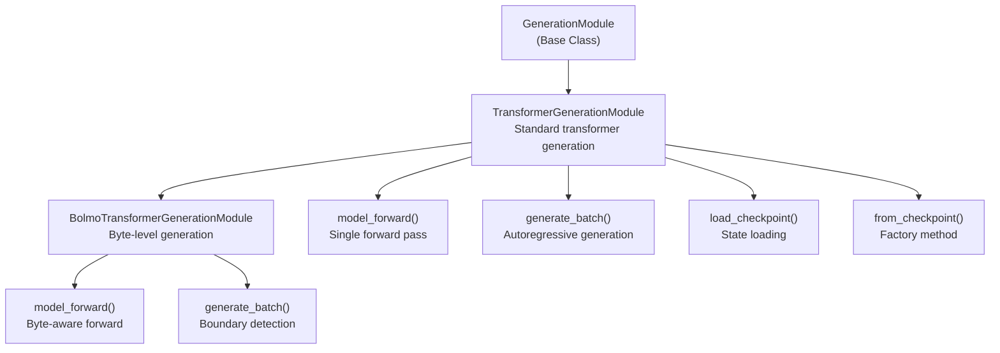

**Sources:** [src/olmo_core/generate/generation_module/transformer/generation_module.py:55-1624]()

---

## TransformerGenerationModule

The `TransformerGenerationModule` class wraps a `Transformer` model and provides methods for autoregressive text generation with standard subword tokenizers.

### Initialization

The module is initialized with a model, generation configuration, and optional parallelism settings:

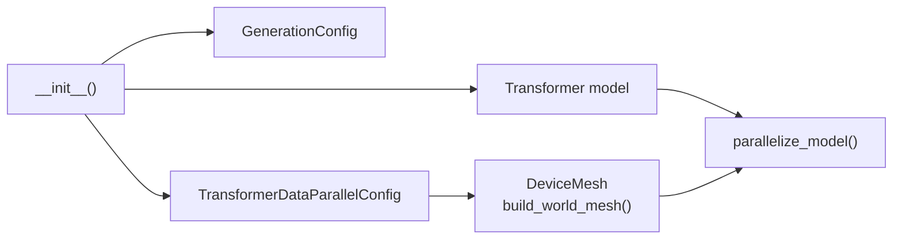

Key initialization parameters:
- `model`: The transformer model to use for generation
- `generation_config`: Configuration controlling generation behavior (max length, temperature, sampling)
- `compile_model`: Whether to compile the model with `torch.compile`
- `float8_config`: Optional Float8 quantization configuration
- `dp_config`: Data parallel configuration for distributed inference
- `device`: Target device (defaults to CUDA if available)

**Sources:** [src/olmo_core/generate/generation_module/transformer/generation_module.py:58-99]()

### Generation Configuration

| Parameter | Type | Description |
|-----------|------|-------------|
| `max_length` | `Optional[int]` | Maximum total sequence length |
| `max_new_tokens` | `Optional[int]` | Maximum number of tokens to generate |
| `temperature` | `float` | Sampling temperature (default: 1.0) |
| `top_k` | `Optional[int]` | Top-k filtering threshold |
| `top_p` | `Optional[float]` | Nucleus (top-p) sampling threshold |
| `do_sample` | `bool` | Whether to sample (True) or use greedy decoding (False) |
| `eos_token_id` | `int` | End-of-sequence token ID |
| `pad_token_id` | `int` | Padding token ID |
| `stop_token_ids` | `Optional[List[int]]` | Additional stop token IDs |
| `use_cache` | `bool` | Whether to use KV caching (default: True) |

**Sources:** [src/olmo_core/generate/generation_module/transformer/generation_module.py:98-99, 278-280]()

### Cache Management

The generation module manages inference caches to avoid recomputing past key-value states:

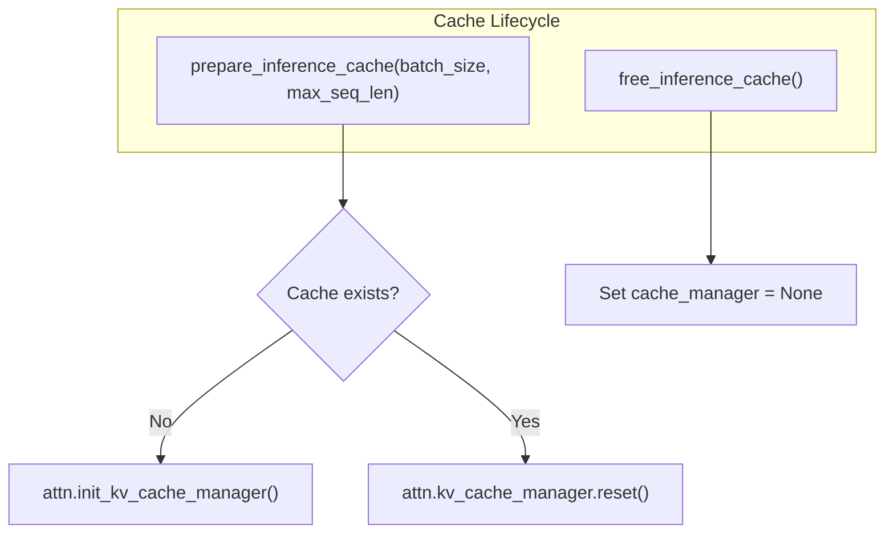

The `prepare_inference_cache` method iterates through all transformer blocks and initializes or resets their KV cache managers. The cache is allocated for the maximum sequence length to avoid reallocation during generation.

**Sources:** [src/olmo_core/generate/generation_module/transformer/generation_module.py:118-133]()

---

## Generation Process

Generation proceeds in two phases: prefill (processing the input prompt) and decode (generating new tokens one at a time).

### Two-Phase Generation Flow

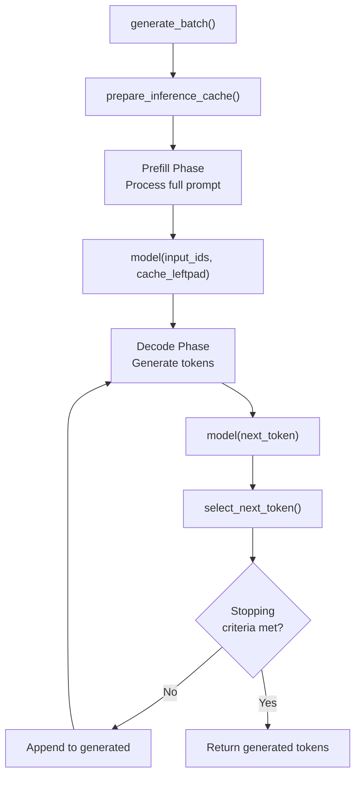

**Sources:** [src/olmo_core/generate/generation_module/transformer/generation_module.py:244-464]()

### Prefill Phase

In the prefill phase, the entire input prompt is processed in parallel:

1. **Cache Initialization**: Allocate KV cache for `batch_size × max_seq_len`
2. **Left-Padding Mask**: Convert attention mask to cache left-padding offsets using `attention_mask_to_cache_leftpad`
3. **Forward Pass**: Process all prompt tokens at once with `model(input_ids, logits_to_keep=1, cache_leftpad=...)`
4. **First Token Selection**: Select the first generated token from the final logits

The prefill pass populates the KV cache with key-value pairs for all prompt tokens, enabling efficient subsequent decoding.

**Sources:** [src/olmo_core/generate/generation_module/transformer/generation_module.py:309-366]()

### Decode Phase

In the decode phase, tokens are generated one at a time:

1. **Single Token Input**: Only the last generated token is passed to the model
2. **Cache Reuse**: The model reads from the KV cache without recomputation
3. **Logits Processing**: Apply temperature scaling, top-k/top-p filtering
4. **Token Selection**: Sample or greedily select the next token
5. **Stopping Criteria**: Check for EOS, stop tokens, or max length

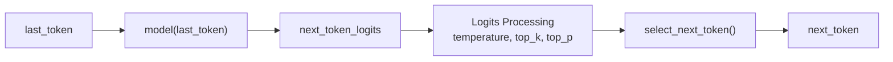

**Sources:** [src/olmo_core/generate/generation_module/transformer/generation_module.py:348-404]()

### Token Selection

Token selection applies various transformations to the raw logits before sampling:

1. **Temperature Scaling**: Divide logits by temperature to control randomness
2. **Top-K Filtering**: Keep only the k highest-probability tokens
3. **Top-P (Nucleus) Filtering**: Keep tokens with cumulative probability ≤ p
4. **Sampling**: Draw from the filtered distribution (if `do_sample=True`) or select argmax (greedy)

The `select_next_token` function from `olmo_core.generate.sampling` handles this logic.

**Sources:** [src/olmo_core/generate/generation_module/transformer/generation_module.py:368-374]()

### Stopping Criteria

Generation terminates when any of the following conditions are met:

| Condition | Description |
|-----------|-------------|
| **EOS Token** | Generated token equals `generation_config.eos_token_id` |
| **Stop Tokens** | Generated token in `generation_config.stop_token_ids` |
| **Max Length** | Total sequence length reaches `max_length` or `prompt_len + max_new_tokens` |
| **All Finished** | All sequences in the batch have hit a stopping condition |

**Sources:** [src/olmo_core/generate/generation_module/transformer/generation_module.py:284-393]()

---

## BolmoTransformerGenerationModule

The `BolmoTransformerGenerationModule` extends `TransformerGenerationModule` to handle byte-level generation with boundary detection. Bolmo models process bytes rather than subword tokens, requiring special handling for token boundaries.

### Architecture Integration

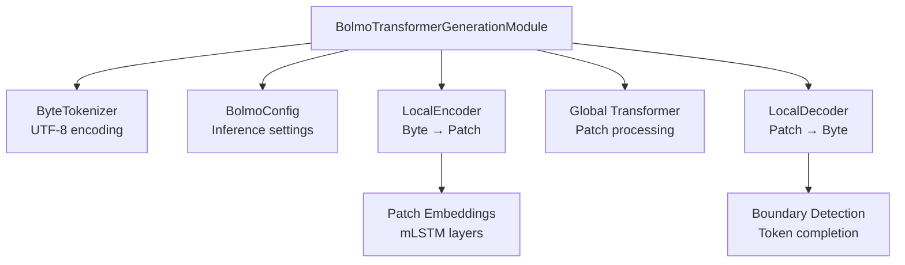

**Sources:** [src/olmo_core/generate/generation_module/transformer/generation_module.py:675-704]()

### Cache Management for Bolmo

Bolmo models have caches across multiple components:

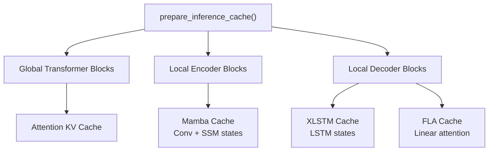

The Bolmo cache preparation iterates through global transformer blocks, local encoder blocks, and local decoder blocks, initializing caches for each block type (Attention, Mamba, XLSTM, FLA).

**Sources:** [src/olmo_core/generate/generation_module/transformer/generation_module.py:706-741]()

### Boundary Detection

Bolmo generation tracks byte-level boundaries to determine when complete tokens are formed:

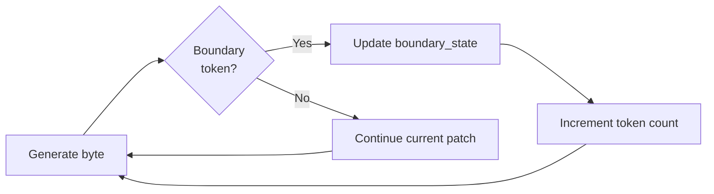

The model tracks:
- **boundary_state**: `MaskState` indicating which sequences just completed a token
- **boundary_mask**: Binary mask showing boundary positions during prefill
- **bytes_since_boundary**: Counter tracking bytes generated in the current token

**Sources:** [src/olmo_core/generate/generation_module/transformer/generation_module.py:1125-1326]()

### Bolmo Generation Process

The Bolmo generation process differs from standard generation:

1. **Byte Conversion**: Convert subword input IDs to byte sequences using the tokenizer
2. **Patch Length Computation**: Calculate patch lengths for prefill boundary mask
3. **Boundary Prediction**: Run `prefill_boundary_prediction_forward` to predict boundaries
4. **Byte-Level Decoding**: Generate bytes one at a time, tracking boundaries
5. **Subword Reconstruction**: Convert generated bytes back to subword tokens

| Phase | Input | Output | Purpose |
|-------|-------|--------|---------|
| **Conversion** | Subword IDs | Byte IDs, patch lengths | Prepare byte-level input |
| **Boundary Prediction** | Byte IDs, patch lengths | Boundary mask | Identify token boundaries |
| **Prefill** | Byte IDs, boundary mask | First token logits | Process prompt |
| **Decode** | Previous byte | Next byte logits | Generate bytes |
| **Reconstruction** | Generated bytes | Subword tokens | Convert to standard format |

**Sources:** [src/olmo_core/generate/generation_module/transformer/generation_module.py:988-1495]()

### Inference Sampling Strategies

BolmoConfig supports several inference sampling strategies:

| Strategy | Effect |
|----------|--------|
| `gen_eos_bias:<value>` | Add bias to EOS token logits |
| `gen_boundary_bias:<value>` | Add bias to boundary token logits |
| `greedy_boundary` | Force boundary if argmax, otherwise force no boundary |
| `temperature_patch_decay:<alpha>` | Decay temperature within patches: `temp × alpha^bytes_since_boundary` |

**Sources:** [src/olmo_core/generate/generation_module/transformer/generation_module.py:1193-1241]()

---

## Checkpoint Loading

The generation module provides two methods for loading model weights:

### load_checkpoint Method

Direct checkpoint loading for an existing generation module:

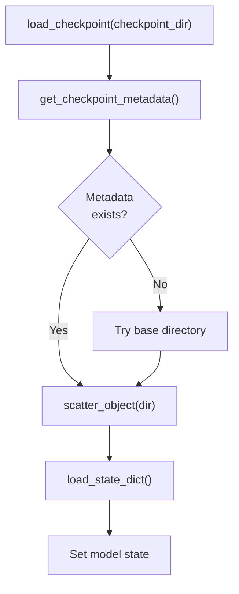

The method handles:
- Searching for checkpoint metadata in `model_and_optim/` subdirectory or base directory
- Distributed loading with rank 0 coordination
- Pre-downloading remote checkpoints (S3, GCS) to local cache
- Thread-parallel loading with configurable thread count

**Sources:** [src/olmo_core/generate/generation_module/transformer/generation_module.py:466-523]()

### from_checkpoint Factory Method

Creates a generation module from a checkpoint in a single call:

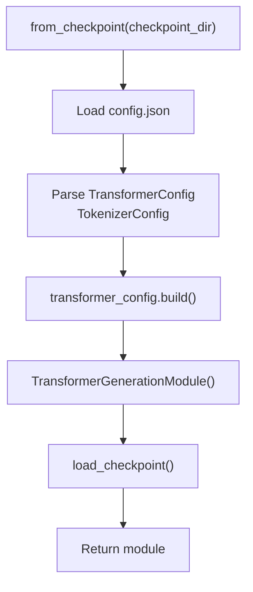

The factory method:
1. Loads configuration from `checkpoint_dir/config.json`
2. Extracts `TransformerConfig` and `TokenizerConfig`
3. Builds the model from configuration
4. Creates a `GenerationConfig` from tokenizer settings (EOS, pad tokens)
5. Initializes the generation module
6. Loads checkpoint weights
7. Returns the ready-to-use module

**Sources:** [src/olmo_core/generate/generation_module/transformer/generation_module.py:525-672]()

### Checkpoint Format Support

The module automatically detects and handles:
- **Training Checkpoints**: Look for weights in `model_and_optim/` subdirectory
- **Model-Only Checkpoints**: Load directly from base directory
- **Bolmo Checkpoints**: Automatically instantiate `BolmoTransformerGenerationModule` when `transformer_config.name` is `bolmo` or `bolmo_distill`

**Sources:** [src/olmo_core/generate/generation_module/transformer/generation_module.py:486-601]()

---

## Benchmarking

The generation module includes a `benchmark` method for performance profiling:

### Benchmark Parameters

```python
def benchmark(
    batch_size: int,
    n_prefill: int,  # Number of tokens to prefill
    n_generate: int,  # Number of tokens to generate
    profile: bool = False,  # Enable PyTorch profiler
    prefill_only: bool = False,  # Skip decode phase
    vocab_size: int = 10_000,  # Vocab size for random input
)
```

### Benchmark Output

The method returns timing statistics:

```python
{
    "cache_prepare_time": float,  # Time to initialize caches
    "prefill_time": float,         # Time for prefill forward pass
    "generate_time": float,        # Time for decode phase
}
```

The benchmark uses random input tokens and measures:
- Cache allocation and initialization overhead
- Prefill throughput (tokens/second for parallel processing)
- Decode throughput (tokens/second for autoregressive generation)

**Sources:** [src/olmo_core/generate/generation_module/transformer/generation_module.py:151-241]()

### Bolmo Benchmarking

Bolmo benchmarks operate at the byte level with additional considerations:

```python
def benchmark(
    batch_size: int,
    n_prefill: int,  # Number of *tokens* to prefill
    n_generate: int,  # Number of *tokens* to generate
    avg_bytes_per_token: float = 4.3,  # Conversion factor
    ...
)
```

The Bolmo benchmark:
1. Converts token counts to byte counts using `avg_bytes_per_token`
2. Generates random byte sequences and boundary masks
3. Measures boundary prediction overhead
4. Tracks byte-per-second throughput instead of token-per-second

**Sources:** [src/olmo_core/generate/generation_module/transformer/generation_module.py:819-949]()

---

## Timing and Logging

Both generation modules provide detailed timing statistics:

### Throughput Metrics

| Metric | Description |
|--------|-------------|
| **Setup Time** | Time to prepare caches and inputs |
| **Prefill Time** | Time for first forward pass |
| **Decode Time** | Time for autoregressive generation |
| **TTFT** | Time to first token (prefill + first decode) |
| **TPOT** | Time per output token (decode_time / completion_tokens) |
| **TPS (Prefill)** | Tokens per second during prefill |
| **TPS (Decode)** | Tokens per second during decode |
| **Overall TPS** | Total tokens per second across entire generation |

### Statistics Display

When `log_timing=True`, the module prints detailed statistics:

```
============================================================
GENERATION STATISTICS
  Batch size: 4 | Prompt len: 128 tokens
  Tokens generated: 256 per sequence | Total: 1,280
  Seq length: 128 → 384
  Padding stats: 0 / 1,280 (0.0%)
  Throughput:
    Setup: 0.145s | Prefill: 0.234s | Decode: 1.987s | Total: 2.366s
    Overall TPS: 108.2 /seq | 541.0 /total
    Prefill TPS: 547.0 /seq | 2188.0 /total
    Completion TPS: 128.9 /seq | 515.4 /total
============================================================
```

**Sources:** [src/olmo_core/generate/generation_module/transformer/generation_module.py:417-456, 1427-1464]()

---

## Distributed Inference

The generation module supports distributed inference with parallelism:

### Parallelism Configuration

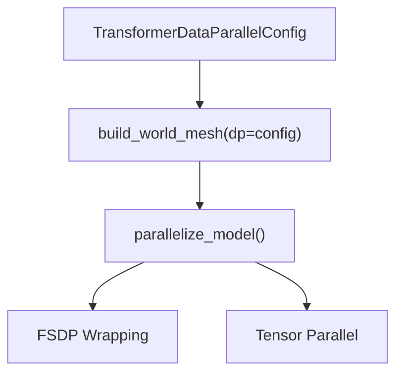

The module:
- Creates a device mesh for distributed processes
- Applies FSDP and/or tensor parallelism to the model
- Coordinates checkpoint loading across ranks
- Manages process groups for collective operations

**Sources:** [src/olmo_core/generate/generation_module/transformer/generation_module.py:75-91]()

### State Dict Options

Distributed checkpoint loading uses `StateDictOptions`:

| Option | Purpose |
|--------|---------|
| `state_dict_load_opts` | Options for loading checkpoint state |
| `state_dict_save_opts` | Options for saving checkpoint state |
| `load_key_mapping` | Optional key remapping for checkpoint compatibility |

**Sources:** [src/olmo_core/generate/generation_module/transformer/generation_module.py:66-97]()

---

## Integration with Cache Managers

The generation module integrates with various cache manager implementations:

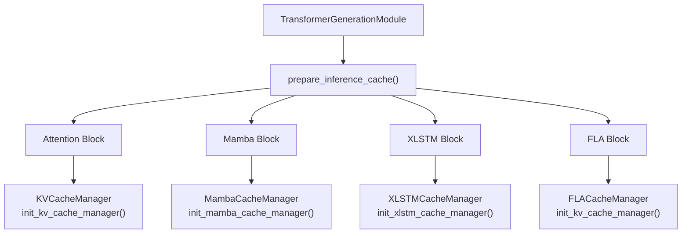

Each block type has its own cache manager interface, but all follow a similar pattern:
- `init_*_cache_manager(batch_size)` or `init_*_cache_manager(batch_size, max_seq_len)`
- `reset(batch_size)` or `reset(batch_size, max_seq_len)` to clear caches
- Setting to `None` to free memory

**Sources:** [src/olmo_core/generate/generation_module/transformer/generation_module.py:118-133, 706-741](), [src/olmo_core/nn/xlstm.py:20-21, 174-197]()

---

