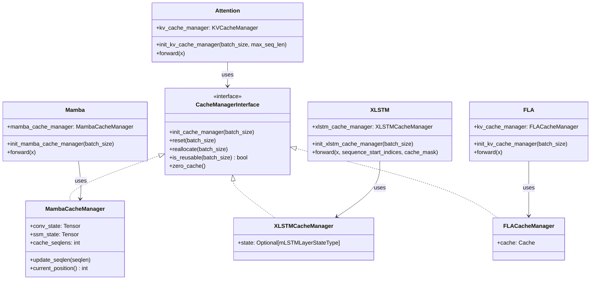
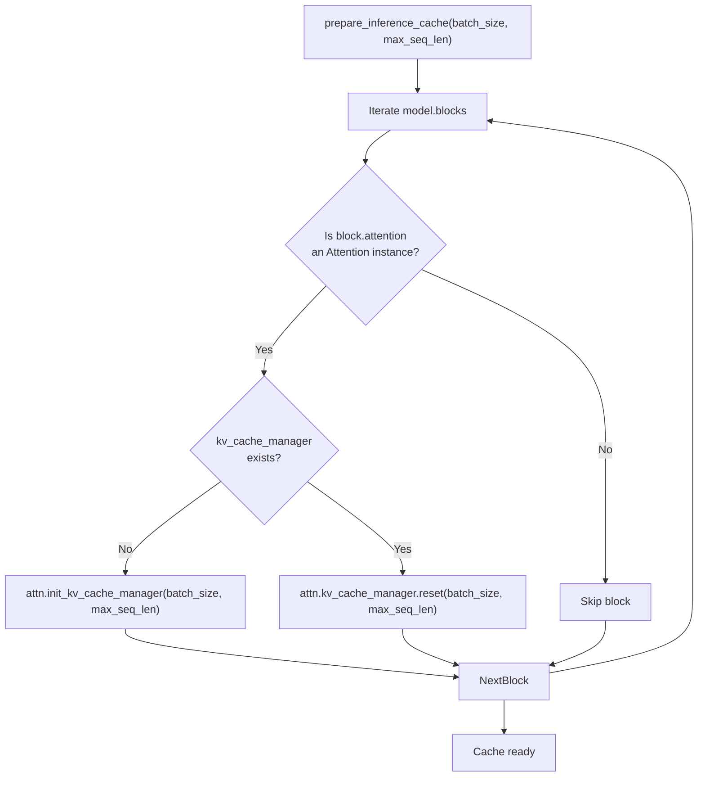
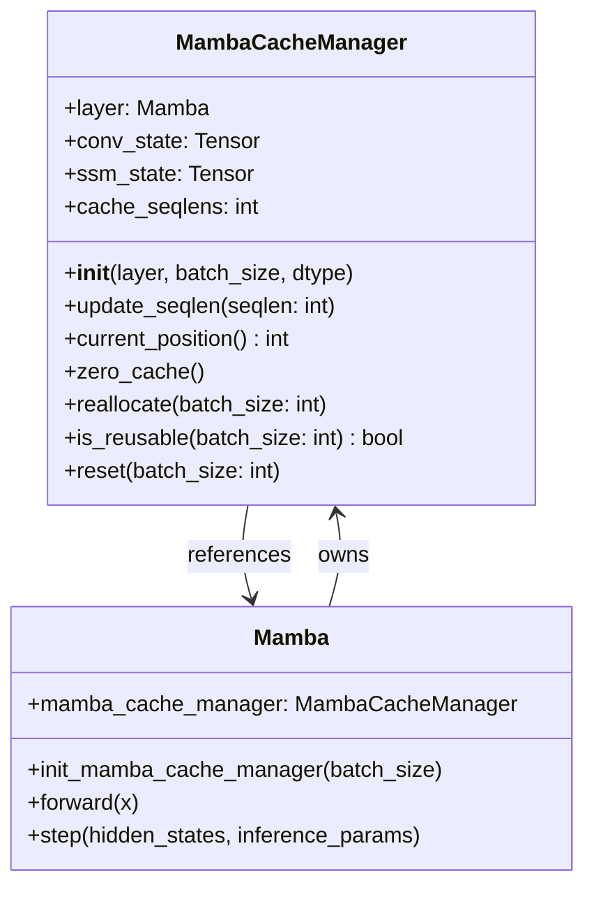
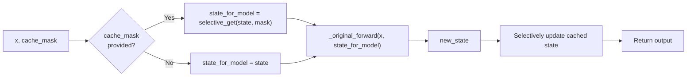
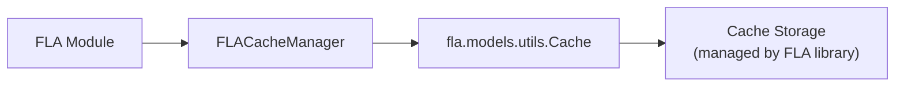
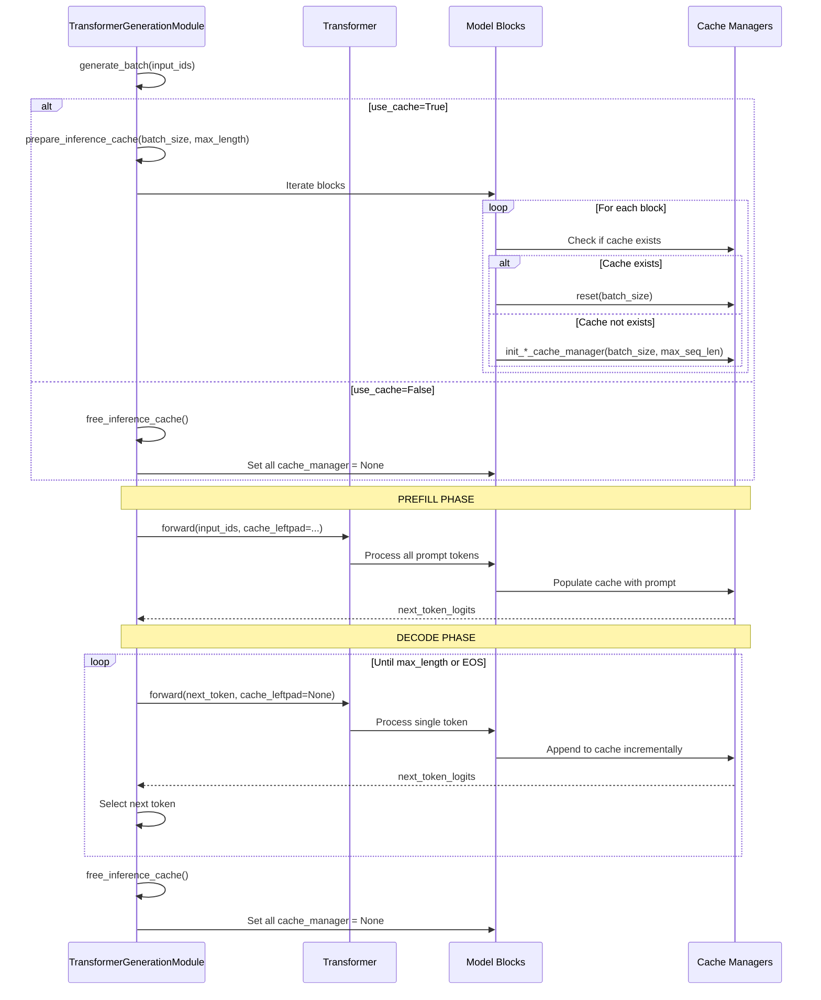
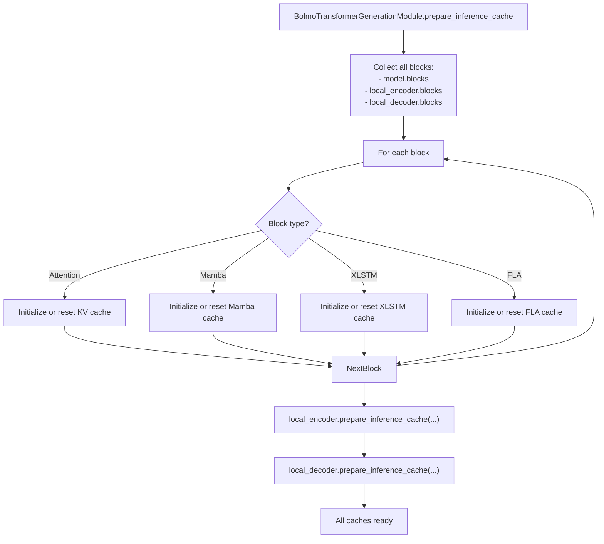
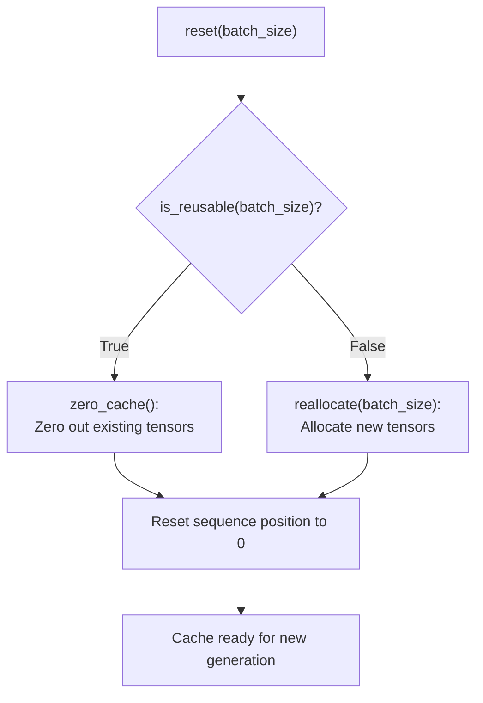

<!-- source: DeepWiki mcp.deepwiki.com · repo allenai/bolmo-core · page 6.2 Cache Management · fetched 2026-10-26 -->

# Cache Management

<details>
<summary>Relevant source files</summary>

The following files were used as context for generating this wiki page:

- [src/olmo_core/generate/generation_module/transformer/generation_module.py](src/olmo_core/generate/generation_module/transformer/generation_module.py)
- [src/olmo_core/nn/fla.py](src/olmo_core/nn/fla.py)
- [src/olmo_core/nn/mamba.py](src/olmo_core/nn/mamba.py)
- [src/olmo_core/nn/xlstm.py](src/olmo_core/nn/xlstm.py)

</details>


## Purpose and Scope

This page documents the cache management system used during autoregressive inference in OLMo-Core and Bolmo models. Cache managers enable efficient token generation by storing intermediate states (e.g., key-value pairs, convolutional states, LSTM states) across decoding steps, avoiding redundant computation.

For information about the overall generation pipeline, see [Generation Module](#6.1). For checkpoint management during training, see [Checkpointing](#5.3).

## Overview

During autoregressive text generation, models process tokens sequentially in two phases:

1. **Prefill Phase**: Process the entire input prompt in parallel
2. **Decode Phase**: Generate tokens one at a time, conditioning on previous tokens

Without caching, each decode step would require recomputing all previous positions. Cache managers store intermediate computation states (attention keys/values, SSM states, LSTM states) to enable efficient incremental generation.

Different model architectures require different types of caches:

| Architecture | Cache Type | Stored State |
|--------------|-----------|--------------|
| Transformer Attention | KV Cache | Keys and values for each layer |
| Mamba (SSM) | Mamba Cache | Convolutional state and SSM state |
| XLSTM | XLSTM Cache | mLSTM layer state (c, n, m) |
| FLA | FLA Cache | Linear attention cache |

Sources: [src/olmo_core/generate/generation_module/transformer/generation_module.py:118-133]()

## Cache Manager Architecture



All cache managers implement a common interface pattern:

- **`init_*_cache_manager(batch_size, ...)`**: Initialize a new cache manager
- **`reset(batch_size)`**: Reset cache for a new generation batch (reallocates if batch size changed)
- **`reallocate(batch_size)`**: Allocate new cache storage
- **`is_reusable(batch_size)`**: Check if existing cache can be reused
- **`zero_cache()`**: Zero out cache contents without reallocation

Sources: [src/olmo_core/nn/mamba.py:75-116](), [src/olmo_core/nn/xlstm.py:174-197](), [src/olmo_core/nn/fla.py:42-70]()

## KV Cache for Attention

KV cache is used by transformer attention layers to store keys and values from previous positions. The `Attention` class manages its `kv_cache_manager` attribute, which is initialized during generation setup.

### Initialization

The `prepare_inference_cache` method in `TransformerGenerationModule` initializes KV caches for all attention layers:



During the prefill phase, the cache is populated with keys/values for all prompt tokens. During decoding, each new token's keys/values are appended incrementally.

The `cache_leftpad` parameter indicates how many left-padding tokens exist in the cache, allowing the model to handle variable-length prompts in a batch.

Sources: [src/olmo_core/generate/generation_module/transformer/generation_module.py:118-133](), [src/olmo_core/nn/attention.py]() (referenced but not provided)

## Mamba Cache Manager

The `MambaCacheManager` handles state caching for Mamba state-space models, which require both convolutional and SSM (structured state-space model) states.

### Implementation



### State Management

The cache stores two tensors:

- **`conv_state`**: Convolutional state from the Mamba module
- **`ssm_state`**: Structured state-space model state

These are allocated via `layer.inner.allocate_inference_cache(batch_size, max_seqlen=None, dtype=dtype)` from the `mamba_ssm` library.

### Forward Pass Behavior

The `Mamba.forward` method adapts based on cache state:

1. **First forward (prefill)**: `current_position() == 0`
   - Creates `InferenceParams` with cache references
   - Calls `inner.forward(x, inference_params=inference_params)`
   - Updates sequence length

2. **Subsequent forwards (decode)**: `current_position() > 0`
   - Calls `step(x, (conv_state, ssm_state))`
   - Loops over tokens (Mamba2 only supports 1 token at a time)
   - Updates cache in-place

Sources: [src/olmo_core/nn/mamba.py:11-116]()

## XLSTM Cache Manager

The `XLSTMCacheManager` manages mLSTM (multiplicative LSTM) layer state for XLSTM blocks.

### State Structure

Unlike other caches, XLSTM cache is not pre-allocated. The state is initialized to `None` and populated during the first forward pass:

```python
self.state: Optional[mLSTMLayerStateType] = None
```

The `mLSTMLayerStateType` is a tuple of `(c, n, m)` representing the internal LSTM states.

### Selective Caching with MaskState

XLSTM supports selective caching through the `cache_mask` parameter, allowing different examples in a batch to use or bypass the cache:



This enables handling sequences with different starting positions within a batch (e.g., in Bolmo where byte sequences may have different boundaries).

### Forget Gate Reset

XLSTM supports resetting the forget gate at sequence boundaries via `sequence_start_indices`. At position `sequence_start_indices[i]` for example `i`, the forget gate is set to a very large negative value (-100,000), effectively resetting the hidden state.

Sources: [src/olmo_core/nn/xlstm.py:14-197]()

## FLA Cache Manager

The `FLACacheManager` wraps the FLA (Fast Linear Attention) library's cache implementation.

### Architecture



### Implementation Details

The FLA cache manager is a thin wrapper around the FLA library's `Cache` object:

```python
from fla.models.utils import Cache
self.cache = Cache()
```

The FLA layer's `forward` method is called with `past_key_values=cache` and `use_cache=True`, returning `(output, _, new_cache)`. The cache is updated after each forward pass.

### Cache Reusability

Unlike other cache managers, `FLACacheManager.is_reusable()` always returns `False`, causing cache reallocation on every `reset()`. This is because the FLA library does not expose methods to check cache compatibility.

Sources: [src/olmo_core/nn/fla.py:14-70]()

## Cache Lifecycle in Generation

The following diagram shows how caches are managed throughout the generation process:



### Prefill vs Decode

**Prefill Phase**:
- Input: Full prompt sequence `(batch_size, prompt_length)`
- Cache is populated with all prompt positions
- `cache_leftpad` parameter indicates padding positions
- Forward pass processes entire sequence in parallel

**Decode Phase**:
- Input: Single token `(batch_size, 1)`
- Cache is updated incrementally with new token
- `cache_leftpad=None` (no padding during decode)
- Forward pass is highly efficient due to cached states

Sources: [src/olmo_core/generate/generation_module/transformer/generation_module.py:243-464]()

## Bolmo-Specific Cache Management

Bolmo models require caching for multiple components: global transformer blocks, local encoder blocks, and local decoder blocks. Each may use different block types (Attention, Mamba, XLSTM, FLA).

### Multi-Component Cache Initialization



### Implementation

The `BolmoTransformerGenerationModule.prepare_inference_cache` method handles heterogeneous block types:

| Block Attribute | Cache Manager Attribute | Initialization Method |
|----------------|-------------------------|----------------------|
| `block.attention` | `attention.kv_cache_manager` | `init_kv_cache_manager(batch_size, max_seq_len)` |
| `block.mamba` | `mamba.mamba_cache_manager` | `init_mamba_cache_manager(batch_size)` |
| `block.xlstm` | `xlstm.xlstm_cache_manager` | `init_xlstm_cache_manager(batch_size)` |
| `block.fla` | `fla.kv_cache_manager` | `init_kv_cache_manager(batch_size)` |

### Free Operation

The `free_inference_cache` method iterates through all blocks and sets their respective cache managers to `None`, allowing garbage collection:

```python
for block in blocks:
    if hasattr(block, "attention") and isinstance(block.attention, Attention):
        block.attention.kv_cache_manager = None
    elif hasattr(block, "mamba") and isinstance(block.mamba, Mamba):
        block.mamba.mamba_cache_manager = None
    # ... etc for XLSTM and FLA
```

Sources: [src/olmo_core/generate/generation_module/transformer/generation_module.py:706-761]()

## Cache Reset vs Reallocation

Cache managers implement a two-tier strategy for reusing cache storage:



### Reusability Criteria

**MambaCacheManager**:
```python
def is_reusable(self, batch_size: int) -> bool:
    return (self.conv_state.shape[0] == batch_size and 
            self.ssm_state.shape[0] >= batch_size)
```

**XLSTMCacheManager**:
```python
def is_reusable(self, batch_size: int) -> bool:
    return False  # Always reallocate
```

**FLACacheManager**:
```python
def is_reusable(self, batch_size: int) -> bool:
    return False  # Always reallocate
```

Reusing cache storage when possible avoids expensive memory allocation during repeated generation calls with the same batch size.

Sources: [src/olmo_core/nn/mamba.py:107-116](), [src/olmo_core/nn/xlstm.py:188-197](), [src/olmo_core/nn/fla.py:59-70]()

## Memory Considerations

### Cache Size

Cache memory usage scales with:
- Batch size
- Maximum sequence length
- Number of layers
- Hidden dimensions
- Number of attention heads

For a transformer with KV cache:
```
cache_size_per_layer = 2 × batch_size × num_heads × max_seq_len × head_dim × sizeof(dtype)
total_cache_size = num_layers × cache_size_per_layer
```

### Allocation Strategy

Caches are allocated on the same device as the model. During prefill, the entire `max_length` cache is allocated upfront, allowing efficient incremental updates during decode without reallocation.

For Mamba/XLSTM/FLA, cache size is independent of sequence length (stores fixed-size hidden states), making them more memory-efficient for long sequences compared to attention-based caching.

Sources: [src/olmo_core/generate/generation_module/transformer/generation_module.py:316-323]()

## Best Practices

### When to Use Caching

**Enable caching** (`use_cache=True`) when:
- Generating multiple tokens autoregressively
- Batch size and max_length are known upfront
- Memory is sufficient for cache allocation

**Disable caching** (`use_cache=False`) when:
- Processing single sequences (no generation)
- Computing perplexity or loss on fixed sequences
- Memory is constrained
- Using very long sequences where cache size is prohibitive

### Configuration

Caching is controlled via `GenerationConfig`:

```python
generation_config = GenerationConfig(
    use_cache=True,
    max_length=2048,  # Required when use_cache=True
    # ... other config
)
```

If `use_cache=True` but `max_length` and `max_new_tokens` are both `None`, an `OLMoConfigurationError` is raised since cache size cannot be determined.

Sources: [src/olmo_core/generate/generation_module/transformer/generation_module.py:316-323]()

---

