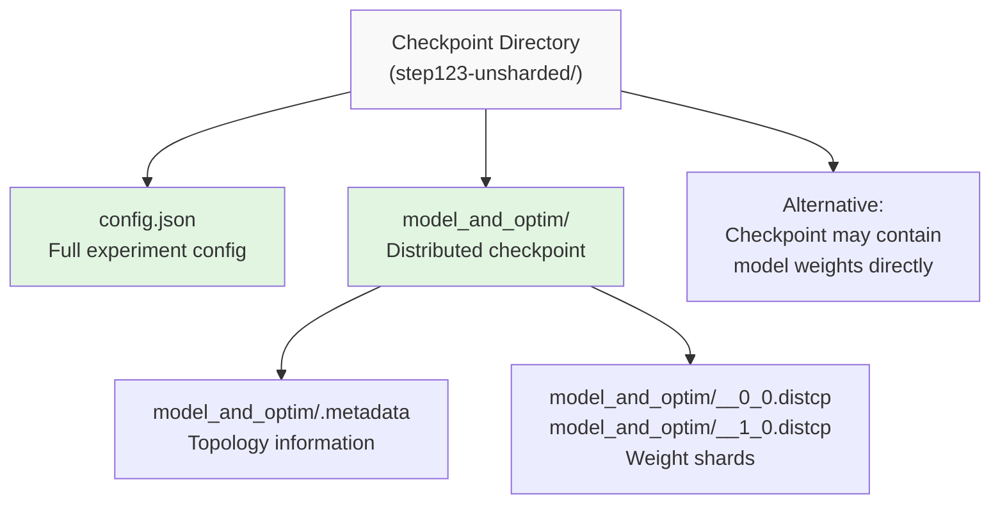
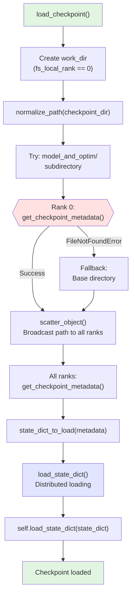
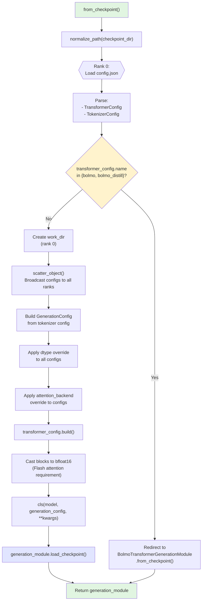
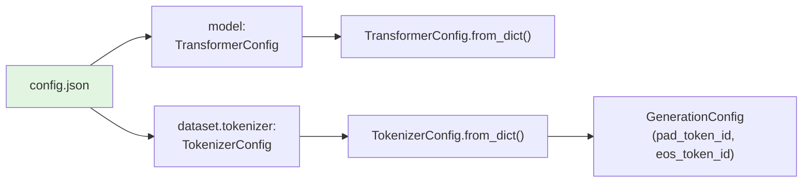
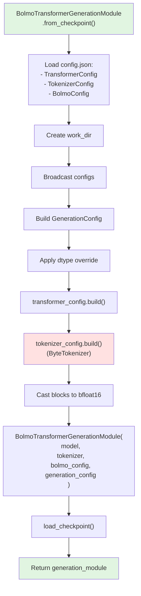
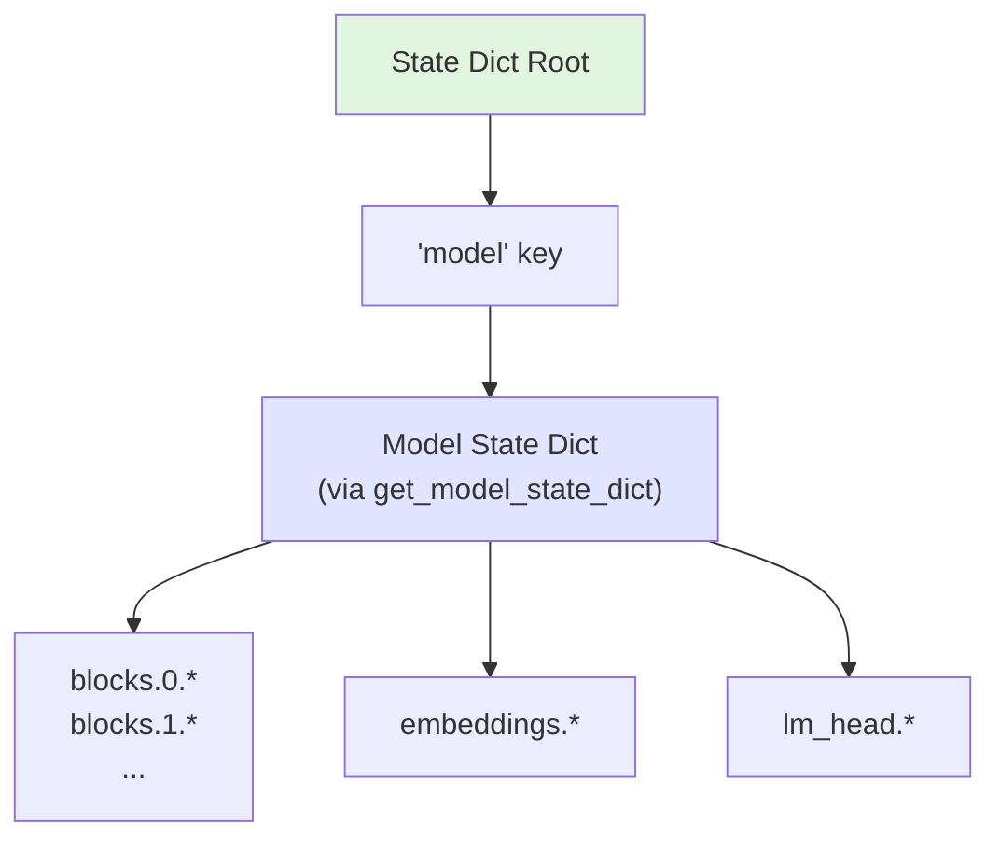
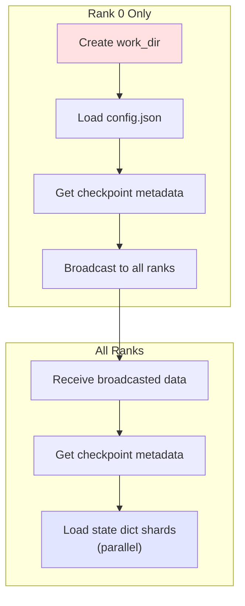

<!-- source: DeepWiki mcp.deepwiki.com · repo allenai/bolmo-core · page 6.3 Checkpoint Loading for Inference · fetched 2026-10-26 -->

# Checkpoint Loading for Inference

<details>
<summary>Relevant source files</summary>

The following files were used as context for generating this wiki page:

- [src/olmo_core/generate/generation_module/transformer/generation_module.py](src/olmo_core/generate/generation_module/transformer/generation_module.py)
- [src/olmo_core/nn/xlstm.py](src/olmo_core/nn/xlstm.py)

</details>


This document covers loading trained model checkpoints for inference and generation tasks. It describes the two primary methods for initializing generation modules from checkpoints: `load_checkpoint()` for loading weights into an existing model, and `from_checkpoint()` for constructing a complete generation module from a checkpoint directory.

For information about saving checkpoints during training, see [Checkpointing](#5.3). For general generation capabilities, see [Generation Module](#6.1).

---

## Overview

The checkpoint loading system provides two complementary approaches for initializing models from saved checkpoints:

| Method | Purpose | When to Use |
|--------|---------|-------------|
| `load_checkpoint()` | Load weights into an existing `TransformerGenerationModule` | When you've already constructed a model and need to populate its weights |
| `from_checkpoint()` | Create a new `TransformerGenerationModule` from checkpoint | When starting from scratch with only a checkpoint directory |

Both methods support:
- **Distributed loading**: Parallel loading across multiple processes
- **Remote checkpoints**: Direct loading from S3, GCS, WEKA, or R2 storage
- **Topology-agnostic loading**: Loading checkpoints saved with different parallelism configurations
- **Pre-downloading**: Optional caching of remote checkpoints to local storage

**Sources:** [src/olmo_core/generate/generation_module/transformer/generation_module.py:466-672]()

---

## Checkpoint Directory Structure

Checkpoints saved during training contain both model weights and training state. For inference, only the model weights are needed.



The loader attempts to find weights in `model_and_optim/` first (training checkpoints), falling back to the base directory (model-only checkpoints) if not found.

**Sources:** [src/olmo_core/generate/generation_module/transformer/generation_module.py:492-508]()

---

## The `load_checkpoint()` Method

The `load_checkpoint()` method loads weights into an existing generation module instance.

### Method Signature

```python
def load_checkpoint(
    self,
    checkpoint_dir: PathOrStr,
    work_dir: PathOrStr,
    process_group: Optional[ProcessGroup] = None,
    pre_download: bool = True,
    load_thread_count: Optional[int] = None,
)
```

### Parameters

| Parameter | Type | Description |
|-----------|------|-------------|
| `checkpoint_dir` | `PathOrStr` | Path to checkpoint directory (local or remote URL) |
| `work_dir` | `PathOrStr` | Working directory for caching remote checkpoints |
| `process_group` | `Optional[ProcessGroup]` | Process group for distributed loading |
| `pre_download` | `bool` | Whether to pre-download remote checkpoints before loading |
| `load_thread_count` | `Optional[int]` | Number of threads for parallel loading |

### Loading Flow



### Key Implementation Details

The loading process coordinates across multiple ranks:

1. **Rank 0 Probing** ([generation_module.py:495-508]()): Rank 0 attempts to locate the checkpoint metadata, first in `model_and_optim/`, then in the base directory if not found.

2. **Path Broadcasting** ([generation_module.py:510]()): The discovered checkpoint path is broadcast to all ranks using `scatter_object()`.

3. **Metadata Loading** ([generation_module.py:511-512]()): All ranks load the checkpoint metadata to understand the saved topology.

4. **State Dict Preparation** ([generation_module.py:514]()): The method `state_dict_to_load()` prepares an empty state dict structure with the correct keys.

5. **Distributed Loading** ([generation_module.py:515-522]()): The `load_state_dict()` function loads weights in parallel across ranks, applying topology transformations as needed.

**Sources:** [src/olmo_core/generate/generation_module/transformer/generation_module.py:466-523]()

---

## The `from_checkpoint()` Factory Method

The `from_checkpoint()` class method provides a higher-level interface that constructs a complete generation module from a checkpoint.

### Method Signature

```python
@classmethod
def from_checkpoint(
    cls,
    checkpoint_dir: PathOrStr,
    *,
    transformer_config: Optional[TransformerConfig] = None,
    generation_config: Optional[GenerationConfig] = None,
    process_group: Optional[ProcessGroup] = None,
    work_dir: Optional[PathOrStr] = None,
    pre_download: bool = True,
    load_thread_count: Optional[int] = None,
    dtype: Optional[DType] = None,
    attention_backend: Optional[AttentionBackendName] = None,
    **kwargs,
) -> "TransformerGenerationModule"
```

### Complete Initialization Flow



### Configuration Loading

The configuration is loaded from `config.json` in the checkpoint directory:



Only rank 0 reads the config file, then broadcasts the parsed configurations to all ranks.

**Sources:** [src/olmo_core/generate/generation_module/transformer/generation_module.py:525-672]()

---

## Configuration Overrides

Both `from_checkpoint()` methods support runtime configuration overrides that are applied after loading the checkpoint configuration.

### Dtype Override

The `dtype` parameter allows casting the model to a different precision:

```python
generation_module = TransformerGenerationModule.from_checkpoint(
    checkpoint_dir,
    dtype=DType.bfloat16,  # Override to bfloat16
)
```

Implementation: The override recursively applies to all configs with a `dtype` attribute ([generation_module.py:635-639]()).

### Attention Backend Override

The `attention_backend` parameter switches the attention implementation:

```python
generation_module = TransformerGenerationModule.from_checkpoint(
    checkpoint_dir,
    attention_backend=AttentionBackendName.flash,  # Use Flash Attention
)
```

Implementation: The override recursively finds all attention configs and updates their `backend` attribute ([generation_module.py:641-651]()).

**Sources:** [src/olmo_core/generate/generation_module/transformer/generation_module.py:635-651]()

---

## Bolmo Checkpoint Loading

`BolmoTransformerGenerationModule` has specialized checkpoint loading to handle byte-level model components.

### Bolmo-Specific Loading Flow



### Key Differences from Standard Loading

| Aspect | Standard Transformer | Bolmo Transformer |
|--------|---------------------|-------------------|
| **Tokenizer** | Not required by generation module | `ByteTokenizer` instance required |
| **Extra Config** | None | `BolmoConfig` loaded from `train_module.bolmo_config` |
| **Config Path** | `config["model"]` | Same, but also loads `config["train_module"]["bolmo_config"]` |
| **Teacher Model** | N/A | Set to `None` during loading (not needed for inference) |

**Sources:** [src/olmo_core/generate/generation_module/transformer/generation_module.py:1497-1624]()

---

## State Dict Operations

The checkpoint loading system uses PyTorch's distributed checkpoint state dict APIs for managing model state.

### State Dict Options

Both generation modules accept custom state dict options:

```python
from torch.distributed.checkpoint import state_dict as dist_cp_sd

generation_module = TransformerGenerationModule(
    model,
    generation_config,
    state_dict_load_opts=dist_cp_sd.StateDictOptions(
        strict=False,  # Allow missing keys
    ),
    state_dict_save_opts=dist_cp_sd.StateDictOptions(
        strict=True,   # Require all keys when saving
    ),
)
```

### Key Mapping

The `load_key_mapping` parameter allows renaming keys during loading:

```python
generation_module = TransformerGenerationModule(
    model,
    generation_config,
    load_key_mapping={
        "old_name": "new_name",
        "model.layer1": "model.layers.0",
    },
)
```

This is useful when loading checkpoints from different model architectures or older checkpoint formats.

### State Dict Structure

The generation module's state dict wraps the model state:



**Sources:** [src/olmo_core/generate/generation_module/transformer/generation_module.py:108-116]()

---

## Distributed Loading Considerations

Checkpoint loading in distributed environments requires coordination across ranks.

### Process Group Management

The `process_group` parameter determines which processes participate in loading:

```python
# Load with specific process group
generation_module = TransformerGenerationModule.from_checkpoint(
    checkpoint_dir,
    process_group=my_process_group,
)
```

If `None`, the default process group (all processes) is used.

### Rank-Specific Operations



### Pre-Download Optimization

When loading from remote storage, `pre_download=True` caches the checkpoint locally before loading:

```python
# Pre-download for faster repeated loading
generation_module = TransformerGenerationModule.from_checkpoint(
    "s3://my-bucket/checkpoints/step123/",
    pre_download=True,  # Download to work_dir first
    work_dir="/tmp/checkpoint_cache",
)
```

This is especially beneficial when:
- Loading the same checkpoint multiple times
- Network latency is high
- Multiple ranks need to read the same files

**Sources:** [src/olmo_core/generate/generation_module/transformer/generation_module.py:515-522]()

---

## Topology-Agnostic Loading

Checkpoints can be loaded with different parallelism configurations than they were saved with. This is handled by PyTorch's distributed checkpoint system.

### Supported Transformations

| Saved With | Can Load With | Notes |
|------------|---------------|-------|
| FSDP | No parallelism | Weights are automatically gathered |
| Tensor Parallel | Different TP degree | Shards are redistributed |
| No parallelism | FSDP or TP | Weights are automatically sharded |
| FSDP + TP | Different FSDP or TP | Combined transformations applied |

### Example: Loading FSDP Checkpoint Without Parallelism

```python
# Checkpoint was saved with FSDP on 8 GPUs
# Load on single GPU without any parallelism
generation_module = TransformerGenerationModule.from_checkpoint(
    checkpoint_dir="s3://bucket/fsdp_checkpoint/",
    dp_config=None,  # No data parallelism config
)
# Weights are automatically gathered from shards
```

### Metadata and Shard Discovery

The checkpoint metadata file (`.metadata`) contains:
- Original topology (TP degree, FSDP configuration)
- Shard layout (which ranks saved which parameters)
- Key mappings and reshaping information

The loader uses this metadata to:
1. Determine which shards contain needed parameters
2. Apply any necessary reshaping or redistribution
3. Coordinate loading across current ranks

**Sources:** [src/olmo_core/generate/generation_module/transformer/generation_module.py:514-522]()

---

## Complete Loading Example

Here's a complete example showing both loading approaches:

```python
from olmo_core.generate.generation_module.transformer import TransformerGenerationModule
from olmo_core.generate import GenerationConfig
from olmo_core.nn.transformer import TransformerConfig

# Approach 1: from_checkpoint (most common)
generation_module = TransformerGenerationModule.from_checkpoint(
    checkpoint_dir="s3://my-bucket/checkpoints/step10000/",
    work_dir="/tmp/checkpoint_cache",
    pre_download=True,
    load_thread_count=4,
    dtype=DType.bfloat16,
    attention_backend=AttentionBackendName.flash,
)

# Approach 2: Manual construction + load_checkpoint
transformer_config = TransformerConfig(...)  # Your config
generation_config = GenerationConfig(...)     # Your config
model = transformer_config.build()

generation_module = TransformerGenerationModule(
    model=model,
    generation_config=generation_config,
)

generation_module.load_checkpoint(
    checkpoint_dir="s3://my-bucket/checkpoints/step10000/",
    work_dir="/tmp/checkpoint_cache",
    pre_download=True,
    load_thread_count=4,
)
```

**Sources:** [src/olmo_core/generate/generation_module/transformer/generation_module.py:466-672]()

---

