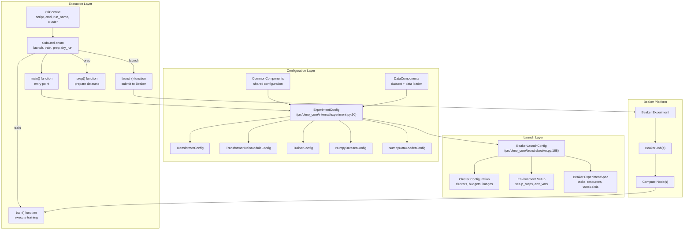
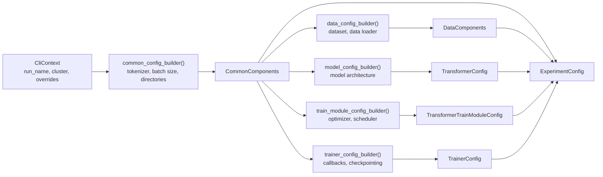
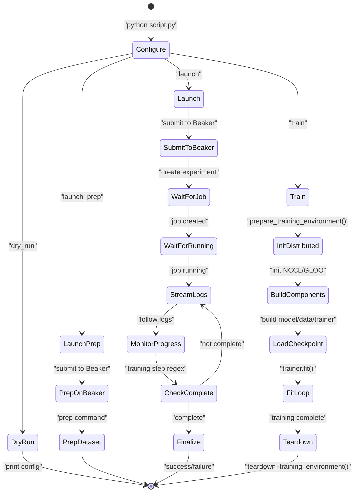
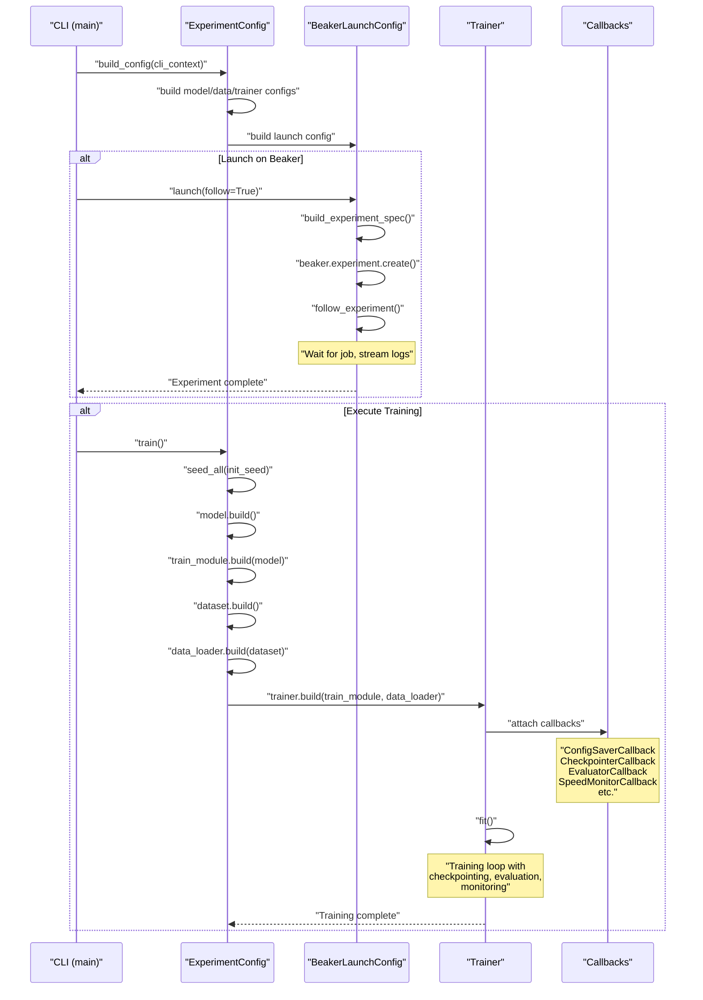

<!-- source: DeepWiki mcp.deepwiki.com · repo allenai/bolmo-core · page 7 Experiment Management · fetched 2026-10-26 -->

# Experiment Management

<details>
<summary>Relevant source files</summary>

The following files were used as context for generating this wiki page:

- [src/olmo_core/internal/common.py](src/olmo_core/internal/common.py)
- [src/olmo_core/internal/experiment.py](src/olmo_core/internal/experiment.py)
- [src/olmo_core/launch/beaker.py](src/olmo_core/launch/beaker.py)
- [src/olmo_core/train/callbacks/__init__.py](src/olmo_core/train/callbacks/__init__.py)
- [src/olmo_core/train/callbacks/gap_monitor.py](src/olmo_core/train/callbacks/gap_monitor.py)

</details>


## Purpose and Scope

This document describes the experiment management system in OLMo-Core, which provides infrastructure for configuring, launching, and monitoring training experiments across different compute clusters. The system abstracts cluster-specific details, handles job orchestration via Beaker, and provides a unified CLI interface for experiment execution.

For details on specific subsystems:
- For Beaker-specific launch configuration and job monitoring, see [Beaker Launch](#7.1)
- For experiment configuration builders and validation, see [Experiment Configuration](#7.2)
- For Augusta cluster optimization with execution units, see [Hostname Constraints and Execution Units](#7.3)
- For the training system that experiments execute, see [Training System](#3)
- For distributed infrastructure used by experiments, see [Distributed Training](#5)

## System Overview

The experiment management system orchestrates the complete lifecycle of training experiments, from local configuration through remote execution on compute clusters. It consists of three main layers:

1. **Configuration Layer**: `ExperimentConfig` and component builders that define what to run
2. **Launch Layer**: `BeakerLaunchConfig` and cluster abstractions that define where and how to run
3. **Execution Layer**: CLI interface and environment setup that actually runs the experiment



**Sources**: [src/olmo_core/internal/experiment.py:1-528](), [src/olmo_core/launch/beaker.py:1-1008](), [src/olmo_core/internal/common.py:1-253]()

## Core Components

### ExperimentConfig

The `ExperimentConfig` class [src/olmo_core/internal/experiment.py:90-100]() is the central configuration object that bundles all components needed for an experiment:

| Field | Type | Description |
|-------|------|-------------|
| `run_name` | `str` | Unique identifier for the experiment run |
| `launch` | `Optional[BeakerLaunchConfig]` | Configuration for launching on Beaker (None for local runs) |
| `model` | `TransformerConfig` | Model architecture configuration |
| `dataset` | `NumpyDatasetConfig` | Dataset configuration |
| `data_loader` | `NumpyDataLoaderConfig` | Data loader configuration |
| `train_module` | `TransformerTrainModuleConfig` | Training module with optimizer and scheduler |
| `trainer` | `TrainerConfig` | Trainer configuration with callbacks |
| `init_seed` | `int` | Random seed for initialization (default: 12536) |
| `backend` | `Optional[str]` | Distributed backend specification (default: "cpu:gloo,cuda:nccl") |

The configuration is built using a modular builder pattern that separates concerns:



**Sources**: [src/olmo_core/internal/experiment.py:317-413]()

### BeakerLaunchConfig

The `BeakerLaunchConfig` class [src/olmo_core/launch/beaker.py:168-656]() manages all aspects of launching experiments on Beaker:

| Field | Type | Default | Description |
|-------|------|---------|-------------|
| `name` | `str` | - | Experiment name in Beaker |
| `cmd` | `List[str]` | - | Command to execute in container |
| `budget` | `Optional[str]` | `None` | Budget account for compute resources |
| `task_name` | `str` | `"train"` | Name for Beaker tasks |
| `workspace` | `Optional[str]` | `None` | Beaker workspace |
| `beaker_image` | `str` | `OLMoCoreBeakerImage.stable` | Docker image to use |
| `num_nodes` | `int` | `1` | Number of compute nodes |
| `num_gpus` | `int` | `8` | GPUs per node |
| `clusters` | `List[str]` | `["ai2/jupiter"]` | Allowed clusters |
| `shared_filesystem` | `bool` | `False` | Whether nodes share a filesystem |
| `priority` | `Priority` | `Priority.normal` | Job priority level |
| `preemptible` | `bool` | `True` | Whether job can be preempted |
| `use_hostname_constraints` | `bool` | `False` | Use colocated nodes (Augusta only) |
| `num_execution_units` | `Optional[int]` | `None` | Number of replica groups |
| `launch_timeout` | `Optional[int]` | `None` | Timeout for job to start (seconds) |

**Sources**: [src/olmo_core/launch/beaker.py:168-321]()

### Helper Components

The `CommonComponents` class [src/olmo_core/internal/experiment.py:69-81]() provides shared configuration used across all builders:

```python
@dataclass
class CommonComponents:
    run_name: str
    root_dir: str        # Cluster-specific root directory
    work_dir: str        # Working directory for temporary files
    save_folder: str     # Checkpoint save location
    launch: Optional[BeakerLaunchConfig]
    tokenizer: TokenizerConfig
    max_sequence_length: int
    global_batch_size: int
```

The `DataComponents` class [src/olmo_core/internal/experiment.py:84-86]() bundles data configuration:

```python
@dataclass
class DataComponents:
    dataset: NumpyDatasetConfig
    data_loader: NumpyDataLoaderConfig
```

**Sources**: [src/olmo_core/internal/experiment.py:69-86]()

## Experiment Lifecycle

The experiment lifecycle follows a multi-stage process from configuration through execution:



**Sources**: [src/olmo_core/internal/experiment.py:102-162](), [src/olmo_core/launch/beaker.py:574-656]()

### Configuration Stage

The configuration stage uses the `build_config()` function [src/olmo_core/internal/experiment.py:317-413]() to construct an `ExperimentConfig`:

1. **Build Common Components**: Creates shared configuration (directories, tokenizer, batch size)
2. **Build Data Components**: Constructs dataset and data loader configurations
3. **Build Model Config**: Defines transformer architecture
4. **Build Training Module Config**: Sets up optimizer and scheduler
5. **Build Trainer Config**: Configures training loop and callbacks
6. **Apply Overrides**: Merges command-line overrides
7. **Set Execution Units**: Optimizes replica placement for Augusta (if applicable)
8. **Finalize**: Optional final modifications

**Sources**: [src/olmo_core/internal/experiment.py:317-413]()

### Launch Stage

When launching an experiment via Beaker:

1. **Build Experiment Spec**: `BeakerLaunchConfig.build_experiment_spec()` [src/olmo_core/launch/beaker.py:432-572]() creates a Beaker `ExperimentSpec`:
   - Creates entrypoint script with setup steps [src/olmo_core/launch/beaker.py:461-489]()
   - Configures torchrun for distributed execution [src/olmo_core/launch/beaker.py:366-384]()
   - Sets up environment variables and secrets [src/olmo_core/launch/beaker.py:324-364]()
   - Applies resource constraints (GPUs, memory) [src/olmo_core/launch/beaker.py:539]()
   - Mounts storage (Weka, NFS) [src/olmo_core/launch/beaker.py:557-565]()

2. **Submit Experiment**: `BeakerLaunchConfig.launch()` [src/olmo_core/launch/beaker.py:574-656]() submits to Beaker
   
3. **Monitor Progress**: `follow_experiment()` [src/olmo_core/launch/beaker.py:662-813]() tracks execution:
   - Waits for job creation and startup [src/olmo_core/launch/beaker.py:673-708]()
   - Streams logs in real-time [src/olmo_core/launch/beaker.py:736-758]()
   - Detects training steps via regex [src/olmo_core/launch/beaker.py:659]()
   - Sends Slack notifications for launch/success/failure [src/olmo_core/launch/beaker.py:710-711]()
   - Applies timeouts for inactivity [src/olmo_core/launch/beaker.py:764-787]()

**Sources**: [src/olmo_core/launch/beaker.py:432-813]()

### Execution Stage

When a training job executes (either locally or on Beaker):

1. **Prepare Environment**: `SubCmd.prepare_environment()` [src/olmo_core/internal/experiment.py:116-124]()
   - Local: `prepare_cli_environment()` for launch/dry_run/prep
   - Distributed: `prepare_training_environment(backend)` for train
   - Single device: `prepare_training_environment(backend=None)` for train_single

2. **Execute Subcommand**: `SubCmd.run()` [src/olmo_core/internal/experiment.py:126-162]()
   - **launch**: Calls `launch()` to submit to Beaker [src/olmo_core/internal/experiment.py:416-433]()
   - **train**: Calls `train()` to execute training [src/olmo_core/internal/experiment.py:450-466]()
   - **prep**: Calls `prep()` to prepare datasets [src/olmo_core/internal/experiment.py:444-447]()
   - **dry_run**: Prints configuration and exits [src/olmo_core/internal/experiment.py:138]()

**Sources**: [src/olmo_core/internal/experiment.py:116-162](), [src/olmo_core/internal/experiment.py:416-466]()

## Command-Line Interface

The experiment management system provides a CLI through the `main()` function [src/olmo_core/internal/experiment.py:469-527]():

### CLI Syntax

```
python script.py <SUBCMD> <RUN_NAME> <CLUSTER> [OVERRIDES...]
```

### Subcommands

The `SubCmd` enum [src/olmo_core/internal/experiment.py:102-162]() defines available operations:

| Subcommand | Purpose | Environment Setup |
|------------|---------|-------------------|
| `launch` | Submit experiment to Beaker for remote execution | `prepare_cli_environment()` |
| `train` | Execute training (typically called by Beaker, not directly) | `prepare_training_environment(backend)` |
| `train_single` | Execute training on single device (GPU/CPU/MPS) | `prepare_training_environment(backend=None)` |
| `prep` | Prepare dataset (shuffle indices, cache metadata) | `prepare_cli_environment()` |
| `launch_prep` | Submit dataset preparation to Beaker | `prepare_cli_environment()` |
| `dry_run` | Validate and print configuration without execution | `prepare_cli_environment()` |

**Sources**: [src/olmo_core/internal/experiment.py:102-162]()

### CLI Context

The `CliContext` class [src/olmo_core/internal/experiment.py:50-65]() captures CLI arguments:

```python
@dataclass
class CliContext:
    script: str           # Path to the script being run
    cmd: SubCmd           # Subcommand to execute
    run_name: str         # Unique identifier for this run
    cluster: str          # Target cluster (e.g., "ai2/jupiter")
    overrides: List[str]  # Configuration overrides (e.g., "--launch.num_nodes=2")
    
    @property
    def remote_cmd(self) -> List[str]:
        """Command to execute on Beaker after launch"""
        return [self.script, self.cmd.post_launch_subcmd(), 
                self.run_name, self.cluster, *self.overrides]
```

**Sources**: [src/olmo_core/internal/experiment.py:50-65]()

### Example Usage

```bash
# Dry run to validate configuration
python my_experiment.py dry_run test-run ai2/jupiter --model.d_model=2048

# Launch on Beaker with 4 nodes
python my_experiment.py launch test-run ai2/jupiter --launch.num_nodes=4

# Prepare dataset on Beaker
python my_experiment.py launch_prep test-run ai2/jupiter

# Train locally on single GPU
python my_experiment.py train_single test-run local

# Train with torchrun (multi-GPU single node)
torchrun --nproc-per-node=8 my_experiment.py train test-run local
```

**Sources**: [src/olmo_core/internal/experiment.py:469-527]()

## Cluster Configuration

The system supports multiple compute clusters with different storage backends and configurations:

```mermaid
graph TB
    ClusterConfig["Cluster Configuration"]
    
    subgraph "Weka Clusters"
        Jupiter["ai2/jupiter<br/>H100 80GB HBM3<br/>/weka/oe-training-default"]
        Saturn["ai2/saturn<br/>H100 80GB HBM3<br/>/weka/oe-training-default"]
        Ceres["ai2/ceres<br/>H100 80GB HBM3<br/>/weka/oe-training-default"]
        Neptune["ai2/neptune<br/>H100 80GB HBM3<br/>/weka/oe-training-default"]
        Titan["ai2/titan<br/>B200<br/>/weka/oe-training-default"]
    end
    
    subgraph "Google Cloud Clusters"
        Augusta["ai2/augusta<br/>H100 80GB HBM3<br/>gs://ai2-llm"]
    end
    
    subgraph "Local"
        Local["local<br/>Development<br/>gs://ai2-llm"]
    end
    
    ClusterConfig --> Jupiter
    ClusterConfig --> Saturn
    ClusterConfig --> Ceres
    ClusterConfig --> Neptune
    ClusterConfig --> Titan
    ClusterConfig --> Augusta
    ClusterConfig --> Local
```

### Cluster-Specific Settings

The `get_root_dir()` function [src/olmo_core/internal/common.py:74-90]() determines the root directory based on cluster:

| Cluster Pattern | Root Directory | Storage Backend |
|----------------|----------------|-----------------|
| `ai2/jupiter`, `ai2/saturn`, `ai2/ceres`, `ai2/neptune`, `ai2/titan` | `/weka/oe-training-default/ai2-llm` | Weka (shared filesystem) |
| `ai2/augusta` | `gs://ai2-llm` | Google Cloud Storage (no shared filesystem) |
| `local` | `gs://ai2-llm` | Google Cloud Storage (development) |

The `build_launch_config()` function [src/olmo_core/internal/common.py:102-230]() creates cluster-specific configurations:
- Mounts Weka buckets for Weka-based clusters [src/olmo_core/internal/common.py:127-128]()
- Sets up Google credentials for non-GCP clusters [src/olmo_core/internal/common.py:136-145]()
- Configures environment secrets (Beaker token, WandB, AWS credentials) [src/olmo_core/internal/common.py:146-184]()
- Sets `shared_filesystem` flag based on storage type [src/olmo_core/internal/common.py:199]()

**Sources**: [src/olmo_core/internal/common.py:74-230](), [src/olmo_core/launch/beaker.py:232-240]()

### GPU Types

Different clusters provide different GPU types, tracked in `CLUSTER_TO_GPU_TYPE` [src/olmo_core/internal/common.py:233-238]():

| Cluster | GPU Type |
|---------|----------|
| `ai2/jupiter` | NVIDIA H100 80GB HBM3 |
| `ai2/augusta` | NVIDIA H100 80GB HBM3 |
| `ai2/ceres` | NVIDIA H100 80GB HBM3 |
| `ai2/titan` | NVIDIA B200 |

**Sources**: [src/olmo_core/internal/common.py:233-253]()

## Environment Setup

### Beaker Image Selection

The `OLMoCoreBeakerImage` enum [src/olmo_core/launch/beaker.py:76-116]() provides pre-built Docker images:

| Image | PyTorch | CUDA | Notes |
|-------|---------|------|-------|
| `stable` | 2.7.1 | 12.8 | Default production image |
| `stable_cu126` | 2.7.1 | 12.6 | CUDA 12.6 variant |
| `stable_cu128` | 2.7.1 | 12.8 | CUDA 12.8 variant |
| `tch280_cu128` | 2.8.0 | 12.8 | PyTorch 2.8.0 with CUDA 12.8 |
| `tch280_cu129` | 2.8.0 | 12.9 | PyTorch 2.8.0 with CUDA 12.9 |
| `flash_attn_3` | 2.7.0 | 12.8 | Flash Attention 3 (beta) |

**Sources**: [src/olmo_core/launch/beaker.py:76-116]()

### Setup Steps

The `setup_steps` field in `BeakerLaunchConfig` [src/olmo_core/launch/beaker.py:203-207]() defines shell commands executed before training. The default steps [src/olmo_core/launch/beaker.py:136-147]() include:

1. Clone repository from `$REPO_URL` and checkout `$GIT_REF`
2. Initialize git submodules
3. Activate conda environment
4. Install package with `pip install -e '.[all]'`
5. Display installed packages with `pip freeze`

Custom setup steps can be provided for private repositories or special dependencies [src/olmo_core/internal/common.py:203-228]().

**Sources**: [src/olmo_core/launch/beaker.py:136-207](), [src/olmo_core/internal/common.py:203-228]()

### Environment Variables

Default environment variables are set via `BeakerLaunchConfig.default_env_vars` [src/olmo_core/launch/beaker.py:324-341]():

| Variable | Value | Purpose |
|----------|-------|---------|
| `NCCL_DEBUG` | `INFO` | NCCL debugging verbosity |
| `LOG_FILTER_TYPE` | `local_rank0_only` | Log filtering strategy |
| `OMP_NUM_THREADS` | `8` | OpenMP thread count |
| `R2_PROFILE`, `S3_PROFILE`, `WEKA_PROFILE` | Profile names | Storage backend configuration |
| `NUM_NODES` | `{num_nodes}` | Number of compute nodes |
| `OLMO_CORE_VERSION` | `{VERSION}` | Package version |
| `FORCE_COLOR` | `1` | Enable ANSI colors in logs |
| `OLMO_SHARED_FS` | `1` (if applicable) | Indicates shared filesystem availability |

Additional custom variables can be provided via `env_vars` (plain values) or `env_secrets` (from Beaker secrets) [src/olmo_core/launch/beaker.py:257-265]().

**Sources**: [src/olmo_core/launch/beaker.py:324-341]()

### Distributed Launch with torchrun

For multi-GPU training, the system automatically generates `torchrun` commands [src/olmo_core/launch/beaker.py:366-384]():

**Single Node** (num_nodes=1):
```bash
torchrun --nproc-per-node={num_gpus}
```

**Multi-Node** (num_nodes>1):
```bash
torchrun \
  --nnodes={num_nodes}:{num_nodes} \
  --nproc-per-node={num_gpus} \
  --rdzv_id=12347 \
  --rdzv_backend=static \
  --rdzv_endpoint="${BEAKER_LEADER_REPLICA_HOSTNAME}:29400" \
  --node_rank="${BEAKER_REPLICA_RANK}" \
  --rdzv_conf='read_timeout=420'
```

For Augusta clusters with multiple nodes, rank reordering is applied [src/olmo_core/launch/beaker.py:473-482]() to optimize placement.

**Sources**: [src/olmo_core/launch/beaker.py:366-384](), [src/olmo_core/launch/beaker.py:472-482]()

## Integration with Training System

The experiment management system integrates tightly with the training system:



The `train()` function [src/olmo_core/internal/experiment.py:450-466]() builds and executes all training components:

1. **Seed RNG**: `seed_all(config.init_seed)` for reproducibility
2. **Build Model**: `config.model.build(init_device="meta")` creates transformer on meta device
3. **Build Train Module**: `config.train_module.build(model)` wraps model with optimizer and scheduler
4. **Build Dataset**: `config.dataset.build()` creates numpy dataset
5. **Build Data Loader**: `config.data_loader.build(dataset, dp_process_group)` creates distributed data loader
6. **Build Trainer**: `config.trainer.build(train_module, data_loader)` creates trainer with callbacks
7. **Attach Config**: Record full configuration to callbacks for checkpointing and logging
8. **Execute Training**: `trainer.fit()` runs the training loop

Required callbacks are automatically added by `_build_required_callbacks()` [src/olmo_core/internal/experiment.py:252-264]():
- `ConfigSaverCallback`: Saves full configuration to checkpoints
- `ProfilerCallback`: Optional profiling (disabled by default)
- `GarbageCollectorCallback`: Periodic garbage collection
- `SlackNotifierCallback`: Slack notifications (disabled by default)
- `GAPMonitorCallback`: Gradient/activation/parameter monitoring (disabled by default)
- `BeakerCallback`: Beaker integration (only when launching on Beaker)
- `GPUMemoryMonitorCallback`: GPU memory tracking (only when CUDA available)

**Sources**: [src/olmo_core/internal/experiment.py:252-466]()

---

