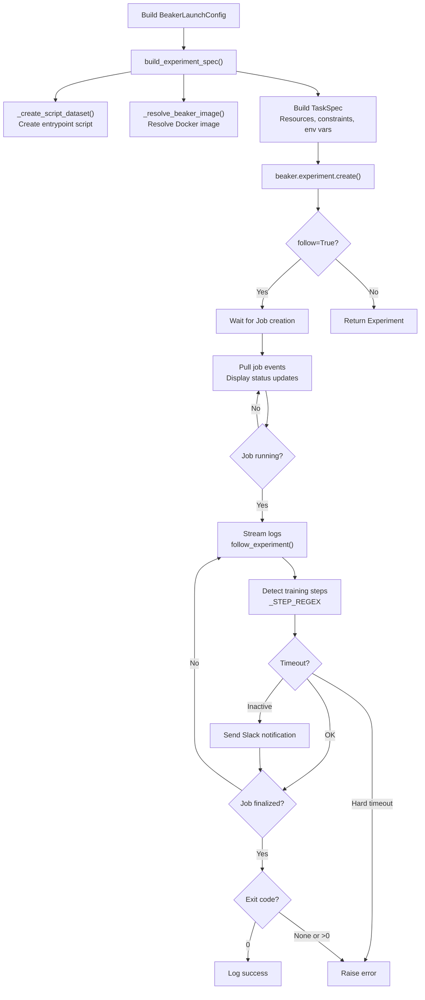
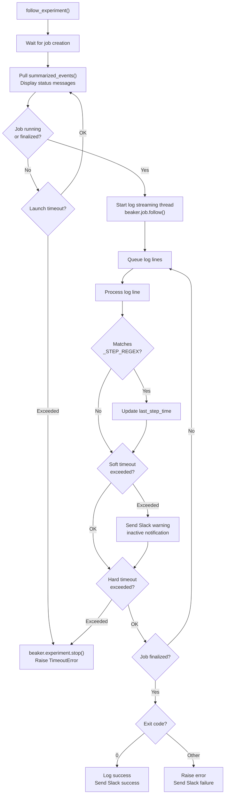
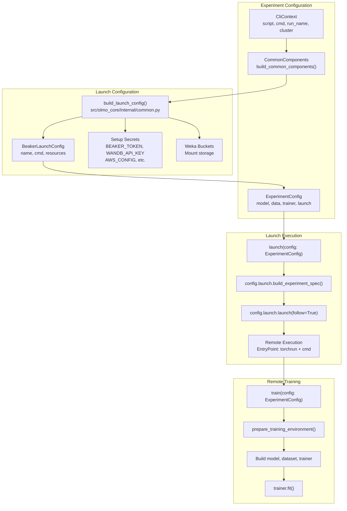

<!-- source: DeepWiki mcp.deepwiki.com · repo allenai/bolmo-core · page 7.1 Beaker Launch · fetched 2026-10-26 -->

# Beaker Launch

<details>
<summary>Relevant source files</summary>

The following files were used as context for generating this wiki page:

- [src/olmo_core/internal/common.py](src/olmo_core/internal/common.py)
- [src/olmo_core/internal/experiment.py](src/olmo_core/internal/experiment.py)
- [src/olmo_core/launch/beaker.py](src/olmo_core/launch/beaker.py)
- [src/olmo_core/train/callbacks/__init__.py](src/olmo_core/train/callbacks/__init__.py)
- [src/olmo_core/train/callbacks/gap_monitor.py](src/olmo_core/train/callbacks/gap_monitor.py)

</details>


This page documents the Beaker launch system, which orchestrates the execution of training experiments on Beaker clusters. Beaker is AI2's internal job orchestration platform that manages compute resources across multiple clusters.

For information about the broader experiment management system, see [Experiment Configuration](#7.2). For details about hostname constraints and execution units specific to Augusta clusters, see [Hostname Constraints and Execution Units](#7.3).

## Purpose and Scope

The Beaker launch system provides:
- **Job Submission**: Create and submit Beaker experiments from configuration
- **Resource Management**: Allocate GPUs, nodes, memory, and storage
- **Environment Setup**: Configure Docker images, dependencies, and secrets
- **Distributed Training**: Integrate with `torchrun` for multi-node training
- **Monitoring**: Follow job logs, detect failures, and send notifications

The system centers around `BeakerLaunchConfig`, which encapsulates all configuration needed to launch an experiment on Beaker.

**Sources**: [src/olmo_core/launch/beaker.py:1-68]()

## Core Components

### BeakerLaunchConfig

`BeakerLaunchConfig` is the main configuration class for launching experiments on Beaker.

| Field | Type | Description |
|-------|------|-------------|
| `name` | `str` | Name for the Beaker experiment |
| `cmd` | `List[str]` | Command to run in the container |
| `budget` | `Optional[str]` | Budget group to charge resources |
| `task_name` | `str` | Name for Beaker tasks (default: "train") |
| `workspace` | `Optional[str]` | Beaker workspace to use |
| `beaker_image` | `str` | Docker image (default: `OLMoCoreBeakerImage.stable`) |
| `num_nodes` | `int` | Number of nodes (default: 1) |
| `num_gpus` | `int` | GPUs per node (default: 8) |
| `shared_memory` | `str` | Shared memory allocation (default: "10GiB") |
| `clusters` | `List[str]` | Allowed clusters (default: ["ai2/jupiter"]) |
| `shared_filesystem` | `bool` | Use shared filesystem like Weka |
| `priority` | `Priority` | Job priority (default: normal) |
| `preemptible` | `bool` | Allow preemption (default: True) |
| `retries` | `Optional[int]` | Number of retries on failure |
| `env_vars` | `List[BeakerEnvVar]` | Additional environment variables |
| `env_secrets` | `List[BeakerEnvSecret]` | Environment variables from secrets |
| `weka_buckets` | `List[BeakerWekaBucket]` | Weka storage buckets to mount |
| `use_hostname_constraints` | `bool` | Enable hostname constraints (Augusta only) |
| `num_execution_units` | `Optional[int]` | Number of execution units for colocation |
| `launch_timeout` | `Optional[int]` | Timeout in seconds for job to start |

**Sources**: [src/olmo_core/launch/beaker.py:167-321]()

### OLMoCoreBeakerImage

Predefined Docker images optimized for OLMo-core training:

```python
class OLMoCoreBeakerImage(StrEnum):
    stable = "olmo-core-tch271cu128-2025-09-15"  # PyTorch 2.7.1, CUDA 12.8
    stable_cu126 = "olmo-core-tch271cu126-2025-09-15"  # CUDA 12.6
    stable_cu128 = "olmo-core-tch271cu128-2025-09-15"  # CUDA 12.8
    tch280_cu128 = "olmo-core-tch280cu128-2025-09-19"  # PyTorch 2.8.0
    tch280_cu129 = "olmo-core-tch280cu129-2025-09-23"  # CUDA 12.9
    flash_attn_3 = "tylerr/olmo-core-tch270cu128-2025-09-24"  # Flash Attention 3
```

**Sources**: [src/olmo_core/launch/beaker.py:76-116]()

### Supporting Configuration Classes

**BeakerEnvVar**: Environment variable specification
```python
@dataclass
class BeakerEnvVar:
    name: str
    value: str
```

**BeakerEnvSecret**: Environment variable from Beaker secret
```python
@dataclass
class BeakerEnvSecret:
    name: str
    secret: str  # Beaker secret name
```

**BeakerWekaBucket**: Weka storage mount specification
```python
@dataclass
class BeakerWekaBucket:
    bucket: str  # Weka bucket name
    mount: str   # Mount path in container
```

**Sources**: [src/olmo_core/launch/beaker.py:118-134]()

## Launch Workflow

The following diagram shows the complete workflow for launching and monitoring a Beaker experiment:

**Beaker Launch Workflow**


**Sources**: [src/olmo_core/launch/beaker.py:574-656](), [src/olmo_core/launch/beaker.py:662-813]()

## Building Experiment Specs

The `build_experiment_spec()` method constructs a Beaker `ExperimentSpec` from the launch configuration.

### Entrypoint Script Creation

The system creates a script dataset containing an entrypoint script that:
1. Sets up the environment (CUDA paths, kernel cache)
2. Clones the Git repository
3. Checks out the specified commit
4. Installs dependencies
5. Optionally wraps the command with `torchrun`

**Default Setup Steps**:
```bash
git clone "$REPO_URL" .
git checkout "$GIT_REF"
git submodule update --init --recursive
conda shell.bash activate base
pip install -e '.[all]'
pip freeze
```

**Sources**: [src/olmo_core/launch/beaker.py:136-148](), [src/olmo_core/launch/beaker.py:461-490]()

### Torchrun Integration

For multi-GPU training, the system automatically generates a `torchrun` command:

**Single Node** (num_nodes=1):
```bash
torchrun --nproc-per-node=<num_gpus>
```

**Multi-Node** (num_nodes>1):
```bash
torchrun \
  --nnodes=<num_nodes>:<num_nodes> \
  --nproc-per-node=<num_gpus> \
  --rdzv_id=12347 \
  --rdzv_backend=static \
  --rdzv_endpoint="${BEAKER_LEADER_REPLICA_HOSTNAME}:29400" \
  --node_rank="${BEAKER_REPLICA_RANK}" \
  --rdzv_conf='read_timeout=420'
```

For Augusta clusters with multiple nodes, the system reorders ranks to optimize placement:
```bash
BEAKER_REPLICA_RANK=$(python -m olmo_core.launch.reorder_ranks_in_gcp ...)
```

**Sources**: [src/olmo_core/launch/beaker.py:366-384](), [src/olmo_core/launch/beaker.py:472-483]()

### Environment Variables

The system sets default environment variables for distributed training and storage:

| Variable | Value | Purpose |
|----------|-------|---------|
| `NCCL_DEBUG` | "INFO" | NCCL logging level |
| `LOG_FILTER_TYPE` | `LogFilterType.local_rank0_only` | Log filtering |
| `OMP_NUM_THREADS` | "8" | OpenMP threads |
| `R2_PROFILE` | "R2" | R2 storage profile |
| `S3_PROFILE` | "S3" | S3 storage profile |
| `WEKA_PROFILE` | "WEKA" | Weka storage profile |
| `NUM_NODES` | str(num_nodes) | Node count |
| `OLMO_CORE_VERSION` | VERSION | Package version |
| `OLMO_SHARED_FS` | "1" | Shared filesystem flag (if enabled) |

**Sources**: [src/olmo_core/launch/beaker.py:324-341]()

### Task Specification

The `TaskSpec` defines the job resources and constraints:

```python
TaskSpec.new(
    task_name,
    beaker_image=image_id,
    priority=priority,
    preemptible=preemptible,
    arguments=cmd,
    command=["bash", "/olmo-core/entrypoint.sh"],
    replicas=num_nodes if num_nodes > 1 else None,
    leader_selection=num_nodes > 1,
    host_networking=True if multi-node else False,
    propagate_failure=True if num_nodes > 1 else None,
    synchronized_start_timeout="90m" if num_nodes > 1 else None,
    resources=TaskResources(gpu_count=num_gpus, shared_memory=shared_memory),
)
```

**Sources**: [src/olmo_core/launch/beaker.py:518-541]()

### Hostname Constraints

When `use_hostname_constraints=True` (Augusta clusters only), the system restricts job placement to colocated nodes:

```python
if use_hostname_constraints and "augusta" in clusters[0]:
    host_name_constraints = get_beaker_hostname_constraints(
        num_nodes,
        num_execution_units or max(1, num_nodes // 32),
        1,
        "us-central1-b",
        beaker_cluster=clusters[0],
        beaker_priority=priority,
    )
    task_spec.with_constraint(hostname=host_name_constraints[0])
```

**Sources**: [src/olmo_core/launch/beaker.py:493-517]()

## Launching Experiments

The `launch()` method submits the experiment to Beaker and optionally monitors it:

### Launch Parameters

| Parameter | Type | Default | Description |
|-----------|------|---------|-------------|
| `follow` | `bool` | False | Stream logs until completion |
| `torchrun` | `Optional[bool]` | None | Use torchrun (auto-detects if None) |
| `entrypoint` | `Optional[str]` | None | Custom entrypoint program |
| `slack_notifications` | `Optional[bool]` | None | Send Slack notifications (requires webhook) |
| `launch_timeout` | `Optional[int]` | None | Seconds to wait for job start |
| `step_timeout` | `Optional[int]` | None | Hard timeout between steps |
| `step_soft_timeout` | `Optional[int]` | None | Soft timeout for warnings |

**Example Usage**:
```python
config = BeakerLaunchConfig(
    name="my-experiment",
    cmd=["python", "train.py"],
    num_nodes=4,
    num_gpus=8,
)
experiment = config.launch(
    follow=True,
    slack_notifications=True,
    launch_timeout=5*60,  # 5 minutes
    step_soft_timeout=10*60,  # 10 minutes
)
```

**Sources**: [src/olmo_core/launch/beaker.py:574-656]()

## Monitoring and Log Following

The `follow_experiment()` function monitors job execution and streams logs:

**Monitoring Flow**:


### Step Detection

Training progress is detected using a regex pattern that matches log lines containing step information:

```python
_STEP_REGEX = re.compile(r"\[olmo_core\..+\].+\[.*step\=\d+.*\]")
```

**Example matching lines**:
- `[olmo_core.train.trainer][step=1000][loss=2.345]`
- `[olmo_core.train.callbacks.evaluator][step=5000][eval_loss=2.123]`

**Sources**: [src/olmo_core/launch/beaker.py:658-660](), [src/olmo_core/launch/beaker.py:752-757]()

### Timeout Monitoring

Two types of timeouts:

1. **Soft Timeout** (`step_soft_timeout`): Sends Slack warning after inactivity
   - Triggered if no steps detected within N seconds
   - Only sends warning once per hour
   - Does not stop the job

2. **Hard Timeout** (`step_timeout`): Stops job after inactivity
   - Triggered if no steps detected within N seconds
   - Calls `beaker.experiment.stop()`
   - Raises `TimeoutError`

**Sources**: [src/olmo_core/launch/beaker.py:764-787]()

### Slack Notifications

Notifications are sent for four events:

| Event | Message | Icon |
|-------|---------|------|
| `launched` | "Run has launched!" | ✓ |
| `succeeded` | "Run succeeded!" | ✓ |
| `failed` | "Run failed!" | ✗ |
| `inactive` | "Run appears to be stuck!" | ⚠ |

**Sources**: [src/olmo_core/launch/beaker.py:815-838]()

## Integration with Training System

The launch system integrates with the experiment management infrastructure:

**Integration Architecture**:


**Sources**: [src/olmo_core/internal/experiment.py:171-217](), [src/olmo_core/internal/common.py:102-231]()

### build_launch_config() Helper

The `build_launch_config()` function in `src/olmo_core/internal/common.py` constructs a `BeakerLaunchConfig` with AI2-specific defaults:

```python
def build_launch_config(
    *,
    name: str,
    cmd: List[str],
    cluster: str,
    root_dir: Optional[str] = None,
    task_name: str = "train",
    workspace: str = "ai2/OLMo-core",
    budget: str = "ai2/oe-base",
    nccl_debug: bool = False,
    beaker_image: str = OLMoCoreBeakerImage.stable,
    num_nodes: int = 1,
    use_hostname_constraints: bool = False,
    num_execution_units: Optional[int] = None,
) -> BeakerLaunchConfig
```

This function:
- Determines Weka bucket mounts based on cluster
- Resolves Beaker secrets for the user (API keys, credentials)
- Sets up Google Cloud credentials for Augusta clusters
- Configures AWS credentials from secrets
- Creates custom setup steps for repo cloning and dependency installation

**Sources**: [src/olmo_core/internal/common.py:102-231]()

### Cluster Configuration

Cluster-specific root directories:

| Cluster | Root Directory |
|---------|----------------|
| ai2/jupiter, ai2/saturn, ai2/ceres, ai2/neptune | `/weka/oe-training-default/ai2-llm` |
| ai2/augusta | `gs://ai2-llm` |
| local | `gs://ai2-llm` |

**Sources**: [src/olmo_core/internal/common.py:74-91]()

## CLI Usage

The Beaker launch system can be invoked from the command line:

### Python Module Invocation

```bash
python -m olmo_core.launch.beaker [OPTIONS...] -- [CMD...]
```

**Common Options**:
| Option | Type | Default | Description |
|--------|------|---------|-------------|
| `--name` | str | "olmo-core-test" | Experiment name |
| `--task-name` | str | "main" | Task name |
| `--gpus` | int | 0 | GPUs per node |
| `--nodes` | int | 1 | Number of nodes |
| `--budget` | str | None | Budget account |
| `--workspace` | str | None | Beaker workspace |
| `--cluster` | str+ | ["ai2/jupiter", ...] | Allowed clusters |
| `--priority` | str | "normal" | Priority level |
| `--preemptible` | flag | False | Allow preemption |
| `--beaker-image` | str | `stable` | Docker image |
| `--shared-filesystem` | flag | False | Use shared filesystem |
| `--weka` | str+ | None | Weka buckets to mount |
| `--torchrun` | bool | auto | Use torchrun |
| `--debug` | flag | False | Enable debug env vars |
| `--dry-run` | flag | False | Print config without launching |
| `--env` | str+ | None | Env vars (NAME=VALUE) |
| `--env-secret` | str+ | None | Env secrets (NAME=SECRET) |

**Example**:
```bash
python -m olmo_core.launch.beaker \
  --name my-training-run \
  --gpus 8 \
  --nodes 4 \
  --cluster ai2/jupiter \
  --weka oe-training-default \
  --shared-filesystem \
  -- python train.py --config configs/my_config.yaml
```

**Sources**: [src/olmo_core/launch/beaker.py:841-1007]()

### Dry Run Mode

Use `--dry-run` to preview the configuration without launching:

```bash
python -m olmo_core.launch.beaker --dry-run --gpus 8 -- python train.py
```

This prints the `BeakerLaunchConfig` that would be used.

**Sources**: [src/olmo_core/launch/beaker.py:1000-1003]()

## Utility Functions

### is_running_in_beaker()

Check if code is executing inside a Beaker job:

```python
def is_running_in_beaker() -> bool:
    """Check if running inside Beaker (batch or session)."""
    return "BEAKER_JOB_ID" in os.environ and "BEAKER_NODE_ID" in os.environ
```

### is_running_in_beaker_batch_job()

Check specifically for batch jobs (not sessions):

```python
def is_running_in_beaker_batch_job() -> bool:
    """Check if running inside a Beaker batch job."""
    return is_running_in_beaker() and os.environ.get("BEAKER_JOB_KIND") == "batch"
```

**Sources**: [src/olmo_core/launch/beaker.py:150-165]()

## Script Dataset Caching

The system creates cached script datasets to avoid recreating entrypoint scripts:

```python
def _create_script_dataset(self, script_name: str, script: List[str]) -> Dataset:
    # Hash script contents
    sha256_hash = hashlib.sha256()
    for line in script:
        sha256_hash.update(line.encode())
    
    # Create unique dataset name
    dataset_name = f"olmo-core-v{VERSION}-{workspace_id}-{sha256_hash.hexdigest()[:6]}"
    
    # Reuse existing dataset if available
    try:
        dataset = self.beaker.dataset.get(dataset_name)
    except DatasetNotFound:
        # Create new dataset
        dataset = self.beaker.dataset.create(dataset_name, script_path)
    
    return dataset
```

This ensures that identical entrypoint scripts reuse the same Beaker dataset, reducing overhead.

**Sources**: [src/olmo_core/launch/beaker.py:386-415]()

---

