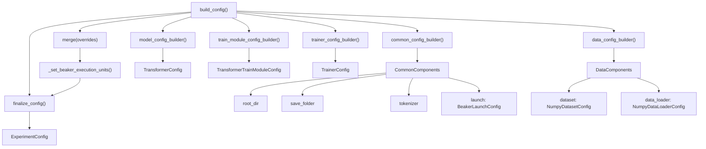
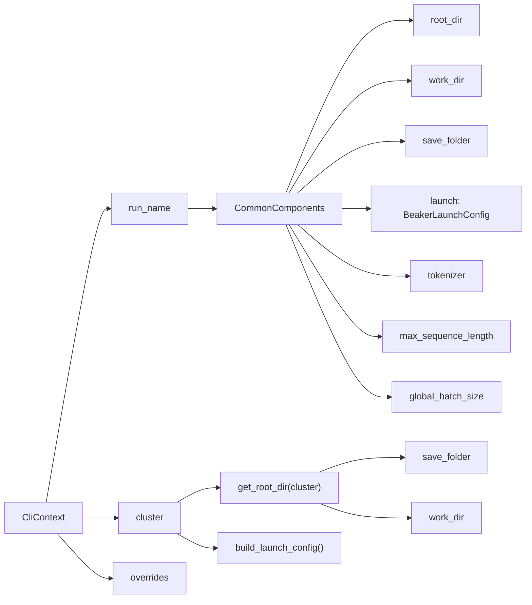
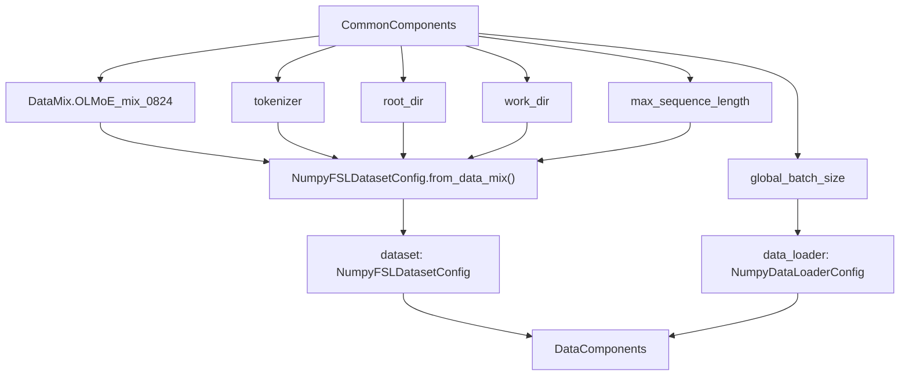
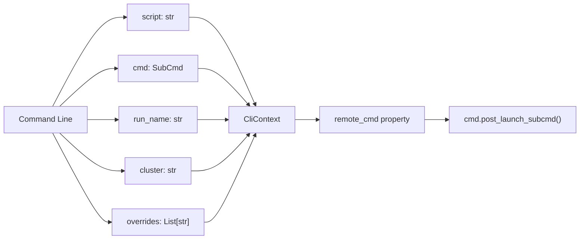
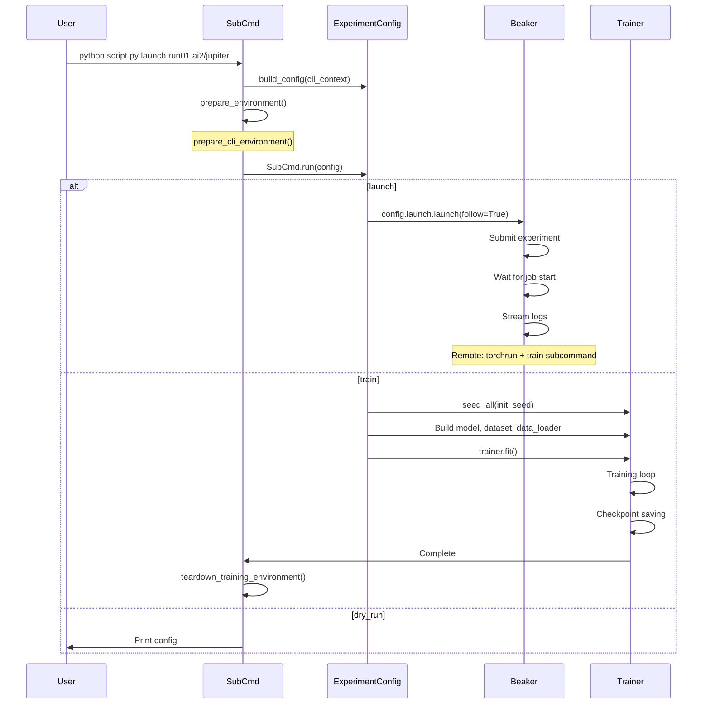
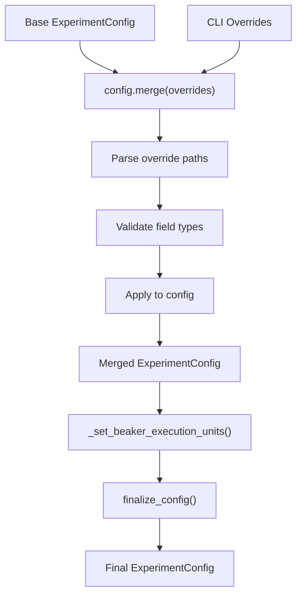
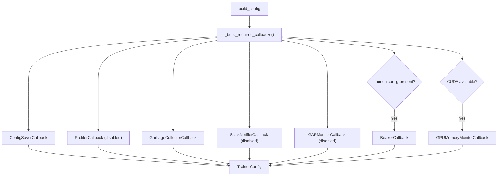
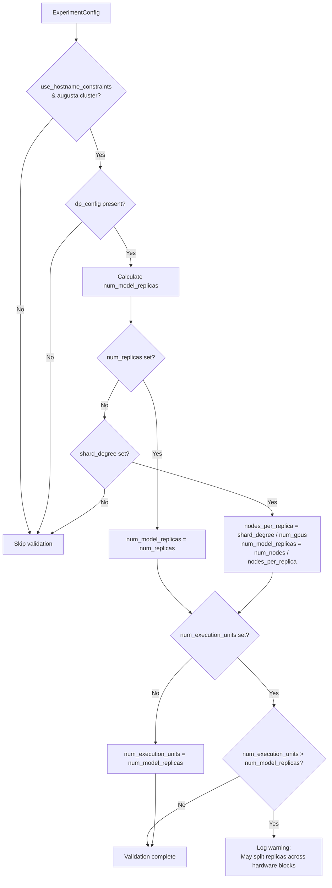

<!-- source: DeepWiki mcp.deepwiki.com · repo allenai/bolmo-core · page 7.2 Experiment Configuration · fetched 2026-10-26 -->

# Experiment Configuration

<details>
<summary>Relevant source files</summary>

The following files were used as context for generating this wiki page:

- [src/olmo_core/internal/common.py](src/olmo_core/internal/common.py)
- [src/olmo_core/internal/experiment.py](src/olmo_core/internal/experiment.py)
- [src/olmo_core/launch/beaker.py](src/olmo_core/launch/beaker.py)
- [src/olmo_core/train/callbacks/__init__.py](src/olmo_core/train/callbacks/__init__.py)
- [src/olmo_core/train/callbacks/gap_monitor.py](src/olmo_core/train/callbacks/gap_monitor.py)

</details>


## Purpose and Scope

This page documents the `ExperimentConfig` system used to configure and launch training jobs in OLMo-Core. The `ExperimentConfig` class aggregates all component configurations (model, data, optimizer, trainer, launcher) into a single coherent specification that can be validated, serialized, and executed.

For information about launching experiments on Beaker clusters, see [Beaker Launch](#7.1). For details on specific component configurations (model, data pipeline, training), refer to their respective sections: [Model Architecture](#2), [Data Pipeline](#4), and [Training System](#3).

---

## ExperimentConfig Structure

The `ExperimentConfig` dataclass brings together all configurations needed to run a complete training experiment. It serves as the single source of truth for experiment specification and can be serialized, passed between processes, and modified through command-line overrides.

### Core Components

```mermaid
graph TB
    ExperimentConfig["ExperimentConfig"]
    
    ExperimentConfig --> run_name["run_name: str"]
    ExperimentConfig --> init_seed["init_seed: int"]
    ExperimentConfig --> backend["backend: Optional[str]"]
    
    ExperimentConfig --> launch["launch: BeakerLaunchConfig"]
    ExperimentConfig --> model["model: TransformerConfig"]
    ExperimentConfig --> dataset["dataset: NumpyDatasetConfig"]
    ExperimentConfig --> data_loader["data_loader: NumpyDataLoaderConfig"]
    ExperimentConfig --> train_module["train_module: TransformerTrainModuleConfig"]
    ExperimentConfig --> trainer["trainer: TrainerConfig"]
    
    launch --> name["name: str"]
    launch --> cmd["cmd: List[str]"]
    launch --> clusters["clusters: List[str]"]
    launch --> num_nodes["num_nodes: int"]
    launch --> num_gpus["num_gpus: int"]
    launch --> beaker_image["beaker_image: str"]
    
    model --> ModelParams["d_model, n_layers, etc."]
    
    dataset --> DatasetParams["sources, sequence_length, etc."]
    
    data_loader --> LoaderParams["global_batch_size, seed, etc."]
    
    train_module --> TrainModuleParams["optimizer, scheduler, dp_config, etc."]
    
    trainer --> TrainerConfig_params["max_epochs, save_folder, callbacks, etc."]
```



**Sources:** [src/olmo_core/internal/experiment.py:90-100]()

### Component Hierarchy

| Component | Type | Purpose |
|-----------|------|---------|
| `run_name` | `str` | Unique identifier for the experiment |
| `launch` | `BeakerLaunchConfig` | Cluster launch settings (optional for local runs) |
| `model` | `TransformerConfig` | Model architecture specification |
| `dataset` | `NumpyDatasetConfig` | Dataset configuration (FSL, VSL, Packed, etc.) |
| `data_loader` | `NumpyDataLoaderConfig` | Distributed data loading settings |
| `train_module` | `TransformerTrainModuleConfig` | Optimizer, scheduler, and parallelism configs |
| `trainer` | `TrainerConfig` | Training loop settings, callbacks, checkpointing |
| `init_seed` | `int` | RNG seed for reproducibility (default: 12536) |
| `backend` | `Optional[str]` | Distributed backend string (default: "cpu:gloo,cuda:nccl") |

**Sources:** [src/olmo_core/internal/experiment.py:90-100]()

---

## Configuration Builder Pattern

OLMo-Core uses a builder pattern to construct `ExperimentConfig` instances programmatically. This pattern separates configuration construction into modular, reusable components.

### Builder Function Hierarchy



**Sources:** [src/olmo_core/internal/experiment.py:317-413]()

### CommonComponents Builder

The `build_common_components()` function constructs shared configuration elements used across multiple component builders:



**Key Parameters:**

| Parameter | Type | Description |
|-----------|------|-------------|
| `tokenizer` | `TokenizerConfig` | Tokenizer configuration (e.g., `TokenizerConfig.dolma2()`) |
| `global_batch_size` | `int` | Global batch size across all devices |
| `max_sequence_length` | `int` | Maximum sequence length for training |
| `beaker_image` | `str` | Docker image for Beaker (default: `OLMoCoreBeakerImage.stable`) |
| `num_nodes` | `int` | Number of nodes for distributed training |
| `use_hostname_constraints` | `bool` | Enable hostname constraints on Augusta (default: False) |
| `num_execution_units` | `Optional[int]` | Number of execution units for node allocation |

**Sources:** [src/olmo_core/internal/experiment.py:171-217]()

### DataComponents Builder

The `build_default_data_components()` function creates dataset and data loader configurations:



**Parameters:**

- `intra_document_masking`: Enable document boundary tracking (default: False)
- `include_instance_filter`: Add repetition filtering (default: False)

**Sources:** [src/olmo_core/internal/experiment.py:220-249]()

### Full Configuration Builder

The `build_config()` function orchestrates all component builders and produces a complete `ExperimentConfig`:

```python
# Simplified signature
def build_config(
    cli_context: CliContext,
    *,
    common_config_builder: Callable[..., CommonComponents] = build_common_components,
    data_config_builder: Callable[..., DataComponents] = build_default_data_components,
    model_config_builder: Callable[[CommonComponents], TransformerConfig],
    train_module_config_builder: Callable[[CommonComponents], TransformerTrainModuleConfig],
    trainer_config_builder: Callable[[CommonComponents], TrainerConfig],
    finalize_config: Optional[Callable[[ExperimentConfig], None]] = None,
    tokenizer: TokenizerConfig = TokenizerConfig.dolma2(),
    global_batch_size: int,
    max_sequence_length: int = 4096,
    include_default_evals: bool = False,
    **data_kwargs,
) -> ExperimentConfig
```

**Builder Flow:**

1. **Build common components** - Shared configuration elements
2. **Build data components** - Dataset and data loader configs
3. **Build model config** - Transformer architecture specification
4. **Build trainer config** - Add required callbacks (checkpointing, monitoring, etc.)
5. **Build train module config** - Optimizer, scheduler, parallelism settings
6. **Assemble ExperimentConfig** - Combine all components
7. **Merge overrides** - Apply command-line overrides
8. **Validate** - Set execution units based on parallelism
9. **Finalize** - Optional user-defined finalization

**Sources:** [src/olmo_core/internal/experiment.py:317-413]()

---

## CLI Context and Subcommands

The experiment system provides a command-line interface through the `CliContext` and `SubCmd` system.

### CliContext Structure



**Command-line format:**
```bash
python script.py [SUBCMD] [RUN_NAME] [CLUSTER] [OVERRIDES...]
```

**Sources:** [src/olmo_core/internal/experiment.py:49-65]()

### Subcommand Types

| Subcommand | Purpose | Environment Setup | Post-Launch |
|------------|---------|-------------------|-------------|
| `launch` | Submit job to Beaker cluster | CLI environment | → `train` |
| `train` | Run distributed training | Full distributed setup | N/A |
| `train_single` | Run on single device (no distribution) | Limited distributed setup | N/A |
| `prep` | Prepare dataset (shuffle indices, cache) | CLI environment | N/A |
| `launch_prep` | Submit dataset preparation to Beaker | CLI environment | → `prep` |
| `dry_run` | Print config without execution | CLI environment | N/A |

**Sources:** [src/olmo_core/internal/experiment.py:102-163]()

### Subcommand Execution Flow



**Sources:** [src/olmo_core/internal/experiment.py:116-163](), [src/olmo_core/internal/experiment.py:416-467]()

---

## Configuration Merging and Overrides

Configurations support merging with command-line overrides using dot-notation paths.

### Override Syntax

**Format:** `--path.to.field=value`

**Examples:**
```bash
# Override launch config
python script.py launch run01 ai2/jupiter --launch.num_nodes=4

# Override model config
python script.py launch run01 ai2/jupiter --model.d_model=2048

# Override trainer config
python script.py launch run01 ai2/jupiter --trainer.max_epochs=10

# Multiple overrides
python script.py launch run01 ai2/jupiter \
    --launch.num_nodes=8 \
    --model.n_layers=32 \
    --train_module.optimizer.learning_rate=3e-4
```

### Merge Process



**Sources:** [src/olmo_core/internal/experiment.py:406-411]()

---

## Automatic Callbacks and Validation

The configuration system automatically adds required callbacks and validates settings.

### Required Callbacks

The `build_config()` function automatically adds essential callbacks to the trainer configuration:



**Default Callbacks:**

| Callback | Purpose | Default State |
|----------|---------|---------------|
| `ConfigSaverCallback` | Save config to checkpoints and W&B/Comet | Enabled |
| `ProfilerCallback` | PyTorch profiler integration | Disabled (enable via override) |
| `GarbageCollectorCallback` | Periodic garbage collection | Enabled |
| `SlackNotifierCallback` | Slack notifications for job events | Disabled (enable via override) |
| `GAPMonitorCallback` | Gradient/activation/parameter monitoring | Disabled (enable via override) |
| `BeakerCallback` | Beaker-specific result uploading | Enabled if `launch` config present |
| `GPUMemoryMonitorCallback` | GPU memory usage tracking | Enabled if CUDA available |

**Sources:** [src/olmo_core/internal/experiment.py:252-264](), [src/olmo_core/internal/experiment.py:385-392]()

### Optional Evaluation Callbacks

When `include_default_evals=True`, additional evaluation callbacks are added:

```python
"lm_evaluator": LMEvaluatorCallbackConfig(
    eval_dataset=NumpyPaddedFSLDatasetConfig.from_data_mix(
        DataMix.v3_small_ppl_validation,
        # ... config
    ),
    eval_interval=1000,
)

"downstream_evaluator": DownstreamEvaluatorCallbackConfig(
    tasks=["hellaswag"],
    tokenizer=common.tokenizer,
    eval_interval=1000,
)
```

**Sources:** [src/olmo_core/internal/experiment.py:267-284]()

### Execution Unit Validation

The `_set_beaker_execution_units()` function automatically configures execution units for Augusta clusters with hostname constraints:



**Purpose:** Ensures that execution units align with model replicas to prevent performance degradation from suboptimal node placement on Augusta clusters.

**Sources:** [src/olmo_core/internal/experiment.py:287-314](), [src/olmo_core/internal/experiment.py:408]()

---

## Configuration Serialization

`ExperimentConfig` inherits from `Config`, which provides automatic serialization to YAML/JSON and integration with OmegaConf for merging.

### Config Dictionary Export

```python
# Inside train() function
config_dict = config.as_config_dict()
cast(ConfigSaverCallback, trainer.callbacks["config_saver"]).config = config_dict
```

The configuration dictionary is:
- Saved to checkpoint directories
- Uploaded to W&B and Comet
- Used for experiment reproducibility

**Sources:** [src/olmo_core/internal/experiment.py:462-463]()

---

## Example: Custom Configuration Builder

Here's a typical pattern for building custom experiment configurations:

```python
from functools import partial
from olmo_core.internal.experiment import (
    build_config, 
    ConfigBuilder, 
    CommonComponents
)
from olmo_core.nn.transformer import TransformerConfig
from olmo_core.train import TrainerConfig
from olmo_core.train.train_module import TransformerTrainModuleConfig

def my_model_builder(common: CommonComponents) -> TransformerConfig:
    return TransformerConfig(
        d_model=2048,
        n_heads=16,
        n_layers=24,
        mlp_hidden_size=8192,
        vocab_size=100278,
        max_sequence_length=common.max_sequence_length,
    )

def my_train_module_builder(common: CommonComponents) -> TransformerTrainModuleConfig:
    return TransformerTrainModuleConfig(
        optimizer=AdamWConfig(learning_rate=3e-4),
        scheduler=WSDSchedulerConfig(warmup_steps=2000),
    )

def my_trainer_builder(common: CommonComponents) -> TrainerConfig:
    return TrainerConfig(
        save_folder=common.save_folder,
        max_duration=100_000,
        save_interval=1000,
    )

# Assemble config builder
config_builder: ConfigBuilder = partial(
    build_config,
    model_config_builder=my_model_builder,
    train_module_config_builder=my_train_module_builder,
    trainer_config_builder=my_trainer_builder,
    global_batch_size=2048,
    max_sequence_length=4096,
)

# Use in main()
from olmo_core.internal.experiment import main
main(config_builder=config_builder)
```

**Sources:** [src/olmo_core/internal/experiment.py:469-527]()

---

