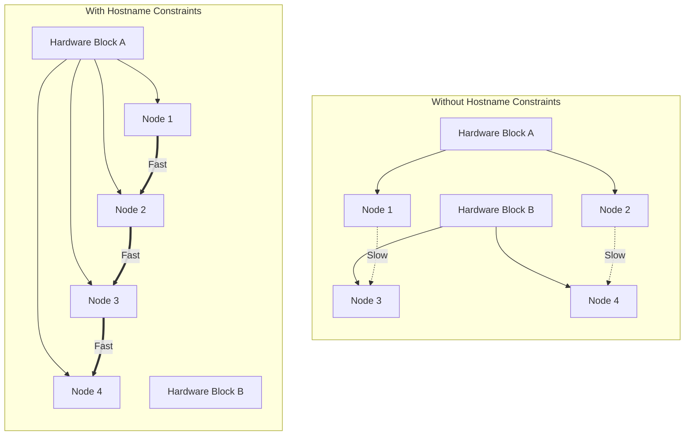
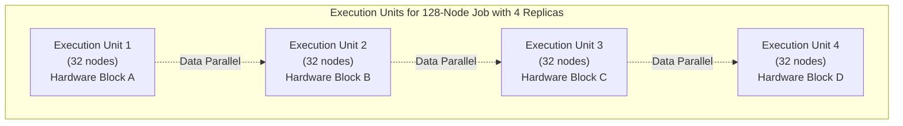
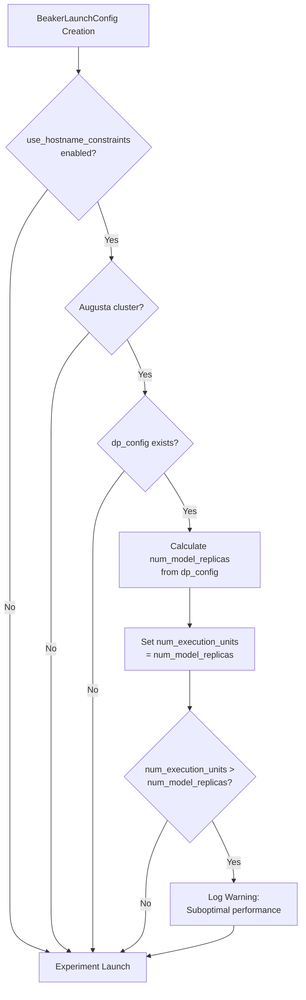

<!-- source: DeepWiki mcp.deepwiki.com · repo allenai/bolmo-core · page 7.3 Hostname Constraints and Execution Units · fetched 2026-10-26 -->

# Hostname Constraints and Execution Units

<details>
<summary>Relevant source files</summary>

The following files were used as context for generating this wiki page:

- [src/olmo_core/internal/common.py](src/olmo_core/internal/common.py)
- [src/olmo_core/internal/experiment.py](src/olmo_core/internal/experiment.py)
- [src/olmo_core/launch/beaker.py](src/olmo_core/launch/beaker.py)
- [src/olmo_core/train/callbacks/__init__.py](src/olmo_core/train/callbacks/__init__.py)
- [src/olmo_core/train/callbacks/gap_monitor.py](src/olmo_core/train/callbacks/gap_monitor.py)

</details>


This page documents the hostname constraints and execution unit features for Beaker experiment launches on Augusta clusters. These features optimize distributed training performance by ensuring that related GPU nodes are physically colocated on the same hardware block, reducing inter-node communication latency.

For general information about launching experiments on Beaker, see [Beaker Launch](#7.1). For overall experiment configuration, see [Experiment Configuration](#7.2).

---

## Overview

When running large-scale distributed training jobs on Google Cloud Platform (GCP) clusters like Augusta, the physical placement of GPU nodes can significantly impact training performance. By default, Beaker may allocate nodes from different hardware blocks, resulting in suboptimal network topology. Hostname constraints allow you to restrict job execution to specific, colocated nodes, while execution units provide an abstraction for managing how many independent node groups require colocation.

**Key Features:**
- **Hostname Constraints**: Restrict Beaker jobs to run on specific, colocated hostnames
- **Execution Units**: Define the number of independent node-using entities requiring colocation
- **Augusta-Specific**: Currently only supported on `ai2/augusta` cluster
- **Performance Optimization**: Ensures nodes within a replica use fast interconnects

---

## Hostname Constraints

### Concept

Hostname constraints tell Beaker to schedule a job only on specific pre-selected hostnames rather than any available nodes in a cluster. For Augusta clusters, this ensures all nodes for a training replica are allocated from the same hardware block, maximizing inter-node bandwidth and minimizing latency.



**Diagram: Impact of Hostname Constraints on Node Allocation**

Sources: [src/olmo_core/launch/beaker.py:295-302]()

### Configuration

Enable hostname constraints via the `use_hostname_constraints` field in `BeakerLaunchConfig`:

```python
BeakerLaunchConfig(
    name="my-experiment",
    cmd=["python", "train.py"],
    clusters=["ai2/augusta"],
    num_nodes=32,
    use_hostname_constraints=True,  # Enable hostname constraints
    # ...
)
```

**Requirements:**
- Must be enabled only for Augusta clusters (`ai2/augusta` in cluster list)
- Single cluster specification required (cannot use multiple clusters)
- Cannot be combined with retries (`retries` must be `None` or `0`)

Sources: [src/olmo_core/launch/beaker.py:295-302](), [src/olmo_core/launch/beaker.py:493-516]()

---

## Execution Units

### Concept

An **execution unit** is an abstraction representing any node-using entity where all nodes within that unit should be colocated. Execution units help the hostname constraint system understand how to group nodes optimally.

**Common Patterns:**

| Job Type | Execution Units | Example |
|----------|----------------|---------|
| Small job (≤32 nodes) | 1 | Entire 32-node job is one replica |
| Large job with data parallelism | Number of replicas | 128 nodes with 4 replicas = 4 execution units |
| Pipeline parallelism | Number of pipeline replicas | Split by pipeline stages |



**Diagram: Execution Units Map to Physical Hardware Blocks**

Sources: [src/olmo_core/launch/beaker.py:304-311]()

### Default Behavior

The default value for `num_execution_units` is:
```python
num_execution_units = max(1, num_nodes // 32)
```

This assumes that each 32-node block should be colocated. For internal AI2 experiments, the system automatically determines the correct value based on the number of data-parallel model replicas.

Sources: [src/olmo_core/launch/beaker.py:304-311]()

### Automatic Calculation

For internal experiments using `ExperimentConfig`, the system automatically sets `num_execution_units` based on the data parallelism configuration:



**Diagram: Automatic Execution Unit Calculation Flow**

Sources: [src/olmo_core/internal/experiment.py:287-314]()

The calculation logic in `_set_beaker_execution_units()`:

```python
if dp_config.num_replicas is not None:
    num_model_replicas = dp_config.num_replicas
elif dp_config.shard_degree is not None:
    nodes_per_replica = max(1, dp_config.shard_degree // num_gpus)
    num_model_replicas = num_nodes // nodes_per_replica
```

Sources: [src/olmo_core/internal/experiment.py:297-302]()

---

## Implementation Details

### Hostname Selection

When hostname constraints are enabled and all requirements are met, the system calls `get_beaker_hostname_constraints()` to select appropriate hostnames:

```python
host_name_constraints = get_beaker_hostname_constraints(
    self.num_nodes,
    self.num_execution_units or max(1, self.num_nodes // 32),
    1,  # num_jobs (always 1 for experiments)
    "us-central1-b",  # GCP zone
    beaker_cluster=self.clusters[0],
    beaker_priority=self.priority,
)
```

The function returns a list of hostname lists, where each inner list contains colocated hostnames for one execution unit.

Sources: [src/olmo_core/launch/beaker.py:503-510]()

### Task Spec Configuration

The selected hostnames are applied to the Beaker task specification:

```python
if use_hostname_constraints:
    # Single execution unit containing all nodes
    assert len(host_name_constraints) == 1
    assert len(host_name_constraints[0]) >= self.num_nodes
    constraints_kwargs = {"hostname": host_name_constraints[0]}
else:
    constraints_kwargs = {"cluster": self.clusters}

task_spec = TaskSpec.new(
    # ... other config ...
).with_constraint(**constraints_kwargs)
```

Sources: [src/olmo_core/launch/beaker.py:511-543]()

### Integration with Internal Experiments

The internal experiment framework automatically configures these settings:

```python
def build_common_components(
    cli_context: CliContext,
    # ...
    use_hostname_constraints: bool = False,
    num_execution_units: Optional[int] = None,
) -> CommonComponents:
    # ...
    launch_config = build_launch_config(
        # ...
        use_hostname_constraints=use_hostname_constraints,
        num_execution_units=num_execution_units,
    )
```

Sources: [src/olmo_core/internal/experiment.py:171-200](), [src/olmo_core/internal/common.py:102-231]()

---

## Best Practices and Limitations

### When to Use Hostname Constraints

**Use hostname constraints when:**
- Running on Augusta clusters
- Training large models with multiple nodes per replica
- Network communication is a bottleneck
- Using high-priority, non-preemptible jobs

**Do NOT use hostname constraints when:**
- Running on non-Augusta clusters (not supported)
- Using preemptible or low-priority jobs
- Job includes retries
- Flexibility in scheduling is more important than performance

### Limitations

| Limitation | Reason | Reference |
|------------|--------|-----------|
| Augusta only | Implementation specific to GCP infrastructure | [beaker.py:496-497]() |
| No retries | Hostname constraints not updated on retry | [beaker.py:498-501]() |
| Single cluster | Cannot select hostnames across clusters | [beaker.py:495-497]() |
| Not recommended for preemptible | Constraints not updated on preemption | [beaker.py:300-301]() |

Sources: [src/olmo_core/launch/beaker.py:295-302](), [src/olmo_core/launch/beaker.py:498-501]()

### Configuration Warnings

The system logs warnings when execution units exceed model replicas on Augusta:

```python
if config.launch.num_execution_units > num_model_replicas:
    log.warning(
        f"Number of execution units {num_execution_units} exceeds "
        f"number of model replicas {num_model_replicas}. "
        "On Augusta, this may result in suboptimal performance..."
    )
```

This warning indicates that replicas may be split across hardware blocks, negating the performance benefits.

Sources: [src/olmo_core/internal/experiment.py:308-314]()

---

## Example Configuration

### Basic Usage

```python
from olmo_core.launch.beaker import BeakerLaunchConfig

config = BeakerLaunchConfig(
    name="distributed-training",
    cmd=["python", "train.py"],
    clusters=["ai2/augusta"],
    num_nodes=64,
    num_gpus=8,
    use_hostname_constraints=True,
    num_execution_units=2,  # 2 replicas, 32 nodes each
    preemptible=False,  # Required for hostname constraints
    retries=None,  # No retries allowed
)
```

### Internal Experiment

```python
from functools import partial
from olmo_core.internal.experiment import build_config, main

config_builder = partial(
    build_config,
    # ...
    num_nodes=128,
    use_hostname_constraints=True,
    num_execution_units=4,  # Will be auto-adjusted if dp_config conflicts
)

main(config_builder=config_builder)
```

Sources: [src/olmo_core/launch/beaker.py:167-321](), [src/olmo_core/internal/experiment.py:317-413]()

---

## Related Components

The hostname constraints and execution units system integrates with:

- **BeakerLaunchConfig**: Main configuration class [see 7.1](#7.1)
- **Data Parallelism Config**: Determines execution units for replicas [see 5.1](#5.1)
- **Distributed Initialization**: Benefits from improved network topology [see 5.2](#5.2)

Sources: [src/olmo_core/launch/beaker.py:54](), [src/olmo_core/internal/experiment.py:1-4]()

---

