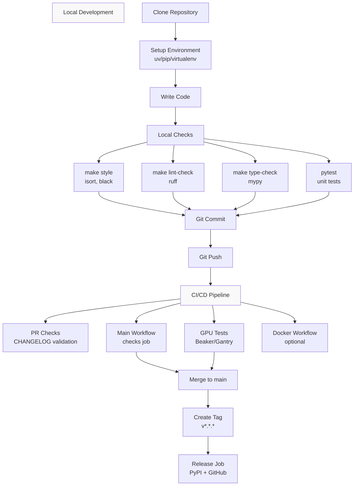
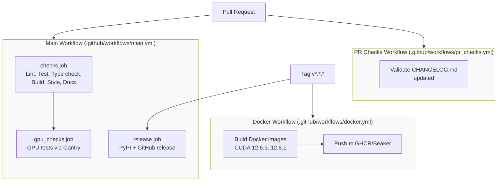
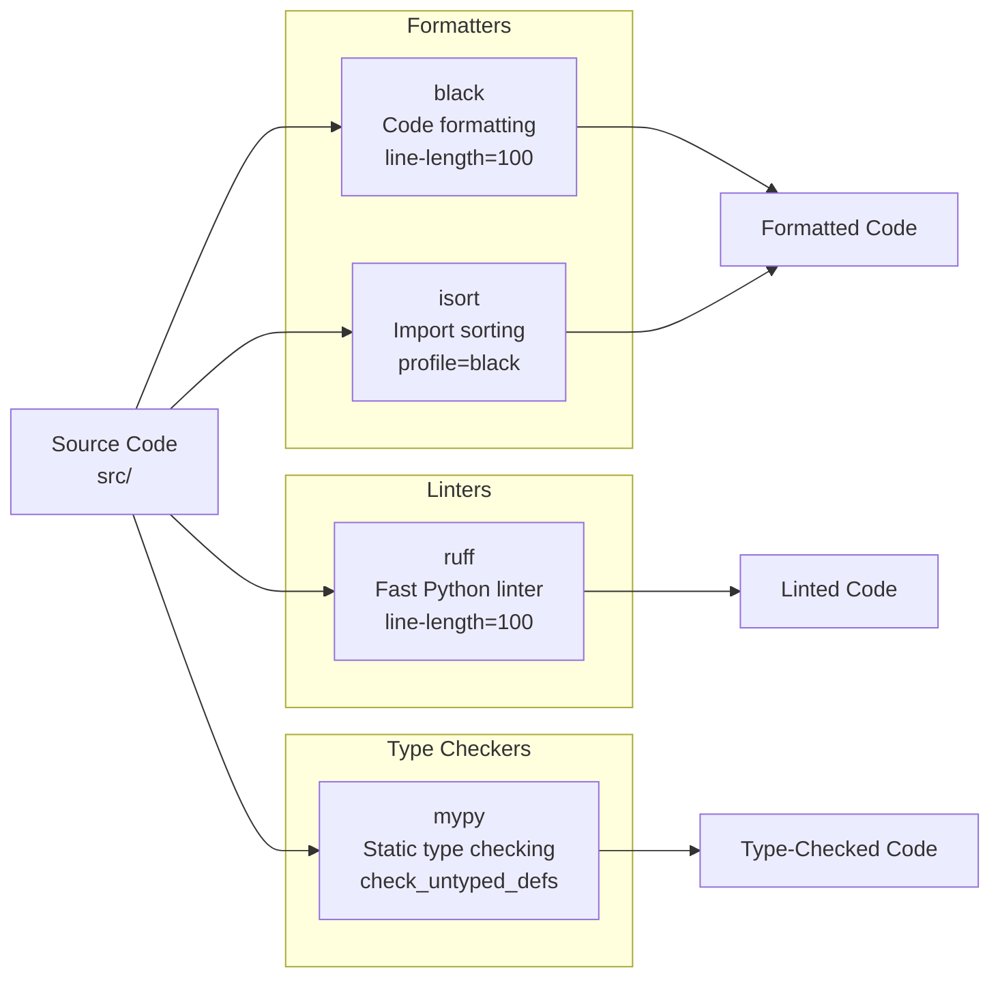
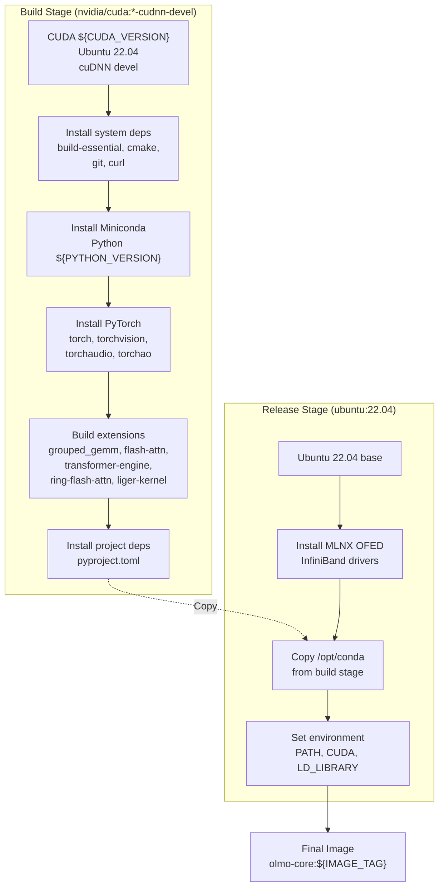

<!-- source: DeepWiki mcp.deepwiki.com · repo allenai/bolmo-core · page 8 Development Guide · fetched 2026-10-26 -->

# Development Guide

Relevant source files

The following files were used as context for generating this wiki page:

- [.github/actions/setup-venv/action.yml](.github/actions/setup-venv/action.yml)
- [.github/workflows/docker.yml](.github/workflows/docker.yml)
- [.github/workflows/main.yml](.github/workflows/main.yml)
- [.github/workflows/pr_checks.yml](.github/workflows/pr_checks.yml)
- [Makefile](Makefile)
- [pyproject.toml](pyproject.toml)
- [src/Dockerfile](src/Dockerfile)
- [src/olmo_core/distributed/utils.py](src/olmo_core/distributed/utils.py)

This guide provides an overview of the development workflow for OLMo-Core, covering environment setup, testing, continuous integration, and release processes. It is intended for contributors and developers who want to extend or modify the codebase.

For detailed information on specific topics, see:
- Development environment setup: [Development Setup](#8.1)
- Running tests and test organization: [Testing](#8.2)
- CI/CD pipeline details: [CI/CD Pipeline](#8.3)
- Code quality tools and configuration: [Code Quality Tools](#8.4)

## Development Workflow

The following diagram illustrates the complete development workflow from local development through CI to release:

**Sources:** [.github/workflows/main.yml:1-278](), [Makefile:1-112]()

## Quick Reference

The following table summarizes common development commands:

| Command | Purpose | Details |
|---------|---------|---------|
| `make checks` | Run all pre-commit checks | Executes `style-check`, `lint-check`, `type-check` |
| `make style` | Auto-format code | Runs `isort` and `black` |
| `make style-check` | Check code formatting | Validates with `isort` and `black` |
| `make lint-check` | Lint code | Runs `ruff` linter |
| `make type-check` | Type check code | Runs `mypy` type checker |
| `make build` | Build package | Creates distribution files in `dist/` |
| `make docs` | Build and serve docs | Runs `sphinx-autobuild` with live reload |
| `pytest src/test/` | Run all tests | Executes test suite |
| `pytest -m gpu` | Run GPU tests | Requires GPU, executes tests marked with `@pytest.mark.gpu` |
| `make docker-image` | Build Docker image | Creates local Docker image with CUDA and dependencies |

**Sources:** [Makefile:1-112]()

## Development Environment

Development environments can be set up using standard Python tools (`pip`, `virtualenv`) or the modern `uv` package manager. The project requires Python ≥3.11 and supports various optional dependency groups for different use cases.

**Key optional dependency groups** defined in [pyproject.toml:33-75]():

| Group | Purpose | Key Packages |
|-------|---------|--------------|
| `dev` | Development tools | `black`, `isort`, `ruff`, `mypy`, `pytest`, `sphinx` |
| `beaker` | Cluster orchestration | `beaker-py`, `GitPython` |
| `eval` | In-loop evaluation | `ai2-olmo-eval` |
| `mamba` | Mamba block support | `mamba_ssm`, `causal_conv1d`, `triton` |
| `xlstm` | xLSTM block support | `xlstm` |
| `fla` | Fast linear attention | `flash-linear-attention` |
| `all` | All optional dependencies | Includes all of the above |

See [Development Setup](#8.1) for detailed installation instructions.

**Sources:** [pyproject.toml:5-26](), [pyproject.toml:33-75](), [.github/actions/setup-venv/action.yml:1-72]()

## Testing Strategy

The test suite is organized in `src/test/` and uses `pytest` with custom markers and fixtures. Tests are categorized into CPU tests (run in CI) and GPU tests (run on Beaker).

**Test execution patterns:**

- **Local CPU tests:** `pytest src/test/`
- **GPU tests:** `pytest -m gpu src/test/` (requires GPU hardware)
- **Distributed tests:** Automatically detected and run with appropriate process groups
- **Checkpoint tests:** Run separately due to longer execution time
- **NN tests:** Model architecture tests, split by component

The CI pipeline splits tests into multiple jobs to optimize execution time:
- `Test` job excludes checkpoint and nn tests
- `Test checkpoint` job runs checkpoint-specific tests
- `Test nn` job runs neural network component tests
- GPU tests run on Beaker using Gantry for orchestration

See [Testing](#8.2) for detailed test organization and execution.

**Sources:** [.github/workflows/main.yml:39-56](), [.github/workflows/main.yml:120-159](), [pyproject.toml:164-179]()

## Continuous Integration

The CI/CD pipeline is implemented using GitHub Actions with three main workflows:

**Main workflow jobs** ([.github/workflows/main.yml:26-278]()):
- **checks:** Runs linting, type checking, testing, building, and documentation on `ubuntu-latest` with Python 3.11
- **gpu_checks:** Runs GPU-specific tests on Beaker clusters using Gantry orchestration with H100/A100 GPUs
- **release:** Triggered on version tags, publishes to PyPI and creates GitHub releases

The GPU tests use the Gantry tool to submit jobs to Beaker clusters with:
- Budget: `ai2/oe-base`
- GPU types: H100, A100
- Docker image: `tylerr/olmo-core-tch270cu128-2025-09-24`
- Timeout: 8 minutes per task
- Host networking enabled for optimal performance

See [CI/CD Pipeline](#8.3) for comprehensive workflow details.

**Sources:** [.github/workflows/main.yml:1-278](), [.github/workflows/docker.yml:1-89](), [.github/workflows/pr_checks.yml:1-31]()

## Code Quality Tools

Code quality is enforced through multiple tools configured in [pyproject.toml:91-179]():

**Tool configuration highlights:**

- **black** ([pyproject.toml:91-106]()): Line length 100, excludes cache/build directories
- **isort** ([pyproject.toml:108-110]()): Black-compatible profile, multi-line output mode 3
- **ruff** ([pyproject.toml:112-144]()): Ignores F403, F405, E501, excludes test/build directories
- **mypy** ([pyproject.toml:153-162]()): Ignores missing imports, checks untyped definitions, strict mode disabled for tests

All tools can be run via `make` targets or directly. The `make checks` target runs all three validation checks in sequence.

See [Code Quality Tools](#8.4) for detailed configuration and usage.

**Sources:** [Makefile:1-27](), [pyproject.toml:91-162]()

## Docker Development

Docker images are built using a two-stage process defined in [src/Dockerfile:1-138]():

**Build parameters** defined in [Makefile:45-61]():

| Parameter | Default | Purpose |
|-----------|---------|---------|
| `CUDA_VERSION` | 12.8.1 | CUDA toolkit version |
| `PYTHON_VERSION` | 3.11 | Python version |
| `TORCH_VERSION` | 2.8.0 | PyTorch version |
| `FLASH_ATTN_VERSION` | 2.8.2 | Flash Attention 2 version |
| `TE_VERSION` | 2.6.0.post1 | Transformer Engine version |

**Build and push commands:**

- `make docker-image`: Build local Docker image
- `make ghcr-image`: Build and push to GitHub Container Registry
- `make beaker-image`: Build and push to Beaker registry

The Docker workflow ([.github/workflows/docker.yml:1-89]()) automatically builds images for multiple CUDA versions (12.6.3, 12.8.1) and pushes them to registries on version tag pushes.

**Sources:** [src/Dockerfile:1-138](), [Makefile:38-112](), [.github/workflows/docker.yml:1-89]()

## Release Process

Releases are automated through GitHub Actions when version tags are pushed:

```mermaid
flowchart LR
    DevComplete["Development Complete"]
    UpdateVersion["Update VERSION<br/>in version.py"]
    UpdateChangelog["Update CHANGELOG.md<br/>with release notes"]
    
    CreateTag["Create Git Tag<br/>v*.*.*"]
    PushTag["Push Tag<br/>to GitHub"]
    
    subgraph CI["Automated Release (GitHub Actions)"]
        BuildPkg["Build Package<br/>python -m build"]
        GenNotes["Generate Release Notes<br/>release_notes.py"]
        PublishPyPI["Publish to PyPI<br/>twine upload"]
        CreateGHRelease["Create GitHub Release<br/>with assets"]
        AddPRComments["Add PR Comments<br/>release mentions"]
        SlackNotify["Send Slack<br/>notifications"]
        BuildDockerImages["Build Docker Images<br/>CUDA variants"]
        PushRegistries["Push to GHCR/Beaker"]
    end
    
    DevComplete --> UpdateVersion
    UpdateVersion --> UpdateChangelog
    UpdateChangelog --> CreateTag
    CreateTag --> PushTag
    
    PushTag --> BuildPkg
    BuildPkg --> GenNotes
    GenNotes --> PublishPyPI
    PublishPyPI --> CreateGHRelease
    CreateGHRelease --> AddPRComments
    AddPRComments --> SlackNotify
    
    PushTag --> BuildDockerImages
    BuildDockerImages --> PushRegistries
```

**Release workflow** ([.github/workflows/main.yml:219-278]()):

1. **Triggered by:** Pushing a tag matching pattern `v*.*.*` (e.g., `v1.2.3`)
2. **Dependencies:** Requires `checks` job to pass
3. **Actions performed:**
   - Downloads build artifacts from `checks` job
   - Generates release notes from CHANGELOG.md using [src/scripts/release/release_notes.py]()
   - Publishes package to PyPI using twine with token authentication
   - Creates GitHub release with generated notes and distribution files
   - Adds comments to PRs included in the release
   - Sends Slack notifications to configured webhook

**Docker images** are built separately by the Docker workflow ([.github/workflows/docker.yml:1-89]()) for tagged releases, producing images for multiple CUDA versions and pushing to:
- GitHub Container Registry (GHCR): `ghcr.io/allenai/olmo-core:${IMAGE_TAG}`
- Beaker: via `make beaker-image` using `src/scripts/beaker/create_beaker_image.sh`

**Version management:**
- Version is defined in [src/olmo_core/version.py]()
- Dynamically loaded in [pyproject.toml:84]() using `setuptools.dynamic`
- Format: `MAJOR.MINOR.PATCH` or `MAJOR.MINOR.PATCH.dev0` for development versions
- Release candidates use `MAJOR.MINOR.PATCHrc#` format

**Sources:** [.github/workflows/main.yml:219-278](), [.github/workflows/docker.yml:1-89](), [pyproject.toml:6-84]()

---

