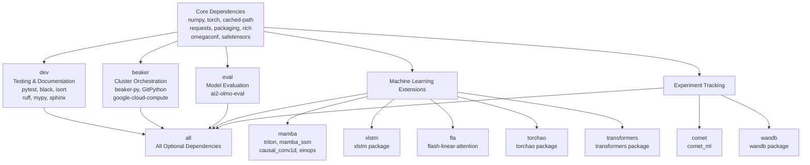
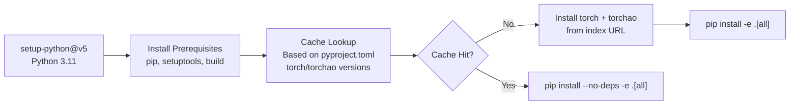
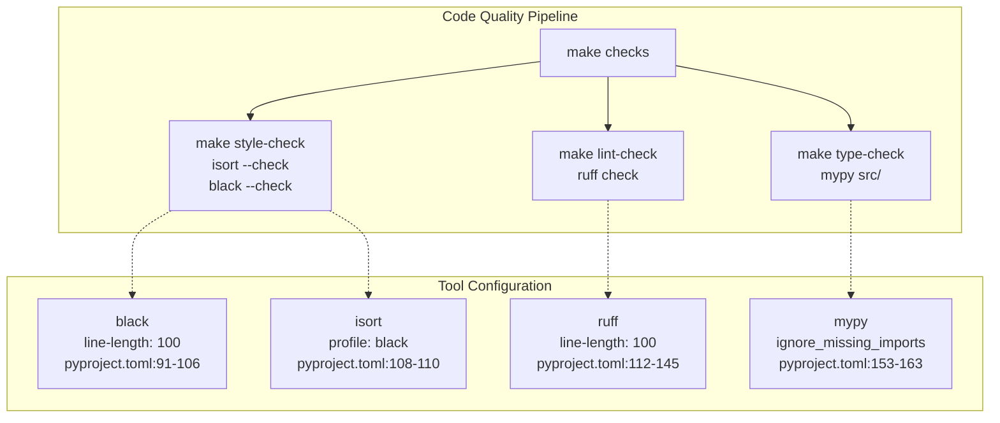
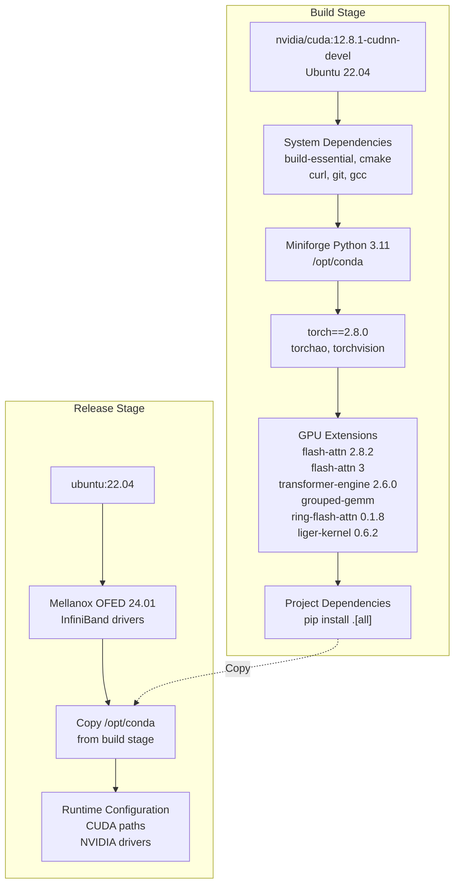

<!-- source: DeepWiki mcp.deepwiki.com · repo allenai/bolmo-core · page 8.1 Development Setup · fetched 2026-10-26 -->

# Development Setup

<details>
<summary>Relevant source files</summary>

The following files were used as context for generating this wiki page:

- [.github/actions/setup-venv/action.yml](.github/actions/setup-venv/action.yml)
- [.github/workflows/docker.yml](.github/workflows/docker.yml)
- [.github/workflows/main.yml](.github/workflows/main.yml)
- [.github/workflows/pr_checks.yml](.github/workflows/pr_checks.yml)
- [Makefile](Makefile)
- [pyproject.toml](pyproject.toml)
- [src/Dockerfile](src/Dockerfile)
- [src/olmo_core/distributed/utils.py](src/olmo_core/distributed/utils.py)
- [uv.lock](uv.lock)

</details>


This page documents how to set up a local development environment for OLMo-Core. It covers Python requirements, installation methods, dependency management, and environment configuration. For information about running tests, see [Testing](#8.2). For Docker image building, see [CI/CD Pipeline](#8.3).

## Prerequisites

### Python Version

OLMo-Core requires **Python 3.11 or higher**. The CI pipeline tests against both Python 3.11 (primary) and Python 3.10 (minimum supported version for linting).

```python
# From pyproject.toml:5
requires-python = ">=3.11"
```

### System Requirements

For GPU-accelerated training and testing:
- CUDA 12.6.3 or 12.8.1 (see Docker configurations)
- PyTorch 2.6.0 or higher (2.7.0+ recommended)
- Sufficient disk space for dependencies (~2-3 GB for full installation)

Sources: [pyproject.toml:13](), [.github/workflows/docker.yml:37](), [Makefile:50-53]()

## Installation Methods

### Install from PyPI

For users who want to use OLMo-Core as a library:

```bash
pip install ai2-olmo-core
```

This installs only the core dependencies required for basic functionality.

### Install with Optional Dependencies

Install with specific optional dependency groups:

```bash
# Development dependencies
pip install ai2-olmo-core[dev]

# Beaker cluster support
pip install ai2-olmo-core[beaker]

# All optional dependencies
pip install ai2-olmo-core[all]
```

### Development Installation

For contributors developing OLMo-Core itself:

```bash
# Clone the repository
git clone https://github.com/allenai/OLMo-core.git
cd OLMo-core

# Install in editable mode with all dependencies
pip install -e .[all]
```

The `-e` flag creates an editable installation, allowing code changes to take effect immediately without reinstallation.

Sources: [pyproject.toml:6-26](), [pyproject.toml:33-75]()

## Dependency Groups

OLMo-Core organizes dependencies into modular groups. The following diagram shows the dependency structure:



### Core Dependencies

Always installed with the base package:

| Package | Version Constraint | Purpose |
|---------|-------------------|---------|
| `numpy` | (latest) | Numerical computing |
| `torch` | `>=2.6.0` | Deep learning framework |
| `cached-path` | `>=1.7.2` | Remote file caching |
| `requests` | (latest) | HTTP client |
| `packaging` | (latest) | Version parsing |
| `rich` | (latest) | Terminal formatting |
| `omegaconf` | (latest) | Configuration management |
| `safetensors` | (latest) | Safe tensor serialization |
| `importlib_resources` | (latest) | Resource loading |
| `bettermap` | (latest) | Parallel mapping utilities |

### Optional Dependency Groups

**`dev`** - Development and testing tools:
- `black>=23.1,<24.0` - Code formatting
- `isort>=5.12,<5.14` - Import sorting
- `ruff` - Fast Python linter
- `mypy>=1.0,<1.4` - Static type checking
- `pytest`, `pytest-xdist`, `pytest-memray` - Testing framework
- `sphinx`, `furo`, `myst-parser` - Documentation generation
- `boto3`, `google-cloud-storage` - Cloud storage access for tests
- `build`, `twine`, `wheel` - Package building and publishing

**`beaker`** - Beaker cluster orchestration:
- `beaker-py>=1.37.0,<2.0` - Beaker Python client
- `GitPython>=3.0,<4.0` - Git repository interaction
- `google-cloud-compute` - GCP compute management

**`mamba`** - Mamba state-space models:
- `triton>=3.2.0` - GPU kernels
- `mamba_ssm` - Mamba implementation
- `causal_conv1d` - Causal convolution
- `einops` - Tensor operations

**`xlstm`** - Extended LSTM support:
- `xlstm` - XLSTM implementation

**`fla`** - Fast linear attention:
- `flash-linear-attention` - FLA kernels

**`eval`** - Model evaluation:
- `ai2-olmo-eval` - In-loop evaluation framework

**`torchao`** - PyTorch AO (Accelerated Optimization):
- `torchao` - Quantization and optimization

**`transformers`** - HuggingFace integration:
- `transformers` - Transformers library

**`comet`** - Comet ML experiment tracking:
- `comet_ml` - Comet ML client

**`wandb`** - Weights & Biases tracking:
- `wandb` - W&B client

**`all`** - Installs all optional dependency groups above.

Sources: [pyproject.toml:15-26](), [pyproject.toml:34-75]()

## Virtual Environment Setup

### Using Standard Python venv

Create and activate a virtual environment:

```bash
# Create virtual environment
python -m venv .venv

# Activate on Linux/macOS
source .venv/bin/activate

# Activate on Windows
.venv\Scripts\activate

# Install OLMo-Core
pip install -e .[all]
```

### Using uv (Recommended for Faster Installs)

The repository includes a `uv.lock` file for reproducible installations with [uv](https://github.com/astral-sh/uv):

```bash
# Install uv
curl -LsSf https://astral.sh/uv/install.sh | sh

# Install dependencies with uv
uv pip install -e .[all]
```

The uv tool provides significantly faster dependency resolution and installation compared to pip.

### CI/CD Virtual Environment Setup

The GitHub Actions workflow uses a reusable action for consistent environment setup:



The cache key includes:
- Cache prefix (`CACHE_PREFIX` environment variable)
- Operating system
- Exact Python version
- PyTorch version (`2.7.0` default)
- torchao version (`0.9.0` default)
- Hash of `pyproject.toml`

Sources: [.github/actions/setup-venv/action.yml:1-72](), [.github/workflows/main.yml:78-119]()

## Environment Variables

### Required for Training

Set `PYTHONPATH` to include the source directory:

```bash
export PYTHONPATH=./src/
```

This is required for imports to work correctly when running training scripts.

### Distributed Training Configuration

OLMo-Core uses specific environment variables for distributed training setup. These are automatically configured by [`init_distributed()`](src/olmo_core/distributed/utils.py:30-131) but can be set manually:

| Environment Variable | Purpose | Default |
|---------------------|---------|---------|
| `LOCAL_RANK` | Local rank within node | Required by torchrun |
| `NUM_NODES` | Total number of nodes | Required for multi-node |
| `LOCAL_WORLD_SIZE` | GPUs per node | Required for multi-node |
| `FS_LOCAL_RANK` | Rank per filesystem | Auto-detected |
| `OLMO_SHARED_FS` | Shared filesystem flag | `1` if shared |
| `BEAKER_NODE_HOSTNAME` | Node hostname in Beaker | Set by Beaker |

### NCCL Configuration (Cluster-Specific)

The distributed utilities automatically configure NCCL based on the cluster hostname:

**Jupiter cluster:**
- `NCCL_IB_HCA=^=mlx5_bond_0`
- `NCCL_SOCKET_IFNAME=ib` (multi-node only)

**Pluto cluster:**
- `NCCL_IB_HCA=^=mlx5_1,mlx5_2`

**Augusta cluster (A3+):**
- Multiple NCCL settings for optimal performance
- Requires host networking enabled
- See [src/olmo_core/distributed/utils.py:65-113]() for full configuration

### Testing Environment Variables

```bash
# Disable tokenizer parallelism warnings
export TOKENIZERS_PARALLELISM=false

# Enable deterministic CUBLAS operations
export CUBLAS_WORKSPACE_CONFIG=:16:8

# Cloud credentials (for integration tests)
export AWS_ACCESS_KEY_ID=<your-key>
export AWS_SECRET_ACCESS_KEY=<your-secret>
export GOOGLE_APPLICATION_CREDENTIALS=/path/to/credentials.json
```

Sources: [.github/workflows/main.yml:20-24](), [src/olmo_core/distributed/utils.py:19-113]()

## Development Tools

### Code Quality Targets

The `Makefile` provides convenient targets for development:

```bash
# Run all checks (style, lint, type)
make checks

# Style checking
make style-check    # Verify black and isort formatting

# Linting
make lint-check     # Run ruff linter

# Type checking
make type-check     # Run mypy

# Formatting (auto-fix)
make style          # Apply black and isort
```

These commands are defined in the Makefile and used by CI:



### Tool Configurations

**Black** (code formatter):
- Line length: 100
- Configuration: [pyproject.toml:91-106]()

**isort** (import sorter):
- Profile: black (compatible with Black)
- Multi-line output: 3
- Configuration: [pyproject.toml:108-110]()

**Ruff** (linter):
- Line length: 100
- Ignored rules: `F403`, `F405`, `E501`
- Per-file ignores: `F401` in `__init__.py`
- Configuration: [pyproject.toml:112-145]()

**Mypy** (type checker):
- Ignore missing imports: true
- Check untyped defs: true
- Configuration: [pyproject.toml:153-163]()

Sources: [Makefile:1-20](), [pyproject.toml:91-163]()

### Building Documentation

Build the Sphinx documentation locally:

```bash
# Build HTML documentation
cd docs && make html

# Auto-rebuild on changes
make docs
```

The `make docs` target uses `sphinx-autobuild` to automatically rebuild documentation when source files change.

### Building Distribution Packages

```bash
# Build source distribution and wheel
make build
```

This creates distribution files in the `dist/` directory, ready for PyPI upload.

Sources: [Makefile:28-36]()

## Docker-Based Development

For GPU-enabled development and testing, use the provided Dockerfile:

### Docker Image Structure



### Building Docker Images

```bash
# Build with default versions
make docker-image

# Build with specific versions
make docker-image \
  CUDA_VERSION=12.8.1 \
  TORCH_VERSION=2.8.0 \
  PYTHON_VERSION=3.11
```

### Build Arguments

Key build arguments in the Dockerfile:

| Argument | Default | Description |
|----------|---------|-------------|
| `CUDA_VERSION` | 12.8.1 | CUDA toolkit version |
| `PYTHON_VERSION` | 3.11 | Python version |
| `TORCH_VERSION` | 2.8.0 | PyTorch version |
| `INSTALL_CHANNEL` | whl | PyTorch install channel |
| `FLASH_ATTN_VERSION` | 2.8.2 | Flash Attention 2 version |
| `TE_VERSION` | 2.6.0.post1 | Transformer Engine version |

### Specialized Extensions

The Docker build includes several GPU-optimized extensions:

**Flash Attention:**
- Flash Attention 2 (version 2.8.2)
- Flash Attention 3 (Hopper architecture, commit `1ceaa984`)

**Transformer Engine:**
- Version 2.6.0.post1 with PyTorch support

**Grouped GEMM:**
- Built with CUTLASS support for batch size on GPU

**Ring Flash Attention:**
- Version 0.1.8 for sequence parallelism

**Liger Kernel:**
- Version 0.6.2 for optimized kernels

### Publishing Images

```bash
# Push to GitHub Container Registry
make ghcr-image

# Push to Beaker (requires BEAKER_TOKEN)
make beaker-image
```

Sources: [src/Dockerfile:1-138](), [Makefile:40-112]()

## Verifying Installation

After installation, verify the setup:

```python
# Test basic import
python -c "import olmo_core; print(olmo_core.__version__)"

# Test CUDA availability (if using GPU)
python -c "import torch; print(f'CUDA available: {torch.cuda.is_available()}')"

# Test distributed utilities
python -c "from olmo_core.distributed.utils import get_rank; print(f'Rank: {get_rank()}')"
```

All tests should complete without errors.

## Common Issues

### Import Errors

If you encounter import errors, ensure `PYTHONPATH` includes the source directory:

```bash
export PYTHONPATH=./src/
```

### CUDA Version Mismatch

If PyTorch cannot find CUDA, ensure you're installing the correct CUDA variant:

```bash
# For CUDA 12.8
pip install torch --index-url https://download.pytorch.org/whl/cu128

# For CUDA 12.6
pip install torch --index-url https://download.pytorch.org/whl/cu126
```

### Missing Optional Dependencies

Some features require optional dependencies. Install the appropriate group:

```bash
pip install -e .[mamba]    # For Mamba models
pip install -e .[beaker]   # For Beaker launches
```

Sources: [.github/actions/setup-venv/action.yml:49-63](), [pyproject.toml:63-74]()

---

