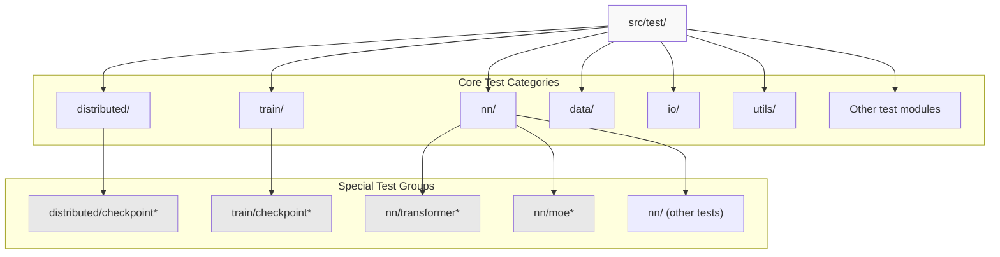
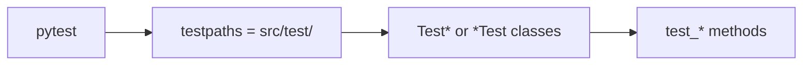
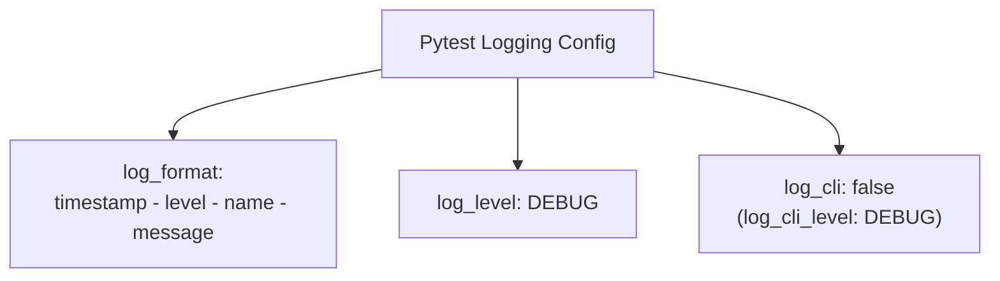
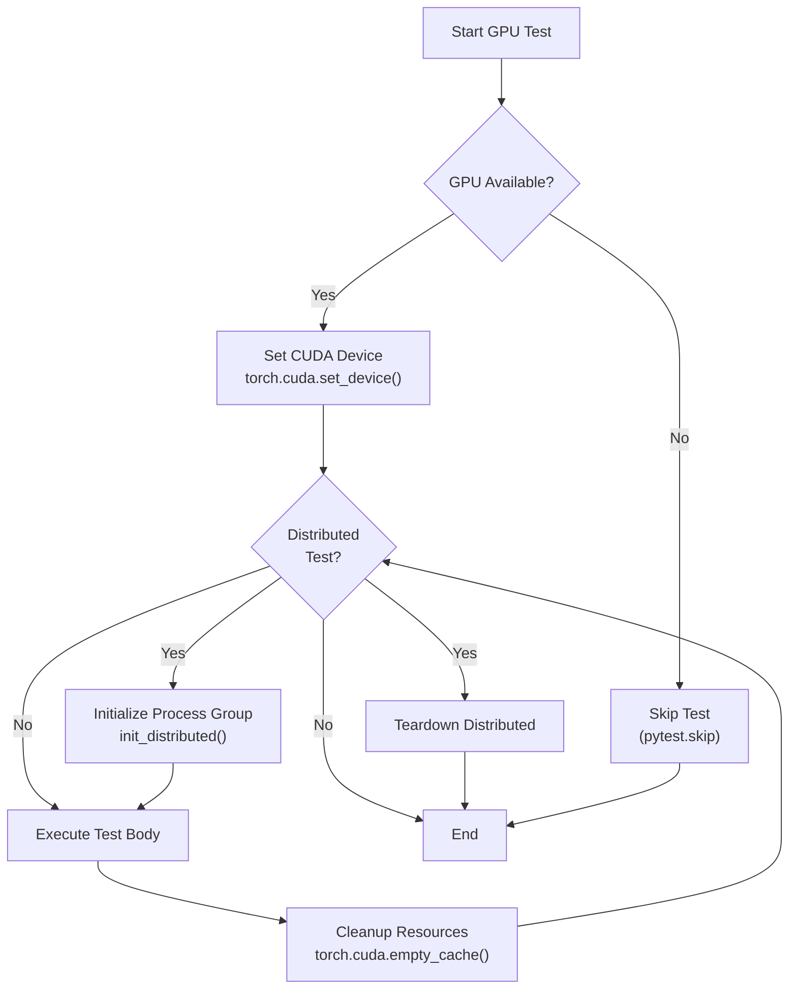
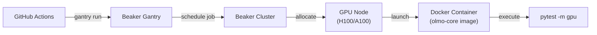

<!-- source: DeepWiki mcp.deepwiki.com · repo allenai/bolmo-core · page 8.2 Testing · fetched 2026-10-26 -->

# Testing

<details>
<summary>Relevant source files</summary>

The following files were used as context for generating this wiki page:

- [.github/actions/setup-venv/action.yml](.github/actions/setup-venv/action.yml)
- [.github/workflows/docker.yml](.github/workflows/docker.yml)
- [.github/workflows/main.yml](.github/workflows/main.yml)
- [.github/workflows/pr_checks.yml](.github/workflows/pr_checks.yml)
- [Makefile](Makefile)
- [pyproject.toml](pyproject.toml)
- [src/Dockerfile](src/Dockerfile)
- [src/olmo_core/distributed/utils.py](src/olmo_core/distributed/utils.py)

</details>


## Purpose and Scope

This page documents the testing infrastructure for OLMo-Core, including test organization, execution strategies, pytest configuration, and CI/CD integration. It covers how to run tests locally and how they execute in continuous integration, with special focus on GPU and distributed testing requirements.

For information about the CI/CD pipeline infrastructure and automated workflows, see [CI/CD Pipeline](#8.3). For development environment setup required before running tests, see [Development Setup](#8.1).

---

## Test Organization

Tests are organized in the `src/test/` directory, structured to mirror the main source code hierarchy. The test suite is partitioned into multiple categories to optimize execution time and resource allocation in CI environments.



**Test Categories:**

| Category | Path Pattern | Purpose | Execution Environment |
|----------|-------------|---------|----------------------|
| **Unit Tests** | `src/test/` (general) | Fast, CPU-only tests for utilities, configuration, and basic functionality | CPU (CI runner) |
| **Checkpoint Tests** | `src/test/distributed/checkpoint*`, `src/test/train/checkpoint*` | Tests for distributed checkpoint save/load, topology-agnostic loading | CPU/GPU |
| **Transformer Tests** | `src/test/nn/transformer*` | Tests for transformer models, blocks, attention mechanisms | GPU required |
| **MoE Tests** | `src/test/nn/moe*` | Tests for Mixture of Experts implementations | GPU required |
| **Other NN Tests** | `src/test/nn/` (excluding above) | Tests for other neural network components | GPU required |

**Sources:** [.github/workflows/main.yml:39-56](), [pyproject.toml:164-179]()

---

## Pytest Configuration

The test suite uses pytest with specific configuration defined in `pyproject.toml`. 

### Test Discovery



- **Test paths:** Tests are discovered in `src/test/`
- **Class patterns:** `Test*` or `*Test` 
- **Method patterns:** Standard pytest `test_*` prefix

**Sources:** [pyproject.toml:165-166]()

### Markers

The test suite defines custom pytest markers to categorize tests:

| Marker | Usage | Purpose |
|--------|-------|---------|
| `@pytest.mark.gpu` | Marks tests requiring GPU | Allows filtering GPU-only tests for execution on GPU-enabled runners |

**Example usage in test code:**
```python
@pytest.mark.gpu
def test_transformer_forward():
    # Test requiring GPU execution
    pass
```

**Sources:** [pyproject.toml:171]()

### Logging Configuration

Test execution includes detailed logging configuration:



- **Log format:** `%(asctime)s - %(levelname)s - %(name)s - %(message)s`
- **Log level:** `DEBUG` (provides detailed diagnostic output)
- **CLI logging:** Disabled by default, but DEBUG level when enabled
- **Purpose:** Comprehensive logging helps diagnose failures in distributed and GPU tests

**Sources:** [pyproject.toml:167-170]()

### Warning Filters

The test suite filters known warnings from dependencies to reduce noise:

```python
filterwarnings = [
    'ignore::FutureWarning:huggingface_hub.file_download',
    'ignore::DeprecationWarning:pkg_resources',
    'ignore::DeprecationWarning:google.rpc',
    'ignore::FutureWarning:torch.distributed.checkpoint.default_planner',
    'ignore::UserWarning:torch.distributed.checkpoint.state_dict_saver',
    'ignore::UserWarning:torch.distributed.checkpoint.state_dict_loader',
]
```

These filters suppress expected warnings from third-party libraries (huggingface_hub, PyTorch distributed checkpoint) that would otherwise clutter test output.

**Sources:** [pyproject.toml:172-179]()

---

## Running Tests Locally

### Prerequisites

Before running tests, ensure the development environment is set up:

```bash
# Create and activate virtual environment
virtualenv -p python3.11 .venv
source .venv/bin/activate

# Install with dev dependencies
pip install -e .[dev]
```

For GPU tests, additional dependencies are required:
```bash
pip install -e .[all]  # Includes GPU-enabled packages
```

See [Development Setup](#8.1) for detailed environment configuration.

### Basic Test Execution

**Run all CPU tests:**
```bash
pytest -v --color=yes --durations=3 \
  --ignore-glob='src/test/distributed/checkpoint*' \
  --ignore-glob='src/test/train/checkpoint*' \
  --ignore-glob='src/test/nn/*' \
  src/test/
```

**Run checkpoint tests:**
```bash
pytest -v --color=yes --durations=3 \
  src/test/distributed/checkpoint* \
  src/test/train/checkpoint*
```

**Run neural network tests:**
```bash
pytest -v --color=yes --durations=3 \
  src/test/nn/
```

**Common pytest options:**
- `-v`: Verbose output showing individual test names
- `--color=yes`: Enable colored output
- `--durations=3`: Show 3 slowest tests
- `-m gpu`: Run only GPU-marked tests
- `-k pattern`: Run tests matching name pattern

**Sources:** [.github/workflows/main.yml:41-56]()

### Parallel Test Execution

For faster local test execution, use `pytest-xdist`:

```bash
# Run tests in parallel across N CPU cores
pytest -n auto src/test/

# Run specific number of workers
pytest -n 4 src/test/
```

**Sources:** [pyproject.toml:46]()

---

## GPU and Distributed Tests

GPU tests require special handling due to hardware requirements and potential resource conflicts.

### GPU Test Execution Flow



### Running GPU Tests Locally

**Run GPU tests with explicit marker:**
```bash
pytest -v --color=yes -m gpu src/test/
```

**Run transformer tests on GPU:**
```bash
pytest -v --color=yes -m gpu src/test/nn/transformer*
```

**Run MoE tests on GPU:**
```bash
pytest -v --color=yes -m gpu src/test/nn/moe*
```

**Environment variables for GPU tests:**
```bash
export TOKENIZERS_PARALLELISM=false  # Avoid tokenizer warnings
export CUBLAS_WORKSPACE_CONFIG=:16:8  # Deterministic CUDA operations
```

**Sources:** [.github/workflows/main.yml:134-159](), [.github/workflows/main.yml:213-214]()

### Distributed Test Requirements

Distributed tests require initialization of PyTorch distributed process groups. Key environment variables:

| Variable | Purpose | Example |
|----------|---------|---------|
| `LOCAL_RANK` | Local rank within node | `0`, `1`, ... |
| `RANK` | Global rank across all processes | `0`, `1`, `2`, ... |
| `WORLD_SIZE` | Total number of processes | `2`, `4`, `8`, ... |
| `MASTER_ADDR` | Master node address | `localhost`, IP address |
| `MASTER_PORT` | Master node port | `29500` |

Tests utilizing distributed functionality should call `init_distributed()` in setup and ensure proper cleanup in teardown.

**Sources:** [src/olmo_core/distributed/utils.py:30-131]()

---

## CI Test Execution

The CI pipeline executes tests across multiple jobs to optimize execution time and resource utilization.

### CI Test Strategy

```mermaid
graph TB
    subgraph "CPU Tests (ubuntu-latest)"
        Lint["Lint Check<br/>ruff check"]
        Test["Unit Tests<br/>(excluding checkpoint, nn)"]
        TestCP["Checkpoint Tests<br/>(distributed/checkpoint*, train/checkpoint*)"]
        TestNN["NN Tests (CPU)<br/>(src/test/nn/)"]
        TypeCheck["Type Check<br/>mypy"]
        Build["Build Package<br/>python -m build"]
        Style["Style Check<br/>black, isort"]
        Docs["Docs Build<br/>sphinx"]
    end
    
    subgraph "GPU Tests (Beaker Gantry)"
        GPUTest["GPU Unit Tests<br/>pytest -m gpu"]
        GPUCheckpoint["GPU Checkpoint Tests<br/>checkpoint* + GPU"]
        GPUTransformer["GPU Transformer Tests<br/>transformer* + GPU"]
        GPUMoE["GPU MoE Tests<br/>moe* + GPU"]
    end
    
    CI["CI Trigger<br/>(PR or Push)"]
    
    CI --> Lint
    CI --> Test
    CI --> TestCP
    CI --> TestNN
    CI --> TypeCheck
    CI --> Build
    CI --> Style
    CI --> Docs
    
    CI --> GPUTest
    CI --> GPUCheckpoint
    CI --> GPUTransformer
    CI --> GPUMoE
    
    style CI fill:#f9f9f9
```



**Sources:** [.github/workflows/main.yml:27-106](), [.github/workflows/main.yml:120-217]()

### CPU Test Jobs

CPU tests run on `ubuntu-latest` runners with Python 3.11 (and 3.10 for minimum version validation):

```yaml
strategy:
  matrix:
    task:
      - name: Lint
        run: make lint-check
      - name: Test
        run: pytest -v --color=yes --durations=3 \
               --ignore-glob='src/test/distributed/checkpoint*' \
               --ignore-glob='src/test/train/checkpoint*' \
               --ignore-glob='src/test/nn/*' \
               src/test/
      - name: Test checkpoint
        run: pytest -v --color=yes --durations=3 \
               src/test/distributed/checkpoint* \
               src/test/train/checkpoint*
      - name: Test nn
        run: pytest -v --color=yes --durations=3 \
               src/test/nn/
```

**Test job features:**
- **Parallel execution:** Multiple tasks run concurrently
- **Timeout:** 15 minutes per job
- **Caching:** Virtual environment and mypy cache are cached
- **Credentials:** AWS, Beaker, and Google Cloud credentials provided via secrets

**Sources:** [.github/workflows/main.yml:27-119]()

### GPU Test Jobs

GPU tests execute on Beaker compute clusters using Gantry orchestration:



**GPU test configuration:**
```bash
gantry run \
  --workspace ai2/OLMo-core \
  --beaker-image tylerr/olmo-core-tch270cu128-2025-09-24 \
  --gpus 2 \
  --gpu-type h100 \
  --gpu-type a100 \
  --preemptible \
  --host-networking \
  --task-timeout 8m \
  -- pytest -v --color=yes -m gpu src/test/
```

**Key parameters:**
- **Image:** Pre-built Docker image with CUDA, PyTorch, and dependencies
- **GPUs:** 2 GPUs allocated per test job
- **GPU types:** Accepts H100 or A100 hardware
- **Timeout:** 8 minutes per task
- **Host networking:** Required for multi-node communication
- **Preemptible:** Uses lower-cost preemptible instances
- **System Python:** Uses system Python from container

**Sources:** [.github/workflows/main.yml:191-217]()

### Test Isolation Strategy

Tests are isolated into separate jobs to prevent interference and optimize resource usage:

| Job | Tests Excluded | Reason |
|-----|----------------|--------|
| **Main Test** | `checkpoint*`, `nn/*` | These require special handling or GPU |
| **Checkpoint Test** | All except `checkpoint*` | Checkpoint tests may be resource-intensive |
| **NN Test** | All except `nn/*` | NN tests often require GPU or more memory |
| **GPU Tests** | Split by component | Transformer and MoE tests are computationally expensive |

This isolation allows:
- **Parallel execution** of independent test suites
- **Targeted reruns** when specific test categories fail
- **Resource optimization** by matching test requirements to runner capabilities
- **Faster feedback** by running quick CPU tests first

**Sources:** [.github/workflows/main.yml:39-56](), [.github/workflows/main.yml:129-159]()

---

## Test Fixtures and Utilities

### Environment Setup

The CI uses a custom GitHub Action for environment setup:

**`.github/actions/setup-venv/action.yml`** provides:
- Python version installation
- Virtual environment creation with caching
- PyTorch installation from specified channel
- Package installation with dependencies

**Cache key includes:**
- Python version
- PyTorch version  
- torchao version
- Installation channel
- Hash of requirements files

This ensures consistent environments across test runs while minimizing setup time through caching.

**Sources:** [.github/actions/setup-venv/action.yml:1-72]()

### Docker Images for Testing

GPU tests use pre-built Docker images with complete testing environments:

**Image naming convention:**
```
tylerr/olmo-core-tch<TORCH_VERSION><CUDA_VERSION>-<DATE>
```

Example: `tylerr/olmo-core-tch270cu128-2025-09-24`
- PyTorch 2.7.0
- CUDA 12.8
- Built on 2025-09-24

**Image contents:**
- CUDA runtime and development libraries
- PyTorch with CUDA support
- Flash Attention 2 and 3
- Transformer Engine
- Ring Flash Attention
- Liger Kernel
- All project dependencies

**Sources:** [src/Dockerfile:1-138](), [.github/workflows/main.yml:131]()

---

## Quality Checks

In addition to functional tests, the CI runs quality checks:

### Linting

```bash
make lint-check  # Executes: ruff check .
```

Ruff checks for:
- Code style violations
- Common programming errors
- Import organization issues

**Configuration:** [pyproject.toml:112-144]()

### Type Checking

```bash
make type-check  # Executes: mypy src/
```

MyPy validates type hints throughout the codebase with:
- `ignore_missing_imports = true` (for untyped dependencies)
- `check_untyped_defs = true` (enforce type checking)
- Relaxed strictness for test modules

**Configuration:** [pyproject.toml:153-162]()

### Style Checking

```bash
make style-check
# Executes:
#   isort --check .
#   black --check .
```

Validates:
- Import ordering (isort)
- Code formatting (black)

**Configuration:** [pyproject.toml:91-110]()

**Sources:** [Makefile:1-19](), [.github/workflows/main.yml:36-65]()

---

## Summary

The OLMo-Core test infrastructure provides:

1. **Comprehensive test coverage** across unit, integration, GPU, and distributed tests
2. **Efficient CI execution** through job parallelization and test isolation  
3. **Reproducible environments** via Docker images and cached virtual environments
4. **Clear test categorization** using pytest markers and directory structure
5. **Flexible local execution** with multiple pytest invocation options
6. **Automated quality checks** for code style, type safety, and documentation

The test suite ensures code quality and correctness across diverse execution environments, from local development to large-scale distributed GPU training scenarios.

---

