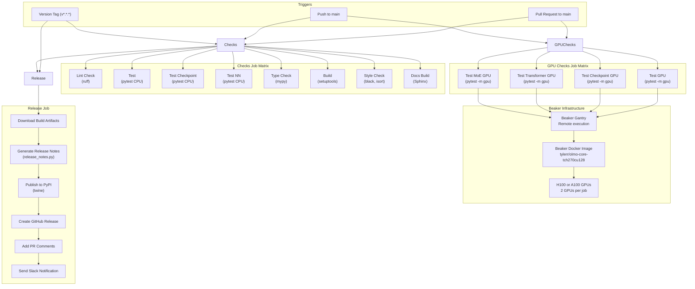
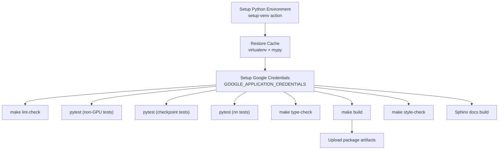
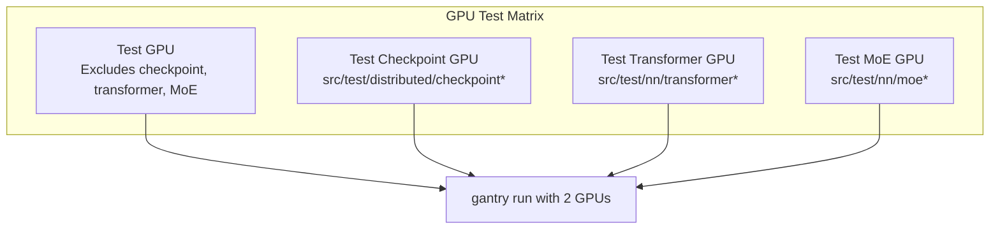
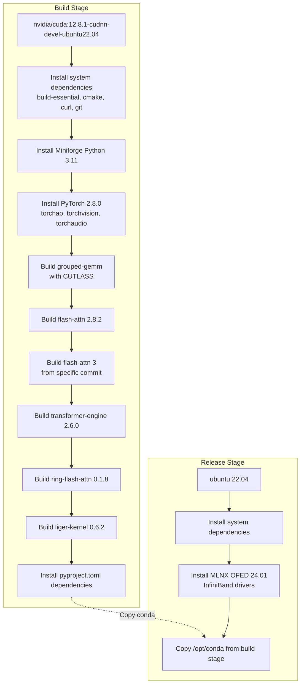
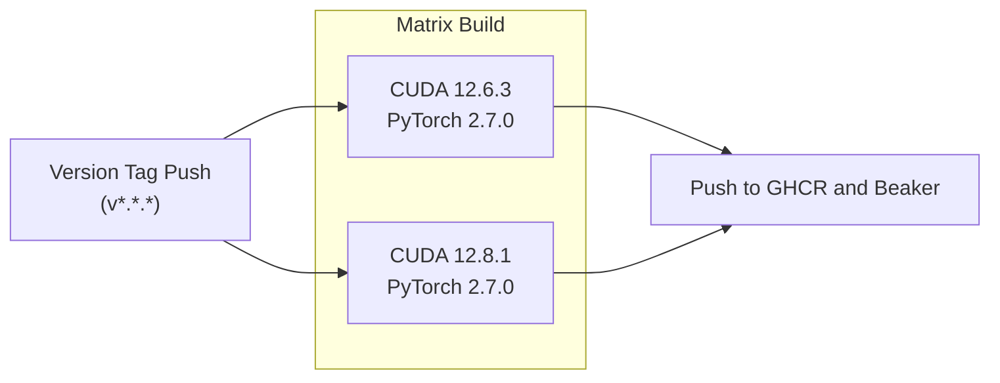
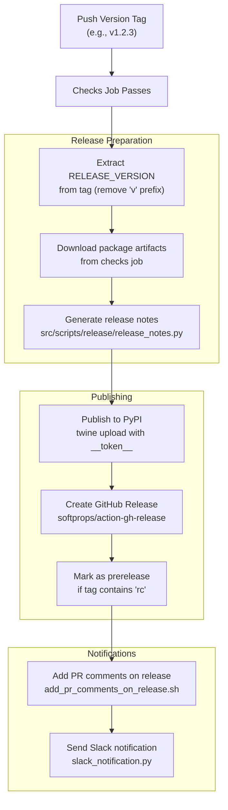
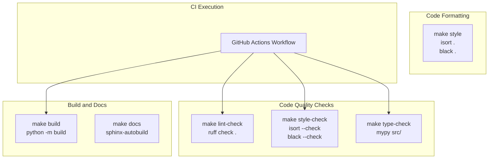
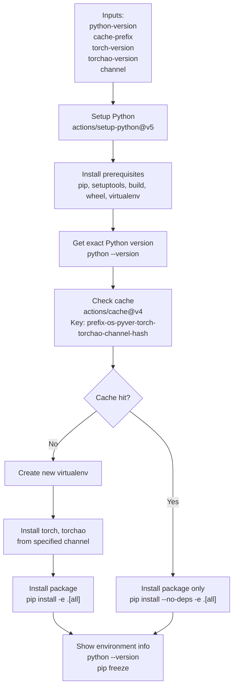
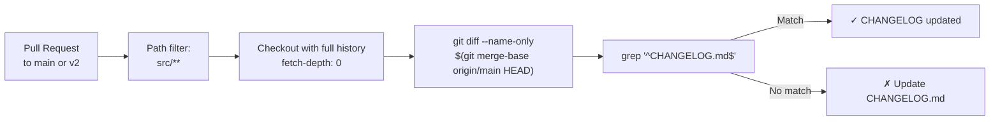

<!-- source: DeepWiki mcp.deepwiki.com · repo allenai/bolmo-core · page 8.3 CI/CD Pipeline · fetched 2026-10-26 -->

# CI/CD Pipeline

<details>
<summary>Relevant source files</summary>

The following files were used as context for generating this wiki page:

- [.github/actions/setup-venv/action.yml](.github/actions/setup-venv/action.yml)
- [.github/workflows/docker.yml](.github/workflows/docker.yml)
- [.github/workflows/main.yml](.github/workflows/main.yml)
- [.github/workflows/pr_checks.yml](.github/workflows/pr_checks.yml)
- [Makefile](Makefile)
- [pyproject.toml](pyproject.toml)
- [src/Dockerfile](src/Dockerfile)
- [src/olmo_core/distributed/utils.py](src/olmo_core/distributed/utils.py)

</details>


This document describes the continuous integration and continuous deployment (CI/CD) infrastructure for OLMo-Core, including automated testing, Docker image building, and release processes. The CI/CD system uses GitHub Actions workflows to validate code changes, run distributed GPU tests, build Docker images with CUDA support, and publish releases to PyPI.

For information about development environment setup and running tests locally, see [Development Setup](#8.1) and [Testing](#8.2). For code quality tools configuration, see [Code Quality Tools](#8.4).

## Overview

The CI/CD pipeline consists of three primary GitHub Actions workflows:

| Workflow | File | Trigger | Purpose |
|----------|------|---------|---------|
| **Main** | `.github/workflows/main.yml` | PR, push to main, version tags | Core checks, tests, and releases |
| **Docker** | `.github/workflows/docker.yml` | Version tags, manual dispatch | Build and publish Docker images |
| **PR Checks** | `.github/workflows/pr_checks.yml` | Pull requests | Verify CHANGELOG updates |

The pipeline validates code quality through linting, type checking, and testing (both CPU and GPU), builds Docker images with CUDA and PyTorch pre-installed, and automates the release process when version tags are pushed.

**Sources:** [.github/workflows/main.yml:1-278](), [.github/workflows/docker.yml:1-89](), [.github/workflows/pr_checks.yml:1-31]()

## Main Workflow Architecture



**Main Workflow Execution Flow**

The main workflow implements a matrix strategy to parallelize checks and tests. All jobs use cached Python virtual environments to speed up execution.

**Sources:** [.github/workflows/main.yml:26-119]()

### Checks Job Configuration

The `checks` job runs a matrix of validation tasks on Ubuntu runners with Python 3.11 (and 3.10 for minimum version compatibility):



The checks job uses several environment variables and secrets:

| Variable | Purpose |
|----------|---------|
| `CACHE_PREFIX` | Version prefix to invalidate caches (currently `v1`) |
| `PYTHONPATH` | Set to `./src/` for import resolution |
| `AWS_ACCESS_KEY_ID` / `AWS_SECRET_ACCESS_KEY` | AWS credentials for S3 access |
| `BEAKER_TOKEN` | Beaker authentication for GPU tests |
| `GOOGLE_CREDENTIALS` | GCS credentials written to `~/.google/credentials.json` |

**Sources:** [.github/workflows/main.yml:17-25](), [.github/workflows/main.yml:77-105]()

### Test Execution Strategy

Tests are split into multiple jobs to parallelize execution and manage memory:

1. **Main Tests**: All tests except checkpoint and NN tests [.github/workflows/main.yml:39-45]()
2. **Checkpoint Tests**: Distributed checkpoint tests isolated due to memory requirements [.github/workflows/main.yml:47-51]()
3. **NN Tests**: Neural network tests isolated for better parallelization [.github/workflows/main.yml:53-56]()

The test commands use pytest with specific flags:

```bash
pytest -v --color=yes --durations=3 \
  --ignore-glob='src/test/distributed/checkpoint*' \
  --ignore-glob='src/test/train/checkpoint*' \
  --ignore-glob='src/test/nn/*' \
  src/test/
```

**Sources:** [.github/workflows/main.yml:39-56]()

## GPU Testing with Beaker Gantry

GPU tests execute on remote Beaker clusters using the `beaker-gantry` tool, which wraps Beaker job submission:

```mermaid
flowchart LR
    subgraph "GitHub Runner"
        InstallGantry["Install beaker-gantry<br/>(uv tool install)"]
        DetermineWorkspace["Get BEAKER_WORKSPACE<br/>(make get-beaker-workspace)"]
        DetermineCommit["Extract commit SHA<br/>and branch name"]
    end
    
    subgraph "Gantry Command"
        GantryRun["gantry run"]
        Config["--workspace ai2/OLMo-core<br/>--beaker-image<br/>--gpus 2<br/>--gpu-type h100,a100"]
        Env["--env GOOGLE_APPLICATION_CREDENTIALS<br/>--env TOKENIZERS_PARALLELISM<br/>--env CUBLAS_WORKSPACE_CONFIG<br/>--env-secret AWS credentials"]
        Command["pytest -v --color=yes<br/>--durations=3 -m gpu"]
    end
    
    subgraph "Beaker Cluster"
        Schedule["Job Scheduled<br/>priority: normal<br/>preemptible"]
        Execute["Execute on GPU node<br/>H100 or A100"]
        Logs["Stream logs back<br/>--show-logs"]
    end
    
    InstallGantry --> DetermineWorkspace
    DetermineWorkspace --> DetermineCommit
    DetermineCommit --> GantryRun
    
    GantryRun --> Config
    Config --> Env
    Env --> Command
    
    Command --> Schedule
    Schedule --> Execute
    Execute --> Logs
```



**Gantry Configuration**

The GPU tests use the following configuration:

| Parameter | Value | Purpose |
|-----------|-------|---------|
| `--beaker-image` | `tylerr/olmo-core-tch270cu128-2025-09-24` | Docker image with PyTorch 2.7.0 and CUDA 12.8 |
| `--gpus` | `2` | Number of GPUs per job |
| `--gpu-type` | `h100 a100` | Prefer H100, fallback to A100 |
| `--budget` | `ai2/oe-base` | Beaker budget for charging |
| `--priority` | `normal` | Job priority |
| `--preemptible` | Flag | Allow preemption for cost savings |
| `--task-timeout` | `8m` | Maximum execution time per task |
| `--host-networking` | Flag | Enable host networking for Augusta clusters |
| `--system-python` | Flag | Use system Python from image |

**Sources:** [.github/workflows/main.yml:120-217]()

### GPU Test Matrix

GPU tests are split into four parallel jobs:



Each test job targets specific test files to balance execution time and resource usage. The `-m gpu` marker ensures only GPU-requiring tests are executed.

**Sources:** [.github/workflows/main.yml:129-159]()

### Beaker Workspace Detection

The workflow determines the Beaker workspace dynamically:

```bash
echo "BEAKER_WORKSPACE=$(make get-beaker-workspace)" >> $GITHUB_ENV
```

This calls the Makefile target that returns the hardcoded workspace `ai2/OLMo-core`.

**Sources:** [.github/workflows/main.yml:174-177](), [Makefile:98-107]()

## Docker Image Building

The Docker workflow builds multi-stage images with CUDA, PyTorch, and GPU-accelerated libraries:



**Multi-Stage Build Strategy**

The Dockerfile uses a two-stage build to minimize final image size:

1. **Build Stage** (`FROM nvidia/cuda:...-devel`): Compiles all GPU-accelerated libraries with full development tools [src/Dockerfile:13-95]()
2. **Release Stage** (`FROM ubuntu:22.04`): Copies only the compiled artifacts and runtime dependencies [src/Dockerfile:100-138]()

**Sources:** [src/Dockerfile:1-138]()

### Docker Build Variables

The Makefile defines configurable build arguments:

| Variable | Default | Purpose |
|----------|---------|---------|
| `CUDA_VERSION` | `12.8.1` | CUDA toolkit version |
| `PYTHON_VERSION` | `3.11` | Python version |
| `TORCH_VERSION` | `2.8.0` | PyTorch version |
| `INSTALL_CHANNEL` | `whl` | PyTorch installation channel |
| `GROUPED_GEMM_VERSION` | `git+...@main` | Grouped GEMM library source |
| `FLASH_ATTN_VERSION` | `2.8.2` | Flash Attention 2 version |
| `FLASH_ATTN_3_SHA` | `1ceaa984b2f3...` | Flash Attention 3 commit SHA |
| `TE_VERSION` | `2.6.0.post1` | Transformer Engine version |
| `RING_FLASH_ATTN_VERSION` | `0.1.8` | Ring Flash Attention version |
| `LIGER_KERNEL_VERSION` | `0.6.2` | Liger Kernel version |

**Sources:** [Makefile:46-61]()

### Image Tagging and Publishing

Docker images are tagged with a composite version string:

```
tch{TORCH_VERSION_SHORT}{CUDA_VERSION_PATH}-{DATE}
```

Example: `tch280cu128-2025-09-24`

Images are published to three registries:

1. **Local**: `olmo-core:{IMAGE_TAG}`
2. **GitHub Container Registry**: `ghcr.io/allenai/olmo-core:{IMAGE_TAG}` and `ghcr.io/allenai/olmo-core:latest`
3. **Beaker**: Created via `src/scripts/beaker/create_beaker_image.sh` in workspace `ai2/OLMo-core`

**Sources:** [Makefile:67-112](), [.github/workflows/docker.yml:73-88]()

### Docker Workflow Matrix

The Docker workflow builds images for multiple CUDA versions:



Both matrix jobs execute in parallel on `ubuntu-latest-m` runners with 60-minute timeouts.

**Sources:** [.github/workflows/docker.yml:26-88]()

### MLNX OFED Installation

The release stage installs Mellanox OFED (OpenFabrics Enterprise Distribution) user-space drivers for InfiniBand support:

```dockerfile
ENV MOFED_VER="24.01-0.3.3.1"
RUN wget --quiet https://content.mellanox.com/ofed/MLNX_OFED-${MOFED_VER}/... && \
    ... && \
    mlnxofedinstall --basic --user-space-only --without-fw-update -q
```

This enables high-performance RDMA communication for distributed training across InfiniBand-connected clusters like Jupiter and Pluto.

**Sources:** [src/Dockerfile:116-125]()

## Release Process

The release workflow triggers on version tags matching `v*.*.*` and depends on the successful completion of the `checks` job:



**Release Steps**

1. **Environment Preparation** [.github/workflows/main.yml:236-238]()
   - Extract release version from tag (removes `v` prefix)
   - Store tag name for prerelease detection

2. **Artifact Download** [.github/workflows/main.yml:240-244]()
   - Download package distribution files built in the `checks` job
   - Files stored in `dist/` directory

3. **Release Notes Generation** [.github/workflows/main.yml:246-249]()
   - Execute `src/scripts/release/release_notes.py`
   - Output written to temporary markdown file

4. **PyPI Publication** [.github/workflows/main.yml:251-254]()
   - Use `twine` to upload to PyPI
   - Authenticate with `PYPI_TOKEN` secret

5. **GitHub Release Creation** [.github/workflows/main.yml:256-264]()
   - Use `softprops/action-gh-release@v2` action
   - Attach release notes and distribution files
   - Mark as prerelease if tag contains `rc`

6. **Post-Release Actions** [.github/workflows/main.yml:266-277]()
   - Add comments to PRs included in the release
   - Send Slack notifications to team channels
   - Both continue on error to avoid blocking

**Sources:** [.github/workflows/main.yml:219-278]()

### Release Secrets

The release process requires several GitHub secrets:

| Secret | Purpose |
|--------|---------|
| `PYPI_TOKEN` | API token for publishing to PyPI |
| `GITHUB_TOKEN` | Automatically provided by GitHub Actions |
| `SLACK_WEBHOOK_URL` | Webhook URL for Slack notifications |

**Sources:** [.github/workflows/main.yml:254](), [.github/workflows/main.yml:259](), [.github/workflows/main.yml:277]()

## Development Tools Integration

The CI/CD pipeline integrates with development tools defined in the Makefile:



**Makefile Targets**

The Makefile provides several targets used in CI:

| Target | Command | Purpose |
|--------|---------|---------|
| `lint-check` | `ruff check .` | Run linter without fixing |
| `style-check` | `isort --check` + `black --check` | Check code formatting |
| `type-check` | `mypy src/` | Run type checker |
| `style` | `isort` + `black` | Auto-format code |
| `build` | `python -m build` | Build distribution packages |
| `docs` | `sphinx-autobuild` | Build and serve documentation |

**Sources:** [Makefile:1-37]()

### Tool Configuration

Tool configurations are centralized in `pyproject.toml`:

**Black Configuration** [pyproject.toml:91-106]():
```toml
[tool.black]
line-length = 100
include = '\.pyi?$'
exclude = '''(
    __pycache__ | \.git | \.mypy_cache | \.pytest_cache
    | \.vscode | \.venv | \bdist\b | \bdoc\b | scratch/
)'''
```

**Ruff Configuration** [pyproject.toml:112-144]():
```toml
[tool.ruff]
line-length = 100

[tool.ruff.lint]
ignore = ["F403", "F405", "E501"]
```

**MyPy Configuration** [pyproject.toml:153-162]():
```toml
[tool.mypy]
ignore_missing_imports = true
no_site_packages = true
check_untyped_defs = true
```

**Pytest Configuration** [pyproject.toml:164-179]():
```toml
[tool.pytest.ini_options]
testpaths = "src/test/"
python_classes = ["Test*", "*Test"]
markers = ["gpu"]
```

**Sources:** [pyproject.toml:91-179]()

## Virtual Environment Caching

The `setup-venv` reusable action implements intelligent caching for Python virtual environments:



**Cache Key Structure**

The cache key includes all factors that affect environment reproducibility:

```
{cache-prefix}-{os}-{python-version}-{torch-version}-{torchao-version}-{channel}-{hash}
```

Example:
```
v1-Linux-Python_3.11.5-2.7.0-0.9.0-whl/cpu-abc123def456
```

The `hash` component is computed from `*requirements.txt` and `*pyproject.toml` files, ensuring cache invalidation when dependencies change.

**Sources:** [.github/actions/setup-venv/action.yml:1-72]()

### Cache Restoration

The action uses restore keys to allow partial cache matches:

```yaml
restore-keys: |
  ${{ inputs.cache-prefix }}-${{ runner.os }}-${{ env.PYTHON_VERSION }}-${{ inputs.torch-version }}-${{ inputs.torchao-version }}-${{ inputs.channel }}
```

This enables cache reuse when only the dependency hash changes, falling back to reinstalling dependencies instead of rebuilding the entire environment.

**Sources:** [.github/actions/setup-venv/action.yml:46-47]()

## PR-Specific Checks

The `pr_checks` workflow enforces repository conventions on pull requests:



The workflow ensures contributors document their changes in `CHANGELOG.md` by comparing the changed files between the PR branch and the merge base with `origin/main`.

**Sources:** [.github/workflows/pr_checks.yml:1-31]()

## Environment Variables and Secrets

The CI/CD pipeline relies on several environment variables and secrets:

### Environment Variables

| Variable | Workflow | Purpose |
|----------|----------|---------|
| `CACHE_PREFIX` | Main | Cache invalidation version |
| `PYTHONPATH` | Main | Python module search path (`./src/`) |
| `GANTRY_GITHUB_TESTING` | Main | Enable verbose Gantry logging |
| `BEAKER_WORKSPACE` | Main, Docker | Beaker workspace for GPU tests and images |
| `COMMIT_SHA` | Main | Current commit SHA for Gantry |
| `BRANCH_NAME` | Main | Current branch name for Gantry |
| `RELEASE_VERSION` | Main | Release version without `v` prefix |
| `TAG` | Main | Full tag name for prerelease detection |

**Sources:** [.github/workflows/main.yml:17-25](), [.github/workflows/main.yml:125-189](), [.github/workflows/main.yml:236-238]()

### Secrets

| Secret | Workflow | Purpose |
|--------|----------|---------|
| `AWS_ACCESS_KEY_ID` | Main | AWS S3 access for tests |
| `AWS_SECRET_ACCESS_KEY` | Main | AWS S3 access for tests |
| `BEAKER_TOKEN` | Main, Docker | Beaker authentication |
| `GOOGLE_CREDENTIALS` | Main | GCS access for tests |
| `PYPI_TOKEN` | Main | PyPI package publishing |
| `SLACK_WEBHOOK_URL` | Main | Release notifications |
| `DOCKER_HUB_TOKEN` | Docker | Docker Hub authentication |
| `DOCKER_HUB_USER` | Docker | Docker Hub username |
| `GITHUB_TOKEN` | Main | Automatically provided by GitHub |

**Sources:** [.github/workflows/main.yml:21-24](), [.github/workflows/docker.yml:31-33](), [.github/workflows/main.yml:254](), [.github/workflows/main.yml:277]()

### Google Credentials Setup

Google credentials are written to a file and exposed via environment variable:

```bash
mkdir -p $HOME/.google
printenv GOOGLE_CREDENTIALS > $HOME/.google/credentials.json
echo "GOOGLE_APPLICATION_CREDENTIALS=$HOME/.google/credentials.json" >> $GITHUB_ENV
```

This enables GCS access from test code using the `google-cloud-storage` library.

**Sources:** [.github/workflows/main.yml:86-90]()

## Concurrency Control

All workflows implement concurrency control to prevent resource waste:

```yaml
concurrency:
  group: ${{ github.workflow }}-${{ github.ref }}
  cancel-in-progress: true
```

This ensures that when new commits are pushed to a PR or branch, any in-progress workflow runs for that ref are automatically cancelled.

**Sources:** [.github/workflows/main.yml:3-5](), [.github/workflows/docker.yml:3-5](), [.github/workflows/pr_checks.yml:3-5]()

---

