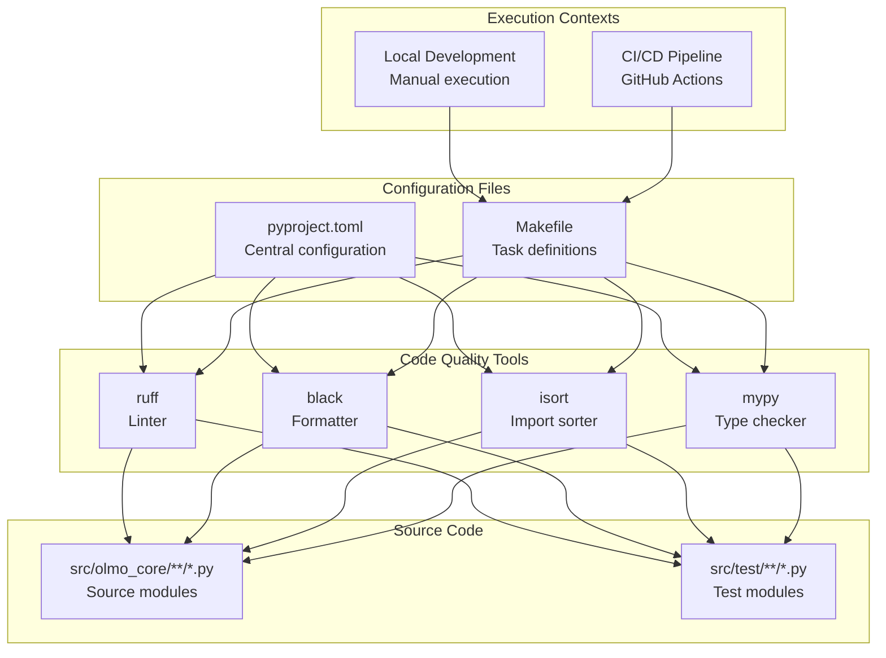
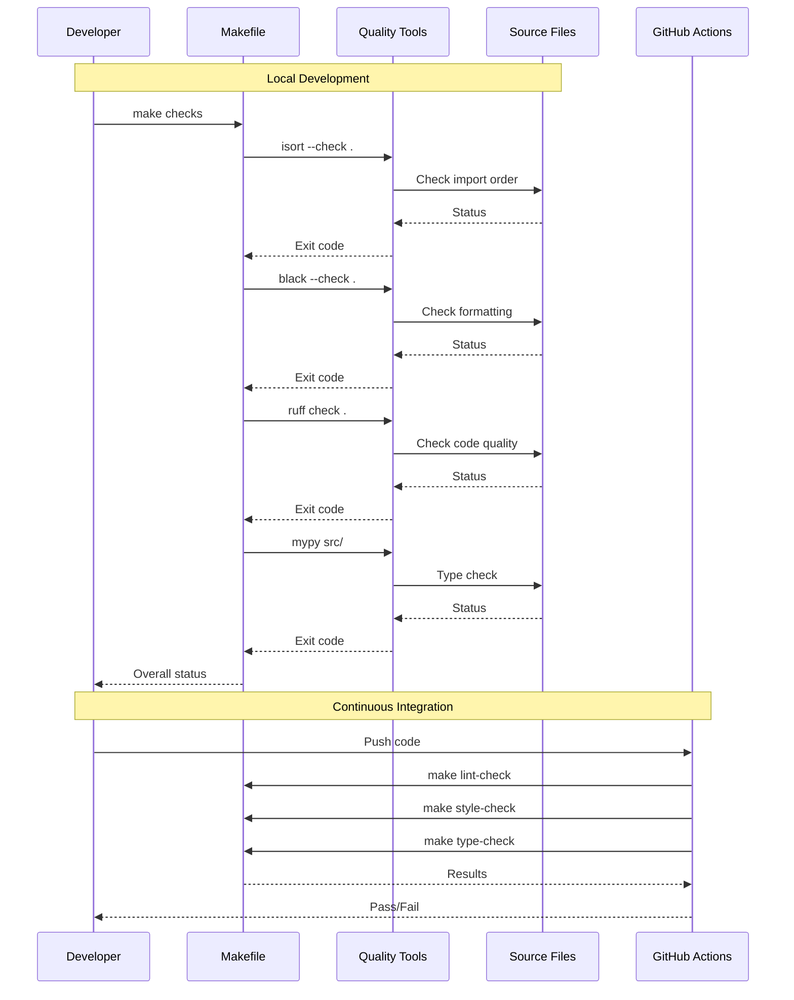

<!-- source: DeepWiki mcp.deepwiki.com · repo allenai/bolmo-core · page 8.4 Code Quality Tools · fetched 2026-10-26 -->

# Code Quality Tools

<details>
<summary>Relevant source files</summary>

The following files were used as context for generating this wiki page:

- [.github/actions/setup-venv/action.yml](.github/actions/setup-venv/action.yml)
- [.github/workflows/docker.yml](.github/workflows/docker.yml)
- [.github/workflows/main.yml](.github/workflows/main.yml)
- [.github/workflows/pr_checks.yml](.github/workflows/pr_checks.yml)
- [Makefile](Makefile)
- [pyproject.toml](pyproject.toml)
- [src/Dockerfile](src/Dockerfile)
- [src/olmo_core/distributed/utils.py](src/olmo_core/distributed/utils.py)

</details>


This document describes the code quality tools used in the OLMo-Core project, including linting, formatting, type checking, and their integration with the development workflow and CI/CD pipeline. The tools ensure consistent code style, catch potential bugs, and maintain type safety across the codebase.

For information about testing infrastructure, see [Testing](#8.2). For CI/CD workflow details, see [CI/CD Pipeline](#8.3).

---

## Overview

OLMo-Core uses a combination of automated tools to maintain code quality:

| Tool | Purpose | Configuration |
|------|---------|---------------|
| **ruff** | Fast Python linter checking code quality and style | [pyproject.toml:112-144]() |
| **black** | Opinionated code formatter ensuring consistent style | [pyproject.toml:91-106]() |
| **isort** | Import statement organizer | [pyproject.toml:108-110]() |
| **mypy** | Static type checker | [pyproject.toml:153-162]() |

All tools are installed as part of the `dev` optional dependency group in [pyproject.toml:34-56]().

**Sources:** [pyproject.toml:1-180]()

---

## Tool Configuration and Architecture



**Sources:** [pyproject.toml:91-162](), [Makefile:1-27]()

---

## Linting with ruff

`ruff` is a fast Python linter written in Rust that checks for code quality issues, potential bugs, and style violations.

### Configuration

The ruff configuration is defined in [pyproject.toml:112-144]():

```
[tool.ruff]
line-length = 100

[tool.ruff.lint]
ignore = ["F403", "F405", "E501"]
```

**Key settings:**
- **Line length:** 100 characters (matching black's configuration)
- **Ignored rules:**
  - `F403`: Wildcard imports allowed
  - `F405`: Names from wildcard imports allowed
  - `E501`: Line length violations (handled by black)
- **Excluded directories:** `.venv`, `.mypy_cache`, `__pycache__`, `dist`, `build`, and others

**Per-file ignores:**
- `__init__.py` files: `F401` (unused imports) are allowed for re-exports

### Running ruff

**Manual execution:**
```bash
ruff check .
```

**Via Makefile:**
```bash
make lint-check
```

The linter scans all Python files except those in excluded directories and reports violations to stdout.

**Sources:** [pyproject.toml:112-144](), [Makefile:11-14]()

---

## Code Formatting

OLMo-Core uses two formatters to maintain consistent code style: `black` for general code formatting and `isort` for import statement organization.

### black Configuration

`black` is an opinionated code formatter that enforces a consistent style. Configuration in [pyproject.toml:91-106]():

```
[tool.black]
line-length = 100
include = '\.pyi?$'
exclude = '''
(
      __pycache__
    | \.git
    | \.mypy_cache
    | \.pytest_cache
    | \.vscode
    | \.venv
    | \bdist\b
    | \bdoc\b
    | scratch/
)
'''
```

**Key settings:**
- **Line length:** 100 characters
- **File patterns:** Python files (`.py`) and stub files (`.pyi`)
- **Excluded paths:** Cache directories, virtual environments, build artifacts

### isort Configuration

`isort` organizes import statements. Configuration in [pyproject.toml:108-110]():

```
[tool.isort]
profile = "black"
multi_line_output = 3
```

The `profile = "black"` setting ensures isort's formatting is compatible with black.

### Running Formatters

**Check mode (CI/validation):**
```bash
make style-check
```

This runs:
1. `isort --check .` - Verifies imports are sorted correctly
2. `black --check .` - Verifies code is formatted correctly

**Format mode (apply changes):**
```bash
make style
```

This runs:
1. `isort .` - Sorts imports in place
2. `black .` - Formats code in place

**Sources:** [pyproject.toml:91-110](), [Makefile:4-26]()

---

## Type Checking with mypy

`mypy` performs static type analysis to catch type-related errors before runtime.

### Configuration

Type checking configuration in [pyproject.toml:153-162]():

```
[tool.mypy]
ignore_missing_imports = true
no_site_packages = true
check_untyped_defs = true
namespace_packages = false
disable_error_code = "has-type"

[[tool.mypy.overrides]]
module = "tests.*"
strict_optional = false
```

**Key settings:**
- **`ignore_missing_imports`:** Allows imports from libraries without type stubs
- **`check_untyped_defs`:** Type-checks function bodies even without annotations
- **Test overrides:** Relaxes `strict_optional` for test modules

### Running mypy

**Manual execution:**
```bash
mypy src/
```

**Via Makefile:**
```bash
make type-check
```

### Cache Management

mypy uses a cache directory (`.mypy_cache`) to speed up subsequent runs. The CI/CD pipeline restores this cache between runs using GitHub Actions cache at [.github/workflows/main.yml:92-100]().

**Sources:** [pyproject.toml:153-162](), [Makefile:16-19](), [.github/workflows/main.yml:92-100]()

---

## Makefile Targets

The [Makefile:1-27]() provides convenient targets for running quality checks:

```mermaid
graph LR
    checks["make checks"]
    style_check["make style-check"]
    lint_check["make lint-check"]
    type_check["make type-check"]
    style["make style"]
    
    checks --> style_check
    checks --> lint_check
    checks --> type_check
    
    style_check --> isort_check["isort --check ."]
    style_check --> black_check["black --check ."]
    
    lint_check --> ruff["ruff check ."]
    
    type_check --> mypy["mypy src/"]
    
    style --> isort_format["isort ."]
    style --> black_format["black ."]
```

### Target Descriptions

| Target | Description | Commands |
|--------|-------------|----------|
| `checks` | Run all quality checks | Combines `style-check`, `lint-check`, `type-check` |
| `style-check` | Verify code formatting | `isort --check .`, `black --check .` |
| `lint-check` | Check code quality | `ruff check .` |
| `type-check` | Run type checking | `mypy src/` |
| `style` | Auto-format code | `isort .`, `black .` |

### Typical Development Workflow

1. **Before committing:** Run `make checks` to verify all quality checks pass
2. **Fix formatting issues:** Run `make style` to auto-format code
3. **Fix lint/type issues:** Address issues reported by `make lint-check` and `make type-check`

**Sources:** [Makefile:1-27]()

---

## CI/CD Integration

### GitHub Actions Workflow

The code quality tools are integrated into the CI/CD pipeline at [.github/workflows/main.yml:26-106]().

```mermaid
graph TB
    PR["Pull Request / Push"]
    
    subgraph "GitHub Actions Jobs"
        checks_job["checks job<br/>matrix strategy"]
        
        subgraph "Check Tasks"
            lint["Lint<br/>make lint-check"]
            style["Style<br/>make style-check"]
            type["Type check<br/>make type-check"]
            test["Test<br/>pytest"]
            build["Build<br/>make build"]
            docs["Docs<br/>sphinx"]
        end
    end
    
    success["All checks pass"]
    failure["Checks fail<br/>PR blocked"]
    
    PR --> checks_job
    
    checks_job --> lint
    checks_job --> style
    checks_job --> type
    checks_job --> test
    checks_job --> build
    checks_job --> docs
    
    lint --> success
    style --> success
    type --> success
    test --> success
    build --> success
    docs --> success
    
    lint -.failure.-> failure
    style -.failure.-> failure
    type -.failure.-> failure
```

### CI Job Configuration

The `checks` job runs on `ubuntu-latest` with a 15-minute timeout. It uses a matrix strategy to run different tasks:

**Quality check tasks:**
- **Lint:** [.github/workflows/main.yml:36-37]()
  ```yaml
  - name: Lint
    run: make lint-check
  ```

- **Style:** [.github/workflows/main.yml:64-65]()
  ```yaml
  - name: Style
    run: make style-check
  ```

- **Type check:** [.github/workflows/main.yml:58-59]()
  ```yaml
  - name: Type check
    run: make type-check
  ```

### Environment Setup

Quality checks run in a virtual environment set up by [.github/actions/setup-venv/action.yml:1-72](). The environment includes:

1. Python 3.11 (specified in [.github/workflows/main.yml:34]())
2. Development dependencies installed via `pip install -e .[all]`
3. Cached virtual environment for faster CI runs

### Caching Strategy

**Virtual environment cache:**
- Key includes Python version, torch version, and dependency file hashes
- Stored at `.venv` path
- Restored on cache hit to skip reinstallation

**mypy cache:**
- Key includes Python version, `pyproject.toml` hash, git ref, and commit SHA
- Stored at `.mypy_cache` path
- Speeds up type checking on incremental changes

**Sources:** [.github/workflows/main.yml:26-119](), [.github/actions/setup-venv/action.yml:1-72]()

---

## Tool Invocation Flow



**Sources:** [Makefile:1-27](), [.github/workflows/main.yml:26-106]()

---

## Configuration Reference

### Complete pyproject.toml Tool Configuration

The [pyproject.toml:91-162]() file contains all tool configurations:

```
[tool.black]
line-length = 100
include = '\.pyi?$'
exclude = '''(...)'''

[tool.isort]
profile = "black"
multi_line_output = 3

[tool.ruff]
line-length = 100

[tool.ruff.lint]
ignore = ["F403", "F405", "E501"]
exclude = [...]

[tool.ruff.lint.per-file-ignores]
"**/__init__.py" = ["F401"]

[tool.pyright]
reportPrivateImportUsage = false

[tool.mypy]
ignore_missing_imports = true
no_site_packages = true
check_untyped_defs = true
namespace_packages = false
disable_error_code = "has-type"

[[tool.mypy.overrides]]
module = "tests.*"
strict_optional = false
```

### Tool Versions

Development dependencies are specified in [pyproject.toml:34-56]():

| Tool | Version Constraint |
|------|-------------------|
| black | `>=23.1,<24.0` |
| isort | `>=5.12,<5.14` |
| mypy | `>=1.0,<1.4` |
| ruff | (latest compatible) |

**Sources:** [pyproject.toml:34-162]()

---

## Development Best Practices

### Pre-commit Workflow

Before committing code:

1. **Auto-format code:**
   ```bash
   make style
   ```

2. **Run all checks:**
   ```bash
   make checks
   ```

3. **Fix any reported issues**

4. **Commit changes**

### Handling Check Failures

**Formatting issues:**
- Run `make style` to automatically fix most formatting problems
- Review changes before committing

**Lint issues:**
- Address issues reported by ruff
- For intentional violations, add `# noqa: <code>` comments
- Update `.ruff.toml` configuration if needed project-wide

**Type issues:**
- Add type annotations where missing
- Fix type inconsistencies
- Use `# type: ignore` comments sparingly for unavoidable issues

### CI Failure Resolution

If CI checks fail:

1. Pull the latest code
2. Run the failing check locally (e.g., `make lint-check`)
3. Fix issues
4. Re-run `make checks` to verify
5. Push the fix

**Sources:** [Makefile:1-27](), [.github/workflows/main.yml:26-106]()

---

## Docker Image Integration

The Docker image used for production includes the complete development environment with all quality tools installed. The [src/Dockerfile:88-94]() installs project dependencies:

```dockerfile
COPY pyproject.toml .
COPY src/olmo_core/__init__.py src/olmo_core/__init__.py
COPY src/olmo_core/version.py src/olmo_core/version.py
RUN pip install --no-cache-dir '.[all]' && \
    pip uninstall -y ai2-olmo-core && \
    rm -rf *
```

The `[all]` extra includes the `dev` dependency group, ensuring the Docker environment has all quality tools available for development and testing.

**Sources:** [src/Dockerfile:88-94](), [pyproject.toml:34-75]()

---

