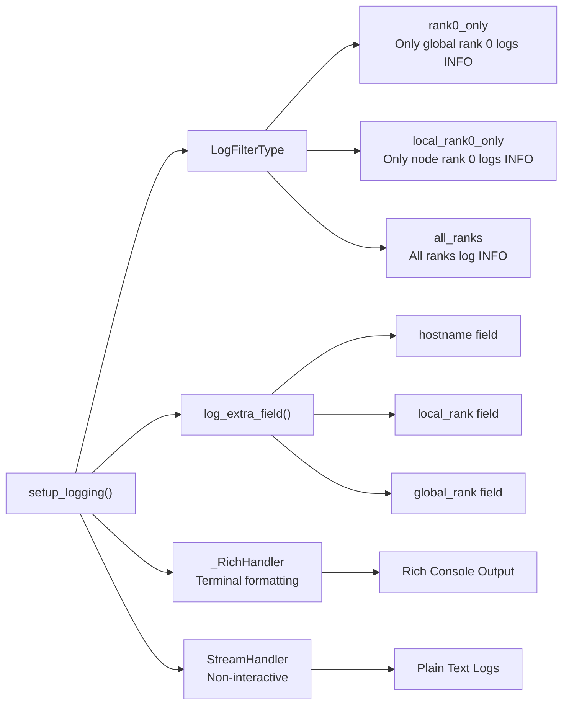
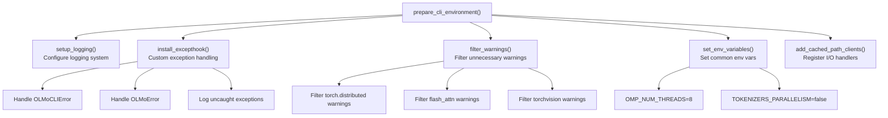
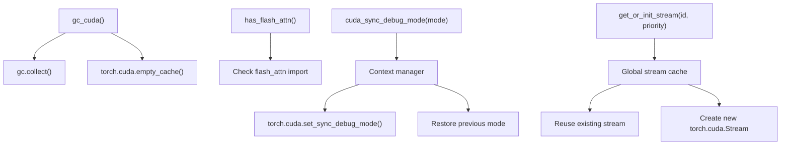
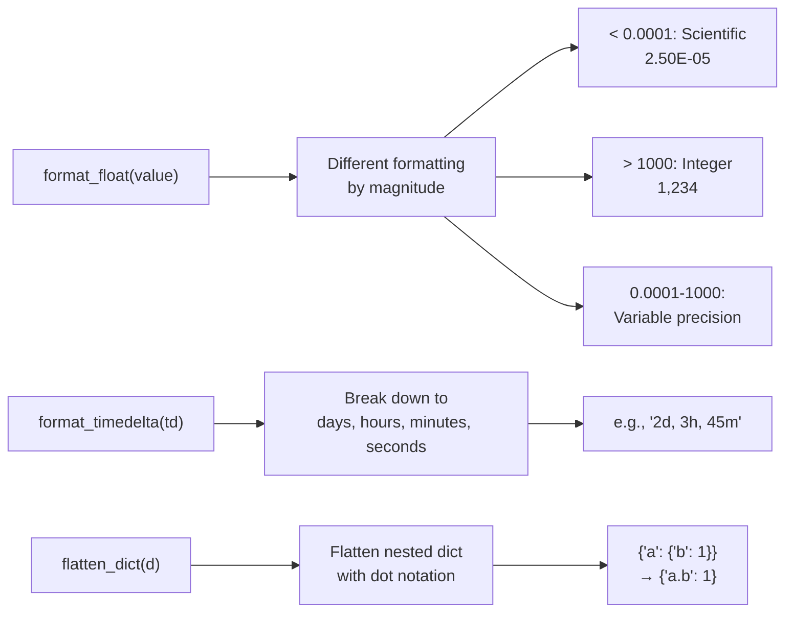
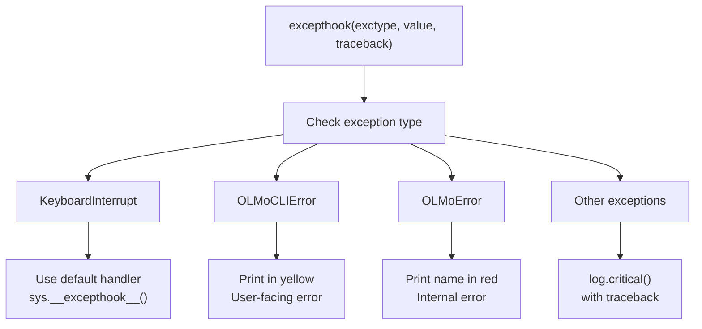

<!-- source: DeepWiki mcp.deepwiki.com · repo allenai/bolmo-core · page 9 Utility Modules · fetched 2026-10-26 -->

# Utility Modules

<details>
<summary>Relevant source files</summary>

The following files were used as context for generating this wiki page:

- [src/olmo_core/utils.py](src/olmo_core/utils.py)
- [src/test/distributed/checkpoint_test.py](src/test/distributed/checkpoint_test.py)

</details>


## Purpose and Scope

The utility modules provide essential helper functions, configuration patterns, and common operations used throughout the OLMo-Core codebase. These utilities support device management, logging configuration, tensor operations, threading primitives, and environment setup. This page provides an overview of the utility system's organization and key components.

For detailed documentation of specific utility functions, see [Common Utilities](#9.1). For information about the configuration system pattern, see [Configuration System](#9.2). For distributed-specific utilities, see [Distributed Initialization](#5.2).

**Sources:** [src/olmo_core/utils.py:1-756]()

## Utility Module Organization

The utility functions in OLMo-Core are organized into several functional categories that support different aspects of the training and inference pipeline.

```mermaid
graph TB
    subgraph "olmo_core.utils Module"
        DeviceUtils["Device Management<br/>get_default_device()<br/>move_to_device()<br/>apply_to_tensors()"]
        
        SeedUtils["Seeding & RNG<br/>seed_all()<br/>generate_uuid()"]
        
        TensorUtils["Tensor Operations<br/>same_storage()<br/>mark_dynamic()<br/>min_value_of_dtype()<br/>get_element_size()"]
        
        ThreadUtils["Threading<br/>threaded_generator()<br/>wait_for()<br/>get_default_thread_count()"]
        
        LogUtils["Logging<br/>setup_logging()<br/>log_extra_field()<br/>LogFilterType"]
        
        EnvUtils["Environment Setup<br/>prepare_cli_environment()<br/>set_env_var()<br/>filter_warnings()"]
        
        CUDAUtils["CUDA Operations<br/>gc_cuda()<br/>has_flash_attn()<br/>cuda_sync_debug_mode()<br/>get_or_init_stream()"]
        
        FormatUtils["Formatting<br/>format_float()<br/>format_timedelta()<br/>flatten_dict()"]
        
        MathUtils["Math Utilities<br/>powers_of_2()<br/>capped_powers_of_2()<br/>ensure_multiple_of()"]
        
        IterUtils["Iterators<br/>roundrobin()"]
    end
    
    DeviceUtils -.-> ModelInit["Model Initialization"]
    DeviceUtils -.-> DataLoading["Data Loading"]
    
    SeedUtils -.-> Reproducibility["Reproducible Training"]
    
    TensorUtils -.-> Checkpointing["Checkpoint Operations"]
    TensorUtils -.-> Compilation["torch.compile()"]
    
    ThreadUtils -.-> AsyncOps["Async Operations"]
    ThreadUtils -.-> DataPipeline["Data Pipeline"]
    
    LogUtils -.-> DistributedLogging["Distributed Logging"]
    
    EnvUtils -.-> CLIScripts["CLI Scripts"]
    EnvUtils -.-> TrainingSetup["Training Setup"]
    
    CUDAUtils -.-> MemoryMgmt["Memory Management"]
    CUDAUtils -.-> Debugging["Debug Support"]
    
    FormatUtils -.-> Metrics["Metrics Display"]
    
    MathUtils -.-> BatchSize["Batch Size Calculations"]
    
    IterUtils -.-> DataMixing["Data Mixing"]
```



**Sources:** [src/olmo_core/utils.py:1-756]()

## Core Utility Categories

### Device Management

Device management utilities handle device selection, tensor movement, and device-aware operations across CPU, CUDA, and MPS backends.

| Function | Purpose | Key Features |
|----------|---------|--------------|
| `get_default_device()` | Determines the default compute device | Checks distributed backend, CUDA availability, MPS availability |
| `move_to_device()` | Moves tensors or containers to a device | Handles dicts, lists, tuples, dataclasses; supports non-blocking transfers |
| `apply_to_tensors()` | Recursively applies a function to all tensors | Works with nested containers and dataclasses |

**Sources:** [src/olmo_core/utils.py:96-152]()

### Logging Configuration

The logging system provides distributed-aware logging with rank filtering and rich terminal output.



The `LogFilterType` enum controls which ranks emit INFO-level messages in distributed training:
- **rank0_only**: Only global rank 0 emits INFO messages (default)
- **local_rank0_only**: Only local rank 0 on each node emits INFO messages
- **all_ranks**: All ranks emit INFO messages

**Sources:** [src/olmo_core/utils.py:232-354]()

### Environment Setup

The `prepare_cli_environment()` function orchestrates environment preparation for scripts and CLIs.



**Sources:** [src/olmo_core/utils.py:459-494]()

### Threading Utilities

Threading utilities support asynchronous operations and parallel data loading.

| Function | Purpose | Return Type |
|----------|---------|-------------|
| `threaded_generator(g, maxsize, thread_name)` | Wraps generator in a thread with queue | Generator |
| `wait_for(condition, description, timeout)` | Waits for condition to become True | None |
| `get_default_thread_count()` | Gets default max thread count from env or CPU count | int |

The `threaded_generator()` function is particularly useful for data loading pipelines where I/O can be performed in parallel with computation. It uses a `Queue` to buffer items and raises `OLMoThreadError` if the background thread fails.

**Sources:** [src/olmo_core/utils.py:46-60](), [src/olmo_core/utils.py:62-69](), [src/olmo_core/utils.py:563-589]()

### CUDA Operations

CUDA-specific utilities provide memory management, capability detection, and debugging support.



The `get_or_init_stream()` function maintains a global cache of CUDA streams identified by string IDs, allowing efficient reuse of streams across the codebase.

**Sources:** [src/olmo_core/utils.py:181-188](), [src/olmo_core/utils.py:190-201](), [src/olmo_core/utils.py:693-708](), [src/olmo_core/utils.py:745-756]()

## Tensor and Data Type Utilities

Utilities for working with PyTorch tensors and data types.

| Function | Purpose | Example Use Case |
|----------|---------|------------------|
| `same_storage(x, y)` | Check if tensors share storage | Verify views reference same data |
| `mark_dynamic(x, dim, strict)` | Mark tensor dimensions as dynamic | Support `torch.compile()` with variable sizes |
| `get_element_size(dtype)` | Get size in bytes of dtype | Memory calculations |
| `info_value_of_dtype(dtype)` | Get finfo or iinfo for dtype | Determine min/max values |
| `min_value_of_dtype(dtype)` | Get minimum value for dtype | Initialize masks |

**Sources:** [src/olmo_core/utils.py:117-125](), [src/olmo_core/utils.py:172-179](), [src/olmo_core/utils.py:710-743]()

## Formatting and Display Utilities

Functions for formatting values for human-readable display.



**Sources:** [src/olmo_core/utils.py:631-646](), [src/olmo_core/utils.py:648-669](), [src/olmo_core/utils.py:671-691]()

## Mathematical Utilities

Utilities for mathematical operations commonly needed in training.

| Function | Signature | Description |
|----------|-----------|-------------|
| `powers_of_2(x)` | `int -> List[int]` | Returns powers of 2 that sum to x (e.g., 5 → [4, 1]) |
| `capped_powers_of_2(x, cap)` | `int, int -> List[int]` | Like powers_of_2 but caps each power at maximum value |
| `ensure_multiple_of(x, of)` | `int, int -> int` | Rounds x up to nearest multiple of `of` |
| `roundrobin(*iterables)` | `*Iterable -> Iterator` | Interleaves iterables in round-robin fashion |

The `roundrobin()` function is particularly useful for data mixing, where multiple data sources need to be interleaved fairly.

**Sources:** [src/olmo_core/utils.py:591-607](), [src/olmo_core/utils.py:609-629](), [src/olmo_core/utils.py:717-719]()

## Integration with Training Pipeline

The following diagram shows how utility functions integrate with the major systems in OLMo-Core:

```mermaid
graph TB
    subgraph "CLI Entry Points"
        TrainScript["train.py"]
        EvalScript["eval.py"]
        GenScript["generate.py"]
    end
    
    subgraph "Environment Setup"
        prepare_cli_environment["prepare_cli_environment()"]
        setup_logging["setup_logging()"]
        filter_warnings["filter_warnings()"]
        set_env_variables["set_env_variables()"]
    end
    
    subgraph "Training System"
        Trainer["Trainer.fit()"]
        TrainModule["TrainModule"]
        Callbacks["Callbacks"]
    end
    
    subgraph "Distributed System"
        init_distributed["init_distributed()"]
        Checkpointer["Checkpointer"]
        DistCheckpoint["torch.distributed.checkpoint"]
    end
    
    subgraph "Data Pipeline"
        DataLoader["NumpyDataLoader"]
        Dataset["NumpyDataset"]
        SourceMixture["SourceMixture"]
    end
    
    subgraph "Device & Memory"
        get_default_device["get_default_device()"]
        move_to_device["move_to_device()"]
        gc_cuda["gc_cuda()"]
    end
    
    subgraph "Threading & Async"
        threaded_generator["threaded_generator()"]
        wait_for["wait_for()"]
    end
    
    TrainScript --> prepare_cli_environment
    EvalScript --> prepare_cli_environment
    GenScript --> prepare_cli_environment
    
    prepare_cli_environment --> setup_logging
    prepare_cli_environment --> filter_warnings
    prepare_cli_environment --> set_env_variables
    
    TrainScript --> init_distributed
    init_distributed --> get_default_device
    
    Trainer --> get_default_device
    Trainer --> move_to_device
    TrainModule --> move_to_device
    
    Callbacks --> gc_cuda
    Checkpointer --> wait_for
    
    DataLoader --> threaded_generator
    DataLoader --> get_default_device
    DataLoader --> move_to_device
    
    SourceMixture --> roundrobin["roundrobin()"]
```



**Sources:** [src/olmo_core/utils.py:459-494]()

## Environment Variables

The utility module respects several environment variables for configuration:

| Environment Variable | Purpose | Default |
|---------------------|---------|---------|
| `OLMO_NUM_THREADS` | Maximum number of threads for data loading | `min(16, cpu_count + 4)` |
| `LOG_FILTER_TYPE` | Logging filter type (rank0_only, local_rank0_only, all_ranks) | `rank0_only` |
| `OMP_NUM_THREADS` | OpenMP thread count (set by `set_env_variables()`) | `8` |
| `TOKENIZERS_PARALLELISM` | HuggingFace tokenizers parallelism (set by `set_env_variables()`) | `false` |
| `BEAKER_EXPERIMENT_ID` | Presence indicates running in Beaker environment | N/A |

**Sources:** [src/olmo_core/utils.py:30-31](), [src/olmo_core/utils.py:46-60](), [src/olmo_core/utils.py:448-457]()

## Exception Handling

The utility module provides custom exception handling through `install_excepthook()`:



Custom exception types:
- **OLMoCLIError**: User-facing errors (displayed in yellow)
- **OLMoError**: Internal errors (name displayed in red)
- **OLMoThreadError**: Errors from background threads
- **OLMoEnvironmentError**: Environment configuration errors

**Sources:** [src/olmo_core/utils.py:368-393](), [src/olmo_core/exceptions.py]()

## Usage Examples

### Setting up CLI Environment

```python
# At the top of a script
if __name__ == "__main__":
    from olmo_core.utils import prepare_cli_environment
    prepare_cli_environment()
    
    # Rest of script...
```

**Sources:** [src/olmo_core/utils.py:459-494]()

### Device-Aware Tensor Operations

```python
from olmo_core.utils import get_default_device, move_to_device

# Get the appropriate device for distributed or local training
device = get_default_device()

# Move batch to device
batch = {"input_ids": input_ids, "labels": labels}
batch = move_to_device(batch, device)
```

**Sources:** [src/olmo_core/utils.py:96-152]()

### Threaded Data Loading

```python
from olmo_core.utils import threaded_generator

# Wrap a generator to run in a background thread
data_gen = threaded_generator(
    my_data_generator(),
    maxsize=16,
    thread_name="data-loader"
)

for batch in data_gen:
    # Process batch while next batch is being loaded
    ...
```

**Sources:** [src/olmo_core/utils.py:563-589]()

## Summary

The utility modules provide foundational support for all aspects of OLMo-Core, from environment setup and logging to device management and threading. Key design principles include:

1. **Distributed Awareness**: Utilities like `get_default_device()` and `setup_logging()` automatically adapt to distributed training contexts
2. **Rich Terminal Support**: Logging and exception handling provide enhanced output in interactive terminals
3. **Type Safety**: Helper functions like `info_value_of_dtype()` provide type-safe operations on PyTorch data types
4. **Async Support**: Threading utilities enable non-blocking I/O operations
5. **Environment Flexibility**: Extensive use of environment variables for configuration

These utilities are used throughout the training pipeline, data loading, checkpointing, and distributed coordination systems.

**Sources:** [src/olmo_core/utils.py:1-756]()

---

