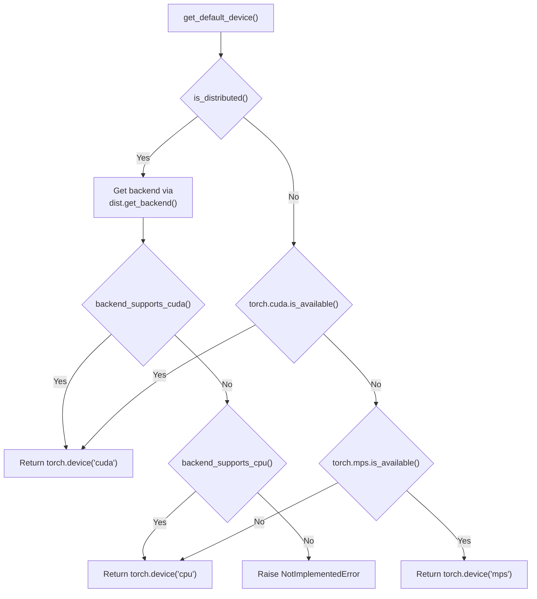
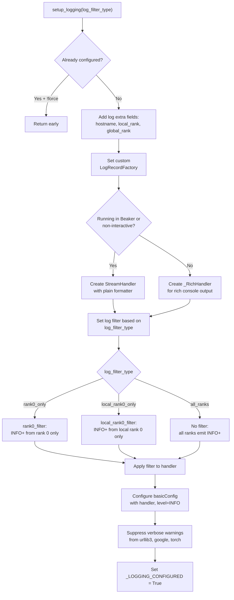
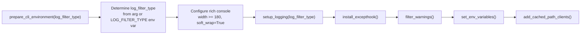
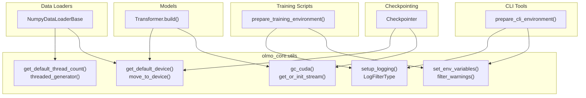

<!-- source: DeepWiki mcp.deepwiki.com · repo allenai/bolmo-core · page 9.1 Common Utilities · fetched 2026-10-26 -->

# Common Utilities

<details>
<summary>Relevant source files</summary>

The following files were used as context for generating this wiki page:

- [src/olmo_core/utils.py](src/olmo_core/utils.py)
- [src/test/distributed/checkpoint_test.py](src/test/distributed/checkpoint_test.py)

</details>


This page documents the common utility functions and helpers provided by the `olmo_core.utils` module. These utilities are used throughout the codebase for device management, logging, tensor operations, threading, environment setup, and various other common tasks.

For configuration-related utilities, see [Configuration System](#9.2). For distributed utilities, see [Distributed Initialization](#5.2). For I/O utilities, see [I/O System](#5.4).

## Overview

The `olmo_core.utils` module provides a comprehensive set of utility functions organized into the following categories:

| Category | Purpose | Key Functions |
|----------|---------|---------------|
| Device Management | Handle device selection and tensor movement | `get_default_device()`, `move_to_device()` |
| Tensor Operations | Apply operations to tensors and tensor containers | `apply_to_tensors()`, `same_storage()`, `mark_dynamic()` |
| Random Seeding | Seed all random number generators | `seed_all()` |
| Threading | Thread management and threaded generators | `get_default_thread_count()`, `threaded_generator()` |
| Logging | Comprehensive logging setup and configuration | `setup_logging()`, `LogFilterType`, `log_extra_field()` |
| Environment Setup | Prepare execution environment | `prepare_cli_environment()`, `set_env_var()` |
| CUDA Utilities | CUDA-specific operations and checks | `gc_cuda()`, `has_flash_attn()`, `cuda_sync_debug_mode()` |
| Formatting | Format values for display | `format_float()`, `format_timedelta()`, `flatten_dict()` |
| Math Operations | Mathematical utility functions | `powers_of_2()`, `ensure_multiple_of()` |
| Dtype Operations | PyTorch dtype information | `get_element_size()`, `min_value_of_dtype()` |

Sources: [src/olmo_core/utils.py:1-756]()

## Utility Categories

```mermaid
graph TB
    subgraph "olmo_core.utils Module"
        DeviceMgmt["Device Management<br/>get_default_device<br/>move_to_device<br/>apply_to_tensors"]
        TensorOps["Tensor Operations<br/>same_storage<br/>mark_dynamic"]
        Seeding["Random Seeding<br/>seed_all"]
        Threading["Threading<br/>get_default_thread_count<br/>threaded_generator<br/>roundrobin"]
        Logging["Logging System<br/>setup_logging<br/>LogFilterType<br/>_RichHandler<br/>log_extra_field"]
        EnvSetup["Environment Setup<br/>prepare_cli_environment<br/>set_env_var<br/>filter_warnings"]
        CUDA["CUDA Utilities<br/>gc_cuda<br/>has_flash_attn<br/>get_or_init_stream<br/>cuda_sync_debug_mode"]
        Format["Formatting<br/>format_float<br/>format_timedelta<br/>flatten_dict"]
        Math["Math Operations<br/>powers_of_2<br/>capped_powers_of_2<br/>ensure_multiple_of"]
        Dtype["Dtype Operations<br/>get_element_size<br/>info_value_of_dtype<br/>min_value_of_dtype"]
        Misc["Miscellaneous<br/>generate_uuid<br/>wait_for<br/>log_once"]
    end
    
    subgraph "Primary Use Cases"
        Training["Training Scripts"]
        Inference["Inference Scripts"]
        CLI["CLI Tools"]
        Testing["Test Suites"]
    end
    
    Training --> DeviceMgmt
    Training --> Seeding
    Training --> Logging
    Training --> CUDA
    
    Inference --> DeviceMgmt
    Inference --> TensorOps
    
    CLI --> EnvSetup
    CLI --> Logging
    CLI --> Format
    
    Testing --> Threading
    Testing --> Misc
    Testing --> Math
```



Sources: [src/olmo_core/utils.py:1-756]()

## Device Management

The device management utilities help select appropriate compute devices and move tensors between devices in distributed and non-distributed contexts.

### get_default_device()

Returns the default device for computation based on the environment:



The function prioritizes CUDA when available in distributed mode with NCCL backend, CPU for GLOO backend, and falls back to MPS (Apple Silicon) or CPU in non-distributed mode.

Sources: [src/olmo_core/utils.py:127-152]()

### move_to_device()

Recursively moves tensors or containers of tensors to a specified device:

| Container Type | Handling |
|----------------|----------|
| `torch.Tensor` | Direct `.to(device)` call with `non_blocking` flag |
| `dict` | Recursively move all values |
| `list` | Recursively move all elements |
| `tuple` | Recursively move all elements, return new tuple |
| Other | Return unchanged |

The `non_blocking` parameter defaults to `True` for CUDA devices and `False` for CPU/MPS to optimize asynchronous transfers.

Sources: [src/olmo_core/utils.py:96-115]()

### apply_to_tensors()

Recursively applies a function to all tensors in a container structure. This function handles:

- Direct tensors
- Lists, tuples, sets
- Dictionaries (applies to both keys and values)
- Dataclass instances
- Iterators

This is useful for operations like moving all tensors in a complex nested structure or applying transformations.

Sources: [src/olmo_core/utils.py:71-91]()

## Tensor Operations

### same_storage()

Checks if two tensors share the same underlying storage by comparing data pointers:

```python
def same_storage(x: torch.Tensor, y: torch.Tensor) -> bool
```

This is useful for detecting aliasing and understanding memory layout in sharded or parallelized models.

Sources: [src/olmo_core/utils.py:172-179]()

### mark_dynamic()

Marks tensor dimensions as dynamic for `torch.compile()` optimization:

```python
def mark_dynamic(x: torch.Tensor, dim: Union[int, Sequence[int]], strict: bool = True)
```

When `strict=True`, uses `torch._dynamo.mark_dynamic()`. When `strict=False`, uses `torch._dynamo.maybe_mark_dynamic()` for more lenient marking.

Sources: [src/olmo_core/utils.py:117-125]()

## Random Seeding

### seed_all()

Seeds all random number generators (Python `random`, NumPy, PyTorch CPU and CUDA) with a single seed value:

```python
def seed_all(seed: int)
```

The seed must be in the range `[0, 2^32 - 1]`. This ensures reproducibility across all random operations in training and evaluation.

Sources: [src/olmo_core/utils.py:154-170]()

## Threading Utilities

### Thread Count Management

The default thread count is controlled by the `OLMO_NUM_THREADS` environment variable or defaults to `min(16, os.cpu_count() + 4)`:

```python
def get_default_thread_count() -> int
```

This value is used by data loaders and other multi-threaded components to limit parallelism.

Sources: [src/olmo_core/utils.py:30-60]()

### threaded_generator()

Wraps a generator to run in a separate thread with a queue buffer:

```python
def threaded_generator(g, maxsize: int = 16, thread_name: Optional[str] = None)
```

This is particularly useful for I/O-bound data loading operations. The generator runs in a daemon thread, and exceptions are propagated as `OLMoThreadError`.

**Flow:**
1. Creates a `Queue` with specified `maxsize`
2. Starts a daemon thread that fills the queue
3. Main thread yields items from the queue
4. Uses sentinel object to signal completion
5. Propagates exceptions from the generator thread

Sources: [src/olmo_core/utils.py:563-589]()

### roundrobin()

Iterates through multiple iterables in round-robin fashion:

```python
def roundrobin(*iterables)
```

Example: `roundrobin('ABC', 'D', 'EF')` yields `A, D, E, B, F, C`.

This is used in data mixing scenarios to interleave multiple data sources.

Sources: [src/olmo_core/utils.py:591-607]()

## Logging System

The logging system provides rich console output with distributed-aware filtering and custom formatting.

### Logging Setup Flow



Sources: [src/olmo_core/utils.py:272-354]()

### LogFilterType

An enum determining which ranks emit log messages below the WARNING level:

| Value | Description |
|-------|-------------|
| `rank0_only` | Only global rank 0 emits INFO messages |
| `local_rank0_only` | Only local (node) rank 0 emits INFO messages |
| `all_ranks` | All ranks emit INFO messages |

All ranks always emit WARNING and higher level messages regardless of the filter type.

Sources: [src/olmo_core/utils.py:232-251]()

### log_extra_field()

Adds custom fields to all log records:

```python
def log_extra_field(field_name: str, field_value: Any) -> None
```

These fields are automatically added to the `LogRecord` via a custom factory. Common fields include `hostname`, `local_rank`, and `global_rank`.

Sources: [src/olmo_core/utils.py:253-270]()

### _RichHandler

A custom logging handler that uses the `rich` library for beautiful console output:

**Features:**
- Colored log levels
- Timestamp formatting
- Location information (module:line, rank)
- Rich traceback rendering for exceptions
- Markup support for styled messages

Sources: [src/olmo_core/utils.py:496-561]()

## Environment Setup

### prepare_cli_environment()

Comprehensive environment preparation for scripts and CLI tools:



This function should be called at the beginning of every script or CLI command. It sets up logging, installs a custom exception handler, filters warnings, sets environment variables, and configures I/O clients.

Sources: [src/olmo_core/utils.py:459-494]()

### Environment Variables

The `set_env_variables()` function sets common environment variables if not already set:

| Variable | Default Value | Purpose |
|----------|---------------|---------|
| `OMP_NUM_THREADS` | `"8"` | Limit OpenMP parallelism |
| `TOKENIZERS_PARALLELISM` | `"false"` | Disable tokenizer warnings |

The `set_env_var()` function provides controlled environment variable setting with logging and optional override behavior.

Sources: [src/olmo_core/utils.py:203-221](), [src/olmo_core/utils.py:448-457]()

### Exception Hook

The custom `excepthook()` provides better error display:

| Exception Type | Handling |
|----------------|----------|
| `KeyboardInterrupt` | Uses default handler |
| `OLMoCLIError` | Yellow text without traceback |
| `OLMoError` | Red error name with message |
| Other | Full traceback logged as CRITICAL |

Sources: [src/olmo_core/utils.py:368-393]()

### Warning Filters

The `filter_warnings()` function suppresses verbose warnings from:
- PyTorch internal deprecations
- Flash attention
- Torchvision (when not used)
- NCCL configuration

Sources: [src/olmo_core/utils.py:395-446]()

## CUDA Utilities

### gc_cuda()

Performs garbage collection and empties the CUDA cache:

```python
def gc_cuda()
```

This is useful for reclaiming GPU memory between training phases or after checkpoint loading.

Sources: [src/olmo_core/utils.py:181-188]()

### has_flash_attn()

Checks if the `flash_attn` package is available:

```python
def has_flash_attn() -> bool
```

Returns `True` if `flash_attn` can be imported, `False` otherwise. This is used to conditionally enable flash attention optimizations.

Sources: [src/olmo_core/utils.py:190-201]()

### cuda_sync_debug_mode()

Context manager for temporarily setting CUDA sync debug mode:

```python
@contextmanager
def cuda_sync_debug_mode(debug_mode: Union[int, str])
```

This enables synchronization debugging for specific code sections without affecting the global setting.

Sources: [src/olmo_core/utils.py:693-708]()

### get_or_init_stream()

Gets or initializes a named CUDA stream:

```python
def get_or_init_stream(id: str, priority: int = 0) -> torch.cuda.Stream
```

Streams are cached by ID in the global `_CUDA_STREAMS` dictionary. This enables consistent stream reuse across different parts of the codebase.

Sources: [src/olmo_core/utils.py:745-756]()

## Formatting Utilities

### format_float()

Formats floating-point values with appropriate precision:

| Value Range | Format | Example |
|-------------|--------|---------|
| `== 0.0` | `"0.0"` | `"0.0"` |
| `< 0.0001` | Scientific notation | `"1.23E-05"` |
| `> 1000` | Integer with commas | `"1,234"` |
| `> 100` | One decimal | `"123.4"` |
| `> 10` | Two decimals | `"12.34"` |
| `> 1` | Three decimals | `"1.234"` |
| `<= 1` | Four decimals | `"0.1234"` |

Sources: [src/olmo_core/utils.py:631-646]()

### format_timedelta()

Formats `timedelta` objects in human-readable format:

```python
def format_timedelta(td: timedelta) -> str
```

Examples:
- `"2d, 3h, 45m"` for 2 days, 3 hours, 45 minutes
- `"30s"` for 30 seconds
- `"0s"` for zero duration

Sources: [src/olmo_core/utils.py:648-669]()

### flatten_dict()

Flattens nested dictionaries using dot notation:

```python
def flatten_dict(d: Dict[str, Any]) -> Dict[str, Any]
```

Example:
```
{"model": {"layer1": {"weight": 10}}} 
→ {"model.layer1.weight": 10}
```

This is useful for logging and metric reporting.

Sources: [src/olmo_core/utils.py:671-691]()

## Math Utilities

### powers_of_2()

Returns a list of powers of 2 that sum to the input:

```python
def powers_of_2(x: int) -> List[int]
```

Example: `powers_of_2(13)` returns `[8, 4, 1]`

This is used for decomposing sizes in parallel processing.

Sources: [src/olmo_core/utils.py:609-617]()

### capped_powers_of_2()

Similar to `powers_of_2()` but caps the maximum value:

```python
def capped_powers_of_2(x: int, cap: int) -> List[int]
```

Example: `capped_powers_of_2(13, 4)` returns `[4, 4, 4, 1]`

Used when dividing work with a maximum chunk size.

Sources: [src/olmo_core/utils.py:619-629]()

### ensure_multiple_of()

Rounds up to the nearest multiple:

```python
def ensure_multiple_of(x: int, of: int) -> int
```

Example: `ensure_multiple_of(13, 8)` returns `16`

This is useful for padding dimensions to required multiples (e.g., for tensor cores).

Sources: [src/olmo_core/utils.py:717-719]()

## Dtype Utilities

### get_element_size()

Returns the size in bytes of an element of the given PyTorch dtype:

```python
def get_element_size(dtype: torch.dtype) -> int
```

Examples:
- `torch.float32` → `4`
- `torch.float16` → `2`
- `torch.int64` → `8`

Sources: [src/olmo_core/utils.py:710-715]()

### info_value_of_dtype()

Returns the `finfo` or `iinfo` object for a dtype:

```python
def info_value_of_dtype(dtype: torch.dtype)
```

Returns `torch.finfo` for floating-point dtypes and `torch.iinfo` for integer dtypes. Raises `TypeError` for `torch.bool`.

Sources: [src/olmo_core/utils.py:726-736]()

### min_value_of_dtype()

Returns the minimum representable value for a dtype:

```python
def min_value_of_dtype(dtype: torch.dtype)
```

This is useful for creating mask values and initialization.

Sources: [src/olmo_core/utils.py:738-743]()

## Miscellaneous Utilities

### generate_uuid()

Generates a unique identifier string:

```python
def generate_uuid() -> str
```

Uses `uuid.uuid4()` internally and returns a string representation.

Sources: [src/olmo_core/utils.py:39-44]()

### wait_for()

Waits for a condition function to return `True`:

```python
def wait_for(condition: Callable[[], bool], description: str, timeout: float = 10.0)
```

Polls the condition every 0.5 seconds. Raises `TimeoutError` if the timeout is exceeded.

Sources: [src/olmo_core/utils.py:62-69]()

### log_once()

Logs a message only once per unique message string:

```python
@lru_cache(maxsize=128)
def log_once(logger: logging.Logger, msg: str, *args, level: int = logging.INFO, **kwargs)
```

Uses `lru_cache` to track which messages have been logged. Useful for warnings that should only appear once.

Sources: [src/olmo_core/utils.py:721-724]()

## Integration with Other Systems



Sources: [src/olmo_core/utils.py:1-756]()

---

