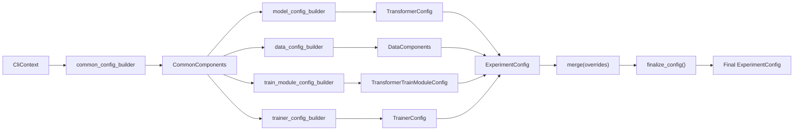

<!-- source: DeepWiki mcp.deepwiki.com · repo allenai/bolmo-core · page 9.2 Configuration System · fetched 2026-10-26 -->

# Configuration System

<details>
<summary>Relevant source files</summary>

The following files were used as context for generating this wiki page:

- [src/olmo_core/internal/common.py](src/olmo_core/internal/common.py)
- [src/olmo_core/internal/experiment.py](src/olmo_core/internal/experiment.py)
- [src/olmo_core/launch/beaker.py](src/olmo_core/launch/beaker.py)
- [src/olmo_core/train/callbacks/__init__.py](src/olmo_core/train/callbacks/__init__.py)
- [src/olmo_core/train/callbacks/gap_monitor.py](src/olmo_core/train/callbacks/gap_monitor.py)

</details>


## Purpose and Scope

The Configuration System in OLMo-Core provides a unified, type-safe approach to defining and managing all configuration parameters throughout the codebase. It is built on Python dataclasses and provides serialization, validation, and builder patterns for constructing complex configurations.

This document covers the `Config` base class, dataclass-based configuration patterns, builder methods, and configuration composition. For information about distributed training configuration, see [Distributed Training](#5). For model architecture configuration, see [Model Architecture](#2).

---

## Overview

The configuration system uses a dataclass-based approach where all configuration classes inherit from a common `Config` base class. This provides:

- **Type safety** through Python type hints and dataclass validation
- **Serialization/deserialization** to/from dictionaries, YAML, and JSON
- **Composition** through nested configuration objects
- **Builder patterns** for constructing complex configurations programmatically
- **CLI override support** for modifying configurations from command line

The system is used to configure every major component: models, datasets, data loaders, training modules, trainers, callbacks, and launch specifications.

**Key Configuration Classes:**
- `Config` - Base class for all configurations
- `ExperimentConfig` - Top-level configuration for training experiments
- `CommonComponents` - Shared configuration components
- `BeakerLaunchConfig` - Cluster launch configuration
- Component-specific configs (`TransformerConfig`, `DataLoaderConfig`, etc.)

Sources: [src/olmo_core/launch/beaker.py:39](), [src/olmo_core/internal/experiment.py:10-42]()

---

## The Config Base Class

All configuration classes inherit from `olmo_core.config.Config`, which provides common functionality:

```python
from olmo_core.config import Config
from dataclasses import dataclass

@dataclass
class MyConfig(Config):
    learning_rate: float = 1e-4
    num_layers: int = 12
```

### Core Capabilities

The `Config` base class provides:

1. **Serialization methods:**
   - `as_config_dict()` - Convert to dictionary representation
   - `from_dict()` - Construct from dictionary
   - YAML/JSON serialization support

2. **Validation:**
   - Dataclass field validation at instantiation
   - Type checking through Python type hints

3. **Merging:**
   - `merge(overrides)` - Merge with override values from command line or other sources

4. **Builder pattern:**
   - `build()` method convention for constructing objects from configs

### Configuration as Dataclasses

Configurations use Python's `@dataclass` decorator, providing:
- Automatic `__init__`, `__repr__`, and `__eq__` methods
- Default values through field assignment
- Type hints for all fields
- Field-level documentation through docstrings

Sources: [src/olmo_core/launch/beaker.py:118-134](), [src/olmo_core/internal/experiment.py:49-100]()

---

## Configuration Hierarchy and Composition

### ExperimentConfig Structure

The top-level configuration for training experiments is `ExperimentConfig`, which composes configurations for all major components:

```mermaid
graph TB
    ExperimentConfig["ExperimentConfig"]
    
    ExperimentConfig --> run_name["run_name: str"]
    ExperimentConfig --> init_seed["init_seed: int"]
    ExperimentConfig --> backend["backend: str"]
    
    ExperimentConfig --> launch["launch: BeakerLaunchConfig"]
    ExperimentConfig --> model["model: TransformerConfig"]
    ExperimentConfig --> dataset["dataset: NumpyDatasetConfig"]
    ExperimentConfig --> data_loader["data_loader: NumpyDataLoaderConfig"]
    ExperimentConfig --> train_module["train_module: TransformerTrainModuleConfig"]
    ExperimentConfig --> trainer["trainer: TrainerConfig"]
    
    launch --> task_name["task_name, budget, workspace"]
    launch --> clusters["clusters, num_nodes, num_gpus"]
    launch --> beaker_image["beaker_image"]
    
    model --> d_model["d_model, n_heads, n_layers"]
    model --> vocab_size["vocab_size"]
    model --> block_type["block_type"]
    
    dataset --> sources["source mixtures"]
    dataset --> seq_length["sequence_length"]
    
    data_loader --> batch_size["global_batch_size"]
    data_loader --> num_workers["num_workers"]
    
    train_module --> optimizer["optimizer config"]
    train_module --> scheduler["scheduler config"]
    train_module --> dp_config["dp_config, tp_config"]
    
    trainer --> max_steps["max_steps, max_duration"]
    trainer --> callbacks["callbacks dict"]
    trainer --> save_folder["save_folder"]
```



Sources: [src/olmo_core/internal/experiment.py:89-100]()

### CommonComponents Pattern

`CommonComponents` provides shared configuration values used across multiple component builders:

```python
@dataclass
class CommonComponents(Config):
    run_name: str
    root_dir: str
    work_dir: str
    save_folder: str
    launch: Optional[BeakerLaunchConfig]
    tokenizer: TokenizerConfig
    max_sequence_length: int
    global_batch_size: int
```

This pattern avoids duplication and ensures consistency across component configurations.

Sources: [src/olmo_core/internal/experiment.py:68-81]()

### DataComponents Pattern

`DataComponents` groups related dataset and data loader configurations:

```python
@dataclass
class DataComponents(Config):
    dataset: NumpyDatasetConfig
    data_loader: NumpyDataLoaderConfig
```

This enables dataset and data loader configurations to be built together and passed as a unit.

Sources: [src/olmo_core/internal/experiment.py:83-86]()

---

## Configuration Builders

### Builder Method Pattern

Most configuration classes follow the builder pattern where the config itself has a `build()` method that constructs the actual object:

```python
# Define the config
config = TransformerConfig(
    d_model=2048,
    n_heads=16,
    n_layers=24,
    ...
)

# Build the actual model
model = config.build(init_device="meta")
```

### Functional Builders

Complex configurations are assembled using builder functions that compose multiple configs:

**Key Builder Functions:**

| Function | Purpose | Returns |
|----------|---------|---------|
| `build_common_components()` | Builds shared configuration values | `CommonComponents` |
| `build_default_data_components()` | Builds dataset and data loader configs | `DataComponents` |
| `build_config()` | Builds complete experiment configuration | `ExperimentConfig` |
| `build_launch_config()` | Builds Beaker cluster launch config | `BeakerLaunchConfig` |

### The build_config Pattern

The `build_config()` function demonstrates the builder pattern for complex configurations:



This pattern enables:
- **Customization** by replacing individual builder functions
- **Reusability** through shared builder implementations
- **Composition** by building components independently then combining

Sources: [src/olmo_core/internal/experiment.py:317-413]()

---

## Configuration Examples

### BeakerLaunchConfig

Configuration for launching experiments on Beaker clusters:

```python
@dataclass
class BeakerLaunchConfig(Config):
    name: str                              # Experiment name
    cmd: List[str]                         # Command to run
    budget: Optional[str] = None           # Budget group
    workspace: Optional[str] = None        # Beaker workspace
    beaker_image: str = "stable"           # Docker image
    num_nodes: int = 1                     # Number of nodes
    num_gpus: int = 8                      # GPUs per node
    clusters: List[str] = ["ai2/jupiter"]  # Allowed clusters
    shared_filesystem: bool = False        # Whether using shared FS
    priority: Priority = Priority.normal   # Job priority
    preemptible: bool = True               # If preemptible
    env_vars: List[BeakerEnvVar] = []      # Environment variables
    weka_buckets: List[BeakerWekaBucket] = []  # Weka mounts
```

Key methods:
- `build_experiment_spec()` - Builds Beaker experiment specification
- `launch()` - Submits and optionally follows experiment

Sources: [src/olmo_core/launch/beaker.py:168-321]()

### Nested Configuration Objects

Configurations can be nested to any depth:

```python
@dataclass
class BeakerEnvVar(Config):
    name: str
    value: str

@dataclass
class BeakerEnvSecret(Config):
    name: str
    secret: str

@dataclass
class BeakerWekaBucket(Config):
    bucket: str
    mount: str
```

These small config classes compose into larger ones like `BeakerLaunchConfig`.

Sources: [src/olmo_core/launch/beaker.py:118-134]()

---

## Configuration Overrides

### CLI Override Pattern

Configurations support command-line overrides using dot notation:

```bash
python train.py launch run01 ai2/neptune \
    --launch.num_nodes=2 \
    --model.d_model=4096 \
    --trainer.max_steps=100000
```

These overrides are parsed and merged into the configuration:

```python
config = config.merge(cli_context.overrides)
```

### Override Syntax

The override system supports:
- **Nested fields**: `--launch.num_nodes=2`
- **List fields**: `--launch.clusters=["ai2/jupiter","ai2/ceres"]`
- **Boolean flags**: `--launch.preemptible=true`
- **Complex objects**: Can override nested configuration objects

Sources: [src/olmo_core/internal/experiment.py:406-412]()

---

## Configuration Default Values

### Field Defaults

Configurations use Python's dataclass default values extensively:

```python
@dataclass
class BeakerLaunchConfig(Config):
    task_name: str = "train"                    # Default task name
    setup_steps: List[str] = field(            # Factory for mutable defaults
        default_factory=lambda: list(DEFAULT_SETUP_STEPS)
    )
    beaker_image: str = OLMoCoreBeakerImage.stable
    num_nodes: int = 1
    num_gpus: int = 8
    shared_memory: str = "10GiB"
    priority: Priority = Priority.normal
    preemptible: bool = True
```

**Important**: Use `field(default_factory=...)` for mutable defaults (lists, dicts) to avoid sharing instances.

### Default Builders

Builder functions provide sensible defaults:

```python
def build_default_data_components(
    common: CommonComponents,
    intra_document_masking: bool = False,
    include_instance_filter: bool = False,
) -> DataComponents:
    """Default dataset and data loader configurations."""
    dataset_config = NumpyFSLDatasetConfig.from_data_mix(
        DataMix.OLMoE_mix_0824,
        tokenizer=common.tokenizer,
        sequence_length=common.max_sequence_length,
        ...
    )
    data_loader_config = NumpyDataLoaderConfig(
        global_batch_size=common.global_batch_size,
        seed=34521,
        num_workers=4
    )
    return DataComponents(dataset=dataset_config, data_loader=data_loader_config)
```

Sources: [src/olmo_core/internal/experiment.py:220-249]()

---

## Configuration Validation

### Type Checking

Python type hints provide compile-time and runtime validation:

```python
@dataclass
class TrainerConfig(Config):
    max_steps: int                    # Required field
    save_folder: str                  # Required field
    save_interval: Optional[int] = 1000  # Optional field with default
```

### Custom Validation

Configurations can include validation in their `__post_init__` method:

```python
def __post_init__(self):
    if self.num_nodes > 1 and not self.shared_filesystem:
        if "weka" not in self.save_folder and "gs://" not in self.save_folder:
            raise ValueError(
                "Multi-node training requires shared filesystem or cloud storage"
            )
```

### Builder-Time Validation

Builder methods perform validation when constructing configurations:

```python
if self.git is None:
    raise OLMoConfigurationError(
        f"{self.__class__.__name__}.git field is required!"
    )

if self.git.is_dirty and not self.allow_dirty:
    raise RuntimeError(
        "You have uncommitted changes! Set 'allow_dirty=True' to force."
    )
```

Sources: [src/olmo_core/launch/beaker.py:444-453]()

---

## Configuration Serialization

### As Dictionary

All configs can be converted to dictionaries:

```python
config_dict = config.as_config_dict()
```

This is used for:
- Saving configurations to checkpoints
- Logging configurations to W&B/Comet
- Debugging and inspection

### Saving Configurations

The `ConfigSaverCallback` saves the experiment configuration:

```python
config_dict = config.as_config_dict()
callback = ConfigSaverCallback()
callback.config = config_dict
```

The configuration is saved alongside checkpoints for reproducibility.

Sources: [src/olmo_core/internal/experiment.py:462-463]()

---

## Configuration Usage Patterns

### Component Configuration Mapping

The following table shows how configurations map to components throughout the system:

| Configuration Class | Component Built | Key Fields |
|---------------------|----------------|------------|
| `TransformerConfig` | `Transformer` model | `d_model`, `n_layers`, `n_heads`, `block_type` |
| `TransformerTrainModuleConfig` | `TransformerTrainModule` | `optimizer_config`, `scheduler_config`, `dp_config` |
| `NumpyDatasetConfig` | `NumpyDataset` | `source_mixture`, `sequence_length` |
| `NumpyDataLoaderConfig` | `NumpyDataLoader` | `global_batch_size`, `num_workers`, `seed` |
| `TrainerConfig` | `Trainer` | `max_steps`, `save_folder`, `callbacks` |
| `BeakerLaunchConfig` | Beaker `ExperimentSpec` | `clusters`, `num_nodes`, `num_gpus` |
| `CallbackConfig` | `Callback` instance | Varies by callback type |

### Callback Configuration

Callbacks are configured through the trainer configuration:

```python
@dataclass
class TrainerConfig(Config):
    callbacks: Dict[str, Union[Callback, CallbackConfig]] = field(default_factory=dict)
    
    def add_callback(self, name: str, callback: Union[Callback, CallbackConfig]):
        self.callbacks[name] = callback
```

Callbacks can be:
- **Direct instances**: `CheckpointerCallback(save_interval=1000)`
- **Config objects**: `LMEvaluatorCallbackConfig(eval_interval=1000)`

When built, config objects are converted to callback instances.

### Required Callbacks Pattern

Internal experiments automatically add required callbacks:

```python
def _build_required_callbacks(common: CommonComponents) -> Dict[str, Callback]:
    callbacks = {
        "config_saver": ConfigSaverCallback(),
        "profiler": ProfilerCallback(enabled=False),
        "garbage_collector": GarbageCollectorCallback(),
        "slack_notifier": SlackNotifierCallback(name=common.run_name, enabled=False),
        "gap_monitor": GAPMonitorCallback(enabled=False),
    }
    if common.launch is not None:
        callbacks["beaker"] = BeakerCallback()
    return callbacks
```

Sources: [src/olmo_core/internal/experiment.py:252-264](), [src/olmo_core/train/callbacks/gap_monitor.py:19-27]()

---

## StrEnum Configuration Pattern

For fields with a fixed set of string choices, use `StrEnum`:

```python
from olmo_core.config import StrEnum

class OLMoCoreBeakerImage(StrEnum):
    stable = "olmo-core-tch271cu128-2025-09-15"
    stable_cu126 = "olmo-core-tch271cu126-2025-09-15"
    flash_attn_3 = "tylerr/olmo-core-tch270cu128-2025-09-24"

# Usage in config
@dataclass
class BeakerLaunchConfig(Config):
    beaker_image: str = OLMoCoreBeakerImage.stable
```

This provides:
- **Enumeration** of valid choices
- **String compatibility** for serialization
- **IDE autocomplete** support

Sources: [src/olmo_core/launch/beaker.py:76-116]()

---

## Environment-Based Configuration

Some configurations are initialized from environment variables:

```python
@dataclass
class BeakerLaunchConfig(Config):
    git: Optional[GitConfig] = field(default_factory=GitConfig.from_env)
```

The `GitConfig.from_env()` method reads git repository information from the environment or current directory, enabling automatic configuration of git checkout parameters.

### Default Environment Variables

`BeakerLaunchConfig` automatically sets environment variables for launched jobs:

```python
@property
def default_env_vars(self) -> List[Tuple[str, str]]:
    env_vars = [
        ("NCCL_DEBUG", "INFO"),
        ("LOG_FILTER_TYPE", "local_rank0_only"),
        ("NUM_NODES", str(self.num_nodes)),
        ("OLMO_CORE_VERSION", VERSION),
        ("FORCE_COLOR", "1"),
    ]
    if self.shared_filesystem:
        env_vars.append((OLMO_SHARED_FS_ENV_VAR, "1"))
    return env_vars
```

Sources: [src/olmo_core/launch/beaker.py:284-341]()

---

## Configuration Best Practices

### 1. Use Type Hints

Always provide type hints for all fields:

```python
@dataclass
class MyConfig(Config):
    learning_rate: float  # Good
    num_layers: int       # Good
    # value             # Bad - no type hint
```

### 2. Document Fields

Use docstrings to document configuration fields:

```python
@dataclass
class BeakerLaunchConfig(Config):
    name: str
    """
    A name to assign the Beaker experiment.
    """
    
    budget: Optional[str] = None
    """
    The budget group to assign.
    """
```

### 3. Mutable Defaults

Use `field(default_factory=...)` for mutable defaults:

```python
@dataclass
class MyConfig(Config):
    # Good
    items: List[str] = field(default_factory=list)
    
    # Bad - will share the same list instance!
    # items: List[str] = []
```

### 4. Optional vs Required

Make fields optional only when they truly are:

```python
@dataclass
class MyConfig(Config):
    # Required
    model_name: str
    
    # Optional with None default
    checkpoint: Optional[str] = None
    
    # Optional with value default
    learning_rate: float = 1e-4
```

### 5. Composition Over Inheritance

Prefer composing configurations over deep inheritance:

```python
@dataclass
class ExperimentConfig(Config):
    model: TransformerConfig      # Composition
    data_loader: DataLoaderConfig  # Composition
    # Not: class ExperimentConfig(TransformerConfig, DataLoaderConfig)
```

Sources: [src/olmo_core/launch/beaker.py:168-294](), [src/olmo_core/internal/experiment.py:89-100]()

---

