# Page: Overview

# Overview

<details>
<summary>Relevant source files</summary>

The following files were used as context for generating this wiki page:

- [README.md](README.md)
- [docs/source/index.rst](docs/source/index.rst)
- [docs/source/overview/installation.rst](docs/source/overview/installation.rst)
- [docs/source/overview/introduction.rst](docs/source/overview/introduction.rst)

</details>


This document provides an introduction to the Bolmo-Core repository, explaining its dual purpose as both a distributed training framework (OLMo-Core) and an implementation of byte-level language models (Bolmo). This page covers the project's goals, key features, system architecture, and the relationship between major components.

For installation and setup instructions, see [Getting Started](#1.1). For details on the repository organization, see [Project Structure](#1.2).

---

## What is OLMo-Core and Bolmo?

**OLMo-Core** is a Python library that provides building blocks for large-scale distributed training of language models with PyTorch. It is designed for performance, API stability, and serves as a foundation for LLM research at the Allen Institute for AI (AI2) and other organizations.

**Bolmo** is the first family of competitive, fully open byte-level language models built using the OLMo-Core framework. Unlike traditional language models that rely on subword tokenizers (BPE, WordPiece, etc.), Bolmo operates directly on raw UTF-8 bytes. This repository is a fork of OLMo-Core that implements the complete Bolmo architecture and training pipeline.

The relationship between OLMo-Core and Bolmo:
- **OLMo-Core** provides the training infrastructure: `Trainer`, distributed utilities, data loading, checkpointing, and standard transformer implementations
- **Bolmo** extends OLMo-Core with byte-level components: `BolmoTransformer`, `LocalEncoder`, `LocalDecoder`, and byte-level datasets
- Both standard subword models and Bolmo byte-level models can be trained using the same core training infrastructure

**Sources:** [README.md:1-34](), [docs/source/index.rst:6-10](), [docs/source/overview/introduction.rst:1-8]()

---

## Key Features

### OLMo-Core Framework
- **Efficient Training System**: Highly optimized `Trainer` class with callback-based architecture for checkpointing, evaluation, and monitoring
- **Distributed Training**: Support for tensor parallelism (TP), context parallelism (CP), pipeline parallelism (PP), FSDP, and expert parallelism (EP)
- **Flexible Data Pipeline**: Numpy-based datasets with support for fixed/variable sequence lengths, packing, padding, and sophisticated data mixing
- **Unified I/O**: Abstract I/O layer supporting local filesystems, S3, GCS, WEKA, and R2
- **Experiment Management**: Beaker integration for cluster orchestration and job launching
- **Production-Ready**: Comprehensive testing, CI/CD pipelines, and Docker images

### Bolmo Models
- **Byte-Level Processing**: No subword tokenization required; operates on raw UTF-8 bytes
- **Universal Applicability**: Works seamlessly across all languages, scripts, and domains
- **Competitive Performance**: Matches or exceeds state-of-the-art byte-level models and approaches subword model performance
- **Character Understanding**: Superior performance on character-level tasks
- **Efficient Byteifying**: Converts existing subword models to byte-level using <1% of pretraining budget
- **Post-Training via Task Arithmetic**: Apply adaptations without additional training

**Sources:** [README.md:24-30](), [docs/source/overview/introduction.rst:4-12]()

---

## System Architecture

The following diagram illustrates the high-level architecture of the OLMo-Core framework with Bolmo extensions:

**Figure 1: High-Level System Architecture**

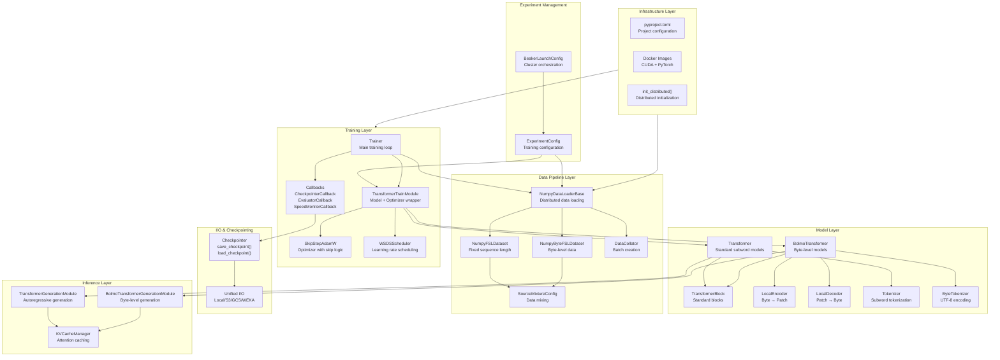

**Sources:** [docs/source/overview/introduction.rst:9-12](), [README.md:1-45]()

---

## Core Components and Code Entities

The system is organized around several core abstractions. The following table maps conceptual components to their primary code entities:

| Component | Primary Classes/Functions | File Paths |
|-----------|--------------------------|------------|
| **Configuration System** | `Config` base class, dataclass-based configs with `.build()` methods | Throughout codebase |
| **Model Architecture** | `Transformer`, `BolmoTransformer`, `BolmoDistillTransformer` | `src/olmo_core/nn/transformer/` |
| **Transformer Blocks** | `TransformerBlock`, `TransformerBlockConfig` | `src/olmo_core/nn/transformer/block.py` |
| **Byte-Level Components** | `LocalEncoder`, `LocalDecoder`, `PatchEmbeddings` | `src/olmo_core/nn/transformer/model.py` |
| **Tokenization** | `Tokenizer`, `ByteTokenizer` | `src/olmo_core/data/tokenizer.py` |
| **Training Loop** | `Trainer`, `Trainer.fit()` | `src/olmo_core/train/trainer.py` |
| **Training Wrapper** | `TrainModule`, `TransformerTrainModule` | `src/olmo_core/train/train_module.py` |
| **Callbacks** | `Callback`, `CheckpointerCallback`, `EvaluatorCallback` | `src/olmo_core/train/callbacks/` |
| **Optimizer** | `SkipStepAdamW`, `SkipStepOptimizer` | `src/olmo_core/optim/` |
| **Learning Rate** | `WSDSScheduler`, `LRScheduler` | `src/olmo_core/optim/scheduler.py` |
| **Datasets** | `NumpyFSLDataset`, `NumpyByteFSLDataset`, `NumpyPackedFSLDataset` | `src/olmo_core/data/numpy_dataset.py` |
| **Data Loaders** | `NumpyDataLoaderBase`, `NumpyFSLDataLoader` | `src/olmo_core/data/data_loader.py` |
| **Data Mixing** | `SourceMixtureConfig`, `SourceMixtureDatasetConfig` | `src/olmo_core/data/source_mixture_dataset.py` |
| **Collation** | `DataCollator`, `ByteDataCollator` | `src/olmo_core/data/data_collator.py` |
| **Distributed Utils** | `init_distributed()`, `prepare_training_environment()` | `src/olmo_core/distributed/utils.py` |
| **Checkpointing** | `Checkpointer`, `save_checkpoint()`, `load_checkpoint()` | `src/olmo_core/distributed/checkpoint/` |
| **I/O Layer** | `clear_directory()`, `upload()`, `download()` | `src/olmo_core/io.py` |
| **Generation** | `TransformerGenerationModule`, `BolmoTransformerGenerationModule` | `src/olmo_core/nn/transformer/generation.py` |
| **Experiment Launch** | `BeakerLaunchConfig`, `BeakerLaunchConfig.launch()` | `src/olmo_core/launch/beaker/` |

**Sources:** [docs/source/overview/introduction.rst:11-17]()

---

## Training Workflow

The typical workflow for training models with this codebase follows a configuration-based pattern:

**Figure 2: Configuration-to-Execution Workflow**

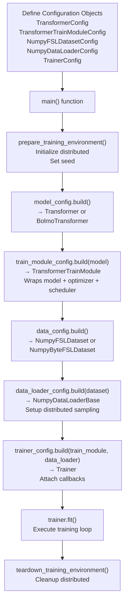

**Sources:** [docs/source/overview/introduction.rst:14-50]()

### Workflow Steps

1. **Configuration Definition**: Define all experiment components using configuration classes. Each config class (e.g., `TransformerConfig`, `TrainerConfig`) is a dataclass that specifies parameters for that component.

2. **Environment Preparation**: Call `prepare_training_environment()` to initialize distributed training, set random seeds, and configure NCCL communication.

3. **Component Building**: Use the `.build()` method on each configuration object to instantiate the actual component:
   - `TransformerConfig.build()` → `Transformer` or `BolmoTransformer`
   - `TransformerTrainModuleConfig.build(model)` → `TransformerTrainModule`
   - Dataset and data loader configs build their respective components

4. **Training Execution**: Call `trainer.fit()` to begin the training loop. The trainer coordinates:
   - Forward and backward passes
   - Optimizer steps with skip-step logic
   - Learning rate scheduling
   - Callback execution (checkpointing, evaluation, monitoring)

5. **Environment Teardown**: Call `teardown_training_environment()` to clean up distributed resources.

**Sources:** [docs/source/overview/introduction.rst:14-40]()

---

## Bolmo-Specific Architecture

Bolmo extends the standard transformer architecture with byte-level processing components:

**Figure 3: Bolmo Byte-Level Architecture**

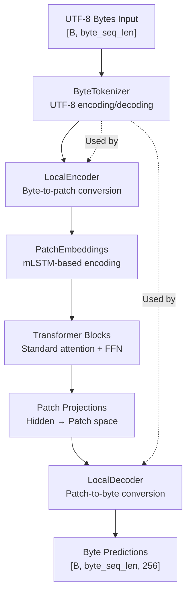

### Bolmo Components

- **`ByteTokenizer`**: Handles UTF-8 encoding/decoding without learned vocabulary. Each byte (0-255) is a token.

- **`LocalEncoder`**: Converts variable-length byte sequences into fixed-length patches using mLSTM layers. Handles boundary detection for valid UTF-8 sequences.

- **`PatchEmbeddings`**: Embeds patch representations using mLSTM layers from the xlstm library.

- **`Transformer` Blocks**: Standard transformer blocks process patch-level representations (same as subword models).

- **`LocalDecoder`**: Converts patch-level representations back to byte-level predictions, predicting 256-way distributions for each byte position.

**Sources:** [README.md:7-34]()

---

## Byteifying Process

Bolmo uses a two-stage training procedure called "byteifying" to convert existing subword models to byte-level models efficiently:

| Stage | Description | Token Count | Purpose | Training Scripts |
|-------|-------------|-------------|---------|-----------------|
| **Stage 1** | Subword-to-Byte Distillation | 9.8B tokens (≈43B bytes) | Learn local encoder/decoder weights while freezing global transformer | `bolmo_scripts/launch_stage1_*` |
| **Stage 2** | End-to-End Training | 39.3B tokens (≈173B bytes) | Train entire model to utilize byte-level information | `bolmo_scripts/launch_stage2_*` |

This approach requires less than 1% of the original pretraining budget to achieve competitive byte-level performance.

**Post-Training via Task Arithmetic**: Existing post-trained checkpoints can be converted to byte-level without additional training using the `instructify.py` script:

```bash
python3 src/examples/bolmo/instructify.py \
    --output=/path/to/output/ \
    --checkpoint-dir=/path/to/bolmo/checkpoint \
    --base-checkpoint-dir=/path/to/base-olmo/checkpoint \
    --instruct-checkpoint-dir=/path/to/post-trained-olmo/checkpoint \
    --alpha=1.0
```

**Sources:** [README.md:105-123]()

---

## Distributed Training Infrastructure

The framework supports multiple parallelism strategies that can be composed:

| Strategy | Abbreviation | Process Group | Purpose | Applied To |
|----------|--------------|---------------|---------|------------|
| **Data Parallelism** | DP | `dp_process_group` | Replicate model across devices | All model types |
| **Tensor Parallelism** | TP | `tp_process_group` | Shard weights across devices | Attention, FFN layers |
| **Context Parallelism** | CP | `cp_process_group` | Shard sequence length | Attention computation |
| **Pipeline Parallelism** | PP | `pp_process_group` | Shard layers across devices | Transformer layers |
| **Expert Parallelism** | EP | `ep_process_group` | Shard experts across devices | MoE models |
| **FSDP** | FSDP | `fsdp_process_group` | Fully shard parameters | All model types |

These strategies are initialized via `init_distributed()` and configured through the device mesh. For details on parallelism strategies, see [Parallelism Strategies](#5.1).

**Sources:** High-level diagrams provided in context

---

## Launch and Execution

Training jobs can be launched in two ways:

### 1. Beaker Launch (Cluster Orchestration)

```python
from olmo_core.launch.beaker import BeakerLaunchConfig

launch_config = BeakerLaunchConfig(
    name="bolmo-training",
    clusters=["jupiter", "pluto"],
    # ... other configuration
)
launch_config.launch(follow=True)
```

The `BeakerLaunchConfig` handles job submission to compute clusters, manages resource allocation, and provides job monitoring. For more details, see [Beaker Launch](#7.1).

### 2. Manual Launch with torchrun

```bash
torchrun --nproc-per-node=8 train_script.py --config config.yaml
```

The `torchrun` launcher initializes multiple processes per node for distributed training. This is useful for local development or manual cluster management.

**Sources:** [docs/source/overview/introduction.rst:41-49]()

---

## Model Variants

The repository includes several model variants built on the core infrastructure:

| Model Class | Description | Use Case |
|-------------|-------------|----------|
| `Transformer` | Standard transformer with subword tokenization | General language modeling |
| `NormalizedTransformer` | nGPT architecture with normalized representations | Improved training stability |
| `MoETransformer` | Mixture-of-experts with expert routing | Large-scale models with sparsity |
| `BolmoTransformer` | Byte-level model with local encoders/decoders | Tokenization-free language modeling |
| `BolmoDistillTransformer` | Bolmo with teacher model for distillation | Stage 1 byteifying |

All models share the same training infrastructure and can be configured through their respective `*Config` classes. For detailed architecture information, see [Model Architecture](#2).

**Sources:** [README.md:36-44](), High-level diagrams provided in context

---

## Repository Organization

The repository is organized as follows:

```
bolmo-core/
├── src/olmo_core/          # Main library code
│   ├── nn/                 # Neural network modules (models, blocks, attention)
│   ├── train/              # Training system (Trainer, callbacks)
│   ├── data/               # Data pipeline (datasets, loaders, mixing)
│   ├── distributed/        # Distributed utilities and checkpointing
│   ├── optim/              # Optimizers and schedulers
│   ├── launch/             # Experiment launching (Beaker, torchrun)
│   └── io.py               # Unified I/O layer
├── src/examples/           # Example scripts and tutorials
│   ├── bolmo/              # Bolmo-specific examples (byteifying, instructify)
│   ├── huggingface/        # HuggingFace integration and conversion
│   └── train_llm.py        # Standard training script example
├── bolmo_scripts/          # Bolmo training scripts (Stage 1, Stage 2)
├── src/test/               # Test suite
├── docs/                   # Documentation (Sphinx)
└── pyproject.toml          # Project configuration and dependencies
```

For a detailed explanation of the repository structure, see [Project Structure](#1.2).

**Sources:** [README.md:47-67]()

---

## Next Steps

- **Installation**: Follow [Getting Started](#1.1) to install the framework and dependencies
- **Training**: See [Training System](#3) for details on the training loop and callbacks
- **Models**: Explore [Model Architecture](#2) for transformer implementations
- **Data**: Learn about the data pipeline in [Data Pipeline](#4)
- **Distributed**: Understand distributed training in [Distributed Training](#5)
- **Bolmo**: Deep dive into byte-level models in [Bolmo Byte-Level Models](#10)

**Sources:** [docs/source/index.rst:1-86]()

---

# Page: Getting Started

# Getting Started

<details>
<summary>Relevant source files</summary>

The following files were used as context for generating this wiki page:

- [.github/actions/setup-venv/action.yml](.github/actions/setup-venv/action.yml)
- [.github/workflows/docker.yml](.github/workflows/docker.yml)
- [.github/workflows/main.yml](.github/workflows/main.yml)
- [.github/workflows/pr_checks.yml](.github/workflows/pr_checks.yml)
- [Makefile](Makefile)
- [README.md](README.md)
- [docs/source/index.rst](docs/source/index.rst)
- [docs/source/overview/installation.rst](docs/source/overview/installation.rst)
- [docs/source/overview/introduction.rst](docs/source/overview/introduction.rst)
- [pyproject.toml](pyproject.toml)
- [src/Dockerfile](src/Dockerfile)
- [src/olmo_core/distributed/utils.py](src/olmo_core/distributed/utils.py)

</details>


This page guides you through installing OLMo-Core/Bolmo, setting up your environment, and running your first training and inference examples. For detailed information about the project structure and architecture, see [Project Structure](#1.2). For development and contribution setup, see [Development Setup](#8.1).

---

## Prerequisites

Before installing OLMo-Core, ensure you have the following:

| Requirement | Version | Notes |
|-------------|---------|-------|
| Python | ≥ 3.11 | Required by the package |
| PyTorch | ≥ 2.6.0 | Must be installed separately according to your hardware |
| CUDA | 12.6+ recommended | For GPU training and inference |
| Operating System | Linux preferred | Developed and tested primarily on Linux |

**Important**: Install [PyTorch](https://pytorch.org) first according to the official instructions specific to your operating system and hardware before proceeding with OLMo-Core installation.

**Sources**: [pyproject.toml:13-26](), [README.md:49-50]()

---

## Installation Methods

### From PyPI (For Users)

For general usage, install the stable release from PyPI:

```bash
pip install ai2-olmo-core
```

This installs the core package with minimal dependencies suitable for basic training and inference tasks.

**Sources**: [docs/source/index.rst:14-16](), [pyproject.toml:5-26]()

### From Source (Recommended for Development)

For development or to access the latest features including Bolmo:

```bash
git clone https://github.com/allenai/bolmo-core.git
cd bolmo-core
pip install -e .[all]
```

The `-e` flag installs in editable mode, and `[all]` includes all optional dependencies for full functionality.

**Sources**: [README.md:52-57]()

---

## Optional Dependencies

OLMo-Core supports various optional features through additional dependencies:

```mermaid
graph TB
    Core["ai2-olmo-core<br/>(core package)"]
    
    subgraph "Attention Backends"
        FlashAttn["flash-attn<br/>Efficient attention"]
        RingFlash["ring-flash-attn<br/>Context parallel attention"]
        TE["TransformerEngine<br/>FP8 training"]
    end
    
    subgraph "Alternative Architectures"
        Mamba["mamba_ssm<br/>State-space models"]
        XLSTM["xlstm<br/>Extended LSTM (mLSTM)"]
        FLA["flash-linear-attention<br/>Linear attention"]
    end
    
    subgraph "Optimization"
        TorchAO["torchao<br/>Float8 training"]
        LigerKernel["liger-kernel<br/>Fused loss functions"]
        GroupedGEMM["grouped_gemm<br/>MoE kernels"]
    end
    
    subgraph "Experiment Management"
        Beaker["beaker-py<br/>Cluster orchestration"]
        WandB["wandb<br/>Experiment tracking"]
        Comet["comet_ml<br/>Experiment tracking"]
    end
    
    Core --> FlashAttn
    Core --> RingFlash
    Core --> TE
    Core --> Mamba
    Core --> XLSTM
    Core --> FLA
    Core --> TorchAO
    Core --> LigerKernel
    Core --> GroupedGEMM
    Core --> Beaker
    Core --> WandB
    Core --> Comet
```

### Installation Commands for Optional Dependencies

| Feature | Install Command | Use Case |
|---------|----------------|----------|
| All dependencies | `pip install ai2-olmo-core[all]` | Complete functionality |
| Development tools | `pip install ai2-olmo-core[dev]` | Testing, linting, docs |
| Beaker integration | `pip install ai2-olmo-core[beaker]` | Cluster job launching |
| Mamba architecture | `pip install ai2-olmo-core[mamba]` | State-space models |
| xLSTM architecture | `pip install ai2-olmo-core[xlstm]` | mLSTM layers (used in Bolmo) |
| FLA architecture | `pip install ai2-olmo-core[fla]` | Fast linear attention |
| Evaluation | `pip install ai2-olmo-core[eval]` | In-loop evaluations |
| TorchAO | `pip install ai2-olmo-core[torchao]` | Float8 training |
| HuggingFace | `pip install ai2-olmo-core[transformers]` | HF model conversion |

**Sources**: [pyproject.toml:33-75](), [README.md:60-66](), [docs/source/overview/installation.rst:11-17]()

---

## Environment Setup

### Distributed Training Environment Variables

OLMo-Core expects specific environment variables for distributed training:

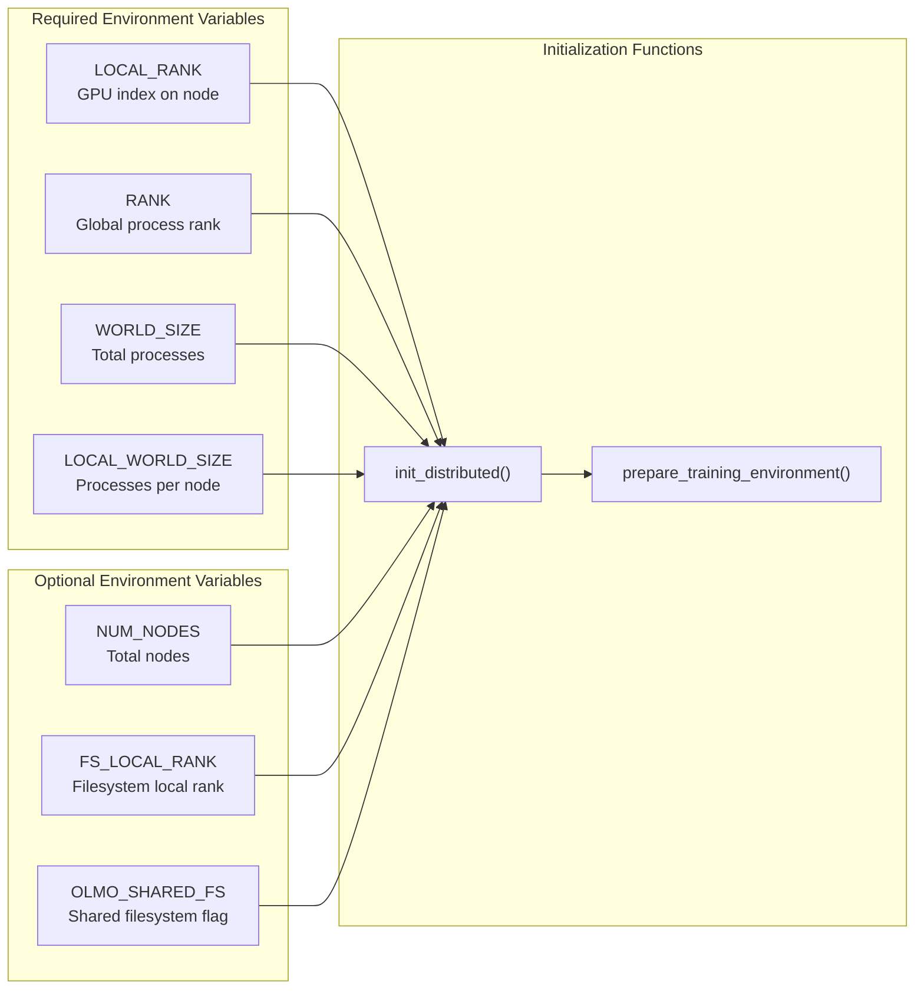

**Manual Setup Example**:
```bash
# Single-node, 8 GPUs
export LOCAL_RANK=0
export RANK=0
export WORLD_SIZE=8
export LOCAL_WORLD_SIZE=8
export NUM_NODES=1
```

**Automatic Setup**: When using `torchrun`, these variables are set automatically.

**Sources**: [src/olmo_core/distributed/utils.py:19-25](), [src/olmo_core/distributed/utils.py:30-131]()

### Cluster-Specific Configuration

When running on AI2 clusters (Jupiter, Pluto, Augusta), `init_distributed()` automatically configures NCCL settings:

| Cluster | Auto-Configuration |
|---------|-------------------|
| Jupiter | InfiniBand HCA settings, socket interface |
| Pluto | InfiniBand HCA exclusions |
| Augusta | FastRAK networking, NCCL tuning, TCPx optimizations |

**Sources**: [src/olmo_core/distributed/utils.py:52-112]()

---

## Quick Start: Inference

### Using Bolmo with HuggingFace

The simplest way to use Bolmo models for inference:

```python
from transformers import AutoModelForCausalLM, AutoTokenizer

device = "cuda"
bolmo = AutoModelForCausalLM.from_pretrained(
    "allenai/Bolmo-7B", 
    trust_remote_code=True
).to(device)
tokenizer = AutoTokenizer.from_pretrained(
    "allenai/Bolmo-7B", 
    trust_remote_code=True
)

message = ["Language modeling is "]
input_ids = tokenizer(message, return_tensors="pt")["input_ids"].to(device)

# max_new_tokens is the amount of bytes to generate
response = bolmo.generate(
    input_ids, 
    max_new_tokens=256, 
    do_sample=True, 
    temperature=0.1
)
print(tokenizer.decode(response[0], skip_special_tokens=True))
```

**Sources**: [README.md:72-86]()

### Loading Native OLMo-Core Checkpoints

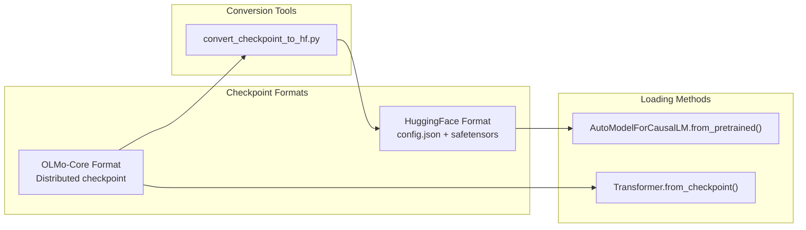

**Checkpoint Conversion** (OLMo-Core → HuggingFace):
```bash
python3 src/examples/huggingface/convert_checkpoint_to_hf.py \
    -i /path/to/bolmo/checkpoint \
    -o /path/to/hf/checkpoint \
    -s 65536 \
    --dtype float32 \
    --skip-validation
```

**Sources**: [README.md:88-102]()

---

## Quick Start: Training

### Minimal Training Configuration

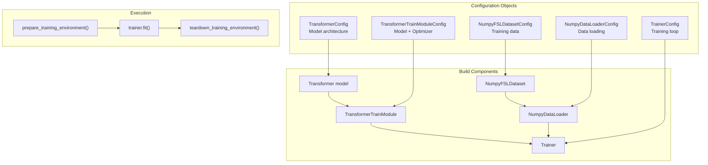

### Basic Training Script Structure

A minimal training script follows this pattern:

```python
from olmo_core.nn.transformer import TransformerConfig
from olmo_core.train import TrainerConfig, prepare_training_environment, teardown_training_environment

def main():
    # 1. Build model
    model_config = TransformerConfig.llama2_1B(
        vocab_size=50280,
        compile=True
    )
    model = model_config.build()
    
    # 2. Build train module (wraps model + optimizer)
    train_module_config = TransformerTrainModuleConfig(
        model=model_config,
        # ... optimizer, scheduler config
    )
    train_module = train_module_config.build(model)
    
    # 3. Build dataset and data loader
    dataset_config = NumpyFSLDatasetConfig(
        source_paths=["path/to/data"],
        # ... data config
    )
    dataset = dataset_config.build()
    
    data_loader_config = NumpyDataLoaderConfig(
        global_batch_size=2048,
        seed=0,
    )
    data_loader = data_loader_config.build(
        dataset, 
        dp_process_group=train_module.dp_process_group
    )
    
    # 4. Build trainer
    trainer_config = TrainerConfig(
        save_folder="checkpoints/",
        max_epochs=1,
        # ... callback configs
    )
    trainer = trainer_config.build(train_module, data_loader)
    
    # 5. Train
    trainer.fit()

if __name__ == "__main__":
    prepare_training_environment(seed=0)
    main()
    teardown_training_environment()
```

**Sources**: [docs/source/overview/introduction.rst:14-52]()

### Launching with torchrun

```bash
# Single-node training with 8 GPUs
torchrun --nproc-per-node=8 train_script.py

# Multi-node training (run on each node)
torchrun \
    --nproc-per-node=8 \
    --nnodes=4 \
    --node-rank=$NODE_RANK \
    --master-addr=$MASTER_ADDR \
    --master-port=$MASTER_PORT \
    train_script.py
```

The `torchrun` utility automatically sets required environment variables like `LOCAL_RANK`, `RANK`, `WORLD_SIZE`, etc.

**Sources**: [docs/source/overview/introduction.rst:47-49]()

---

## Bolmo Training: Two-Stage Byteifying

Bolmo uses a specialized two-stage training procedure to convert subword models to byte-level:

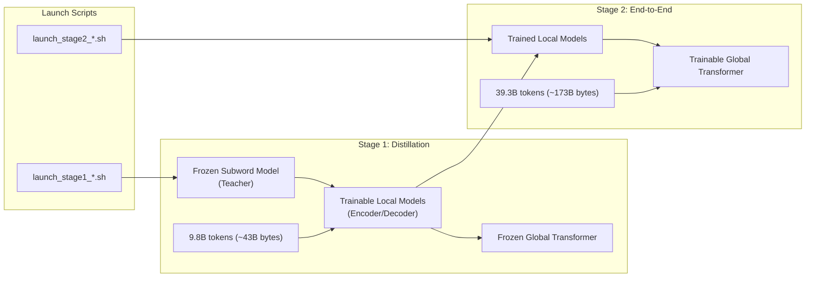

**Stage 1** trains local encoder/decoder models while keeping the global transformer frozen. Training scripts are located at `bolmo_scripts/launch_stage1_*`.

**Stage 2** fine-tunes the entire model end-to-end. Training scripts are located at `bolmo_scripts/launch_stage2_*`.

**Sources**: [README.md:104-111]()

---

## Verification

### Verify Installation

Check that the package is properly installed:

```bash
python -c "import olmo_core; print(olmo_core.__version__)"
```

### Verify GPU Access

```bash
python -c "import torch; print(f'CUDA available: {torch.cuda.is_available()}'); print(f'GPU count: {torch.cuda.device_count()}')"
```

### Run Test Suite

```bash
# Run all tests (requires dev dependencies)
pytest src/test/

# Run only GPU tests (requires GPU)
pytest -m gpu src/test/
```

**Sources**: [pyproject.toml:164-179](), [.github/workflows/main.yml:39-56]()

---

## Docker Images

Pre-built Docker images with all dependencies are available:

```bash
# Pull the latest image
docker pull ghcr.io/allenai/olmo-core:latest

# Or build locally
make docker-image
```

**Image Contents**:
- CUDA 12.6 or 12.8
- PyTorch 2.7+
- All optional dependencies (flash-attn, TransformerEngine, etc.)
- MLNX OFED drivers for InfiniBand
- Optimized NCCL configuration

**Sources**: [Makefile:72-89](), [src/Dockerfile:1-138](), [.github/workflows/docker.yml:26-89]()

---

## Next Steps

| Topic | Documentation |
|-------|---------------|
| Understanding the codebase organization | [Project Structure](#1.2) |
| Model architectures and variants | [Model Architecture](#2) |
| Training system components | [Training System](#3) |
| Data pipeline and mixing | [Data Pipeline](#4) |
| Distributed training setup | [Distributed Training](#5) |
| Launching experiments on Beaker | [Beaker Launch](#7.1) |
| Bolmo architecture details | [Bolmo Architecture](#10.1) |
| Complete training examples | See `src/examples/` directory |
| Development and testing | [Development Setup](#8.1) |

**Sources**: [docs/source/overview/introduction.rst:51-52]()

---

# Page: Project Structure

# Project Structure

<details>
<summary>Relevant source files</summary>

The following files were used as context for generating this wiki page:

- [.github/actions/setup-venv/action.yml](.github/actions/setup-venv/action.yml)
- [.github/workflows/docker.yml](.github/workflows/docker.yml)
- [.github/workflows/main.yml](.github/workflows/main.yml)
- [.github/workflows/pr_checks.yml](.github/workflows/pr_checks.yml)
- [Makefile](Makefile)
- [README.md](README.md)
- [docs/source/index.rst](docs/source/index.rst)
- [docs/source/overview/installation.rst](docs/source/overview/installation.rst)
- [docs/source/overview/introduction.rst](docs/source/overview/introduction.rst)
- [pyproject.toml](pyproject.toml)
- [src/Dockerfile](src/Dockerfile)
- [src/olmo_core/distributed/utils.py](src/olmo_core/distributed/utils.py)

</details>


## Purpose and Scope

This document explains the organization of the Bolmo-core repository, including the directory structure, key modules, and the relationships between core components, examples, and tests. For information about installation and getting started, see [Getting Started](#1.1). For an introduction to the project's purpose and features, see [Overview](#1).

---

## Repository Layout

The repository follows a standard Python project structure with source code, tests, documentation, and build configurations organized into distinct directories.

### Top-Level Directory Structure

```mermaid
graph TB
    Root["/"]
    
    Root --> Src["src/"]
    Root --> Docs["docs/"]
    Root --> Github[".github/"]
    Root --> Config["Configuration Files"]
    
    Src --> OlmoCore["olmo_core/"]
    Src --> Examples["examples/"]
    Src --> Test["test/"]
    Src --> Scripts["scripts/"]
    Src --> Dockerfile["Dockerfile"]
    
    OlmoCore --> NN["nn/"]
    OlmoCore --> Train["train/"]
    OlmoCore --> Data["data/"]
    OlmoCore --> Distributed["distributed/"]
    OlmoCore --> IO["io/"]
    OlmoCore --> Launch["launch/"]
    OlmoCore --> Optim["optim/"]
    OlmoCore --> Eval["eval/"]
    OlmoCore --> Utils["Core modules"]
    
    Examples --> Huggingface["huggingface/"]
    Examples --> Bolmo["bolmo/"]
    Examples --> Training["Training scripts"]
    
    Test --> NNTests["nn/"]
    Test --> TrainTests["train/"]
    Test --> DataTests["data/"]
    Test --> DistTests["distributed/"]
    
    Github --> Workflows["workflows/"]
    Github --> Actions["actions/"]
    
    Workflows --> MainYml["main.yml"]
    Workflows --> DockerYml["docker.yml"]
    
    Config --> Pyproject["pyproject.toml"]
    Config --> Makefile["Makefile"]
    Config --> Readme["README.md"]
    
    Docs --> Source["source/"]
    Source --> ApiDocs["API Reference"]
    Source --> Guides["Guides"]
```

**Sources:** [pyproject.toml:86-89](), [.github/workflows/main.yml:1-278]()

---

## Source Code Organization

All source code resides in the `src/` directory, which contains the main `olmo_core` package, example scripts, tests, and build files.

### Package Structure

The project is configured as a Python package named `ai2-olmo-core`, with the main module `olmo_core` located at `src/olmo_core/`.

| Directory | Purpose |
|-----------|---------|
| `src/olmo_core/` | Core library modules |
| `src/examples/` | Example scripts and training configurations |
| `src/test/` | Test suite |
| `src/scripts/` | Utility scripts for releases, Beaker, etc. |
| `src/Dockerfile` | Docker image definition |

**Sources:** [pyproject.toml:86-89](), [pyproject.toml:5-26]()

---

## Core Package Structure (`olmo_core`)

The `olmo_core` package is organized into functionally distinct modules, each handling a specific aspect of the training and inference pipeline.

### Main Modules

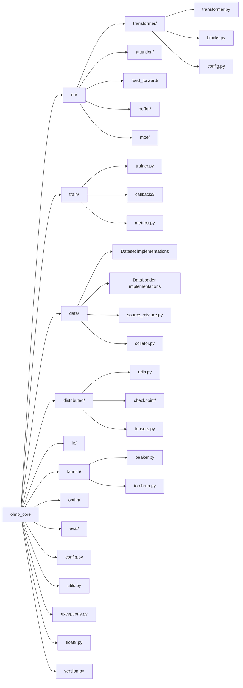

**Sources:** [pyproject.toml:86-89]()

### Module Responsibilities

| Module | Purpose | Key Components |
|--------|---------|----------------|
| `nn/` | Model architecture implementations | `Transformer`, `TransformerBlock`, attention mechanisms, feed-forward networks, MoE blocks |
| `train/` | Training system | `Trainer`, `TrainModule`, callbacks (checkpointing, evaluation, monitoring) |
| `data/` | Data pipeline | Dataset classes (`NumpyFSLDataset`, `NumpyPackedFSLDataset`), data loaders, source mixing, collators |
| `distributed/` | Distributed training utilities | Process group management, distributed initialization, checkpointing |
| `io/` | Unified I/O system | Support for local filesystems, S3, GCS, WEKA, R2 |
| `launch/` | Experiment orchestration | `BeakerLaunchConfig` for cluster launches |
| `optim/` | Optimizers and schedulers | `AdamW`, `SkipStepOptimizer`, learning rate schedulers |
| `eval/` | Evaluation system | Evaluator interface and implementations |
| `config.py` | Configuration base class | `Config` class for all configuration objects |
| `utils.py` | Common utilities | Device management, seeding, tensor operations |
| `exceptions.py` | Custom exceptions | `OLMoError`, `OLMoEnvironmentError`, etc. |
| `float8.py` | Float8 training support | Integration with torchao for FP8 training |

**Sources:** Based on high-level architecture diagrams provided

---

## Examples and Scripts

The `src/examples/` directory contains practical examples demonstrating various use cases.

### Examples Directory Structure

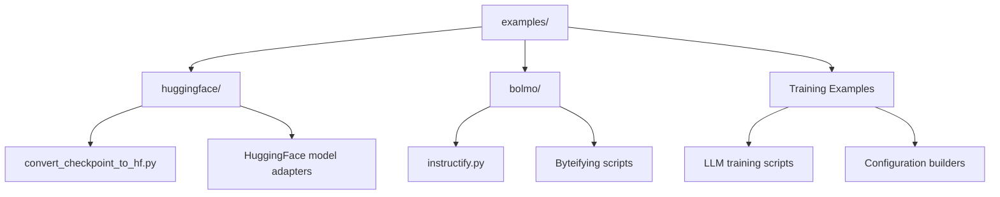

| Example Type | Location | Purpose |
|--------------|----------|---------|
| HuggingFace Integration | `examples/huggingface/` | Converting checkpoints to HF format, model adapters |
| Bolmo Post-Training | `examples/bolmo/instructify.py` | Task arithmetic for post-training without additional training |
| Training Scripts | `examples/` | Complete training examples with configuration builders |

**Sources:** [README.md:91-123]()

### Scripts Directory

The `src/scripts/` directory contains utility scripts for release management, Beaker operations, and other development tasks.

**Sources:** Inferred from repository structure

---

## Test Organization

Tests are located in `src/test/` and are organized to mirror the structure of the main package. The test suite uses pytest with custom markers for GPU and distributed tests.

### Test Structure

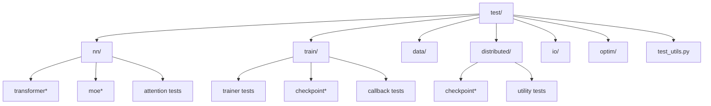

### Test Categories

The CI/CD pipeline organizes tests into several categories:

| Category | Test Pattern | GPU Required | Description |
|----------|--------------|--------------|-------------|
| General Tests | `src/test/` (excluding patterns below) | No | Unit tests for core functionality |
| Checkpoint Tests | `src/test/*/checkpoint*` | No | Checkpoint saving/loading tests |
| Neural Network Tests | `src/test/nn/` | No | Model architecture tests |
| GPU Tests | Tests marked with `@pytest.mark.gpu` | Yes (2 GPUs) | Tests requiring CUDA |
| GPU Checkpoint Tests | `src/test/distributed/checkpoint*` with GPU marker | Yes (2 GPUs) | Distributed checkpoint tests on GPU |
| GPU Transformer Tests | `src/test/nn/transformer*` with GPU marker | Yes (2 GPUs) | Transformer model tests on GPU |
| GPU MoE Tests | `src/test/nn/moe*` with GPU marker | Yes (2 GPUs) | Mixture-of-experts tests on GPU |

**Sources:** [.github/workflows/main.yml:39-159](), [pyproject.toml:164-179]()

### Test Execution

Tests can be run using pytest with various markers:

```bash
# Run all non-GPU tests
pytest src/test/

# Run GPU tests only
pytest -m gpu src/test/

# Run specific test category
pytest src/test/nn/
```

**Sources:** [pyproject.toml:164-179](), [.github/workflows/main.yml:39-159]()

---

## Configuration Files

The repository includes several key configuration files at the root level.

### `pyproject.toml`

The main project configuration file defining package metadata, dependencies, and tool configurations.

| Section | Purpose |
|---------|---------|
| `[project]` | Package name (`ai2-olmo-core`), version, dependencies |
| `[project.optional-dependencies]` | Optional dependency groups: `dev`, `beaker`, `comet`, `eval`, `torchao`, `transformers`, `wandb`, `mamba`, `xlstm`, `fla`, `all` |
| `[tool.setuptools]` | Package discovery configuration |
| `[tool.black]`, `[tool.isort]`, `[tool.ruff]` | Code formatting and linting rules |
| `[tool.mypy]` | Type checking configuration |
| `[tool.pytest.ini_options]` | Test configuration, markers, and filters |

**Sources:** [pyproject.toml:1-180]()

### `Makefile`

Provides convenient commands for common development tasks:

| Target | Command | Purpose |
|--------|---------|---------|
| `make checks` | - | Run all checks (style, lint, type) |
| `make style` | `isort`, `black` | Format code |
| `make lint-check` | `ruff check` | Check linting |
| `make type-check` | `mypy` | Type checking |
| `make build` | `python -m build` | Build package distributions |
| `make docs` | `sphinx-autobuild` | Build and serve documentation |
| `make docker-image` | Docker build with args | Build Docker image |
| `make beaker-image` | Docker + Beaker push | Push image to Beaker |

**Sources:** [Makefile:1-112]()

### Dependency Groups

Optional dependencies are organized by functionality:

| Group | Dependencies | Purpose |
|-------|--------------|---------|
| `dev` | black, isort, mypy, pytest, sphinx, etc. | Development and testing tools |
| `beaker` | beaker-py, GitPython | Beaker cluster integration |
| `comet` | comet_ml | Comet ML logging |
| `eval` | ai2-olmo-eval | Evaluation framework |
| `torchao` | torchao | Float8 training |
| `transformers` | transformers | HuggingFace integration |
| `wandb` | wandb | Weights & Biases logging |
| `mamba` | mamba_ssm, causal_conv1d, triton | Mamba architecture support |
| `xlstm` | xlstm | xLSTM architecture support (used in Bolmo) |
| `fla` | flash-linear-attention | Fast linear attention |
| `all` | All of the above | Install everything |

**Sources:** [pyproject.toml:33-75]()

---

## Build and Deployment

The repository includes comprehensive build and deployment infrastructure for Docker images and CI/CD.

### Docker Build Pipeline

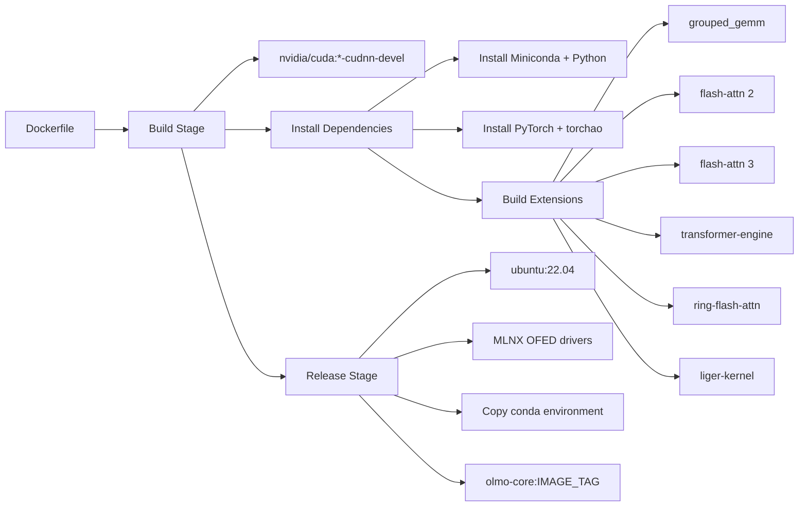

**Sources:** [src/Dockerfile:1-138](), [Makefile:40-112]()

### Docker Image Variants

Images are built with specific CUDA and PyTorch versions:

| Component | Default Version | Configurable |
|-----------|----------------|--------------|
| CUDA | 12.8.1 | `CUDA_VERSION` |
| PyTorch | 2.8.0 | `TORCH_VERSION` |
| Python | 3.11 | `PYTHON_VERSION` |
| flash-attn | 2.8.2 | `FLASH_ATTN_VERSION` |
| transformer-engine | 2.6.0.post1 | `TE_VERSION` |
| liger-kernel | 0.6.2 | `LIGER_KERNEL_VERSION` |

**Sources:** [Makefile:50-61](), [src/Dockerfile:44-86]()

### CI/CD Workflows

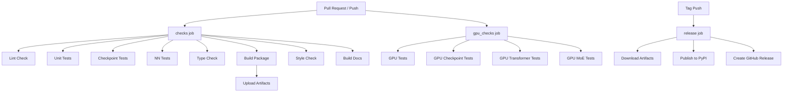

**Sources:** [.github/workflows/main.yml:1-278]()

### CI/CD Job Configurations

**CPU Tests:**
- Run on `ubuntu-latest`
- Use Python virtual environment with caching
- Execute various test suites in parallel
- Validate code quality (lint, type, style)
- Build documentation

**GPU Tests:**
- Run on Beaker clusters via Gantry
- Use pre-built Docker images with CUDA support
- Require 2 GPUs (H100 or A100)
- Test distributed training functionality

**Release Workflow:**
- Triggered on version tags (`v*.*.*`)
- Builds package distributions
- Publishes to PyPI
- Creates GitHub release with changelog
- Sends Slack notifications

**Sources:** [.github/workflows/main.yml:26-278]()

---

## Distributed Training Environment Variables

The `olmo_core.distributed.utils` module defines and validates several environment variables required for distributed training:

| Environment Variable | Purpose | Set By |
|---------------------|---------|--------|
| `LOCAL_RANK` | Local rank within node | torchrun |
| `NUM_NODES` | Number of nodes in job | Launch script or cluster |
| `LOCAL_WORLD_SIZE` | Number of processes per node | torchrun |
| `OLMO_SHARED_FS` | Indicates shared filesystem | User or `init_distributed()` |
| `FS_LOCAL_RANK` | Filesystem-local rank | User (if no shared FS) |
| `BEAKER_NODE_HOSTNAME` | Node hostname in Beaker | Beaker |

**Sources:** [src/olmo_core/distributed/utils.py:19-25](), [src/olmo_core/distributed/utils.py:133-156]()

### Cluster-Specific Configuration

The `init_distributed()` function automatically configures NCCL settings for different AI2 clusters:

| Cluster | Detection | Special Configuration |
|---------|-----------|----------------------|
| Jupiter | Hostname contains "jupiter" | Set `NCCL_IB_HCA`, conditionally set `NCCL_SOCKET_IFNAME` for multi-node |
| Pluto | Hostname contains "pluto" | Set `NCCL_IB_HCA` |
| Augusta | Hostname contains "augusta" | Extensive NCCL tuning (20+ environment variables) for optimized A3+ performance |

**Sources:** [src/olmo_core/distributed/utils.py:52-112]()

---

## Development Workflow

The typical development workflow involves:

1. **Setup:** Install dependencies using the development extras:
   ```bash
   pip install -e .[dev]
   ```

2. **Code Quality:** Run checks before committing:
   ```bash
   make style        # Format code
   make checks       # Run all checks
   ```

3. **Testing:** Run appropriate test suites:
   ```bash
   pytest src/test/                    # Local tests
   pytest -m gpu src/test/             # GPU tests (requires GPU)
   ```

4. **Documentation:** Build and preview documentation:
   ```bash
   make docs
   ```

5. **Building:** Create distribution packages:
   ```bash
   make build
   ```

**Sources:** [Makefile:1-112](), [pyproject.toml:33-56]()

---

# Page: Model Architecture

# Model Architecture

<details>
<summary>Relevant source files</summary>

The following files were used as context for generating this wiki page:

- [src/olmo_core/data/tokenizer.py](src/olmo_core/data/tokenizer.py)
- [src/olmo_core/nn/feed_forward.py](src/olmo_core/nn/feed_forward.py)
- [src/olmo_core/nn/layer_norm.py](src/olmo_core/nn/layer_norm.py)
- [src/olmo_core/nn/lm_head.py](src/olmo_core/nn/lm_head.py)
- [src/olmo_core/nn/transformer/__init__.py](src/olmo_core/nn/transformer/__init__.py)
- [src/olmo_core/nn/transformer/block.py](src/olmo_core/nn/transformer/block.py)
- [src/olmo_core/nn/transformer/config.py](src/olmo_core/nn/transformer/config.py)
- [src/olmo_core/nn/transformer/init.py](src/olmo_core/nn/transformer/init.py)
- [src/olmo_core/nn/transformer/model.py](src/olmo_core/nn/transformer/model.py)
- [src/test/nn/layer_norm_test.py](src/test/nn/layer_norm_test.py)
- [src/test/nn/lm_head_test.py](src/test/nn/lm_head_test.py)
- [src/test/nn/transformer/model_test.py](src/test/nn/transformer/model_test.py)

</details>


This page provides a comprehensive overview of the transformer model architecture in OLMo-Core, covering model variants, transformer blocks, and core components. This documentation focuses on the structural design and implementation details of the models themselves.

For information about:
- Specific attention mechanisms and feed-forward implementations, see [Attention and Feed-Forward](#2.3)
- Tokenization strategies, see [Tokenizers](#2.4)
- Weight initialization schemes, see [Weight Initialization](#2.5)
- Training these models, see [Training System](#3)

---

## Model Hierarchy

The codebase implements a flexible hierarchy of transformer models built around a common base architecture. All models inherit from `nn.Module` and share a common interface defined through configuration classes.

### Model Class Hierarchy

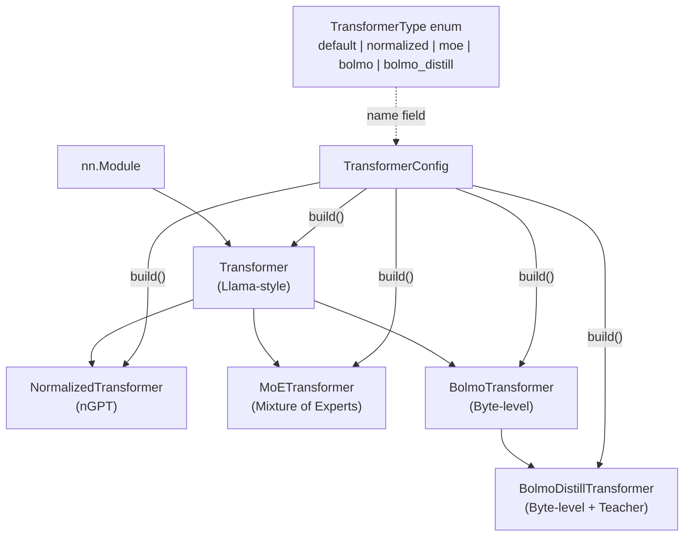

**Sources:** [src/olmo_core/nn/transformer/model.py:82-896](), [src/olmo_core/nn/transformer/config.py:76-105](), [src/olmo_core/nn/transformer/config.py:333-467]()

### Transformer Base Model

The `Transformer` class implements the standard "Llama-style" architecture with the following structure:

| Component | Type | Description |
|-----------|------|-------------|
| `embeddings` | `nn.Embedding` | Token embeddings (vocab_size × d_model) |
| `blocks` | `nn.ModuleDict` | Dictionary of transformer blocks indexed by layer number |
| `lm_head` | `LMHead` | Final language modeling head with optional layer norm |
| `_cache` | `BufferCache` | Shared buffer cache for RoPE and other buffers |

**Key attributes:**
- `d_model`: Model dimensionality
- `vocab_size`: Vocabulary size
- `n_layers`: Number of transformer layers
- `n_attn_heads`: Number of attention heads
- `dtype`: Model data type (typically `torch.float32` or `torch.bfloat16`)

**Sources:** [src/olmo_core/nn/transformer/model.py:82-164]()

### Model Variants

#### NormalizedTransformer (nGPT)

The `NormalizedTransformer` implements the nGPT architecture with normalized weights and activations:

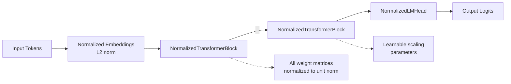

**Key differences from base Transformer:**
- Uses `NormalizedTransformerBlock` with L2-normalized weights
- Requires `init_method=InitMethod.normalized`
- Calls `normalize_matrices()` after each optimizer step
- Uses `NormalizedLMHead` with scaling parameter

**Sources:** [src/olmo_core/nn/transformer/model.py:897-945](), [src/olmo_core/nn/transformer/config.py:86-89]()

#### MoETransformer (Mixture of Experts)

The `MoETransformer` replaces some or all feed-forward layers with mixture-of-experts modules:

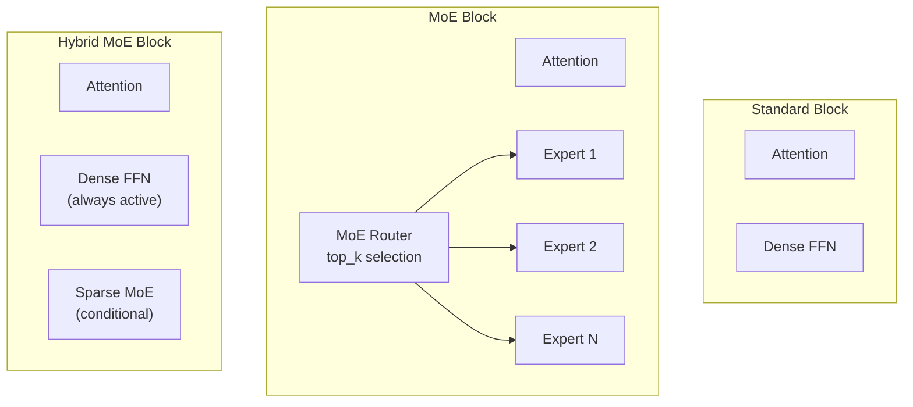

**Key features:**
- Supports pure MoE (`MoETransformerBlock`) or hybrid dense+MoE (`MoEHybridTransformerBlock`)
- Implements load balancing and z-loss auxiliary losses
- Supports expert parallelism (`apply_ep()`) for sharding experts across GPUs
- Tracks routing metrics for monitoring expert utilization

**Sources:** [src/olmo_core/nn/transformer/model.py:948-1078](), [src/olmo_core/nn/transformer/config.py:91-94]()

---

## Transformer Block Architecture

Transformer blocks are the fundamental building units of the models. The codebase provides multiple block implementations with different architectural choices.

### Block Type Hierarchy

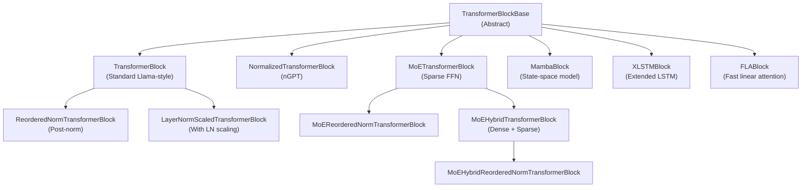

**Sources:** [src/olmo_core/nn/transformer/block.py:34-92](), [src/olmo_core/nn/transformer/config.py:107-167]()

### Standard TransformerBlock

The `TransformerBlock` implements the standard pre-norm architecture:

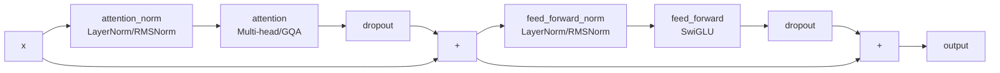

**Forward pass equation:**
```
h = x + dropout(attention(attention_norm(x)))
out = h + dropout(feed_forward(feed_forward_norm(h)))
```

**Key components:**
| Component | Default Type | Purpose |
|-----------|-------------|---------|
| `attention_norm` | `LayerNormConfig` | Normalization before attention |
| `attention` | `AttentionConfig` | Multi-head or grouped-query attention |
| `feed_forward_norm` | `LayerNormConfig` | Normalization before FFN |
| `feed_forward` | `FeedForwardConfig` | SwiGLU feed-forward network |
| `dropout` | `nn.Dropout` | Optional dropout (default 0.0) |

**Sources:** [src/olmo_core/nn/transformer/block.py:94-204]()

### Block Configuration

Blocks are built from a declarative configuration:

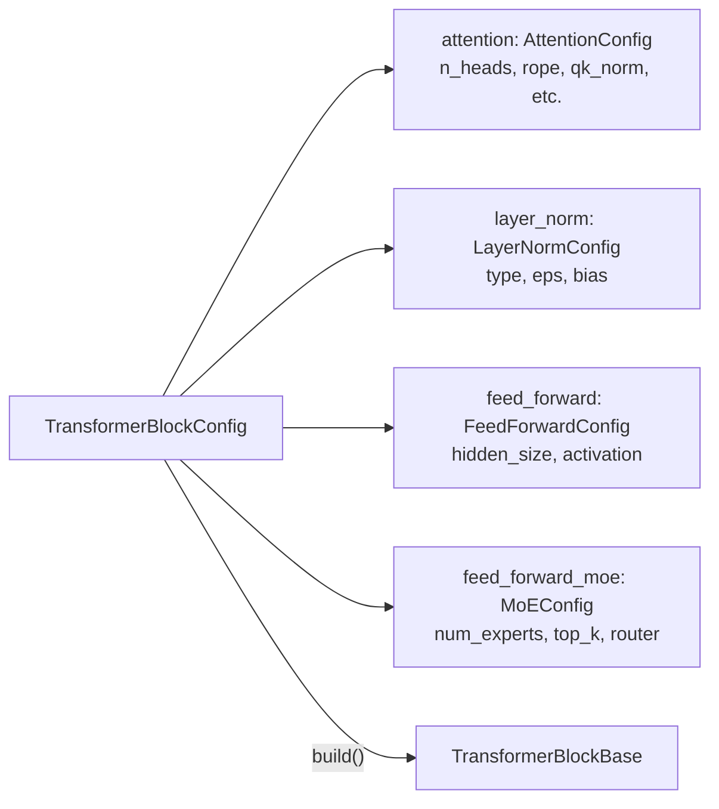

**Configuration example:**
```python
# Standard block
block_config = TransformerBlockConfig(
    name=TransformerBlockType.default,
    attention=AttentionConfig(n_heads=32, rope=RoPEConfig()),
    layer_norm=LayerNormConfig(name=LayerNormType.rms, bias=False),
    feed_forward=FeedForwardConfig(hidden_size=14336, bias=False)
)

# MoE block
moe_block_config = TransformerBlockConfig(
    name=TransformerBlockType.moe,
    attention=AttentionConfig(...),
    layer_norm=LayerNormConfig(...),
    feed_forward_moe=MoEConfig(num_experts=64, top_k=8)
)
```

**Sources:** [src/olmo_core/nn/transformer/config.py:168-301]()

### Block Variants

#### ReorderedNormTransformerBlock

Applies layer normalization *after* attention and FFN instead of before (post-norm):

```
h = x + dropout(attention_norm(attention(x)))
out = h + dropout(feed_forward_norm(feed_forward(h)))
```

This variant is used in OLMo-2 models.

**Sources:** [src/olmo_core/nn/transformer/block.py:258-275]()

#### LayerNormScaledTransformerBlock

Applies LayerNorm Scaling (LNS) by multiplying each LayerNorm output by `1/sqrt(layer_id)` where `layer_id` is 1-based:

```python
ln_scale = 1.0 / sqrt(block_idx + 1)
h = x + dropout(attention(attention_norm(x) * ln_scale))
out = h + dropout(feed_forward(feed_forward_norm(h) * ln_scale))
```

**Sources:** [src/olmo_core/nn/transformer/block.py:206-256]()

#### NormalizedTransformerBlock (nGPT)

Implements the nGPT block with L2-normalized activations and learnable interpolation parameters:

```mermaid
graph LR
    Input["x<br/>(normalized)"]
    Attn["attention(x)"]
    Norm1["L2 normalize"]
    Lerp1["lerp with attn_alpha"]
    Norm2["L2 normalize"]
    
    FFN["feed_forward(h)"]
    Norm3["L2 normalize"]
    Lerp2["lerp with mlp_alpha"]
    Norm4["L2 normalize"]
    Output["output"]
    
    Input --> Attn
    Attn --> Norm1
    Input --> Lerp1
    Norm1 --> Lerp1
    Lerp1 --> Norm2
    
    Norm2 --> FFN
    FFN --> Norm3
    Norm2 --> Lerp2
    Norm3 --> Lerp2
    Lerp2 --> Norm4
    Norm4 --> Output
```

**Key features:**
- No LayerNorm modules (uses L2 normalization)
- Learnable `attn_alpha` and `mlp_alpha` parameters for interpolation
- All weight matrices must be normalized after each optimizer step

**Sources:** [src/olmo_core/nn/transformer/block.py:277-402]()

#### MoE Blocks

MoE blocks replace the dense FFN with a mixture of experts:

| Block Type | Attention Norm | FFN Type | FFN Norm |
|------------|---------------|----------|----------|
| `MoETransformerBlock` | Pre-norm | Sparse MoE | Pre-norm |
| `MoEReorderedNormTransformerBlock` | Post-norm | Sparse MoE | Post-norm |
| `MoEHybridTransformerBlock` | Pre-norm | Dense + Sparse | Pre-norm (dense), Pre-norm (sparse) |
| `MoEHybridReorderedNormTransformerBlock` | Post-norm | Dense + Sparse | Post-norm (dense), Post-norm (sparse) |

**Hybrid forward pass:**
```
# Separate forward paths
h = x + dropout(attention_norm(attention(x)))
dense_out = feed_forward(feed_forward_norm(h))
sparse_out = feed_forward_moe(feed_forward_moe_norm(h))
out = h + dropout(dense_out) + dropout(sparse_out)

# Or combined forward for better parallelism with EP/TP
out = combined_forward(x)  # Fuses dense and sparse computation
```

**Sources:** [src/olmo_core/nn/transformer/block.py:404-857]()

---

## Core Architectural Components

### Embeddings

Token embeddings are standard PyTorch `nn.Embedding` layers:

```python
self.embeddings = nn.Embedding(vocab_size, d_model, dtype=dtype, device=init_device)
```

**Initialization:**
- Standard: Truncated normal with std=0.02
- Llama: Normal distribution
- Normalized (nGPT): Normal with std=d_model^(-0.5)

**Sources:** [src/olmo_core/nn/transformer/model.py:121](), [src/olmo_core/nn/transformer/init.py:68-89]()

### Language Model Head

The LM head projects hidden states to vocabulary logits and computes loss:

```mermaid
graph LR
    Hidden["Hidden States<br/>(B, S, d_model)"]
    Norm["Optional LayerNorm"]
    Linear["w_out<br/>(d_model → vocab_size)"]
    Logits["Logits<br/>(B, S, vocab_size)"]
    Loss["Cross-Entropy Loss<br/>+ Optional Z-Loss"]
    
    Hidden --> Norm
    Norm --> Linear
    Linear --> Logits
    
    Labels["Labels<br/>(B, S)"]
    Logits --> Loss
    Labels --> Loss
```

**LMHead implementations:**

| Type | Features |
|------|----------|
| `LMHead` | Standard linear projection with optional layer norm and bias |
| `NormalizedLMHead` | nGPT variant with L2-normalized weights and learnable scaling |

**Loss implementations:**

| Implementation | Description | Use Case |
|----------------|-------------|----------|
| `LMLossImplementation.default` | Computes logits then loss separately | Memory-intensive, returns logits |
| `LMLossImplementation.fused_linear` | Fuses linear + loss computation | Memory-efficient, no logits returned |

**Key features:**
- Supports `logits_to_keep` parameter to compute loss only on subset of positions
- Handles tensor parallelism with proper loss reduction
- Optional z-loss regularization: `z_loss = log(sum(exp(logits)))^2`

**Sources:** [src/olmo_core/nn/lm_head.py:154-422](), [src/olmo_core/nn/lm_head.py:424-475]()

### Feed-Forward Networks

Feed-forward networks use SwiGLU activation:

```mermaid
graph LR
    Input["x<br/>(*, d_model)"]
    W1["w1<br/>(d_model → hidden_size)"]
    W3["w3<br/>(d_model → hidden_size)"]
    Act["SiLU activation"]
    Mult["*"]
    W2["w2<br/>(hidden_size → d_model)"]
    Output["output<br/>(*, d_model)"]
    
    Input --> W1
    Input --> W3
    W1 --> Act
    Act --> Mult
    W3 --> Mult
    Mult --> W2
    W2 --> Output
```

**Forward equation:**
```
out = w2(silu(w1(x)) * w3(x))
```

**Variants:**
- `FeedForward`: Standard implementation with configurable activation
- `NormalizedFeedForward`: nGPT variant with L2-normalized weights and scaling parameters

**Sources:** [src/olmo_core/nn/feed_forward.py:105-173](), [src/olmo_core/nn/feed_forward.py:175-241]()

### Layer Normalization

The codebase provides multiple layer norm implementations:

| Type | Implementation | Use Case |
|------|----------------|----------|
| `LayerNorm` | Standard PyTorch LayerNorm | General purpose |
| `RMSNorm` | Root Mean Square normalization | Llama-style models, no bias/centering |
| `FusedRMSNorm` | Triton-based fused RMSNorm | GPU optimization |
| `L2Norm` | L2 normalization of last dimension | nGPT models |

**RMSNorm equation:**
```
out = x * rsqrt(mean(x^2) + eps) * weight
```

**Sources:** [src/olmo_core/nn/layer_norm.py:104-291]()

---

## Model Construction Flow

The model construction process follows a builder pattern using configuration objects:

```mermaid
graph TB
    Start["TransformerConfig"]
    
    subgraph "Configuration"
        ModelParams["d_model, n_layers, vocab_size<br/>dtype, init_method, init_std"]
        BlockConfig["block: TransformerBlockConfig"]
        LMHeadConfig["lm_head: LMHeadConfig"]
        Overrides["block_overrides: Dict[int, Config]<br/>(optional per-layer configs)"]
    end
    
    Start --> ModelParams
    Start --> BlockConfig
    Start --> LMHeadConfig
    Start --> Overrides
    
    Build["config.build(init_device='cpu'/'meta')"]
    
    ModelParams --> Build
    BlockConfig --> Build
    LMHeadConfig --> Build
    Overrides --> Build
    
    Model["Transformer instance"]
    InitWeights["model.init_weights(device, max_seq_len)"]
    
    Build --> Model
    Model --> InitWeights
    
    subgraph "Parallelism Setup"
        TP["model.apply_tp(tp_mesh)"]
        CP["model.apply_cp(cp_mesh, load_balancer)"]
        FSDP["model.apply_fsdp(dp_mesh)"]
        Compile["model.apply_compile()"]
    end
    
    InitWeights --> TP
    TP --> CP
    CP --> FSDP
    FSDP --> Compile
    
    Ready["Model ready for training"]
    Compile --> Ready
```

**Sources:** [src/olmo_core/nn/transformer/config.py:333-467](), [src/olmo_core/nn/transformer/model.py:223-319]()

### Configuration Builders

The `TransformerConfig` class provides convenient builder methods for common model sizes:

**OLMo-2 models:**
- `olmo2_30M()`, `olmo2_190M()`, `olmo2_370M()`, `olmo2_600M()`, `olmo2_760M()`, `olmo2_1B()`, `olmo2_3B()`, `olmo2_7B()`, `olmo2_13B()`, `olmo2_32B()`

**OLMo-3 models:**
- `olmo3_190M()`, `olmo3_7B()` (with sliding window attention)

**Llama-style models:**
- `llama2_271M()`, `llama2_1B()`, `llama2_7B()`, `llama2_13B()`

**MoE models:**
- `smallmoe()`, `small_hybrid_moe()`, `olmoe_1B_7B()`

**nGPT models:**
- `ngpt_271M()`, `ngpt_1B()`

**Example usage:**
```python
config = TransformerConfig.olmo2_7B(
    vocab_size=100_278,
    use_flash=True,
    rope_theta=500_000
)
model = config.build(init_device="meta")
model.init_weights(device="cuda", max_seq_len=4096)
```

**Sources:** [src/olmo_core/nn/transformer/config.py:567-878]()

---

## Forward Pass

The transformer forward pass processes input token IDs through the model:

```mermaid
graph TB
    Start["forward(input_ids, labels=None, **kwargs)"]
    
    Prepare["_prepare_inputs()<br/>- Handle context parallelism sharding<br/>- Prepare RoPE buffers<br/>- Move to device"]
    
    Embed["embeddings(input_ids)<br/>→ h: (B, S, d_model)"]
    
    Start --> Prepare
    Prepare --> Embed
    
    Block0["blocks['0'](h)"]
    Block1["blocks['1'](h)"]
    BlockN["blocks['N-1'](h)"]
    
    Embed --> Block0
    Block0 --> Block1
    Block1 -->|"..."| BlockN
    
    Decision{"labels provided?"}
    BlockN --> Decision
    
    Logits["lm_head(h)<br/>→ logits: (B, S, vocab_size)"]
    Loss["lm_head(h, labels=labels)<br/>→ LMOutputWithLoss"]
    
    Decision -->|"No"| Logits
    Decision -->|"Yes"| Loss
    
    Return["Return logits or loss"]
    Logits --> Return
    Loss --> Return
```

**Method signature:**
```python
def forward(
    self,
    input_ids: torch.Tensor,  # (batch_size, seq_len)
    *,
    labels: Optional[torch.Tensor] = None,  # (batch_size, seq_len)
    ignore_index: int = -100,
    loss_reduction: Literal["mean", "sum", "none"] = "mean",
    z_loss_multiplier: Optional[float] = None,
    loss_div_factor: Optional[Union[torch.Tensor, float]] = None,
    return_logits: Optional[bool] = None,
    logits_to_keep: Union[int, torch.Tensor] = 0,
    **kwargs,
) -> Union[torch.Tensor, LMOutputWithLoss]
```

**Key features:**
- Pipeline parallelism: Supports missing embeddings or lm_head for intermediate stages
- Context parallelism: Automatically shards inputs along sequence dimension
- Intra-document masking: Supports `doc_lens` and `cu_doc_lens` for document boundaries
- Dynamic shape marking: Calls `mark_dynamic()` when compiled

**Sources:** [src/olmo_core/nn/transformer/model.py:464-537](), [src/olmo_core/nn/transformer/model.py:321-462]()

---

## Parallelism Integration

Models support multiple parallelism strategies that can be composed:

### Supported Parallelism Modes

| Strategy | Method | Purpose | Applied To |
|----------|--------|---------|------------|
| Tensor Parallel (TP) | `apply_tp(tp_mesh)` | Shard weights across GPUs | Attention, FFN, embeddings, LM head |
| Context Parallel (CP) | `apply_cp(cp_mesh, load_balancer)` | Shard sequences across GPUs | Attention (ring attention) |
| Pipeline Parallel (PP) | `apply_pp(pp_mesh)` | Shard layers across GPUs | Per-block preparation |
| Expert Parallel (EP) | `apply_ep(ep_mesh)` | Shard experts across GPUs | MoE blocks only |
| FSDP | `apply_fsdp(dp_mesh)` | Fully Sharded Data Parallel | All parameters |
| DDP | `apply_ddp(dp_mesh)` | Distributed Data Parallel | All parameters |

### Application Order

The parallelism methods should be applied in this order:

```mermaid
graph LR
    Build["build(init_device='meta')"]
    TP["apply_tp()"]
    CP["apply_cp()"]
    PP["apply_pp()"]
    EP["apply_ep()<br/>(MoE only)"]
    FP8["apply_fp8()"]
    AC["apply_activation_checkpointing()"]
    Compile["apply_compile()"]
    FSDP["apply_fsdp() / apply_ddp()"]
    Init["init_weights()"]
    
    Build --> TP
    TP --> CP
    CP --> PP
    PP --> EP
    EP --> FP8
    FP8 --> AC
    AC --> Compile
    Compile --> FSDP
    FSDP --> Init
```

**Sources:** [src/olmo_core/nn/transformer/model.py:539-846]()

### Tensor Parallelism

Tensor parallelism shards weight matrices across GPUs:

**Sharding strategy:**
- Embeddings: Rowwise parallel (output sharded on sequence dim)
- Attention Q/K/V: Colwise parallel (heads sharded)
- Attention output: Rowwise parallel
- FFN w1/w3: Colwise parallel
- FFN w2: Rowwise parallel
- LM head: Colwise parallel (vocab sharded)

**Example:**
```python
from torch.distributed.tensor import init_device_mesh

mesh = init_device_mesh("cuda", (world_size,), mesh_dim_names=("tp",))
model.apply_tp(mesh["tp"])
```

**Sources:** [src/olmo_core/nn/transformer/model.py:567-602]()

### Activation Checkpointing

Multiple activation checkpointing modes are supported:

| Mode | Description |
|------|-------------|
| `full` | Checkpoint every block |
| `selected_blocks` | Checkpoint blocks at `block_interval` |
| `selected_modules` | Checkpoint specific module patterns (supports globs) |
| `selected_ops` | Checkpoint specific operations within blocks |
| `budget` | Use torch compile's memory budget feature |

**Example:**
```python
# Checkpoint every 4th block
model.apply_activation_checkpointing(
    mode=TransformerActivationCheckpointingMode.selected_blocks,
    block_interval=4
)

# Checkpoint specific modules
model.apply_activation_checkpointing(
    mode=TransformerActivationCheckpointingMode.selected_modules,
    modules=["blocks.*.attention", "blocks.*.feed_forward"]
)
```

**Sources:** [src/olmo_core/nn/transformer/model.py:623-720]()

---

## Properties and Utilities

### Model Metrics

The `Transformer` class provides several utility properties:

| Property | Description |
|----------|-------------|
| `num_params` | Total number of parameters |
| `num_trainable_params` | Number of trainable parameters (excludes frozen) |
| `num_non_embedding_params` | Parameters excluding embeddings |
| `num_flops_per_token(seq_len)` | Approximate FLOPs per token |
| `pp_enabled` | Whether pipeline parallelism is active |
| `tp_enabled` | Whether tensor parallelism is active |
| `fsdp_enabled` | Whether FSDP is active |
| `fp8_enabled` | Whether FP8 training is active |
| `is_moe` | Whether model uses MoE (overridden in `MoETransformer`) |

**FLOP calculation:**
```python
flop_per_token = 6 * num_non_embedding_params + 12 * n_layers * n_heads * head_dim * seq_len
```

**Sources:** [src/olmo_core/nn/transformer/model.py:848-879]()

### Post-Training Hooks

Models provide lifecycle hooks called during training:

| Hook | When Called | Purpose |
|------|-------------|---------|
| `post_batch(dry_run=False)` | After final backward before optimizer step | Auxiliary loss finalization |
| `post_optim_step()` | After optimizer step | Weight normalization, FP8 scale precomputation |

**nGPT example:**
```python
# After optimizer.step()
model.post_optim_step()  # Calls normalize_matrices() on NormalizedTransformer
```

**Sources:** [src/olmo_core/nn/transformer/model.py:881-895](), [src/olmo_core/nn/transformer/model.py:941-944]()

---

## Summary

The OLMo-Core model architecture provides:

1. **Flexible model hierarchy** with `Transformer`, `NormalizedTransformer`, `MoETransformer`, and Bolmo variants
2. **Multiple block types** including standard, reordered-norm, MoE, hybrid, and alternative architectures (Mamba, XLSTM, FLA)
3. **Composable components** with attention, FFN, layer norm, and LM head modules
4. **Configuration-based construction** using declarative config objects with builder methods
5. **Comprehensive parallelism support** for TP, CP, PP, EP, FSDP, and DDP
6. **Optimization features** including activation checkpointing, FP8, and torch.compile integration

All components are designed to be modular, configurable, and compatible with distributed training strategies.

---

# Page: Transformer Models

# Transformer Models

<details>
<summary>Relevant source files</summary>

The following files were used as context for generating this wiki page:

- [src/olmo_core/data/tokenizer.py](src/olmo_core/data/tokenizer.py)
- [src/olmo_core/nn/transformer/config.py](src/olmo_core/nn/transformer/config.py)
- [src/olmo_core/nn/transformer/model.py](src/olmo_core/nn/transformer/model.py)

</details>


This document describes the transformer model implementations in OLMo-Core, including the base `Transformer` class and its specialized variants. These classes represent the top-level model architecture that orchestrates embeddings, transformer blocks, and the language modeling head.

For information about the internal block architecture, see [Transformer Blocks](#2.2). For attention mechanisms and feed-forward networks, see [Attention and Feed-Forward](#2.3). For tokenization, see [Tokenizers](#2.4). For weight initialization strategies, see [Weight Initialization](#2.5).

---

## Transformer Class Hierarchy

The codebase provides multiple transformer implementations, each optimized for different use cases. All variants inherit from the base `Transformer` class.

**Class Hierarchy Diagram**

```mermaid
graph TD
    Module["nn.Module"]
    Transformer["Transformer<br/>(Base Llama-style)"]
    NormalizedTransformer["NormalizedTransformer<br/>(nGPT architecture)"]
    MoETransformer["MoETransformer<br/>(Mixture of Experts)"]
    BolmoTransformer["BolmoTransformer<br/>(Byte-level model)"]
    BolmoDistillTransformer["BolmoDistillTransformer<br/>(Byte-level with teacher)"]
    
    Module --> Transformer
    Transformer --> NormalizedTransformer
    Transformer --> MoETransformer
    Transformer --> BolmoTransformer
    BolmoTransformer --> BolmoDistillTransformer
    
    TransformerType["TransformerType enum:<br/>default, normalized, moe,<br/>bolmo, bolmo_distill"]
    TransformerConfig["TransformerConfig"]
    
    TransformerConfig -.builds.-> Transformer
    TransformerConfig -.builds.-> NormalizedTransformer
    TransformerConfig -.builds.-> MoETransformer
    TransformerConfig -.builds.-> BolmoTransformer
    TransformerConfig -.builds.-> BolmoDistillTransformer
    
    TransformerType -.selects.-> TransformerConfig
```

**Sources:** [src/olmo_core/nn/transformer/model.py:82-1100](), [src/olmo_core/nn/transformer/config.py:76-105]()

---

## Base Transformer Class

The `Transformer` class at [src/olmo_core/nn/transformer/model.py:82-895]() provides the standard Llama-style transformer implementation with the following components:

### Core Components

| Component | Type | Description |
|-----------|------|-------------|
| `embeddings` | `nn.Embedding` | Token embeddings (vocab_size × d_model) |
| `blocks` | `nn.ModuleDict` | Dictionary of transformer blocks indexed by layer number |
| `lm_head` | `LMHeadConfig.build()` | Language modeling head for logit computation |

**Component Initialization Diagram**

```mermaid
graph LR
    Init["__init__"]
    BufferCache["BufferCache<br/>(shared)"]
    Embeddings["nn.Embedding<br/>(vocab_size, d_model)"]
    Blocks["blocks: ModuleDict"]
    Block0["block '0'"]
    Block1["block '1'"]
    BlockN["block 'N-1'"]
    LMHead["lm_head"]
    
    Init --> BufferCache
    Init --> Embeddings
    Init --> Blocks
    Init --> LMHead
    
    Blocks --> Block0
    Blocks --> Block1
    Blocks --> BlockN
    
    BufferCache -.shared with.-> Block0
    BufferCache -.shared with.-> Block1
    BufferCache -.shared with.-> BlockN
```

**Sources:** [src/olmo_core/nn/transformer/model.py:96-161]()

### Forward Pass

The forward method at [src/olmo_core/nn/transformer/model.py:464-537]() implements the standard transformer forward pass:

```mermaid
graph TD
    InputIDs["input_ids<br/>(B, S)"]
    PrepareInputs["_prepare_inputs()"]
    Embeddings["embeddings(input_ids)<br/>→ h (B, S, d_model)"]
    BlockLoop["For each block in blocks"]
    Block["block(h, **kwargs)<br/>→ h"]
    LMHead["lm_head(h, labels=...)"]
    Output["logits or LMOutputWithLoss"]
    
    InputIDs --> PrepareInputs
    PrepareInputs --> Embeddings
    Embeddings --> BlockLoop
    BlockLoop --> Block
    Block -->|next block| BlockLoop
    BlockLoop -->|done| LMHead
    LMHead --> Output
```

The `_prepare_inputs()` method at [src/olmo_core/nn/transformer/model.py:321-462]() handles:
- Moving inputs to device
- Context parallelism sharding (if enabled)
- Document-level masking preparation
- RoPE buffer initialization
- Loss configuration

**Sources:** [src/olmo_core/nn/transformer/model.py:321-537]()

### Initialization and Configuration

**Weight Initialization Flow**

```mermaid
graph TD
    InitWeights["init_weights()"]
    ToEmpty["to_empty(device)"]
    ResetParams["Reset parameters<br/>on all modules"]
    Generator["torch.Generator<br/>(seeded)"]
    InitEmb["init_method.init_embeddings()"]
    LoopBlocks["For each block"]
    InitAtt["init_method.init_attention()"]
    InitFF["init_method.init_feed_forward()"]
    InitMoE["init_method.init_feed_forward_moe()"]
    WarmupCache["Warmup caches<br/>(attention, RoPE, MoE)"]
    InitLMHead["init_method.init_final_w_out()"]
    
    InitWeights --> ToEmpty
    ToEmpty --> ResetParams
    ResetParams --> Generator
    Generator --> InitEmb
    InitEmb --> LoopBlocks
    LoopBlocks --> InitAtt
    InitAtt --> InitFF
    InitFF --> InitMoE
    InitMoE --> WarmupCache
    LoopBlocks -->|next block| LoopBlocks
    LoopBlocks -->|done| InitLMHead
```

**Sources:** [src/olmo_core/nn/transformer/model.py:223-319]()

### Key Properties

| Property | Type | Description |
|----------|------|-------------|
| `num_params` | `int` | Total parameter count (cached) |
| `num_non_embedding_params` | `int` | Parameters excluding embeddings |
| `num_trainable_params` | `int` | Parameters with `requires_grad=True` |
| `device` | `torch.device` | Device where model parameters reside |
| `pp_enabled` | `bool` | Whether pipeline parallelism is active |
| `tp_enabled` | `bool` | Whether tensor parallelism is active |
| `fp8_enabled` | `bool` | Whether FP8 training is active |
| `fsdp_enabled` | `bool` | Whether FSDP is active |
| `is_moe` | `bool` | Whether model uses Mixture of Experts |
| `compile_enabled` | `bool` | Whether torch.compile is active |

**Sources:** [src/olmo_core/nn/transformer/model.py:174-208](), [src/olmo_core/nn/transformer/model.py:848-879]()

---

## NormalizedTransformer

The `NormalizedTransformer` at [src/olmo_core/nn/transformer/model.py:897-983]() implements the nGPT architecture with L2-normalized weights and activations.

### Key Differences from Base Transformer

**Normalization Lifecycle**

```mermaid
graph LR
    InitWeights["init_weights()"]
    Normalize1["normalize_matrices()"]
    Training["Training step"]
    OptimStep["optimizer.step()"]
    PostOptim["post_optim_step()"]
    Normalize2["normalize_matrices()"]
    
    InitWeights --> Normalize1
    Normalize1 --> Training
    Training --> OptimStep
    OptimStep --> PostOptim
    PostOptim --> Normalize2
    Normalize2 --> Training
```

The `normalize_matrices()` method at [src/olmo_core/nn/transformer/model.py:947-960]() normalizes:
- Embedding weights
- All block weights (via `block.normalize_matrices()`)
- LM head weights

### Validation

The model validates that all blocks are `NormalizedTransformerBlock` instances at [src/olmo_core/nn/transformer/model.py:933-938]().

**Sources:** [src/olmo_core/nn/transformer/model.py:897-983]()

---

## MoETransformer

The `MoETransformer` at [src/olmo_core/nn/transformer/model.py:985-1086]() extends the base transformer with Mixture of Experts support.

### Additional Functionality

**MoE-Specific Methods**

| Method | Purpose |
|--------|---------|
| `compute_auxiliary_metrics()` | Aggregate load balancing, routing, and z-loss metrics across MoE blocks |
| `reset_auxiliary_metrics()` | Clear accumulated metrics |
| `apply_ep()` | Apply expert parallelism to MoE blocks |
| `prepare_experts_for_fsdp()` | Wrap expert parameters with FSDP |
| `prepare_experts_for_ddp()` | Wrap expert parameters with DDP |
| `post_batch()` | Post-batch cleanup for MoE routing |

**Auxiliary Metrics Flow**

```mermaid
graph TD
    Blocks["MoE Transformer Blocks"]
    Metrics["Block-level metrics:<br/>load_balance_loss,<br/>router_z_loss,<br/>expert_assignment_entropy"]
    Compute["compute_auxiliary_metrics()"]
    Aggregate["Aggregate across blocks"]
    PPAdjust["Adjust for PP if enabled"]
    Output["Global metrics"]
    
    Blocks --> Metrics
    Metrics --> Compute
    Compute --> Aggregate
    Aggregate --> PPAdjust
    PPAdjust --> Output
```

**Sources:** [src/olmo_core/nn/transformer/model.py:985-1086]()

---

## BolmoTransformer

The `BolmoTransformer` at [src/olmo_core/nn/transformer/model.py:1110-1414]() implements byte-level language modeling with hierarchical architecture.

### Architecture Overview

**Bolmo Component Structure**

```mermaid
graph TD
    InputBytes["input_ids<br/>(byte tokens)"]
    LocalEncoder["local_encoder<br/>LocalEncoderConfig.build()"]
    ByteEmbed["Byte embeddings<br/>h_byte"]
    PatchEmbed["Patch embeddings<br/>h_patch"]
    BoundaryLogprobs["boundary_logprobs"]
    GlobalBlocks["Transformer blocks<br/>(standard)"]
    PatchAfterGlobal["h_patch_after_global"]
    LocalDecoder["local_decoder<br/>LocalDecoderConfig.build()"]
    ByteOut["h_out<br/>(byte-level)"]
    LMHead["lm_head<br/>(byte vocab)"]
    
    InputBytes --> LocalEncoder
    LocalEncoder --> ByteEmbed
    LocalEncoder --> PatchEmbed
    LocalEncoder --> BoundaryLogprobs
    PatchEmbed --> GlobalBlocks
    GlobalBlocks --> PatchAfterGlobal
    ByteEmbed --> LocalDecoder
    PatchEmbed --> LocalDecoder
    PatchAfterGlobal --> LocalDecoder
    BoundaryLogprobs --> LocalDecoder
    LocalDecoder --> ByteOut
    ByteOut --> LMHead
```

### Key Differences from Base Transformer

| Component | Base Transformer | BolmoTransformer |
|-----------|-----------------|------------------|
| `embeddings` | `nn.Embedding` | `None` (replaced by local_encoder) |
| `lm_head` | Uses `d_model` | Uses `local_decoder.d_model` (local dimension) |
| Input | Token IDs | Byte IDs |
| Additional Components | - | `local_encoder`, `local_decoder` |

### Special Inputs

The `_prepare_inputs()` method at [src/olmo_core/nn/transformer/model.py:1269-1335]() handles Bolmo-specific inputs:

| Input | Purpose |
|-------|---------|
| `patch_lens` | Length of each patch in bytes |
| `patch_ids` | Patch boundaries derived from `patch_lens` |
| `original_input_ids` | Original subword tokens (for teacher forcing) |
| `expanded_input_ids` | Expanded byte sequence |
| `teacher_inputs_embeds` | Teacher embeddings for distillation |

**Sources:** [src/olmo_core/nn/transformer/model.py:1110-1414]()

---

## BolmoDistillTransformer

The `BolmoDistillTransformer` at [src/olmo_core/nn/transformer/model.py:1416-1697]() extends `BolmoTransformer` with knowledge distillation support.

### Teacher Model Integration

**Teacher-Student Architecture**

```mermaid
graph TD
    TeacherConfig["teacher_config:<br/>TransformerConfig"]
    BuildTeacher["teacher_config.build()"]
    Teacher["teacher:<br/>Transformer"]
    ShareBlocks{"share_blocks?"}
    StudentBlocks["Student blocks"]
    TeacherBlocks["Teacher blocks"]
    
    TeacherConfig --> BuildTeacher
    BuildTeacher --> Teacher
    Teacher --> ShareBlocks
    ShareBlocks -->|True| StudentBlocks
    ShareBlocks -->|False| TeacherBlocks
    
    StudentBlocks -.shared with.-> TeacherBlocks
```

### Distillation Forward Pass

The `teacher_forward()` method at [src/olmo_core/nn/transformer/model.py:1491-1587]() provides:
- Optional block execution (`skip_blocks=True`)
- Intermediate hidden state extraction (`hidden_states_to_return`)
- Support for custom input embeddings (`inputs_embeds`)
- Optional BOS token zeroing (`zero_bos`)

**Distillation Flow**

```mermaid
graph TD
    StudentInput["Student: input_ids<br/>(bytes)"]
    TeacherInput["Teacher: input_ids<br/>(subwords)"]
    StudentForward["BolmoTransformer.forward()"]
    TeacherForward["teacher_forward()"]
    StudentLoss["Student CE loss"]
    DistillLoss["Distillation loss<br/>(e.g., hidden state matching)"]
    TotalLoss["Combined loss"]
    
    StudentInput --> StudentForward
    TeacherInput --> TeacherForward
    StudentForward --> StudentLoss
    TeacherForward --> DistillLoss
    StudentLoss --> TotalLoss
    DistillLoss --> TotalLoss
```

### Teacher Embeddings

When `use_teacher_embs_with_vocab_size` is set, the model maintains separate `teacher_embeddings` at [src/olmo_core/nn/transformer/model.py:1425-1433]() for distilling from Stage 1 local decoder transfer.

**Sources:** [src/olmo_core/nn/transformer/model.py:1416-1697]()

---

## Model Building and Configuration

### TransformerConfig

The `TransformerConfig` class at [src/olmo_core/nn/transformer/config.py:304-546]() provides a declarative way to build transformer models.

**Configuration to Model Flow**

```mermaid
graph TD
    Config["TransformerConfig"]
    Name["name: TransformerType"]
    DModel["d_model, vocab_size,<br/>n_layers"]
    Block["block:<br/>TransformerBlockConfig"]
    LMHead["lm_head:<br/>LMHeadConfig"]
    InitMethod["init_method:<br/>InitMethod"]
    
    Build["config.build()"]
    SelectImpl{"Select<br/>implementation"}
    
    Transformer["Transformer"]
    Normalized["NormalizedTransformer"]
    MoE["MoETransformer"]
    Bolmo["BolmoTransformer"]
    BolmoDistill["BolmoDistillTransformer"]
    
    FreezeParams["Apply freeze_params<br/>patterns"]
    InitWeights["model.init_weights()"]
    
    Config --> Name
    Config --> DModel
    Config --> Block
    Config --> LMHead
    Config --> InitMethod
    
    Config --> Build
    Build --> SelectImpl
    
    SelectImpl -->|default| Transformer
    SelectImpl -->|normalized| Normalized
    SelectImpl -->|moe| MoE
    SelectImpl -->|bolmo| Bolmo
    SelectImpl -->|bolmo_distill| BolmoDistill
    
    Transformer --> FreezeParams
    Normalized --> FreezeParams
    MoE --> FreezeParams
    Bolmo --> FreezeParams
    BolmoDistill --> FreezeParams
    
    FreezeParams --> InitWeights
```

**Sources:** [src/olmo_core/nn/transformer/config.py:304-467]()

### Preset Configurations

The `TransformerConfig` class provides numerous preset factory methods:

| Method | Description | Model Type |
|--------|-------------|------------|
| `olmo2_30M()` | 30M OLMo2 model | Standard |
| `olmo2_190M()` | 190M OLMo2 model | Standard |
| `olmo2_1B()` | 1B OLMo2 model | Standard |
| `olmo2_7B()` | 7B OLMo2 model | Standard |
| `olmo2_13B()` | 13B OLMo2 model | Standard |
| `olmo3_190M()` | 190M OLMo3 with sliding window | Standard |
| `olmo3_7B()` | 7B OLMo3 with sliding window | Standard |
| `smallmoe()` | Small MoE model | MoE |
| `olmoe_1B_7B()` | OLMoE 1B-7B model | MoE |
| `ngpt_271M()` | 271M nGPT model | Normalized |
| `ngpt_1B()` | 1B nGPT model | Normalized |
| `llama2_1B()` | 1B Llama2-like model | Standard |
| `llama2_7B()` | 7B Llama2-like model | Standard |
| `llama3_8B()` | 8B Llama3-like model | Standard |

**Sources:** [src/olmo_core/nn/transformer/config.py:568-1038]()

### Llama-like Configurations

The `llama_like()` factory method at [src/olmo_core/nn/transformer/config.py:1041-1143]() provides flexible configuration:

```mermaid
graph TD
    LlamaLike["llama_like()"]
    HiddenSize["Calculate hidden_size<br/>(8 * d_model / 3)"]
    Multiplier["Apply hidden_size_multiplier"]
    Multiple["Ensure multiple_of"]
    LayerNorm["Configure LayerNormConfig"]
    FusedOps{"fused_ops?"}
    FusedRMS["LayerNormType.fused_rms"]
    RMS["LayerNormType.rms"]
    AttentionConfig["Build AttentionConfig"]
    FFConfig["Build FeedForwardConfig"]
    BlockConfig["Build TransformerBlockConfig"]
    TransConfig["Return TransformerConfig"]
    
    LlamaLike --> HiddenSize
    HiddenSize --> Multiplier
    Multiplier --> Multiple
    Multiple --> LayerNorm
    LayerNorm --> FusedOps
    FusedOps -->|Yes| FusedRMS
    FusedOps -->|No| RMS
    FusedRMS --> AttentionConfig
    RMS --> AttentionConfig
    AttentionConfig --> FFConfig
    FFConfig --> BlockConfig
    BlockConfig --> TransConfig
```

**Sources:** [src/olmo_core/nn/transformer/config.py:1041-1143]()

---

## Parallelism and Optimization

The transformer models support various parallelism and optimization strategies through dedicated `apply_*` methods.

### Parallelism Methods

**Parallelism Application Order**

```mermaid
graph TD
    Model["Transformer model"]
    FP8["apply_fp8()<br/>(optional)"]
    TP["apply_tp()<br/>(tensor parallel)"]
    CP["apply_cp()<br/>(context parallel)"]
    PP["apply_pp()<br/>(pipeline parallel)"]
    EP["apply_ep()<br/>(expert parallel, MoE only)"]
    ActCheckpoint["apply_activation_checkpointing()"]
    Compile["apply_compile()"]
    FSDP["apply_fsdp()<br/>(data parallel)"]
    DDP["apply_ddp()<br/>(data parallel, alternative)"]
    
    Model --> FP8
    FP8 --> TP
    FP8 --> PP
    TP --> CP
    CP --> EP
    EP --> ActCheckpoint
    PP --> ActCheckpoint
    ActCheckpoint --> Compile
    Compile --> FSDP
    Compile --> DDP
```

| Method | Location | Purpose |
|--------|----------|---------|
| `apply_fp8()` | [model.py:539-555]() | Enable FP8 training on linear layers |
| `apply_tp()` | [model.py:567-601]() | Shard weights across GPUs |
| `apply_cp()` | [model.py:603-621]() | Shard sequences across GPUs |
| `apply_pp()` | [model.py:557-565]() | Prepare for pipeline parallelism stages |
| `apply_ep()` | [model.py:1043-1048]() | Shard MoE experts across GPUs |
| `apply_activation_checkpointing()` | [model.py:623-719]() | Trade compute for memory |
| `apply_compile()` | [model.py:721-737]() | Enable torch.compile |
| `apply_fsdp()` | [model.py:739-813]() | Fully Sharded Data Parallel |
| `apply_ddp()` | [model.py:815-846]() | Distributed Data Parallel |

**Sources:** [src/olmo_core/nn/transformer/model.py:539-846]()

### Tensor Parallelism

The `apply_tp()` method at [src/olmo_core/nn/transformer/model.py:567-601]() applies tensor parallelism:

1. Parallelizes embeddings with `RowwiseParallel` (output sharded on dim 1)
2. Applies TP to all transformer blocks
3. Applies TP to LM head

### Context Parallelism

The `apply_cp()` method at [src/olmo_core/nn/transformer/model.py:603-621]() prepares for context parallelism:

1. Creates a `RingAttentionLoadBalancer` from config
2. Applies CP to all blocks
3. Applies CP to LM head

The actual sharding happens in `_prepare_inputs()` at [src/olmo_core/nn/transformer/model.py:372-443]().

### FSDP Configuration

The `apply_fsdp()` method at [src/olmo_core/nn/transformer/model.py:739-813]() supports different wrapping strategies:

| Strategy | Description |
|----------|-------------|
| `full` | Wrap each block and LM head separately |
| `blocks` | Wrap each block but not LM head separately |
| `fine_grained` | Additional wrapping within blocks |

For MoE models, expert preparation must be done separately via `prepare_experts_for_fsdp()`.

**Sources:** [src/olmo_core/nn/transformer/model.py:739-813](), [src/olmo_core/nn/transformer/config.py:37-56]()

---

## Lifecycle Hooks

The transformer provides hooks for training integration:

**Training Lifecycle Integration**

```mermaid
graph LR
    Forward["forward()"]
    Backward["backward()"]
    PostBatch["post_batch(dry_run)"]
    OptimStep["optimizer.step()"]
    PostOptim["post_optim_step()"]
    
    Forward --> Backward
    Backward --> PostBatch
    PostBatch --> OptimStep
    OptimStep --> PostOptim
    PostOptim --> Forward
```

| Hook | Purpose | Models |
|------|---------|--------|
| `post_batch()` | Called after backward pass, before optimizer step | `Transformer`, `MoETransformer` |
| `post_optim_step()` | Called after optimizer step | `Transformer`, `NormalizedTransformer` |

### MoE Post-Batch Hook

For `MoETransformer`, `post_batch()` at [src/olmo_core/nn/transformer/model.py:1080-1086]() calls `feed_forward_moe.post_batch()` on each MoE block to:
- Clear token routing statistics
- Reset capacity counters
- Prepare for next batch

### Normalized Transformer Post-Optim Hook

For `NormalizedTransformer`, `post_optim_step()` at [src/olmo_core/nn/transformer/model.py:980-982]() calls `normalize_matrices()` to maintain L2 normalization after weight updates. For FP8-enabled models, it precomputes dynamic scales for FSDP.

**Sources:** [src/olmo_core/nn/transformer/model.py:881-894](), [src/olmo_core/nn/transformer/model.py:980-983](), [src/olmo_core/nn/transformer/model.py:1080-1086]()

---

## Model Utilities

### Parameter Counting

| Property | Formula | Notes |
|----------|---------|-------|
| `num_params` | Total of all `p.numel()` | Cached on first access |
| `num_non_embedding_params` | `num_params - embeddings.weight.numel()` | Excludes embedding layer |
| `num_trainable_params` | Sum where `p.requires_grad` | Excludes frozen params |

For `BolmoTransformer`, `num_non_embedding_params` excludes local encoder embeddings including hash embeddings.

**Sources:** [src/olmo_core/nn/transformer/model.py:848-858](), [src/olmo_core/nn/transformer/model.py:1258-1267]()

### FLOPs Estimation

The `num_flops_per_token()` method at [src/olmo_core/nn/transformer/model.py:860-879]() estimates FLOPs using:

```
flop_per_token = 6 * num_non_embedding_params + 12 * n * h * q * t
```

where:
- `n` = number of layers
- `h` = number of attention heads  
- `q` = head dimension
- `t` = sequence length

**Sources:** [src/olmo_core/nn/transformer/model.py:860-879]()

### Device Management

The `device` property at [src/olmo_core/nn/transformer/model.py:195-203]() automatically detects the device by checking parameter locations, falling back to `get_default_device()` if no parameters exist.

**Sources:** [src/olmo_core/nn/transformer/model.py:195-203]()

---

# Page: Transformer Blocks

# Transformer Blocks

<details>
<summary>Relevant source files</summary>

The following files were used as context for generating this wiki page:

- [src/olmo_core/nn/feed_forward.py](src/olmo_core/nn/feed_forward.py)
- [src/olmo_core/nn/fla.py](src/olmo_core/nn/fla.py)
- [src/olmo_core/nn/layer_norm.py](src/olmo_core/nn/layer_norm.py)
- [src/olmo_core/nn/lm_head.py](src/olmo_core/nn/lm_head.py)
- [src/olmo_core/nn/mamba.py](src/olmo_core/nn/mamba.py)
- [src/olmo_core/nn/transformer/__init__.py](src/olmo_core/nn/transformer/__init__.py)
- [src/olmo_core/nn/transformer/block.py](src/olmo_core/nn/transformer/block.py)
- [src/olmo_core/nn/transformer/init.py](src/olmo_core/nn/transformer/init.py)
- [src/test/nn/layer_norm_test.py](src/test/nn/layer_norm_test.py)
- [src/test/nn/lm_head_test.py](src/test/nn/lm_head_test.py)
- [src/test/nn/transformer/model_test.py](src/test/nn/transformer/model_test.py)

</details>


## Purpose and Scope

Transformer blocks are the core computational units that compose transformer models in OLMo-Core. Each block represents one layer of the transformer, typically containing attention mechanisms and feed-forward networks combined with normalization and residual connections. This page documents the various block implementations including standard transformer blocks, Mixture-of-Experts (MoE) variants, and alternative architectures like Mamba, XLSTM, and FLA.

For details about the internal components used within blocks (attention mechanisms, feed-forward networks, layer normalization), see [Attention and Feed-Forward](#2.3). For information about how blocks are assembled into complete transformer models, see [Transformer Models](#2.1). For weight initialization strategies applied to blocks, see [Weight Initialization](#2.5).

---

## Block Hierarchy

All transformer block implementations inherit from `TransformerBlockBase`, which defines the common interface for forward passes and parallelism application. The hierarchy supports standard dense blocks, MoE blocks with expert routing, and alternative architectures that replace attention with state-space models or linear attention.

**Block Class Hierarchy**

```mermaid
graph TB
    TransformerBlockBase["TransformerBlockBase<br/>(abstract base)"]
    
    TransformerBlock["TransformerBlock<br/>(standard Llama-style)"]
    LayerNormScaled["LayerNormScaledTransformerBlock<br/>(LNS variant)"]
    ReorderedNorm["ReorderedNormTransformerBlock<br/>(post-norm)"]
    NormalizedBlock["NormalizedTransformerBlock<br/>(nGPT)"]
    
    MoEBlock["MoETransformerBlock<br/>(sparse MoE)"]
    MoEReorderedNorm["MoEReorderedNormTransformerBlock<br/>(post-norm MoE)"]
    MoEHybridBase["MoEHybridTransformerBlockBase<br/>(abstract hybrid)"]
    MoEHybrid["MoEHybridTransformerBlock<br/>(dense + sparse)"]
    MoEHybridReordered["MoEHybridReorderedNormTransformerBlock<br/>(post-norm hybrid)"]
    
    MambaBlock["MambaBlock<br/>(state-space model)"]
    XLSTMBlock["XLSTMBlock<br/>(extended LSTM)"]
    FLABlock["FLABlock<br/>(fast linear attention)"]
    
    TransformerBlockBase --> TransformerBlock
    TransformerBlockBase --> NormalizedBlock
    TransformerBlockBase --> MoEBlock
    TransformerBlockBase --> MoEHybridBase
    TransformerBlockBase --> MambaBlock
    TransformerBlockBase --> XLSTMBlock
    TransformerBlockBase --> FLABlock
    
    TransformerBlock --> LayerNormScaled
    TransformerBlock --> ReorderedNorm
    
    MoEBlock --> MoEReorderedNorm
    MoEHybridBase --> MoEHybrid
    MoEHybridBase --> MoEHybridReordered
    MoEBlock -.inherits from.-> MoEHybridBase
```

Sources: [src/olmo_core/nn/transformer/block.py:34-1155]()

### TransformerBlockBase Interface

`TransformerBlockBase` at [src/olmo_core/nn/transformer/block.py:34-92]() defines the abstract interface that all blocks must implement:

| Method | Purpose |
|--------|---------|
| `forward()` | Run the block on input tensor of shape `(batch_size, seq_len, d_model)` |
| `apply_tp()` | Apply tensor parallelism with specified device mesh and input layout |
| `apply_cp()` | Apply context parallelism with specified device mesh and load balancer |
| `apply_fsdp()` | Apply FSDP with optional fine-grained wrapping strategy |
| `apply_pp()` | Apply pipeline parallelism (optional, mainly for MoE) |
| `apply_compile()` | Apply PyTorch compilation (default implementation available) |

The abstract base also defines `is_moe` property which returns `True` for MoE variants and `False` otherwise.

Sources: [src/olmo_core/nn/transformer/block.py:34-92]()

---

## Standard Transformer Blocks

### TransformerBlock (Llama-Style)

`TransformerBlock` at [src/olmo_core/nn/transformer/block.py:94-204]() implements the standard pre-norm transformer architecture used in models like LLaMA. This is the most commonly used block type in OLMo-Core.

**Architecture:**
- **Pre-normalization pattern**: LayerNorm is applied before each sub-layer (attention and feed-forward)
- **Residual connections**: Output of each sub-layer is added to its input
- **Optional dropout**: Applied after both attention and feed-forward

**Component Composition:**

```mermaid
graph LR
    Input["x<br/>(B, S, D)"]
    
    AttentionNorm["attention_norm<br/>(LayerNorm)"]
    Attention["attention<br/>(Attention module)"]
    Dropout1["dropout"]
    Add1["+ (residual)"]
    
    FFNorm["feed_forward_norm<br/>(LayerNorm)"]
    FFN["feed_forward<br/>(FeedForward)"]
    Dropout2["dropout"]
    Add2["+ (residual)"]
    
    Output["output<br/>(B, S, D)"]
    
    Input --> AttentionNorm
    AttentionNorm --> Attention
    Attention --> Dropout1
    Input --> Add1
    Dropout1 --> Add1
    
    Add1 --> FFNorm
    FFNorm --> FFN
    FFN --> Dropout2
    Add1 --> Add2
    Dropout2 --> Add2
    
    Add2 --> Output
```

**Initialization Parameters:**

| Parameter | Type | Description |
|-----------|------|-------------|
| `d_model` | `int` | Model dimensionality |
| `block_idx` | `int` | Block position within model (0 to n_layers-1) |
| `n_layers` | `int` | Total number of layers in the model |
| `attention` | `AttentionConfig` | Configuration for building attention module |
| `feed_forward` | `FeedForwardConfig` | Configuration for building feed-forward module |
| `layer_norm` | `LayerNormConfig` | Configuration for building both layer norms |
| `dropout` | `float` | Dropout probability (default: 0.0) |
| `init_device` | `str` | Device for parameter initialization (default: "cpu") |
| `cache` | `Optional[BufferCache]` | Optional buffer cache for sharing across blocks |

**Forward Pass:**

The forward pass at [src/olmo_core/nn/transformer/block.py:131-140]() implements:

```
h = x + dropout(attention(attention_norm(x), **kwargs))
return h + dropout(feed_forward(feed_forward_norm(h)))
```

Sources: [src/olmo_core/nn/transformer/block.py:94-204]()

### LayerNormScaledTransformerBlock

`LayerNormScaledTransformerBlock` at [src/olmo_core/nn/transformer/block.py:206-256]() extends `TransformerBlock` with LayerNorm Scaling (LNS). Each LayerNorm output is multiplied by `1 / sqrt(layer_id)` where `layer_id` is 1-based.

This scaling helps stabilize training in very deep networks by preventing activation magnitudes from growing with depth.

**Key Differences:**
- Registers a buffer `ln_scale` with value `1.0 / sqrt(block_idx + 1)`
- Scales LayerNorm outputs before passing to attention and feed-forward

Sources: [src/olmo_core/nn/transformer/block.py:206-256]()

### ReorderedNormTransformerBlock

`ReorderedNormTransformerBlock` at [src/olmo_core/nn/transformer/block.py:258-275]() implements post-normalization instead of pre-normalization.

**Architecture Difference:**
```
# Pre-norm (TransformerBlock):
h = x + dropout(attention(attention_norm(x)))

# Post-norm (ReorderedNormTransformerBlock):
h = x + dropout(attention_norm(attention(x)))
```

This places normalization after the sub-layer instead of before, which can affect training dynamics.

Sources: [src/olmo_core/nn/transformer/block.py:258-275]()

### NormalizedTransformerBlock (nGPT)

`NormalizedTransformerBlock` at [src/olmo_core/nn/transformer/block.py:278-402]() implements the nGPT architecture, which enforces unit L2 norm on all hidden states and uses learnable interpolation parameters (`attn_alpha`, `mlp_alpha`) instead of LayerNorm.

**Architecture:**

```mermaid
graph LR
    Input["x (normalized)"]
    
    Attention["attention<br/>(NormalizedAttention)"]
    L2Norm1["l2_normalize"]
    Lerp1["lerp(x, attn_out, alpha)"]
    L2Norm2["l2_normalize"]
    
    FFN["feed_forward<br/>(NormalizedFeedForward)"]
    L2Norm3["l2_normalize"]
    Lerp2["lerp(h, ffn_out, alpha)"]
    L2Norm4["l2_normalize"]
    
    Output["output (normalized)"]
    
    Input --> Attention
    Attention --> L2Norm1
    Input --> Lerp1
    L2Norm1 --> Lerp1
    Lerp1 --> L2Norm2
    
    L2Norm2 --> FFN
    FFN --> L2Norm3
    L2Norm2 --> Lerp2
    L2Norm3 --> Lerp2
    Lerp2 --> L2Norm4
    L2Norm4 --> Output
```

**Key Components:**
- **No LayerNorm**: Uses L2 normalization instead
- **Learnable alpha parameters**: `attn_alpha` and `mlp_alpha` control interpolation
- **Matrix normalization**: After each optimizer step, `normalize_matrices()` must be called to re-normalize weights

**Alpha Parameters:**
- Initialized with scaling `1.0 / sqrt(d_model)`
- Used in linear interpolation: `torch.lerp(x, normalized_output, alpha * init_value / init_scaling)`

The `normalize_matrices()` method at [src/olmo_core/nn/transformer/block.py:388-398]() must be called after each training step to maintain unit norm constraints on attention and feed-forward weight matrices.

Sources: [src/olmo_core/nn/transformer/block.py:278-402]()

---

## MoE Transformer Blocks

Mixture-of-Experts (MoE) blocks replace the dense feed-forward network with a sparse routing mechanism that selects a subset of expert networks for each token.

### MoETransformerBlock

`MoETransformerBlock` at [src/olmo_core/nn/transformer/block.py:405-561]() replaces the dense `FeedForward` with a `MoEConfig`-based sparse MoE module.

**Architecture:**

```mermaid
graph LR
    Input["x"]
    
    AttentionNorm["attention_norm"]
    Attention["attention"]
    Dropout1["dropout"]
    Add1["+ (residual)"]
    
    FFMoENorm["feed_forward_norm"]
    Router["router<br/>(expert selection)"]
    Experts["experts<br/>(parallel MLPs)"]
    Dropout2["dropout"]
    Add2["+ (residual)"]
    
    Output["output"]
    
    Input --> AttentionNorm
    AttentionNorm --> Attention
    Attention --> Dropout1
    Input --> Add1
    Dropout1 --> Add1
    
    Add1 --> FFMoENorm
    FFMoENorm --> Router
    Router --> Experts
    Experts --> Dropout2
    Add1 --> Add2
    Dropout2 --> Add2
    
    Add2 --> Output
```

**Key Properties:**
- `is_moe` returns `True`
- `router` property provides access to the `MoERouter`
- `experts` property provides access to the expert MLPs
- `top_k` property returns number of experts selected per token
- `ep_enabled` and `tp_enabled` track parallelism state

**Metrics Collection:**

MoE blocks track routing metrics like expert utilization and load balance. The `compute_metrics()` method at [src/olmo_core/nn/transformer/block.py:467-470]() returns a dictionary of metrics with optional reduction strategies.

Sources: [src/olmo_core/nn/transformer/block.py:405-561]()

### MoEHybridTransformerBlock

`MoEHybridTransformerBlock` at [src/olmo_core/nn/transformer/block.py:604-872]() combines a dense feed-forward network with a sparse MoE module, allowing both to contribute to the output.

**Dual Feed-Forward Architecture:**

```mermaid
graph TB
    Input["x"]
    
    subgraph "Dense Path"
        AttentionNorm["attention_norm"]
        Attention["attention"]
        FFNorm["feed_forward_norm"]
        DenseFFN["feed_forward<br/>(dense MLP)"]
    end
    
    subgraph "Sparse Path"
        MoENorm["feed_forward_moe_norm"]
        Router["router"]
        ExpertsMLP["experts<br/>(sparse MLPs)"]
        SharedMLP["shared_mlp<br/>(optional)"]
    end
    
    DenseOut["dense_forward()"]
    SparseOut["sparse_forward()"]
    Combined["combined_forward()"]
    
    Add["+ (combine paths)"]
    Output["output"]
    
    Input --> AttentionNorm
    AttentionNorm --> Attention
    Attention --> FFNorm
    FFNorm --> DenseFFN
    DenseFFN --> DenseOut
    
    Input --> MoENorm
    MoENorm --> Router
    Router --> ExpertsMLP
    ExpertsMLP --> SparseOut
    SharedMLP --> SparseOut
    
    DenseOut --> Add
    SparseOut --> Add
    
    Combined -.optimized variant.-> Add
    
    Add --> Output
```

**Forward Methods:**

The hybrid block provides three forward implementations:

1. **`dense_forward()`** at [src/olmo_core/nn/transformer/block.py:770-772](): Standard attention + dense FFN path
2. **`sparse_forward()`** at [src/olmo_core/nn/transformer/block.py:774-779](): Only the sparse MoE path
3. **`combined_forward()`** at [src/olmo_core/nn/transformer/block.py:781-871](): Optimized fusion that overlaps dense computation with expert parallel communication

**Combined Forward Optimization:**

The `combined_forward()` method is an optimization for when expert parallelism (EP) or tensor parallelism (TP) is enabled. It overlaps dense operations with all-to-all communication:

```
1. Start expert permutation + all-to-all send
2. While waiting, compute attention (dense path)
3. Wait for all-to-all completion
4. Compute local experts
5. Start reverse all-to-all
6. While waiting, compute feed-forward (dense path)
7. Wait for reverse all-to-all
8. Combine sparse and dense outputs
```

The `use_combined_forward` property at [src/olmo_core/nn/transformer/block.py:626-633]() automatically enables combined forward when parallelism is active, but can be manually controlled.

Sources: [src/olmo_core/nn/transformer/block.py:604-872](), [src/test/nn/transformer/model_test.py:339-421]()

### MoEReorderedNormTransformerBlock

`MoEReorderedNormTransformerBlock` at [src/olmo_core/nn/transformer/block.py:564-601]() combines MoE with post-normalization pattern (similar to `ReorderedNormTransformerBlock`).

Similarly, `MoEHybridReorderedNormTransformerBlock` at [src/olmo_core/nn/transformer/block.py:875-978]() provides the hybrid MoE variant with post-normalization.

Sources: [src/olmo_core/nn/transformer/block.py:564-601](), [src/olmo_core/nn/transformer/block.py:875-978]()

---

## Alternative Architectures

Beyond standard transformer attention, OLMo-Core supports alternative sequence modeling architectures that can be used as drop-in replacements for transformer blocks.

### MambaBlock

`MambaBlock` at [src/olmo_core/nn/transformer/block.py:980-1060]() integrates Mamba2 state-space models, which provide an alternative to attention mechanisms with linear time complexity.

**Architecture:**

```mermaid
graph LR
    Input["x<br/>(B, S, D)"]
    
    MambaNorm["mamba_norm<br/>(LayerNorm)"]
    Mamba["mamba<br/>(Mamba2 SSM)"]
    Dropout1["dropout"]
    Add1["+ (residual)"]
    
    FFNorm["feed_forward_norm<br/>(optional)"]
    FFN["feed_forward<br/>(optional)"]
    Dropout2["dropout"]
    Add2["+ (residual)"]
    
    Output["output"]
    
    Input --> MambaNorm
    MambaNorm --> Mamba
    Mamba --> Dropout1
    Input --> Add1
    Dropout1 --> Add1
    
    Add1 --> FFNorm
    FFNorm --> FFN
    FFN --> Dropout2
    Add1 --> Add2
    Dropout2 --> Add2
    
    Add2 --> Output
```

**Key Features:**
- **Optional feed-forward**: Can be `None` for pure Mamba architecture
- **State-space modeling**: Uses convolutional and SSM states instead of key-value cache
- **Cache management**: Integrates with `MambaCacheManager` at [src/olmo_core/nn/mamba.py:75-116]()

**Configuration:**

`MambaConfig` at [src/olmo_core/nn/mamba.py:118-138]() specifies:
- `chunk_size`: Size of chunks for parallel processing
- `d_conv`: Convolution kernel size
- `d_state`: State dimension
- `expand`: Expansion factor for hidden dimension

**Compilation:**

The `apply_compile()` method at [src/olmo_core/nn/transformer/block.py:1037-1041]() requires `dynamic=False` mode due to Mamba's dynamic shapes.

Sources: [src/olmo_core/nn/transformer/block.py:980-1060](), [src/olmo_core/nn/mamba.py:11-138]()

### XLSTMBlock

`XLSTMBlock` at [src/olmo_core/nn/transformer/block.py:1063-1112]() integrates Extended LSTM (xLSTM) models, which enhance traditional LSTMs with exponential gating and matrix memory.

The architecture is similar to `MambaBlock` with an optional feed-forward network, but uses xLSTM's specialized recurrence mechanism.

Sources: [src/olmo_core/nn/transformer/block.py:1063-1112]()

### FLABlock

`FLABlock` at [src/olmo_core/nn/transformer/block.py:1115-1155]() integrates Fast Linear Attention models from the FLA library, providing efficient linear attention mechanisms as an alternative to softmax attention.

Sources: [src/olmo_core/nn/transformer/block.py:1115-1155](), [src/olmo_core/nn/fla.py:14-88]()

---

## Parallelism Support

All transformer blocks implement methods to apply various parallelism strategies for distributed training. The parallelism methods must be called in a specific order to properly compose multiple strategies.

### Tensor Parallelism (TP)

**Method Signature:**
```python
def apply_tp(
    self,
    tp_mesh: DeviceMesh,
    *,
    input_layout: Placement,
    float8_enabled: bool = False
)
```

Tensor parallelism shards model parameters across the sequence dimension, enabling parallel computation within a layer.

**Standard Block TP Application:**

For `TransformerBlock` at [src/olmo_core/nn/transformer/block.py:142-178]():

1. **Prepare input**: Convert input layout to `Shard(1)` (shard on sequence dimension)
2. **Apply to layer norms**: Use `SequenceParallel()` plan
3. **Apply to attention**: Shard input and output on dimension 1
4. **Apply to feed-forward**: Shard input and output on dimension 1
5. **Apply to dropout**: Use `SequenceParallel()` plan

**MoE Block TP Application:**

For `MoETransformerBlock` at [src/olmo_core/nn/transformer/block.py:494-532](), the same pattern is used but additionally applies TP to the MoE module, which handles expert sharding.

**TP Layout Diagram:**

```mermaid
graph TB
    Input["Input<br/>Placement: input_layout"]
    PrepareInput["PrepareModuleInput<br/>Convert to Shard(1)"]
    
    AttNorm["attention_norm<br/>SequenceParallel"]
    Attention["attention<br/>Shard(1) -> Shard(1)"]
    
    FFNorm["feed_forward_norm<br/>SequenceParallel"]
    FFN["feed_forward<br/>Shard(1) -> Shard(1)"]
    
    Dropout["dropout<br/>SequenceParallel"]
    
    Output["Output<br/>Shard(1)"]
    
    Input --> PrepareInput
    PrepareInput --> AttNorm
    AttNorm --> Attention
    Attention --> FFNorm
    FFNorm --> FFN
    FFN --> Dropout
    Dropout --> Output
```

**Unsupported Variants:**
- `NormalizedTransformerBlock` raises `NotImplementedError` at [src/olmo_core/nn/transformer/block.py:347-354]()
- `NormalizedFeedForward` raises `NotImplementedError` at [src/olmo_core/nn/feed_forward.py:223-227]()

Sources: [src/olmo_core/nn/transformer/block.py:142-178](), [src/olmo_core/nn/transformer/block.py:494-532]()

### Context Parallelism (CP)

**Method Signature:**
```python
def apply_cp(
    self,
    cp_mesh: DeviceMesh,
    load_balancer: RingAttentionLoadBalancerType,
    head_stride: int = 1
)
```

Context parallelism shards the sequence dimension across devices, enabling processing of very long sequences. It delegates to the attention module's `apply_cp()` method.

For `TransformerBlock` at [src/olmo_core/nn/transformer/block.py:180-186]():
```python
def apply_cp(self, cp_mesh, load_balancer, head_stride=1):
    self.attention.apply_cp(cp_mesh, load_balancer, head_stride=head_stride)
```

MoE blocks additionally apply CP to the MoE module at [src/olmo_core/nn/transformer/block.py:534-541]().

Sources: [src/olmo_core/nn/transformer/block.py:180-186](), [src/olmo_core/nn/transformer/block.py:534-541]()

### FSDP (Fully Sharded Data Parallelism)

**Method Signature:**
```python
def apply_fsdp(
    self,
    dp_mesh: Optional[DeviceMesh] = None,
    prefetch_factor: int = 0,
    wrapping_strategy: TransformerDataParallelWrappingStrategy = TransformerDataParallelWrappingStrategy.full,
    **fsdp_kwargs
)
```

FSDP shards parameters, gradients, and optimizer states across the data-parallel dimension.

**Wrapping Strategies:**

| Strategy | Behavior |
|----------|----------|
| `full` | Single FSDP unit wrapping the entire block |
| `fine_grained` | Separate FSDP units for attention and feed-forward, enabling prefetching |

**Fine-Grained Wrapping with Prefetching:**

For `TransformerBlock` at [src/olmo_core/nn/transformer/block.py:195-201]():

```python
if wrapping_strategy == TransformerDataParallelWrappingStrategy.fine_grained:
    fsdp_att = fully_shard(self.attention, mesh=dp_mesh, **fsdp_kwargs)
    fsdp_mlp = fully_shard(self.feed_forward, mesh=dp_mesh, **fsdp_kwargs)
    fsdp_root = fully_shard(self, mesh=dp_mesh, **fsdp_kwargs)
    if prefetch_factor > 0:
        fsdp_root.set_modules_to_forward_prefetch([fsdp_att])
        fsdp_att.set_modules_to_forward_prefetch([fsdp_mlp])
```

This creates a prefetch chain: `root -> attention -> feed_forward`, reducing communication overhead.

**MoE Hybrid FSDP:**

For `MoEHybridTransformerBlockBase` at [src/olmo_core/nn/transformer/block.py:702-765](), FSDP wrapping is more complex:
- Router is forced to full precision (`MixedPrecisionPolicy(param_dtype=torch.float32)`)
- Different prefetch chains for `use_combined_forward=True` vs `False`
- Shared MLP (if present) is wrapped separately

Sources: [src/olmo_core/nn/transformer/block.py:188-204](), [src/olmo_core/nn/transformer/block.py:702-765]()

### Expert Parallelism (EP)

**Method Signature:**
```python
def apply_ep(self, ep_mesh: DeviceMesh, **kwargs)
```

Expert parallelism is specific to MoE blocks and shards experts across devices, enabling larger expert counts.

For `MoETransformerBlock` at [src/olmo_core/nn/transformer/block.py:490-492]():
```python
def apply_ep(self, ep_mesh: DeviceMesh, **kwargs):
    self.feed_forward_moe.apply_ep(ep_mesh, **kwargs)
    self._ep_enabled = True
```

Sources: [src/olmo_core/nn/transformer/block.py:490-492]()

### Pipeline Parallelism (PP)

**Method Signature:**
```python
def apply_pp(self, pp_mesh: DeviceMesh)
```

Pipeline parallelism shards layers across devices. For most blocks, this is a no-op (at [src/olmo_core/nn/transformer/block.py:62-63]()). For MoE blocks, it delegates to the MoE module at [src/olmo_core/nn/transformer/block.py:487-488]().

Sources: [src/olmo_core/nn/transformer/block.py:62-63](), [src/olmo_core/nn/transformer/block.py:487-488]()

---

## Forward Pass Details

### Standard Block Forward Signature

```python
def forward(
    self,
    x: torch.Tensor,
    *,
    loss_div_factor: Optional[Union[torch.Tensor, float]] = None,
    **kwargs
) -> torch.Tensor
```

**Parameters:**
- `x`: Input tensor of shape `(batch_size, seq_len, d_model)`
- `loss_div_factor`: Optional divisor for auxiliary losses (used by MoE for router loss)
- `**kwargs`: Additional arguments passed to attention (e.g., `attention_mask`, `position_ids`)

**Returns:** Output tensor of shape `(batch_size, seq_len, d_model)`

### Attention-Specific kwargs

The `**kwargs` are forwarded to the attention module and may include:

| Argument | Type | Purpose |
|----------|------|---------|
| `attention_mask` | `Optional[torch.Tensor]` | Mask to prevent attention to certain positions |
| `position_ids` | `Optional[torch.Tensor]` | Position indices for positional embeddings |
| `cu_seqlens` | `Optional[torch.Tensor]` | Cumulative sequence lengths for packed sequences |
| `max_seqlen` | `Optional[int]` | Maximum sequence length in batch |

### MambaBlock-Specific kwargs

For `MambaBlock` at [src/olmo_core/nn/transformer/block.py:1010-1035]():

| Argument | Type | Purpose |
|----------|------|---------|
| `sequence_start_indices` | `Optional[torch.Tensor]` | Starting positions of sequences in packed format |
| `cache_mask` | `Optional[MaskState]` | Mask state for cache management |
| `return_mixed_out` | `bool` | If True, return both final and intermediate outputs |

---

## Compilation Support

Blocks support PyTorch 2.0 compilation via the `apply_compile()` method at [src/olmo_core/nn/transformer/block.py:80-81]():

```python
def apply_compile(self):
    self.compile(fullgraph=False)
```

**Special Cases:**
- `MambaBlock` requires `dynamic=False` at [src/olmo_core/nn/transformer/block.py:1037-1041]() due to Mamba's use of dynamic shapes
- `XLSTMBlock` cannot use `torch.compile` and passes at [src/olmo_core/nn/transformer/block.py:1102-1103]()

Sources: [src/olmo_core/nn/transformer/block.py:80-81](), [src/olmo_core/nn/transformer/block.py:1037-1041]()

---

## Initialization

Block initialization is handled by `InitMethod` enum at [src/olmo_core/nn/transformer/init.py:29-216](), which provides several initialization strategies:

| Strategy | Description |
|----------|-------------|
| `normal` | Truncated normal with std=0.02 for all layers |
| `llama` | Output layers scaled by `std / sqrt(2 * num_blocks)` |
| `llama_depth` | Output layers scaled by `std / sqrt(2 * (block_idx + 1))` |
| `normalized` | nGPT-specific initialization with unit norm constraints |

**Key Initialization Methods:**

- `init_attention()` at [src/olmo_core/nn/transformer/init.py:103-134](): Initializes attention weight matrices
- `init_feed_forward()` at [src/olmo_core/nn/transformer/init.py:136-162](): Initializes feed-forward weight matrices  
- `init_feed_forward_moe()` at [src/olmo_core/nn/transformer/init.py:163-216](): Initializes MoE router and expert weights

All methods support distributed initialization by detecting `DTensor` and initializing full tensors before distributing.

Sources: [src/olmo_core/nn/transformer/init.py:29-216]()

---

## Usage Examples

### Building a Standard Block

```python
from olmo_core.nn.transformer import TransformerBlock
from olmo_core.nn.attention import AttentionConfig
from olmo_core.nn.feed_forward import FeedForwardConfig
from olmo_core.nn.layer_norm import LayerNormConfig

block = TransformerBlock(
    d_model=512,
    block_idx=0,
    n_layers=12,
    attention=AttentionConfig(n_heads=8),
    feed_forward=FeedForwardConfig(hidden_size=2048),
    layer_norm=LayerNormConfig(),
    dropout=0.1,
    init_device="cuda"
)
```

### Building an MoE Block

```python
from olmo_core.nn.transformer import MoETransformerBlock
from olmo_core.nn.moe import MoEConfig

moe_block = MoETransformerBlock(
    d_model=512,
    block_idx=0,
    n_layers=12,
    attention=AttentionConfig(n_heads=8),
    feed_forward_moe=MoEConfig(
        num_experts=8,
        top_k=2,
        hidden_size=1024
    ),
    layer_norm=LayerNormConfig(),
    init_device="cuda"
)
```

### Applying Parallelism

```python
import torch.distributed as dist
from torch.distributed import DeviceMesh

# Initialize device mesh
tp_mesh = dist.init_device_mesh("cuda", (2,), mesh_dim_names=("tp",))

# Apply tensor parallelism
block.apply_tp(tp_mesh, input_layout=Replicate())

# Apply FSDP with fine-grained wrapping
dp_mesh = dist.init_device_mesh("cuda", (4,), mesh_dim_names=("dp",))
block.apply_fsdp(
    dp_mesh,
    prefetch_factor=2,
    wrapping_strategy=TransformerDataParallelWrappingStrategy.fine_grained
)
```

Sources: [src/test/nn/transformer/model_test.py:159-189]()

---

# Page: Attention and Feed-Forward

# Attention and Feed-Forward

<details>
<summary>Relevant source files</summary>

The following files were used as context for generating this wiki page:

- [src/olmo_core/nn/feed_forward.py](src/olmo_core/nn/feed_forward.py)
- [src/olmo_core/nn/layer_norm.py](src/olmo_core/nn/layer_norm.py)
- [src/olmo_core/nn/lm_head.py](src/olmo_core/nn/lm_head.py)
- [src/olmo_core/nn/transformer/__init__.py](src/olmo_core/nn/transformer/__init__.py)
- [src/olmo_core/nn/transformer/block.py](src/olmo_core/nn/transformer/block.py)
- [src/olmo_core/nn/transformer/init.py](src/olmo_core/nn/transformer/init.py)
- [src/test/nn/layer_norm_test.py](src/test/nn/layer_norm_test.py)
- [src/test/nn/lm_head_test.py](src/test/nn/lm_head_test.py)
- [src/test/nn/transformer/model_test.py](src/test/nn/transformer/model_test.py)

</details>


## Purpose and Scope

This page documents the core neural network components that compose transformer blocks: **attention mechanisms**, **feed-forward networks**, and **layer normalization**. These modules are the fundamental building blocks used within each transformer layer.

For information about how these components are assembled into complete transformer blocks, see [Transformer Blocks](#2.2). For the complete model architecture including embeddings and language model heads, see [Transformer Models](#2.1).

## Overview

Transformer blocks follow a consistent pattern of applying attention and feed-forward transformations with residual connections and layer normalization. The standard architecture consists of:

1. **Attention sub-layer**: Multi-head attention with pre-normalization
2. **Feed-forward sub-layer**: Position-wise MLP with pre-normalization
3. **Residual connections**: Around both sub-layers
4. **Dropout**: Optional regularization after each sub-layer

### Component Composition in Transformer Blocks

```mermaid
graph TB
    Input["Input Tensor<br/>(batch, seq_len, d_model)"]
    
    Input --> AttentionNorm["attention_norm<br/>LayerNorm/RMSNorm"]
    AttentionNorm --> Attention["attention<br/>Attention Module"]
    Attention --> AttentionDropout["dropout"]
    AttentionDropout --> ResidualAdd1["Residual Add"]
    Input --> ResidualAdd1
    
    ResidualAdd1 --> FeedForwardNorm["feed_forward_norm<br/>LayerNorm/RMSNorm"]
    FeedForwardNorm --> FeedForward["feed_forward<br/>FeedForward Module"]
    FeedForward --> FeedForwardDropout["dropout"]
    FeedForwardDropout --> ResidualAdd2["Residual Add"]
    ResidualAdd1 --> ResidualAdd2
    
    ResidualAdd2 --> Output["Output Tensor<br/>(batch, seq_len, d_model)"]
    
    style Attention fill:#e6f3ff
    style FeedForward fill:#e6f3ff
    style AttentionNorm fill:#fff3e6
    style FeedForwardNorm fill:#fff3e6
```

**Sources:** [src/olmo_core/nn/transformer/block.py:94-141]()

The forward pass in `TransformerBlock` implements this pattern:

```python
# Line 139-140 in block.py
h = x + self.dropout(self.attention(self.attention_norm(x), **kwargs))
return h + self.dropout(self.feed_forward(self.feed_forward_norm(h)))
```

## Feed-Forward Networks

Feed-forward networks in OLMo-Core implement position-wise transformations using the SwiGLU activation function. Each network consists of three linear projections arranged to enable gated activations.

### FeedForward Architecture

```mermaid
graph TB
    Input["Input<br/>(*, d_model)"]
    
    Input --> W1["w1: Linear<br/>(d_model → hidden_size)"]
    Input --> W3["w3: Linear<br/>(d_model → hidden_size)"]
    
    W1 --> Gate["gate"]
    W3 --> Y["y"]
    
    Gate --> ActFn["act_fn<br/>(SiLU/SwiGLU)"]
    ActFn --> Multiply["Elementwise Multiply"]
    Y --> Multiply
    
    Multiply --> W2["w2: Linear<br/>(hidden_size → d_model)"]
    W2 --> Output["Output<br/>(*, d_model)"]
    
    style W1 fill:#e6f3ff
    style W2 fill:#e6f3ff
    style W3 fill:#e6f3ff
    style ActFn fill:#fff3e6
```

**Sources:** [src/olmo_core/nn/feed_forward.py:105-140]()

### Feed-Forward Implementations

| Class | Type | Key Features | Bias | Use Case |
|-------|------|--------------|------|----------|
| `FeedForward` | default | SwiGLU activation, standard 3-layer MLP | Configurable | Standard transformer blocks |
| `NormalizedFeedForward` | normalized | L2-normalized weights, learnable scaling factors | No | nGPT architecture |

**Sources:** [src/olmo_core/nn/feed_forward.py:22-36](), [src/olmo_core/nn/feed_forward.py:105-173](), [src/olmo_core/nn/feed_forward.py:176-241]()

### FeedForward Implementation

The default `FeedForward` module implements the SwiGLU gated activation:

```python
# Conceptual forward pass from line 133-139 in feed_forward.py
output = w2(act_fn(w1(x), w3(x)))
```

Configuration and construction:

```python
# Example from FeedForwardConfig
config = FeedForwardConfig(
    hidden_size=4096,  # Typically 4 * d_model
    bias=False,
    act_name="silu"  # or "swiglu" for fused implementation
)
feed_forward = config.build(d_model=1024)
```

**Sources:** [src/olmo_core/nn/feed_forward.py:38-101](), [src/olmo_core/nn/feed_forward.py:105-173]()

### NormalizedFeedForward for nGPT

The `NormalizedFeedForward` variant implements the nGPT architecture with L2-normalized weight matrices and learnable scaling parameters:

- **Weight normalization**: All weight matrices are L2-normalized along embedding dimensions
- **Scaling factors**: Learnable `sw1` and `sw3` parameters control activation magnitudes
- **Matrix re-normalization**: Weights are re-normalized after each optimizer step via `normalize_matrices()`

**Sources:** [src/olmo_core/nn/feed_forward.py:176-241]()

### Tensor Parallelism for Feed-Forward

Feed-forward layers support column-wise and row-wise tensor parallelism:

- **w1, w3**: Column-wise parallel (output sharded across TP ranks)
- **w2**: Row-wise parallel (input sharded, local outputs optionally accumulated)

```mermaid
graph LR
    subgraph "Rank 0"
        Input0["Input<br/>(replicated)"]
        W1_0["w1[0:H/2]"]
        W3_0["w3[0:H/2]"]
        W2_0["w2[0:H/2, :]"]
    end
    
    subgraph "Rank 1"
        Input1["Input<br/>(replicated)"]
        W1_1["w1[H/2:H]"]
        W3_1["w3[H/2:H]"]
        W2_1["w2[H/2:H, :]"]
    end
    
    Input0 --> W1_0
    Input0 --> W3_0
    W1_0 --> W2_0
    W3_0 --> W2_0
    
    Input1 --> W1_1
    Input1 --> W3_1
    W1_1 --> W2_1
    W3_1 --> W2_1
    
    W2_0 --> AllReduce["All-Reduce"]
    W2_1 --> AllReduce
    AllReduce --> Output["Output<br/>(replicated)"]
```

**Sources:** [src/olmo_core/nn/feed_forward.py:141-173]()

## Layer Normalization

Layer normalization is applied before attention and feed-forward transformations in transformer blocks. OLMo-Core provides multiple implementations optimized for different use cases.

### Layer Norm Variants

```mermaid
graph TB
    LayerNormConfig["LayerNormConfig<br/>(Configuration)"]
    
    LayerNormConfig --> Default["LayerNorm<br/>(default)"]
    LayerNormConfig --> RMS["RMSNorm<br/>(rms)"]
    LayerNormConfig --> Fused["FusedRMSNorm<br/>(fused_rms)"]
    LayerNormConfig --> L2["L2Norm<br/>(l2_norm)"]
    
    Default --> DefaultDesc["Standard LayerNorm<br/>Normalize + affine transform<br/>Mean & variance computation"]
    RMS --> RMSDesc["RMS Normalization<br/>Simplified: only variance<br/>No mean centering"]
    Fused --> FusedDesc["Fused RMSNorm<br/>Triton kernel implementation<br/>Optimized for GPU"]
    L2 --> L2Desc["L2 Normalization<br/>Unit norm vectors<br/>nGPT architecture"]
    
    style Default fill:#e6f3ff
    style RMS fill:#e6f3ff
    style Fused fill:#e6f3ff
    style L2 fill:#e6f3ff
```

**Sources:** [src/olmo_core/nn/layer_norm.py:15-36](), [src/olmo_core/nn/layer_norm.py:38-102]()

### LayerNorm Implementations

| Class | Type | Formula | Affine | Bias | Full Precision |
|-------|------|---------|--------|------|----------------|
| `LayerNorm` | default | Standard layer norm with mean and variance | Optional | Optional | Optional |
| `RMSNorm` | rms | Root mean square, no mean centering | Optional | Optional | Optional |
| `FusedRMSNorm` | fused_rms | Triton-accelerated RMS norm | Yes | Optional | Yes |
| `L2Norm` | l2_norm | L2 normalize to unit vectors | No | No | N/A |

**Sources:** [src/olmo_core/nn/layer_norm.py:104-291]()

### LayerNorm

Standard PyTorch layer normalization with optional full precision computation:

```python
# Forward pass conceptually (lines 165-185 in layer_norm.py)
# Normalize with mean and variance
x = (x - mean) / sqrt(variance + eps)
# Optional affine transform
x = weight * x + bias
```

Configuration:
```python
config = LayerNormConfig(
    name=LayerNormType.default,
    eps=1e-5,
    elementwise_affine=True,
    bias=True,
    full_precision=True  # Cast to float32 internally
)
layer_norm = config.build(size=d_model)
```

**Sources:** [src/olmo_core/nn/layer_norm.py:104-186]()

### RMSNorm

Simplified layer normalization that omits mean centering, computing only root mean square:

```python
# Forward pass conceptually (lines 193-214 in layer_norm.py)
# Compute variance (no mean centering)
variance = x.pow(2).mean(-1, keepdim=True)
# Normalize
x = x * rsqrt(variance + eps)
# Optional affine transform
x = weight * x + bias
```

RMSNorm is faster than standard LayerNorm due to the simplified computation, while maintaining comparable performance in practice.

**Sources:** [src/olmo_core/nn/layer_norm.py:188-215]()

### FusedRMSNorm

Triton-kernel implementation from flash-attention that fuses RMSNorm computation for improved performance on GPU:

- Requires `flash-attn` package
- Always uses full precision internally
- Requires `elementwise_affine=True`

**Sources:** [src/olmo_core/nn/layer_norm.py:217-272]()

### L2Norm for nGPT

The `L2Norm` variant normalizes vectors to unit L2 norm, as used in the nGPT architecture:

```python
# Forward pass: normalize to unit vectors
x = x / ||x||_2
```

This normalization has no learnable parameters and is used in conjunction with `NormalizedFeedForward` and `NormalizedAttention` in the nGPT model variant.

**Sources:** [src/olmo_core/nn/layer_norm.py:274-291]()

## Attention Mechanisms

Attention modules are configured via `AttentionConfig` and built within transformer blocks. The attention implementation supports:

- **Multi-head attention**: Standard parallel attention heads
- **Grouped-query attention (GQA)**: Shared key-value heads across query groups
- **Rotary position embeddings (RoPE)**: Relative position encoding
- **Flash Attention**: Memory-efficient attention computation
- **Sliding window attention**: Local attention patterns
- **Context parallelism**: Sequence-parallel attention via ring communication

Attention configuration is specified in transformer block configs and instantiated at [src/olmo_core/nn/transformer/block.py:123-125](). For detailed documentation of attention mechanisms, see the attention module documentation.

**Sources:** [src/olmo_core/nn/transformer/block.py:19](), [src/olmo_core/nn/transformer/block.py:123-125]()

## Component Integration

### Transformer Block Assembly

The `TransformerBlock` class assembles these components:

```python
# From TransformerBlock.__init__ (lines 107-129 in block.py)
self.attention = attention.build(d_model, layer_idx=block_idx, ...)
self.attention_norm = layer_norm.build(d_model, ...)
self.feed_forward = feed_forward.build(d_model=d_model, ...)
self.feed_forward_norm = layer_norm.build(d_model, ...)
self.dropout = nn.Dropout(dropout)
```

Configuration example:

```python
from olmo_core.nn.attention import AttentionConfig
from olmo_core.nn.feed_forward import FeedForwardConfig
from olmo_core.nn.layer_norm import LayerNormConfig, LayerNormType

block_config = TransformerBlockConfig(
    attention=AttentionConfig(n_heads=32, rope=RoPEConfig()),
    feed_forward=FeedForwardConfig(hidden_size=4096, bias=False),
    layer_norm=LayerNormConfig(name=LayerNormType.rms, bias=False)
)
```

**Sources:** [src/olmo_core/nn/transformer/block.py:94-141]()

### Block Variants

Different block types compose these components with architectural variations:

| Block Type | Normalization Order | Feed-Forward Type | Special Features |
|------------|-------------------|-------------------|------------------|
| `TransformerBlock` | Pre-norm | Dense FFN | Standard Llama-style |
| `ReorderedNormTransformerBlock` | Post-norm | Dense FFN | Norm after sublayer |
| `LayerNormScaledTransformerBlock` | Pre-norm with scaling | Dense FFN | Layer-dependent scaling factor |
| `NormalizedTransformerBlock` | L2 norm with lerp | Normalized FFN | nGPT architecture |
| `MoETransformerBlock` | Pre-norm | MoE | Sparse experts |
| `MoEHybridTransformerBlock` | Pre-norm | Dense + MoE | Both dense and sparse |

**Sources:** [src/olmo_core/nn/transformer/block.py:94-978]()

## Weight Initialization

The `InitMethod` enum defines initialization strategies for attention and feed-forward components:

```mermaid
graph TB
    InitMethod["InitMethod"]
    
    InitMethod --> Normal["normal<br/>Truncated normal<br/>std=0.02"]
    InitMethod --> Normalized["normalized<br/>nGPT initialization<br/>std=1/sqrt(d_model)"]
    InitMethod --> Llama["llama<br/>Output layers scaled<br/>std/sqrt(2*n_layers)"]
    InitMethod --> LlamaDepth["llama_depth<br/>Output layers scaled<br/>std/sqrt(2*layer_idx)"]
    
    Normal --> NormalOps["Embeddings: trunc_normal<br/>Linear: trunc_normal<br/>Output: trunc_normal"]
    Normalized --> NormOps["Embeddings: normal, scaled<br/>Linear: normal, scaled<br/>L2 normalize matrices"]
    Llama --> LlamaOps["Embeddings: normal<br/>Input layers: trunc_normal<br/>Output layers: scaled by depth"]
    LlamaDepth --> DepthOps["Similar to llama<br/>Per-layer scaling"]
    
    style Normal fill:#e6f3ff
    style Normalized fill:#e6f3ff
    style Llama fill:#e6f3ff
    style LlamaDepth fill:#e6f3ff
```

**Sources:** [src/olmo_core/nn/transformer/init.py:29-52]()

### Initialization Methods

#### Attention Initialization

```python
# From init.py lines 103-135
def init_attention(
    m: AttentionBase,
    d_model: int,
    block_idx: int,
    num_blocks: int,
    std: float = 0.02,
):
    # Initialize Q, K, V projections
    self._init_linear(m.w_q, std=std)
    self._init_linear(m.w_k, std=std)
    self._init_linear(m.w_v, std=std)
    
    # Scale output projection based on depth
    if method == "llama":
        std = std / (2 * num_blocks) ** 0.5
    elif method == "llama_depth":
        std = std / (2 * (block_idx + 1)) ** 0.5
    
    self._init_linear(m.w_out, std=std)
```

**Sources:** [src/olmo_core/nn/transformer/init.py:103-135]()

#### Feed-Forward Initialization

```python
# From init.py lines 136-162
def init_feed_forward(
    m: FeedForward,
    d_model: int,
    block_idx: int,
    num_blocks: int,
    std: float = 0.02,
):
    # Initialize input projections (w1, w3)
    self._init_linear(m.w1, std=std)
    
    # Scale output projection (w2) based on depth
    if method == "llama":
        std = std / (2 * num_blocks) ** 0.5
    elif method == "llama_depth":
        std = std / (2 * (block_idx + 1)) ** 0.5
    
    self._init_linear(m.w3, std=std)
    self._init_linear(m.w2, std=std)
```

**Sources:** [src/olmo_core/nn/transformer/init.py:136-162]()

### nGPT Initialization

For normalized architectures, weights are initialized and then normalized to unit vectors:

```python
# Initialization uses std = d_model ** -0.5
# After optimizer steps, weights are re-normalized:
block.normalize_matrices()  # For NormalizedTransformerBlock
feed_forward.normalize_matrices()  # For NormalizedFeedForward
```

**Sources:** [src/olmo_core/nn/transformer/block.py:389-402](), [src/olmo_core/nn/feed_forward.py:229-241]()

## Parallelism Support

### Tensor Parallelism

Attention and feed-forward modules support tensor parallelism with automatic layout management:

```mermaid
graph TB
    Input["Input Tensor<br/>Shard(1) or Replicate()"]
    
    Input --> PrepareInput["PrepareModuleInput<br/>Converts to desired layout"]
    PrepareInput --> AttentionNorm["attention_norm<br/>SequenceParallel"]
    AttentionNorm --> Attention["attention<br/>apply_tp()"]
    Attention --> FeedForwardNorm["feed_forward_norm<br/>SequenceParallel"]
    FeedForwardNorm --> FeedForward["feed_forward<br/>apply_tp()"]
    FeedForward --> Output["Output Tensor<br/>Shard(1)"]
    
    style Attention fill:#e6f3ff
    style FeedForward fill:#e6f3ff
```

**Sources:** [src/olmo_core/nn/transformer/block.py:142-179]()

### TP Application in Blocks

The `apply_tp()` method on transformer blocks coordinates tensor parallelism across all components:

1. **Input preparation**: Convert input layout to sequence-parallel (Shard(1))
2. **Layer norm**: Apply sequence parallelism to normalization layers
3. **Attention**: Shard Q/K/V projections column-wise, output projection row-wise
4. **Feed-forward**: Shard w1/w3 column-wise, w2 row-wise
5. **Dropout**: Maintain sequence parallelism

**Sources:** [src/olmo_core/nn/transformer/block.py:142-179]()

### Context Parallelism

Attention modules also support context parallelism for processing long sequences:

```python
# Apply CP to attention (line 186 in block.py)
self.attention.apply_cp(cp_mesh, load_balancer, head_stride=head_stride)
```

Context parallelism shards the sequence dimension across ranks, enabling training on sequences longer than fit in single-GPU memory.

**Sources:** [src/olmo_core/nn/transformer/block.py:180-187]()

---

# Page: Tokenizers

# Tokenizers

<details>
<summary>Relevant source files</summary>

The following files were used as context for generating this wiki page:

- [src/olmo_core/data/tokenizer.py](src/olmo_core/data/tokenizer.py)
- [src/olmo_core/nn/transformer/config.py](src/olmo_core/nn/transformer/config.py)
- [src/olmo_core/nn/transformer/model.py](src/olmo_core/nn/transformer/model.py)

</details>


This page documents the tokenization systems used in OLMo-Core, covering both standard subword tokenizers and byte-level tokenizers for Bolmo models. For information about how tokenizers integrate with the data pipeline, see [Data Pipeline](#4). For Bolmo-specific architecture details, see [Bolmo Byte-Level Models](#10).

## Overview

OLMo-Core supports two distinct tokenization approaches:

1. **Standard subword tokenizers** - Traditional BPE/WordPiece tokenizers represented by `TokenizerConfig`, used with standard Transformer models
2. **Byte-level tokenizers** - UTF-8 byte sequence tokenizers represented by `ByteTokenizerConfig` and `ByteTokenizer`, used exclusively with Bolmo models

The tokenizer configurations define vocabulary sizes, special token IDs, and model-specific parameters that are used during model initialization and data preprocessing.

**Sources:** [src/olmo_core/data/tokenizer.py:1-487]()

## Tokenizer Configuration Classes

```mermaid
classDiagram
    class Config {
        <<abstract>>
    }
    
    class TokenizerConfig {
        +int vocab_size
        +int eos_token_id
        +int pad_token_id
        +int bos_token_id
        +str identifier
        +padded_vocab_size(pad_multiple)
        +dolma2()$
        +gpt2()$
        +from_hf(identifier)$
    }
    
    class ByteTokenizerConfig {
        +list~str~ special_tokens
        +bool special_tokens_first
        +str original_identifier
        +int bpe_token_end_id
        +from_tokenizer_config(config)$
        +blt()$
        +hnet()$
        +build()
    }
    
    class ByteTokenizer {
        +ByteTokenizerConfig config
        +AutoTokenizer hf_tokenizer
        +dict byte_sequences
        +dict byte_trie
        +expand_byte_ids(byte_ids)
        +patch_ids_to_byte_ids(input_ids)
        +encode(string)
        +decode(tokens)
        +get_space_patch_lengths(input_ids)
    }
    
    Config <|-- TokenizerConfig
    TokenizerConfig <|-- ByteTokenizerConfig
    ByteTokenizerConfig --> ByteTokenizer : builds
```

**Sources:** [src/olmo_core/data/tokenizer.py:44-271]()

## Standard Subword Tokenizers

Standard subword tokenizers are represented by the `TokenizerConfig` class, which stores vocabulary metadata and special token IDs. These configurations do not perform tokenization themselves but define the parameters for HuggingFace tokenizers or model embedding layers.

### TokenizerConfig

The `TokenizerConfig` class provides essential tokenizer metadata:

| Field | Type | Description |
|-------|------|-------------|
| `vocab_size` | `int` | Total vocabulary size |
| `eos_token_id` | `int` | End-of-sequence token ID |
| `pad_token_id` | `int` | Padding token ID |
| `bos_token_id` | `Optional[int]` | Begin-of-sequence token ID |
| `identifier` | `Optional[str]` | HuggingFace identifier or path |

**Sources:** [src/olmo_core/data/tokenizer.py:44-81]()

### TokenizerName Enum

The `TokenizerName` enum defines commonly used tokenizer identifiers:

| Value | HuggingFace Identifier | Description |
|-------|----------------------|-------------|
| `dolma2` | `allenai/dolma2-tokenizer` | Standard Dolma2 tokenizer |
| `dolma2_sigdig` | `allenai/dolma2-tokenizer-sigdig` | R2L Dolma2 tokenizer |
| `gpt_neox_olmo_dolma_v1_5` | `allenai/gpt-neox-olmo-dolma-v1_5` | Modified GPT NeoX tokenizer |
| `gpt2` | `gpt2` | Base GPT2 tokenizer |

**Sources:** [src/olmo_core/data/tokenizer.py:18-42]()

### Preset Configurations

`TokenizerConfig` provides factory methods for common tokenizers:

```python
# Dolma2 tokenizer (vocab_size=100278)
config = TokenizerConfig.dolma2()

# GPT2 tokenizer (vocab_size=50257)
config = TokenizerConfig.gpt2()

# Load from HuggingFace
config = TokenizerConfig.from_hf("meta-llama/Llama-3.2-1B")
```

**Sources:** [src/olmo_core/data/tokenizer.py:82-194]()

## Byte-Level Tokenizers

Byte-level tokenizers convert text into UTF-8 byte sequences rather than subword tokens. This approach is used exclusively by Bolmo models for token-free language modeling.

### ByteTokenizerConfig

`ByteTokenizerConfig` extends `TokenizerConfig` with byte-level specific parameters:

| Field | Type | Description |
|-------|------|-------------|
| `special_tokens` | `list[str]` | List of special token strings |
| `special_tokens_first` | `bool` | Whether special tokens come before byte IDs |
| `original_identifier` | `Optional[str]` | Original subword tokenizer identifier |
| `bpe_token_end_id` | `Optional[int]` | Token marking BPE token boundaries |

**Sources:** [src/olmo_core/data/tokenizer.py:196-271]()

### ByteTokenizer Implementation

The `ByteTokenizer` class implements byte-level tokenization with support for expanding byte sequences back to subword tokens.

```mermaid
graph TB
    subgraph "Initialization"
        Config["ByteTokenizerConfig"]
        HF["HuggingFace Tokenizer<br/>(original_identifier)"]
        Config --> ByteTok["ByteTokenizer.__init__"]
        HF --> ByteTok
    end
    
    subgraph "Data Structures"
        ByteTok --> ByteSeq["byte_sequences<br/>dict[token_id → list[byte_id]]"]
        ByteTok --> ByteTrie["byte_trie<br/>reversed trie for lookup"]
    end
    
    subgraph "Encoding Path"
        Text["Input Text"]
        Text --> HFEncode["hf_tokenizer.encode()"]
        HFEncode --> SubwordIDs["Subword Token IDs"]
        SubwordIDs --> PatchToBytes["patch_ids_to_byte_ids()"]
        PatchToBytes --> ByteIDs["Byte Token IDs"]
    end
    
    subgraph "Decoding Path"
        ByteIDs2["Byte Token IDs"]
        ByteIDs2 --> DecodeBytes["decode_to_bytes()"]
        DecodeBytes --> UTF8["UTF-8 Bytes"]
        UTF8 --> DecodedText["Decoded Text"]
    end
    
    subgraph "Expansion Path"
        ByteIDs3["Byte Token IDs"]
        ByteIDs3 --> TrieLookup["expand_byte_ids()<br/>trie-based longest match"]
        TrieLookup --> ExpandedIDs["Subword Token IDs"]
    end
```

**Sources:** [src/olmo_core/data/tokenizer.py:273-406]()

### Token ID Mapping

The byte tokenizer maps subword tokens to byte sequences during initialization:

1. **Special tokens**: Mapped to their designated IDs in the byte vocabulary
2. **Regular tokens**: Converted to UTF-8 byte sequences, each byte mapped to `offset + byte_value`
3. **Offset calculation**: 
   - If `special_tokens_first=True`: offset = number of special tokens
   - Otherwise: offset = 0, special tokens at end

**Sources:** [src/olmo_core/data/tokenizer.py:286-301]()

### Byte Trie Structure

The `byte_trie` enables efficient expansion of byte sequences back to subword tokens:

```mermaid
graph LR
    subgraph "Trie Construction"
        Token1["Token 'hello' = [104,101,108,108,111]"]
        Token2["Token 'world' = [119,111,114,108,100]"]
        
        Token1 --> Reverse1["Reversed: [111,108,108,101,104]"]
        Token2 --> Reverse2["Reversed: [100,108,114,111,119]"]
        
        Reverse1 --> Insert1["Insert into trie"]
        Reverse2 --> Insert2["Insert into trie"]
    end
    
    subgraph "Trie Lookup"
        ByteSeq["Byte sequence: [...,104,101,108,108,111]"]
        ByteSeq --> Search["Search backwards from position"]
        Search --> Match["Find longest match in trie"]
        Match --> TokenID["Extract TOKEN_ID_KEY"]
    end
```

The trie stores byte sequences in reverse order to enable backward lookup during expansion. Each leaf node contains the special key `TOKEN_ID_KEY = -1` mapping to the original subword token ID.

**Sources:** [src/olmo_core/data/tokenizer.py:303-361]()

### Patching Strategies

The `get_space_patch_lengths()` method determines how to segment byte sequences into patches for Bolmo models:

| Strategy | Description |
|----------|-------------|
| `"spacebyte"` | Split at transitions from non-spacelike to spacelike bytes |
| `"spacebyte_end_before_space"` | Split before spacelike bytes |
| `"strict_end_before_space"` | Split at strict whitespace boundaries (space, tab, newline, CR) |

All strategies respect a maximum patch length and always split at special tokens.

**Sources:** [src/olmo_core/data/tokenizer.py:432-486]()

## Integration with Models

### Standard Transformer Models

Standard transformers use `vocab_size` from `TokenizerConfig` to initialize embedding layers:

```python
# In Transformer.__init__
self.embeddings = nn.Embedding(
    vocab_size,  # from TokenizerConfig
    d_model,
    dtype=dtype,
    device=init_device
)
```

**Sources:** [src/olmo_core/nn/transformer/model.py:121]()

### Bolmo Transformer Models

Bolmo models use `ByteTokenizerConfig` but do not directly instantiate `ByteTokenizer` in the model. Instead:

1. The local encoder handles byte-level embeddings
2. `ByteTokenizer` is used in the data pipeline for preprocessing
3. The model's `vocab_size` matches the byte tokenizer's vocabulary

**Sources:** [src/olmo_core/nn/transformer/model.py:1110-1166]()

### TransformerConfig Integration

`TransformerConfig` stores the vocabulary size which must match the tokenizer:

```python
config = TransformerConfig.olmo2_1B(
    vocab_size=TokenizerConfig.dolma2().vocab_size,
    ...
)

# For Bolmo models
config = TransformerConfig(
    name=TransformerType.bolmo,
    vocab_size=ByteTokenizerConfig.blt().vocab_size,
    ...
)
```

**Sources:** [src/olmo_core/nn/transformer/config.py:304-467]()

## Vocabulary Padding

The `padded_vocab_size()` method rounds vocabulary size to multiples for hardware efficiency:

```python
# Pad to multiple of 128 for better GPU utilization
padded_size = tokenizer_config.padded_vocab_size(pad_multiple=128)
```

This is commonly used when initializing embedding layers to ensure efficient memory access patterns.

**Sources:** [src/olmo_core/data/tokenizer.py:75-80]()

## Usage Examples

### Loading a Standard Tokenizer

```python
from olmo_core.data.tokenizer import TokenizerConfig

# Use preset
config = TokenizerConfig.dolma2()

# Load from HuggingFace
config = TokenizerConfig.from_hf("meta-llama/Llama-3.2-1B")

# Access metadata
print(f"Vocab size: {config.vocab_size}")
print(f"EOS token: {config.eos_token_id}")
```

### Creating a Byte Tokenizer

```python
from olmo_core.data.tokenizer import ByteTokenizerConfig, TokenizerConfig

# Convert from standard tokenizer
base_config = TokenizerConfig.dolma2()
byte_config = ByteTokenizerConfig.from_tokenizer_config(base_config)

# Build the tokenizer
byte_tokenizer = byte_config.build()

# Encode text to byte IDs
byte_ids = byte_tokenizer.encode("Hello world!")

# Decode byte IDs back to text
text = byte_tokenizer.decode(byte_ids)

# Expand byte IDs to original tokens
original_token_ids = byte_tokenizer.expand_byte_ids(byte_ids)
```

### Computing Patch Lengths

```python
# Get byte IDs from text
byte_ids = byte_tokenizer.encode("This is a test sentence.")

# Compute space-based patches
patch_lengths = byte_tokenizer.get_space_patch_lengths(
    byte_ids,
    max_patch_length=16,
    kind="strict_end_before_space"
)

# patch_lengths[i] indicates number of bytes in patch i
```

**Sources:** [src/olmo_core/data/tokenizer.py:273-486]()

---

# Page: Weight Initialization

# Weight Initialization

<details>
<summary>Relevant source files</summary>

The following files were used as context for generating this wiki page:

- [src/olmo_core/nn/feed_forward.py](src/olmo_core/nn/feed_forward.py)
- [src/olmo_core/nn/layer_norm.py](src/olmo_core/nn/layer_norm.py)
- [src/olmo_core/nn/lm_head.py](src/olmo_core/nn/lm_head.py)
- [src/olmo_core/nn/transformer/__init__.py](src/olmo_core/nn/transformer/__init__.py)
- [src/olmo_core/nn/transformer/block.py](src/olmo_core/nn/transformer/block.py)
- [src/olmo_core/nn/transformer/init.py](src/olmo_core/nn/transformer/init.py)
- [src/test/nn/layer_norm_test.py](src/test/nn/layer_norm_test.py)
- [src/test/nn/lm_head_test.py](src/test/nn/lm_head_test.py)
- [src/test/nn/transformer/model_test.py](src/test/nn/transformer/model_test.py)

</details>


This document describes the weight initialization strategies used across transformer models in OLMo-Core and Bolmo. For model architecture details, see [Model Architecture](#2). For training configuration and model building, see [Transformer Models](#2.1).

## Overview

Weight initialization is a critical aspect of training deep neural networks that determines the initial values of model parameters. OLMo-Core provides four distinct initialization strategies through the `InitMethod` enum, each optimized for different architectural variants and training objectives. The initialization system handles standard PyTorch tensors as well as distributed tensors (DTensor) used in tensor-parallel training.

The initialization framework supports:
- Multiple initialization strategies (`normal`, `llama`, `llama_depth`, `normalized`)
- Component-specific initialization for embeddings, attention, feed-forward, and LM heads
- Distributed tensor-aware initialization for tensor parallelism
- Special handling for normalized architectures (nGPT)

**Sources:** [src/olmo_core/nn/transformer/init.py:1-216]()

## Initialization Methods

### InitMethod Enum

The `InitMethod` enum defines four distinct initialization strategies, each with specific use cases and mathematical properties:

```mermaid
graph TB
    InitMethod["InitMethod<br/>(StrEnum)"]
    
    Normal["normal<br/>Truncated normal<br/>std=0.02"]
    Llama["llama<br/>Depth-independent<br/>output scaling"]
    LlamaDepth["llama_depth<br/>Depth-dependent<br/>output scaling"]
    Normalized["normalized<br/>nGPT scheme<br/>d_model scaling"]
    
    InitMethod --> Normal
    InitMethod --> Llama
    InitMethod --> LlamaDepth
    InitMethod --> Normalized
    
    Normal --> NormalDesc["All layers:<br/>trunc_normal(std=0.02)"]
    Llama --> LlamaDesc["Input layers: std=0.02<br/>Output layers: std / sqrt(2*n_layers)"]
    LlamaDepth --> LlamaDepthDesc["Input layers: std=0.02<br/>Output layers: std / sqrt(2*(layer_idx+1))"]
    Normalized --> NormalizedDesc["All layers: std = d_model^-0.5<br/>Output layers: additional sqrt(2*n_layers) scaling"]
```

**Sources:** [src/olmo_core/nn/transformer/init.py:29-52]()

### Method Characteristics

| Method | Input Layer Std | Output Layer Std | Use Case |
|--------|----------------|------------------|----------|
| `normal` | `0.02` | `0.02` | Simple baseline, uniform initialization |
| `llama` | `0.02` | `0.02 / sqrt(2 * n_layers)` | Llama-style models, depth-independent scaling |
| `llama_depth` | `0.02` | `0.02 / sqrt(2 * (block_idx + 1))` | Per-layer scaling, varies by depth |
| `normalized` | `d_model^-0.5` | `d_model^-0.5 / sqrt(2 * n_layers)` | nGPT normalized architectures |

**Sources:** [src/olmo_core/nn/transformer/init.py:29-52]()

## Component-Specific Initialization

### Initialization Flow

```mermaid
graph TB
    Model["Transformer Model<br/>init_weights()"]
    
    Embeddings["Embeddings<br/>init_embeddings()"]
    Blocks["Transformer Blocks<br/>for each block"]
    LMHead["LM Head<br/>init_final_w_out()"]
    
    Model --> Embeddings
    Model --> Blocks
    Model --> LMHead
    
    Blocks --> Attention["Attention<br/>init_attention()"]
    Blocks --> FFN["Feed Forward<br/>init_feed_forward()"]
    Blocks --> MoE["MoE (optional)<br/>init_feed_forward_moe()"]
    
    Attention --> WQ["w_q, w_k, w_v<br/>Input projections"]
    Attention --> WOut["w_out<br/>Output projection"]
    
    FFN --> W1W3["w1, w3<br/>Expansion layers"]
    FFN --> W2["w2<br/>Projection layer"]
    
    MoE --> Router["Router weights"]
    MoE --> Experts["Expert MLPs"]
```

**Sources:** [src/olmo_core/nn/transformer/init.py:68-216](), [src/olmo_core/nn/transformer/model.py:200-300]()

### Embedding Initialization

The `init_embeddings()` method initializes token embedding matrices with strategy-specific standard deviations:

```mermaid
graph LR
    InitEmbeddings["init_embeddings()"]
    
    CheckMethod{"InitMethod?"}
    
    LlamaPath["llama/llama_depth:<br/>normal(mean=0, std=1)"]
    NormalizedPath["normalized:<br/>normal(mean=0, std=d_model^-0.5)"]
    DefaultPath["normal:<br/>trunc_normal(std=0.02)"]
    
    InitEmbeddings --> CheckMethod
    CheckMethod --> LlamaPath
    CheckMethod --> NormalizedPath
    CheckMethod --> DefaultPath
    
    LlamaPath --> Apply["Apply to<br/>embedding.weight"]
    NormalizedPath --> Apply
    DefaultPath --> Apply
```

**Sources:** [src/olmo_core/nn/transformer/init.py:68-89]()

### Attention Layer Initialization

Attention layers consist of query, key, value projections and an output projection. The initialization strategy differs for input vs. output projections:

```mermaid
graph TB
    InitAttention["init_attention(m, d_model, block_idx, num_blocks)"]
    
    CheckArch{"Architecture?"}
    
    Attention["Attention<br/>(separate QKV)"]
    FusedAttention["FusedAttention<br/>(fused QKV)"]
    
    InitAttention --> CheckArch
    CheckArch --> Attention
    CheckArch --> FusedAttention
    
    Attention --> InitQKV["Initialize w_q, w_k, w_v<br/>std = base_std"]
    FusedAttention --> InitFused["Initialize w_qkv<br/>std = base_std"]
    
    InitQKV --> ComputeOutStd["Compute output std"]
    InitFused --> ComputeOutStd
    
    ComputeOutStd --> CheckMethod{"InitMethod?"}
    
    CheckMethod --> LlamaOut["llama:<br/>std = std / sqrt(2*num_blocks)"]
    CheckMethod --> DepthOut["llama_depth:<br/>std = std / sqrt(2*(block_idx+1))"]
    CheckMethod --> NormOut["normalized:<br/>std = std / sqrt(2*num_blocks)"]
    CheckMethod --> NormalOut["normal:<br/>std = std"]
    
    LlamaOut --> InitWOut["Initialize w_out"]
    DepthOut --> InitWOut
    NormOut --> InitWOut
    NormalOut --> InitWOut
```

**Notes:**
- For `normalized` method, `base_std = d_model^-0.5`
- For other methods, `base_std = 0.02` (default)
- Output projection scaling compensates for residual connection accumulation

**Sources:** [src/olmo_core/nn/transformer/init.py:103-134]()

### Feed-Forward Initialization

Feed-forward networks use SwiGLU activation with three weight matrices (`w1`, `w2`, `w3`). Different matrices receive different scaling:

```mermaid
graph TB
    InitFFN["init_feed_forward(m, d_model, block_idx, num_blocks)"]
    
    BaseStd["Compute base_std<br/>normalized: d_model^-0.5<br/>others: 0.02"]
    
    InitFFN --> BaseStd
    
    BaseStd --> InitW1["Initialize w1<br/>std = base_std"]
    
    InitW1 --> ComputeW3Std["Compute w3 std"]
    
    ComputeW3Std --> CheckW3{"InitMethod?"}
    
    CheckW3 --> LlamaW3["llama:<br/>std = base_std / sqrt(2*num_blocks)"]
    CheckW3 --> DepthW3["llama_depth:<br/>std = base_std / sqrt(2*(block_idx+1))"]
    CheckW3 --> OtherW3["normal/normalized:<br/>std = base_std"]
    
    LlamaW3 --> InitW3["Initialize w3"]
    DepthW3 --> InitW3
    OtherW3 --> InitW3
    
    InitW3 --> ComputeW2Std["Compute w2 std<br/>normalized: additional sqrt(2*num_blocks) scaling"]
    
    ComputeW2Std --> InitW2["Initialize w2"]
```

**Notes:**
- `w1` and `w3` are expansion/gate matrices (d_model → hidden_size)
- `w2` is the projection matrix (hidden_size → d_model)
- Output scaling on `w2` and `w3` helps with gradient flow through deep networks

**Sources:** [src/olmo_core/nn/transformer/init.py:136-161]()

### MoE Initialization

Mixture-of-experts layers initialize the router and expert MLPs:

```mermaid
graph TB
    InitMoE["init_feed_forward_moe(m, d_model, block_idx, num_blocks)"]
    
    ComputeStd["Compute std<br/>llama: std / sqrt(2*num_blocks)<br/>llama_depth: std / sqrt(2*(block_idx+1))<br/>others: 0.02"]
    
    InitMoE --> ComputeStd
    
    ComputeStd --> InitRouter["Initialize router.weight<br/>trunc_normal(std)"]
    ComputeStd --> InitExperts["Initialize expert MLPs"]
    
    InitExperts --> InitExpertW1["experts.mlp.w1<br/>trunc_normal(std)"]
    InitExperts --> InitExpertW2["experts.mlp.w2<br/>trunc_normal(std)"]
    InitExperts --> InitExpertW3["experts.mlp.w3<br/>trunc_normal(std)"]
```

**Sources:** [src/olmo_core/nn/transformer/init.py:163-215]()

### LM Head Initialization

The final language modeling head is initialized with special attention to the vocabulary projection:

```mermaid
graph LR
    InitLMHead["init_final_w_out(m, d_model)"]
    
    CheckMethod{"InitMethod?"}
    
    InitLMHead --> CheckMethod
    
    CheckMethod --> SpecialStd["llama/llama_depth/normalized:<br/>std = d_model^-0.5"]
    CheckMethod --> DefaultStd["normal:<br/>std = 0.02"]
    
    SpecialStd --> InitLinear["_init_linear(m, std)<br/>trunc_normal(weight)<br/>zeros(bias if present)"]
    DefaultStd --> InitLinear
```

**Sources:** [src/olmo_core/nn/transformer/init.py:91-101]()

## Distributed Tensor Handling

### DTensor Initialization

When using tensor parallelism, model weights are represented as `DTensor` objects that are sharded across multiple devices. The initialization system handles this transparently:

```mermaid
graph TB
    ApplyInit["_apply_init(init_fun, x, *args, **kwargs)"]
    
    CheckType{"x is DTensor?"}
    
    ApplyInit --> CheckType
    
    CheckType -->|No| DirectInit["Apply init_fun directly<br/>to x"]
    
    CheckType -->|Yes| CreateFull["Create full local tensor<br/>zeros(x.shape, dtype, device)"]
    
    CreateFull --> InitFull["Apply init_fun to<br/>full_x locally"]
    
    InitFull --> Distribute["distribute_like(x, full_x)<br/>Apply sharding plan"]
    
    Distribute --> CopyShard["Copy local shard from<br/>full_x into x"]
    
    CopyShard --> Result["Initialized DTensor<br/>with correct sharding"]
    DirectInit --> Result
```

**Key Implementation Details:**
1. For regular tensors, initialization functions are applied directly
2. For DTensor:
   - Create a full (unsharded) version locally
   - Apply initialization to the full tensor
   - Distribute the full tensor according to DTensor's sharding plan
   - Copy the appropriate shard into the DTensor

This ensures consistent initialization across all ranks regardless of sharding strategy.

**Sources:** [src/olmo_core/nn/transformer/init.py:15-26]()

## Normalized Architectures

### nGPT-Specific Initialization

Normalized architectures (nGPT) require special initialization procedures beyond standard weight initialization. These involve learnable scaling parameters that modulate the interaction between normalized hidden states.

#### NormalizedTransformerBlock

```mermaid
graph TB
    Block["NormalizedTransformerBlock"]
    
    AttnAlpha["attn_alpha<br/>Shape: (d_model,)<br/>Init: ones() * (1/sqrt(d_model))"]
    MLPAlpha["mlp_alpha<br/>Shape: (d_model,)<br/>Init: ones() * (1/sqrt(d_model))"]
    
    Block --> AttnAlpha
    Block --> MLPAlpha
    
    AttnAlpha --> AttnUse["Used in: lerp mixing<br/>between x and attention(x)"]
    MLPAlpha --> MLPUse["Used in: lerp mixing<br/>between h and feedforward(h)"]
    
    AttnUse --> Values["attn_alpha_init_value: 0.05<br/>attn_alpha_init_scaling: 1/sqrt(d_model)"]
    MLPUse --> Values
```

**Sources:** [src/olmo_core/nn/transformer/block.py:303-319]()

#### NormalizedFeedForward

```mermaid
graph TB
    FFN["NormalizedFeedForward"]
    
    SW1["sw1<br/>Shape: (hidden_size,)<br/>Init: ones() * sw_init_scaling"]
    SW3["sw3<br/>Shape: (hidden_size,)<br/>Init: ones() * sw_init_scaling"]
    
    FFN --> SW1
    FFN --> SW3
    
    SW1 --> Usage["sw_init_value: 1.0<br/>sw_init_scaling: 1.0"]
    SW3 --> Usage
    
    SW1 --> Forward1["Applied in forward:<br/>sw1 * sqrt(d_model) * w1(x)"]
    SW3 --> Forward3["Applied in forward:<br/>sw3 * w3(x)"]
```

**Sources:** [src/olmo_core/nn/feed_forward.py:196-208]()

#### NormalizedLMHead

```mermaid
graph LR
    LMHead["NormalizedLMHead"]
    
    SZ["sz<br/>Shape: (vocab_size,)<br/>Init: ones() * (1/sqrt(d_model))"]
    
    LMHead --> SZ
    
    SZ --> Forward["Applied in forward:<br/>sz * (sz_init_value/sz_init_scaling) * w_out(x)"]
    
    Forward --> Values["sz_init_value: 1.0<br/>sz_init_scaling: 1/sqrt(d_model)"]
```

**Sources:** [src/olmo_core/nn/lm_head.py:448-459]()

### Weight Normalization

Normalized architectures require periodic weight normalization after optimizer steps. Each component has a `normalize_matrices()` method:

| Component | Method | Matrices Normalized |
|-----------|--------|-------------------|
| `NormalizedTransformerBlock` | `normalize_matrices()` | Calls `attention.normalize_matrices()` and `feed_forward.normalize_matrices()` |
| `NormalizedFeedForward` | `normalize_matrices()` | `w1.weight` (dim=-1), `w2.weight` (dim=0), `w3.weight` (dim=-1) |
| `NormalizedLMHead` | `normalize_matrices()` | `w_out.weight` (dim=-1) |

Weight normalization applies L2 normalization: `w.copy_(l2_normalize(w, dim=dim))`

**Sources:** [src/olmo_core/nn/transformer/block.py:388-401](), [src/olmo_core/nn/feed_forward.py:229-240](), [src/olmo_core/nn/lm_head.py:555-560]()

## Initialization in Practice

### Model Building and Initialization

The typical initialization flow when building a transformer model:

```mermaid
sequenceDiagram
    participant Config as TransformerConfig
    participant Builder as build()
    participant Model as Transformer
    participant InitWeights as init_weights()
    participant Components as Components<br/>(Embeddings, Blocks, LMHead)
    
    Config->>Builder: build(init_device="cpu")
    Builder->>Model: Instantiate model<br/>(parameters on init_device)
    Model-->>Builder: model instance
    
    Builder->>InitWeights: model.init_weights(device="cuda")
    
    InitWeights->>Components: init_embeddings(embeddings)
    
    loop For each block
        InitWeights->>Components: init_attention(block.attention)
        InitWeights->>Components: init_feed_forward(block.feed_forward)
    end
    
    InitWeights->>Components: init_final_w_out(lm_head.w_out)
    
    InitWeights-->>Builder: initialized model
```

**Sources:** [src/olmo_core/nn/transformer/model.py:200-300]()

### Example: Standard Transformer

For a standard transformer using `llama` initialization:

```python
# From configuration
config = TransformerConfig.llama2_271M(
    vocab_size=50257,
    init_method=InitMethod.llama
)

# Build on CPU, then move to GPU and initialize
model = config.build(init_device="cpu")
model.init_weights(device=torch.device("cuda"))
```

The `init_weights()` method:
1. Initializes embeddings with `normal(mean=0, std=1.0)`
2. For each block (0 to n_layers-1):
   - Attention input projections: `trunc_normal(std=0.02)`
   - Attention output projection: `trunc_normal(std=0.02 / sqrt(2*n_layers))`
   - FFN w1: `trunc_normal(std=0.02)`
   - FFN w3: `trunc_normal(std=0.02 / sqrt(2*n_layers))`
   - FFN w2: `trunc_normal(std=0.02 / sqrt(2*n_layers))`
3. LM head output projection: `trunc_normal(std=d_model^-0.5)`

**Sources:** [src/test/nn/transformer/model_test.py:60-84]()

### Example: Normalized Transformer (nGPT)

For normalized transformers:

```python
config = TransformerConfig.ngpt_271M(
    vocab_size=50257,
    # init_method is automatically set to InitMethod.normalized
)

model = config.build(init_device="cpu")
model.init_weights(device=torch.device("cuda"))

# After each optimizer step, re-normalize weights
optimizer.step()
model.normalize_matrices()
```

The normalized initialization:
1. All weight matrices: `normal(std=d_model^-0.5)`
2. Output projections: additional `sqrt(2*n_layers)` scaling
3. Learnable scaling parameters (alphas, sz, sw1, sw3): initialized with specific values
4. After training steps: explicit L2 normalization of all weight matrices

**Sources:** [src/test/nn/transformer/model_test.py:114-156]()

### Initialization with FSDP

When using Fully Sharded Data Parallel (FSDP), initialization must occur after FSDP wrapping:

```python
# Build on meta device
model = config.build(init_device="meta")

# Apply FSDP
model.apply_fsdp(mesh)

# Initialize weights (FSDP-aware)
model.init_weights(max_seq_len=1024, device=get_default_device())
```

The initialization system ensures that:
- All replicas receive identical parameter values
- DTensor sharding is properly handled
- Initialization is deterministic across the process group

**Sources:** [src/test/nn/transformer/model_test.py:304-336]()

---

# Page: Training System

# Training System

<details>
<summary>Relevant source files</summary>

The following files were used as context for generating this wiki page:

- [CHANGELOG.md](CHANGELOG.md)
- [src/olmo_core/train/__init__.py](src/olmo_core/train/__init__.py)
- [src/olmo_core/train/callbacks/evaluator_callback.py](src/olmo_core/train/callbacks/evaluator_callback.py)
- [src/olmo_core/train/common.py](src/olmo_core/train/common.py)
- [src/olmo_core/train/config.py](src/olmo_core/train/config.py)
- [src/olmo_core/train/train_module/train_module.py](src/olmo_core/train/train_module/train_module.py)
- [src/olmo_core/train/trainer.py](src/olmo_core/train/trainer.py)
- [src/olmo_core/version.py](src/olmo_core/version.py)

</details>


## Purpose and Scope

The training system provides the infrastructure for training language models in OLMo-Core. It orchestrates the training loop, manages checkpointing, coordinates distributed training, and provides extensibility through callbacks. This page covers the high-level architecture and how the major components interact.

For detailed information about specific components:
- Trainer implementation details: see [Trainer](#3.1)
- TrainModule abstraction and implementations: see [Training Modules](#3.2)
- Callback system and built-in callbacks: see [Callbacks](#3.3)
- Optimizer configurations: see [Optimizers](#3.4)
- Learning rate scheduling: see [Learning Rate Schedulers](#3.5)
- Metric recording and logging: see [Metrics and Logging](#3.6)

For distributed training infrastructure: see [Distributed Training](#5)

For checkpoint management: see [Checkpointing](#5.3)

Sources: [src/olmo_core/train/__init__.py:1-41]()

## Architecture Overview

The training system is built around three core abstractions that work together:

1. **`Trainer`** - The main training loop orchestrator that manages the overall training lifecycle
2. **`TrainModule`** - An abstraction that encapsulates a model and optimizer together
3. **`Callback`** - Extension points for customizing training behavior

### Component Relationships

```mermaid
graph TB
    TrainerConfig["TrainerConfig<br/>(Configuration)"]
    Trainer["Trainer<br/>(Main orchestrator)"]
    TrainModule["TrainModule<br/>(Model + Optimizer wrapper)"]
    DataLoader["DataLoaderBase<br/>(Data pipeline)"]
    Checkpointer["Checkpointer<br/>(State persistence)"]
    
    subgraph "Callbacks System"
        CheckpointerCallback["CheckpointerCallback"]
        EvaluatorCallback["EvaluatorCallback"]
        SpeedMonitorCallback["SpeedMonitorCallback"]
        ConsoleLoggerCallback["ConsoleLoggerCallback"]
        WandBCallback["WandBCallback"]
        CometCallback["CometCallback"]
        GarbageCollectorCallback["GarbageCollectorCallback"]
        CustomCallback["Custom callbacks..."]
    end
    
    TrainerConfig -->|"build()"| Trainer
    Trainer -->|"trains"| TrainModule
    Trainer -->|"iterates"| DataLoader
    Trainer -->|"uses"| Checkpointer
    Trainer -->|"invokes"| CheckpointerCallback
    Trainer -->|"invokes"| EvaluatorCallback
    Trainer -->|"invokes"| SpeedMonitorCallback
    Trainer -->|"invokes"| ConsoleLoggerCallback
    Trainer -->|"invokes"| WandBCallback
    Trainer -->|"invokes"| CometCallback
    Trainer -->|"invokes"| GarbageCollectorCallback
    Trainer -->|"invokes"| CustomCallback
    
    TrainModule -->|"contains"| Model["nn.Module<br/>(Model)"]
    TrainModule -->|"contains"| Optimizer["Optimizer<br/>(Weight updates)"]
    TrainModule -->|"contains"| Scheduler["LRScheduler<br/>(Learning rate)"]
```

Sources: [src/olmo_core/train/trainer.py:88-380](), [src/olmo_core/train/train_module/train_module.py:72-225](), [src/olmo_core/train/config.py:25-202]()

## Core Components

### Trainer

The `Trainer` class [src/olmo_core/train/trainer.py:88-295]() is the central orchestrator. It manages:

- **Training loop execution** via `fit()` method
- **Step counting** through `global_step` and `global_train_tokens_seen`
- **Checkpoint loading/saving** through integration with `Checkpointer`
- **Metric collection and reduction** via `record_metric()` methods
- **Callback orchestration** by invoking callbacks at specific lifecycle points
- **Distributed coordination** using process groups and barriers

Key properties:
- `global_batch_size`: Total batch size in tokens across all ranks
- `max_steps`: Maximum training steps determined by `max_duration`
- `training_complete`: Boolean indicating if training should stop
- `training_progress`: Current progress with estimated time remaining

### TrainModule

The `TrainModule` abstraction [src/olmo_core/train/train_module/train_module.py:72-225]() provides a unified interface for different training paradigms:

```python
class TrainModule(Stateful, metaclass=ABCMeta):
    def train_batch(self, batch: Dict[str, Any], dry_run: bool = False):
        """Run forward and backward pass on a training batch."""
        
    def eval_batch(self, batch: Dict[str, Any], labels: Optional[Any] = None) -> Any:
        """Run forward pass on eval batch."""
        
    def optim_step(self):
        """Run optimizer step."""
        
    def zero_grads(self):
        """Zero-out gradients."""
        
    def state_dict(self, *, optim: Optional[bool] = None) -> Dict[str, Any]:
        """Get state dict to save or load."""
```

The `BasicTrainModule` [src/olmo_core/train/train_module/train_module.py:227-389]() provides a reference implementation, while `TransformerTrainModule` (see [Training Modules](#3.2)) extends this for transformer-specific features like gradient accumulation, loss compilation, and Z-loss.

### DataLoader

The `DataLoaderBase` [src/olmo_core/data/data_loader.py]() provides batches to the trainer. Key responsibilities:

- **Distributed sampling** across data parallel ranks
- **State persistence** for resumption via `state_dict()` and `load_state_dict()`
- **Epoch management** and batch counting
- **Fingerprinting** for data mix validation

### Checkpointer

The `Checkpointer` [src/olmo_core/train/checkpoint.py]() handles distributed checkpoint I/O:

- **Async saving** to avoid blocking training
- **Topology-agnostic loading** allowing checkpoint reuse across different parallelism configurations
- **Remote storage support** via unified I/O layer

Sources: [src/olmo_core/train/trainer.py:88-380](), [src/olmo_core/train/train_module/train_module.py:72-389]()

## Training Lifecycle

### Initialization and Setup

```mermaid
sequenceDiagram
    participant Script as "Training Script"
    participant Env as "prepare_training_environment()"
    participant Config as "TrainerConfig"
    participant Trainer as "Trainer"
    participant Callbacks as "Callback.pre_train()"
    participant Module as "TrainModule.pre_train()"
    
    Script->>Env: Initialize distributed, RNG
    Env-->>Script: Environment ready
    
    Script->>Config: Build trainer
    Config->>Trainer: __init__()
    Trainer->>Trainer: Validate configuration
    Trainer->>Trainer: Initialize callbacks
    Trainer->>Callbacks: post_attach()
    
    Script->>Trainer: fit()
    Trainer->>Trainer: maybe_load_checkpoint()
    Trainer->>Callbacks: pre_train()
    Trainer->>Module: pre_train()
    Trainer->>Trainer: _dry_run_batch()
```

The training lifecycle begins with `prepare_training_environment()` [src/olmo_core/train/__init__.py:85-149](), which:

1. Sets multiprocessing start method to "spawn"
2. Initializes distributed process groups via `init_distributed()`
3. Configures logging and CLI environment
4. Seeds RNG states across all ranks

Sources: [src/olmo_core/train/__init__.py:85-149](), [src/olmo_core/train/trainer.py:628-703]()

### Main Training Loop

```mermaid
flowchart TD
    Start["Trainer.fit()"]
    LoadCP{"Load checkpoint?<br/>(load_strategy)"}
    PreTrain["Callback.pre_train()<br/>TrainModule.pre_train()"]
    DryRun["_dry_run_batch()<br/>(compile + OOM check)"]
    
    EpochStart["Start epoch"]
    CheckComplete{"training_complete?"}
    NextBatch["Get next batch"]
    
    PreStep["Callback.pre_step()"]
    TrainBatch["TrainModule.train_batch()<br/>(forward + backward)"]
    PreBackward["Callback.pre_backward()"]
    OptimStep["TrainModule.optim_step()<br/>(grad clip + weight update)"]
    ZeroGrad["TrainModule.zero_grads()"]
    PostStep["Callback.post_step()"]
    
    RecordMetrics["record_metric() calls"]
    CheckLog{"Step % metrics_collect_interval == 0?"}
    ReduceLog["_log_metrics()<br/>(reduce + log)"]
    
    CheckEpochEnd{"End of epoch?"}
    PostEpoch["Callback.post_epoch()"]
    
    PostTrain["Callback.post_train()"]
    Shutdown["_shutdown()"]
    
    Start --> LoadCP
    LoadCP -->|"yes"| PreTrain
    LoadCP -->|"no"| PreTrain
    PreTrain --> DryRun
    DryRun --> EpochStart
    
    EpochStart --> CheckComplete
    CheckComplete -->|"yes"| PostTrain
    CheckComplete -->|"no"| NextBatch
    
    NextBatch --> PreStep
    PreStep --> TrainBatch
    TrainBatch --> PreBackward
    PreBackward --> OptimStep
    OptimStep --> ZeroGrad
    ZeroGrad --> PostStep
    PostStep --> RecordMetrics
    
    RecordMetrics --> CheckLog
    CheckLog -->|"yes"| ReduceLog
    CheckLog -->|"no"| CheckEpochEnd
    ReduceLog --> CheckEpochEnd
    
    CheckEpochEnd -->|"yes"| PostEpoch
    CheckEpochEnd -->|"no"| CheckComplete
    PostEpoch --> CheckComplete
    
    PostTrain --> Shutdown
    Shutdown --> End["End"]
```

The main training loop [src/olmo_core/train/trainer.py:704-726]() operates as follows:

1. **Epoch iteration**: Loops over epochs until `training_complete` returns `True`
2. **Batch processing**: For each batch:
   - Invoke `Callback.pre_step()`
   - Execute `TrainModule.train_batch()` (forward + backward)
   - Invoke `Callback.pre_backward()`
   - Execute `TrainModule.optim_step()` (gradient clipping + optimizer step)
   - Zero gradients via `TrainModule.zero_grads()`
   - Invoke `Callback.post_step()`
3. **Metric logging**: Every `metrics_collect_interval` steps, reduce and log accumulated metrics
4. **Epoch completion**: Invoke `Callback.post_epoch()` at the end of each epoch

Sources: [src/olmo_core/train/trainer.py:628-726]()

### Training Completion Criteria

The `training_complete` property [src/olmo_core/train/trainer.py:399-417]() determines when training stops:

| Condition | Check Method |
|-----------|--------------|
| Max duration reached | `_duration_due(self.max_duration)` |
| Hard stop reached | `_duration_due(self.hard_stop)` if set |
| Run canceled | `check_if_canceled()` called every `cancel_check_interval` steps |
| Error occurred | `self._error` is not None |

The `max_duration` can be specified in multiple units via the `Duration` class [src/olmo_core/train/common.py:35-105]():
- `Duration.steps(n)` - train for n steps
- `Duration.epochs(n)` - train for n epochs
- `Duration.tokens(n)` - train for n tokens
- `Duration.chinchilla_tokens(multiple, model_params=...)` - train for a multiple of Chinchilla-optimal tokens

Sources: [src/olmo_core/train/trainer.py:399-417](), [src/olmo_core/train/common.py:35-105]()

### Checkpointing in the Training Loop

Checkpointing is managed by the `CheckpointerCallback` [src/olmo_core/train/callbacks/checkpointer_callback.py]() which:

1. **Determines when to save** based on `save_interval` and `save_interval_ephemeral`
2. **Saves asynchronously** via `save_checkpoint_async()` [src/olmo_core/train/trainer.py:1084-1145]()
3. **Manages ephemeral checkpoints** - temporary checkpoints that are cleaned up after a permanent checkpoint is saved
4. **Handles final checkpoint** on training completion

The async save operation uses a thread pool to avoid blocking training:

```mermaid
sequenceDiagram
    participant Loop as "Training Loop"
    participant Callback as "CheckpointerCallback"
    participant Trainer as "Trainer"
    participant Thread as "Thread Pool"
    participant CP as "Checkpointer"
    
    Loop->>Callback: post_step()
    Callback->>Callback: Check if save needed
    Callback->>Trainer: save_checkpoint_async()
    Trainer->>Thread: Submit save task
    Thread->>CP: save()
    Trainer-->>Callback: Future returned
    Callback-->>Loop: Continue training
    
    Note over Thread,CP: Checkpoint save happens<br/>in background
    
    Thread-->>CP: Save complete
    Thread-->>Callback: Callback.post_checkpoint_saved()
```

Sources: [src/olmo_core/train/trainer.py:1084-1145]()

## Configuration

The `TrainerConfig` [src/olmo_core/train/config.py:25-202]() provides a declarative way to construct trainers:

```python
trainer_config = TrainerConfig(
    save_folder="s3://bucket/checkpoints",
    max_duration=Duration.tokens(1_000_000_000_000),  # 1T tokens
    metrics_collect_interval=5,
    checkpointer=CheckpointerConfig(
        save_interval=1000,
        save_interval_ephemeral=100,
    ),
    callbacks={
        "wandb": WandBCallback(project="my-project"),
        "speed": SpeedMonitorCallback(),
    }
)

trainer = trainer_config.build(train_module, data_loader)
```

### Key Configuration Fields

| Field | Type | Description |
|-------|------|-------------|
| `save_folder` | `str` | Checkpoint save location (local path or URL) |
| `work_dir` | `Optional[str]` | Local working directory for temporary files |
| `max_duration` | `Duration` | Training duration (steps/epochs/tokens) |
| `load_path` | `Optional[str]` | Alternative checkpoint load location |
| `load_strategy` | `LoadStrategy` | When to load checkpoints (if_available/always/never) |
| `metrics_collect_interval` | `int` | Steps between metric reduction and logging |
| `cancel_check_interval` | `int` | Steps between checking if run is canceled |
| `callbacks` | `Dict[str, Callback]` | Named callbacks to attach |
| `checkpointer` | `CheckpointerConfig` | Checkpointer configuration |
| `async_bookkeeping` | `Optional[bool]` | Enable async metric reduction (requires CPU backend) |
| `no_checkpoints` | `bool` | Disable checkpointing (for benchmarking) |
| `no_evals` | `bool` | Disable evaluators (for benchmarking) |

Sources: [src/olmo_core/train/config.py:25-202]()

### Adding Callbacks

The `TrainerConfig` provides convenience methods for adding callbacks:

```python
config = (
    TrainerConfig(save_folder="...")
    .with_callback("slack", SlackNotifierCallback(webhook_url="..."))
    .with_callbacks({
        "profiler": ProfilerCallback(wait=5, warmup=5, active=10),
        "garbage_collector": GarbageCollectorCallback(),
    })
)
```

Or use `with_recommended_evals()` to add standard evaluation callbacks:

```python
config = config.with_recommended_evals(
    tokenizer=tokenizer_config,
    sequence_length=2048,
    cluster="jupiter",
    task_set="full",  # or "fast"
    eval_interval=10_000,
)
```

Sources: [src/olmo_core/train/config.py:56-134]()

## Key Features

### Async Bookkeeping

When a CPU-only backend (like GLOO) is available, the trainer can run bookkeeping operations asynchronously:

- **Metric reduction**: Collecting and reducing metrics across ranks
- **Cancel checking**: Checking if any rank has canceled the run
- **Logging**: Writing metrics to loggers

This is enabled automatically when `backend_supports_cpu()` returns `True` [src/olmo_core/train/trainer.py:349-357](). Operations are queued and executed in a background thread pool, avoiding blocking the main training loop.

### Metric Recording and Reduction

Metrics can be recorded at any point during training:

```python
# From TrainModule
self.record_metric("train/my_metric", value, reduce_type=ReduceType.mean)

# From Trainer
trainer.record_metric("custom/metric", value, namespace="myapp")
```

Metrics are:
1. **Accumulated** in `_metrics` dict [src/olmo_core/train/trainer.py:278]()
2. **Reduced** across ranks every `metrics_collect_interval` steps
3. **Passed to callbacks** via `Callback.log_metrics()` method
4. **Cleared** after logging

The `ReduceType` [src/olmo_core/train/common.py:130-155]() determines how metrics are reduced:
- `mean`: Average across ranks
- `sum`: Sum across ranks
- `max`: Maximum across ranks
- `l2_norm`: Correctly reduce L2 norms

Sources: [src/olmo_core/train/trainer.py:1164-1254](), [src/olmo_core/train/common.py:130-155]()

### Step Skipping

Training can skip specific step ranges via `steps_to_skip` [src/olmo_core/train/trainer.py:271-274]():

```python
TrainerConfig(
    steps_to_skip=[
        StepSkipRange(start=100, stop=200),  # Skip steps 100-199
        StepSkipRange(start=500, stop=600),  # Skip steps 500-599
    ]
)
```

This is useful for debugging or continuing training with different data.

### Signal Handling

The trainer installs SIGTERM and SIGINT handlers [src/olmo_core/train/trainer.py:685-687]() that:
1. Mark the run as canceled via `cancel_run()`
2. Allow callbacks to handle the cancellation (e.g., save checkpoint)
3. Perform cleanup via `_shutdown()`

This enables graceful handling of preemption on clusters.

### Dry Run Batch

Before starting training, the trainer executes a dry run batch [src/olmo_core/train/trainer.py:702]() to:
1. **Trigger compilation** if using `torch.compile()`
2. **Catch OOM errors** early before potentially wasting time
3. **Validate batch shapes** and data pipeline

Sources: [src/olmo_core/train/trainer.py:271-274](), [src/olmo_core/train/trainer.py:685-702]()

### State Management

The trainer maintains comprehensive state in `TrainerStateDict` [src/olmo_core/train/trainer.py:77-86]():

```python
{
    "global_step": int,           # Current training step
    "global_train_tokens_seen": int,  # Total tokens processed
    "max_steps": int,             # Maximum steps to train for
    "data_loader": Dict,          # Data loader state
    "epoch": int,                 # Current epoch
    "world_size": int,            # Global world size
    "rng": Dict,                  # RNG states for all libraries
    "callbacks": Dict,            # Per-callback state
}
```

This state is saved with checkpoints and restored on load, enabling exact training resumption including:
- Random number generator states (PyTorch, NumPy, Python)
- Data loader position within epoch
- Callback-specific state (e.g., best metric values)

Sources: [src/olmo_core/train/trainer.py:77-86](), [src/olmo_core/train/trainer.py:740-800]()

## Integration with Other Systems

### Data Pipeline Integration

The trainer expects a `DataLoaderBase` [src/olmo_core/data/data_loader.py]() that provides:

```python
class DataLoaderBase:
    @property
    def global_batch_size(self) -> int:
        """Total batch size in tokens."""
        
    @property
    def total_batches(self) -> Optional[int]:
        """Total batches per epoch, if known."""
        
    def __iter__(self) -> Iterator[Dict[str, Any]]:
        """Iterate over batches."""
        
    def state_dict(self) -> Dict[str, Any]:
        """Get state for checkpointing."""
```

The trainer validates that the data loader's configuration matches expected values [src/olmo_core/train/trainer.py:359-374]().

### Distributed Training Integration

The trainer coordinates with distributed infrastructure:

- **Process groups**: Accepts a `dp_process_group` for data parallel operations
- **Barriers**: Uses `barrier()` for synchronization at critical points
- **Checkpointer process group**: Can use a separate process group for checkpoint I/O

The trainer automatically handles single-GPU and multi-GPU configurations.

Sources: [src/olmo_core/train/trainer.py:359-380]()

---

# Page: Trainer

# Trainer

<details>
<summary>Relevant source files</summary>

The following files were used as context for generating this wiki page:

- [CHANGELOG.md](CHANGELOG.md)
- [src/olmo_core/train/__init__.py](src/olmo_core/train/__init__.py)
- [src/olmo_core/train/common.py](src/olmo_core/train/common.py)
- [src/olmo_core/train/config.py](src/olmo_core/train/config.py)
- [src/olmo_core/train/trainer.py](src/olmo_core/train/trainer.py)
- [src/olmo_core/version.py](src/olmo_core/version.py)

</details>


## Purpose and Scope

The `Trainer` class is the central orchestrator for language model training in OLMo-Core. It manages the training loop, coordinates callbacks, handles checkpoint loading and saving, tracks training state, and manages distributed synchronization. This page documents the `Trainer` class structure, lifecycle, state management, and integration points.

For information about the `TrainModule` that wraps the model and optimizer, see [Training Modules](#3.2). For details on callbacks that extend trainer functionality, see [Callbacks](#3.3). For checkpoint persistence mechanisms, see [Checkpointing](#5.3).

---

## Overview

The `Trainer` is responsible for:

- Executing the training loop over epochs and batches
- Managing training state (steps, tokens, epochs)
- Coordinating callbacks at specific lifecycle hooks
- Loading and saving checkpoints
- Collecting, reducing, and logging metrics
- Handling distributed synchronization and bookkeeping
- Managing cancellation and error handling

The `Trainer` is typically constructed via `TrainerConfig.build()` rather than directly instantiated.

**Sources:** [src/olmo_core/train/trainer.py:89-380](), [src/olmo_core/train/__init__.py:1-41]()

---

## Trainer Architecture

```mermaid
graph TB
    subgraph "Trainer Core Components"
        Trainer["Trainer"]
        TrainModule["TrainModule<br/>(model + optimizer)"]
        DataLoader["DataLoaderBase"]
        Checkpointer["Checkpointer"]
        Callbacks["Dict[str, Callback]"]
    end
    
    subgraph "State Management"
        GlobalStep["global_step: int"]
        GlobalTokens["global_train_tokens_seen: int"]
        Epoch["epoch: int"]
        Canceled["_canceled: bool"]
        Metrics["_metrics: Dict[int, Dict[str, Tensor]]"]
    end
    
    subgraph "Configuration"
        SaveFolder["save_folder: str"]
        WorkDir["work_dir: Path"]
        MaxDuration["max_duration: Duration"]
        LoadStrategy["load_strategy: LoadStrategy"]
        MetricsInterval["metrics_collect_interval: int"]
    end
    
    subgraph "Distributed Setup"
        Device["device: torch.device"]
        DPProcessGroup["dp_process_group: ProcessGroup"]
        BookkeepingPG["_bookkeeping_pg: ProcessGroup"]
    end
    
    subgraph "Execution Pools"
        MultiThreadPool["_multi_thread_pool: ThreadPoolExecutor"]
        SingleThreadPool["_single_thread_pool: ThreadPoolExecutor"]
        BookkeepingQueue["_bookkeeping_queue: Dict"]
    end
    
    Trainer --> TrainModule
    Trainer --> DataLoader
    Trainer --> Checkpointer
    Trainer --> Callbacks
    
    Trainer --> GlobalStep
    Trainer --> GlobalTokens
    Trainer --> Epoch
    Trainer --> Canceled
    Trainer --> Metrics
    
    Trainer --> SaveFolder
    Trainer --> WorkDir
    Trainer --> MaxDuration
    Trainer --> LoadStrategy
    Trainer --> MetricsInterval
    
    Trainer --> Device
    Trainer --> DPProcessGroup
    Trainer --> BookkeepingPG
    
    Trainer --> MultiThreadPool
    Trainer --> SingleThreadPool
    Trainer --> BookkeepingQueue
```

**Trainer Component Structure**

The `Trainer` class contains several key component categories:

| Category | Key Attributes | Purpose |
|----------|----------------|---------|
| **Core Components** | `train_module`, `data_loader`, `checkpointer`, `callbacks` | Primary training objects |
| **State Management** | `global_step`, `global_train_tokens_seen`, `epoch`, `_metrics` | Training progress tracking |
| **Configuration** | `save_folder`, `work_dir`, `max_duration`, `load_strategy` | Training parameters |
| **Distributed Setup** | `device`, `dp_process_group`, `_bookkeeping_pg` | Distributed training configuration |
| **Execution Pools** | `_multi_thread_pool`, `_single_thread_pool`, `_bookkeeping_queue` | Async operation management |

**Sources:** [src/olmo_core/train/trainer.py:89-294]()

---

## Trainer Lifecycle

```mermaid
flowchart TD
    Start["Trainer Construction<br/>TrainerConfig.build()"]
    
    Start --> PostInit["__post_init__()<br/>- Validate configuration<br/>- Create default callbacks<br/>- Sort callbacks by priority<br/>- Setup process groups"]
    
    PostInit --> Fit["fit()"]
    
    Fit --> MaybeLoad{"load_strategy?"}
    
    MaybeLoad -->|"if_available"| TryLoad["maybe_load_checkpoint()<br/>from save_folder"]
    MaybeLoad -->|"always"| RequireLoad["load_checkpoint()<br/>or error"]
    MaybeLoad -->|"never"| PreTrain
    
    TryLoad --> CheckLoaded{"Checkpoint<br/>loaded?"}
    CheckLoaded -->|No| TryLoadPath["maybe_load_checkpoint()<br/>from load_path"]
    CheckLoaded -->|Yes| PreTrain
    TryLoadPath --> PreTrain
    RequireLoad --> PreTrain
    
    PreTrain["Pre-Train Phase<br/>- Callback.pre_train()<br/>- TrainModule.pre_train()"]
    
    PreTrain --> DryRun["_dry_run_batch()<br/>Compile and check OOM"]
    
    DryRun --> EpochLoop["While not training_complete:<br/>_fit_epoch()"]
    
    EpochLoop --> BatchLoop["For batch in data_loader:<br/>_fit_batch()"]
    
    BatchLoop --> Forward["Forward Pass<br/>train_module.forward(batch)"]
    Forward --> Backward["Backward Pass<br/>train_module.backward(loss)"]
    Backward --> Step["Optimizer Step<br/>train_module.step()"]
    
    Step --> RecordMetrics["record_metric()<br/>Loss, LR, etc."]
    RecordMetrics --> Callbacks["Invoke Callbacks<br/>- post_batch()<br/>- maybe save checkpoint<br/>- maybe evaluate"]
    
    Callbacks --> CheckComplete{"training_complete?"}
    CheckComplete -->|No| BatchLoop
    CheckComplete -->|Yes| EndEpoch["data_loader.end_epoch()"]
    
    EndEpoch --> CheckDone{"training_complete?"}
    CheckDone -->|No| EpochLoop
    CheckDone -->|Yes| PostTrain
    
    PostTrain["Post-Train Phase<br/>Callback.post_train()"]
    
    PostTrain --> Shutdown["_shutdown()<br/>- Log final metrics<br/>- Close callbacks<br/>- Shutdown thread pools<br/>- Garbage collect"]
    
    Shutdown --> End["End"]
```

**Key Lifecycle Methods**

| Method | Description | Called By |
|--------|-------------|-----------|
| `fit()` | Main entry point for training | User script |
| `_fit_epoch()` | Execute one epoch of training | `fit()` |
| `_fit_batch()` | Execute one training step on a batch | `_fit_epoch()` |
| `_dry_run_batch()` | Test forward/backward with mock batch | `fit()` |
| `_shutdown()` | Clean up resources at end of training | `fit()` |

**Sources:** [src/olmo_core/train/trainer.py:628-739](), [src/olmo_core/train/trainer.py:1110-1211]()

---

## State Management

The `Trainer` maintains several types of state that can be saved and restored:

### State Dictionary Structure

```mermaid
graph LR
    subgraph "TrainerStateDict"
        GlobalStep["global_step: int"]
        GlobalTokens["global_train_tokens_seen: int"]
        MaxSteps["max_steps: int"]
        DataLoaderState["data_loader: Dict[str, Any]"]
        Epoch["epoch: int"]
        WorldSize["world_size: int"]
        RNG["rng: Dict[str, Any]"]
        CallbackStates["callbacks: Dict[str, Dict[str, Any]]"]
    end
    
    DataLoaderState --> DLFingerprint["dataset_fingerprint"]
    DataLoaderState --> DLTokens["tokens_processed"]
    DataLoaderState --> DLBatches["batches_processed"]
    DataLoaderState --> DLSeqLen["sequence_length"]
    
    RNG --> TorchRNG["PyTorch RNG state"]
    RNG --> NumpyRNG["NumPy RNG state"]
    RNG --> PythonRNG["Python RNG state"]
    
    CallbackStates --> CheckpointerCB["checkpointer: {...}"]
    CallbackStates --> EvaluatorCB["evaluator: {...}"]
    CallbackStates --> OtherCB["...: {...}"]
```

### State Methods

| Method | Purpose | Returns |
|--------|---------|---------|
| `state_dict()` | Create saveable state dictionary | `TrainerStateDict` |
| `load_state_dict(state_dict)` | Restore trainer state from dict | `None` |
| `checkpoint_loaded` property | Check if checkpoint was loaded | `bool` |

**Tracked State Variables**

- **`global_step`**: Current training step (1-based, initialized to 0)
- **`global_train_tokens_seen`**: Total tokens processed across all steps
- **`epoch`**: Current epoch number (1-based)
- **`max_steps`**: Maximum steps determined by `max_duration`
- **`_canceled`**: Whether training has been canceled
- **`_metrics`**: Pending metrics awaiting reduction and logging

**Sources:** [src/olmo_core/train/trainer.py:740-799](), [src/olmo_core/train/trainer.py:77-86]()

---

## Configuration and Construction

### TrainerConfig

The `TrainerConfig` class provides a convenient builder pattern for constructing `Trainer` instances:

```python
@dataclass
class TrainerConfig(Config):
    save_folder: str
    work_dir: Optional[str] = None
    load_path: Optional[str] = None
    load_strategy: LoadStrategy = LoadStrategy.if_available
    max_duration: Duration = Duration.epochs(1)
    checkpointer: CheckpointerConfig = CheckpointerConfig()
    callbacks: Dict[str, Callback] = field(default_factory=dict)
    # ... additional fields
```

### Building a Trainer

```python
trainer = trainer_config.build(
    train_module=train_module,
    data_loader=data_loader,
    dp_process_group=dp_pg,  # optional
    checkpointer_pg=checkpointer_pg  # optional
)
```

**Configuration Flow**

```mermaid
flowchart LR
    Config["TrainerConfig"]
    
    Config --> Validate["Validate Configuration<br/>- Check save_folder<br/>- Check work_dir<br/>- Verify shared filesystem"]
    
    Validate --> BuildCheckpointer["Build Checkpointer<br/>from CheckpointerConfig"]
    
    BuildCheckpointer --> BuildCallbacks["Build Callbacks<br/>from CallbackConfigs"]
    
    BuildCallbacks --> InstantiateTrainer["Instantiate Trainer<br/>with all components"]
    
    InstantiateTrainer --> AddDefaults["Add Default Callbacks<br/>- ConsoleLoggerCallback<br/>- CheckpointerCallback<br/>- SpeedMonitorCallback<br/>- GarbageCollectorCallback"]
    
    AddDefaults --> Attach["Attach Callbacks<br/>callback.post_attach()"]
    
    Attach --> AttachTrainModule["train_module._attach_trainer()"]
    
    AttachTrainModule --> TrainerReady["Trainer Ready"]
```

**Sources:** [src/olmo_core/train/config.py:26-201](), [src/olmo_core/train/trainer.py:295-378]()

---

## Callback Integration

The `Trainer` coordinates with callbacks at specific points in the training lifecycle:

### Callback Invocation Points

| Hook Method | When Invoked | Purpose |
|-------------|--------------|---------|
| `post_attach()` | After callback attached to trainer | Initialize callback state |
| `pre_train()` | Before training loop starts | Setup resources |
| `pre_batch(batch)` | Before processing batch | Modify batch data |
| `post_batch(batch, loss)` | After processing batch | Record metrics, log |
| `post_checkpoint_saved(checkpoint_dir)` | After checkpoint saved | Cleanup, notify |
| `post_checkpoint_loaded(checkpoint_dir)` | After checkpoint loaded | Adjust state |
| `log_metrics(step, metrics)` | When metrics ready | Log to external systems |
| `post_train()` | After training completes | Final cleanup |
| `on_error(exc)` | When error occurs | Handle failure |
| `close()` | Always at end (even on error) | Release resources |

### Callback Ordering

Callbacks are sorted by `(priority, name)` to ensure consistent execution order across ranks. Lower priority values execute first.

```python
def _sort_callbacks(self):
    self.callbacks = dict(sorted(self.callbacks.items(), key=lambda x: (x[1].priority, x[0])))
```

**Sources:** [src/olmo_core/train/trainer.py:334-342](), [src/olmo_core/train/callbacks/__init__.py]()

---

## Metrics Collection and Logging

The `Trainer` implements an efficient metrics collection system that minimizes host-device syncs:

### Metrics Recording Flow

```mermaid
flowchart TD
    RecordMetric["record_metric(name, value, reduce_type)"]
    
    RecordMetric --> Store["Store in _metrics[global_step][name]"]
    
    Store --> CheckInterval{"Step % metrics_collect_interval == 0?"}
    
    CheckInterval -->|No| Continue["Continue Training"]
    CheckInterval -->|Yes| ScheduleLog["Schedule _log_metrics()"]
    
    ScheduleLog --> AsyncReduce["run_bookkeeping_op(_log_metrics)<br/>- Move metrics to bookkeeping device<br/>- Reduce across ranks<br/>- Compute per-step averages"]
    
    AsyncReduce --> InvokeCallbacks["For each step in collected metrics:<br/>callback.log_metrics(step, metrics)"]
    
    InvokeCallbacks --> ClearMetrics["Clear _metrics buffer"]
```

### Metric Recording API

| Method | Purpose | Parameters |
|--------|---------|------------|
| `record_metric(name, value, reduce_type, merge_strategy)` | Record a metric for current step | Name, tensor value, how to reduce, merge strategy |
| `get_metric(name, step=None)` | Retrieve recorded metric | Metric name, optional step |
| `get_loss(step=None)` | Get training CE loss | Optional step |
| `get_zloss(step=None)` | Get z-loss | Optional step |

**Reduce Types**

- **`mean`**: Average across data parallel ranks
- **`sum`**: Sum across data parallel ranks
- **`max`**: Maximum across data parallel ranks
- **`l2_norm`**: Compute global L2 norm from per-rank norms

**Sources:** [src/olmo_core/train/trainer.py:1266-1382](), [src/olmo_core/train/common.py:130-155]()

---

## Checkpoint Loading

The `Trainer` supports flexible checkpoint loading strategies:

### Load Strategy Behavior

```mermaid
flowchart TD
    Start["fit() called"]
    
    Start --> CheckStrategy{"load_strategy?"}
    
    CheckStrategy -->|"never"| SkipLoad["Skip checkpoint loading<br/>Train from scratch"]
    
    CheckStrategy -->|"if_available"| TrySaveFolder["Try save_folder first"]
    CheckStrategy -->|"always"| RequireSaveFolder["Require save_folder or load_path"]
    
    TrySaveFolder --> CheckSaveFolder{"Checkpoint in<br/>save_folder?"}
    
    CheckSaveFolder -->|Yes| LoadFromSave["load_checkpoint(save_folder)<br/>load_trainer_state=True<br/>load_optim_state=True"]
    CheckSaveFolder -->|No| TryLoadPath{"load_path<br/>provided?"}
    
    TryLoadPath -->|Yes| LoadFromPath["load_checkpoint(load_path)<br/>use load_trainer_state/load_optim_state"]
    TryLoadPath -->|No| WarnNoCheckpoint["Warn: training from scratch"]
    
    RequireSaveFolder --> CheckRequired{"Checkpoint found<br/>in either location?"}
    CheckRequired -->|No| Error["Raise FileNotFoundError"]
    CheckRequired -->|Yes| LoadFromSave
    
    LoadFromSave --> Continue["Continue to training"]
    LoadFromPath --> Continue
    WarnNoCheckpoint --> Continue
    SkipLoad --> Continue
    Error --> End["Abort"]
```

### Checkpoint Loading Methods

| Method | Purpose | Parameters |
|--------|---------|------------|
| `load_checkpoint(dir, load_trainer_state, load_optim_state)` | Load checkpoint from path | Directory, state flags |
| `maybe_load_checkpoint(dir, load_trainer_state, load_optim_state)` | Load if exists, else warn | Directory, state flags |

**State Loading Options**

- **`load_trainer_state=True`**: Restore data loader state, RNG states, training progress
- **`load_trainer_state=None`**: Load if available, ignore if missing
- **`load_trainer_state=False`**: Never load trainer state

- **`load_optim_state=True`**: Restore optimizer state
- **`load_optim_state=None`**: Load if available, ignore if missing
- **`load_optim_state=False`**: Never load optimizer state

**Sources:** [src/olmo_core/train/trainer.py:801-907]()

---

## Bookkeeping Operations

The `Trainer` can execute non-training operations asynchronously using a separate CPU-backed process group:

### Async Bookkeeping Architecture

```mermaid
graph TB
    subgraph "Training Thread"
        TrainLoop["Training Loop<br/>CUDA Operations"]
        ScheduleOp["run_bookkeeping_op(fn, args)"]
    end
    
    subgraph "Bookkeeping Thread"
        SingleThreadPool["Single Thread Pool<br/>For distributed ops"]
        MultiThreadPool["Multi Thread Pool<br/>For local ops"]
    end
    
    subgraph "Process Groups"
        MainPG["Main Process Group<br/>NCCL backend"]
        BookkeepingPG["Bookkeeping Process Group<br/>Gloo (CPU) backend"]
    end
    
    subgraph "Bookkeeping Operations"
        LogMetrics["_log_metrics()<br/>Reduce and log metrics"]
        CheckCancel["_check_if_canceled()<br/>Check for cancellation"]
        CollectFiles["_collect_working_files()<br/>Gather checkpoint files"]
    end
    
    TrainLoop --> ScheduleOp
    ScheduleOp --> SingleThreadPool
    
    SingleThreadPool --> LogMetrics
    SingleThreadPool --> CheckCancel
    MultiThreadPool --> CollectFiles
    
    LogMetrics --> BookkeepingPG
    CheckCancel --> BookkeepingPG
    
    TrainLoop -.Device.-> MainPG
    BookkeepingPG -.CPU.-> LogMetrics
```

### Bookkeeping API

| Method | Purpose | Thread Pool |
|--------|---------|-------------|
| `run_bookkeeping_op(fn, *args, allow_multiple=True)` | Schedule async operation | Single-threaded |
| `run_bookkeeping_op_in_multi_thread_pool(fn, *args)` | Schedule local operation | Multi-threaded |

**Key Properties**

- **`async_bookkeeping`**: Enable/disable async operations (auto-detected based on CPU backend availability)
- **`bookkeeping_pg`**: Separate process group for collectives (`_bookkeeping_pg`)
- **`bookkeeping_device`**: Device for bookkeeping operations (CPU if async enabled)
- **`bookkeeping_soft_timeout`**: Warning threshold for slow operations (default 30s)

**Sources:** [src/olmo_core/train/trainer.py:1383-1517](), [src/olmo_core/train/trainer.py:245-255]()

---

## Training Progress and Completion

### Progress Tracking

The `Trainer` provides detailed progress information through the `training_progress` property:

```python
@dataclass
class TrainingProgress:
    current_step: int
    total_steps: int
    time_remaining: Optional[timedelta] = None
```

### Completion Conditions

Training completes when any of these conditions are met:

```mermaid
flowchart TD
    CheckComplete["training_complete property"]
    
    CheckComplete --> CheckError{"_error is set?"}
    CheckError -->|Yes| RaiseError["Raise RuntimeError"]
    
    CheckError -->|No| CheckCancel{"is_canceled?"}
    CheckCancel -->|Yes| ReturnTrue["Return True<br/>(training complete)"]
    
    CheckCancel -->|No| CheckMaxDuration{"max_duration reached?"}
    CheckMaxDuration -->|Yes| ReturnTrue
    
    CheckMaxDuration -->|No| CheckHardStop{"hard_stop set and reached?"}
    CheckHardStop -->|Yes| ReturnTrue
    
    CheckHardStop -->|No| ReturnFalse["Return False<br/>(continue training)"]
```

**Duration Conversion**

The trainer converts `Duration` objects to steps/tokens based on the unit:

| Duration Unit | Conversion Logic |
|---------------|------------------|
| `steps` | Directly use value |
| `epochs` | Multiply by `steps_per_epoch` |
| `tokens` | Divide by `tokens_per_batch`, round up |

**Sources:** [src/olmo_core/train/trainer.py:398-477](), [src/olmo_core/train/common.py:35-105]()

---

## Error Handling and Cancellation

### Cancellation Mechanism

The `Trainer` supports graceful cancellation through distributed coordination:

```mermaid
flowchart TD
    CancelSource["Cancel Source<br/>- OS Signal (SIGTERM/SIGINT)<br/>- Manual (cancel_run)<br/>- Callback"]
    
    CancelSource --> SetCanceled["Set _canceled = True<br/>Set _cancel_reason<br/>Set _canceling_rank"]
    
    SetCanceled --> SyncCheck["Periodic check_if_canceled()<br/>Every cancel_check_interval steps"]
    
    SyncCheck --> AsyncOp["run_bookkeeping_op(_check_if_canceled)"]
    
    AsyncOp --> AllReduce["All-reduce canceled flag<br/>across process group"]
    
    AllReduce --> Propagate["Propagate to all ranks"]
    
    Propagate --> CheckLoop["training_complete checks is_canceled"]
    
    CheckLoop --> Exit["Exit training loop"]
    
    Exit --> PostTrain["Still call callback.post_train()"]
```

### Signal Handling

The trainer installs signal handlers for graceful shutdown:

```python
og_sigterm_handler = signal.signal(signal.SIGTERM, self._handle_os_signal)
og_sigint_handler = signal.signal(signal.SIGINT, self._handle_os_signal)
```

When a signal is received, the trainer marks the run as canceled and allows the current step to complete before exiting.

### Error Recovery

On exceptions, the trainer:
1. Logs the error
2. Calls `callback.on_error(exc)` for all callbacks
3. Calls `callback.close()` for all callbacks
4. Re-raises the exception

**Sources:** [src/olmo_core/train/trainer.py:600-627](), [src/olmo_core/train/trainer.py:685-718](), [src/olmo_core/train/trainer.py:1576-1597]()

---

## Properties and Computed Values

### Key Properties

| Property | Type | Description |
|----------|------|-------------|
| `global_batch_size` | `int` | Total tokens per batch across all ranks |
| `rank_batch_size` | `int` | Tokens per batch for this rank |
| `tokens_per_batch` | `int` | Alias for `global_batch_size` |
| `steps_per_epoch` | `Optional[int]` | Total steps in epoch (if data loader knows) |
| `tokens_per_epoch` | `Optional[int]` | Total tokens in epoch |
| `max_steps` | `int` | Maximum steps based on `max_duration` |
| `max_tokens` | `int` | Maximum tokens based on `max_duration` |
| `training_complete` | `bool` | Whether training should stop |
| `is_canceled` | `bool` | Whether run has been canceled |
| `checkpoint_loaded` | `bool` | Whether a checkpoint was loaded |
| `training_progress` | `TrainingProgress` | Current progress with ETA |

### Utility Methods

| Method | Purpose |
|--------|---------|
| `convert_duration_to_steps(duration)` | Convert a `Duration` to step count |
| `has_callback(callback_type)` | Check if callback type is registered |
| `get_callback(callback_type)` | Get callback instance of type |
| `add_callback(name, callback)` | Add new callback at runtime |

**Sources:** [src/olmo_core/train/trainer.py:381-599]()

---

## Integration with Other Components

### TrainModule Integration

```mermaid
graph LR
    Trainer["Trainer"]
    TrainModule["TrainModule"]
    
    Trainer -->|"Calls"| TMPreTrain["train_module.pre_train()"]
    Trainer -->|"Calls"| TMForward["train_module.forward(batch)"]
    Trainer -->|"Calls"| TMBackward["train_module.backward(loss)"]
    Trainer -->|"Calls"| TMStep["train_module.step()"]
    Trainer -->|"Uses"| TMDP["train_module.dp_process_group"]
    
    TrainModule -->|"Attached to"| Trainer
```

### DataLoader Integration

```mermaid
graph LR
    Trainer["Trainer"]
    DataLoader["DataLoaderBase"]
    
    Trainer -->|"Iterates"| DLBatches["for batch in data_loader"]
    Trainer -->|"Calls"| DLEndEpoch["data_loader.end_epoch()"]
    Trainer -->|"Reads"| DLGlobalBS["data_loader.global_batch_size"]
    Trainer -->|"Reads"| DLTotalBatches["data_loader.total_batches"]
    Trainer -->|"Saves/Loads"| DLState["data_loader.state_dict()"]
```

### Checkpointer Integration

```mermaid
graph LR
    Trainer["Trainer"]
    Checkpointer["Checkpointer"]
    
    Trainer -->|"Calls"| CPLoad["checkpointer.load(dir, train_module)"]
    Trainer -->|"Calls"| CPSave["checkpointer.save(dir, train_module, trainer_state)"]
    Trainer -->|"Calls"| CPLatest["checkpointer.latest_checkpoint(dir)"]
    Trainer -->|"Calls"| CPDirCheck["checkpointer.dir_is_checkpoint(dir)"]
    
    Checkpointer -->|"Returns"| TrainerState["Optional[TrainerStateDict]"]
```

**Sources:** [src/olmo_core/train/trainer.py:628-907](), [src/olmo_core/train/trainer.py:1110-1265]()

---

# Page: Training Modules

# Training Modules

<details>
<summary>Relevant source files</summary>

The following files were used as context for generating this wiki page:

- [src/olmo_core/train/callbacks/evaluator_callback.py](src/olmo_core/train/callbacks/evaluator_callback.py)
- [src/olmo_core/train/train_module/train_module.py](src/olmo_core/train/train_module/train_module.py)

</details>


## Purpose and Scope

This document explains the `TrainModule` abstraction, which wraps a model and optimizer to provide a unified API for the `Trainer`. Training modules are responsible for executing forward/backward passes, optimizer steps, metric recording, and state management for checkpointing.

For information about the `Trainer` that orchestrates training modules, see [Trainer](#3.1). For information about optimizer implementations, see [Optimizers](#3.4). For information about callbacks that extend training functionality, see [Callbacks](#3.3).

---

## Core Concepts

### TrainModule Abstraction

A `TrainModule` encapsulates a `torch.nn.Module` and a `torch.optim.Optimizer` to provide a unified interface for training. This abstraction allows the `Trainer` to remain agnostic to specific training paradigms, model architectures, and optimization strategies.

The key responsibilities of a `TrainModule` are:

| Responsibility | Description |
|---------------|-------------|
| **Batch Processing** | Execute forward and backward passes on training batches |
| **Optimizer Management** | Handle optimizer steps and gradient zeroing |
| **State Management** | Provide state dictionaries for checkpointing |
| **Metric Recording** | Record training metrics like loss and gradient norms |
| **Evaluation** | Execute forward passes on evaluation batches |
| **Configuration** | Define evaluation batch specifications |

**Sources:** [src/olmo_core/train/train_module/train_module.py:72-84]()

### Relationship to Trainer

```mermaid
graph TB
    Trainer["Trainer"]
    TrainModule["TrainModule"]
    Model["torch.nn.Module"]
    Optimizer["torch.optim.Optimizer"]
    
    Trainer -->|"calls train_batch()"| TrainModule
    Trainer -->|"calls eval_batch()"| TrainModule
    Trainer -->|"calls optim_step()"| TrainModule
    Trainer -->|"calls zero_grads()"| TrainModule
    Trainer -->|"calls state_dict()"| TrainModule
    Trainer -->|"calls load_state_dict()"| TrainModule
    
    TrainModule -->|"wraps"| Model
    TrainModule -->|"wraps"| Optimizer
    
    TrainModule -->|"record_metric()"| Trainer
    TrainModule -->|"record_ce_loss()"| Trainer
```

**Diagram: TrainModule and Trainer Interaction**

The `Trainer` calls methods on the `TrainModule` to drive the training loop, while the `TrainModule` calls back to the `Trainer` to record metrics.

**Sources:** [src/olmo_core/train/train_module/train_module.py:72-225]()

---

## TrainModule Base Class

### Class Hierarchy

```mermaid
classDiagram
    class Stateful {
        <<interface>>
        +state_dict()
        +load_state_dict()
    }
    
    class TrainModule {
        <<abstract>>
        -_trainer: Optional[Trainer]
        +trainer: Trainer
        +dp_process_group: Optional[ProcessGroup]
        +eval_batch_spec: EvalBatchSpec
        +on_attach()
        +pre_train()
        +state_dict()*
        +state_dict_to_save()
        +state_dict_to_load()
        +load_state_dict()*
        +train_batch()*
        +eval_batch()*
        +optim_step()*
        +zero_grads()*
        +record_metric()
        +record_ce_loss()
        +_attach_trainer()
    }
    
    class BasicTrainModule {
        +model: nn.Module
        +optim: Optimizer
        +rank_microbatch_size: int
        +max_grad_norm: Optional[float]
        +loss_fn: Callable
        +label_ignore_index: int
        +eval_batch_spec: EvalBatchSpec
        +on_attach()
        +state_dict()
        +load_state_dict()
        +train_batch()
        +eval_batch()
        +optim_step()
        +zero_grads()
        +model_forward()
    }
    
    class TransformerTrainModule {
        +eval_batch_spec: EvalBatchSpec
    }
    
    Stateful <|-- TrainModule
    TrainModule <|-- BasicTrainModule
    TrainModule <|-- TransformerTrainModule
```

**Diagram: TrainModule Class Hierarchy**

**Sources:** [src/olmo_core/train/train_module/train_module.py:72-389]()

### Abstract Methods

All `TrainModule` implementations must define these abstract methods:

| Method | Signature | Purpose |
|--------|-----------|---------|
| `eval_batch_spec` | `@property` → `EvalBatchSpec` | Define how evaluation batches should be sized |
| `state_dict` | `(optim: Optional[bool])` → `Dict[str, Any]` | Return state dictionary for checkpointing |
| `load_state_dict` | `(state_dict: Dict[str, Any])` → `None` | Load state from dictionary |
| `train_batch` | `(batch: Dict[str, Any], dry_run: bool)` | Execute forward/backward pass on training batch |
| `eval_batch` | `(batch: Dict[str, Any], labels: Optional[Any])` → `Any` | Execute forward pass on evaluation batch |
| `optim_step` | `()` | Run optimizer step |
| `zero_grads` | `()` | Zero out gradients |

**Sources:** [src/olmo_core/train/train_module/train_module.py:110-193]()

### Properties

#### trainer

Provides access to the attached `Trainer` instance. This property can only be accessed after the trainer has been attached via `_attach_trainer()`.

```python
@property
def trainer(self) -> "Trainer":
    if self._trainer is None:
        raise RuntimeError("trainer has not yet been assigned the train module")
    return self._trainer
```

**Sources:** [src/olmo_core/train/train_module/train_module.py:89-99]()

#### dp_process_group

Should return the data parallel process group if it differs from the default process group. This is used by the `Trainer` to correctly reduce metrics and synchronize across data parallel ranks.

**Sources:** [src/olmo_core/train/train_module/train_module.py:102-107]()

### Lifecycle Hooks

#### on_attach()

Called immediately after the `Trainer` has been attached to the `TrainModule`. This is where validation of configuration (e.g., batch sizes) should occur.

**Sources:** [src/olmo_core/train/train_module/train_module.py:119-122]()

#### pre_train()

Called before the training loop starts, after `pre_train()` has been called on all callbacks. This can be used for initialization that depends on the trainer being fully set up.

**Sources:** [src/olmo_core/train/train_module/train_module.py:124-128]()

### State Management

```mermaid
graph LR
    subgraph "Save Path"
        SD1["state_dict()"]
        SD2["state_dict_to_save()"]
        CP1["Checkpoint"]
    end
    
    subgraph "Load Path"
        CP2["Checkpoint"]
        SD3["state_dict_to_load()"]
        LSD["load_state_dict()"]
    end
    
    SD1 --> SD2
    SD2 --> CP1
    CP2 --> SD3
    SD3 --> LSD
```

**Diagram: State Dict Flow**

The `TrainModule` provides three methods for state management:

- **`state_dict(optim: Optional[bool])`**: Returns the base state dictionary. If `optim=False`, optimizer state is excluded.
- **`state_dict_to_save(optim: Optional[bool])`**: Can be overridden if the state to save differs from the state to load. By default, calls `state_dict()`.
- **`state_dict_to_load(metadata: Metadata, optim: Optional[bool])`**: Can be overridden to handle topology-agnostic loading. By default, calls `state_dict()`.

**Sources:** [src/olmo_core/train/train_module/train_module.py:131-158]()

### Metric Recording

The `TrainModule` provides convenience methods to record metrics:

#### record_metric()

```python
def record_metric(
    self,
    name: str,
    value: Union[float, torch.Tensor],
    reduce_type: Optional[ReduceType] = None,
    namespace: Optional[str] = None,
    merge_strategy: MetricMergeStrategy = MetricMergeStrategy.warn,
):
```

Records a metric by delegating to `Trainer.record_metric()`.

**Sources:** [src/olmo_core/train/train_module/train_module.py:195-212]()

#### record_ce_loss()

```python
def record_ce_loss(
    self, value: Union[float, torch.Tensor], reduce_type: Optional[ReduceType] = None
):
```

Convenience method specifically for recording cross-entropy loss.

**Sources:** [src/olmo_core/train/train_module/train_module.py:214-220]()

---

## BasicTrainModule

`BasicTrainModule` is a straightforward implementation of `TrainModule` that demonstrates the essential patterns. It is primarily used for testing and as a reference implementation.

### Constructor Parameters

| Parameter | Type | Description |
|-----------|------|-------------|
| `model` | `nn.Module` | The model to train |
| `optim` | `Optimizer` | The optimizer |
| `rank_microbatch_size` | `int` | Microbatch size in tokens per rank for gradient accumulation |
| `max_grad_norm` | `Optional[float]` | Maximum gradient norm for clipping (default: `None`) |
| `label_ignore_index` | `int` | Index to ignore in loss computation (default: `-100`) |

**Sources:** [src/olmo_core/train/train_module/train_module.py:227-257]()

### Training Flow

```mermaid
graph TB
    Start["train_batch()"]
    Move["Move batch to device"]
    Labels["Generate labels"]
    Split["Split into microbatches"]
    
    subgraph "For each microbatch"
        Forward["model_forward()"]
        GetInputs["get_inputs_for_loss()"]
        Loss["cross_entropy_loss()"]
        Backward["loss.backward()"]
    end
    
    Record["record_ce_loss()"]
    
    Start --> Move
    Move --> Labels
    Labels --> Split
    Split --> Forward
    Forward --> GetInputs
    GetInputs --> Loss
    Loss --> Backward
    Backward --> Record
```

**Diagram: BasicTrainModule Training Flow**

**Sources:** [src/olmo_core/train/train_module/train_module.py:298-355]()

### Gradient Accumulation

The `BasicTrainModule` implements gradient accumulation by splitting each batch into microbatches based on `rank_microbatch_size`. The key implementation details:

1. **Batch Splitting**: The batch is split such that each microbatch contains `rank_microbatch_size // seq_len` instances.
2. **Loss Reduction**: Uses `"sum"` reduction and divides by the total number of tokens across all microbatches to avoid bias when microbatches have different sizes.
3. **Gradient Accumulation**: Gradients accumulate across microbatches since `optim.zero_grad()` is not called between microbatches.

**Sources:** [src/olmo_core/train/train_module/train_module.py:310-346]()

### Optimizer Step

The `optim_step()` method implements gradient clipping and optimizer stepping:

```python
def optim_step(self):
    # Maybe clip gradients.
    if self.max_grad_norm is not None:
        grad_norm = nn.utils.clip_grad_norm_(self.model.parameters(), self.max_grad_norm)
        self.trainer.record_metric(
            "total grad norm", grad_norm, reduce_type=None, namespace="optim"
        )
    
    # Step optimizer.
    self.optim.step()
```

Note that the gradient norm is already reduced over ranks by PyTorch, so `reduce_type=None` is used.

**Sources:** [src/olmo_core/train/train_module/train_module.py:372-382]()

### State Dict Structure

The `BasicTrainModule` uses PyTorch's distributed checkpoint APIs for state management:

```python
def state_dict(self, *, optim: Optional[bool] = None) -> Dict[str, Any]:
    sd_options = dist_cp_sd.StateDictOptions(full_state_dict=False, cpu_offload=True)
    state_dict: Dict[str, Any] = {
        "model": dist_cp_sd.get_model_state_dict(self.model, options=sd_options),
    }
    if optim is not False:
        state_dict["optim"] = dist_cp_sd.get_optimizer_state_dict(
            self.model, self.optim, options=sd_options
        )
    return state_dict
```

Key features:
- Uses `full_state_dict=False` for distributed checkpointing (each rank only saves its shard)
- Uses `cpu_offload=True` to reduce GPU memory pressure
- Conditionally includes optimizer state based on the `optim` parameter

**Sources:** [src/olmo_core/train/train_module/train_module.py:275-296]()

---

## TransformerTrainModule

While the full implementation is not shown in the provided files, `TransformerTrainModule` is a more sophisticated implementation designed specifically for transformer models. It is used by evaluation callbacks and provides enhanced functionality beyond `BasicTrainModule`.

### Usage in Evaluation

The `EvaluatorCallback` requires a `TransformerTrainModule`:

```python
def post_attach(self):
    if not isinstance(self.trainer.train_module, TransformerTrainModule):
        raise OLMoConfigurationError(
            f"'{self.__class__.__name__}' only suports the '{TransformerTrainModule.__name__}' train module"
        )
```

**Sources:** [src/olmo_core/train/callbacks/evaluator_callback.py:90-94]()

### Evaluation Batch Handling

The `TransformerTrainModule` provides a more sophisticated `eval_batch()` method that returns structured output:

```python
output = self.trainer.train_module.eval_batch(batch, labels=labels)
assert isinstance(output, LMOutputWithLoss)
logits, _, ce_loss, _ = output
```

This returns an `LMOutputWithLoss` tuple containing logits and unreduced cross-entropy loss, which is used by evaluators to compute metrics.

**Sources:** [src/olmo_core/train/callbacks/evaluator_callback.py:131-133]()

---

## Evaluation Batch Specification

### EvalBatchSpec

The `EvalBatchSpec` dataclass defines how evaluation batches should be constructed:

```python
@dataclass
class EvalBatchSpec:
    rank_batch_size: int
    batch_size_unit: EvalBatchSizeUnit = EvalBatchSizeUnit.tokens
    max_sequence_length: Optional[int] = None
    fixed_sequence_length: bool = False
```

| Field | Type | Description |
|-------|------|-------------|
| `rank_batch_size` | `int` | Size of eval batches per rank |
| `batch_size_unit` | `EvalBatchSizeUnit` | Unit for `rank_batch_size` (tokens or instances) |
| `max_sequence_length` | `Optional[int]` | Maximum allowed sequence length |
| `fixed_sequence_length` | `bool` | Whether all batches have fixed sequence length |

**Sources:** [src/olmo_core/train/train_module/train_module.py:41-69]()

### EvalBatchSizeUnit

```mermaid
graph LR
    EvalBatchSizeUnit["EvalBatchSizeUnit"]
    Tokens["tokens<br/>Specify batch size in tokens"]
    Instances["instances<br/>Specify batch size in instances"]
    
    EvalBatchSizeUnit --> Tokens
    EvalBatchSizeUnit --> Instances
```

**Diagram: EvalBatchSizeUnit Options**

The `EvalBatchSizeUnit` enum determines how `rank_batch_size` is interpreted:

- **`tokens`**: The batch size is specified in total tokens
- **`instances`**: The batch size is specified in number of instances/examples

**Sources:** [src/olmo_core/train/train_module/train_module.py:26-38]()

### Usage in Evaluation Callbacks

Evaluation callbacks use `eval_batch_spec` to determine how to construct evaluation batches:

```python
batch_spec = trainer.train_module.eval_batch_spec

global_eval_batch_size: int
if batch_spec.batch_size_unit == EvalBatchSizeUnit.tokens:
    global_eval_batch_size = batch_spec.rank_batch_size * get_world_size(
        trainer.dp_process_group
    )
elif batch_spec.batch_size_unit == EvalBatchSizeUnit.instances:
    global_eval_batch_size = (
        batch_spec.rank_batch_size
        * dataset_max_sequence_length
        * get_world_size(trainer.dp_process_group)
    )
```

**Sources:** [src/olmo_core/train/callbacks/evaluator_callback.py:261-273]()

---

## Implementation Guide

### Creating a Custom TrainModule

To implement a custom `TrainModule`, follow these steps:

1. **Inherit from TrainModule**: Subclass the `TrainModule` base class
2. **Implement Abstract Methods**: Define all required abstract methods
3. **Initialize Model and Optimizer**: Store references in `__init__`
4. **Validate Configuration**: Use `on_attach()` to validate batch sizes and other configuration
5. **Handle State Management**: Implement `state_dict()` and `load_state_dict()` for checkpointing
6. **Record Metrics**: Use `record_metric()` and `record_ce_loss()` during training

### Minimal Example Structure

```mermaid
graph TB
    Init["__init__(model, optim, ...)"]
    Attach["on_attach()<br/>Validate configuration"]
    PreTrain["pre_train()<br/>Initialize if needed"]
    
    subgraph "Training Loop"
        TrainBatch["train_batch()<br/>Forward + backward pass"]
        OptimStep["optim_step()<br/>Update weights"]
        ZeroGrads["zero_grads()<br/>Clear gradients"]
    end
    
    subgraph "Evaluation"
        EvalBatch["eval_batch()<br/>Forward pass only"]
    end
    
    subgraph "Checkpointing"
        StateDict["state_dict()<br/>Return state"]
        LoadStateDict["load_state_dict()<br/>Restore state"]
    end
    
    Init --> Attach
    Attach --> PreTrain
    PreTrain --> TrainBatch
    TrainBatch --> OptimStep
    OptimStep --> ZeroGrads
    ZeroGrads --> TrainBatch
```

**Diagram: TrainModule Implementation Flow**

**Sources:** [src/olmo_core/train/train_module/train_module.py:72-389]()

### Key Considerations

1. **Batch Size Validation**: Ensure global batch size is divisible by `rank_microbatch_size * dp_world_size` in `on_attach()`.
2. **Loss Reduction**: When using gradient accumulation, use sum reduction and normalize by total tokens to avoid bias.
3. **Metric Reduction**: Specify appropriate `reduce_type` when recording metrics (e.g., `ReduceType.mean` for per-token loss).
4. **State Dict Options**: Use `full_state_dict=False` and `cpu_offload=True` for efficient distributed checkpointing.
5. **Gradient Clipping**: Remember that gradient norms returned by `clip_grad_norm_` are already reduced over ranks.

**Sources:** [src/olmo_core/train/train_module/train_module.py:227-389]()

---

# Page: Callbacks

# Callbacks

<details>
<summary>Relevant source files</summary>

The following files were used as context for generating this wiki page:

- [CHANGELOG.md](CHANGELOG.md)
- [src/olmo_core/io.py](src/olmo_core/io.py)
- [src/olmo_core/train/__init__.py](src/olmo_core/train/__init__.py)
- [src/olmo_core/train/callbacks/checkpointer.py](src/olmo_core/train/callbacks/checkpointer.py)
- [src/olmo_core/train/callbacks/evaluator_callback.py](src/olmo_core/train/callbacks/evaluator_callback.py)
- [src/olmo_core/train/common.py](src/olmo_core/train/common.py)
- [src/olmo_core/train/config.py](src/olmo_core/train/config.py)
- [src/olmo_core/train/train_module/train_module.py](src/olmo_core/train/train_module/train_module.py)
- [src/olmo_core/train/trainer.py](src/olmo_core/train/trainer.py)
- [src/olmo_core/version.py](src/olmo_core/version.py)
- [src/test/conftest.py](src/test/conftest.py)
- [src/test/io_test.py](src/test/io_test.py)
- [src/test/launch/beaker_test.py](src/test/launch/beaker_test.py)

</details>


This page documents the callback system in OLMo-Core's training framework. Callbacks provide a flexible mechanism for extending and customizing the training loop without modifying the core `Trainer` class. They enable functionality such as checkpointing, logging, evaluation, and custom training behaviors through well-defined hook methods.

For information about the `Trainer` class itself, see [3.1](#3.1). For checkpoint management specifically, see [5.3](#5.3).

---

## Purpose and Architecture

Callbacks implement an observer pattern where multiple callback objects can hook into different points of the training lifecycle. The `Trainer` maintains a dictionary of named callbacks and invokes their hook methods at specific points during training, allowing modular extensions to the training loop.

Sources: [src/olmo_core/train/trainer.py:142-145](), [src/olmo_core/train/__init__.py:1-14]()

### Callback Integration with Trainer

```mermaid
graph TB
    Trainer[Trainer]
    CallbackDict["callbacks: Dict[str, Callback]"]
    
    subgraph "Callback Lifecycle Hooks"
        PostAttach["post_attach()"]
        PreTrain["pre_train()"]
        PostTrainBatch["post_train_batch()"]
        PostStep["post_step()"]
        LogMetrics["log_metrics()"]
        PostCheckpointSaved["post_checkpoint_saved()"]
        PostCheckpointLoaded["post_checkpoint_loaded()"]
        OnError["on_error()"]
        PostTrain["post_train()"]
        Close["close()"]
    end
    
    subgraph "Default Callbacks"
        ConsoleLogger["ConsoleLoggerCallback"]
        Checkpointer["CheckpointerCallback"]
        SpeedMonitor["SpeedMonitorCallback"]
        GarbageCollector["GarbageCollectorCallback"]
    end
    
    subgraph "Optional Callbacks"
        Evaluator["EvaluatorCallback"]
        WandB["WandBCallback"]
        Comet["CometCallback"]
        Beaker["BeakerCallback"]
        Slack["SlackNotifierCallback"]
        GAP["GAPMonitorCallback"]
    end
    
    Trainer --> CallbackDict
    CallbackDict --> ConsoleLogger
    CallbackDict --> Checkpointer
    CallbackDict --> SpeedMonitor
    CallbackDict --> GarbageCollector
    CallbackDict --> Evaluator
    CallbackDict --> WandB
    CallbackDict --> Comet
    CallbackDict --> Beaker
    CallbackDict --> Slack
    CallbackDict --> GAP
    
    ConsoleLogger -.implements.-> PostAttach
    ConsoleLogger -.implements.-> PreTrain
    ConsoleLogger -.implements.-> LogMetrics
    
    Checkpointer -.implements.-> PreTrain
    Checkpointer -.implements.-> PostTrainBatch
    Checkpointer -.implements.-> PostTrain
    
    Evaluator -.implements.-> PostAttach
    Evaluator -.implements.-> PreTrain
    Evaluator -.implements.-> PostStep
```

Sources: [src/olmo_core/train/trainer.py:322-342](), [src/olmo_core/train/trainer.py:376-377](), [CHANGELOG.md:17-19]()

---

## Callback Base Class

All callbacks inherit from the `Callback` base class and have access to the `Trainer` instance through the `self.trainer` property. Callbacks can also define a `priority` class variable to control their execution order relative to other callbacks.

### Key Properties

| Property | Type | Description |
|----------|------|-------------|
| `trainer` | `Trainer` | Reference to the trainer instance |
| `priority` | `int` (class var) | Controls callback ordering (lower = earlier) |
| `step` | `int` | Current training step (via `self.trainer.global_step`) |

Callbacks are sorted by `(priority, name)` to ensure consistent execution order across all ranks in distributed training.

Sources: [src/olmo_core/train/trainer.py:338-342](), [src/olmo_core/train/callbacks/checkpointer.py:61]()

---

## Callback Lifecycle

The following diagram shows when each callback hook is invoked during the training process:

```mermaid
sequenceDiagram
    participant Main as Training Script
    participant Trainer
    participant Callbacks as All Callbacks
    
    Main->>Trainer: __init__()
    Trainer->>Callbacks: Set trainer pointer
    Trainer->>Callbacks: post_attach()
    
    Main->>Trainer: fit()
    
    Trainer->>Trainer: maybe_load_checkpoint()
    Trainer->>Callbacks: post_checkpoint_loaded(dir)
    
    Trainer->>Callbacks: pre_train()
    Trainer->>Trainer: TrainModule.pre_train()
    
    Trainer->>Trainer: _dry_run_batch()
    
    loop For each epoch
        loop For each batch
            Trainer->>Trainer: train_batch()
            Trainer->>Callbacks: post_train_batch()
            
            alt Step interval reached
                Trainer->>Callbacks: post_step()
            end
            
            alt Metrics collection due
                Trainer->>Callbacks: log_metrics(step, metrics)
            end
            
            alt Checkpoint save triggered
                Trainer->>Trainer: save_checkpoint()
                Trainer->>Callbacks: post_checkpoint_saved(path)
            end
        end
    end
    
    Trainer->>Callbacks: post_train()
    
    alt Error occurred
        Trainer->>Callbacks: on_error(exc)
    end
    
    Trainer->>Callbacks: close()
```

Sources: [src/olmo_core/train/trainer.py:628-726](), [src/olmo_core/train/trainer.py:854]()

### Hook Methods

| Hook Method | When Called | Common Uses |
|-------------|-------------|-------------|
| `post_attach()` | After callback is attached to trainer | Initialization, validation |
| `pre_train()` | Before training loop starts | Setup, initial checkpointing |
| `post_train_batch()` | After each training batch | Per-batch actions, incremental saves |
| `post_step()` | After completing a step | Periodic evaluations, logging |
| `log_metrics(step, metrics)` | When metrics are collected | Logging to W&B, Comet, console |
| `post_checkpoint_saved(path)` | After checkpoint saved | Notifications, metadata saving |
| `post_checkpoint_loaded(dir)` | After checkpoint loaded | State restoration |
| `on_error(exc)` | When training encounters error | Error notifications, cleanup |
| `post_train()` | After training completes | Final checkpointing, summary |
| `close()` | Always at exit (even on error) | Resource cleanup, finalization |

Sources: [src/olmo_core/train/trainer.py:376-377](), [src/olmo_core/train/trainer.py:690-726](), [CHANGELOG.md:83]()

---

## Built-in Callbacks

### Default Callbacks

These callbacks are automatically added if not explicitly configured:

#### ConsoleLoggerCallback

Logs training metrics to the console at regular intervals. Uses `metrics_log_interval` parameter to control frequency.

Sources: [src/olmo_core/train/trainer.py:322-326]()

#### CheckpointerCallback

Manages checkpoint saving and removal during training.

**Key Features:**
- Saves permanent checkpoints at `save_interval` 
- Optionally saves ephemeral checkpoints at `ephemeral_save_interval` (removed when new checkpoint saved)
- Supports async checkpointing with separate CPU backend
- Configurable removal strategy for old checkpoints

**Configuration:**

| Field | Type | Default | Description |
|-------|------|---------|-------------|
| `save_interval` | `int` | 250 | Steps between permanent checkpoints |
| `ephemeral_save_interval` | `Optional[int]` | None | Steps between temporary checkpoints |
| `save_async` | `Optional[bool]` | Auto | Enable async checkpointing |
| `remove` | `CheckpointRemovalStrategy` | ephemeral_only | Old checkpoint removal strategy |
| `pre_train_checkpoint` | `Optional[bool]` | Auto | Save checkpoint before training |

**Removal Strategies:**
- `ephemeral_only`: Only remove ephemeral checkpoints
- `all_non_permanent`: Remove all non-permanent checkpoints
- `never`: Never remove old checkpoints

Sources: [src/olmo_core/train/callbacks/checkpointer.py:49-274](), [src/olmo_core/train/trainer.py:327-328]()

#### SpeedMonitorCallback

Tracks training throughput metrics like batches per second and tokens per second.

Sources: [src/olmo_core/train/trainer.py:329-330]()

#### GarbageCollectorCallback

Manages Python garbage collection to prevent memory buildup during training.

Sources: [src/olmo_core/train/trainer.py:331-332](), [CHANGELOG.md:45-46]()

### Evaluation Callbacks

#### EvaluatorCallback

Runs in-loop evaluations periodically during training. Supports custom `Evaluator` implementations.

**Key Features:**
- Runs multiple evaluators in sequence
- Supports both LM evaluation and downstream tasks
- Configurable evaluation frequency and duration
- Optional result saving to disk

**Configuration:**

| Field | Type | Default | Description |
|-------|------|---------|-------------|
| `evaluators` | `List[Evaluator]` | [] | List of evaluators to run |
| `eval_interval` | `int` | 1000 | Steps between evaluations |
| `eval_on_startup` | `bool` | False | Run evaluation before training |
| `cancel_after_first_eval` | `bool` | False | Cancel run after first eval |
| `eval_duration` | `Duration` | epochs(1) | How long to run each evaluator |
| `save_results` | `bool` | False | Save per-example results |

Sources: [src/olmo_core/train/callbacks/evaluator_callback.py:48-229]()

#### LMEvaluatorCallbackConfig

Configuration builder for language model evaluation on padded FSL datasets.

Sources: [src/olmo_core/train/callbacks/evaluator_callback.py:232-301]()

#### DownstreamEvaluatorCallbackConfig

Configuration builder for downstream task evaluation (MCQA, classification, etc.) using `olmo-eval` tasks.

Sources: [src/olmo_core/train/callbacks/evaluator_callback.py:437-505]()

### Logging Callbacks

#### WandBCallback

Logs metrics and artifacts to Weights & Biases.

Sources: [CHANGELOG.md:522]()

#### CometCallback

Logs metrics and artifacts to Comet.ml. Supports auto-resume for continuing existing runs.

Sources: [CHANGELOG.md:182](), [CHANGELOG.md:390]()

#### BeakerCallback

Saves configuration and requirements to Beaker results dataset.

Sources: [CHANGELOG.md:108](), [CHANGELOG.md:267]()

#### SlackNotifierCallback

Sends Slack notifications for training events and checkpoints.

Sources: [CHANGELOG.md:59-60](), [CHANGELOG.md:284]()

### Monitoring Callbacks

#### GAPMonitorCallback

Monitors gradients, activations, and parameters during training for debugging and analysis.

Sources: [CHANGELOG.md:17]()

#### ProfilerCallback

Profiles the training loop using PyTorch's profiler module for performance analysis.

Sources: [CHANGELOG.md:482]()

---

## Creating Custom Callbacks

To create a custom callback, subclass `Callback` and override the desired hook methods:

```python
from olmo_core.train.callbacks import Callback

class MyCustomCallback(Callback):
    priority = 10  # Optional: control execution order
    
    def __init__(self, config_param: int):
        super().__init__()
        self.config_param = config_param
    
    def post_attach(self):
        """Called when callback is attached to trainer."""
        # Validate configuration
        if self.trainer.global_batch_size < self.config_param:
            raise ValueError("Invalid configuration")
    
    def pre_train(self):
        """Called before training starts."""
        print(f"Starting training with {self.trainer.max_steps} steps")
    
    def post_step(self):
        """Called after each training step."""
        if self.step % 100 == 0:
            # Do something every 100 steps
            pass
    
    def log_metrics(self, step: int, metrics: Dict[str, torch.Tensor]):
        """Called when metrics are collected."""
        # Log metrics to your custom backend
        pass
    
    def close(self):
        """Always called at exit, even on error."""
        # Clean up resources
        pass
```

### Callback Configuration Classes

For callbacks that need complex configuration, create a `CallbackConfig` subclass:

```python
from dataclasses import dataclass
from olmo_core.train.callbacks import CallbackConfig

@dataclass
class MyCustomCallbackConfig(CallbackConfig):
    config_param: int
    enabled: bool = True
    
    def build(self, trainer: "Trainer") -> Optional[Callback]:
        if not self.enabled:
            return None
        return MyCustomCallback(config_param=self.config_param)
```

This allows callbacks to be configured declaratively and built lazily after the trainer is constructed.

Sources: [src/olmo_core/train/callbacks/evaluator_callback.py:232-301](), [src/olmo_core/train/config.py:180-199]()

---

## Callback Configuration

### Adding Callbacks to Trainer

Callbacks can be added in several ways:

**1. Through TrainerConfig dictionary:**

```python
trainer_config = TrainerConfig(
    save_folder="./checkpoints",
    callbacks={
        "my_callback": MyCustomCallback(config_param=42),
        "wandb": WandBCallback(project="my-project"),
    }
)
```

**2. Using configuration builders:**

```python
trainer_config = TrainerConfig(
    save_folder="./checkpoints",
    callbacks={
        "evaluator": DownstreamEvaluatorCallbackConfig(
            tasks=["mmlu", "gsm8k"],
            tokenizer=tokenizer_config,
            eval_interval=1000,
        ),
    }
)
```

**3. Through helper methods:**

```python
trainer_config = trainer_config.with_callback(
    "my_callback", 
    MyCustomCallback(config_param=42)
)

trainer_config = trainer_config.with_recommended_evals(
    tokenizer=tokenizer_config,
    sequence_length=2048,
    cluster="jupiter",
    task_set="fast",
)
```

Sources: [src/olmo_core/train/config.py:56-90](), [src/olmo_core/train/config.py:92-134]()

### Callback Execution Order

Callbacks are executed in order determined by:
1. **Priority** (lower numbers first)
2. **Name** (alphabetically, for consistent ordering across ranks)

Default callback priorities:
- `CheckpointerCallback`: priority 1
- Most other callbacks: default priority (unspecified, typically 0 or comparable)

This ordering ensures that:
- Checkpointing happens early to capture state before other callbacks modify it
- Callback execution is deterministic and consistent across distributed ranks
- Callbacks making distributed synchronization calls execute in the same order

Sources: [src/olmo_core/train/trainer.py:338-342](), [src/olmo_core/train/callbacks/checkpointer.py:61]()

---

## Distributed Considerations

Callbacks must be aware of distributed training contexts:

### Rank-Aware Operations

Some operations should only run on specific ranks:

```python
from olmo_core.distributed.utils import get_rank, get_fs_local_rank

def post_checkpoint_saved(self, path: str):
    # Only rank 0 should upload metadata
    if get_rank() == 0:
        upload_metadata(path)
    
    # Only one rank per node should clean local cache
    if get_fs_local_rank() == 0:
        clear_local_cache()
```

### Collective Operations

Callbacks using collective operations must ensure all ranks participate:

```python
def post_train_batch(self):
    # This must be called from all ranks at the same point
    if self.step % self.interval == 0:
        # All ranks must participate in barrier/broadcast/etc
        self.trainer.run_bookkeeping_op(self._sync_operation)
```

### Async Bookkeeping

The trainer supports asynchronous bookkeeping operations when a CPU backend is available:

```python
def post_step(self):
    # Run operation asynchronously without blocking training
    self.trainer.run_bookkeeping_op(
        self._expensive_operation,
        op_name="my_operation",
        distributed=True,  # Requires collective communication
    )
```

Sources: [src/olmo_core/train/trainer.py:245-255](), [src/olmo_core/train/callbacks/checkpointer.py:158-176]()

---

## Common Patterns

### Conditional Execution

```python
def post_step(self):
    # Only run every N steps
    if self.step % self.interval != 0:
        return
    
    # Skip on first step
    if self.step <= 1:
        return
    
    self._perform_action()
```

### Recording Metrics

```python
def post_train_batch(self):
    value = compute_metric()
    
    # Record with automatic reduction across ranks
    self.trainer.record_metric(
        "my_metric",
        value,
        reduce_type=ReduceType.mean,  # Average across ranks
        namespace="custom",  # Optional namespace
    )
```

### State Persistence

```python
def state_dict(self) -> Dict[str, Any]:
    """Return state to save in checkpoint."""
    return {
        "counter": self.counter,
        "history": self.history,
    }

def load_state_dict(self, state_dict: Dict[str, Any]):
    """Restore state from checkpoint."""
    self.counter = state_dict["counter"]
    self.history = state_dict["history"]
```

Sources: [src/olmo_core/train/trainer.py:740-753](), [src/olmo_core/train/trainer.py:783-785]()

---

# Page: Optimizers

# Optimizers

<details>
<summary>Relevant source files</summary>

The following files were used as context for generating this wiki page:

- [src/olmo_core/optim/__init__.py](src/olmo_core/optim/__init__.py)
- [src/olmo_core/optim/adamw.py](src/olmo_core/optim/adamw.py)
- [src/olmo_core/optim/config.py](src/olmo_core/optim/config.py)
- [src/olmo_core/optim/noop.py](src/olmo_core/optim/noop.py)
- [src/olmo_core/optim/scheduler.py](src/olmo_core/optim/scheduler.py)
- [src/olmo_core/train/callbacks/list_checkpointer.py](src/olmo_core/train/callbacks/list_checkpointer.py)
- [src/test/optim/adamw_test.py](src/test/optim/adamw_test.py)
- [src/test/optim/noop_test.py](src/test/optim/noop_test.py)
- [src/test/optim/scheduler_test.py](src/test/optim/scheduler_test.py)
- [src/test/optim/skip_step_optimizer_test.py](src/test/optim/skip_step_optimizer_test.py)

</details>


This page documents the optimizer system in OLMo-Core, covering optimizer configurations, parameter groups, standard optimizers (AdamW, Lion), skip-step optimizers for handling training instabilities, and the no-op optimizer for gathering statistics. For learning rate scheduling strategies, see [Learning Rate Schedulers](#3.5).

## Overview

The optimizer system in OLMo-Core follows a configuration-based pattern where optimizer settings are defined in dataclass configs that can build optimizer instances. All optimizer configurations inherit from `OptimConfig`, which provides common functionality for:

- Building parameter groups with per-group overrides
- Compiling optimizer steps for performance
- Managing fixed fields that persist across checkpoint loads
- Supporting distributed training with various parallelism strategies

**Optimizer Class Hierarchy**

```mermaid
graph TB
    Config["Config<br/>(Base configuration class)"]
    OptimConfig["OptimConfig[Opt]<br/>src/olmo_core/optim/config.py"]
    
    AdamWConfig["AdamWConfig<br/>torch.optim.AdamW"]
    SkipStepAdamWConfig["SkipStepAdamWConfig<br/>SkipStepAdamW"]
    AdamConfig["AdamConfig<br/>torch.optim.Adam"]
    LionConfig["LionConfig<br/>Lion optimizer"]
    SkipStepLionConfig["SkipStepLionConfig<br/>SkipStepLion"]
    NoOpConfig["NoOpConfig<br/>NoOpOptimizer"]
    
    TorchOptimizer["torch.optim.Optimizer"]
    SkipStepOptimizer["SkipStepOptimizer<br/>src/olmo_core/optim/skip_step_optimizer.py"]
    
    AdamW["torch.optim.AdamW"]
    SkipStepAdamW["SkipStepAdamW<br/>src/olmo_core/optim/adamw.py"]
    Lion["Lion<br/>src/olmo_core/optim/lion.py"]
    SkipStepLion["SkipStepLion<br/>src/olmo_core/optim/lion.py"]
    NoOpOptimizer["NoOpOptimizer<br/>src/olmo_core/optim/noop.py"]
    
    Config --> OptimConfig
    
    OptimConfig --> AdamWConfig
    OptimConfig --> SkipStepAdamWConfig
    OptimConfig --> AdamConfig
    OptimConfig --> LionConfig
    OptimConfig --> SkipStepLionConfig
    OptimConfig --> NoOpConfig
    
    AdamWConfig -.builds.-> AdamW
    SkipStepAdamWConfig -.builds.-> SkipStepAdamW
    LionConfig -.builds.-> Lion
    SkipStepLionConfig -.builds.-> SkipStepLion
    NoOpConfig -.builds.-> NoOpOptimizer
    
    TorchOptimizer --> AdamW
    TorchOptimizer --> SkipStepOptimizer
    SkipStepOptimizer --> SkipStepAdamW
    SkipStepOptimizer --> SkipStepLion
    SkipStepOptimizer --> NoOpOptimizer
```

Sources: [src/olmo_core/optim/config.py:54-224](), [src/olmo_core/optim/adamw.py:233-290](), [src/olmo_core/optim/noop.py:68-94]()

## OptimConfig Base Class

The `OptimConfig` class serves as the base for all optimizer configurations. It is a generic class parameterized by the optimizer type `Opt`.

**Key Responsibilities:**
- Building parameter groups with customizable overrides
- Instantiating optimizer instances via the `build()` method
- Managing optimizer compilation
- Handling fixed fields that should not be overridden during checkpoint loading

**Core Fields:**

| Field | Type | Default | Description |
|-------|------|---------|-------------|
| `group_overrides` | `Optional[List[OptimGroupOverride]]` | `None` | Parameter group overrides for custom learning rates or weight decay |
| `compile` | `bool` | `False` | Whether to compile the optimizer step (beta feature) |
| `fixed_fields` | `Tuple[str, ...]` | `(INITIAL_LR_FIELD,)` | Fields that persist across checkpoint loads |

**Abstract Methods:**

The `OptimConfig` class requires subclasses to implement:
- `optimizer()`: Returns the optimizer class type

Sources: [src/olmo_core/optim/config.py:54-81]()

## Parameter Groups and Overrides

Optimizer parameter groups allow different parameters to have different hyperparameters (e.g., different learning rates or weight decay values). This is commonly used to exclude biases and layer norms from weight decay, or to apply different learning rates to different layers.

**OptimGroupOverride Structure**

```mermaid
graph LR
    Override["OptimGroupOverride"]
    Params["params: List[str]<br/>FQN patterns"]
    Opts["opts: Dict[str, Any]<br/>Group options"]
    
    Override --> Params
    Override --> Opts
    
    Params --> Pattern1["'wte.*'"]
    Params --> Pattern2["'*.bias'"]
    Params --> Pattern3["'ln*.weight'"]
    
    Opts --> LR["lr: 1e-4"]
    Opts --> WD["weight_decay: 0.0"]
```

**Parameter Group Building Process:**

```mermaid
flowchart TD
    Start["build_groups(model)"] --> Collect["Collect all trainable parameters<br/>from model.named_parameters()"]
    
    Collect --> Expand["Expand glob patterns<br/>in group_overrides"]
    
    Expand --> Match["Match parameter names<br/>using fnmatch()"]
    
    Match --> Create["Create override groups<br/>with matched params"]
    
    Create --> Default["Create default group<br/>for remaining params"]
    
    Default --> Build["Build param group dicts<br/>with params + opts"]
    
    Build --> Return["Return List[Dict[str, Any]]"]
```

**Example Usage:**

```python
config = AdamWConfig(
    lr=1e-3,
    weight_decay=0.01,
    group_overrides=[
        OptimGroupOverride(
            params=["wte.*"],  # Embedding weights
            opts={"weight_decay": 0.0}
        ),
        OptimGroupOverride(
            params=["*.bias", "ln*.weight"],  # Biases and layer norms
            opts={"weight_decay": 0.0}
        )
    ]
)
```

The `build_groups()` method processes these overrides by:
1. Collecting all trainable parameters from the model
2. Expanding glob patterns using `fnmatch()` to match parameter names
3. Creating separate parameter groups for each override
4. Creating a default group for any parameters not matched by overrides

Sources: [src/olmo_core/optim/config.py:42-52](), [src/olmo_core/optim/config.py:86-152](), [src/test/optim/adamw_test.py:45-62]()

## Standard Optimizers

### AdamW

The `AdamWConfig` builds PyTorch's standard `torch.optim.AdamW` optimizer with decoupled weight decay.

**Configuration Fields:**

| Field | Type | Default | Description |
|-------|------|---------|-------------|
| `lr` | `float` | `1e-3` | Learning rate |
| `betas` | `Tuple[float, float]` | `(0.9, 0.999)` | Coefficients for computing running averages |
| `eps` | `float` | `1e-8` | Term added to denominator for numerical stability |
| `weight_decay` | `float` | `1e-2` | Weight decay coefficient (L2 penalty) |
| `foreach` | `Optional[bool]` | `None` | Use multi-tensor (foreach) implementation |
| `fused` | `Optional[bool]` | `None` | Use fused kernel implementation |

**Example:**

```python
config = AdamWConfig(
    lr=1e-3,
    betas=(0.9, 0.999),
    eps=1e-8,
    weight_decay=0.01
)
optimizer = config.build(model)
```

Sources: [src/olmo_core/optim/adamw.py:233-248](), [src/test/optim/adamw_test.py:33-43]()

### Lion Optimizer

The `LionConfig` builds the Lion optimizer, an alternative to AdamW that uses sign-based updates and often requires less memory.

Sources: [src/olmo_core/optim/__init__.py:4]()

## Skip-Step Optimizers

Skip-step optimizers automatically detect and skip training steps with abnormally high losses or gradient norms, helping to recover from training instabilities without manual intervention. This is particularly useful for large-scale pretraining where occasional spikes can derail training.

### SkipStepOptimizer Base Class

The `SkipStepOptimizer` class provides the core skip-step logic that tracks rolling statistics of loss and gradient norm to determine when to skip a step.

**Skip-Step Mechanism:**

```mermaid
flowchart TD
    Start["step() called"] --> GetFactor["get_step_factor()"]
    
    GetFactor --> CheckLoss["Check latest_loss<br/>against rolling stats"]
    
    CheckLoss --> CheckGrad["Check grad_norm<br/>against rolling stats"]
    
    CheckGrad --> Decision{"Loss or grad_norm<br/>> mean + sigma_factor * std?"}
    
    Decision -->|Yes| Skip["step_factor = 0.0<br/>(skip step)"]
    Decision -->|No| Update["step_factor = 1.0<br/>(take step)"]
    
    Skip --> Apply["Apply step_factor<br/>to parameter updates"]
    Update --> Apply
    
    Apply --> Record["Update rolling statistics<br/>(loss_history, grad_norm_history)"]
    
    Record --> End["Return"]
```

**Key Methods and Properties:**

| Method/Property | Description |
|----------------|-------------|
| `latest_loss` | Property to set/get the current loss value (must be set before `step()`) |
| `latest_grad_norm` | Property to set/get the current gradient norm |
| `get_step_factor()` | Returns 0.0 if step should be skipped, 1.0 otherwise |
| `step_skipped` | Boolean tensor indicating whether the last step was skipped |

**Configuration Parameters:**

| Parameter | Type | Default | Description |
|-----------|------|---------|-------------|
| `rolling_interval_length` | `int` | `128` | Length of rolling window for computing statistics |
| `sigma_factor` | `int` | `6` | Number of standard deviations above mean to trigger skip |

The skip logic triggers when:
```
loss > mean(loss_history) + sigma_factor * std(loss_history)
OR
grad_norm > mean(grad_norm_history) + sigma_factor * std(grad_norm_history)
```

Sources: [src/olmo_core/optim/skip_step_optimizer.py]()

### SkipStepAdamW

`SkipStepAdamW` combines AdamW optimization with skip-step logic. It implements the AdamW algorithm using a `step_factor` that multiplies all updates, effectively zeroing them out when a step should be skipped.

**AdamW Update with Step Factor:**

The update rule applies `step_factor` to all components:
1. Weight decay: `p *= (1 - step_factor * lr * weight_decay)`
2. First moment: `exp_avg = lerp(exp_avg, grad, step_factor * (1 - beta1))`
3. Second moment: `exp_avg_sq = exp_avg_sq * (1 - step_factor * (1 - beta2)) + step_factor * grad^2 * (1 - beta2)`
4. Parameter update: `p += -step_size * exp_avg / sqrt(exp_avg_sq / bias_correction2) + eps * step_factor`

**Configuration Fields:**

| Field | Type | Default | Description |
|-------|------|---------|-------------|
| `lr` | `float` | `1e-3` | Learning rate |
| `betas` | `Tuple[float, float]` | `(0.9, 0.999)` | AdamW beta coefficients |
| `eps` | `float` | `1e-8` | Numerical stability term |
| `weight_decay` | `float` | `1e-2` | Weight decay coefficient |
| `dtype` | `Optional[DType]` | `None` | Data type for optimizer state (exp_avg, exp_avg_sq) |
| `foreach` | `bool` | `True` | Use multi-tensor foreach kernels (faster) |
| `step_increment_bugfix` | `bool` | `True` | Fix for step increment bug |
| `rolling_interval_length` | `int` | `128` | Rolling window length |
| `sigma_factor` | `int` | `6` | Standard deviations for skip threshold |

**Foreach Implementation:**

The `foreach=True` option uses PyTorch's multi-tensor kernels (`torch._foreach_*`) which process multiple tensors in a single kernel launch, providing significant speedups:

```python
# Instead of looping over parameters:
for p in params:
    p.mul_(1 - step_factor * lr * weight_decay)

# Foreach processes all at once:
torch._foreach_mul_(params, 1 - step_factor * (lr * weight_decay))
```

Sources: [src/olmo_core/optim/adamw.py:105-231](), [src/olmo_core/optim/adamw.py:252-290](), [src/test/optim/adamw_test.py:87-123]()

### Step Increment Bugfix

The `step_increment_bugfix` flag addresses a bug in early SkipStepAdamW implementations where the step counter was not incremented, causing:
- Effective learning rate 2.2x higher than specified
- No bias correction applied

When `step_increment_bugfix=True` (default), the step counter is correctly incremented with `step_factor`:
```python
step.add_(step_factor)
```

When `False`, maintains backward compatibility with the buggy behavior.

Sources: [src/olmo_core/optim/adamw.py:268-275](), [src/olmo_core/optim/adamw.py:46-47](), [src/olmo_core/optim/adamw.py:101-102]()

## NoOpOptimizer

The `NoOpOptimizer` is a special optimizer that performs no parameter updates but maintains all skip-step logic and statistics tracking. This is useful for:
- Gathering loss and gradient statistics without modifying parameters
- Testing skip-step thresholds
- Analyzing training stability without actually training

**Behavior:**

```mermaid
flowchart TD
    Start["NoOpOptimizer.step()"] --> Factor["Compute step_factor<br/>(skip-step logic)"]
    
    Factor --> Track["Track step_skipped<br/>for metrics"]
    
    Track --> Iterate["Iterate through param groups"]
    
    Iterate --> Init["Initialize state['step']<br/>if needed"]
    
    Init --> Increment["Increment step counter<br/>step += step_factor"]
    
    Increment --> NoUpdate["NO parameter updates"]
    
    NoUpdate --> End["Return"]
```

**Configuration:**

| Field | Type | Default | Description |
|-------|------|---------|-------------|
| `lr` | `float` | `1e-3` | Learning rate (unused, for compatibility) |
| `rolling_interval_length` | `int` | `128` | Rolling window length |
| `sigma_factor` | `int` | `6` | Standard deviations for skip threshold |

**Example:**

```python
config = NoOpConfig(
    rolling_interval_length=128,
    sigma_factor=6
)
optimizer = config.build(model)

# Use like a normal optimizer, but no updates occur
optimizer.zero_grad()
loss.backward()
optimizer.latest_loss = loss.detach()
optimizer.step()  # No parameter changes, but skip logic tracked
```

Sources: [src/olmo_core/optim/noop.py:10-66](), [src/olmo_core/optim/noop.py:68-94](), [src/test/optim/noop_test.py:86-111]()

## Optimizer Build Process

The complete flow from configuration to optimizer instance:

```mermaid
flowchart TD
    Start["OptimConfig.build(model)"] --> Extract["Extract config fields<br/>via as_dict()"]
    
    Extract --> BuildGroups["build_groups(model)<br/>Create parameter groups"]
    
    BuildGroups --> Expand["Expand OptimGroupOverride<br/>patterns with fnmatch"]
    
    Expand --> CreateGroups["Create param group dicts<br/>with params + opts"]
    
    CreateGroups --> Instantiate["Instantiate optimizer<br/>optimizer_class(groups, **kwargs)"]
    
    Instantiate --> SetLR["Set 'lr' and 'initial_lr'<br/>in each param group"]
    
    SetLR --> Compile{"compile == True?"}
    
    Compile -->|Yes| CompileStep["torch.compile(optimizer.step)"]
    Compile -->|No| RegisterHook
    
    CompileStep --> ConvertLR["Convert lr to tensor<br/>for compilation"]
    
    ConvertLR --> RegisterHook["Register load_state_dict<br/>post_hook"]
    
    RegisterHook --> Hook["Hook resets fixed_fields<br/>after checkpoint load"]
    
    Hook --> Return["Return optimizer instance"]
```

**Key Steps:**

1. **Extract Configuration:** Convert config to dictionary, removing special fields (`group_overrides`, `compile`, `fixed_fields`)

2. **Build Parameter Groups:** Process `group_overrides` to create separate parameter groups with custom hyperparameters

3. **Instantiate Optimizer:** Call the optimizer class constructor with parameter groups and hyperparameters

4. **Set Learning Rates:** 
   - Set `lr` field in each group (as float or tensor if compiling)
   - Set `initial_lr` to preserve the original learning rate

5. **Compile (Optional):** If `compile=True`, compile the optimizer's `step()` method using `torch.compile()`

6. **Register Hook:** Register a post-hook that resets `fixed_fields` after loading state from checkpoint

Sources: [src/olmo_core/optim/config.py:162-224]()

## Optimizer Compilation

Optimizer compilation uses PyTorch's `torch.compile()` to optimize the optimizer's `step()` method, potentially providing significant speedups. This is still a beta feature.

**How to Enable:**

```python
config = AdamWConfig(
    lr=1e-3,
    compile=True  # Enable compilation
)
optimizer = config.build(model)
```

**Important Considerations:**

1. **Learning Rate as Tensor:** When compiling, the learning rate must be a tensor rather than a float:
   ```python
   # Without compilation: group['lr'] = 1e-3  (float)
   # With compilation: group['lr'] = torch.tensor(1e-3)  (tensor)
   ```

2. **Checkpoint Compatibility:** Loading a checkpoint from a non-compiled run into a compiled run (or vice versa) can cause issues because the LR type changes between float and tensor.

3. **Beta Status:** Optimizer compilation is still in beta and may not work with all optimizers or parallelism strategies.

4. **Fixed Fields:** The `fixed_fields` mechanism ensures that critical fields like `initial_lr` are restored correctly after checkpoint loading.

Sources: [src/olmo_core/optim/config.py:65-74](), [src/olmo_core/optim/config.py:188-193](), [src/olmo_core/optim/config.py:213-215]()

## Checkpoint Loading and Fixed Fields

The `fixed_fields` mechanism ensures certain optimizer fields remain unchanged when loading from a checkpoint. By default, `initial_lr` is protected.

**Fixed Fields Post-Hook:**

```mermaid
flowchart TD
    Start["Checkpoint load triggered"] --> Save["Store fixed_fields values<br/>from each param group"]
    
    Save --> Build["Optimizer built with<br/>config values"]
    
    Build --> Load["load_state_dict() called<br/>Restores optimizer state"]
    
    Load --> Hook["Post-hook triggered<br/>reset_fixed_fields()"]
    
    Hook --> Restore["Restore fixed_fields<br/>to config values"]
    
    Restore --> Example["Example: initial_lr<br/>restored to config.lr"]
    
    Example --> End["Optimizer ready"]
```

**Why Fixed Fields Matter:**

1. **Learning Rate Schedules:** The `initial_lr` is used by schedulers to compute the current learning rate. If it gets overwritten by a checkpoint value, the schedule will be incorrect.

2. **Configuration Changes:** When resuming training with a modified config (e.g., changed learning rate), the fixed fields ensure the new values take effect.

3. **Compilation Compatibility:** When switching between compiled and non-compiled modes, fixed fields help maintain consistency.

**Implementation:**

```python
# During optimizer build:
fixed_fields_per_group = []
for group in optim.param_groups:
    fixed_fields = {}
    for k in self.fixed_fields:  # default: ('initial_lr',)
        if k in group:
            fixed_fields[k] = group[k]
    fixed_fields_per_group.append(fixed_fields)

# Register post-hook:
def reset_fixed_fields(opt: torch.optim.Optimizer):
    for fixed_fields, group in zip(fixed_fields_per_group, opt.param_groups):
        group.update(fixed_fields)

optim.register_load_state_dict_post_hook(reset_fixed_fields)
```

Sources: [src/olmo_core/optim/config.py:76-80](), [src/olmo_core/optim/config.py:179-223](), [src/test/optim/adamw_test.py:78-84]()

## Optimizer Equivalence Testing

The codebase includes extensive tests to ensure custom optimizers (like `SkipStepAdamW`) produce identical results to PyTorch's standard optimizers when skip logic is not triggered.

**Test Coverage:**

| Test | Purpose |
|------|---------|
| `test_adamw_equivalence` | Verifies SkipStepAdamW (both foreach and non-foreach) matches torch.optim.AdamW exactly |
| `test_noop_vs_zero_lr_adamw` | Verifies NoOpOptimizer produces same output as AdamW with lr=0 |
| `test_skip_step_optimizer` | Verifies skip logic triggers correctly for outlier losses |

The equivalence tests compare:
- Parameter values after each step
- Optimizer state (`exp_avg`, `exp_avg_sq`, `step`)
- Numerical precision (atol=1e-5, rtol=1e-7)

Sources: [src/test/optim/adamw_test.py:130-192](), [src/test/optim/noop_test.py:20-83](), [src/test/optim/skip_step_optimizer_test.py:23-52]()

## Usage in Training

Optimizers are typically configured and built as part of the `TrainModule` setup. See [Training Modules](#3.2) for details on how optimizers integrate with the training system.

**Typical Usage Pattern:**

```python
# Define optimizer config
optim_config = SkipStepAdamWConfig(
    lr=1e-3,
    betas=(0.9, 0.999),
    weight_decay=0.01,
    dtype=DType.bfloat16,
    foreach=True,
    rolling_interval_length=128,
    sigma_factor=6,
    group_overrides=[
        OptimGroupOverride(
            params=["wte.*", "*.bias"],
            opts={"weight_decay": 0.0}
        )
    ]
)

# Build optimizer from model
optimizer = optim_config.build(model)

# In training loop, set loss before step
optimizer.latest_loss = loss.detach()
optimizer.step()

# Check if step was skipped
if optimizer.step_skipped:
    log.info("Step skipped due to outlier loss")
```

Sources: [src/olmo_core/optim/__init__.py:1-48]()

---

# Page: Learning Rate Schedulers

# Learning Rate Schedulers

<details>
<summary>Relevant source files</summary>

The following files were used as context for generating this wiki page:

- [src/olmo_core/optim/__init__.py](src/olmo_core/optim/__init__.py)
- [src/olmo_core/optim/adamw.py](src/olmo_core/optim/adamw.py)
- [src/olmo_core/optim/config.py](src/olmo_core/optim/config.py)
- [src/olmo_core/optim/noop.py](src/olmo_core/optim/noop.py)
- [src/olmo_core/optim/scheduler.py](src/olmo_core/optim/scheduler.py)
- [src/olmo_core/train/callbacks/list_checkpointer.py](src/olmo_core/train/callbacks/list_checkpointer.py)
- [src/test/optim/adamw_test.py](src/test/optim/adamw_test.py)
- [src/test/optim/noop_test.py](src/test/optim/noop_test.py)
- [src/test/optim/scheduler_test.py](src/test/optim/scheduler_test.py)
- [src/test/optim/skip_step_optimizer_test.py](src/test/optim/skip_step_optimizer_test.py)

</details>


This document describes the learning rate scheduler system in OLMo-Core. Learning rate schedulers dynamically adjust the learning rate during training according to predefined schedules. The scheduler system supports warmup phases, various decay strategies, and specialized schedulers for continual pretraining scenarios.

For information about optimizers themselves, see [Optimizers](#3.4). For metrics tracking during training, see [Metrics and Logging](#3.6). For the overall training loop, see [Trainer](#3.1).

## Overview

The scheduler system is built around a `Scheduler` base class that defines the interface for computing learning rates at each training step or token count. Schedulers are configured as part of the `TrainModule` and are called after each optimizer step to update the learning rate in optimizer parameter groups.

All schedulers support two modes of operation:
- **Step-based**: Learning rate is computed based on training steps
- **Token-based**: Learning rate is computed based on tokens processed

Sources: [src/olmo_core/optim/scheduler.py:21-89]()

## Scheduler Architecture

```mermaid
graph TB
    Scheduler["Scheduler (base)"]
    
    subgraph "Simple Schedulers"
        ConstantScheduler["ConstantScheduler"]
        ConstantWithWarmup["ConstantWithWarmup"]
    end
    
    subgraph "Warmup + Decay"
        LinearWithWarmup["LinearWithWarmup"]
        InvSqrtWithWarmup["InvSqrtWithWarmup"]
        CosWithWarmup["CosWithWarmup"]
        HalfCosWithWarmup["HalfCosWithWarmup"]
    end
    
    subgraph "Advanced Schedulers"
        WSD["WSD<br/>(Warmup-Stable-Decay)"]
        WSDS["WSDS<br/>(for continual pretraining)"]
        CosWithWarmupAndLinearDecay["CosWithWarmupAndLinearDecay"]
        SequentialScheduler["SequentialScheduler"]
    end
    
    subgraph "Configuration"
        SchedulerUnits["SchedulerUnits<br/>steps | tokens"]
        Config["Config fields<br/>lr_field, initial_lr_field, units"]
    end
    
    Scheduler --> ConstantScheduler
    Scheduler --> ConstantWithWarmup
    Scheduler --> LinearWithWarmup
    Scheduler --> InvSqrtWithWarmup
    Scheduler --> CosWithWarmup
    Scheduler --> HalfCosWithWarmup
    Scheduler --> WSD
    Scheduler --> WSDS
    Scheduler --> CosWithWarmupAndLinearDecay
    Scheduler --> SequentialScheduler
    
    Scheduler --> SchedulerUnits
    Scheduler --> Config
```

**Scheduler Class Hierarchy**: All schedulers inherit from the `Scheduler` base class and implement the `get_lr()` method to compute learning rates. The system includes simple constant schedules, various warmup and decay strategies, and advanced schedulers for continual pretraining scenarios.

Sources: [src/olmo_core/optim/scheduler.py:26-684](), [src/olmo_core/optim/__init__.py:6-18]()

## Base Scheduler Class

The `Scheduler` base class defines the core interface that all learning rate schedulers must implement.

### Key Methods

| Method | Purpose |
|--------|---------|
| `get_lr(initial_lr, current, t_max)` | Compute the learning rate given initial LR, current step/token count, and maximum steps/tokens |
| `set_lr(group, trainer)` | Update the learning rate on an optimizer parameter group based on trainer state |

### Configuration Fields

| Field | Type | Default | Description |
|-------|------|---------|-------------|
| `lr_field` | `str` | `"lr"` | The field name in optimizer param groups to update |
| `initial_lr_field` | `str` | `"initial_lr"` | The field name storing the initial learning rate |
| `units` | `SchedulerUnits` | `steps` | Whether to use steps or tokens for scheduling |

The `set_lr()` method automatically determines whether to use `trainer.global_step` or `trainer.global_train_tokens_seen` based on the `units` configuration.

Sources: [src/olmo_core/optim/scheduler.py:26-89](), [src/olmo_core/optim/config.py:37-38]()

## Scheduler Variants

### Constant Schedulers

#### ConstantScheduler

A no-op scheduler that maintains a constant learning rate throughout training.

```python
scheduler = ConstantScheduler()
```

Sources: [src/olmo_core/optim/scheduler.py:91-102]()

#### ConstantWithWarmup

Maintains a constant learning rate after a linear warmup phase.

```python
scheduler = ConstantWithWarmup(
    warmup=3000,           # warmup for 3000 steps
    warmup_min_lr=0.0,     # start from 0
)
# or use fraction of total training
scheduler = ConstantWithWarmup(
    warmup_fraction=0.03,  # warmup for 3% of training
    warmup_min_lr=0.0,
)
```

**Configuration:**
- `warmup` or `warmup_fraction`: Length of warmup (exactly one must be specified)
- `warmup_min_lr`: Starting learning rate during warmup

Sources: [src/olmo_core/optim/scheduler.py:104-145]()

### Linear and Inverse Square Root Decay

#### LinearWithWarmup

Linear warmup followed by linear decay to a minimum learning rate.

```python
scheduler = LinearWithWarmup(
    warmup=1000,
    alpha_f=0.1,          # decay to 10% of peak LR
    warmup_min_lr=0.0,
)
```

**Configuration:**
- `warmup` or `warmup_fraction`: Warmup period
- `alpha_f`: Final learning rate as fraction of initial LR
- `t_max`: Optional override for maximum steps (defaults to trainer's max)
- `warmup_min_lr`: Starting learning rate

Sources: [src/olmo_core/optim/scheduler.py:239-289]()

#### InvSqrtWithWarmup

Linear warmup followed by inverse square root decay.

```python
scheduler = InvSqrtWithWarmup(
    warmup=3000,
    alpha_f=0.1,          # minimum LR = 10% of peak
    warmup_min_lr=0.0,
)
```

The learning rate follows: `lr = eta_min + (initial_lr - eta_min) * sqrt(warmup / current)` after warmup.

Sources: [src/olmo_core/optim/scheduler.py:291-334]()

### Cosine Schedulers

#### CosWithWarmup

Linear warmup followed by cosine decay.

```python
scheduler = CosWithWarmup(
    warmup=2000,
    alpha_f=0.1,          # decay to 10% of peak LR
    warmup_min_lr=0.0,
)
```

The learning rate follows a cosine curve: `lr = eta_min + (initial_lr - eta_min) * (1 + cos(π * t / T)) / 2`

Sources: [src/olmo_core/optim/scheduler.py:336-386]()

#### HalfCosWithWarmup

Uses only the second half of a cosine curve, with warmup before it. The peak LR specified should be for the full cosine schedule.

```python
scheduler = HalfCosWithWarmup(
    warmup=1000,
    alpha_f=0.1,
    warmup_min_lr=0.0,
)
```

Sources: [src/olmo_core/optim/scheduler.py:388-442]()

#### CosWithWarmupAndLinearDecay

Cosine decay that is cut short and followed by a linear decay phase. Useful for ending training with a smoother transition to the minimum learning rate.

```python
scheduler = CosWithWarmupAndLinearDecay(
    warmup=2000,
    alpha_f=0.1,
    decay=1000,           # final 1000 steps are linear decay
    decay_min_lr=0.0,
)
```

Sources: [src/olmo_core/optim/scheduler.py:444-486]()

### WSD: Warmup-Stable-Decay

The `WSD` scheduler implements a three-phase schedule with warmup, stable training at peak LR, and decay.

```python
scheduler = WSD(
    warmup=2000,          # warmup for 2000 steps
    decay=1000,           # decay for 1000 steps
    decay_min_lr=0.0,
    warmup_min_lr=0.0,
    decay_kind="linear",  # or "inv_sqrt"
)
```

**Phases:**
1. **Warmup**: Linear increase from `warmup_min_lr` to peak LR
2. **Stable**: Constant learning rate at peak LR
3. **Decay**: Linear or inverse square root decay to `decay_min_lr`

**Configuration:**
- `warmup` or `warmup_fraction`: Warmup period
- `decay` or `decay_fraction`: Decay period
- `decay_kind`: `"linear"` or `"inv_sqrt"`
- `decay_min_lr` or `decay_min_lr_ratio`: Target minimum LR
- `cosine_decay_alpha`: Parameter for inverse square root decay

Sources: [src/olmo_core/optim/scheduler.py:147-237]()

### WSDS: Warmup-Stable-Decay-Simplified

The `WSDS` scheduler is designed for continual pretraining with multiple training periods. It implements the Warmup-Stable-Decay-Simplified schedule from [arXiv:2410.05192](https://arxiv.org/abs/2410.05192).

```mermaid
graph LR
    subgraph "Period 0"
        W0["Warmup<br/>0→peak"]
        S0["Stable<br/>at peak"]
        D0["Decay<br/>peak→0"]
    end
    
    subgraph "Period 1"
        S1["Stable<br/>at peak"]
        D1["Decay<br/>peak→0"]
    end
    
    subgraph "Period 2"
        S2["Stable<br/>at peak"]
        D2["Decay<br/>peak→0"]
    end
    
    W0 --> S0
    S0 --> D0
    D0 --> S1
    S1 --> D1
    D1 --> S2
    S2 --> D2
```

**WSDS Multi-Period Schedule**: Each period has a stable phase at peak LR followed by decay to minimum LR. Only the first period includes warmup. The LR resets to peak at the start of each new period.

```python
scheduler = WSDS(
    period_lengths=[10000, 10000, 10000],  # three periods
    warmup=1000,                            # only in first period
    decay_fraction=0.1,                     # decay for 10% of each period
    warmup_min_lr=0.0,
    decay_min_lr=0.0,
)
```

**Key Features:**
- Only the first period includes warmup
- Each period ends with a decay phase
- Learning rate resets to peak at the start of each new period (after decay)
- Warmup is subtracted from the first period length when computing phases

**Implementation Details:**

The scheduler pre-computes adjusted period lengths by subtracting the warmup from the first period:
```
adjusted_periods = [period_0 - warmup, period_1, period_2, ...]
```

For any step `current`:
1. If in warmup phase: apply linear warmup
2. Otherwise, find which adjusted period the step falls in
3. Within each period:
   - If in stable phase: return peak LR
   - If in decay phase: apply linear decay to `decay_min_lr`

**Validation:**
- Warmup + decay must not exceed the first period length
- Decay must not exceed any individual period length
- All period lengths must be positive

Sources: [src/olmo_core/optim/scheduler.py:570-684]()

### SequentialScheduler

Chains multiple schedulers together, running them sequentially during training.

```python
scheduler = SequentialScheduler(
    schedulers=[
        InvSqrtWithWarmup(warmup=1000, alpha_f=0.5),
        CosWithWarmup(warmup=0),
        LinearWithWarmup(t_max=3000, warmup=0),
    ],
    schedulers_max=[2500, 4000],  # transition points
)
```

**Behavior:**
- The initial LR of each scheduler is set to the final LR of the previous scheduler
- The last scheduler runs until the end of training
- `schedulers_max` specifies when to switch between schedulers (excluding the last)

Sources: [src/olmo_core/optim/scheduler.py:508-568]()

## Learning Rate Curves

```mermaid
graph TB
    subgraph "ConstantWithWarmup"
        CW_Start["t=0<br/>LR=warmup_min_lr"]
        CW_Peak["t=warmup<br/>LR=peak"]
        CW_Stable["t>warmup<br/>LR=peak"]
        CW_Start --> CW_Peak --> CW_Stable
    end
    
    subgraph "LinearWithWarmup"
        LW_Start["t=0<br/>LR=warmup_min_lr"]
        LW_Peak["t=warmup<br/>LR=peak"]
        LW_Decay["t>warmup<br/>linear decay"]
        LW_End["t=t_max<br/>LR=alpha_f*peak"]
        LW_Start --> LW_Peak --> LW_Decay --> LW_End
    end
    
    subgraph "CosWithWarmup"
        COS_Start["t=0<br/>LR=warmup_min_lr"]
        COS_Peak["t=warmup<br/>LR=peak"]
        COS_Decay["t>warmup<br/>cosine decay"]
        COS_End["t=t_max<br/>LR=alpha_f*peak"]
        COS_Start --> COS_Peak --> COS_Decay --> COS_End
    end
    
    subgraph "WSD"
        WSD_Warmup["Warmup<br/>0→peak"]
        WSD_Stable["Stable<br/>at peak"]
        WSD_Decay["Decay<br/>peak→min"]
        WSD_Warmup --> WSD_Stable --> WSD_Decay
    end
```

**Learning Rate Trajectory Patterns**: Different schedulers produce different learning rate curves. All support warmup phases, but differ in their decay strategies: linear, cosine, inverse square root, or stable-then-decay patterns.

Sources: [src/olmo_core/optim/scheduler.py:1-684]()

## Integration with Training

```mermaid
graph TB
    Trainer["Trainer"]
    TrainModule["TrainModule"]
    Optimizer["torch.optim.Optimizer"]
    ParamGroups["param_groups"]
    Scheduler["Scheduler"]
    
    subgraph "Training Loop"
        Forward["forward()"]
        Backward["backward()"]
        OptimStep["optimizer.step()"]
        SchedulerStep["scheduler.set_lr()"]
    end
    
    subgraph "Parameter Group"
        LRField["'lr' field"]
        InitialLRField["'initial_lr' field"]
        Params["'params' list"]
    end
    
    Trainer --> TrainModule
    TrainModule --> Optimizer
    TrainModule --> Scheduler
    Optimizer --> ParamGroups
    ParamGroups --> LRField
    ParamGroups --> InitialLRField
    ParamGroups --> Params
    
    Trainer --> Forward
    Forward --> Backward
    Backward --> OptimStep
    OptimStep --> SchedulerStep
    
    SchedulerStep --> LRField
    Scheduler --> SchedulerStep
```

**Scheduler Integration in Training Loop**: Schedulers interact with the optimizer's parameter groups to update learning rates after each optimizer step. The scheduler reads trainer state (step count or token count) and updates the `lr` field in each parameter group.

### Scheduler Execution

The scheduler's `set_lr()` method is called after each optimizer step:

1. **Read trainer state**: Get `trainer.global_step` or `trainer.global_train_tokens_seen`
2. **Compute new LR**: Call `get_lr(initial_lr, current, t_max)`
3. **Update param groups**: Set the `lr_field` in each optimizer parameter group

### Units: Steps vs Tokens

Schedulers support two units via the `SchedulerUnits` enum:

| Unit | Description | Trainer Field Used |
|------|-------------|-------------------|
| `steps` | Schedule based on training steps | `trainer.global_step` |
| `tokens` | Schedule based on tokens processed | `trainer.global_train_tokens_seen` |

When using token-based scheduling, `t_max` should be set to `trainer.max_tokens` instead of `trainer.max_steps`.

Sources: [src/olmo_core/optim/scheduler.py:46-89](), [src/olmo_core/optim/scheduler.py:21-24]()

## Configuration Examples

### Basic Cosine Schedule

```python
from olmo_core.optim import CosWithWarmup

scheduler = CosWithWarmup(
    warmup=2000,
    alpha_f=0.1,
    warmup_min_lr=0.0,
)
```

### Token-Based Scheduling

```python
from olmo_core.optim import LinearWithWarmup, SchedulerUnits

scheduler = LinearWithWarmup(
    warmup=10_000_000,      # 10M tokens warmup
    alpha_f=0.1,
    units=SchedulerUnits.tokens,
)
```

### WSD Schedule for Single Run

```python
from olmo_core.optim import WSD

scheduler = WSD(
    warmup_fraction=0.01,   # 1% warmup
    decay_fraction=0.1,     # 10% decay
    decay_min_lr=0.0,
    warmup_min_lr=0.0,
    decay_kind="linear",
)
```

### WSDS for Continual Pretraining

```python
from olmo_core.optim import WSDS

scheduler = WSDS(
    period_lengths=[100_000, 100_000, 100_000],  # three 100K step periods
    warmup=5_000,                                 # 5K steps warmup
    decay_fraction=0.1,                           # 10% decay per period
    warmup_min_lr=0.0,
    decay_min_lr=0.0,
)
```

This scheduler is particularly useful for continual pretraining scenarios where you want to train on multiple data distributions sequentially, resetting the learning rate at the start of each new distribution.

Sources: [src/olmo_core/optim/scheduler.py:1-684]()

## Optimizer Compilation and Schedulers

When using optimizer compilation (`compile=True` in optimizer config), the `lr` field in parameter groups becomes a `torch.Tensor` instead of a `float`. The scheduler's `set_lr()` method handles this automatically:

```python
if isinstance(current_lr := group.get(self.lr_field), torch.Tensor):
    current_lr.fill_(new_lr)
else:
    group[self.lr_field] = new_lr
```

This ensures compatibility with compiled optimizers while maintaining correct learning rate updates.

Sources: [src/olmo_core/optim/scheduler.py:83-87](), [src/olmo_core/optim/config.py:65-74]()

## Helper Functions

The scheduler module provides two internal helper functions for common operations:

| Function | Purpose |
|----------|---------|
| `_linear_warmup(initial_lr, current, warmup, warmup_min_lr)` | Compute linearly interpolated LR during warmup |
| `_linear_decay(initial_lr, step_from_end, decay, decay_min_lr)` | Compute linearly decaying LR based on steps remaining |

These are used by multiple scheduler implementations to ensure consistent warmup and decay behavior.

Sources: [src/olmo_core/optim/scheduler.py:488-506]()

## Testing

The scheduler system includes comprehensive tests covering:
- Correct learning rate computation at various training phases
- Warmup and decay behavior
- Sequential scheduler transitions
- WSDS multi-period behavior with validation
- Edge cases and configuration validation

Sources: [src/test/optim/scheduler_test.py:1-349]()

---

# Page: Metrics and Logging

# Metrics and Logging

<details>
<summary>Relevant source files</summary>

The following files were used as context for generating this wiki page:

- [CHANGELOG.md](CHANGELOG.md)
- [src/olmo_core/train/__init__.py](src/olmo_core/train/__init__.py)
- [src/olmo_core/train/common.py](src/olmo_core/train/common.py)
- [src/olmo_core/train/config.py](src/olmo_core/train/config.py)
- [src/olmo_core/train/trainer.py](src/olmo_core/train/trainer.py)
- [src/olmo_core/version.py](src/olmo_core/version.py)

</details>


## Purpose and Scope

This page documents the metrics recording and logging system in OLMo-Core. The system provides facilities for recording training metrics, reducing them across distributed ranks, and logging them through various callback mechanisms. The design prioritizes throughput by batching metric collection and performing asynchronous reductions.

For information about the overall training lifecycle and callback system, see [Trainer](#3.1) and [Callbacks](#3.3). For distributed communication primitives used in metric reduction, see [Distributed Training](#5).

---

## Overview

The metrics and logging system is integrated into the `Trainer` class and operates through a three-stage pipeline:

1. **Recording**: Metrics are recorded during training steps and stored locally per rank
2. **Collection and Reduction**: Metrics are periodically collected, moved to the bookkeeping device, and reduced across ranks
3. **Logging**: Reduced metrics are passed to callback hooks where they can be logged to various destinations

This batched approach minimizes host-device synchronization and distributed communication overhead during training.

```mermaid
graph TB
    subgraph "Training Loop (each step)"
        ForwardBackward["Forward/Backward Pass"]
        RecordLocal["record_metric()<br/>Store metrics locally"]
    end
    
    subgraph "Periodic Collection (every metrics_collect_interval steps)"
        CheckInterval["Step % interval == 0?"]
        MoveMetrics["move_metrics()<br/>Transfer to bookkeeping device"]
        ReduceMetrics["reduce_metrics()<br/>All-reduce across ranks"]
        CheckMetrics["check_metrics_consistent()<br/>Verify metric keys match"]
    end
    
    subgraph "Callback Hooks"
        LogMetrics["Callback.log_metrics()<br/>ConsoleLoggerCallback<br/>WandBCallback<br/>CometCallback<br/>BeakerCallback"]
    end
    
    ForwardBackward --> RecordLocal
    RecordLocal --> CheckInterval
    CheckInterval -->|Yes| MoveMetrics
    CheckInterval -->|No| ForwardBackward
    MoveMetrics --> ReduceMetrics
    ReduceMetrics --> CheckMetrics
    CheckMetrics --> LogMetrics
    LogMetrics --> ForwardBackward
```

**Sources:** [src/olmo_core/train/trainer.py:189-206](), [src/olmo_core/train/trainer.py:278-279]()

---

## Metric Recording

### Recording Metrics

The `Trainer` class provides the `record_metric()` method for recording scalar metrics during training:

[src/olmo_core/train/trainer.py:1007-1085]()

**Key Parameters:**
- `name`: The metric name (string identifier)
- `value`: The metric value (float or torch.Tensor)
- `reduce_type`: How to reduce across ranks (optional, defaults to `ReduceType.mean`)
- `namespace`: Optional namespace prefix for the metric name
- `merge_strategy`: How to handle duplicate metrics in the same step

Metrics are stored in the trainer's internal `_metrics` dictionary, indexed by step number.

### Standard Metrics

The system defines several standard metric names:

| Metric Name | Constant | Description |
|-------------|----------|-------------|
| `train/CE loss` | `TRAIN_CE_LOSS_METRIC` | Cross-entropy loss |
| `train/PPL` | `TRAIN_PPL_METRIC` | Perplexity |
| `train/Z loss` | `TRAIN_Z_LOSS_METRIC` | Z-loss regularization |

**Sources:** [src/olmo_core/train/common.py:11-13]()

### Reduce Types

The `ReduceType` enum defines how metrics are aggregated across distributed ranks:

| Reduce Type | Behavior |
|-------------|----------|
| `mean` | Average the metric across all ranks |
| `sum` | Sum the metric across all ranks |
| `max` | Take the maximum value across all ranks |
| `l2_norm` | Correctly reduce L2 norms computed per-rank to produce global L2 norm |

**Sources:** [src/olmo_core/train/common.py:130-155]()

### Merge Strategies

When the same metric is recorded multiple times in a single step, the `MetricMergeStrategy` controls how duplicates are handled:

| Strategy | Behavior |
|----------|----------|
| `warn` | Emit a warning and keep the current value |
| `latest` | Use the most recently recorded value |
| `oldest` | Use the first recorded value |
| `mean` | Average the duplicate values |
| `sum` | Sum the duplicate values |
| `max` | Take the maximum of the duplicates |
| `min` | Take the minimum of the duplicates |

**Sources:** [src/olmo_core/train/common.py:157-196]()

---

## Metric Collection and Reduction

### Collection Interval

The trainer collects and reduces metrics every `metrics_collect_interval` steps (default: 5). This batching strategy improves throughput by reducing the frequency of host-device synchronization and distributed communication.

```mermaid
sequenceDiagram
    participant TL as Training Loop
    participant T as Trainer
    participant BG as Bookkeeping Group
    participant CB as Callbacks
    
    loop Every Step
        TL->>T: record_metric(name, value)
        T->>T: Store in _metrics[step]
    end
    
    Note over T: Step % metrics_collect_interval == 0
    
    T->>T: move_metrics(_metrics)
    Note over T: Transfer tensors to bookkeeping_device
    
    T->>BG: reduce_metrics(process_group)
    Note over BG: All-reduce operations
    
    BG->>T: Reduced metrics
    
    T->>T: check_metrics_consistent()
    Note over T: Verify all ranks have same metric keys
    
    loop For each callback
        T->>CB: log_metrics(step, metrics)
    end
```

**Configuration:**

[src/olmo_core/train/trainer.py:189-206]()

Increasing `metrics_collect_interval` can improve throughput but delays metric visibility.

**Sources:** [src/olmo_core/train/trainer.py:189-206](), [src/olmo_core/train/trainer.py:1087-1144]()

### Asynchronous Bookkeeping

The trainer supports asynchronous metric reduction when a separate CPU-only backend (e.g., GLOO) is available:

- **`async_bookkeeping`**: Enable/disable async operations (default: auto-detected based on backend support)
- **`bookkeeping_device`**: CPU for async mode, otherwise the main training device
- **`bookkeeping_pg`**: Separate process group for bookkeeping collectives

```mermaid
graph LR
    subgraph "Training Device (CUDA/NCCL)"
        TrainOps["Training Operations<br/>Forward/Backward/Optimizer"]
    end
    
    subgraph "Bookkeeping Device (CPU/GLOO)"
        MetricReduce["Metric Reduction<br/>All-reduce operations"]
        CheckpointIO["Checkpoint I/O<br/>Background saves"]
    end
    
    TrainOps -->|"Metrics batch"| MetricReduce
    TrainOps -->|"Non-blocking"| CheckpointIO
    
    MetricReduce -.->|"Results available"| TrainOps
    CheckpointIO -.->|"Complete"| TrainOps
```

When async bookkeeping is enabled, metric reduction happens on a separate thread using the CPU backend, allowing training to continue without blocking.

**Sources:** [src/olmo_core/train/trainer.py:245-255](), [src/olmo_core/train/trainer.py:520-529](), [src/olmo_core/train/trainer.py:346-357]()

### Metric Reduction Functions

The core reduction logic is implemented in utility functions:

**`move_metrics(metrics, device)`** [src/olmo_core/train/utils.py]()
- Transfers metric tensors from training device to bookkeeping device
- Handles conversion to float32 for numerical stability

**`reduce_metrics(metrics, reduce_types, process_group)`** [src/olmo_core/train/utils.py]()
- Performs all-reduce operations based on each metric's `ReduceType`
- Supports mean, sum, max, and L2 norm reductions

**`check_metrics_consistent(metrics, process_group)`** [src/olmo_core/train/utils.py]()
- Verifies that all ranks have recorded the same set of metric names
- Raises an error if inconsistencies are detected to prevent silent failures

**Sources:** [src/olmo_core/train/utils.py]() (referenced in trainer.py line 69)

---

## Logging Through Callbacks

### Callback Interface

Callbacks receive reduced metrics through the `log_metrics()` hook:

```python
def log_metrics(self, step: int, metrics: Dict[str, float]) -> None:
    """
    Called after metrics are collected and reduced.
    
    :param step: The training step
    :param metrics: Dictionary mapping metric names to values
    """
    pass
```

The callback system allows metrics to be logged to multiple destinations simultaneously.

### Built-in Logging Callbacks

| Callback | Purpose | Key Features |
|----------|---------|--------------|
| `ConsoleLoggerCallback` | Terminal output | Formatted console logging with configurable interval |
| `WandBCallback` | Weights & Biases | Cloud-based experiment tracking |
| `CometCallback` | Comet.ml | Experiment tracking with auto-resume support |
| `BeakerCallback` | Beaker platform | Saves config and metrics to Beaker results dataset |
| `SpeedMonitorCallback` | Throughput tracking | Records batches/sec, tokens/sec, MFU |
| `GAPMonitorCallback` | Gradient/activation/parameter stats | Monitors norms and distributions |

**Sources:** [CHANGELOG.md:17](), [src/olmo_core/train/callbacks.py]() (referenced in trainer.py imports)

### ConsoleLoggerCallback

The default console logger formats metrics for human-readable terminal output:

[src/olmo_core/train/callbacks.py]() (referenced in [src/olmo_core/train/trainer.py:322-326]())

**Configuration:**
- `metrics_log_interval`: How often to log to console (inherits from `Trainer.metrics_collect_interval` by default)

The console logger is automatically added if not present in the callbacks dictionary.

### SpeedMonitorCallback

Tracks training throughput and efficiency metrics:

- **Batches per second (BPS)**: Training steps per wall-clock second
- **Tokens per second**: Total tokens processed per second across all ranks
- **Model FLOPs Utilization (MFU)**: Percentage of theoretical peak FLOPs achieved

[src/olmo_core/train/callbacks.py]() (referenced in [src/olmo_core/train/trainer.py:329-330]())

The speed monitor maintains exponential moving averages of throughput metrics and is used internally by the trainer to estimate remaining training time.

**Sources:** [src/olmo_core/train/trainer.py:580-584]()

### GAPMonitorCallback

Added in v2.3.0, this callback monitors gradients, activations, and parameters during training:

- Tracks L2 norms
- Records distribution statistics (mean, std, min, max)
- Useful for debugging training instabilities

**Sources:** [CHANGELOG.md:17]()

---

## Integration with Distributed Training

### Rank-Specific Logging

In distributed training, metrics are recorded on all ranks but only logged from specific ranks:

```mermaid
graph TB
    subgraph "Rank 0"
        R0Record["record_metric()"]
        R0Reduce["Participate in<br/>all-reduce"]
        R0Log["Callbacks log to<br/>console/WandB/etc"]
    end
    
    subgraph "Rank 1..N"
        RNRecord["record_metric()"]
        RNReduce["Participate in<br/>all-reduce"]
        RNNoLog["Callbacks may skip<br/>logging or log locally"]
    end
    
    R0Record --> R0Reduce
    RNRecord --> RNReduce
    
    R0Reduce --> R0Log
    RNReduce --> RNNoLog
    
    R0Reduce <-.->|"All-reduce<br/>operations"| RNReduce
```

Most callbacks implement rank-specific behavior, typically logging only from rank 0 to avoid duplicate entries in cloud services.

**Sources:** Inferred from distributed training patterns

### Metric Consistency Checking

The system verifies that all ranks record the same set of metrics at each step. This prevents silent failures where different ranks have diverged:

**`check_metrics_consistent()`** [src/olmo_core/train/utils.py]()
- Gathers metric names from all ranks
- Raises an error if any rank has a different set of metrics

This check can be optionally disabled via `Trainer._metrics_consistent` for performance if consistency is guaranteed by the training code.

**Sources:** [src/olmo_core/train/trainer.py:293](), [src/olmo_core/train/utils.py]() (referenced in trainer.py line 69)

---

## Configuration and Best Practices

### Optimal Metrics Collection Interval

The `metrics_collect_interval` parameter trades off between visibility and throughput:

| Interval | Visibility | Overhead |
|----------|------------|----------|
| 1 | Real-time | High (sync every step) |
| 5 (default) | Delayed by ~5 steps | Low |
| 10+ | Delayed significantly | Minimal |

**Recommendation**: Use the default value of 5 for most training runs. Increase to 10-20 for maximum throughput on very fast training loops (small models, large clusters).

**Sources:** [src/olmo_core/train/trainer.py:189-206]()

### Custom Metrics

Record custom metrics using `trainer.record_metric()`:

```python
# Example: Record gradient norm
grad_norm = torch.nn.utils.clip_grad_norm_(model.parameters(), max_norm=1.0)
trainer.record_metric("train/grad_norm", grad_norm, reduce_type=ReduceType.max)

# Example: Record per-layer statistics
for name, param in model.named_parameters():
    if param.grad is not None:
        trainer.record_metric(
            f"grad_norm/{name}",
            param.grad.norm(),
            reduce_type=ReduceType.l2_norm,
            namespace="debug"
        )
```

**Best Practices:**
- Use namespaces (`namespace="train"`, `namespace="eval"`) to organize related metrics
- Choose appropriate `ReduceType` for your metric semantics
- Avoid recording metrics that require expensive computation every step

**Sources:** [src/olmo_core/train/trainer.py:1007-1085]()

### Logging Configuration Example

Configure multiple logging destinations through callbacks:

```python
from olmo_core.train import TrainerConfig
from olmo_core.train.callbacks import WandBCallback, ConsoleLoggerCallback

trainer_config = TrainerConfig(
    save_folder="checkpoints/",
    metrics_collect_interval=5,
    callbacks={
        "console": ConsoleLoggerCallback(metrics_log_interval=5),
        "wandb": WandBCallback(
            project="my-project",
            name="experiment-001"
        ),
    }
)
```

**Sources:** [src/olmo_core/train/config.py:26-91]()

### Throughput Considerations

The metrics system is designed to minimize training overhead:

1. **Batched Collection**: Reduces host-device syncs by collecting multiple steps at once
2. **Async Bookkeeping**: Uses separate CPU backend when available to avoid blocking
3. **Lazy Tensor Movement**: Only moves tensors to bookkeeping device when needed
4. **Configurable Intervals**: Allows tuning the visibility/performance tradeoff

**Bookkeeping Timeout**: If bookkeeping operations take longer than `bookkeeping_soft_timeout` (default: 30 seconds), a warning is emitted. This helps identify performance bottlenecks.

**Sources:** [src/olmo_core/train/trainer.py:250-255]()

---

## Advanced Topics

### Manual Metric Logging

For advanced use cases, you can access the trainer's internal metrics directly:

[src/olmo_core/train/trainer.py:1146-1176]()

The `get_metric()`, `get_loss()`, and `get_zloss()` methods provide programmatic access to metric values.

### Metric Namespaces

Namespaces provide hierarchical organization of metrics:

```python
trainer.record_metric("loss", value, namespace="train")  # → "train/loss"
trainer.record_metric("loss", value, namespace="eval")   # → "eval/loss"
```

This allows the same metric name to be used in different contexts without conflicts.

**Sources:** [src/olmo_core/train/trainer.py:1007-1085]()

### Integration with Evaluators

The `EvaluatorCallback` automatically records evaluation metrics with the `"eval"` namespace, distinguishing them from training metrics. See [Callbacks](#3.3) for details on evaluation integration.

**Sources:** Referenced in [src/olmo_core/train/trainer.py:52]()

---

# Page: Data Pipeline

# Data Pipeline

<details>
<summary>Relevant source files</summary>

The following files were used as context for generating this wiki page:

- [docs/source/guides/data_mixing.rst](docs/source/guides/data_mixing.rst)
- [src/olmo_core/data/__init__.py](src/olmo_core/data/__init__.py)
- [src/olmo_core/data/collator.py](src/olmo_core/data/collator.py)
- [src/olmo_core/data/data_loader.py](src/olmo_core/data/data_loader.py)
- [src/olmo_core/data/numpy_dataset.py](src/olmo_core/data/numpy_dataset.py)
- [src/olmo_core/data/source_mixture.py](src/olmo_core/data/source_mixture.py)
- [src/olmo_core/data/types.py](src/olmo_core/data/types.py)
- [src/olmo_core/distributed/parallel/data_parallel.py](src/olmo_core/distributed/parallel/data_parallel.py)
- [src/test/data/data_loader_test.py](src/test/data/data_loader_test.py)
- [src/test/data/fixtures.py](src/test/data/fixtures.py)
- [src/test/data/numpy_dataset_test.py](src/test/data/numpy_dataset_test.py)
- [src/test/data/source_mixture_test.py](src/test/data/source_mixture_test.py)

</details>


## Purpose and Scope

This document covers the data pipeline system that transforms raw tokenized data into training batches consumed by the Trainer. The pipeline handles dataset construction from numpy arrays, distributed data loading with deterministic shuffling, sophisticated data mixing across multiple sources, and batch collation with padding strategies.

For training system integration, see [Training System](#3). For model architecture details, see [Model Architecture](#2). For distributed training infrastructure, see [Distributed Training](#5).

## Overview

The data pipeline progresses through four main stages:

1. **Data Preparation**: Token IDs are stored in numpy arrays on disk (`.npy` files), with optional metadata files tracking document boundaries
2. **Data Mixing**: Multiple data sources are combined according to target ratios using Hamilton's apportionment method to achieve precise mixing
3. **Dataset Construction**: Arrays are wrapped by dataset classes that define how instances are formed (fixed-length chunks, packed documents, variable-length sequences, etc.)
4. **Batch Loading**: Distributed data loaders shuffle, sample, and collate instances into batches for training

Sources: [src/olmo_core/data/__init__.py:1-14](), [src/olmo_core/data/numpy_dataset.py:104-121]()

## Pipeline Architecture

```mermaid
graph TB
    subgraph "Raw Data"
        TokenArrays["Token Arrays<br/>(*.npy files)"]
        Metadata["Document Indices<br/>(*.idx files)"]
    end
    
    subgraph "Data Mixing"
        SMConfig["SourceMixtureConfig<br/>target_ratio, paths"]
        SMList["SourceMixtureList<br/>sources[]"]
        SMDatasetConfig["SourceMixtureDatasetConfig<br/>requested_tokens"]
        TokenCounter["Token Counter<br/>Parallel I/O"]
        Hamilton["Hamilton Apportionment<br/>Precise ratios"]
        SMDataset["SourceMixtureDataset<br/>path_tokens[]"]
    end
    
    subgraph "Dataset Construction"
        NumpyDatasetBase["NumpyDatasetBase<br/>Abstract base"]
        NumpyFSLDataset["NumpyFSLDataset<br/>Fixed sequence length"]
        NumpyPackedFSLDataset["NumpyPackedFSLDataset<br/>Pack documents"]
        NumpyPaddedFSLDataset["NumpyPaddedFSLDataset<br/>Pad documents"]
        NumpyVSLDataset["NumpyVSLDataset<br/>Variable sequence"]
        NumpyByteFSLDataset["NumpyByteFSLDataset<br/>Byte-level"]
        NumpyFSLDatasetMixture["NumpyFSLDatasetMixture<br/>From mixture"]
    end
    
    subgraph "Data Loading"
        NumpyDataLoaderBase["NumpyDataLoaderBase<br/>Abstract loader"]
        NumpyFSLDataLoader["NumpyFSLDataLoader<br/>FSL batching"]
        NumpyVSLDataLoader["NumpyVSLDataLoader<br/>VSL bucketing"]
        GlobalIndices["Global Indices<br/>Shuffled order"]
        Threading["Multi-threaded I/O<br/>bettermap"]
    end
    
    subgraph "Collation"
        DataCollator["DataCollator<br/>Padding & stacking"]
        ByteDataCollator["ByteDataCollator<br/>Byte-level collation"]
        Batch["Training Batch<br/>input_ids, masks"]
    end
    
    TokenArrays --> NumpyFSLDataset
    TokenArrays --> NumpyPackedFSLDataset
    TokenArrays --> NumpyPaddedFSLDataset
    TokenArrays --> NumpyVSLDataset
    TokenArrays --> NumpyByteFSLDataset
    Metadata --> NumpyVSLDataset
    Metadata --> NumpyPackedFSLDataset
    
    SMConfig --> SMList
    SMList --> SMDatasetConfig
    SMDatasetConfig --> TokenCounter
    TokenCounter --> Hamilton
    Hamilton --> SMDataset
    SMDataset --> NumpyFSLDatasetMixture
    
    NumpyDatasetBase --> NumpyFSLDataset
    NumpyDatasetBase --> NumpyPackedFSLDataset
    NumpyDatasetBase --> NumpyPaddedFSLDataset
    NumpyDatasetBase --> NumpyVSLDataset
    NumpyDatasetBase --> NumpyByteFSLDataset
    NumpyFSLDataset --> NumpyFSLDatasetMixture
    
    NumpyFSLDataset --> NumpyFSLDataLoader
    NumpyVSLDataset --> NumpyVSLDataLoader
    NumpyFSLDatasetMixture --> NumpyFSLDataLoader
    NumpyByteFSLDataset --> NumpyFSLDataLoader
    
    NumpyDataLoaderBase --> NumpyFSLDataLoader
    NumpyDataLoaderBase --> NumpyVSLDataLoader
    NumpyFSLDataLoader --> GlobalIndices
    NumpyVSLDataLoader --> GlobalIndices
    GlobalIndices --> Threading
    Threading --> DataCollator
    Threading --> ByteDataCollator
    
    DataCollator --> Batch
    ByteDataCollator --> Batch
```

Sources: [src/olmo_core/data/numpy_dataset.py:65-88](), [src/olmo_core/data/data_loader.py:38-45](), [src/olmo_core/data/source_mixture.py:20-24](), [src/olmo_core/data/collator.py:12]()

## Dataset Types

The pipeline supports multiple dataset types, each suited for different use cases:

### Dataset Class Hierarchy

```mermaid
graph TB
    NumpyDatasetBase["NumpyDatasetBase<br/>paths, vocab_size, dtype"]
    NumpyFSLDatasetBase["NumpyFSLDatasetBase<br/>sequence_length"]
    
    NumpyFSLDataset["NumpyFSLDataset<br/>Contiguous chunks"]
    NumpyByteFSLDataset["NumpyByteFSLDataset<br/>+ byte_sequence_length<br/>+ tokenizer"]
    NumpyPaddedFSLDataset["NumpyPaddedFSLDataset<br/>Pad to length"]
    NumpyPackedFSLDataset["NumpyPackedFSLDataset<br/>Pack documents<br/>+ long_doc_strategy"]
    NumpyInterleavedFSLDataset["NumpyInterleavedFSLDataset<br/>Interleave docs<br/>+ docs_per_instance"]
    NumpyFSLDatasetMixture["NumpyFSLDatasetMixture<br/>+ path_offset_index<br/>+ seed"]
    
    NumpyVSLDataset["NumpyVSLDataset<br/>Variable length<br/>+ curriculum"]
    
    NumpyDatasetBase --> NumpyFSLDatasetBase
    NumpyDatasetBase --> NumpyVSLDataset
    
    NumpyFSLDatasetBase --> NumpyFSLDataset
    NumpyFSLDatasetBase --> NumpyPaddedFSLDataset
    NumpyFSLDatasetBase --> NumpyPackedFSLDataset
    NumpyFSLDatasetBase --> NumpyInterleavedFSLDataset
    
    NumpyFSLDataset --> NumpyByteFSLDataset
    NumpyFSLDataset --> NumpyFSLDatasetMixture
```

Sources: [src/olmo_core/data/numpy_dataset.py:104-364](), [src/olmo_core/data/numpy_dataset.py:449-687](), [src/olmo_core/data/numpy_dataset.py:821-949]()

### NumpyDatasetBase

The abstract base class at [src/olmo_core/data/numpy_dataset.py:104-362]() defines the core interface:

| Property/Method | Purpose |
|----------------|---------|
| `paths: Tuple[PathOrStr, ...]` | Paths to numpy token arrays |
| `pad_token_id: int` | Padding token ID |
| `eos_token_id: int` | End-of-sequence token ID |
| `vocab_size: int` | Vocabulary size |
| `dtype: NumpyUIntTypes` | Array dtype (uint8/16/32/64) |
| `max_sequence_length: int` | Maximum sequence length |
| `fingerprint: str` | Content hash for reproducibility |
| `__len__() -> int` | Number of instances |
| `__getitem__(index) -> Dict` | Get instance by index |
| `prepare()` | Prepare dataset (pre-compute indices) |

Sources: [src/olmo_core/data/numpy_dataset.py:104-362]()

### Fixed Sequence Length Datasets

**NumpyFSLDataset** at [src/olmo_core/data/numpy_dataset.py:449-687]() chunks arrays into fixed-length sequences:
- Concatenates all arrays and splits into `sequence_length` chunks
- Discards remainder tokens that don't fit into a complete chunk
- No special tokens added (must be in source arrays)
- Supports `max_target_sequence_length` for sequence length warmup

**NumpyPaddedFSLDataset** at [src/olmo_core/data/numpy_dataset.py:1052-1347]() pads documents to `sequence_length`:
- Each document becomes a separate instance
- Pads short documents with `pad_token_id`
- Generates `label_mask` to exclude padding from loss
- Requires document indices via `prepare()`

**NumpyPackedFSLDataset** at [src/olmo_core/data/numpy_dataset.py:1350-1830]() packs multiple documents into instances:
- Fills each instance with complete documents
- Handles long documents via `LongDocStrategy` (truncate or fragment)
- Optionally groups documents by source with `source_group_size`
- Generates `label_mask` for packed boundaries

**NumpyInterleavedFSLDataset** at [src/olmo_core/data/numpy_dataset.py:1833-2212]() interleaves document chunks:
- Splits documents into chunks
- Interleaves chunks from multiple documents
- Configured with `docs_per_instance` and `chunks_per_doc`

Sources: [src/olmo_core/data/numpy_dataset.py:449-2212]()

### Variable Sequence Length Dataset

**NumpyVSLDataset** at [src/olmo_core/data/numpy_dataset.py:2289-2742]() supports variable-length instances:
- Each document is a separate instance (length = document length)
- Groups instances into buckets by length (powers of 2)
- Supports curriculum learning via `VSLCurriculum` classes
- Requires document indices pre-computed via `prepare()`

Curriculum types:
- `VSLNaturalCurriculum`: Natural document length distribution
- `VSLGrowthCurriculum`: Gradual increase in sequence length
- `VSLGrowP2Curriculum`: Power-of-2 bucket cycling
- `VSLGrowLinearCurriculum`: Linear length increase

Sources: [src/olmo_core/data/numpy_dataset.py:2289-2742](), [src/olmo_core/data/numpy_dataset.py:2215-2286]()

### Byte-Level Dataset

**NumpyByteFSLDataset** at [src/olmo_core/data/numpy_dataset.py:821-949]() extends `NumpyFSLDataset` for byte-level models:
- Reads subword token sequences
- Converts to byte sequences via `ByteTokenizer`
- Tracks patch lengths (bytes per subword token)
- Supports merge computation for compression
- Configured with `byte_sequence_length` and `tokenizer_config`

The conversion process at [src/olmo_core/data/numpy_dataset.py:688-819]():
1. Removes FIM tokens if present
2. Converts subword tokens to bytes via `tokenizer.get_tokens_and_patch_lengths()`
3. Computes space patch lengths
4. Truncates or pads to `byte_sequence_length`
5. Generates `patch_lens` tensor tracking byte boundaries

Sources: [src/olmo_core/data/numpy_dataset.py:688-949]()

## Data Loading

### Data Loader Architecture

```mermaid
graph TB
    subgraph "Data Loader Hierarchy"
        DataLoaderBase["DataLoaderBase<br/>work_dir, global_batch_size<br/>state_dict, reshuffle"]
        TextDataLoaderBase["TextDataLoaderBase<br/>+ collator<br/>+ tokens_processed"]
        NumpyDataLoaderBase["NumpyDataLoaderBase<br/>+ dataset<br/>+ shuffle, seed"]
        NumpyFSLDataLoader["NumpyFSLDataLoader<br/>+ chunk_size<br/>Fixed batching"]
        NumpyVSLDataLoader["NumpyVSLDataLoader<br/>+ curriculum<br/>Bucketed batching"]
    end
    
    subgraph "Shuffling System"
        BuildIndices["_build_global_indices()<br/>Shuffle all instances"]
        SaveIndices["save to work_dir/<br/>global_indices.npy"]
        LoadIndices["Load from disk<br/>or memory"]
        FilterLocal["_get_local_instance_indices()<br/>Filter by DP rank & worker"]
    end
    
    subgraph "Multi-threaded Loading"
        PyTorchDataLoader["torch.utils.data.DataLoader<br/>num_workers, prefetch"]
        WorkerThreads["Worker threads<br/>Load instances"]
        BettermapThreads["bettermap threads<br/>Parallel array reads"]
        InstanceBatch["Instances<br/>List[Dict]"]
    end
    
    DataLoaderBase --> TextDataLoaderBase
    TextDataLoaderBase --> NumpyDataLoaderBase
    NumpyDataLoaderBase --> NumpyFSLDataLoader
    NumpyDataLoaderBase --> NumpyVSLDataLoader
    
    NumpyDataLoaderBase --> BuildIndices
    BuildIndices --> SaveIndices
    SaveIndices --> LoadIndices
    LoadIndices --> FilterLocal
    
    NumpyFSLDataLoader --> PyTorchDataLoader
    NumpyVSLDataLoader --> PyTorchDataLoader
    PyTorchDataLoader --> WorkerThreads
    WorkerThreads --> BettermapThreads
    BettermapThreads --> InstanceBatch
```

Sources: [src/olmo_core/data/data_loader.py:52-257](), [src/olmo_core/data/data_loader.py:316-431](), [src/olmo_core/data/data_loader.py:644-805]()

### DataLoaderBase

The abstract base at [src/olmo_core/data/data_loader.py:52-257]() defines the data loader interface:

| Property/Method | Purpose |
|----------------|---------|
| `global_batch_size: int` | Total tokens per batch across all ranks |
| `dp_world_size: int` | Data parallel world size |
| `dp_rank: int` | Local data parallel rank |
| `batches_processed: int` | Batches processed in current epoch |
| `epoch: int` | Current epoch (1-based) |
| `total_batches: Optional[int]` | Total batches per epoch if known |
| `rank_batch_size: int` | Batch size per rank |
| `reshuffle(epoch)` | Shuffle for new epoch |
| `__iter__()` | Iterate over batches |
| `state_dict()` | Get checkpoint state |
| `load_state_dict(state)` | Restore from checkpoint |
| `reset()` | Reset epoch bookkeeping |

Sources: [src/olmo_core/data/data_loader.py:52-257]()

### NumpyDataLoaderBase

The base class for numpy datasets at [src/olmo_core/data/data_loader.py:316-642]() adds:

- **Deterministic shuffling**: Global instance order is shuffled once per epoch based on `seed + epoch`, saved to disk as `global_indices.npy`
- **Distributed sampling**: Global indices are partitioned by DP rank and worker ID
- **State management**: Fingerprint validation ensures checkpoint/dataset consistency
- **Multi-threading**: Configurable via `num_threads` for array reads and `num_workers` for batch loading

Key methods:
- `_build_global_indices()` at [src/olmo_core/data/data_loader.py:477-481](): Creates shuffled instance order
- `_get_local_instance_indices()` at [src/olmo_core/data/data_loader.py:483-488](): Filters to local rank's subset
- `build_and_save_global_indices()` at [src/olmo_core/data/data_loader.py:501-524](): Writes shuffle to disk

Sources: [src/olmo_core/data/data_loader.py:316-642]()

### NumpyFSLDataLoader

Fixed sequence length loader at [src/olmo_core/data/data_loader.py:644-803]():

**Batching logic**:
1. Compute instances per batch: `global_batch_size // dataset.sequence_length`
2. Reshape global indices to `(num_batches, instances_per_batch)`
3. Skip already processed batches: `indices[batches_processed:]`
4. Partition by worker: `indices[worker_id::num_workers]`
5. Partition by DP rank: `indices[:, dp_rank::dp_world_size]`

**Chunk size support**: The `chunk_size` parameter enables sequence length warmup by treating `chunk_size` consecutive instances as a unit during shuffling, maintaining document order within chunks.

Sources: [src/olmo_core/data/data_loader.py:644-803]()

### NumpyVSLDataLoader

Variable sequence length loader at [src/olmo_core/data/data_loader.py:805-999]():

**Bucket-based batching**:
1. Dataset groups instances into buckets by length
2. Shuffle instances within each bucket
3. Sample batches that fill `global_batch_size` tokens
4. Apply curriculum to control bucket sampling order

**Curriculum scheduling**: The `step()` method at [src/olmo_core/data/data_loader.py:883-923]() advances the curriculum, potentially changing which buckets are sampled and their relative weights.

Sources: [src/olmo_core/data/data_loader.py:805-999]()

## Data Mixing

### Source Mixture System

```mermaid
graph TB
    subgraph "Configuration"
        SMConfig["SourceMixtureConfig<br/>source_name<br/>target_ratio<br/>paths[]<br/>max_repetition_ratio<br/>max_source_fraction"]
        SMList["SourceMixtureList<br/>sources[]<br/>validate ratios sum to 1.0"]
        SMDatasetConfig["SourceMixtureDatasetConfig<br/>requested_tokens<br/>global_batch_size<br/>seed, processes"]
    end
    
    subgraph "Token Counting"
        ResolveGlobs["Resolve glob patterns<br/>in paths"]
        ParallelCount["Parallel token counting<br/>ThreadPoolExecutor"]
        AvailableTokens["available_tokens_by_source<br/>Dict[str, int]"]
    end
    
    subgraph "Allocation"
        ComputeNeeded["needed = requested *<br/>target_ratio"]
        CheckCapacity["Validate max_source_fraction<br/>* max_repetition_ratio"]
        BaseAllocation["Base allocation<br/>int(needed / seq_len)"]
        HamiltonMethod["Hamilton apportionment<br/>Distribute remainders"]
        FinalAllocation["path_tokens[]<br/>per source, per path"]
    end
    
    subgraph "Output"
        SMDataset["SourceMixtureDataset<br/>sources[]"]
        PathIndex["to_index()<br/>Dict[(path, idx), tokens]"]
        PathList["to_paths()<br/>List[path]"]
    end
    
    SMConfig --> SMList
    SMList --> SMDatasetConfig
    
    SMDatasetConfig --> ResolveGlobs
    ResolveGlobs --> ParallelCount
    ParallelCount --> AvailableTokens
    
    AvailableTokens --> ComputeNeeded
    ComputeNeeded --> CheckCapacity
    CheckCapacity --> BaseAllocation
    BaseAllocation --> HamiltonMethod
    HamiltonMethod --> FinalAllocation
    
    FinalAllocation --> SMDataset
    SMDataset --> PathIndex
    SMDataset --> PathList
```

Sources: [src/olmo_core/data/source_mixture.py:29-124](), [src/olmo_core/data/source_mixture.py:239-455]()

### SourceMixtureConfig

Defines a single data source at [src/olmo_core/data/source_mixture.py:29-124]():

| Field | Purpose |
|-------|---------|
| `source_name: str` | Identifier for the source |
| `target_ratio: float` | Fraction of total tokens from this source (0 < ratio ≤ 1) |
| `paths: List[str]` | File paths or glob patterns |
| `max_repetition_ratio: float` | Allow upsampling (default 1.0 = no repeats) |
| `max_source_fraction: float` | Limit fraction of source used (default 1.0 = all) |

The `resolved_paths` property at [src/olmo_core/data/source_mixture.py:80-123]() expands globs and validates file existence.

Sources: [src/olmo_core/data/source_mixture.py:29-124]()

### SourceMixtureDatasetConfig

Orchestrates mixture construction at [src/olmo_core/data/source_mixture.py:239-455]():

**Token counting** at [src/olmo_core/data/source_mixture.py:290-303]():
- Parallel file size queries via `ThreadPoolExecutor`
- Converts bytes to tokens: `file_size // dtype.itemsize`

**Allocation algorithm** at [src/olmo_core/data/source_mixture.py:305-407]():
1. Compute needed tokens per source: `needed = requested_tokens * target_ratio`
2. Validate capacity: `max_tokens = population * max_source_fraction * max_repetition_ratio`
3. Raise error if `max_tokens < needed`
4. Allocate base instances: `base = needed // sequence_length`
5. Apply Hamilton's method to distribute remainder instances proportionally
6. Ensure final allocations respect `max_tokens` constraints

**Repetition handling** at [src/olmo_core/data/source_mixture.py:474-494]():
- When `take_ratio > 1.0`, split into full passes plus fractional pass
- Each path is repeated up to `max_repetition_ratio` times

Sources: [src/olmo_core/data/source_mixture.py:239-494]()

### NumpyFSLDatasetMixture

Consumes the mixture at [src/olmo_core/data/numpy_dataset.py:951-1049]():

**Construction**:
- Takes `path_offset_index: Dict[(path, idx), tokens]` from `SourceMixtureDataset.to_index()`
- Builds cumulative offsets for instance indexing
- Shuffles according to `seed` while respecting path token limits

**Instance retrieval**:
- Maps global instance index to (path, local_index) pair
- Reads from appropriate array at correct offset
- Applies token limit from path_offset_index

Sources: [src/olmo_core/data/numpy_dataset.py:951-1049]()

## Collation

### DataCollator

The default collator at [src/olmo_core/data/collator.py:24-159]() batches instances:

**Processing steps**:
1. Determine max length across instances
2. Pad `input_ids` to max length (left or right via `pad_direction`)
3. Pad optional fields: `attention_mask`, `attention_bias`, `label_mask`, `doc_lens`
4. Stack all tensors along batch dimension
5. Preserve `metadata` as list

**Padding configuration**:
- `pad_token_id: int` - Token used for padding
- `pad_direction: PaddingDirection` - Left or right padding
- `label_ignore_index: int` - Value for masked positions (default -100)

Output batch keys:
- `input_ids: Tensor[B, L]` - Padded token IDs
- `attention_mask: Tensor[B, L]` - Optional attention mask
- `attention_bias: Tensor[B, 1, L, L]` - Optional attention bias
- `label_mask: Tensor[B, L]` - Optional label mask
- `doc_lens: Tensor[B, D]` - Optional document lengths
- `metadata: List[Dict]` - Optional metadata per instance

Sources: [src/olmo_core/data/collator.py:24-159]()

### ByteDataCollator

Extends `DataCollator` for byte-level data at [src/olmo_core/data/collator.py:162-259]():

**Additional fields**:
- `original_input_ids: Tensor[B, P]` - Subword token sequences
- `expanded_input_ids: Tensor[B, L]` - Expanded byte IDs
- `patch_lens: Tensor[B, P]` - Bytes per patch
- `space_patch_lens: Tensor[B, P]` - Space-aware patch lengths
- `bpe_merges: Tensor[B, M]` - BPE merge indices

The byte collator pads both the byte-level sequences (to max byte length) and patch-level sequences (to max patch length) across the batch.

Sources: [src/olmo_core/data/collator.py:162-259]()

## Configuration Builders

### Dataset Configuration

All dataset types have corresponding config builders that inherit from `NumpyDatasetConfigBase`:

**NumpyFSLDatasetConfig** at [src/olmo_core/data/numpy_dataset.py:2745-2995]():
```python
@dataclass
class NumpyFSLDatasetConfig(Config):
    paths: Optional[List[PathOrStr]] = None
    sequence_length: int
    tokenizer: TokenizerConfig
    metadata: Optional[Union[List[Dict], Dict]] = None
    generate_doc_lengths: bool = False
    max_target_sequence_length: Optional[int] = None
    source_mixture_config: Optional[SourceMixtureDatasetConfig] = None
    # ... additional fields
    
    def build(self) -> NumpyFSLDatasetBase:
        # Constructs dataset from paths or source mixture
```

**Factory methods**:
- `from_src_mix()` at [src/olmo_core/data/numpy_dataset.py:2876-2922](): Build from `SourceMixtureDatasetConfig`
- `glob()` at [src/olmo_core/data/numpy_dataset.py:2945-2966](): Build from glob pattern

Sources: [src/olmo_core/data/numpy_dataset.py:2745-3627]()

### Data Loader Configuration

**NumpyDataLoaderConfig** at [src/olmo_core/data/data_loader.py:1002-1153]():
```python
@dataclass
class NumpyDataLoaderConfig(Config):
    global_batch_size: int
    num_workers: int = 0
    num_threads: Optional[int] = None
    seed: int = 0
    shuffle: bool = True
    # ... additional fields
    
    def build(self, dataset: NumpyDatasetBase) -> NumpyDataLoaderBase:
        # Wraps dataset with appropriate loader
```

The `build()` method automatically selects `NumpyFSLDataLoader` or `NumpyVSLDataLoader` based on dataset type.

Sources: [src/olmo_core/data/data_loader.py:1002-1153]()

## Key Implementation Details

### Fingerprinting

Dataset fingerprints at [src/olmo_core/data/numpy_dataset.py:209-221]() ensure reproducibility:
- Hash includes class name, configuration fields, file paths, and file sizes
- Data loaders validate fingerprint on checkpoint restore
- Mismatch raises error unless `ignore_fingerprint_mismatch=True`

Sources: [src/olmo_core/data/numpy_dataset.py:209-221](), [src/olmo_core/data/data_loader.py:442-458]()

### Multi-threaded Loading

Instance loading at [src/olmo_core/data/data_loader.py:599-627]() uses:
- PyTorch's `DataLoader` with `num_workers` processes for batch parallelism
- `bettermap.ordered_map_per_thread` with `num_threads` for array I/O parallelism within each batch
- Pinned memory when `target_device_type="cuda"` and `num_workers > 0`

Sources: [src/olmo_core/data/data_loader.py:599-642]()

### Batch Size Changes

Data loaders support mid-training batch size changes at [src/olmo_core/data/data_loader.py:114-139]():
- Batch size can increase by integer factor if `batches_processed` is divisible by the ratio
- Batch size can decrease by integer factor anytime
- `batches_processed` is adjusted to maintain correct data position

Sources: [src/olmo_core/data/data_loader.py:114-139]()

### Work Directory

The `work_dir` parameter specifies where preprocessing artifacts are cached:
- Global shuffle indices: `{work_dir}/global_indices_{seed}_{epoch}.npy`
- Document indices: `{work_dir}/dataset-common/{name}-{seq_len}-{hash}.npy`
- Must be a local path shared among filesystem-local ranks

Sources: [src/olmo_core/data/data_loader.py:82-95](), [src/olmo_core/data/numpy_dataset.py:232-252]()

---

# Page: Datasets

# Datasets

<details>
<summary>Relevant source files</summary>

The following files were used as context for generating this wiki page:

- [src/olmo_core/data/__init__.py](src/olmo_core/data/__init__.py)
- [src/olmo_core/data/collator.py](src/olmo_core/data/collator.py)
- [src/olmo_core/data/data_loader.py](src/olmo_core/data/data_loader.py)
- [src/olmo_core/data/numpy_dataset.py](src/olmo_core/data/numpy_dataset.py)
- [src/test/data/data_loader_test.py](src/test/data/data_loader_test.py)

</details>


This page documents the dataset classes in OLMo-Core, which are responsible for loading tokenized text data from numpy arrays on disk. These datasets serve as the foundation of the data pipeline, providing structured access to pre-tokenized training data.

For information about data loaders that wrap these datasets for distributed training, see [Data Loaders](#4.2). For data mixing and source configuration, see [Data Mixing](#4.3). For batch collation, see [Data Collation](#4.4).

## Overview

OLMo-Core datasets are built around numpy arrays containing token IDs stored on disk. All dataset classes inherit from `NumpyDatasetBase` and implement PyTorch's `Dataset` interface. The primary distinction between dataset types is how they chunk token arrays into training instances:

- **Fixed Sequence Length (FSL)** datasets chunk data into fixed-size sequences
- **Variable Sequence Length (VSL)** datasets create sequences of varying lengths based on document boundaries
- **Packed** datasets pack multiple documents into single instances
- **Padded** datasets ensure documents aren't split across instances
- **Byte-level** datasets handle Bolmo's hierarchical byte-to-patch tokenization

Sources:
- [src/olmo_core/data/numpy_dataset.py:104-362]()
- [src/olmo_core/data/__init__.py:1-14]()

## Dataset Class Hierarchy

```mermaid
graph TB
    subgraph "Abstract Base Classes"
        NumpyDatasetBase["NumpyDatasetBase<br/>(Abstract)"]
        NumpyFSLDatasetBase["NumpyFSLDatasetBase<br/>(Abstract)"]
    end
    
    subgraph "Fixed Sequence Length Datasets"
        NumpyFSLDataset["NumpyFSLDataset<br/>Contiguous chunks"]
        NumpyPaddedFSLDataset["NumpyPaddedFSLDataset<br/>Padded documents"]
        NumpyPackedFSLDataset["NumpyPackedFSLDataset<br/>Packed documents"]
        NumpyInterleavedFSLDataset["NumpyInterleavedFSLDataset<br/>Interleaved sources"]
        NumpyFSLDatasetMixture["NumpyFSLDatasetMixture<br/>Mixed sources"]
    end
    
    subgraph "Byte-Level Datasets"
        NumpyByteFSLDataset["NumpyByteFSLDataset<br/>Byte tokenization"]
        NumpyBytePaddedFSLDataset["NumpyBytePaddedFSLDataset<br/>Padded byte-level"]
    end
    
    subgraph "Variable Sequence Length"
        NumpyVSLDataset["NumpyVSLDataset<br/>Document-based buckets"]
    end
    
    NumpyDatasetBase --> NumpyFSLDatasetBase
    NumpyDatasetBase --> NumpyVSLDataset
    
    NumpyFSLDatasetBase --> NumpyFSLDataset
    NumpyFSLDatasetBase --> NumpyPaddedFSLDataset
    NumpyFSLDatasetBase --> NumpyPackedFSLDataset
    NumpyFSLDatasetBase --> NumpyInterleavedFSLDataset
    NumpyFSLDatasetBase --> NumpyFSLDatasetMixture
    
    NumpyFSLDataset --> NumpyByteFSLDataset
    NumpyPaddedFSLDataset --> NumpyBytePaddedFSLDataset
```

Sources:
- [src/olmo_core/data/numpy_dataset.py:104-122]()
- [src/olmo_core/data/numpy_dataset.py:364-426]()
- [src/olmo_core/data/numpy_dataset.py:449-687]()

## NumpyDatasetBase

`NumpyDatasetBase` is the abstract foundation for all numpy-backed datasets. It manages paths to numpy arrays, provides common properties, and defines the interface for subclasses.

### Key Properties and Methods

| Property/Method | Description |
|-----------------|-------------|
| `paths` | Tuple of paths or URLs to numpy arrays |
| `file_sizes` | Size in bytes of each array |
| `pad_token_id` | Padding token ID |
| `eos_token_id` | End-of-sequence token ID |
| `bos_token_id` | Beginning-of-sequence token ID (optional) |
| `vocab_size` | Vocabulary size |
| `dtype` | Numpy datatype (e.g., `np.uint16`) |
| `max_sequence_length` | Maximum sequence length (abstract) |
| `fingerprint` | Content-based hash for dataset versioning |
| `work_dir` | Local working directory for preprocessed data |
| `fs_local_rank` | Filesystem-local rank for distributed setup |
| `prepare()` | Perform preparation (e.g., precompute indices) |
| `map()` | Apply function to all paths with parallelism |

The `fingerprint` property generates a SHA-256 hash based on dataset class, configuration fields, paths, and file sizes. This enables detecting dataset changes when loading checkpoints.

Sources:
- [src/olmo_core/data/numpy_dataset.py:104-362]()
- [src/olmo_core/data/numpy_dataset.py:196-221]()

### Working Directory and Distributed Setup

Datasets use `work_dir` to cache preprocessed data like instance indices. In distributed settings, this should be a shared filesystem path accessible by all local ranks:

```python
dataset = NumpyFSLDataset(
    "s3://bucket/tokens.npy",
    sequence_length=2048,
    pad_token_id=0,
    eos_token_id=1,
    vocab_size=50257,
)
dataset.work_dir = "/shared/cache"
dataset.fs_local_rank = get_fs_local_rank()
dataset.prepare()  # Call from main process before training
```

Sources:
- [src/olmo_core/data/numpy_dataset.py:232-252]()
- [src/olmo_core/data/numpy_dataset.py:326-334]()

## Fixed Sequence Length Datasets

### NumpyFSLDataset

`NumpyFSLDataset` is the standard fixed sequence length dataset. It concatenates all token arrays and chunks them into contiguous blocks of `sequence_length` tokens. Documents may be split across multiple instances.

#### Key Features

- **Contiguous chunking**: Token arrays are concatenated and divided into fixed-size windows
- **No special token insertion**: EOS tokens between documents must already be in the arrays
- **Remainder handling**: If array length is not divisible by `sequence_length`, remainder tokens are dropped
- **Sequence length warmup**: `max_target_sequence_length` parameter enables deterministic instance ordering across different sequence lengths

#### Instance Structure

Each instance returned by `__getitem__()` is a dictionary containing:

| Field | Type | Description |
|-------|------|-------------|
| `input_ids` | `torch.Tensor` | Token IDs of shape `(sequence_length,)` |
| `label_mask` | `torch.Tensor` | Optional mask for supervised fine-tuning |
| `metadata` | `Dict[str, Any]` | Optional source metadata |
| `doc_lens` | `torch.Tensor` | Optional document length information |
| `instance_mask` | `bool` | Optional validity mask for filtering |

Sources:
- [src/olmo_core/data/numpy_dataset.py:449-687]()
- [src/olmo_core/data/numpy_dataset.py:577-621]()

#### Sequence Length Warmup

The `max_target_sequence_length` parameter enables sequence length curriculum learning. When set, instances are computed based on this larger length, ensuring consistent data ordering when switching sequence lengths:

```python
# Stage 1: Train with shorter sequences
dataset1 = NumpyFSLDataset(
    "tokens.npy",
    sequence_length=512,
    max_target_sequence_length=2048,  # Plan to increase to 2048 later
    pad_token_id=0,
    eos_token_id=1,
    vocab_size=50257,
)

# Stage 2: Increase sequence length while maintaining data order
dataset2 = NumpyFSLDataset(
    "tokens.npy",
    sequence_length=2048,
    max_target_sequence_length=2048,
    pad_token_id=0,
    eos_token_id=1,
    vocab_size=50257,
)
# Both datasets see tokens in the same order
```

Sources:
- [src/olmo_core/data/numpy_dataset.py:479-484]()
- [src/olmo_core/data/numpy_dataset.py:517-524]()
- [src/olmo_core/data/numpy_dataset.py:668-687]()

### NumpyPaddedFSLDataset

`NumpyPaddedFSLDataset` ensures documents are never split across instances by padding the end of each document to fill the sequence length. This is useful for tasks where document boundaries are semantically important.

#### Document Handling Strategies

The `long_doc_strategy` parameter controls how documents longer than `sequence_length` are handled:

| Strategy | Description |
|----------|-------------|
| `LongDocStrategy.drop` | Drop long documents entirely |
| `LongDocStrategy.truncate` | Truncate long documents to fit |
| `LongDocStrategy.split` | Split long documents into multiple instances |

Documents are identified by the `eos_token_id` in the token arrays.

Sources:
- [src/olmo_core/data/numpy_dataset.py:1054-1278]()

### NumpyPackedFSLDataset

`NumpyPackedFSLDataset` packs multiple documents into single instances to minimize padding waste. Documents are packed greedily to fill each `sequence_length`-token window, separated by EOS tokens.

#### Packing Process

```mermaid
graph LR
    subgraph "Document Streams"
        D1["Doc 1<br/>(50 tokens)"]
        D2["Doc 2<br/>(30 tokens)"]
        D3["Doc 3<br/>(100 tokens)"]
        D4["Doc 4<br/>(20 tokens)"]
    end
    
    subgraph "Packed Instances (seq_len=128)"
        I1["Instance 1<br/>Doc1 + EOS + Doc2 + EOS + Doc4 + EOS + PAD"]
        I2["Instance 2<br/>Doc3 + EOS + PAD"]
    end
    
    D1 --> I1
    D2 --> I1
    D4 --> I1
    D3 --> I2
```

Sources:
- [src/olmo_core/data/numpy_dataset.py:1280-1582]()
- [src/olmo_core/data/utils.py:440-490]()

### NumpyInterleavedFSLDataset

`NumpyInterleavedFSLDataset` maintains multiple FSL datasets and interleaves instances from them in a deterministic pattern. This is useful for mixing data sources while preserving their individual shuffling orders.

Sources:
- [src/olmo_core/data/numpy_dataset.py:1584-1712]()

### NumpyFSLDatasetMixture

`NumpyFSLDatasetMixture` implements precise data mixing using Hamilton's apportionment method. It takes a `path_offset_index` dictionary that specifies how many instances to take from each source path to achieve desired mixing ratios.

This class is typically constructed via `SourceMixtureDatasetConfig` rather than directly.

Sources:
- [src/olmo_core/data/numpy_dataset.py:951-1052]()

## Variable Sequence Length Datasets

### NumpyVSLDataset

`NumpyVSLDataset` implements document-based variable sequence length training with curriculum learning. Instead of chunking arbitrarily, it creates instances that respect document boundaries and groups them into buckets by sequence length.

#### Architecture

```mermaid
graph TB
    subgraph "Input"
        Arrays["Numpy Arrays<br/>with EOS markers"]
    end
    
    subgraph "Document Segmentation"
        DocExtract["Extract Documents<br/>Split on EOS"]
        DocBucket["Bucket by Length<br/>min_seq_len to max_seq_len"]
    end
    
    subgraph "Instance Buckets"
        B2["Bucket: seq_len=2<br/>Short documents"]
        B4["Bucket: seq_len=4<br/>Medium documents"]
        B8["Bucket: seq_len=8<br/>Long documents"]
    end
    
    subgraph "Curriculum"
        Curriculum["VSLCurriculum<br/>Defines sampling schedule"]
        Batches["Batch Generation<br/>Sample from buckets"]
    end
    
    Arrays --> DocExtract
    DocExtract --> DocBucket
    DocBucket --> B2
    DocBucket --> B4
    DocBucket --> B8
    
    B2 --> Curriculum
    B4 --> Curriculum
    B8 --> Curriculum
    Curriculum --> Batches
```

Sources:
- [src/olmo_core/data/numpy_dataset.py:1714-2069]()

#### VSL Curriculum Types

The curriculum determines the order in which sequence length buckets are sampled:

| Curriculum | Description |
|------------|-------------|
| `VSLNaturalCurriculum` | Sample proportional to token count in each bucket |
| `VSLGrowthCurriculum` | Start with shorter sequences, gradually increase length |
| `VSLGrowP2Curriculum` | Grow length in powers of 2 (e.g., 128→256→512→1024) |
| `VSLGrowLinearCurriculum` | Grow length linearly across training |

```python
from olmo_core.data import NumpyVSLDataset, VSLGrowP2Curriculum

dataset = NumpyVSLDataset(
    "tokens.npy",
    pad_token_id=0,
    eos_token_id=1,
    vocab_size=50257,
    min_sequence_length=128,
    max_sequence_length=2048,
    curriculum=VSLGrowP2Curriculum(num_cycles=2, balanced=True),
)
```

Sources:
- [src/olmo_core/data/numpy_dataset.py:1714-1760]()
- [src/olmo_core/data/numpy_dataset.py:2071-2396]()

## Byte-Level Datasets

### NumpyByteFSLDataset

`NumpyByteFSLDataset` extends `NumpyFSLDataset` for Bolmo's hierarchical byte-level models. It reads subword token arrays and converts them to byte-level representations with patch length information.

#### Byte-Level Transformation Pipeline

```mermaid
graph LR
    subgraph "Input"
        SubwordTokens["Subword Tokens<br/>from numpy array"]
    end
    
    subgraph "Tokenizer Processing"
        ByteTokenizer["ByteTokenizer<br/>get_tokens_and_patch_lengths"]
        ByteExpand["Expand Byte IDs<br/>UTF-8 representation"]
    end
    
    subgraph "Output Tensors"
        InputIDs["input_ids<br/>Byte tokens"]
        ExpandedIDs["expanded_input_ids<br/>Expanded bytes"]
        PatchLens["patch_lens<br/>Patch boundaries"]
        SpacePatchLens["space_patch_lens<br/>Space-aware lengths"]
        AttentionMask["attention_mask<br/>Valid positions"]
    end
    
    SubwordTokens --> ByteTokenizer
    ByteTokenizer --> ByteExpand
    ByteExpand --> InputIDs
    ByteExpand --> ExpandedIDs
    ByteTokenizer --> PatchLens
    ByteTokenizer --> SpacePatchLens
    InputIDs --> AttentionMask
```

Sources:
- [src/olmo_core/data/numpy_dataset.py:821-949]()
- [src/olmo_core/data/numpy_dataset.py:688-819]()

#### Key Properties

| Property | Description |
|----------|-------------|
| `patch_sequence_length` | Sequence length in subword/patch space |
| `byte_sequence_length` | Sequence length in byte space |
| `sequence_length` | Returns `byte_sequence_length` (overrides parent) |
| `tokenizer` | `ByteTokenizer` instance for conversion |

The dataset reads `patch_sequence_length` subword tokens from disk, then converts them to `byte_sequence_length` byte tokens. The `patch_lens` tensor maps patch boundaries in byte space.

Sources:
- [src/olmo_core/data/numpy_dataset.py:822-825]()
- [src/olmo_core/data/numpy_dataset.py:938-948]()

#### BPE Merge Computation

`NumpyByteFSLDataset` optionally computes BPE merges for dynamic compression:

```python
dataset = NumpyByteFSLDataset(
    "tokens.npy",
    sequence_length=2048,
    byte_sequence_length=8192,
    tokenizer_config=ByteTokenizerConfig(...),
    pad_token_id=0,
    eos_token_id=1,
    vocab_size=50257,
)

# Enable entropy-based merge computation
dataset.enable_compute_merges(
    kind="entropy",
    entropy_path_replace=("tokens", "entropies")
)
```

Sources:
- [src/olmo_core/data/numpy_dataset.py:846-853]()
- [src/olmo_core/data/numpy_dataset.py:782-818]()

### NumpyBytePaddedFSLDataset

`NumpyBytePaddedFSLDataset` combines byte-level processing with document padding, ensuring documents aren't split while maintaining byte-to-patch mappings.

Sources:
- [src/olmo_core/data/numpy_dataset.py:2398-2526]()

## Dataset Configuration

Datasets are typically instantiated through configuration classes that handle parameter validation and provide builder patterns.

### Configuration Class Hierarchy

```mermaid
graph TB
    subgraph "Configuration Classes"
        NumpyDatasetConfig["NumpyDatasetConfig<br/>(Abstract)"]
        NumpyFSLDatasetConfig["NumpyFSLDatasetConfig<br/>Build NumpyFSLDataset"]
        NumpyByteFSLDatasetConfig["NumpyByteFSLDatasetConfig<br/>Build NumpyByteFSLDataset"]
        NumpyPaddedFSLDatasetConfig["NumpyPaddedFSLDatasetConfig<br/>Build NumpyPaddedFSLDataset"]
        NumpyBytePaddedFSLDatasetConfig["NumpyBytePaddedFSLDatasetConfig<br/>Build NumpyBytePaddedFSLDataset"]
        NumpyPackedFSLDatasetConfig["NumpyPackedFSLDatasetConfig<br/>Build NumpyPackedFSLDataset"]
        NumpyInterleavedFSLDatasetConfig["NumpyInterleavedFSLDatasetConfig<br/>Build NumpyInterleavedFSLDataset"]
        NumpyVSLDatasetConfig["NumpyVSLDatasetConfig<br/>Build NumpyVSLDataset"]
    end
    
    NumpyDatasetConfig --> NumpyFSLDatasetConfig
    NumpyDatasetConfig --> NumpyVSLDatasetConfig
    NumpyFSLDatasetConfig --> NumpyByteFSLDatasetConfig
    NumpyFSLDatasetConfig --> NumpyPaddedFSLDatasetConfig
    NumpyFSLDatasetConfig --> NumpyPackedFSLDatasetConfig
    NumpyFSLDatasetConfig --> NumpyInterleavedFSLDatasetConfig
    NumpyPaddedFSLDatasetConfig --> NumpyBytePaddedFSLDatasetConfig
```

Sources:
- [src/olmo_core/data/numpy_dataset.py:2528-2881]()

### Building Datasets from Configuration

Configuration classes provide `build()` methods that construct dataset instances:

```python
from olmo_core.data import NumpyFSLDatasetConfig

config = NumpyFSLDatasetConfig(
    paths=["s3://bucket/data1.npy", "s3://bucket/data2.npy"],
    sequence_length=2048,
    tokenizer=TokenizerConfig(identifier="allenai/gpt-neox-olmo-dolma-v1_5"),
    metadata=[{"source": "web"}, {"source": "books"}],
)

dataset = config.build()
```

Sources:
- [src/olmo_core/data/numpy_dataset.py:2617-2670]()

### Source Mixture Integration

For complex data mixing, use `SourceMixtureDatasetConfig`:

```python
from olmo_core.data.source_mixture import SourceMixtureDatasetConfig

config = SourceMixtureDatasetConfig(
    source_configs=[
        SourceConfig(paths=["web.npy"], target_ratio=0.7),
        SourceConfig(paths=["books.npy"], target_ratio=0.3),
    ],
    sequence_length=2048,
    tokenizer=TokenizerConfig(...),
    max_tokens=1_000_000_000,
)

dataset = config.build()  # Returns NumpyFSLDatasetMixture
```

Sources:
- [src/olmo_core/data/source_mixture.py:1-100]() (referenced but not in provided files)

## Instance Filtering

Datasets support filtering instances based on repetitive patterns using `InstanceFilterConfig`:

```python
from olmo_core.data import InstanceFilterConfig

filter_config = InstanceFilterConfig(
    repetition_max_period=13,      # Maximum pattern length to check
    repetition_min_period=1,        # Minimum pattern length to check
    repetition_max_count=32,        # Maximum repetitions allowed
)

dataset = NumpyFSLDataset(
    "tokens.npy",
    sequence_length=2048,
    pad_token_id=0,
    eos_token_id=1,
    vocab_size=50257,
    instance_filter_config=filter_config,
)

# Instances will include 'instance_mask' field indicating validity
```

The filter detects periodic sequences (e.g., "123123123...") and marks instances with excessive repetition. The `instance_mask` field in each instance is `True` for valid instances, `False` for those with excessive repetition.

Sources:
- [src/olmo_core/data/numpy_dataset.py:97-102]()
- [src/olmo_core/data/numpy_dataset.py:351-361]()
- [src/olmo_core/data/numpy_dataset.py:609-610]()

## Label Masking for Supervised Fine-Tuning

Datasets support label masks for supervised fine-tuning scenarios where only part of each sequence should be used for loss computation:

```python
dataset = NumpyFSLDataset(
    "tokens.npy",
    sequence_length=2048,
    pad_token_id=0,
    eos_token_id=1,
    vocab_size=50257,
    label_mask_paths=["label_masks.npy"],  # Boolean array matching tokens.npy
)

# Each instance includes 'label_mask' tensor indicating which positions to compute loss on
```

The label mask arrays must be boolean numpy arrays with the same shape as the corresponding token arrays. During training, positions where `label_mask` is `False` are typically assigned a loss ignore index.

Sources:
- [src/olmo_core/data/numpy_dataset.py:382-418]()
- [src/olmo_core/data/numpy_dataset.py:603-607]()

## Document Length Tracking

When `generate_doc_lengths=True`, datasets compute document boundary information for each instance:

```python
dataset = NumpyFSLDataset(
    "tokens.npy",
    sequence_length=2048,
    pad_token_id=0,
    eos_token_id=1,
    vocab_size=50257,
    bos_token_id=2,
    generate_doc_lengths=True,
)

instance = dataset[0]
# instance["doc_lens"] contains tensor with document lengths in this instance
```

This is useful for models that need document boundary awareness or for metrics that track per-document statistics.

Sources:
- [src/olmo_core/data/numpy_dataset.py:379]()
- [src/olmo_core/data/numpy_dataset.py:616-619]()

## Dataset and Data Loader Integration

```mermaid
graph TB
    subgraph "Dataset Layer"
        Dataset["NumpyDatasetBase<br/>Manages numpy arrays"]
        GetItem["__getitem__<br/>Returns single instance"]
        Prepare["prepare()<br/>Precompute indices"]
    end
    
    subgraph "Data Loader Layer"
        DataLoader["NumpyDataLoaderBase<br/>Wraps dataset"]
        Shuffling["Deterministic Shuffling<br/>Per-epoch global indices"]
        Sampling["Distributed Sampling<br/>Per-rank batches"]
        Threading["Multi-threaded Loading<br/>Parallel I/O"]
    end
    
    subgraph "Collator Layer"
        Collator["DataCollator<br/>Batches instances"]
        ByteCollator["ByteDataCollator<br/>Byte-level batching"]
    end
    
    subgraph "Trainer"
        TrainLoop["Training Loop<br/>Consumes batches"]
    end
    
    Dataset --> GetItem
    Dataset --> Prepare
    GetItem --> DataLoader
    Prepare --> Shuffling
    
    DataLoader --> Shuffling
    Shuffling --> Sampling
    Sampling --> Threading
    Threading --> Collator
    Threading --> ByteCollator
    
    Collator --> TrainLoop
    ByteCollator --> TrainLoop
```

Datasets are wrapped by data loaders (see [Data Loaders](#4.2)) which handle:
- Distributed sampling across data parallel ranks
- Deterministic shuffling per epoch
- Multi-threaded instance loading
- Batch collation via `DataCollator` or `ByteDataCollator`

Sources:
- [src/olmo_core/data/data_loader.py:316-431]()
- [src/olmo_core/data/data_loader.py:599-627]()

## Performance Considerations

### Memory-Mapped Arrays

Datasets use memory-mapped numpy arrays (`np.memmap`) to avoid loading entire arrays into RAM. Token IDs are read on-demand as instances are accessed:

```python
# Efficient: Only reads requested slice
input_ids = load_array_slice_into_tensor(
    path="s3://bucket/tokens.npy",
    start_idx=index * sequence_length,
    end_idx=(index + 1) * sequence_length,
    dtype=np.uint16,
)
```

Sources:
- [src/olmo_core/data/numpy_dataset.py:659-666]()
- [src/olmo_core/data/utils.py:133-157]()

### Parallel Path Operations

The `map()` method processes multiple paths in parallel using thread or process pools:

```python
# Count total tokens across all arrays in parallel
total_tokens = sum(dataset.map(
    lambda path, idx: get_file_size(path) // np.uint16(0).itemsize,
    max_workers=16,
    method="threads"
))
```

Sources:
- [src/olmo_core/data/numpy_dataset.py:286-324]()

### Index Caching

FSL and VSL datasets precompute and cache global instance indices to `work_dir`. This avoids recomputing expensive shuffling operations:

```python
# Cached indices file structure:
# work_dir/
#   dataset-common/
#     instance-indices-<fingerprint>.npy
#   dataset-<fingerprint>/
#     <curriculum>/
#       global_batch_indices_seed<N>_epoch<M>_bz<B>.npy
```

Sources:
- [src/olmo_core/data/numpy_dataset.py:431-446]()
- [src/olmo_core/data/data_loader.py:501-524]()

---

# Page: Data Loaders

# Data Loaders

<details>
<summary>Relevant source files</summary>

The following files were used as context for generating this wiki page:

- [src/olmo_core/data/__init__.py](src/olmo_core/data/__init__.py)
- [src/olmo_core/data/collator.py](src/olmo_core/data/collator.py)
- [src/olmo_core/data/data_loader.py](src/olmo_core/data/data_loader.py)
- [src/olmo_core/data/numpy_dataset.py](src/olmo_core/data/numpy_dataset.py)
- [src/test/data/data_loader_test.py](src/test/data/data_loader_test.py)

</details>


Data loaders in OLMo-Core provide distributed, deterministic, stateful iterators over datasets for training. They handle distributed sampling across data parallel ranks, deterministic shuffling per epoch, checkpoint/resume functionality, and multi-threaded data loading with prefetching.

For information about the underlying datasets that data loaders wrap, see [Datasets](#4.1). For batch preparation from individual instances, see [Data Collation](#4.4). For mixing multiple data sources, see [Data Mixing](#4.3).

## Architecture Overview

The data loader system is organized as a hierarchy of abstract and concrete classes:

```mermaid
graph TB
    DataLoaderBase["DataLoaderBase<br/>(Abstract)"]
    TextDataLoaderBase["TextDataLoaderBase<br/>(Abstract)"]
    NumpyDataLoaderBase["NumpyDataLoaderBase<br/>(Abstract)"]
    NumpyFSLDataLoader["NumpyFSLDataLoader<br/>(Fixed Sequence Length)"]
    NumpyVSLDataLoader["NumpyVSLDataLoader<br/>(Variable Sequence Length)"]
    
    DataCollator["DataCollator<br/>ByteDataCollator"]
    NumpyDatasetBase["NumpyDatasetBase<br/>NumpyFSLDataset<br/>NumpyVSLDataset"]
    
    DataLoaderBase --> TextDataLoaderBase
    TextDataLoaderBase --> NumpyDataLoaderBase
    NumpyDataLoaderBase --> NumpyFSLDataLoader
    NumpyDataLoaderBase --> NumpyVSLDataLoader
    
    NumpyDataLoaderBase -.uses.-> DataCollator
    NumpyDataLoaderBase -.wraps.-> NumpyDatasetBase
    
    NumpyFSLDataLoader -.works_with.-> NumpyFSLDataset["NumpyFSLDataset<br/>NumpyByteFSLDataset"]
    NumpyVSLDataLoader -.works_with.-> NumpyVSLDataset_only["NumpyVSLDataset"]
```

**Sources:** [src/olmo_core/data/data_loader.py:52-257]()

## DataLoaderBase

`DataLoaderBase` is the abstract base class that defines the interface for all data loaders used by the [Trainer](#3.1).

### Core Interface

```mermaid
graph LR
    subgraph "DataLoaderBase Interface"
        iter["__iter__()<br/>Returns Iterator[Dict[str, Any]]"]
        reshuffle["reshuffle(epoch)<br/>Prepare for new epoch"]
        reset["reset()<br/>Clear epoch state"]
        state_dict["state_dict()<br/>Get checkpoint state"]
        load_state["load_state_dict(state)<br/>Restore from checkpoint"]
        mock_batch["get_mock_batch()<br/>Create dummy batch"]
    end
    
    reshuffle --> iter
    iter --> reset
    state_dict -.checkpoint.-> load_state
```

### Key Properties and Methods

| Property/Method | Purpose |
|-----------------|---------|
| `work_dir` | Local directory for caching shuffled indices |
| `global_batch_size` | Total batch size across all ranks |
| `dp_world_size` | Number of data parallel replicas |
| `dp_rank` | Local data parallel rank |
| `batches_processed` | Number of batches processed in current epoch |
| `epoch` | Current epoch number (1-based) |
| `total_batches` | Total batches per epoch (if known) |
| `rank_batch_size` | Batch size for local rank |

The `global_batch_size` property is mutable and can be changed during training. When changed, the data loader automatically adjusts `batches_processed` to maintain consistency with `tokens_processed`:

```mermaid
graph TD
    Start["global_batch_size = N"]
    CheckChange{Changed?}
    Increase{N_new > N_old?}
    Decrease{N_new < N_old?}
    AdjustBatches["batches_processed //= ratio<br/>or<br/>batches_processed *= ratio"]
    Continue["Continue iteration"]
    
    Start --> CheckChange
    CheckChange -->|Yes| Increase
    CheckChange -->|No| Continue
    Increase -->|Yes| AdjustBatches
    Increase -->|No| Decrease
    Decrease -->|Yes| AdjustBatches
    Decrease -->|No| Continue
    AdjustBatches --> Continue
```

**Sources:** [src/olmo_core/data/data_loader.py:52-257]()

## TextDataLoaderBase

`TextDataLoaderBase` extends `DataLoaderBase` for text-based data loaders. It adds token counting and integrates with a `DataCollator` for batch preparation.

### Additional Features

| Property/Method | Purpose |
|-----------------|---------|
| `collator` | `DataCollator` instance for batching |
| `tokens_processed` | Total tokens processed in current epoch |
| `global_num_tokens_in_batch()` | Returns global token count per batch |

The class validates that each batch has exactly `rank_batch_size` tokens and automatically tracks `tokens_processed` alongside `batches_processed`.

**Sources:** [src/olmo_core/data/data_loader.py:259-314]()

## NumpyDataLoaderBase

`NumpyDataLoaderBase` is the base class for data loaders that work with `NumpyDatasetBase` implementations. It provides distributed sampling, deterministic shuffling, and state management.

### Construction

The recommended way to construct a data loader is via the `wrap_numpy_dataset()` class method, which automatically selects the appropriate loader type:

```mermaid
graph TD
    wrap["NumpyDataLoaderBase.wrap_numpy_dataset()"]
    check_type{Dataset Type?}
    create_fsl["Create NumpyFSLDataLoader"]
    create_vsl["Create NumpyVSLDataLoader"]
    
    wrap --> check_type
    check_type -->|NumpyFSLDatasetBase| create_fsl
    check_type -->|NumpyVSLDataset| create_vsl
```

### Key Configuration Parameters

| Parameter | Purpose | Default |
|-----------|---------|---------|
| `dataset` | The `NumpyDatasetBase` to load from | Required |
| `global_batch_size` | Global batch size in tokens | Required |
| `seed` | Random seed for shuffling | 0 |
| `shuffle` | Whether to shuffle data | `True` |
| `num_threads` | Threads for loading instances | `None` |
| `num_workers` | Worker processes for batch loading | 0 |
| `prefetch_factor` | Batches to prefetch per worker | `None` |
| `target_device_type` | Target device ("cpu" or "cuda") | "cpu" |

### Global Index Generation

Data loaders generate and cache global shuffled indices for each epoch. This ensures deterministic data order across training runs:

```mermaid
graph TD
    reshuffle["reshuffle(epoch)"]
    check_cache{Indices<br/>cached?}
    check_fs_rank{fs_local_rank<br/>== 0?}
    build["_build_global_indices()"]
    save["Save to .npy file"]
    load["Load from .npy file"]
    barrier["barrier()"]
    done["Indices ready"]
    
    reshuffle --> check_cache
    check_cache -->|No| check_fs_rank
    check_cache -->|Yes| done
    check_fs_rank -->|Yes| build
    check_fs_rank -->|No| barrier
    build --> save
    save --> barrier
    barrier --> load
    load --> done
```

Indices are cached in `work_dir` with filenames encoding:
- Dataset fingerprint or size
- Seed (if shuffling)
- Epoch (if shuffling)
- Chunk size (for FSL with warmup)

**Sources:** [src/olmo_core/data/data_loader.py:316-642]()

## NumpyFSLDataLoader

`NumpyFSLDataLoader` implements a fixed sequence length data loader for use with `NumpyFSLDataset` and related dataset types.

### Instance Batching

The data loader chunks dataset instances into batches:

```mermaid
graph LR
    dataset["Dataset Instances<br/>[0, 1, 2, ..., N-1]"]
    shuffle["Shuffle<br/>(if enabled)"]
    chunk["Chunk into Batches<br/>instances_per_batch"]
    slice["Slice by DP Rank"]
    workers["Distribute to Workers<br/>(round-robin)"]
    collate["Collate to Batch"]
    
    dataset --> shuffle
    shuffle --> chunk
    chunk --> slice
    slice --> workers
    workers --> collate
```

### Sequence Length Warmup

The `chunk_size` parameter enables sequence length warmup (curriculum learning with increasing sequence lengths):

```mermaid
graph TD
    Start["Dataset with max_target_sequence_length=8"]
    
    Stage1["Stage 1: sequence_length=2<br/>chunk_size=4"]
    Stage2["Stage 2: sequence_length=4<br/>chunk_size=2"]
    Stage3["Stage 3: sequence_length=8<br/>chunk_size=1"]
    
    Benefit["✓ Same data order across stages<br/>✓ Consistent token boundaries<br/>✓ Reuses cached indices"]
    
    Start --> Stage1
    Stage1 --> Stage2
    Stage2 --> Stage3
    Stage3 --> Benefit
```

When `chunk_size > 1`, consecutive instances are treated as a chunk and shuffled as a unit. This ensures that increasing sequence length during warmup maintains the same underlying data order.

### Key Properties

| Property | Description |
|----------|-------------|
| `total_size` | Total instances produced per epoch |
| `total_batches` | Total batches per epoch |
| `chunk_size` | Number of instances per chunk (for warmup) |

**Sources:** [src/olmo_core/data/data_loader.py:644-803]()

## NumpyVSLDataLoader

`NumpyVSLDataLoader` implements variable sequence length loading with curriculum support for `NumpyVSLDataset`. It implements sequence length-based curriculum learning as described in [Dataset Decomposition: Faster LLM Training with Variable Sequence Length Curriculum](https://arxiv.org/pdf/2405.13226).

### Bucket-Based Loading

The data loader organizes instances into sequence length buckets and processes them according to a curriculum:

```mermaid
graph TD
    dataset["NumpyVSLDataset<br/>Instances organized by length"]
    buckets["Sequence Length Buckets<br/>[2, 4, 8, 16, ...]"]
    curriculum["VSLCurriculum<br/>Determines batch schedule"]
    
    batch_schedule["Batch Schedule<br/>[(seq_len=2, 10 batches),<br/>(seq_len=4, 20 batches),<br/>...]"]
    
    shuffle_buckets["Shuffle instances<br/>within each bucket"]
    batch_order["Determine batch order<br/>per curriculum"]
    
    iterate["Iterate batches<br/>per schedule"]
    
    dataset --> buckets
    buckets --> curriculum
    curriculum --> batch_schedule
    batch_schedule --> shuffle_buckets
    shuffle_buckets --> batch_order
    batch_order --> iterate
```

### Curriculum Types

The data loader supports multiple curriculum strategies through `VSLCurriculum`:

| Curriculum | Behavior |
|------------|----------|
| `VSLNaturalCurriculum` | Process buckets in natural order (shortest to longest) |
| `VSLGrowP2Curriculum` | Gradually increase average sequence length over cycles |
| `VSLGrowthCurriculum` | Linear growth in average sequence length |
| `VSLGrowLinearCurriculum` | Another linear growth variant |

### Bucket Index Caching

For each bucket, the data loader caches shuffled instance indices separately:

```
work_dir/
  dataset-{fingerprint}/
    {curriculum.short_str}/
      instance_indices_bucket2_seed{seed}_epoch{epoch}.npy
      instance_indices_bucket4_seed{seed}_epoch{epoch}.npy
      ...
      global_batch_indices_seed{seed}_epoch{epoch}_bz{batch_size}.npy
```

### Key Properties

| Property | Description |
|----------|-------------|
| `buckets` | Tuple of sequence lengths |
| `batches_per_bucket` | `(seq_len, num_batches)` pairs |
| `total_batches` | Sum of batches across all buckets |

**Sources:** [src/olmo_core/data/data_loader.py:805-1047]()

## Distributed Sampling

Data loaders distribute batches across data parallel ranks to avoid duplicate processing:

```mermaid
graph TD
    global_indices["Global Instance Indices<br/>[0, 1, 2, ..., N-1]"]
    batch_chunk["Chunk into Batches<br/>[batch_0, batch_1, ...]"]
    
    offset["Offset by batches_processed"]
    
    worker_split{num_workers > 0?}
    worker_slice["Slice by Worker ID<br/>(round-robin)"]
    
    rank_slice["Slice each batch by DP Rank"]
    
    load["Load Instances"]
    collate["Collate to Batch"]
    
    global_indices --> batch_chunk
    batch_chunk --> offset
    offset --> worker_split
    worker_split -->|Yes| worker_slice
    worker_split -->|No| rank_slice
    worker_slice --> rank_slice
    rank_slice --> load
    load --> collate
```

### Rank Slicing Logic

For FSL data loaders, each batch is sliced across DP ranks:

```python
# From global instance indices
instances_per_batch = global_batch_size // sequence_length
indices = indices.reshape(-1, instances_per_batch)

# Slice for local DP rank
indices = indices[:, dp_rank::dp_world_size]
```

For VSL data loaders, slicing occurs per sequence length bucket:

```python
instances_per_batch = global_batch_size // bucket_seq_len
instances_per_rank = instances_per_batch // dp_world_size
instance_start_index += dp_rank * instances_per_rank
```

**Sources:** [src/olmo_core/data/data_loader.py:745-772](), [src/olmo_core/data/data_loader.py:974-992]()

## Shuffling and Determinism

Data loaders ensure deterministic shuffling based on epoch and seed:

```mermaid
graph LR
    seed["Base Seed"]
    epoch["Epoch Number"]
    combine["seed + epoch"]
    rng["numpy.random.Generator"]
    shuffle["rng.shuffle(indices)"]
    
    seed --> combine
    epoch --> combine
    combine --> rng
    rng --> shuffle
```

### Reproducibility Guarantees

| Scenario | Behavior |
|----------|----------|
| Same seed + same epoch | Identical data order |
| Different epoch | Different shuffle order |
| No shuffle | Natural dataset order |
| Resume from checkpoint | Continues from correct position |

The seed can also vary per bucket for VSL loaders:

```python
# VSL bucket shuffling
rng = get_rng(seed + epoch + seq_len)
bucket_indices = rng.permutation(bucket_indices)
```

**Sources:** [src/olmo_core/data/data_loader.py:692-714](), [src/olmo_core/data/data_loader.py:881-888]()

## Multi-threaded and Multi-worker Loading

Data loaders support two levels of parallelism:

```mermaid
graph TD
    main["Main Training Process"]
    
    subgraph "PyTorch DataLoader Workers"
        worker0["Worker 0<br/>Loads batches 0, K, 2K, ..."]
        worker1["Worker 1<br/>Loads batches 1, K+1, 2K+1, ..."]
        workerN["Worker N-1<br/>Loads batches N-1, 2K-1, ..."]
    end
    
    subgraph "Within Each Worker"
        load_batch["Load Batch"]
        threads{"num_threads > 1?"}
        thread_pool["Thread Pool<br/>Parallel instance loading"]
        sequential["Sequential Loading"]
        collate["Collate Instances"]
        
        load_batch --> threads
        threads -->|Yes| thread_pool
        threads -->|No| sequential
        thread_pool --> collate
        sequential --> collate
    end
    
    main -->|Round-robin| worker0
    main -->|Round-robin| worker1
    main -->|Round-robin| workerN
```

### Configuration Recommendations

| Scenario | `num_workers` | `num_threads` | `prefetch_factor` |
|----------|---------------|---------------|-------------------|
| CPU training | 0 | 4-8 | N/A |
| GPU training | 2-4 | None or 2 | 2-4 |
| Fast storage (WEKA) | 4-8 | None | 4 |
| Slow storage (S3) | 4-8 | 2 | 2 |

When `num_workers > 0`, batches are loaded in separate processes and transferred to the main process. The `prefetch_factor` controls how many batches each worker loads ahead.

When `num_workers == 0`, all loading happens in the main thread. Setting `num_threads > 1` uses a thread pool to load instances in parallel within each batch.

**Sources:** [src/olmo_core/data/data_loader.py:599-626](), [src/olmo_core/data/data_loader.py:735-741]()

## State Management and Checkpointing

Data loaders maintain state for checkpoint/resume:

### State Dictionary Contents

```mermaid
graph TD
    state["state_dict()"]
    
    fingerprint["dataset_fingerprint<br/>dataset_fingerprint_version"]
    progress["batches_processed<br/>tokens_processed"]
    config["seed<br/>epoch"]
    dataset_specific["dataset_type<br/>sequence_length<br/>max_target_sequence_length"]
    
    state --> fingerprint
    state --> progress
    state --> config
    state --> dataset_specific
```

### Loading State

When loading a state dict:

1. **Fingerprint Validation**: Checks dataset fingerprint matches to ensure data hasn't changed
2. **Seed Restoration**: Uses seed from checkpoint to maintain data order
3. **Progress Restoration**: Sets `batches_processed` and `tokens_processed`
4. **Batch Size Adjustment**: Recalculates `batches_processed` if batch size changed

```python
# Automatic batch size adjustment
self.batches_processed = self.tokens_processed // self.global_batch_size
```

The `ignore_fingerprint_mismatch` parameter allows loading state even when fingerprints don't match (useful for debugging or intentional data changes).

**Sources:** [src/olmo_core/data/data_loader.py:432-469](), [src/olmo_core/data/data_loader.py:774-803]()

## Worker Initialization

The data loader uses a custom worker initialization function to optimize thread usage:

```python
def _worker_init_fn(worker_id):
    torch.set_num_threads(4)
```

This limits the number of threads per worker process to avoid over-subscription when using multiple workers.

**Sources:** [src/olmo_core/data/data_loader.py:49-50]()

## Practical Usage Pattern

The recommended pattern for using data loaders:

```mermaid
sequenceDiagram
    participant Script
    participant DataLoader
    participant FileSystem
    
    Script->>DataLoader: reshuffle(epoch=1)
    DataLoader->>FileSystem: Check for cached indices
    alt Indices not cached
        DataLoader->>DataLoader: _build_global_indices()
        DataLoader->>FileSystem: Save indices
    end
    DataLoader->>FileSystem: Load indices
    
    loop For each batch
        Script->>DataLoader: next(iter(data_loader))
        DataLoader->>DataLoader: Get local indices
        DataLoader->>FileSystem: Load instances
        DataLoader->>DataLoader: Collate batch
        DataLoader-->>Script: Return batch
    end
    
    Script->>DataLoader: reset()
    
    Note over Script,DataLoader: Next epoch
    Script->>DataLoader: reshuffle(epoch=2)
```

**Important:** Always call `reshuffle()` before iterating and `reset()` after the epoch completes. The [Trainer](#3.1) handles this automatically.

**Sources:** [src/olmo_core/data/data_loader.py:52-80]()

## Configuration Builder

The `NumpyDataLoaderConfig` provides a builder for constructing data loaders from configuration:

```mermaid
graph LR
    config["NumpyDataLoaderConfig"]
    dataset_config["dataset: NumpyDatasetConfig"]
    collator_config["collator: DataCollator"]
    params["seed<br/>shuffle<br/>num_workers<br/>num_threads<br/>..."]
    
    build["build(global_batch_size)"]
    dataset["Build Dataset"]
    loader["Build DataLoader"]
    
    config --> dataset_config
    config --> collator_config
    config --> params
    config --> build
    build --> dataset
    build --> loader
```

The config automatically:
- Builds the dataset from its config
- Selects the appropriate loader type (FSL vs VSL)
- Sets up distributed parameters from environment
- Configures the work directory

**Sources:** [src/olmo_core/data/data_loader.py:1050-1134]()

---

# Page: Data Mixing

# Data Mixing

<details>
<summary>Relevant source files</summary>

The following files were used as context for generating this wiki page:

- [docs/source/guides/data_mixing.rst](docs/source/guides/data_mixing.rst)
- [src/olmo_core/data/source_mixture.py](src/olmo_core/data/source_mixture.py)
- [src/olmo_core/data/types.py](src/olmo_core/data/types.py)
- [src/olmo_core/distributed/parallel/data_parallel.py](src/olmo_core/distributed/parallel/data_parallel.py)
- [src/test/data/fixtures.py](src/test/data/fixtures.py)
- [src/test/data/numpy_dataset_test.py](src/test/data/numpy_dataset_test.py)
- [src/test/data/source_mixture_test.py](src/test/data/source_mixture_test.py)

</details>


## Purpose and Scope

This document describes the data mixing system for combining multiple pre-tokenized data sources according to specified target ratios. The system ensures precise mixing proportions through parallel token counting and Hamilton's apportionment method.

For information about the dataset implementations that consume mixed data, see [Datasets](#4.1). For information about how data is loaded during training, see [Data Loaders](#4.2). For information about batch preparation, see [Data Collation](#4.4).

## Overview

The data mixing system solves the problem of creating training datasets from multiple sources while maintaining precise target ratios. Given a requested number of tokens and per-source target ratios, the system:

1. Counts available tokens in each source
2. Calculates token allocations based on target ratios
3. Validates that sources have sufficient data (considering repetition limits)
4. Applies Hamilton's apportionment to distribute tokens precisely across instances
5. Produces a `SourceMixtureDataset` with exact token counts per file

The system supports upsampling through controlled repetition and downsampling through source fraction limits.

Sources: [src/olmo_core/data/source_mixture.py:1-592]()

## Core Components

### Component Architecture

```mermaid
graph TB
    SMC["SourceMixtureConfig"]
    SML["SourceMixtureList"]
    SMDC["SourceMixtureDatasetConfig"]
    SMD["SourceMixtureDataset"]
    SMO["SourceMixtureOutcome"]
    SPT["SourcePathTokens"]
    STD["SourceTokenDetails"]
    
    SMC -->|"contains"| SML
    SML -->|"contains"| SMDC
    SMDC -->|"build() produces"| SMD
    SMD -->|"contains"| SMO
    SMO -->|"contains"| SPT
    SMDC -->|"uses internally"| STD
    
    SMC -.->|"source_name<br/>target_ratio<br/>paths<br/>max_repetition_ratio<br/>max_source_fraction"| SMC
    SMDC -.->|"requested_tokens<br/>global_batch_size<br/>processes<br/>seed"| SMDC
    SPT -.->|"path<br/>tokens<br/>max_tokens"| SPT
```

**Diagram: Data Mixing Component Relationships**

Sources: [src/olmo_core/data/source_mixture.py:29-148](), [src/olmo_core/data/source_mixture.py:183-236](), [src/olmo_core/data/source_mixture.py:239-287]()

### SourceMixtureConfig

The `SourceMixtureConfig` class defines how a single data source should be sampled within a mixture.

| Field | Type | Description |
|-------|------|-------------|
| `source_name` | `str` | Identifier for the source |
| `target_ratio` | `float` | Desired proportion of tokens from this source (0 < ratio ≤ 1) |
| `paths` | `List[str]` | Paths to `.npy` token files (supports glob patterns) |
| `max_repetition_ratio` | `float` | Maximum repetition factor for upsampling (default: 1.0) |
| `max_source_fraction` | `float` | Maximum fraction of source data to use (default: 1.0) |

The `resolved_paths` property expands glob patterns and validates file existence, caching results for subsequent access.

Sources: [src/olmo_core/data/source_mixture.py:29-124]()

### SourceMixtureList

The `SourceMixtureList` wraps a collection of `SourceMixtureConfig` objects and validates that target ratios sum to 1.0. This separation allows defining source lists independently from dataset materialization parameters like `requested_tokens` or `global_batch_size`.

Sources: [src/olmo_core/data/source_mixture.py:126-149]()

### SourceMixtureDatasetConfig

The `SourceMixtureDatasetConfig` orchestrates the mixture building process.

| Field | Type | Description |
|-------|------|-------------|
| `source_list` | `SourceMixtureList` | Collection of source configurations |
| `requested_tokens` | `int` | Desired dataset size in tokens |
| `global_batch_size` | `int` | Tokens per training step (must be multiple of sequence_length) |
| `processes` | `int` | Worker threads for parallel token counting (default: 1) |
| `seed` | `int` | Random seed for deterministic instance sampling (default: 42) |
| `render_tables` | `bool` | Display outcome summary tables (default: True) |

The `build()` method performs token counting, allocation, and validation, producing a `SourceMixtureDataset`.

Sources: [src/olmo_core/data/source_mixture.py:239-287]()

### SourceMixtureDataset

The `SourceMixtureDataset` is the final output containing per-path token allocations. It provides:

- `to_index()`: Returns `Dict[(path, idx), tokens]` mapping each path to its allocated token count
- `to_paths()`: Returns ordered list of paths for dataset construction

Each `SourceMixtureOutcome` contains a list of `SourcePathTokens` objects specifying:
- `path`: File path
- `tokens`: Number of tokens to use from this file
- `max_tokens`: Maximum available tokens in the file

Sources: [src/olmo_core/data/source_mixture.py:202-236]()

## Token Counting Process

### Parallel Token Counting

```mermaid
flowchart TD
    Start["SourceMixtureDatasetConfig.build()"]
    Start --> CountLoop["For each source in source_list"]
    CountLoop --> ResolveGlobs["Resolve glob patterns<br/>source_config.resolved_paths"]
    ResolveGlobs --> CreatePool["ThreadPoolExecutor<br/>max_workers=processes"]
    CreatePool --> SubmitTasks["Submit _count_tokens_for_file<br/>for each path"]
    SubmitTasks --> WaitFutures["as_completed()<br/>aggregate results"]
    WaitFutures --> SumTokens["Sum tokens for source"]
    SumTokens --> NextSource{More sources?}
    NextSource -->|Yes| CountLoop
    NextSource -->|No| TokenCalc["Calculate token allocations"]
    
    SubmitTasks -.-> GetFileSize["get_file_size(path)"]
    GetFileSize -.-> BytesToTokens["bytes // dtype.itemsize"]
```

**Diagram: Parallel Token Counting Flow**

The token counting process uses `ThreadPoolExecutor` to scan files in parallel. For each file:

1. `get_file_size()` retrieves the file size in bytes
2. Token count = `num_bytes // npdtype(0).itemsize` where `npdtype` is the numpy dtype (uint8, uint16, uint32, or uint64)
3. Results are aggregated per source

This parallel approach significantly speeds up counting for large source collections.

Sources: [src/olmo_core/data/source_mixture.py:511-548]()

## Token Allocation and Hamilton Apportionment

### Allocation Strategy

Once token counts are available, the system calculates allocations:

```mermaid
flowchart TD
    Start["Calculate token needs"]
    Start --> CalcNeeded["For each source:<br/>needed = requested_tokens × target_ratio"]
    CalcNeeded --> CalcMax["max_available = population × max_source_fraction × max_repetition_ratio"]
    CalcMax --> Validate{max_available >= needed?}
    Validate -->|No| Error["Raise OLMoConfigurationError"]
    Validate -->|Yes| GetPaths["Get paths and token counts"]
    GetPaths --> HandleRepetition{take_ratio > 1?}
    HandleRepetition -->|Yes| SplitRepetitions["Split into repetition chunks<br/>Each chunk ≤ 1.0"]
    HandleRepetition -->|No| DirectAlloc["Allocate tokens × take_ratio<br/>per path"]
    SplitRepetitions --> CollectPaths["Collect SourcePathTokens"]
    DirectAlloc --> CollectPaths
    CollectPaths --> Hamilton["Apply Hamilton apportionment"]
```

**Diagram: Token Allocation Process**

Sources: [src/olmo_core/data/source_mixture.py:305-331](), [src/olmo_core/data/source_mixture.py:457-509]()

### Hamilton's Apportionment Method

The system must allocate tokens such that:
- Total instances = `ceil(requested_tokens / global_batch_size) × (global_batch_size / sequence_length)`
- Each instance has exactly `sequence_length` tokens
- Target ratios are preserved as closely as possible

Hamilton's method achieves this by:

1. **Calculate base allocations**: For each path, compute `base_instances = floor(desired_tokens / sequence_length)` (respecting `max_tokens` constraints)

2. **Calculate remainders**: `remainder = (desired_tokens % sequence_length) / sequence_length` for paths with remaining capacity

3. **Distribute shortfall**:
   - If `sum(base_instances) < requested_instances`:
   - First distribute evenly among eligible paths
   - Then allocate remaining instances to paths with largest remainders
   - Always respect `max_tokens // sequence_length` capacity limits

4. **Final token counts**: `tokens = instances × sequence_length`

This approach minimizes deviation from target ratios while ensuring exact instance counts.

Sources: [src/olmo_core/data/source_mixture.py:354-416]()

### Hamilton Apportionment Implementation

```mermaid
flowchart TD
    Start["All SourcePathTokens collected"]
    Start --> CalcBase["For each path:<br/>base_instances = min(desired_tokens // seq_len, max_tokens // seq_len)"]
    CalcBase --> CalcRemainder["remainder = (desired_tokens % seq_len) / seq_len<br/>if below capacity"]
    CalcRemainder --> CheckShortfall{sum(base_instances) < requested_instances?}
    CheckShortfall -->|No| FinalTokens["final_tokens = instances × seq_len"]
    CheckShortfall -->|Yes| FindEligible["eligible = paths with capacity"]
    FindEligible --> DistributeBase["Distribute base_amount evenly<br/>among eligible paths"]
    DistributeBase --> RecalcShortfall["Recalculate shortfall"]
    RecalcShortfall --> SortRemainders["Sort eligible by remainder (descending)"]
    SortRemainders --> DistributeTop["Distribute +1 instance to<br/>top N paths by remainder"]
    DistributeTop --> FinalTokens
    FinalTokens --> UpdateObjects["Update SourcePathTokens.tokens"]
```

**Diagram: Hamilton Apportionment Algorithm**

Sources: [src/olmo_core/data/source_mixture.py:354-416]()

## Repetition and Source Fraction Controls

### Repetition Ratio

When `max_repetition_ratio > 1.0`, the system allows upsampling a source by repeating its data. The implementation splits repetitions into chunks:

```python
# Example: max_repetition_ratio=2.5, take_ratio=2.3
take_ratios = [1.0, 1.0, 0.3]  # Three passes through the data

for ratio in take_ratios:
    for path in resolved_paths:
        tokens_to_keep = ceil(available_tokens × ratio)
        path_tokens.append(SourcePathTokens(path, tokens_to_keep, available_tokens))
```

This creates multiple `SourcePathTokens` entries for the same path, allowing the dataset to read different portions on each repetition.

Sources: [src/olmo_core/data/source_mixture.py:474-495]()

### Source Fraction

The `max_source_fraction` parameter limits how much of a source's available data can be used. This is useful for:
- Reserving held-out data for evaluation
- Preventing exhaustion of smaller sources
- Creating consistent training/validation splits

The effective maximum tokens for a source = `population × max_source_fraction × max_repetition_ratio`

Sources: [src/olmo_core/data/source_mixture.py:312-321]()

## Integration with Dataset Implementations

### Connection to NumpyFSLDataset

The `SourceMixtureDataset` integrates with `NumpyFSLDatasetConfig` through the `from_src_mix()` constructor:

```mermaid
flowchart LR
    SMDC["SourceMixtureDatasetConfig"]
    SMDC -->|"build()"| SMD["SourceMixtureDataset"]
    SMD -->|"to_paths()"| Paths["List[PathOrStr]"]
    SMD -->|"to_index()"| Index["Dict[(path, idx), tokens]"]
    
    Paths --> FSLConfig["NumpyFSLDatasetConfig.from_src_mix()"]
    Index --> FSLConfig
    
    FSLConfig -->|"build()"| FSLDataset["NumpyFSLDatasetMixture"]
    FSLDataset -->|"prepare()"| Sampling["Sample instances<br/>weighted by tokens"]
```

**Diagram: Integration with NumpyFSLDataset**

The dataset uses the token allocations to:
1. Determine which files to include
2. Weight sampling proportionally to allocated tokens
3. Apply deterministic shuffling based on seed

Sources: [src/olmo_core/data/source_mixture.py:217-236](), [src/test/data/numpy_dataset_test.py:418-479]()

## Validation and Error Handling

The system validates configurations at multiple points:

| Validation | Location | Error Type |
|------------|----------|------------|
| `target_ratio` in (0, 1] | `SourceMixtureConfig.validate()` | `OLMoConfigurationError` |
| `max_repetition_ratio >= 1` | `SourceMixtureConfig.validate()` | `OLMoConfigurationError` |
| `max_source_fraction` in [0, 1] | `SourceMixtureConfig.validate()` | `OLMoConfigurationError` |
| Target ratios sum to 1.0 | `SourceMixtureList.validate()` | `OLMoConfigurationError` |
| Paths exist | `SourceMixtureConfig.resolved_paths` | `FileNotFoundError` |
| Sufficient tokens available | `build()` | `OLMoConfigurationError` |
| `global_batch_size % sequence_length == 0` | `build()` | `AssertionError` |

Special handling for unavailable files in OLMo-mix-0625 provides guidance to switch to newer mixes.

Sources: [src/olmo_core/data/source_mixture.py:64-123](), [src/olmo_core/data/source_mixture.py:141-148](), [src/olmo_core/data/source_mixture.py:318-321]()

## Configuration Example

### Basic Three-Source Mix

```python
from olmo_core.data.source_mixture import (
    SourceMixtureConfig,
    SourceMixtureDatasetConfig,
    SourceMixtureList,
)
from olmo_core.data import NumpyFSLDatasetConfig, TokenizerConfig
from olmo_core.data.types import NumpyDatasetDType

# Define sources
source_list = SourceMixtureList([
    SourceMixtureConfig(
        source_name="web_crawl",
        target_ratio=0.5,
        paths=["/data/web/*.npy"],
    ),
    SourceMixtureConfig(
        source_name="books",
        target_ratio=0.3,
        paths=["/data/books/*.npy"],
        max_repetition_ratio=1.5,  # Allow upsampling
    ),
    SourceMixtureConfig(
        source_name="code",
        target_ratio=0.2,
        paths=["/data/code/*.npy"],
        max_source_fraction=0.8,  # Reserve 20% for validation
    ),
])

# Configure mixture
sequence_length = 2048
global_batch_size = sequence_length * 512

mixture_config = SourceMixtureDatasetConfig(
    source_list=source_list,
    requested_tokens=1_000_000_000,
    global_batch_size=global_batch_size,
    processes=16,  # Parallel token counting
    seed=42,
    render_tables=True,
)

# Build dataset
dataset_config = NumpyFSLDatasetConfig.from_src_mix(
    src_mix=mixture_config,
    tokenizer=TokenizerConfig.dolma2(),
    sequence_length=sequence_length,
    dtype=NumpyDatasetDType.uint32,
)

dataset = dataset_config.build()
dataset.prepare()
```

Sources: [src/test/data/numpy_dataset_test.py:418-479](), [src/test/data/source_mixture_test.py:20-72]()

## Logging and Diagnostics

When `render_tables=True`, the system logs detailed outcome tables:

### Per-Source Outcome Table

| Column | Description |
|--------|-------------|
| `source_name` | Source identifier |
| `source_population` | Total available tokens |
| `num_selected` | Tokens allocated to this source |
| `target_ratio` | Requested proportion |
| `max_repetition_ratio` | Repetition limit |
| `max_source_fraction` | Usage fraction limit |
| `observed_source_ratio` | Actual usage: selected / population |
| `observed_global_ratio` | Actual proportion: selected / total |

### Global Outcome Table

| Column | Description |
|--------|-------------|
| `total_tokens` | Sum of all source populations |
| `selected_tokens` | Total tokens in final mixture |
| `observed_global_ratio` | selected / total |

The system also logs per-path token selections and ratio deviations from targets.

Sources: [src/olmo_core/data/source_mixture.py:549-591](), [src/olmo_core/data/source_mixture.py:170-180]()

---

# Page: Data Collation

# Data Collation

<details>
<summary>Relevant source files</summary>

The following files were used as context for generating this wiki page:

- [src/olmo_core/data/__init__.py](src/olmo_core/data/__init__.py)
- [src/olmo_core/data/collator.py](src/olmo_core/data/collator.py)
- [src/olmo_core/data/data_loader.py](src/olmo_core/data/data_loader.py)
- [src/olmo_core/data/numpy_dataset.py](src/olmo_core/data/numpy_dataset.py)
- [src/test/data/data_loader_test.py](src/test/data/data_loader_test.py)

</details>


Data collation transforms individual dataset instances into batched tensors suitable for model training. The collator handles padding sequences to uniform lengths, stacking tensors, and preparing auxiliary fields like attention masks and metadata. For information about datasets that produce instances, see [Datasets](#4.1). For data loaders that orchestrate collation, see [Data Loaders](#4.2).

---

## Overview

The data collation system sits between individual dataset instances and the training module. Each dataset instance contains token IDs and optional metadata (attention masks, label masks, document lengths, etc.). The collator's responsibility is to:

1. Pad sequences to a uniform length within each batch
2. Stack individual tensors into batch tensors
3. Preserve metadata and auxiliary fields
4. Handle special requirements for byte-level models

Two main collator classes exist:
- **`DataCollator`**: Standard collation for token-based models
- **`ByteDataCollator`**: Extended collation for Bolmo byte-level models

Sources: [src/olmo_core/data/collator.py:1-259]()

---

## DataCollator Class

### Configuration

The `DataCollator` is configured with three key parameters:

| Parameter | Type | Purpose |
|-----------|------|---------|
| `pad_token_id` | `int` | Token ID used for padding shorter sequences |
| `pad_direction` | `PaddingDirection` | Whether to pad on the left or right side |
| `label_ignore_index` | `int` | Index used for ignored positions in loss computation (default: -100) |

```python
@dataclass
class DataCollator:
    pad_token_id: int
    pad_direction: PaddingDirection = PaddingDirection.right
    label_ignore_index: int = -100
```

Sources: [src/olmo_core/data/collator.py:24-32]()

### Padding Direction

The `PaddingDirection` enum specifies where to add padding:

- **`PaddingDirection.right`**: Pad at the end of sequences (most common for causal language modeling)
- **`PaddingDirection.left`**: Pad at the beginning of sequences (used for certain inference scenarios)

Sources: [src/olmo_core/data/collator.py:15-22]()

### Collation Process

**Collation Flow Diagram**

```mermaid
graph TB
    Instances["Individual Instances<br/>[{input_ids, metadata}, ...]"]
    
    FindMaxLen["Find Max Length<br/>max_len = max(len(x['input_ids']))"]
    
    PadInputIds["Pad Input IDs<br/>F.pad(input_ids, pad_shape, value=pad_token_id)"]
    PadAttnMask["Pad Attention Mask<br/>F.pad(attention_mask, pad_shape, value=0.0)"]
    PadAttnBias["Pad Attention Bias<br/>F.pad(attention_bias, pad_shape+pad_shape, value=-inf)"]
    PadLabelMask["Pad Label Mask<br/>F.pad(label_mask, pad_shape, value=False)"]
    PadDocLens["Pad Document Lengths<br/>F.pad(doc_lens, (0, max_docs-len), value=0)"]
    
    Stack["Stack Tensors<br/>torch.stack(all_input_ids)"]
    
    Batch["Batched Output<br/>{input_ids, attention_mask, ...}"]
    
    Instances --> FindMaxLen
    FindMaxLen --> PadInputIds
    FindMaxLen --> PadAttnMask
    FindMaxLen --> PadAttnBias
    FindMaxLen --> PadLabelMask
    FindMaxLen --> PadDocLens
    
    PadInputIds --> Stack
    PadAttnMask --> Stack
    PadAttnBias --> Stack
    PadLabelMask --> Stack
    PadDocLens --> Stack
    
    Stack --> Batch
```

Sources: [src/olmo_core/data/collator.py:34-158]()

### Batch Fields

The collator handles multiple optional fields from dataset instances:

| Field | Type | Description | Padding Value |
|-------|------|-------------|---------------|
| `input_ids` | `torch.Tensor` | Token IDs (required) | `pad_token_id` |
| `attention_mask` | `torch.Tensor` | Binary mask for valid tokens | `0.0` |
| `attention_bias` | `torch.Tensor` | Bias added to attention scores | `-inf` (or `False` for bool) |
| `label_mask` | `torch.Tensor` | Binary mask for loss computation | `False` |
| `index` | `torch.Tensor` | Dataset instance indices | N/A (collected, not padded) |
| `instance_mask` | `torch.Tensor` | Validity mask for filtering | N/A (collected, not padded) |
| `doc_lens` | `torch.Tensor` | Document boundary lengths | `0` |
| `max_doc_lens` | `list[int]` | Maximum document length per instance | N/A (collected, not padded) |
| `metadata` | `list[dict]` | Instance metadata | N/A (collected, not padded) |

The collator only processes fields present in the input instances. If a field is missing, it won't appear in the output batch.

Sources: [src/olmo_core/data/collator.py:40-158]()

### Input IDs Padding Logic

```python
# Determine pad shape based on direction
pad_shape = (
    (max_len - len(input_ids), 0)  # Left padding
    if self.pad_direction == PaddingDirection.left
    else (0, max_len - len(input_ids))  # Right padding
)

# Apply padding
padded_input_ids = F.pad(
    input_ids.to(dtype=torch.long),
    pad_shape,
    value=self.pad_token_id,
)
```

Sources: [src/olmo_core/data/collator.py:60-73]()

---

## ByteDataCollator

`ByteDataCollator` extends `DataCollator` to handle additional fields required by Bolmo byte-level models. These models use a hierarchical representation where bytes are grouped into patches, requiring extra metadata about patch boundaries and byte-to-token mappings.

### Additional Fields

**Byte-Level Batch Fields**

```mermaid
graph LR
    subgraph "Standard Fields"
        InputIds["input_ids<br/>(byte tokens)"]
        AttentionMask["attention_mask"]
        LabelMask["label_mask"]
    end
    
    subgraph "Byte-Specific Fields"
        OriginalIds["original_input_ids<br/>(subword tokens)"]
        ExpandedIds["expanded_input_ids<br/>(vocabulary IDs)"]
        PatchLens["patch_lens<br/>(byte counts per patch)"]
        SpacePatchLens["space_patch_lens<br/>(space-related bytes)"]
        BPEMerges["bpe_merges<br/>(compression indices)"]
    end
    
    InputIds -.extends.-> OriginalIds
    InputIds -.extends.-> ExpandedIds
    InputIds -.extends.-> PatchLens
    InputIds -.extends.-> SpacePatchLens
    InputIds -.extends.-> BPEMerges
```

Sources: [src/olmo_core/data/collator.py:161-259]()

### Byte-Specific Collation

The `ByteDataCollator` performs additional padding operations:

1. **`original_input_ids`**: The original subword tokens before byte conversion. Padded to `max_original_len`.
2. **`expanded_input_ids`**: Expanded byte vocabulary IDs. Padded to match `input_ids` shape.
3. **`patch_lens`**: Number of bytes in each patch. Padded to `max_original_len` with zeros.
4. **`space_patch_lens`**: Number of space-related bytes per patch. Padded to `max_original_len` with zeros.
5. **`bpe_merges`**: Indices for BPE-style byte merging during training. Padded to `max_bpe_merges_len` with `-1`.

```python
# Pad original input IDs and patch lengths
pad_shape = (
    (max_original_len - len(original_input_ids), 0)
    if self.pad_direction == PaddingDirection.left
    else (0, max_original_len - len(original_input_ids))
)

all_original_input_ids.append(
    F.pad(original_input_ids.to(dtype=torch.long), pad_shape, value=self.pad_token_id)
)
all_patch_lengths.append(
    F.pad(patch_lengths.to(dtype=torch.long), pad_shape, value=0)
)
```

Sources: [src/olmo_core/data/collator.py:212-246]()

---

## Integration with Data Pipeline

### Data Loader Usage

Data loaders use collators to transform lists of instances into batches. The collator is passed to the data loader at construction time and called internally during batch iteration.

**Collator in Data Loading Pipeline**

```mermaid
graph TB
    Dataset["NumpyDatasetBase<br/>.__getitem__(idx)"]
    Instance["Instance Dict<br/>{input_ids: [1,2,3,...]}"]
    Loader["NumpyDataLoaderBase<br/>._iter_batches()"]
    Collect["Collect Instances<br/>instances = [inst1, inst2, ...]"]
    Collator["DataCollator.__call__<br/>(instances)"]
    Batch["Batch Dict<br/>{input_ids: tensor([[1,2,3],[4,5,6]])}"]
    TrainModule["TrainModule.forward<br/>(batch)"]
    
    Dataset --> Instance
    Instance --> Loader
    Loader --> Collect
    Collect --> Collator
    Collator --> Batch
    Batch --> TrainModule
```

Sources: [src/olmo_core/data/data_loader.py:270-289](), [src/olmo_core/data/data_loader.py:599-627]()

### Example: NumpyFSLDataLoader

The `NumpyFSLDataLoader` calls the collator when building batches:

```python
# Get instances for the batch
instances = list(map_fn(lambda idx: self._get_dataset_item(int(idx)), indices[index]))

# Collate into batch
return self.collator(instances)
```

Sources: [src/olmo_core/data/data_loader.py:734-743]()

### Configuration Example

```python
from olmo_core.data import DataCollator, NumpyFSLDataLoader, NumpyFSLDataset

# Create dataset
dataset = NumpyFSLDataset(
    "path/to/tokens.npy",
    sequence_length=2048,
    pad_token_id=0,
    eos_token_id=50279,
    vocab_size=50280,
)

# Create collator
collator = DataCollator(
    pad_token_id=0,
    pad_direction=PaddingDirection.right,
)

# Create data loader with collator
data_loader = NumpyFSLDataLoader(
    dataset,
    collator=collator,
    global_batch_size=4096,  # in tokens
    work_dir="/tmp/data",
)
```

Sources: [src/test/data/data_loader_test.py:48-66]()

---

## Byte-Level Example

For Bolmo models using byte-level tokenization, use `ByteDataCollator`:

```python
from olmo_core.data import ByteDataCollator, NumpyByteFSLDataset

# Byte dataset with byte_sequence_length
dataset = NumpyByteFSLDataset(
    "path/to/tokens.npy",
    tokenizer_config=ByteTokenizerConfig(...),
    sequence_length=2048,  # patch sequence length
    byte_sequence_length=8192,  # byte sequence length
    pad_token_id=0,
    eos_token_id=50279,
    vocab_size=50280,
)

# Byte collator handles patch_lens, bpe_merges, etc.
collator = ByteDataCollator(
    pad_token_id=0,
    pad_direction=PaddingDirection.right,
)
```

Sources: [src/olmo_core/data/numpy_dataset.py:821-949](), [src/olmo_core/data/collator.py:161-259]()

---

## Key Implementation Details

### Attention Bias Padding

Attention biases are 2D or 3D tensors that get added to attention scores. When padding, the collator:

1. Reshapes to `(1, seq_len, seq_len)` if needed
2. Pads both dimensions (rows and columns) symmetrically
3. Uses `-inf` for float tensors or `False` for boolean tensors to mask invalid positions

```python
# Reshape to (1, seq_len, seq_len)
while len(attention_bias.shape) < 3:
    attention_bias = attention_bias.unsqueeze(0)

pad_value = False if attention_bias.dtype == torch.bool else float("-inf")
all_attention_bias.append(
    F.pad(attention_bias, pad_shape + pad_shape, value=pad_value)
)
```

Sources: [src/olmo_core/data/collator.py:88-103]()

### Document Length Padding

When instances contain document boundary information (`doc_lens`), the collator:

1. Finds the maximum number of documents across all instances
2. Pads shorter `doc_lens` tensors with zeros
3. Records the maximum document length per instance in `max_doc_lens`

This enables models to respect document boundaries during training.

Sources: [src/olmo_core/data/collator.py:51-53](), [src/olmo_core/data/collator.py:129-133]()

### Thread Safety

Collators are stateless and thread-safe. Multiple data loader workers can share the same collator instance without synchronization issues.

Sources: [src/olmo_core/data/data_loader.py:599-627]()

---

# Page: Distributed Training

# Distributed Training

<details>
<summary>Relevant source files</summary>

The following files were used as context for generating this wiki page:

- [.github/actions/setup-venv/action.yml](.github/actions/setup-venv/action.yml)
- [.github/workflows/docker.yml](.github/workflows/docker.yml)
- [.github/workflows/main.yml](.github/workflows/main.yml)
- [.github/workflows/pr_checks.yml](.github/workflows/pr_checks.yml)
- [Makefile](Makefile)
- [pyproject.toml](pyproject.toml)
- [src/Dockerfile](src/Dockerfile)
- [src/olmo_core/data/tokenizer.py](src/olmo_core/data/tokenizer.py)
- [src/olmo_core/distributed/utils.py](src/olmo_core/distributed/utils.py)
- [src/olmo_core/nn/transformer/config.py](src/olmo_core/nn/transformer/config.py)
- [src/olmo_core/nn/transformer/model.py](src/olmo_core/nn/transformer/model.py)

</details>


This page provides an overview of the distributed training infrastructure in OLMo-Core, including how distributed processes are initialized, coordinated, and synchronized across multiple GPUs and nodes. 

For detailed information about specific parallelism strategies (TP, CP, PP, FSDP, EP), see [Parallelism Strategies](#5.1). For checkpointing in distributed settings, see [Checkpointing](#5.3). For distributed I/O operations, see [I/O System](#5.4).

## Overview

OLMo-Core's distributed training system is built on PyTorch's `torch.distributed` module and supports multi-GPU, multi-node training on various cluster configurations. The system handles:

- **Process Group Initialization**: Setting up distributed communication backends (NCCL, Gloo)
- **Device Mesh Management**: Organizing processes into logical topologies for different parallelism strategies
- **Cluster-Specific Configuration**: Optimizing network settings for different hardware (Jupiter, Pluto, Augusta)
- **Communication Primitives**: All-reduce, all-gather, broadcast, and other collective operations
- **Synchronization**: Barriers and coordination across distributed processes

The distributed infrastructure is initialized via `init_distributed()` and configured through environment variables set by launch tools like `torchrun` or Beaker.

Sources: [src/olmo_core/distributed/utils.py:30-131]()

## Distributed Process Organization

### Process Groups and Ranks

In a distributed training job, each process is assigned several rank identifiers:

- **Global Rank**: Unique identifier across all processes (0 to world_size - 1)
- **Local Rank**: Rank within a single node (0 to local_world_size - 1)
- **Filesystem Local Rank**: Rank for I/O coordination, depends on shared filesystem setup

```mermaid
graph TB
    subgraph "Node 0"
        P0["Process 0<br/>Global Rank: 0<br/>Local Rank: 0"]
        P1["Process 1<br/>Global Rank: 1<br/>Local Rank: 1"]
    end
    
    subgraph "Node 1"
        P2["Process 2<br/>Global Rank: 2<br/>Local Rank: 0"]
        P3["Process 3<br/>Global Rank: 3<br/>Local Rank: 1"]
    end
    
    PG["Process Group<br/>World Size: 4"]
    
    P0 --> PG
    P1 --> PG
    P2 --> PG
    P3 --> PG
```

**Key Functions:**
- `get_rank()`: Returns global rank
- `get_local_rank()`: Returns local rank within node
- `get_fs_local_rank()`: Returns filesystem-aware local rank
- `get_world_size()`: Returns total number of processes
- `get_num_nodes()`: Returns number of nodes

Sources: [src/olmo_core/distributed/utils.py:189-293]()

### Device Meshes

A `DeviceMesh` organizes processes into multi-dimensional grids for different parallelism strategies. The transformer model uses device meshes to apply tensor parallelism, context parallelism, and other strategies.

```mermaid
graph LR
    WorldMesh["World Device Mesh<br/>All Processes"]
    
    WorldMesh --> DPSG["Data Parallel<br/>Submesh"]
    WorldMesh --> TPSG["Tensor Parallel<br/>Submesh"]
    WorldMesh --> CPSG["Context Parallel<br/>Submesh"]
    WorldMesh --> PPSG["Pipeline Parallel<br/>Submesh"]
    WorldMesh --> EPSG["Expert Parallel<br/>Submesh (MoE)"]
```

**Device Mesh Coordinates:**
- `get_mesh_coordinates()`: Get coordinates of a rank on a device mesh
- Meshes can be subdivided along different dimensions for different parallelism types

Sources: [src/olmo_core/distributed/utils.py:391-403](), [src/olmo_core/nn/transformer/model.py:23-26]()

## Initialization and Configuration

### Distributed Initialization

The `init_distributed()` function sets up the distributed environment:

```mermaid
flowchart TD
    Start["init_distributed()"] --> SetNCCL["Set NCCL Environment Variables"]
    SetNCCL --> CheckCluster["Detect Cluster Type<br/>Jupiter/Pluto/Augusta"]
    CheckCluster --> ClusterConfig["Apply Cluster-Specific<br/>NCCL Settings"]
    ClusterConfig --> SetDevice["Set CUDA Device<br/>Based on LOCAL_RANK"]
    SetDevice --> InitPG["torch.dist.init_process_group()"]
    InitPG --> Validate["validate_env_vars()"]
    Validate --> End["Ready for Training"]
```

**Key Parameters:**
- `backend`: Communication backend ("nccl" for GPU, "gloo" for CPU)
- `timeout`: Timeout for collective operations (default: 30 minutes)
- `shared_filesystem`: Whether nodes share a filesystem

Sources: [src/olmo_core/distributed/utils.py:30-131]()

### Required Environment Variables

| Variable | Purpose | Set By |
|----------|---------|--------|
| `LOCAL_RANK` | Local rank within node | torchrun, Beaker |
| `RANK` | Global rank | torchrun, Beaker |
| `WORLD_SIZE` | Total number of processes | torchrun, Beaker |
| `LOCAL_WORLD_SIZE` | Processes per node | torchrun, Beaker |
| `NUM_NODES` | Number of nodes | Beaker |
| `MASTER_ADDR` | Address of rank 0 | torchrun, Beaker |
| `MASTER_PORT` | Port for communication | torchrun, Beaker |
| `OLMO_SHARED_FS` | Shared filesystem flag | User/Script |
| `FS_LOCAL_RANK` | Filesystem local rank | User/Script |

Sources: [src/olmo_core/distributed/utils.py:19-24](), [src/olmo_core/distributed/utils.py:133-156]()

## Cluster-Specific Settings

OLMo-Core automatically detects and configures NCCL settings for different cluster types based on the hostname:

### Jupiter Cluster

```python
# InfiniBand configuration for Jupiter nodes
NCCL_IB_HCA = "^=mlx5_bond_0"
NCCL_SOCKET_IFNAME = "ib"  # Multi-node only
```

Sources: [src/olmo_core/distributed/utils.py:58-62]()

### Pluto Cluster

```python
# InfiniBand configuration for Pluto nodes
NCCL_IB_HCA = "^=mlx5_1,mlx5_2"
```

Sources: [src/olmo_core/distributed/utils.py:63-64]()

### Augusta Cluster (A3+ GPUs)

Augusta requires extensive NCCL tuning for optimal performance with GPUDirect-TCPXO:

```mermaid
graph TB
    subgraph "Augusta NCCL Configuration"
        CrossNIC["NCCL_CROSS_NIC=0<br/>Disable cross-NIC"]
        Proto["NCCL_PROTO=Simple,LL128<br/>Protocol selection"]
        Channels["NCCL_MIN_NCHANNELS=4<br/>Minimum channels"]
        ChunkSize["Chunk size settings<br/>P2P/NVL optimization"]
        FastRAK["FastRAK plugin settings<br/>GPUDirect-TCPXO"]
        Tuner["NCCL_TUNER_PLUGIN<br/>A3+ tuner config"]
        Interfaces["Network interfaces<br/>enp6s0,enp7s0,..."]
    end
    
    CrossNIC --> Proto
    Proto --> Channels
    Channels --> ChunkSize
    ChunkSize --> FastRAK
    FastRAK --> Tuner
    Tuner --> Interfaces
```

**Key Augusta Settings:**
- FastRAK enabled for GPUDirect-TCPXO acceleration
- SNAP and LLCM for low-latency communication
- Specific network interface names (enp6s0, enp7s0, etc.)
- Tuner configuration at `/var/lib/tcpxo/lib64/a3plus_tuner_config_ll128.textproto`

Sources: [src/olmo_core/distributed/utils.py:65-112]()

## Communication Primitives

The distributed utilities provide wrappers around PyTorch's collective operations:

### Synchronization Operations

```mermaid
graph LR
    subgraph "Synchronization"
        Barrier["barrier()<br/>Wait for all ranks"]
        SyncValue["synchronize_value()<br/>Broadcast from src"]
        SyncFlag["synchronize_flag()<br/>Broadcast boolean"]
    end
```

**Usage:**
- `barrier()`: Block until all processes in group reach this point
- `synchronize_value()`: Ensure all ranks have the same value
- `synchronize_flag()`: Synchronize boolean flags across ranks

Sources: [src/olmo_core/distributed/utils.py:181-324]()

### Collective Operations

| Operation | Function | Purpose |
|-----------|----------|---------|
| **All-Reduce** | `all_reduce_value()` | Sum/max/min values across all ranks |
| **All-Gather** | `all_gather()`, `all_gather_object()` | Gather tensors/objects from all ranks |
| **Scatter** | `scatter_object()` | Distribute objects from source rank |
| **Broadcast** | Inside `synchronize_value()` | Send value from one rank to all |

Sources: [src/olmo_core/distributed/utils.py:327-388]()

### Coordinated Execution

The `do_n_at_a_time()` function allows controlled concurrent execution:

```python
# Example: Save checkpoints from N ranks at a time to avoid I/O contention
result = do_n_at_a_time(
    lambda: save_checkpoint(...),
    n=num_nodes  # One rank per node at a time
)
```

Sources: [src/olmo_core/distributed/utils.py:475-505]()

## Applying Parallelism to Models

The `Transformer` model provides methods to apply different parallelism strategies:

```mermaid
flowchart TD
    Model["Transformer Model<br/>Initialized on CPU/meta"] --> FP8["apply_fp8()<br/>Float8 quantization"]
    FP8 --> TP["apply_tp()<br/>Tensor Parallelism"]
    TP --> CP["apply_cp()<br/>Context Parallelism"]
    CP --> PP["apply_pp()<br/>Pipeline Parallelism"]
    PP --> ActCheckpoint["apply_activation_checkpointing()"]
    ActCheckpoint --> Compile["apply_compile()<br/>torch.compile()"]
    Compile --> FSDP["apply_fsdp() or apply_ddp()<br/>Data Parallelism"]
    FSDP --> Ready["Ready for Training"]
```

**Order Matters:** Parallelism methods must be applied in a specific order:
1. Float8 quantization (if enabled)
2. Pipeline parallelism (if enabled)
3. Tensor parallelism (if enabled)
4. Context parallelism (if enabled)
5. Activation checkpointing (if enabled)
6. Compilation (if enabled)
7. Data parallelism (FSDP or DDP) - must be last

Sources: [src/olmo_core/nn/transformer/model.py:539-846]()

### Key Model Methods

| Method | Purpose | Input |
|--------|---------|-------|
| `apply_fp8()` | Enable FP8 training | `Float8Config` |
| `apply_tp()` | Apply tensor parallelism | `DeviceMesh` |
| `apply_cp()` | Apply context parallelism | `DeviceMesh`, load balancer |
| `apply_pp()` | Prepare for pipeline parallelism | `DeviceMesh` |
| `apply_fsdp()` | Apply FSDP data parallelism | `DeviceMesh`, wrapping strategy |
| `apply_ddp()` | Apply DDP data parallelism | `DeviceMesh` |

Sources: [src/olmo_core/nn/transformer/model.py:539-846]()

### Distributed Tensor Operations

When working with distributed tensors:

```python
# Get local shard of a DTensor
local_tensor = get_local_tensor(dtensor)

# Get full tensor (gather all shards)
full_tensor = get_full_tensor(dtensor)

# Redistribute tensor to match another's distribution
redistributed = distribute_like(source_dtensor, target_tensor)
```

Sources: [src/olmo_core/distributed/utils.py:441-472]()

## Backend Support

Different backends support different tensor types:

| Backend | CUDA Support | CPU Support | Use Case |
|---------|-------------|-------------|----------|
| **nccl** | ✓ | ✗ | GPU training (default) |
| **gloo** | ✗ | ✓ | CPU-only operations |
| **mpi** | ✗ | ✓ | HPC environments |

**Helper Functions:**
- `backend_supports_cuda()`: Check if backend supports CUDA tensors
- `backend_supports_cpu()`: Check if backend supports CPU tensors

Sources: [src/olmo_core/distributed/utils.py:406-431]()

## Integration with Training

The distributed infrastructure integrates with the training system:

```mermaid
graph TB
    Init["prepare_training_environment()<br/>Initialize distributed"]
    Init --> BuildMesh["Create World DeviceMesh"]
    BuildMesh --> BuildModel["Build Model with TransformerConfig"]
    BuildModel --> ApplyPar["Apply Parallelism Strategies<br/>TP/CP/PP/FSDP"]
    ApplyPar --> BuildData["Build DataLoader<br/>with distributed sampling"]
    BuildData --> BuildTrainer["Build Trainer"]
    BuildTrainer --> Train["Trainer.fit()<br/>Distributed training loop"]
```

**Key Integration Points:**
- Data loaders use distributed samplers to partition data across ranks
- Checkpointer uses distributed checkpoint saving/loading
- Metrics are reduced across ranks before logging
- Callbacks may be rank-aware (execute only on rank 0)

Sources: [src/olmo_core/nn/transformer/model.py:96-160]()

## Docker and CI/CD

The distributed training infrastructure is tested in CI using Docker images with CUDA support:

**Docker Image Components:**
- CUDA toolkit matching cluster configuration
- PyTorch with distributed support
- NCCL for GPU communication
- InfiniBand drivers (MLNX OFED) for high-speed networking

**CI Testing:**
- GPU tests run on Beaker with 2 GPUs
- Distributed checkpoint tests verify save/load across ranks
- Transformer tests verify parallelism strategies work correctly

Sources: [Makefile:72-111](), [.github/workflows/main.yml:120-217](), [src/Dockerfile:1-138]()

---

# Page: Parallelism Strategies

# Parallelism Strategies

<details>
<summary>Relevant source files</summary>

The following files were used as context for generating this wiki page:

- [src/olmo_core/data/tokenizer.py](src/olmo_core/data/tokenizer.py)
- [src/olmo_core/nn/feed_forward.py](src/olmo_core/nn/feed_forward.py)
- [src/olmo_core/nn/layer_norm.py](src/olmo_core/nn/layer_norm.py)
- [src/olmo_core/nn/lm_head.py](src/olmo_core/nn/lm_head.py)
- [src/olmo_core/nn/transformer/__init__.py](src/olmo_core/nn/transformer/__init__.py)
- [src/olmo_core/nn/transformer/block.py](src/olmo_core/nn/transformer/block.py)
- [src/olmo_core/nn/transformer/config.py](src/olmo_core/nn/transformer/config.py)
- [src/olmo_core/nn/transformer/init.py](src/olmo_core/nn/transformer/init.py)
- [src/olmo_core/nn/transformer/model.py](src/olmo_core/nn/transformer/model.py)
- [src/test/nn/layer_norm_test.py](src/test/nn/layer_norm_test.py)
- [src/test/nn/lm_head_test.py](src/test/nn/lm_head_test.py)
- [src/test/nn/transformer/model_test.py](src/test/nn/transformer/model_test.py)

</details>


This page documents the parallelism strategies available in OLMo-Core for distributed training of transformer models. These strategies enable training large models across multiple GPUs and nodes by partitioning model parameters, activations, or computation in different ways.

For information about initializing distributed training environments, see [Distributed Initialization](#5.2). For checkpoint management with parallelism, see [Checkpointing](#5.3).

## Overview

OLMo-Core supports five complementary parallelism strategies that can be combined to scale training:

| Strategy | Abbreviation | Purpose | Shards |
|----------|-------------|---------|--------|
| Tensor Parallelism | TP | Shard weights within layers | Model parameters across feature dimension |
| Context Parallelism | CP | Shard sequences across attention | Sequence dimension using ring attention |
| Pipeline Parallelism | PP | Shard layers across stages | Transformer layers across devices |
| Fully Sharded Data Parallel | FSDP | Shard all parameters | All parameters with flexible wrapping |
| Expert Parallelism | EP | Shard MoE experts | Expert weights across devices |

**Parallelism Strategy Selection**

```mermaid
graph TB
    Start["Model Too Large<br/>for Single GPU"]
    
    CheckModel{"Model Type?"}
    CheckSize{"Model Size?"}
    CheckSeq{"Long Sequences?"}
    
    Start --> CheckModel
    
    CheckModel -->|"Dense Model"| CheckSize
    CheckModel -->|"MoE Model"| UseMoE["Use EP + DP/FSDP"]
    
    CheckSize -->|"< 1B params"| UseDP["Use DDP or FSDP"]
    CheckSize -->|"1-10B params"| CheckSeq
    CheckSize -->|"> 10B params"| UseMulti["Use TP + FSDP + PP"]
    
    CheckSeq -->|"Standard"| UseTPFSDP["Use TP + FSDP"]
    CheckSeq -->|"Very Long"| UseTPCP["Use TP + CP + FSDP"]
    
    style UseMoE fill:#f9f9f9
    style UseDP fill:#f9f9f9
    style UseTPFSDP fill:#f9f9f9
    style UseTPCP fill:#f9f9f9
    style UseMulti fill:#f9f9f9
```

Sources: [src/olmo_core/nn/transformer/model.py:567-813](), [src/olmo_core/nn/transformer/block.py:142-203]()

## Tensor Parallelism (TP)

Tensor Parallelism shards weight matrices and activations across the feature dimension. Linear layers are split either column-wise or row-wise to distribute computation while maintaining mathematical correctness.

### TP Application

The `Transformer.apply_tp()` method applies tensor parallelism to the entire model:

```mermaid
graph LR
    subgraph "Before TP"
        Emb1["Embeddings<br/>(vocab, d_model)"]
        Block1["Block 0-N<br/>Full Parameters"]
        LMHead1["LM Head<br/>(d_model, vocab)"]
    end
    
    subgraph "After TP on 2 Devices"
        Emb2A["Embeddings<br/>Replicated → Shard(1)"]
        Emb2B["Embeddings<br/>Replicated → Shard(1)"]
        
        Block2A["Block 0-N<br/>Attention: Colwise → Rowwise<br/>FFN: Colwise → Rowwise"]
        Block2B["Block 0-N<br/>Attention: Colwise → Rowwise<br/>FFN: Colwise → Rowwise"]
        
        LMHead2A["LM Head<br/>Colwise Parallel"]
        LMHead2B["LM Head<br/>Colwise Parallel"]
    end
    
    Emb1 -->|"apply_tp()"| Emb2A
    Emb1 -->|"apply_tp()"| Emb2B
    Block1 -->|"apply_tp()"| Block2A
    Block1 -->|"apply_tp()"| Block2B
    LMHead1 -->|"apply_tp()"| LMHead2A
    LMHead1 -->|"apply_tp()"| LMHead2B
```

**Key Implementation Details**

| Component | Parallelization Strategy | Input Layout | Output Layout |
|-----------|-------------------------|--------------|---------------|
| Embeddings | `RowwiseParallel` | `Replicate()` | `Shard(1)` |
| Attention (`w_q`, `w_k`, `w_v`) | `ColwiseParallel` | `Shard(1)` | `Shard(1)` |
| Attention (`w_out`) | `RowwiseParallel` | `Shard(1)` | `Shard(1)` |
| FFN (`w1`, `w3`) | `ColwiseParallel` | `Shard(1)` | `Shard(1)` |
| FFN (`w2`) | `RowwiseParallel` | `Shard(1)` | `Shard(1)` |
| LM Head | `ColwiseParallel` | `Shard(1)` | `Shard(1)` |
| Layer Norms | `SequenceParallel` | `Shard(1)` | `Shard(1)` |

The model shards data on the sequence dimension (`Shard(1)`) throughout the forward pass, enabling efficient sequence-parallel computation.

Sources: [src/olmo_core/nn/transformer/model.py:567-602](), [src/olmo_core/nn/transformer/block.py:142-178]()

### TP with Float8

When using FP8 training, tensor parallelism must account for the float8 dtypes:

```python
# From apply_tp() signature
def apply_tp(self, tp_mesh: DeviceMesh, float8_enabled: Optional[bool] = None):
    if float8_enabled is None:
        float8_enabled = self.fp8_enabled
```

The `float8_enabled` flag is propagated through all `apply_tp()` calls to use appropriate tensor parallel wrappers for FP8 linear layers.

Sources: [src/olmo_core/nn/transformer/model.py:567-602](), [src/olmo_core/nn/feed_forward.py:141-172]()

## Context Parallelism (CP)

Context Parallelism uses ring attention to shard sequences across devices, enabling training with very long context lengths that exceed single-GPU memory limits.

### CP Application

```mermaid
graph TB
    subgraph "Input Preparation"
        InputSeq["Input Sequence<br/>(B, S, d_model)"]
        ShardSeq["Shard by Document<br/>or Fixed Chunks"]
        LoadBalance["RingAttentionLoadBalancer"]
    end
    
    subgraph "Model Components with CP"
        Attention["Attention Layers<br/>Ring Attention Enabled"]
        FFN["Feed-Forward<br/>Standard"]
        LMHead["LM Head<br/>CP-Aware Loss"]
    end
    
    subgraph "CP Process"
        Rank0["Rank 0:<br/>Seq Chunk 0"]
        Rank1["Rank 1:<br/>Seq Chunk 1"]
        RingComm["Ring Communication<br/>KV Exchange"]
    end
    
    InputSeq --> ShardSeq
    ShardSeq --> LoadBalance
    LoadBalance --> Attention
    LoadBalance --> LMHead
    
    Attention --> Rank0
    Attention --> Rank1
    Rank0 <--> RingComm
    Rank1 <--> RingComm
```

**Load Balancers**

OLMo-Core provides different load balancing strategies via `RingAttentionLoadBalancerType`:

| Strategy | Description | Use Case |
|----------|-------------|----------|
| `zig_zag` | Alternating forward/backward distribution | General purpose |
| `fair_and_packed` | Packed document-aware balancing | Multi-document batches |
| `unidirectional` | Single-direction ring | Simple sequential data |

The load balancer is configured through `Transformer.apply_cp()`:

```python
def apply_cp(
    self,
    cp_mesh: DeviceMesh,
    load_balancer: RingAttentionLoadBalancerType,
    head_stride: int = 1,
):
    self._cp_load_balancer = load_balancer.build(cp_mesh)
    for block in self.blocks.values():
        cast(TransformerBlockBase, block).apply_cp(
            cp_mesh, load_balancer, head_stride=head_stride
        )
```

### CP with Document Boundaries

When using intra-document masking with CP, inputs must be sharded by document boundaries:

```python
# From _prepare_inputs() in model.py
if cu_doc_lens is not None:
    if B != 1:
        raise RuntimeError(
            f"Rank micro-batches must consist of a single instance when using "
            f"context parallelism with intra-document masking (got {B} instances)"
        )
    inputs, additional_inputs = cp_load_balancer.batch_shard_by_document(
        inputs=inputs,
        seq_dims=seq_dims,
        cu_doc_lens=cu_doc_lens,
        pad_values=pad_values,
        length_multiple=16,
    )
```

Sources: [src/olmo_core/nn/transformer/model.py:603-622](), [src/olmo_core/nn/transformer/model.py:372-441](), [src/olmo_core/nn/transformer/block.py:180-186]()

## Pipeline Parallelism (PP)

Pipeline Parallelism distributes transformer layers across multiple devices, with each device processing a stage of the model. This is particularly useful for very large models where even with TP/FSDP, the model is too large.

### PP Application

```mermaid
graph TB
    subgraph "PP Stage Distribution"
        Stage0["Stage 0 (Device 0)<br/>Embeddings<br/>Blocks 0-7"]
        Stage1["Stage 1 (Device 1)<br/>Blocks 8-15"]
        Stage2["Stage 2 (Device 2)<br/>Blocks 16-23"]
        Stage3["Stage 3 (Device 3)<br/>Blocks 24-31<br/>LM Head"]
    end
    
    Input["Input IDs"] --> Stage0
    Stage0 -->|"Activations"| Stage1
    Stage1 -->|"Activations"| Stage2
    Stage2 -->|"Activations"| Stage3
    Stage3 --> Output["Output Logits"]
    
    Stage3 -.->|"Gradients"| Stage2
    Stage2 -.->|"Gradients"| Stage1
    Stage1 -.->|"Gradients"| Stage0
```

**PP-Specific Considerations**

After splitting the model into stages, `apply_pp()` must be called:

```python
def apply_pp(self, pp_mesh: DeviceMesh):
    """
    Prepare the model for pipeline parallelism after it's been split into stages.
    """
    for block in self.blocks.values():
        block = cast(TransformerBlockBase, block)
        block.apply_pp(pp_mesh)
    self._pp_enabled = True
    self._pp_group_size = pp_mesh.size()
```

PP affects initialization - each stage uses a different random seed based on its rank:

```python
# From init_weights()
seed = self.init_seed
if world_mesh is not None and self.pp_enabled:
    seed += get_pp_mesh(world_mesh).get_local_rank()
```

PP also affects how parameters are handled - some stages may not have embeddings or the LM head:

```python
# From forward()
h = self.embeddings(input_ids) if self.embeddings is not None else input_ids
# ... blocks processing ...
if self.lm_head is not None:
    return self.lm_head(h, **lm_head_kwargs)
else:
    return h  # Pass through for PP
```

Sources: [src/olmo_core/nn/transformer/model.py:557-565](), [src/olmo_core/nn/transformer/model.py:249-251](), [src/olmo_core/nn/transformer/model.py:512-537]()

## Fully Sharded Data Parallel (FSDP)

FSDP (also called FSDP2 in the codebase) shards all model parameters, gradients, and optimizer states across data parallel ranks. This is the most memory-efficient data parallel strategy.

### FSDP Wrapping Strategies

FSDP provides flexible wrapping strategies via `TransformerDataParallelWrappingStrategy`:

| Strategy | Description | When to Use |
|----------|-------------|-------------|
| `full` | Wrap each block and LM head separately | Standard training, balanced memory/speed |
| `blocks` | Wrap each block, but not LM head | When LM head is small |
| `fine_grained` | Wrap attention and FFN within blocks | Maximum memory efficiency, higher communication |

```mermaid
graph TB
    subgraph "Full Wrapping Strategy"
        FullBlock0["FSDP(Block 0)"]
        FullBlock1["FSDP(Block 1)"]
        FullLMHead["FSDP(LM Head)"]
        FullRoot["FSDP(Root)"]
    end
    
    subgraph "Fine-Grained Wrapping Strategy"
        FineAtt0["FSDP(Attention)"]
        FineFFN0["FSDP(FFN)"]
        FineBlock0["FSDP(Block 0)"]
        FineAtt1["FSDP(Attention)"]
        FineFFN1["FSDP(FFN)"]
        FineBlock1["FSDP(Block 1)"]
        FineLMHead["FSDP(LM Head)"]
        FineRoot["FSDP(Root)"]
    end
    
    FineAtt0 --> FineBlock0
    FineFFN0 --> FineBlock0
    FineAtt1 --> FineBlock1
    FineFFN1 --> FineBlock1
    FineBlock0 --> FineRoot
    FineBlock1 --> FineRoot
    FineLMHead --> FineRoot
```

### FSDP Application

```python
def apply_fsdp(
    self,
    dp_mesh: Optional[DeviceMesh] = None,
    param_dtype: Optional[torch.dtype] = None,
    reduce_dtype: torch.dtype = torch.float32,
    pp_enabled: bool = False,
    prefetch_factor: int = 0,
    wrapping_strategy: TransformerDataParallelWrappingStrategy = TransformerDataParallelWrappingStrategy.full,
):
```

**Key Parameters:**

- `param_dtype`: Materialize parameters in this dtype (e.g., `bfloat16` for memory savings)
- `reduce_dtype`: Use this dtype for gradient reduction (typically `float32` for stability)
- `pp_enabled`: If `True`, disables `reshard_after_forward` to avoid per-microbatch all-gathers
- `prefetch_factor`: Controls aggressive prefetching (0=default, higher=more aggressive)

### FSDP with Pipeline Parallelism

When combining FSDP with PP:

```python
# From apply_fsdp()
# For PP, do not reshard after forward to avoid per-microbatch all-gathers,
# which can be expensive and non-overlapped
reshard_after_forward = False if pp_enabled else True
```

This optimization prevents resharding between pipeline stages, improving throughput.

### FSDP Prefetching

FSDP supports forward prefetching to overlap communication with computation:

```python
if prefetch_factor > 0:
    blocks = cast(List[FSDPModule], list(self.blocks.values()))
    for i in range(len(blocks)):
        block = blocks[i]
        if i + 1 < len(blocks):
            block.set_modules_to_forward_prefetch(blocks[i + 1 : i + 1 + prefetch_factor])
        elif isinstance(self.lm_head, FSDPModule):
            block.set_modules_to_forward_prefetch([self.lm_head])
```

Sources: [src/olmo_core/nn/transformer/model.py:739-813](), [src/olmo_core/nn/transformer/config.py:37-56](), [src/olmo_core/nn/transformer/block.py:188-203]()

## Expert Parallelism (EP)

Expert Parallelism is specific to Mixture-of-Experts (MoE) models, sharding expert weights across devices while keeping routing and shared components replicated or otherwise parallelized.

### EP Application

EP is applied to `MoETransformerBlock` instances:

```mermaid
graph TB
    subgraph "MoE Block Structure"
        Router["Router<br/>(Full Precision)"]
        Expert0["Expert 0"]
        Expert1["Expert 1"]
        ExpertN["Expert N"]
        SharedMLP["Shared MLP<br/>(Optional)"]
    end
    
    subgraph "With EP on 4 Devices"
        RouterEP["Router<br/>Replicated"]
        Dev0["Device 0<br/>Experts 0-7"]
        Dev1["Device 1<br/>Experts 8-15"]
        Dev2["Device 2<br/>Experts 16-23"]
        Dev3["Device 3<br/>Experts 24-31"]
        SharedEP["Shared MLP<br/>TP/Replicated"]
    end
    
    Router --> Expert0
    Router --> Expert1
    Router --> ExpertN
    Router --> SharedMLP
    
    RouterEP --> Dev0
    RouterEP --> Dev1
    RouterEP --> Dev2
    RouterEP --> Dev3
    RouterEP --> SharedEP
```

**EP Implementation**

```python
# From MoETransformerBlock
def apply_ep(self, ep_mesh: DeviceMesh, **kwargs):
    self.feed_forward_moe.apply_ep(ep_mesh, **kwargs)
    self._ep_enabled = True
```

The router remains in full precision even with FSDP:

```python
# From MoEHybridTransformerBlockBase.apply_fsdp()
from torch.distributed.fsdp import MixedPrecisionPolicy

# Force router to be full-precision.
fsdp_router = cast(
    FSDPModule,
    fully_shard(
        self.feed_forward_moe.router,
        mesh=dp_mesh,
        mp_policy=MixedPrecisionPolicy(param_dtype=torch.float32),
    ),
)
```

### MoE Hybrid Blocks

Hybrid MoE blocks combine dense FFN with sparse MoE. They have two forward modes:

1. **Sequential Mode** (default without EP/TP): Compute sparse and dense paths separately
2. **Combined Mode** (with EP/TP): Fuse computation for efficiency

```python
@property
def use_combined_forward(self) -> bool:
    if self._use_combined_forward is not None:
        return self._use_combined_forward
    elif not self.ep_enabled and not self.tp_enabled:
        return False
    else:
        return True
```

Sources: [src/olmo_core/nn/transformer/block.py:490-492](), [src/olmo_core/nn/transformer/block.py:604-684](), [src/olmo_core/nn/transformer/block.py:709-719]()

## Combining Parallelism Strategies

Multiple parallelism strategies can be combined using multi-dimensional device meshes. The order of application matters.

### Recommended Application Order

```mermaid
graph TD
    Start["Build Model on<br/>init_device='meta'"]
    
    ApplyFP8["1. apply_fp8()<br/>(Optional)"]
    ApplyPP["2. Split for PP<br/>(Optional)"]
    ApplyPPMethod["3. apply_pp()<br/>(Optional)"]
    ApplyTP["4. apply_tp()"]
    ApplyCP["5. apply_cp()<br/>(Optional)"]
    ApplyEP["6. apply_ep()<br/>(MoE only)"]
    ApplyAC["7. apply_activation_checkpointing()<br/>(Optional)"]
    ApplyCompile["8. apply_compile()<br/>(Optional)"]
    ApplyFSDP["9. apply_fsdp() or apply_ddp()"]
    InitWeights["10. init_weights()"]
    
    Start --> ApplyFP8
    ApplyFP8 --> ApplyPP
    ApplyPP --> ApplyPPMethod
    ApplyPPMethod --> ApplyTP
    ApplyTP --> ApplyCP
    ApplyCP --> ApplyEP
    ApplyEP --> ApplyAC
    ApplyAC --> ApplyCompile
    ApplyCompile --> ApplyFSDP
    ApplyFSDP --> InitWeights
    
    style ApplyFSDP fill:#f9f9f9
    style InitWeights fill:#f9f9f9
```

**Critical Ordering Constraints:**

1. `apply_compile()` must be called **after** `apply_activation_checkpointing()` but **before** `apply_fsdp()`/`apply_ddp()`
2. `init_weights()` must be called **last**, after all parallelism is configured
3. FP8 should be applied first to ensure all subsequent operations use FP8-aware wrappers

### Multi-Dimensional Mesh Example

```python
from olmo_core.distributed.parallel import build_world_mesh, DataParallelConfig

# Build 3D mesh: DP x TP x CP
mesh = build_world_mesh(
    dp=DataParallelConfig(name=DataParallelType.fsdp),
    tp_size=4,
    cp_size=2,
)

# Apply parallelism
model.apply_tp(mesh["tp"])
model.apply_cp(mesh["cp"], load_balancer=RingAttentionLoadBalancerType.zig_zag)
model.apply_fsdp(mesh["dp"])
```

For MoE models with EP:

```python
# Build 4D mesh: DP x TP x EP
mesh = build_world_mesh(
    dp=DataParallelConfig(name=DataParallelType.fsdp),
    tp_size=2,
    ep_size=8,
)

model.apply_tp(mesh["tp"])
model.apply_ep(mesh["ep"])
model.apply_fsdp(mesh["dp"])
```

Sources: [src/olmo_core/nn/transformer/model.py:567-813](), [src/olmo_core/nn/transformer/model.py:721-738](), [src/test/nn/transformer/model_test.py:195-245]()

## Activation Checkpointing

Activation checkpointing reduces memory usage by recomputing activations during the backward pass instead of storing them. This is configured via `TransformerActivationCheckpointingMode`:

| Mode | Description | Granularity |
|------|-------------|-------------|
| `full` | Checkpoint every block | Block-level |
| `selected_blocks` | Checkpoint blocks at intervals | Configurable block-level |
| `selected_modules` | Checkpoint specific module patterns | Module-level (glob patterns) |
| `selected_ops` | Checkpoint specific operations | Op-level |
| `budget` | Checkpoint based on memory budget | Automatic |

```python
model.apply_activation_checkpointing(
    mode=TransformerActivationCheckpointingMode.selected_blocks,
    block_interval=2,  # Checkpoint every 2nd block
)
```

**Important:** Activation checkpointing must be applied before `apply_compile()` and `apply_fsdp()`.

Sources: [src/olmo_core/nn/transformer/model.py:623-720](), [src/olmo_core/nn/transformer/config.py:58-74]()

## DDP Alternative

For smaller models or when FSDP overhead is unnecessary, standard DDP (DistributedDataParallel) can be used:

```python
model.apply_ddp(
    dp_mesh=dp_mesh,
    param_dtype=torch.bfloat16,
    compile_enabled=True,
    autograd_compile_enabled=False,
)
```

DDP replicates the entire model on each device and synchronizes gradients via all-reduce. It's simpler than FSDP but requires each device to hold the full model.

Sources: [src/olmo_core/nn/transformer/model.py:815-846]()

---

# Page: Distributed Initialization

# Distributed Initialization

<details>
<summary>Relevant source files</summary>

The following files were used as context for generating this wiki page:

- [.github/actions/setup-venv/action.yml](.github/actions/setup-venv/action.yml)
- [.github/workflows/docker.yml](.github/workflows/docker.yml)
- [.github/workflows/main.yml](.github/workflows/main.yml)
- [.github/workflows/pr_checks.yml](.github/workflows/pr_checks.yml)
- [Makefile](Makefile)
- [pyproject.toml](pyproject.toml)
- [src/Dockerfile](src/Dockerfile)
- [src/olmo_core/distributed/utils.py](src/olmo_core/distributed/utils.py)

</details>


## Purpose and Scope

This page documents the distributed process group initialization system in OLMo-Core, focusing on the `init_distributed` function, environment variable management, NCCL configuration, and cluster-specific networking setup. For information about parallelism strategies that are applied after initialization, see [Parallelism Strategies](#5.1). For checkpoint operations in distributed contexts, see [Checkpointing](#5.3).

## Overview

The distributed initialization system prepares the training environment for multi-node, multi-GPU execution by:
- Initializing PyTorch's distributed process group with appropriate backends
- Setting environment variables for NCCL communication optimization
- Applying cluster-specific networking configurations for Jupiter, Pluto, and Augusta clusters
- Validating that required environment variables are present
- Setting CUDA devices for GPU-based training

```mermaid
graph TB
    Start["Training Script Entry"]
    InitDist["init_distributed()"]
    DetectCluster["Detect Cluster Environment"]
    SetNCCLVars["Set NCCL Environment Variables"]
    SetDevice["Set CUDA Device"]
    InitPG["torch.dist.init_process_group()"]
    ValidateEnv["validate_env_vars()"]
    Ready["Distributed Training Ready"]
    
    Start --> InitDist
    InitDist --> DetectCluster
    DetectCluster --> SetNCCLVars
    SetNCCLVars --> SetDevice
    SetDevice --> InitPG
    InitPG --> ValidateEnv
    ValidateEnv --> Ready
    
    DetectCluster --> Jupiter["Jupiter: IB HCA Config"]
    DetectCluster --> Pluto["Pluto: IB HCA Config"]
    DetectCluster --> Augusta["Augusta: FastRAK + NCCL Tuner"]
    
    Jupiter --> SetNCCLVars
    Pluto --> SetNCCLVars
    Augusta --> SetNCCLVars
```

**Sources:** [src/olmo_core/distributed/utils.py:30-131]()

## The `init_distributed` Function

The `init_distributed` function is the primary entry point for setting up distributed training. It is defined in [src/olmo_core/distributed/utils.py:30-131]() and performs several critical initialization steps.

### Function Signature

```python
def init_distributed(
    backend: str = "nccl",
    timeout: timedelta = timedelta(minutes=30),
    shared_filesytem: Optional[bool] = True,
    **kwargs,
):
```

### Parameters

| Parameter | Type | Default | Description |
|-----------|------|---------|-------------|
| `backend` | `str` | `"nccl"` | Distributed backend to use (`"nccl"`, `"gloo"`, etc.) |
| `timeout` | `timedelta` | `30 minutes` | Timeout for distributed operations |
| `shared_filesytem` | `Optional[bool]` | `True` | Whether nodes share a filesystem |
| `**kwargs` | | | Additional arguments passed to `torch.dist.init_process_group()` |

### Core Functionality

The function executes the following sequence:

1. **Memory Optimization:** Sets `TORCH_NCCL_AVOID_RECORD_STREAMS=1` to mitigate memory issues with async collective operations
2. **Synchronization:** Sets `TORCH_DIST_INIT_BARRIER=1` to force process synchronization at initialization
3. **Filesystem Configuration:** Sets `OLMO_SHARED_FS` environment variable if shared filesystem is enabled
4. **Cluster Detection:** Detects Beaker cluster environment and applies cluster-specific configurations
5. **CUDA Device Setup:** Sets the CUDA device for GPU-enabled backends
6. **Process Group Initialization:** Calls `torch.distributed.init_process_group()`
7. **Validation:** Validates that all required environment variables are set

**Sources:** [src/olmo_core/distributed/utils.py:30-131]()

## Environment Variables

The distributed initialization system relies on several environment variables to coordinate processes and configure networking.

### Required Environment Variables

```mermaid
graph LR
    subgraph "Rank Identification"
        LocalRank["LOCAL_RANK<br/>Local rank on node"]
        FSLocalRank["FS_LOCAL_RANK<br/>Rank per filesystem"]
    end
    
    subgraph "Topology"
        NumNodes["NUM_NODES<br/>Total number of nodes"]
        LocalWorldSize["LOCAL_WORLD_SIZE<br/>Processes per node"]
    end
    
    subgraph "Filesystem"
        SharedFS["OLMO_SHARED_FS<br/>Shared filesystem flag"]
    end
    
    subgraph "Cluster Detection"
        BeakerHost["BEAKER_NODE_HOSTNAME<br/>Beaker node identifier"]
    end
```

### Environment Variable Table

| Variable | Purpose | Set By | Required |
|----------|---------|--------|----------|
| `LOCAL_RANK` | Local rank within the node (0 to LOCAL_WORLD_SIZE-1) | `torchrun` | Yes |
| `FS_LOCAL_RANK` | Local rank per filesystem (for non-shared filesystems) | User/Launch script | Conditional |
| `NUM_NODES` | Total number of nodes in the job | User/Launch script | Conditional* |
| `LOCAL_WORLD_SIZE` | Number of processes per node | `torchrun` | Conditional* |
| `OLMO_SHARED_FS` | Set to "1" if filesystem is shared across nodes | `init_distributed` | No |
| `BEAKER_NODE_HOSTNAME` | Hostname of Beaker node (e.g., "jupiter-1-2") | Beaker | No |

*Either `NUM_NODES` or `LOCAL_WORLD_SIZE` must be set.

### Validation Logic

The `validate_env_vars` function [src/olmo_core/distributed/utils.py:133-156]() checks:

1. `LOCAL_RANK` must be set in distributed contexts
2. For non-shared filesystems, either `FS_LOCAL_RANK` or `LOCAL_RANK` must be set (or `OLMO_SHARED_FS=1` must be set)
3. Either `NUM_NODES` or `LOCAL_WORLD_SIZE` must be set to determine cluster topology

**Sources:** [src/olmo_core/distributed/utils.py:19-25](), [src/olmo_core/distributed/utils.py:133-156]()

## Cluster-Specific Configuration

OLMo-Core automatically detects and configures settings for three specific compute clusters at AI2: Jupiter, Pluto, and Augusta. Detection is based on the `BEAKER_NODE_HOSTNAME` environment variable pattern.

### Cluster Detection

```mermaid
graph TD
    CheckBeaker{"BEAKER_NODE_HOSTNAME<br/>environment variable set?"}
    ParseHostname["Parse hostname"]
    DetectJupiter{"Contains 'jupiter'?"}
    DetectPluto{"Contains 'pluto'?"}
    DetectAugusta{"Contains 'augusta'?"}
    ApplyJupiter["Apply Jupiter Configuration"]
    ApplyPluto["Apply Pluto Configuration"]
    ApplyAugusta["Apply Augusta Configuration"]
    NoConfig["No Cluster-Specific Config"]
    
    CheckBeaker -->|Yes| ParseHostname
    CheckBeaker -->|No| NoConfig
    ParseHostname --> DetectJupiter
    DetectJupiter -->|Yes| ApplyJupiter
    DetectJupiter -->|No| DetectPluto
    DetectPluto -->|Yes| ApplyPluto
    DetectPluto -->|No| DetectAugusta
    DetectAugusta -->|Yes| ApplyAugusta
    DetectAugusta -->|No| NoConfig
```

**Sources:** [src/olmo_core/distributed/utils.py:52-113]()

### Jupiter Cluster Configuration

Jupiter uses InfiniBand networking and requires specific HCA (Host Channel Adapter) configuration.

**Configuration:**
- `NCCL_IB_HCA`: Set to `^=mlx5_bond_0` to exclude specific InfiniBand adapters
- `NCCL_SOCKET_IFNAME`: Set to `ib` for multi-node jobs to use InfiniBand networking

**Applied when:** Hostname contains `"jupiter"`

**Sources:** [src/olmo_core/distributed/utils.py:58-62]()

### Pluto Cluster Configuration

Pluto also uses InfiniBand but with a different HCA exclusion pattern.

**Configuration:**
- `NCCL_IB_HCA`: Set to `^=mlx5_1,mlx5_2` to exclude specific InfiniBand devices

**Applied when:** Hostname contains `"pluto"`

**Sources:** [src/olmo_core/distributed/utils.py:63-64]()

### Augusta Cluster Configuration

Augusta is a Google Cloud cluster with Hyperdisk ML and requires extensive NCCL tuning for optimal performance with the FastRAK networking plugin.

```mermaid
graph TB
    subgraph "NCCL Core Settings"
        CrossNIC["NCCL_CROSS_NIC=0"]
        Proto["NCCL_PROTO=Simple,LL128"]
        MinChannels["NCCL_MIN_NCHANNELS=4"]
        BuffSize["NCCL_BUFFSIZE=8388608"]
    end
    
    subgraph "FastRAK Plugin"
        FastRAKFlows["NCCL_FASTRAK_NUM_FLOWS=2"]
        FastRAKControl["NCCL_FASTRAK_ENABLE_CONTROL_CHANNEL=0"]
        FastRAKSnap["NCCL_FASTRAK_USE_SNAP=1"]
        FastRAKLLCM["NCCL_FASTRAK_USE_LLCM=1"]
        FastRAKTimeout["NCCL_FASTRAK_PLUGIN_ACCEPT_TIMEOUT_MS"]
        FastRAKLogging["NCCL_FASTRAK_ENABLE_HOTPATH_LOGGING=0"]
    end
    
    subgraph "Network Interfaces"
        CtrlDev["NCCL_FASTRAK_CTRL_DEV=enp0s12"]
        DataIF["NCCL_FASTRAK_IFNAME=enp6s0,enp7s0,..."]
        SocketIF["NCCL_SOCKET_IFNAME=enp0s12"]
    end
    
    subgraph "NCCL Tuner"
        TunerPlugin["NCCL_TUNER_PLUGIN=libnccl-tuner.so"]
        TunerConfig["NCCL_TUNER_CONFIG_PATH"]
        GuestConfig["NCCL_SHIMNET_GUEST_CONFIG_CHECKER_CONFIG_FILE"]
    end
    
    subgraph "Other Settings"
        GDRLevel["NCCL_NET_GDR_LEVEL=PIX"]
        UseSnap["NCCL_USE_SNAP=1"]
        DebugSubsys["NCCL_DEBUG_SUBSYS=INIT,NET"]
        CUDADevices["CUDA_VISIBLE_DEVICES=0,1,2,3,4,5,6,7"]
    end
```

**Key Settings:**

| Setting | Value | Purpose |
|---------|-------|---------|
| `NCCL_CROSS_NIC` | `0` | Disable cross-NIC communication |
| `NCCL_PROTO` | `Simple,LL128` | Enable specific NCCL protocols |
| `NCCL_MIN_NCHANNELS` | `4` | Minimum number of channels |
| `NCCL_P2P_NET_CHUNKSIZE` | `524288` | Network P2P chunk size |
| `NCCL_P2P_PCI_CHUNKSIZE` | `524288` | PCIe P2P chunk size |
| `NCCL_P2P_NVL_CHUNKSIZE` | `1048576` | NVLink P2P chunk size |
| `NCCL_NVLSTREE_MAX_CHUNKSIZE` | `131072` | NVLink tree max chunk size |
| `NCCL_FASTRAK_NUM_FLOWS` | `2` | Number of FastRAK flows |
| `NCCL_FASTRAK_ENABLE_CONTROL_CHANNEL` | `0` | Disable control channel |
| `NCCL_BUFFSIZE` | `8388608` | Buffer size (8MB) |
| `NCCL_FASTRAK_USE_SNAP` | `1` | Enable SNAP for FastRAK |
| `CUDA_VISIBLE_DEVICES` | `0,1,2,3,4,5,6,7` | All 8 GPUs visible |
| `NCCL_NET_GDR_LEVEL` | `PIX` | GPUDirect RDMA level |
| `NCCL_FASTRAK_USE_LLCM` | `1` | Use LLCM device |
| `NCCL_FASTRAK_LLCM_DEVICE_DIRECTORY` | `/dev/aperture_devices` | LLCM device directory |
| `NCCL_TUNER_PLUGIN` | `libnccl-tuner.so` | NCCL tuner plugin |
| `NCCL_TUNER_CONFIG_PATH` | `/var/lib/tcpxo/lib64/a3plus_tuner_config_ll128.textproto` | Tuner config |
| `NCCL_SHIMNET_GUEST_CONFIG_CHECKER_CONFIG_FILE` | `/var/lib/tcpxo/lib64/a3plus_guest_config_ll128.textproto` | Guest config |
| `NCCL_FASTRAK_CTRL_DEV` | `enp0s12` | Control device interface |
| `NCCL_FASTRAK_IFNAME` | `enp6s0,enp7s0,enp13s0,enp14s0,enp134s0,enp135s0,enp141s0,enp142s0` | Data interfaces |
| `NCCL_SOCKET_IFNAME` | `enp0s12` | Socket interface |
| `NCCL_DEBUG_SUBSYS` | `INIT,NET` | Debug subsystems |

**Note:** Augusta requires host networking to be enabled so that ethernet interface names remain consistent. The `NCCL_FASTRAK_PLUGIN_ACCEPT_TIMEOUT_MS` is dynamically set based on the `timeout` parameter passed to `init_distributed`.

**Applied when:** Hostname contains `"augusta"`

**Sources:** [src/olmo_core/distributed/utils.py:65-113]()

## Backend and Device Configuration

### Backend Selection

OLMo-Core supports different distributed backends, with NCCL being the default for GPU training.

```mermaid
graph LR
    Backend{Backend Type}
    NCCL["NCCL<br/>GPU communication"]
    Gloo["Gloo<br/>CPU communication"]
    MPI["MPI<br/>CPU/GPU communication"]
    
    Backend -->|"backend='nccl'"| NCCL
    Backend -->|"backend='gloo'"| Gloo
    Backend -->|"backend='mpi'"| MPI
    
    NCCL --> CUDACheck["backend_supports_cuda() = True"]
    Gloo --> CPUCheck["backend_supports_cpu() = True"]
    MPI --> BothCheck["Supports both CPU and GPU"]
```

The helper functions `backend_supports_cuda` [src/olmo_core/distributed/utils.py:406-418]() and `backend_supports_cpu` [src/olmo_core/distributed/utils.py:420-431]() determine whether a backend supports CUDA or CPU tensors:

- **NCCL:** Supports CUDA tensors, optimal for GPU-to-GPU communication
- **Gloo:** Supports CPU tensors, useful for CPU-based operations
- **MPI:** Supports both CPU and CUDA tensors

**Sources:** [src/olmo_core/distributed/utils.py:406-431]()

### CUDA Device Setup

For CUDA-enabled backends, `init_distributed` sets the CUDA device before initializing the process group to prevent race conditions where multiple ranks try to initialize on GPU 0.

**Device Assignment Logic:**
```python
# Set CUDA device based on LOCAL_RANK environment variable
device = torch.device(f"cuda:{int(os.environ[OLMO_LOCAL_RANK_ENV_VAR])}")
torch.cuda.set_device(device)
```

This ensures each process on a node uses its designated GPU:
- Rank 0 on a node → GPU 0
- Rank 1 on a node → GPU 1
- Rank N on a node → GPU N

**Important:** This step happens *before* `dist.init_process_group()` is called to avoid other ranks initializing CUDA on GPU 0.

**Sources:** [src/olmo_core/distributed/utils.py:114-121]()

## Initialization Flow

### Complete Initialization Sequence

```mermaid
sequenceDiagram
    participant Script as Training Script
    participant Init as init_distributed()
    participant Env as Environment
    participant NCCL as NCCL Library
    participant Torch as torch.distributed
    participant Validate as validate_env_vars()
    
    Script->>Init: Call init_distributed(backend, timeout)
    Init->>Env: Set TORCH_NCCL_AVOID_RECORD_STREAMS=1
    Init->>Env: Set TORCH_DIST_INIT_BARRIER=1
    Init->>Env: Set OLMO_SHARED_FS=1 (if shared_filesystem=True)
    
    Init->>Env: Check BEAKER_NODE_HOSTNAME
    alt Running in Beaker
        Env-->>Init: Hostname (e.g., "jupiter-1-2")
        Init->>Init: Detect cluster type
        alt Jupiter
            Init->>Env: Set NCCL_IB_HCA, NCCL_SOCKET_IFNAME
        else Pluto
            Init->>Env: Set NCCL_IB_HCA
        else Augusta
            Init->>Env: Set 25+ NCCL/FastRAK variables
        end
    end
    
    alt Backend supports CUDA
        Init->>Env: Get LOCAL_RANK
        Env-->>Init: Rank value
        Init->>Torch: torch.cuda.set_device(rank)
    end
    
    Init->>Torch: dist.init_process_group(backend, timeout, **kwargs)
    Torch->>NCCL: Initialize with env vars
    NCCL-->>Torch: Process group initialized
    Torch-->>Init: Success
    
    Init->>Validate: validate_env_vars()
    Validate->>Env: Check LOCAL_RANK
    Validate->>Env: Check FS_LOCAL_RANK / OLMO_SHARED_FS
    Validate->>Env: Check NUM_NODES / LOCAL_WORLD_SIZE
    alt Missing required vars
        Validate-->>Init: Raise OLMoEnvironmentError
    else All vars present
        Validate-->>Init: Success
    end
    
    Init->>Init: Log rank information
    Init-->>Script: Distributed initialization complete
```

**Sources:** [src/olmo_core/distributed/utils.py:30-131]()

## Utility Functions

### Rank and Size Queries

The module provides several utility functions for querying rank and size information:

| Function | Returns | Description |
|----------|---------|-------------|
| `is_distributed()` | `bool` | Whether distributed training is active |
| `get_rank(group)` | `int` | Global rank within process group (0 if not distributed) |
| `get_local_rank()` | `int` | Local rank on current node |
| `get_fs_local_rank(group)` | `int` | Local rank per filesystem |
| `get_world_size(group)` | `int` | Total number of processes in group |
| `get_local_world_size()` | `int` | Number of processes on current node |
| `get_num_nodes()` | `int` | Total number of nodes |
| `get_global_rank(group_rank, group)` | `int` | Translate group rank to global rank |

### Filesystem Local Rank

The `get_fs_local_rank` function [src/olmo_core/distributed/utils.py:225-246]() is particularly important for I/O operations:

- **Shared Filesystem:** Returns the global rank (only one process per filesystem needs to perform I/O)
- **Non-Shared Filesystem:** Returns the local rank (one process per node needs to perform I/O)

This abstraction allows checkpoint and data loading code to work correctly regardless of filesystem topology.

```mermaid
graph TD
    GetFSRank["get_fs_local_rank()"]
    CheckDist{"is_distributed()?"}
    CheckShared{"OLMO_SHARED_FS == '1'?"}
    ReturnGlobal["Return get_rank()"]
    ReturnLocal["Return get_local_rank()"]
    ReturnZero["Return 0"]
    
    GetFSRank --> CheckDist
    CheckDist -->|No| ReturnZero
    CheckDist -->|Yes| CheckShared
    CheckShared -->|Yes| ReturnGlobal
    CheckShared -->|No| ReturnLocal
```

**Sources:** [src/olmo_core/distributed/utils.py:189-293]()

## Integration with Training

### Usage in Training Scripts

Training scripts typically call `init_distributed` early in their execution, before building models or data loaders:

```python
from olmo_core.distributed.utils import init_distributed

# Initialize distributed training
init_distributed(
    backend="nccl",
    timeout=timedelta(minutes=30),
    shared_filesytem=True
)

# Now safe to build models, load data, etc.
```

### Docker and CI/CD Integration

The Docker images built for OLMo-Core [src/Dockerfile:1-138]() include all necessary dependencies for distributed training:
- CUDA toolkit for GPU communication
- MLNX OFED drivers for InfiniBand networking on Jupiter and Pluto
- PyTorch with NCCL backend support

The CI/CD pipeline [.github/workflows/main.yml:1-278]() tests distributed functionality using Beaker, which automatically sets the required environment variables (`LOCAL_RANK`, `NUM_NODES`, etc.) through its job orchestration.

**Sources:** [src/Dockerfile:1-138](), [.github/workflows/main.yml:1-278]()

## Common Issues and Troubleshooting

### Missing Environment Variables

If `init_distributed` raises an `OLMoEnvironmentError`, check that:
1. You're using `torchrun` or another launcher that sets `LOCAL_RANK`
2. For non-shared filesystems, either `FS_LOCAL_RANK` is set or `OLMO_SHARED_FS=1` is set
3. Either `NUM_NODES` or `LOCAL_WORLD_SIZE` is set

### NCCL Timeout Issues

If you encounter NCCL timeouts during initialization:
1. Increase the `timeout` parameter to `init_distributed`
2. For Augusta, ensure host networking is enabled (required for stable interface names)
3. Check that firewall rules allow NCCL traffic on required ports

### Cluster-Specific Issues

**Jupiter/Pluto:** Ensure InfiniBand drivers are installed and operational  
**Augusta:** Verify that:
- Host networking is enabled
- All FastRAK/NCCL tuner libraries are present in `/var/lib/tcpxo/lib64/`
- The aperture devices directory `/dev/aperture_devices` exists

**Sources:** [src/olmo_core/distributed/utils.py:133-156]()

---

# Page: Checkpointing

# Checkpointing

<details>
<summary>Relevant source files</summary>

The following files were used as context for generating this wiki page:

- [src/olmo_core/distributed/checkpoint/__init__.py](src/olmo_core/distributed/checkpoint/__init__.py)
- [src/olmo_core/distributed/checkpoint/filesystem.py](src/olmo_core/distributed/checkpoint/filesystem.py)
- [src/olmo_core/train/checkpoint.py](src/olmo_core/train/checkpoint.py)
- [src/olmo_core/utils.py](src/olmo_core/utils.py)
- [src/test/distributed/checkpoint_test.py](src/test/distributed/checkpoint_test.py)

</details>


## Purpose and Scope

This page documents the checkpointing system in OLMo-Core, which provides functionality for saving and loading model, optimizer, and training state during distributed training. The checkpointing system supports:

- **Topology-agnostic loading**: Load checkpoints saved with one distributed configuration (e.g., world size, sharding strategy) into a different configuration
- **Remote storage**: Save and load directly to/from S3, GCS, WEKA, and other remote storage systems
- **Async checkpointing**: Save checkpoints asynchronously without blocking training
- **Checkpoint unsharding**: Convert distributed checkpoints to standard PyTorch format

For information about the callback that integrates checkpointing into the training loop, see [Callbacks](#3.3). For inference-specific checkpoint loading, see [Checkpoint Loading for Inference](#6.3). For the underlying I/O operations, see [I/O System](#5.4).

**Sources:** [src/olmo_core/train/checkpoint.py:1-451](), [src/olmo_core/distributed/checkpoint/__init__.py:1-68]()

## System Architecture

The checkpointing system consists of two layers: a high-level `Checkpointer` class for trainer integration and a low-level distributed checkpoint module for storage operations.

```mermaid
graph TB
    subgraph "High-Level Layer"
        Checkpointer["Checkpointer"]
        CheckpointerConfig["CheckpointerConfig"]
        CheckpointerCallback["CheckpointerCallback<br/>(from callbacks)"]
    end
    
    subgraph "Low-Level Distributed Checkpoint Module"
        SaveModelOptim["save_model_and_optim_state()"]
        LoadModelOptim["load_model_and_optim_state()"]
        AsyncSave["async_save_model_and_optim_state()"]
        SaveStateDict["save_state_dict()"]
        LoadStateDict["load_state_dict()"]
        UnshardCP["unshard_checkpoint()"]
        LoadKeys["load_keys()"]
    end
    
    subgraph "Storage Layer"
        RemoteWriter["RemoteFileSystemWriter"]
        RemoteReader["RemoteFileSystemReader"]
    end
    
    subgraph "PyTorch Distributed Checkpoint"
        TorchDistCP["torch.distributed.checkpoint"]
        StateDictAPI["torch.distributed.checkpoint.state_dict"]
    end
    
    subgraph "Storage Backends"
        LocalFS["Local Filesystem"]
        S3["S3"]
        GCS["GCS"]
        WEKA["WEKA"]
        R2["Cloudflare R2"]
    end
    
    CheckpointerCallback --> Checkpointer
    CheckpointerConfig --> Checkpointer
    
    Checkpointer --> SaveStateDict
    Checkpointer --> LoadStateDict
    
    SaveModelOptim --> SaveStateDict
    AsyncSave --> SaveStateDict
    LoadModelOptim --> LoadStateDict
    
    SaveStateDict --> RemoteWriter
    LoadStateDict --> RemoteReader
    
    RemoteWriter --> TorchDistCP
    RemoteReader --> TorchDistCP
    
    TorchDistCP --> StateDictAPI
    
    RemoteWriter --> LocalFS
    RemoteWriter --> S3
    RemoteWriter --> GCS
    RemoteWriter --> WEKA
    RemoteWriter --> R2
    
    RemoteReader --> LocalFS
    RemoteReader --> S3
    RemoteReader --> GCS
    RemoteReader --> WEKA
    RemoteReader --> R2
```

**Diagram: Checkpointing System Architecture**

The high-level `Checkpointer` manages checkpoint directories and coordinates with the training loop, while the low-level module provides storage-agnostic save/load operations through PyTorch's distributed checkpoint framework.

**Sources:** [src/olmo_core/train/checkpoint.py:49-68](), [src/olmo_core/distributed/checkpoint/__init__.py:52-67](), [src/olmo_core/distributed/checkpoint/filesystem.py:154-293]()

## Core Components

### Checkpointer Class

The `Checkpointer` class provides trainer-level checkpointing functionality with directory management, metadata handling, and integration with the training loop.

| Component | Type | Purpose |
|-----------|------|---------|
| `Checkpointer` | Class | Main checkpointer for trainer integration |
| `CheckpointerConfig` | Config | Configuration for building Checkpointer instances |
| `CheckpointMetadata` | Dataclass | Version and metadata information |
| `work_dir` | Path | Local working directory for temporary files |
| `save_overwrite` | bool | Whether to overwrite existing checkpoints |
| `pre_download` | bool | Pre-download remote files before loading |

**Key Methods:**

- `save()`: Synchronously save checkpoint to a directory
- `save_async()`: Asynchronously save checkpoint returning a `Future`
- `load()`: Load checkpoint from a directory
- `write_file()`: Write arbitrary files to checkpoint directory
- `dir_is_checkpoint()`: Check if a directory contains a valid checkpoint
- `find_checkpoints()`: Find all checkpoints in a directory
- `latest_checkpoint()`: Find the most recent checkpoint
- `checkpoint_dirname()`: Generate standard checkpoint directory name

**Sources:** [src/olmo_core/train/checkpoint.py:76-451]()

#### Checkpoint Directory Structure

A checkpoint saved by `Checkpointer` has the following structure:

```
step{N}/
├── .metadata.json           # Checkpoint metadata (version, etc.)
├── train/
│   ├── rank0.pt            # Trainer state for rank 0
│   ├── rank1.pt            # Trainer state for rank 1
│   └── ...
└── model_and_optim/
    ├── .metadata           # Distributed checkpoint metadata
    ├── __0_0.distcp        # Shard data files
    ├── __1_0.distcp
    └── ...
```

- **train/**: Contains per-rank trainer state (current step, epoch, RNG state, etc.)
- **model_and_optim/**: Contains distributed model and optimizer state using PyTorch's distributed checkpoint format
- **.metadata.json**: Top-level metadata file with version information

**Sources:** [src/olmo_core/train/checkpoint.py:81-83](), [src/olmo_core/train/checkpoint.py:336-346]()

### Distributed Checkpoint Functions

The low-level distributed checkpoint module provides functions that work directly with PyTorch modules and optimizers.

| Function | Purpose | Returns |
|----------|---------|---------|
| `save_model_and_optim_state()` | Save model and optimizer state | None |
| `async_save_model_and_optim_state()` | Async version of save | `Future[None]` |
| `load_model_and_optim_state()` | Load model and optimizer state in-place | `_IncompatibleKeys` |
| `save_state_dict()` | Save arbitrary state dict | None |
| `async_save_state_dict()` | Async version for state dicts | `Future[None]` |
| `load_state_dict()` | Load arbitrary state dict in-place | None |
| `unshard_checkpoint()` | Convert to unsharded format | `(Path, Optional[Path])` |
| `load_keys()` | Load specific keys from checkpoint | `Generator[Any, None, None]` |
| `get_checkpoint_metadata()` | Read checkpoint metadata | `Metadata` |

**Sources:** [src/olmo_core/distributed/checkpoint/__init__.py:72-668]()

#### Model and Optimizer State Management

The checkpoint module uses PyTorch's `torch.distributed.checkpoint.state_dict` API to obtain distributed-aware state dictionaries:

```mermaid
graph LR
    Model["nn.Module"] --> GetModelState["get_model_state_dict()"]
    Optim["torch.optim.Optimizer"] --> GetOptimState["get_optimizer_state_dict()"]
    
    GetModelState --> StateDict["state_dict = {<br/>'model': {...},<br/>'optim': {...}<br/>}"]
    GetOptimState --> StateDict
    
    StateDict --> SaveFunc["save_state_dict()"]
    SaveFunc --> Storage["Remote/Local Storage"]
    
    Storage --> LoadFunc["load_state_dict()"]
    LoadFunc --> SetModelState["set_model_state_dict()"]
    LoadFunc --> SetOptimState["set_optimizer_state_dict()"]
    
    SetModelState --> Model2["nn.Module (updated)"]
    SetOptimState --> Optim2["Optimizer (updated)"]
```

**Diagram: State Dictionary Flow**

The module automatically handles FSDP, tensor parallel, and other distributed topologies by using PyTorch's state dict APIs, which understand how to shard and gather tensors appropriately.

**Sources:** [src/olmo_core/distributed/checkpoint/__init__.py:704-724](), [src/olmo_core/distributed/checkpoint/__init__.py:346-395]()

### Storage Writers and Readers

The `RemoteFileSystemWriter` and `RemoteFileSystemReader` classes provide the interface between PyTorch's distributed checkpoint framework and storage backends.

#### RemoteFileSystemWriter

Implements `torch.distributed.checkpoint.StorageWriter` to write checkpoint data.

**Key Features:**
- Writes directly to local or remote storage (S3, GCS, WEKA, R2)
- Multi-threaded writing for parallel I/O
- Optional upload throttling to avoid overwhelming storage systems
- Splits write items by size and type for balanced parallel execution

**Configuration:**

| Parameter | Type | Purpose |
|-----------|------|---------|
| `path` | PathOrStr | Target directory path or URL |
| `thread_count` | Optional[int] | Number of I/O threads (default: from `get_default_thread_count()`) |
| `process_group` | Optional[ProcessGroup] | Process group for coordination |
| `throttle_uploads` | bool | Limit concurrent uploads per node |

**Sources:** [src/olmo_core/distributed/checkpoint/filesystem.py:154-293]()

#### RemoteFileSystemReader

Implements `torch.distributed.checkpoint.StorageReader` to read checkpoint data.

**Key Features:**
- Reads from local or remote storage with byte-range requests
- Multi-threaded reading for parallel I/O
- Optional pre-download of checkpoint files to local cache
- Each rank only downloads the data it needs (sparse reads)

**Configuration:**

| Parameter | Type | Purpose |
|-----------|------|---------|
| `path` | PathOrStr | Checkpoint directory path or URL |
| `thread_count` | Optional[int] | Number of I/O threads |
| `pre_download` | bool | Download files to cache before reading |
| `work_dir` | Optional[PathOrStr] | Local cache directory |

**Sources:** [src/olmo_core/distributed/checkpoint/filesystem.py:295-430]()

## Save Operations

### Synchronous Save

The standard save operation blocks until the checkpoint is fully written to storage.

```mermaid
sequenceDiagram
    participant Trainer
    participant Checkpointer
    participant DistCP as "save_state_dict()"
    participant Writer as "RemoteFileSystemWriter"
    participant Storage
    
    Trainer->>Checkpointer: save(dir, train_module, train_state)
    Checkpointer->>Checkpointer: _prepare_dir(dir)
    Note over Checkpointer: Clear/check directory<br/>Create temp directory
    
    Checkpointer->>Checkpointer: _save_train_state()
    Checkpointer->>Storage: Save train/rank{N}.pt
    
    Checkpointer->>DistCP: save_state_dict(model_and_optim_dir, ...)
    DistCP->>Writer: write_data(plan, planner)
    
    loop For each write bucket (parallel)
        Writer->>Writer: _write_items()
        Writer->>Storage: Upload shard files
    end
    
    Writer->>Storage: Upload .metadata
    DistCP-->>Checkpointer: Complete
    
    Checkpointer->>Checkpointer: _teardown_tmp_dir()
    Note over Checkpointer: Replace temp with final dir
    
    Checkpointer->>Storage: Upload .metadata.json
    Checkpointer-->>Trainer: Complete
```

**Diagram: Synchronous Save Sequence**

**Usage Example:**

```python
checkpointer = Checkpointer(
    work_dir=Path("./checkpoints"),
    save_overwrite=False
)

checkpointer.save(
    dir="s3://bucket/experiment/step1000",
    train_module=train_module,
    train_state={"step": 1000, "epoch": 1}
)
```

**Sources:** [src/olmo_core/train/checkpoint.py:97-121](), [src/olmo_core/distributed/checkpoint/__init__.py:183-246]()

### Asynchronous Save

The async save operation offloads checkpoint writing to a background thread, allowing training to continue while the checkpoint is being written.

```mermaid
graph TB
    MainThread["Main Thread<br/>(Training)"]
    BackgroundThread["Background Thread<br/>(I/O)"]
    
    MainThread --> PrepareDir["Prepare directory"]
    MainThread --> SaveTrainState["Save trainer state"]
    MainThread --> GetStateDict["Get state dict<br/>(CPU offload)"]
    
    GetStateDict --> ReturnFuture["Return Future<br/>(training continues)"]
    GetStateDict --> BackgroundThread
    
    BackgroundThread --> WriteData["Write checkpoint data"]
    BackgroundThread --> UploadMetadata["Upload metadata"]
    BackgroundThread --> SetFuture["Set Future result"]
    
    ReturnFuture -.Wait later.-> CheckFuture["future.result()"]
    SetFuture -.Completes.-> CheckFuture
```

**Diagram: Asynchronous Save Flow**

**Key Implementation Details:**

1. State dictionaries are CPU-offloaded before writing begins
2. The `Future` is returned immediately after CPU offload
3. Writing happens in a background thread pool
4. Metadata is written only after all data is uploaded

**Usage Example:**

```python
# Start async save
future = checkpointer.save_async(
    dir="s3://bucket/experiment/step2000",
    train_module=train_module,
    train_state={"step": 2000, "epoch": 2}
)

# Training continues here...
for batch in data_loader:
    # ... training step ...
    pass

# Wait for save to complete before next checkpoint
future.result()
```

**Sources:** [src/olmo_core/train/checkpoint.py:122-161](), [src/olmo_core/distributed/checkpoint/__init__.py:249-287]()

### Process Group Requirements

Async checkpointing requires a dedicated process group to avoid interfering with training collectives:

```python
# In training setup
checkpoint_pg = dist.new_group()

checkpointer = Checkpointer(
    work_dir=Path("./checkpoints"),
    process_group=checkpoint_pg
)
```

Without a separate process group, async saves can cause deadlocks or errors because NCCL collectives from training and checkpointing may conflict.

**Sources:** [src/olmo_core/train/checkpoint.py:128-131]()

## Load Operations

### Topology-Agnostic Loading

A key feature of the distributed checkpoint system is the ability to load checkpoints saved with one distributed topology into a model with a different topology.

```mermaid
graph TB
    subgraph "Save Configuration"
        SaveModel["Model<br/>4 GPUs, FSDP<br/>World Size: 4"]
    end
    
    subgraph "Checkpoint"
        CP["Distributed Checkpoint<br/>__0_0.distcp<br/>__1_0.distcp<br/>__2_0.distcp<br/>__3_0.distcp"]
    end
    
    subgraph "Load Configuration A"
        LoadModel1["Model<br/>8 GPUs, FSDP<br/>World Size: 8"]
    end
    
    subgraph "Load Configuration B"
        LoadModel2["Model<br/>2 GPUs, Tensor Parallel<br/>TP Size: 2"]
    end
    
    subgraph "Load Configuration C"
        LoadModel3["Model<br/>1 GPU, No Sharding"]
    end
    
    SaveModel --> CP
    CP --> LoadModel1
    CP --> LoadModel2
    CP --> LoadModel3
```

**Diagram: Topology-Agnostic Loading**

The system handles:
- **Different world sizes**: Save with N ranks, load with M ranks
- **Different sharding strategies**: Save with FSDP, load with TP or no sharding
- **Different parallelism configs**: Save with TP=2, load with TP=4

**Implementation:**

The PyTorch distributed checkpoint framework analyzes the metadata and determines which portions of each tensor each rank needs, then loads only those portions via byte-range requests.

**Sources:** [src/olmo_core/distributed/checkpoint/__init__.py:8-12](), [src/olmo_core/distributed/checkpoint/__init__.py:290-395]()

### Load Process

```mermaid
sequenceDiagram
    participant Caller
    participant Checkpointer
    participant LoadFunc as "load_model_and_optim_state()"
    participant Reader as "RemoteFileSystemReader"
    participant Storage
    
    Caller->>Checkpointer: load(dir, train_module)
    
    Checkpointer->>Storage: Load train/rank{N}.pt
    Note over Checkpointer: Try current rank first,<br/>fallback to rank 0
    
    Checkpointer->>Reader: read_metadata()
    Reader->>Storage: Download .metadata
    Reader-->>Checkpointer: Metadata
    
    Checkpointer->>Checkpointer: train_module.state_dict_to_load(metadata)
    Note over Checkpointer: Create state dict skeleton<br/>with correct shapes
    
    Checkpointer->>LoadFunc: load_state_dict(dir, state_dict)
    LoadFunc->>Reader: read_data(plan, planner)
    
    loop For each rank (parallel)
        Reader->>Storage: Byte-range request for shard
        Reader->>Reader: Narrow tensor to correct slice
        Reader->>Reader: Copy into target tensor
    end
    
    Reader-->>LoadFunc: Complete
    LoadFunc->>LoadFunc: set_model_state_dict()
    LoadFunc->>LoadFunc: set_optimizer_state_dict()
    LoadFunc-->>Checkpointer: incompatible_keys
    
    Checkpointer->>Checkpointer: train_module.load_state_dict()
    Checkpointer-->>Caller: trainer_state
```

**Diagram: Load Sequence**

**Key Steps:**

1. **Load trainer state**: Each rank loads its own trainer state, or rank 0's state if restoring with different world size
2. **Read metadata**: Rank 0 reads checkpoint metadata and broadcasts to all ranks
3. **Prepare state dict skeleton**: Create state dict with correct tensor shapes for current topology
4. **Parallel loading**: Each rank downloads only the portions of tensors it needs
5. **Set state**: Apply loaded state to model and optimizer

**Sources:** [src/olmo_core/train/checkpoint.py:162-221](), [src/olmo_core/distributed/checkpoint/__init__.py:290-395]()

### Key Mapping

When parameter names differ between the saved checkpoint and the current model, key mapping allows loading under different names:

```python
load_model_and_optim_state(
    dir="path/to/checkpoint",
    model=model,
    optim=optim,
    key_mapping={
        "fc_out.weight": "w2.weight",  # Map current name to checkpoint name
        "fc_out.bias": "w2.bias"
    }
)
```

The key mapping:
- Maps current model parameter names to checkpoint parameter names
- Applies to both model and optimizer state
- Handles both flattened and nested optimizer state dicts

**Sources:** [src/olmo_core/distributed/checkpoint/__init__.py:337-344](), [src/olmo_core/distributed/checkpoint/__init__.py:726-773]()

## Checkpoint Unsharding

The `unshard_checkpoint()` function converts a distributed checkpoint to standard PyTorch format that can be loaded without the distributed checkpoint framework.

### Unsharding Strategies

| Strategy | Description | Use Case |
|----------|-------------|----------|
| `one_file` | Single file for model, single file for optimizer | Default, simple loading |
| `one_file_per_tensor` | Each tensor in its own file | Very large models that don't fit in memory |
| `chunks` | Group tensors into files by size limit | Balance between file count and memory usage |

**Usage Examples:**

```python
# One file strategy (default)
model_path, optim_path = unshard_checkpoint(
    dir="s3://bucket/experiment/step1000",
    target_dir="./unsharded",
    unshard_strategy=UnshardStrategy.one_file()
)
# Creates: ./unsharded/model.pt and ./unsharded/optim.pt

# One file per tensor
model_dir, _ = unshard_checkpoint(
    dir="s3://bucket/experiment/step1000",
    target_dir="./unsharded",
    optim=False,
    unshard_strategy=UnshardStrategy.one_file_per_tensor()
)
# Creates: ./unsharded/model/w1-weight.pt, ./unsharded/model/w1-bias.pt, etc.

# Chunks strategy
model_dir, _ = unshard_checkpoint(
    dir="s3://bucket/experiment/step1000",
    target_dir="./unsharded",
    optim=False,
    unshard_strategy=UnshardStrategy.chunks(chunk_size_in_bytes=1_000_000_000)  # 1GB chunks
)
# Creates: ./unsharded/model/chunk-00000.pt, ./unsharded/model/chunk-00001.pt, etc.
```

**Sources:** [src/olmo_core/distributed/checkpoint/__init__.py:467-622]()

### Safetensors Support

Checkpoints can be unsharded to safetensors format for safer loading and better interoperability:

```python
model_path, _ = unshard_checkpoint(
    dir="s3://bucket/experiment/step1000",
    target_dir="./unsharded",
    optim=False,  # safetensors doesn't support optimizer state
    use_safetensors=True
)
# Creates: ./unsharded/model.safetensors
```

**Note:** Safetensors format cannot save optimizer state because it only supports tensors, not arbitrary Python objects.

**Sources:** [src/olmo_core/distributed/checkpoint/__init__.py:473-502]()

### Loading Specific Keys

For memory-efficient loading of specific tensors without unsharding the entire checkpoint:

```python
# Load specific parameters
tensors = list(load_keys(
    dir="s3://bucket/experiment/step1000",
    keys=["model.transformer.blocks.0.attn.w_q.weight", "model.transformer.blocks.0.attn.w_k.weight"]
))

# tensors[0] contains the query weight
# tensors[1] contains the key weight
```

This is useful for:
- Analyzing specific layers
- Extracting embeddings
- Partial model inspection

**Sources:** [src/olmo_core/distributed/checkpoint/__init__.py:624-657]()

## Working with Remote Storage

### Remote Save Configuration

```python
checkpointer = Checkpointer(
    work_dir=Path("./local_tmp"),  # Local temp dir for staging
    save_overwrite=False,
    save_thread_count=16,  # Parallel upload threads
    throttle_uploads=True  # Limit concurrent uploads per node
)

# Save to S3
checkpointer.save(
    dir="s3://my-bucket/experiments/run1/step1000",
    train_module=train_module,
    train_state=state
)

# Save to GCS
checkpointer.save(
    dir="gs://my-bucket/experiments/run1/step2000",
    train_module=train_module,
    train_state=state
)
```

**Sources:** [src/olmo_core/train/checkpoint.py:84-91]()

### Remote Load Configuration

```python
checkpointer = Checkpointer(
    work_dir=Path("./cache"),
    pre_download=True,  # Download files before reading
    load_thread_count=32  # Parallel download threads
)

checkpointer.load(
    dir="s3://my-bucket/experiments/run1/step1000",
    train_module=train_module
)
```

**Optimization Tips:**

1. **Pre-download**: Set `pre_download=True` when loading from slow storage to download all needed files upfront
2. **Thread count**: Increase `load_thread_count` for faster parallel downloads
3. **Work dir**: Use fast local storage (e.g., NVMe) for `work_dir`
4. **Throttle uploads**: Enable `throttle_uploads=True` to avoid overwhelming object stores during multi-node saves

**Sources:** [src/olmo_core/train/checkpoint.py:84-91](), [src/olmo_core/distributed/checkpoint/filesystem.py:301-318]()

### Byte-Range Reading

When loading from remote storage, the reader uses byte-range requests to fetch only the needed portions of each file:

```python
# Each rank only downloads its shard
# Rank 0 might read bytes 0-1000 of __0_0.distcp
# Rank 1 might read bytes 1000-2000 of __0_0.distcp
# etc.
```

This dramatically reduces network traffic and memory usage compared to downloading entire checkpoint files.

**Sources:** [src/olmo_core/distributed/checkpoint/filesystem.py:320-330]()

## Checkpoint Finding and Management

### Finding Checkpoints

The `Checkpointer` provides utilities for finding and managing checkpoints:

```python
# Check if a directory contains a checkpoint
if Checkpointer.dir_is_checkpoint("./checkpoints/step1000"):
    print("Valid checkpoint found")

# Find all checkpoints in a directory
for step, path in Checkpointer.find_checkpoints("./checkpoints"):
    print(f"Found checkpoint at step {step}: {path}")

# Get the latest checkpoint
try:
    latest = Checkpointer.latest_checkpoint("./checkpoints")
    print(f"Latest checkpoint: {latest}")
except FileNotFoundError:
    print("No checkpoints found")
```

**Sources:** [src/olmo_core/train/checkpoint.py:268-334]()

### Standard Checkpoint Naming

By default, checkpoints are named `step{N}` where N is the training step:

```python
dirname = Checkpointer.checkpoint_dirname(step=1000)
# Returns: "step1000"

checkpoint_path = f"{base_dir}/{dirname}"
# e.g., "/mnt/checkpoints/step1000"
```

**Sources:** [src/olmo_core/train/checkpoint.py:263-265](), [src/olmo_core/train/checkpoint.py:82]()

## Integration with Training

The checkpointing system integrates with the trainer through the `CheckpointerCallback`:

```python
from olmo_core.train import Trainer, TrainerConfig
from olmo_core.train.callbacks import CheckpointerCallback

trainer = Trainer(
    TrainerConfig(
        save_folder="./checkpoints",
        save_interval=1000,  # Save every 1000 steps
        # ... other config ...
    ),
    callbacks=[
        CheckpointerCallback(
            checkpointer_config=CheckpointerConfig(
                work_dir="./tmp",
                save_overwrite=False,
                save_thread_count=16
            )
        )
    ]
)
```

The callback handles:
- Periodic checkpoint saves during training
- Loading checkpoints when resuming training
- Managing checkpoint rotation and cleanup

For details on the callback implementation, see [Callbacks](#3.3).

**Sources:** [src/olmo_core/train/checkpoint.py:49-68]()

## Error Handling

### Common Issues

| Issue | Cause | Solution |
|-------|-------|----------|
| `FileExistsError` | Directory not empty | Set `save_overwrite=True` or clear directory |
| Missing keys on load | Model architecture changed | Use `key_mapping` or `strict=False` |
| Deadlock on async save | No process group | Create separate process group for checkpointer |
| Slow remote loads | Sequential downloads | Increase `load_thread_count` |

### Validation

The checkpoint system validates checkpoint structure before loading:

```python
# Check if directory contains valid checkpoint
try:
    metadata = get_checkpoint_metadata("path/to/checkpoint")
    print(f"Valid checkpoint with {len(metadata.state_dict_metadata)} keys")
except FileNotFoundError as e:
    print(f"Invalid checkpoint: {e}")
```

**Sources:** [src/olmo_core/distributed/checkpoint/__init__.py:659-668]()

## Examples

### Basic Save and Load

```python
from olmo_core.train.checkpoint import Checkpointer
from pathlib import Path

# Create checkpointer
checkpointer = Checkpointer(work_dir=Path("./work"))

# Save checkpoint
checkpointer.save(
    dir="./checkpoints/step1000",
    train_module=train_module,
    train_state={"step": 1000, "epoch": 1}
)

# Load checkpoint
trainer_state = checkpointer.load(
    dir="./checkpoints/step1000",
    train_module=train_module
)
print(f"Resumed from step {trainer_state['step']}")
```

### Async Checkpointing

```python
# Start async save
future = checkpointer.save_async(
    dir="s3://bucket/experiment/step2000",
    train_module=train_module,
    train_state={"step": 2000}
)

# Continue training
for i in range(100):
    train_step()

# Ensure save completed before exit
future.result()
```

### Loading with Different Topology

```python
# Checkpoint was saved with 4 GPUs, FSDP
# Now loading with 8 GPUs, FSDP

checkpointer.load(
    dir="s3://bucket/experiment/step1000",
    train_module=train_module_8gpu
)
# Automatically handles resharding
```

### Unsharding for HuggingFace

```python
from olmo_core.distributed.checkpoint import unshard_checkpoint

# Convert to standard PyTorch format
model_path, _ = unshard_checkpoint(
    dir="s3://bucket/experiment/step5000",
    target_dir="./huggingface_model",
    optim=False,
    use_safetensors=True
)

# Load with HuggingFace
from transformers import AutoModel
model = AutoModel.from_pretrained("./huggingface_model")
```

**Sources:** [src/test/distributed/checkpoint_test.py:29-91](), [src/test/distributed/checkpoint_test.py:105-168](), [src/test/distributed/checkpoint_test.py:217-311]()

---

# Page: I/O System

# I/O System

<details>
<summary>Relevant source files</summary>

The following files were used as context for generating this wiki page:

- [src/olmo_core/io.py](src/olmo_core/io.py)
- [src/olmo_core/train/callbacks/checkpointer.py](src/olmo_core/train/callbacks/checkpointer.py)
- [src/test/conftest.py](src/test/conftest.py)
- [src/test/io_test.py](src/test/io_test.py)
- [src/test/launch/beaker_test.py](src/test/launch/beaker_test.py)

</details>


The I/O system provides a unified interface for file operations across local filesystems and remote storage backends including S3, GCS, WEKA, and R2. This abstraction enables transparent access to training data, checkpoints, and other artifacts regardless of their physical location.

**Scope**: This page covers the file I/O utilities in [src/olmo_core/io.py](). For checkpoint-specific operations and distributed state management, see [Checkpointing](#5.3).

## Architecture Overview

The I/O system consists of three layers: a unified API that abstracts storage location differences, backend-specific implementations for each storage type, and retry/error handling logic for reliability.

```mermaid
graph TB
    subgraph "Unified API Layer"
        normalize_path["normalize_path()"]
        is_url["is_url()"]
        join_path["join_path()"]
    end
    
    subgraph "File Operations"
        file_exists["file_exists()"]
        get_file_size["get_file_size()"]
        get_bytes_range["get_bytes_range()"]
        remove_file["remove_file()"]
    end
    
    subgraph "Directory Operations"
        list_directory["list_directory()"]
        glob_directory["glob_directory()"]
        clear_directory["clear_directory()"]
        dir_is_empty["dir_is_empty()"]
    end
    
    subgraph "Transfer Operations"
        upload["upload()"]
        copy_file["copy_file()"]
        copy_dir["copy_dir()"]
        resource_path["resource_path()"]
    end
    
    subgraph "Backend Implementations"
        LocalFS["Local Filesystem<br/>Path operations"]
        S3Client["S3/R2/WEKA<br/>boto3 client"]
        GCSClient["GCS<br/>google.cloud.storage"]
        HTTPClient["HTTP/HTTPS<br/>requests"]
    end
    
    subgraph "Retry & Error Handling"
        retriable["@retriable decorator"]
        _wait_before_retry["_wait_before_retry()"]
        OLMoNetworkError["OLMoNetworkError"]
    end
    
    normalize_path --> file_exists
    normalize_path --> get_file_size
    normalize_path --> list_directory
    normalize_path --> upload
    
    is_url --> file_exists
    is_url --> get_file_size
    is_url --> copy_file
    
    file_exists --> LocalFS
    file_exists --> S3Client
    file_exists --> GCSClient
    file_exists --> HTTPClient
    
    get_bytes_range --> LocalFS
    get_bytes_range --> S3Client
    get_bytes_range --> GCSClient
    get_bytes_range --> HTTPClient
    
    upload --> S3Client
    upload --> GCSClient
    
    copy_file --> resource_path
    copy_dir --> list_directory
    copy_dir --> copy_file
    
    retriable --> S3Client
    retriable --> GCSClient
    retriable --> HTTPClient
    retriable --> _wait_before_retry
    retriable --> OLMoNetworkError
```

**Sources**: [src/olmo_core/io.py:40-438]()

## Supported Storage Backends

The I/O system supports five storage backend types, each with specific configuration requirements and capabilities.

| Backend | URL Scheme | Configuration | Primary Use Case |
|---------|-----------|---------------|------------------|
| Local Filesystem | `file://` or path | None | Development, local testing |
| AWS S3 | `s3://` | `S3_PROFILE` (optional) | Production checkpoints, datasets |
| Cloudflare R2 | `r2://` | `R2_PROFILE`, `R2_ENDPOINT_URL` | S3-compatible storage |
| WEKA | `weka://` | `WEKA_PROFILE`, `WEKA_ENDPOINT_URL` | High-performance cluster storage |
| Google Cloud Storage | `gs://` | Google Cloud credentials | GCS-hosted data |
| HTTP/HTTPS | `http://`, `https://` | None | Read-only public data |

**Sources**: [src/olmo_core/io.py:77-176](), [src/olmo_core/io.py:824-868]()

### Environment Variables

```mermaid
graph LR
    subgraph "S3 Configuration"
        S3_PROFILE["S3_PROFILE<br/>(optional)"]
        OLMO_NO_SSL["OLMO_NO_SSL<br/>(default: 0)"]
    end
    
    subgraph "R2 Configuration"
        R2_PROFILE["R2_PROFILE<br/>(required)"]
        R2_ENDPOINT_URL["R2_ENDPOINT_URL<br/>(required)"]
    end
    
    subgraph "WEKA Configuration"
        WEKA_PROFILE["WEKA_PROFILE<br/>(required)"]
        WEKA_ENDPOINT_URL["WEKA_ENDPOINT_URL<br/>(required)"]
    end
    
    S3_PROFILE --> _get_s3_client
    R2_PROFILE --> _get_s3_client
    R2_ENDPOINT_URL --> _get_s3_client
    WEKA_PROFILE --> _get_s3_client
    WEKA_ENDPOINT_URL --> _get_s3_client
    OLMO_NO_SSL --> _get_s3_client
    
    _get_s3_client["_get_s3_client()"]
```

**Sources**: [src/olmo_core/io.py:803-868]()

## Core File Operations

The unified API provides consistent file operations across all storage backends.

### File Metadata and Existence

```mermaid
graph TB
    Input["path: PathOrStr"]
    
    Input --> normalize_path["normalize_path(path)"]
    normalize_path --> is_url{"is_url()?"}
    
    is_url -->|"No"| LocalPath["Path(path).exists()"]
    is_url -->|"Yes"| ParseURL["urlparse(path)"]
    
    ParseURL --> CheckScheme{"scheme?"}
    CheckScheme -->|"gs"| GCS["_gcs_file_size()"]
    CheckScheme -->|"s3/r2/weka"| S3["_s3_file_size()"]
    CheckScheme -->|"http/https"| HTTP["_http_file_exists()"]
    
    LocalPath --> Result["bool"]
    GCS --> Result
    S3 --> Result
    HTTP --> Result
```

**Implementation Details**:

- `file_exists(path)` [src/olmo_core/io.py:284-316](): Returns `True` if file exists, `False` otherwise
- `get_file_size(path)` [src/olmo_core/io.py:87-111](): Returns file size in bytes
- `get_bytes_range(path, bytes_start, num_bytes)` [src/olmo_core/io.py:113-145](): Retrieves specific byte range from file

**Sources**: [src/olmo_core/io.py:284-316](), [src/olmo_core/io.py:87-111](), [src/olmo_core/io.py:113-145]()

### File Transfer Operations

The system provides three levels of file transfer: single file upload, single file copy, and directory copy.

```mermaid
graph TB
    subgraph "upload(source, target)"
        U1["Parse target URL"]
        U2["Get file size"]
        U3{"Backend?"}
        U3 -->|"gs"| U4["_gcs_upload()"]
        U3 -->|"s3/r2/weka"| U5["_s3_upload()"]
    end
    
    subgraph "copy_file(source, target)"
        C1["normalize paths"]
        C2["cached_path(source)"]
        C3{"is_url(target)?"}
        C3 -->|"Yes"| C4["upload()"]
        C3 -->|"No"| C5["os.link() or<br/>shutil.copyfile()"]
    end
    
    subgraph "copy_dir(source, target)"
        D1["list_directory(source)"]
        D2["ThreadPoolExecutor"]
        D3["Submit copy_file()<br/>for each file"]
        D4["Wait for completion<br/>with progress bar"]
    end
    
    C2 --> C3
    D1 --> D2
    D2 --> D3
    D3 --> D4
```

**Key Functions**:
- `upload(source, target, save_overwrite, quiet)` [src/olmo_core/io.py:147-179](): Upload local file to remote storage
- `copy_file(source, target, save_overwrite, quiet)` [src/olmo_core/io.py:181-213](): Copy between any locations
- `copy_dir(source, target, save_overwrite, num_threads, quiet)` [src/olmo_core/io.py:215-268](): Parallel directory copy

**Sources**: [src/olmo_core/io.py:147-268]()

## Directory Operations

Directory operations support both immediate listing and recursive traversal.

### Listing and Pattern Matching

```mermaid
graph TB
    subgraph "list_directory(dir, recurse, include_files, include_dirs)"
        L1["normalize_path(dir)"]
        L2{"is_url()?"}
        L2 -->|"No"| L3["Path.iterdir()"]
        L2 -->|"Yes"| L4["Parse URL scheme"]
        
        L4 --> L5{"Backend?"}
        L5 -->|"gs"| L6["_gcs_list_directory()"]
        L5 -->|"s3/r2/weka"| L7["_s3_list_directory()"]
        
        L3 --> L8["Filter files/dirs"]
        L6 --> L8
        L7 --> L8
        
        L8 --> L9{"recurse?"}
        L9 -->|"Yes"| L10["Yield subdirectories"]
        L9 -->|"No"| L11["Yield results"]
        L10 --> L11
    end
    
    subgraph "glob_directory(pattern)"
        G1["Extract base directory<br/>from pattern"]
        G2["Translate glob to regex<br/>* -> [^/]*<br/>** -> .*"]
        G3["list_directory(base)"]
        G4["Filter by regex"]
        
        G1 --> G2
        G2 --> G3
        G3 --> G4
    end
```

**Functions**:
- `list_directory(dir, recurse, include_files, include_dirs)` [src/olmo_core/io.py:385-438](): Enumerate directory contents
- `glob_directory(pattern)` [src/olmo_core/io.py:440-469](): Pattern-based file matching with `*` and `**` wildcards

**Sources**: [src/olmo_core/io.py:385-469]()

### Directory Management

| Function | Purpose | Safety Features |
|----------|---------|-----------------|
| `dir_is_empty(dir)` | Check if directory is empty | Returns `True` for non-existent directories |
| `clear_directory(dir, force)` | Remove all contents | Requires `force=True` for remote paths <2 levels deep |
| `remove_file(path)` | Delete single file | Raises `FileNotFoundError` if missing |

**Sources**: [src/olmo_core/io.py:270-340](), [src/olmo_core/io.py:342-383]()

## Retry Logic and Error Handling

Network operations use a decorator-based retry mechanism with exponential backoff.

```mermaid
graph TB
    FunctionCall["@retriable decorated<br/>function call"]
    
    FunctionCall --> Attempt["Execute function<br/>attempt N"]
    
    Attempt --> Success{"Success?"}
    Success -->|"Yes"| Return["Return result"]
    
    Success -->|"No"| Exception["Exception raised"]
    Exception --> CheckRetriable{"Retriable?"}
    
    CheckRetriable -->|"No"| Raise["Re-raise exception"]
    CheckRetriable -->|"Yes"| CheckAttempts{"More attempts?"}
    
    CheckAttempts -->|"Yes"| Wait["_wait_before_retry()<br/>min(0.5 * 2^attempt, 3.0)"]
    Wait --> Attempt
    
    CheckAttempts -->|"No"| WrapError["Wrap as<br/>OLMoNetworkError"]
    WrapError --> Raise
```

**Configuration**:

The `@retriable` decorator [src/olmo_core/io.py:526-567]() accepts:
- `max_attempts`: Maximum retry attempts (default: 3)
- `retriable_errors`: Tuple of exception types that trigger retries
- `retry_condition`: Custom function to determine if an exception is retriable

**Default Retriable Errors**:
- `requests.exceptions.ConnectionError`
- `requests.exceptions.Timeout`
- `requests.exceptions.ChunkedEncodingError`

**Backend-Specific Retry Conditions**:
- S3/R2/WEKA: `botocore.exceptions.ClientError`, `HTTPClientError`, `ConnectionError` [src/olmo_core/io.py:871-876]()
- GCS: Uses `google.api_core.retry.if_transient_error()` [src/olmo_core/io.py:630-643]()

**Sources**: [src/olmo_core/io.py:514-567](), [src/olmo_core/io.py:630-656](), [src/olmo_core/io.py:871-876]()

## Backend Implementation Details

### S3-Compatible Storage (S3, R2, WEKA)

All S3-compatible backends share common client initialization through `_get_s3_client(scheme)` [src/olmo_core/io.py:803-822]().

```mermaid
graph TB
    GetClient["_get_s3_client(scheme)"]
    GetClient --> CreateSession["boto3.Session(<br/>profile_name)"]
    
    CreateSession --> GetCreds["session.get_credentials()"]
    GetCreds --> CheckCreds{"Credentials?"}
    
    CheckCreds -->|"None"| UnsignedConfig["Config(signature_version<br/>=UNSIGNED)"]
    CheckCreds -->|"Present"| StandardConfig["Config(retries=<br/>max_attempts: 10)"]
    
    UnsignedConfig --> CreateClient["session.client('s3')"]
    StandardConfig --> CreateClient
    
    CreateClient --> EndpointURL["Set endpoint_url<br/>for R2/WEKA"]
    EndpointURL --> UseSSL["Set use_ssl<br/>(not OLMO_NO_SSL)"]
    UseSSL --> CachedClient["@cache<br/>Cached client"]
```

**Client Methods** (all decorated with `@retriable`):
- `_s3_file_size(scheme, bucket_name, key)` [src/olmo_core/io.py:880-890]()
- `_s3_get_bytes_range(scheme, bucket_name, key, bytes_start, num_bytes)` [src/olmo_core/io.py:906-930]()
- `_s3_upload(source, scheme, bucket_name, key, save_overwrite)` [src/olmo_core/io.py:933-955]()
- `_s3_list_directory(scheme, bucket_name, prefix, recurse, include_files, include_dirs)` [src/olmo_core/io.py:977-1005]()

**Sources**: [src/olmo_core/io.py:803-1005]()

### Google Cloud Storage

GCS operations use the `google.cloud.storage.Client` with custom retry configuration.

```mermaid
graph TB
    GetClient["_get_gcs_client()"]
    GetClient --> Client["@cache<br/>gcs.Client()"]
    
    Client --> RetryConfig["_get_gcs_retry()"]
    RetryConfig --> Retry["Retry(<br/>initial=1.0<br/>maximum=10.0<br/>multiplier=2.0<br/>timeout=600.0)"]
    
    Operations["GCS Operations"]
    Operations --> FileSize["_gcs_file_size()"]
    Operations --> GetBytes["_gcs_get_bytes_range()"]
    Operations --> Upload["_gcs_upload()"]
    Operations --> List["_gcs_list_directory()"]
    
    FileSize --> Retriable["@retriable(<br/>retry_condition=<br/>_gcs_is_retriable)"]
    GetBytes --> Retriable
    Upload --> Retriable
    List --> RetryParam["blob.reload(<br/>retry=_get_gcs_retry())"]
```

**GCS-Specific Retry Condition** [src/olmo_core/io.py:630-643]():
- `google.api_core.retry.if_transient_error()`
- `requests.exceptions.Timeout`
- `BadRequest` (Google throws this transiently)
- `GatewayTimeout`
- `RefreshError`

**Sources**: [src/olmo_core/io.py:623-796]()

### Custom WEKA Client for cached_path

The system includes a custom `SchemeClient` implementation for WEKA URLs to work with the `cached_path` library.

```mermaid
graph TB
    WekaClient["_WekaClient(SchemeClient)"]
    WekaClient --> Init["__init__(resource)"]
    
    Init --> Split["_split_cloud_path()<br/>Extract bucket, path"]
    Split --> S3Client["_get_s3_client('weka')"]
    
    Methods["Client Methods"]
    Methods --> GetEtag["get_etag()"]
    Methods --> GetSize["get_size()"]
    Methods --> GetResource["get_resource()"]
    Methods --> GetBytesRange["get_bytes_range()"]
    
    GetEtag --> EnsureInfo["_ensure_object_info()<br/>s3.head_object()"]
    GetSize --> EnsureInfo
    GetResource --> Download["s3.download_fileobj()"]
    GetBytesRange --> S3Get["s3.get_object(<br/>Range header)"]
    
    Registration["add_cached_path_clients()"]
    Registration --> AddScheme["add_scheme_client(<br/>_WekaClient)"]
```

**Sources**: [src/olmo_core/io.py:1012-1074]()

## Serialization Utilities

The I/O system provides utilities for serializing Python objects to tensors for distributed operations.

| Function | Purpose | Implementation |
|----------|---------|----------------|
| `serialize_to_tensor(x)` | Pickle object to byte tensor | `pickle.dumps()` → `torch.frombuffer()` [src/olmo_core/io.py:489-497]() |
| `deserialize_from_tensor(data)` | Unpickle object from byte tensor | `pickle.loads()` from uint8 tensor [src/olmo_core/io.py:499-507]() |

These functions are used internally for passing objects between distributed processes when direct object passing isn't possible.

**Sources**: [src/olmo_core/io.py:489-507]()

## Integration with Checkpointing

The checkpoint system relies heavily on the I/O layer for distributed state management. The `CheckpointerCallback` demonstrates typical usage patterns.

```mermaid
graph TB
    subgraph "CheckpointerCallback Usage"
        RemoveCP["_remove_checkpoint(path)"]
        RemoveCP --> RemoveMeta["remove_file(<br/>join_path(path, metadata))"]
        RemoveMeta --> IsURL{"is_url(path)?"}
        
        IsURL -->|"Yes"| Rank0Clear["Rank 0:<br/>clear_directory(path)"]
        IsURL -->|"No"| FSLocalClear["FS Local Rank 0:<br/>clear_directory(path)"]
    end
    
    subgraph "Directory Operations"
        FindCP["Find checkpoints"]
        FindCP --> ListDir["list_directory(<br/>save_folder)"]
        ListDir --> Filter["Filter by step num"]
    end
    
    subgraph "Copy Operations"
        UnshardCP["Unshard checkpoint"]
        UnshardCP --> CopyDir["copy_dir(<br/>src, dst, num_threads)"]
    end
```

**Key Integration Points**:

1. **Checkpoint Removal** [src/olmo_core/train/callbacks/checkpointer.py:154-177]():
   - Uses `remove_file()` to invalidate checkpoint metadata
   - Uses `clear_directory()` to delete checkpoint contents
   - Handles distributed coordination (rank 0 or FS-local rank 0)

2. **Checkpoint Discovery**:
   - Uses `list_directory()` to find existing checkpoints
   - Filters based on step numbers and intervals

3. **Async Execution**:
   - I/O operations run in separate thread pool for non-blocking saves
   - Checkpoint callback awaits futures before cleanup operations

**Sources**: [src/olmo_core/train/callbacks/checkpointer.py:154-177](), [src/olmo_core/io.py:18]()

## Thread Safety and Initialization

For multi-threaded data loading, backend clients should be initialized per-thread to avoid boto3 threading issues.

```python
# Initialize client for the current thread
init_client("s3://bucket/path")
init_client("weka://bucket/path")
```

The `init_client(remote_path)` function [src/olmo_core/io.py:471-482]() creates a client for the appropriate backend, which is then cached thread-locally through the `@cache` decorator on client factory functions.

**Sources**: [src/olmo_core/io.py:471-482](), [src/olmo_core/io.py:14-17](), [src/olmo_core/io.py:623](), [src/olmo_core/io.py:803]()

---

# Page: Inference and Generation

# Inference and Generation

<details>
<summary>Relevant source files</summary>

The following files were used as context for generating this wiki page:

- [src/olmo_core/generate/generation_module/transformer/generation_module.py](src/olmo_core/generate/generation_module/transformer/generation_module.py)
- [src/olmo_core/nn/xlstm.py](src/olmo_core/nn/xlstm.py)

</details>


This document covers the inference and text generation system in OLMo-Core. It explains the autoregressive generation architecture, cache management strategies, and specialized handling for byte-level Bolmo models. For details on specific components, see [Generation Module](#6.1), [Cache Management](#6.2), and [Checkpoint Loading for Inference](#6.3). For information about the model architectures themselves, see [Model Architecture](#2).

## Overview

The inference system enables autoregressive text generation from trained transformer models. The core abstraction is the `GenerationModule`, which manages the generation lifecycle including cache initialization, prefill and decode phases, token selection, and output processing.

**Key Components:**

| Component | Purpose | File Location |
|-----------|---------|---------------|
| `TransformerGenerationModule` | Standard transformer generation | [src/olmo_core/generate/generation_module/transformer/generation_module.py:55-673]() |
| `BolmoTransformerGenerationModule` | Byte-level generation with boundary detection | [src/olmo_core/generate/generation_module/transformer/generation_module.py:675-1624]() |
| `GenerationConfig` | Generation parameters and settings | [src/olmo_core/generate/generation_module/__init__.py]() |
| Cache Managers | State management for different architectures | Multiple files in `src/olmo_core/nn/` |

**Sources:** [src/olmo_core/generate/generation_module/transformer/generation_module.py:1-52]()

## Generation Architecture

The generation system follows a modular architecture with clear separation between model execution, cache management, and token selection.

```mermaid
graph TB
    subgraph "Generation Module Layer"
        GenModule["TransformerGenerationModule"]
        BolmoGenModule["BolmoTransformerGenerationModule"]
        GenConfig["GenerationConfig"]
    end
    
    subgraph "Model Layer"
        Transformer["Transformer Model"]
        LocalEnc["Local Encoder (Bolmo)"]
        LocalDec["Local Decoder (Bolmo)"]
    end
    
    subgraph "Cache Layer"
        KVCache["KV Cache (Attention)"]
        MambaCache["Mamba Cache"]
        XLSTMCache["XLSTM Cache"]
        FLACache["FLA Cache"]
    end
    
    subgraph "Inference Flow"
        Prefill["Prefill Phase<br/>Process prompt"]
        Decode["Decode Phase<br/>Generate tokens"]
        TokenSelect["Token Selection<br/>Sampling/Greedy"]
    end
    
    GenConfig --> GenModule
    GenConfig --> BolmoGenModule
    
    GenModule --> Transformer
    BolmoGenModule --> Transformer
    BolmoGenModule --> LocalEnc
    BolmoGenModule --> LocalDec
    
    Transformer --> KVCache
    LocalEnc --> XLSTMCache
    LocalEnc --> FLACache
    LocalDec --> XLSTMCache
    LocalDec --> MambaCache
    
    GenModule --> Prefill
    BolmoGenModule --> Prefill
    Prefill --> Decode
    Decode --> TokenSelect
    TokenSelect --> Decode
```

**Sources:** [src/olmo_core/generate/generation_module/transformer/generation_module.py:55-99]()

## Transformer Generation Module

The `TransformerGenerationModule` is the primary interface for text generation with standard transformer models. It handles model parallelization, cache management, and the generation loop.

### Initialization

The module is initialized with a transformer model and generation configuration:

[src/olmo_core/generate/generation_module/transformer/generation_module.py:58-99]()

Key initialization parameters:
- `model`: The `Transformer` instance to use for generation
- `generation_config`: Generation parameters (temperature, top-k, max_length, etc.)
- `compile_model`: Whether to compile the model with `torch.compile`
- `dp_config`: Data parallelism configuration for distributed inference
- `device`: Target device for inference

### Generation Process

The generation process proceeds through distinct phases: setup, prefill, and decode.

```mermaid
graph TB
    Start["generate_batch()"] --> Setup["Setup Phase<br/>- Move inputs to device<br/>- Initialize containers<br/>- Prepare cache"]
    Setup --> CheckCache{use_cache?}
    CheckCache -->|Yes| InitCache["prepare_inference_cache()<br/>Allocate KV cache"]
    CheckCache -->|No| Prefill
    InitCache --> Prefill
    
    Prefill["Prefill Phase<br/>- Forward pass on full prompt<br/>- Cache all KV states<br/>- Get first token logits"]
    
    Prefill --> Decode["Decode Loop<br/>While not finished:"]
    
    Decode --> Forward{use_cache?}
    Forward -->|Yes| ForwardSingle["Forward(last_token)<br/>Use cached states"]
    Forward -->|No| ForwardAll["Forward(all_tokens)<br/>Recompute from scratch"]
    
    ForwardSingle --> TokenSel
    ForwardAll --> TokenSel
    
    TokenSel["Token Selection<br/>- Apply temperature<br/>- Top-k/Top-p filtering<br/>- Sample or greedy"]
    
    TokenSel --> CheckStop{Stopping<br/>criteria?}
    CheckStop -->|EOS or max_length| End["Return generated tokens"]
    CheckStop -->|Continue| Append["Append token to sequence"]
    Append --> Decode
```

**Sources:** [src/olmo_core/generate/generation_module/transformer/generation_module.py:243-464]()

### Prefill and Decode Phases

The generation process has two distinct phases with different computational characteristics:

**Prefill Phase:**
- Processes the entire prompt in parallel
- Populates KV cache for all prompt positions
- Returns logits for next token prediction
- Happens once at the start of generation

[src/olmo_core/generate/generation_module/transformer/generation_module.py:360-366]()

**Decode Phase:**
- Processes one token at a time
- Uses cached KV states from previous positions
- Appends new KV states to cache
- Loops until stopping criteria are met

[src/olmo_core/generate/generation_module/transformer/generation_module.py:348-404]()

### Token Selection

Token selection supports multiple strategies for determining the next token:

| Strategy | Description | Parameters |
|----------|-------------|------------|
| Greedy | Select argmax token | `do_sample=False` |
| Temperature Sampling | Scale logits before sampling | `temperature` (default: 1.0) |
| Top-K Filtering | Keep only top-k highest probability tokens | `top_k` |
| Top-P (Nucleus) | Keep tokens with cumulative probability ≥ p | `top_p` |

[src/olmo_core/generate/generation_module/transformer/generation_module.py:368-374]()

The token selection is implemented in `select_next_token`:

[src/olmo_core/generate/sampling.py]()

**Sources:** [src/olmo_core/generate/generation_module/transformer/generation_module.py:243-464](), [src/olmo_core/generate/sampling.py]()

## Cache Management

Different model architectures require different cache management strategies. The generation module handles cache lifecycle for all supported architectures.

### Cache Initialization

Cache initialization happens before generation begins:

[src/olmo_core/generate/generation_module/transformer/generation_module.py:118-133]()

For standard transformers, this initializes KV caches for all attention layers. For Bolmo models, it also initializes caches for local encoder/decoder blocks, which may use Mamba, XLSTM, or FLA layers.

### Cache Types

```mermaid
graph LR
    subgraph "Attention-Based"
        KVMgr["KVCacheManager<br/>- Keys: (B, H, T, D)<br/>- Values: (B, H, T, D)<br/>- Incremental update"]
    end
    
    subgraph "State-Space Models"
        MambaMgr["MambaCacheManager<br/>- Conv state<br/>- SSM state"]
        XLSTMMgr["XLSTMCacheManager<br/>- Cell state (c)<br/>- Normalizer (n)<br/>- Max value (m)"]
        FLAMgr["FLACacheManager<br/>- Linear attention state"]
    end
    
    Transformer["Transformer Block"] --> KVMgr
    MambaBlock["Mamba Block"] --> MambaMgr
    XLSTMBlock["XLSTM Block"] --> XLSTMMgr
    FLABlock["FLA Block"] --> FLAMgr
```

**Sources:** [src/olmo_core/generate/generation_module/transformer/generation_module.py:118-133](), [src/olmo_core/nn/xlstm.py:174-197]()

### Cache Lifecycle

Cache managers support the following operations:

| Operation | Purpose | When Used |
|-----------|---------|-----------|
| `init_*_cache_manager()` | Create cache manager instance | Before first generation |
| `reset()` | Clear cache or reallocate | Between generation batches |
| `is_reusable()` | Check if cache can be reused | Before reset |
| `reallocate()` | Allocate new cache tensors | When batch size changes |
| `zero_cache()` | Zero out cache values | When reusing cache |

For XLSTM caches specifically:

[src/olmo_core/nn/xlstm.py:174-197]()

The XLSTM cache stores three state tensors that are maintained across generation steps.

**Sources:** [src/olmo_core/nn/xlstm.py:174-197](), [src/olmo_core/generate/generation_module/transformer/generation_module.py:118-133]()

## Bolmo Byte-Level Generation

`BolmoTransformerGenerationModule` extends the standard generation module with specialized handling for byte-level models. Bolmo operates on UTF-8 bytes rather than subword tokens, requiring additional logic for boundary detection.

### Architectural Differences

Bolmo generation differs from standard generation in several key aspects:

| Aspect | Standard Generation | Bolmo Generation |
|--------|---------------------|------------------|
| Granularity | Subword tokens | UTF-8 bytes |
| Cache Scope | Global transformer only | Global + local encoder/decoder |
| Boundary Detection | N/A | Required for complete tokens |
| Output Processing | Direct detokenization | Byte decoding → detokenization |

[src/olmo_core/generate/generation_module/transformer/generation_module.py:675-704]()

### Bolmo Generation Flow

```mermaid
graph TB
    Start["generate_batch()"] --> ConvertInput["Convert subword tokens<br/>to byte sequences"]
    ConvertInput --> ComputePatches["Compute patch lengths<br/>from input bytes"]
    ComputePatches --> InitCache["prepare_inference_cache()<br/>All caches: global + local"]
    
    InitCache --> BoundaryPred["prefill_boundary_prediction_forward()<br/>Predict boundaries in prompt"]
    
    BoundaryPred --> PrefillForward["inference_forward()<br/>with boundary_mask"]
    
    PrefillForward --> DecodeLoop["Decode Loop"]
    
    DecodeLoop --> GenByte["Generate next byte"]
    GenByte --> CheckBoundary{Is boundary?}
    
    CheckBoundary -->|Yes| EmitToken["Emit complete token<br/>Update patch cache"]
    CheckBoundary -->|No| AccumBytes["Accumulate byte<br/>in current patch"]
    
    EmitToken --> CheckDone{Finished?}
    AccumBytes --> CheckDone
    
    CheckDone -->|No| DecodeLoop
    CheckDone -->|Yes| ByteDecode["Decode bytes to text"]
    ByteDecode --> Tokenize["Re-tokenize with HF tokenizer"]
    Tokenize --> Return["Return subword tokens"]
```

**Sources:** [src/olmo_core/generate/generation_module/transformer/generation_module.py:951-1495]()

### Boundary Detection

Boundary detection is a critical component of Bolmo generation. A boundary marks the completion of a token (patch) in the byte sequence.

**Boundary Prediction in Prefill:**

[src/olmo_core/generate/generation_module/transformer/generation_module.py:1054-1060]()

The model predicts which byte positions in the prompt correspond to token boundaries.

**Boundary Tracking During Decode:**

During decoding, the model must track whether each generated byte is a boundary:

[src/olmo_core/generate/generation_module/transformer/generation_module.py:1322-1333]()

The `boundary_state` tracks which sequences have just completed a token. The model uses this to:
1. Prevent consecutive boundaries
2. Update the global transformer cache only at boundaries
3. Accumulate bytes into complete tokens

### Cache Preparation for Bolmo

Bolmo requires cache management across multiple model components:

[src/olmo_core/generate/generation_module/transformer/generation_module.py:706-741]()

This method:
1. Initializes caches for all global transformer blocks
2. Initializes caches for local encoder blocks (which may use XLSTM, FLA, or Mamba)
3. Initializes caches for local decoder blocks
4. Handles different cache types based on block architecture

**Sources:** [src/olmo_core/generate/generation_module/transformer/generation_module.py:675-1495]()

## Generation Configuration

Generation behavior is controlled by `GenerationConfig`, which supports the following parameters:

| Parameter | Type | Description | Default |
|-----------|------|-------------|---------|
| `max_length` | `Optional[int]` | Maximum total sequence length | `None` |
| `max_new_tokens` | `Optional[int]` | Maximum tokens to generate | `None` |
| `do_sample` | `bool` | Use sampling instead of greedy | `False` |
| `temperature` | `float` | Sampling temperature | `1.0` |
| `top_k` | `Optional[int]` | Top-k filtering | `None` |
| `top_p` | `Optional[float]` | Nucleus sampling threshold | `None` |
| `use_cache` | `bool` | Use KV caching | `True` |
| `eos_token_id` | `int` | End-of-sequence token ID | Required |
| `pad_token_id` | `int` | Padding token ID | Required |
| `stop_token_ids` | `Optional[List[int]]` | Additional stop tokens | `None` |
| `until` | `Optional[List[str]]` | Stop on string matches | `None` |

### Usage Example

```python
from olmo_core.generate import GenerationConfig

config = GenerationConfig(
    max_new_tokens=100,
    do_sample=True,
    temperature=0.8,
    top_p=0.95,
    eos_token_id=tokenizer.eos_token_id,
    pad_token_id=tokenizer.pad_token_id,
)
```

The configuration can be overridden at generation time:

[src/olmo_core/generate/generation_module/transformer/generation_module.py:278]()

**Sources:** [src/olmo_core/generate/generation_module/__init__.py]()

## Loading from Checkpoints

The generation module provides a convenient `from_checkpoint` class method that handles model initialization and checkpoint loading:

### Standard Models

[src/olmo_core/generate/generation_module/transformer/generation_module.py:525-672]()

This method:
1. Loads `TransformerConfig` from checkpoint's `config.json`
2. Builds the model from the configuration
3. Creates the generation module
4. Loads model weights using distributed checkpoint loading
5. Returns the ready-to-use generation module

### Bolmo Models

Bolmo models have a specialized loading path:

[src/olmo_core/generate/generation_module/transformer/generation_module.py:1497-1624]()

Key differences for Bolmo:
1. Loads `BolmoConfig` in addition to transformer and tokenizer configs
2. Builds `ByteTokenizer` for byte-level processing
3. Creates `BolmoTransformerGenerationModule` with tokenizer and Bolmo config
4. Handles byte-level specific configuration

### Distributed Loading

Checkpoint loading supports distributed inference with automatic rank coordination:

[src/olmo_core/generate/generation_module/transformer/generation_module.py:466-523]()

The loading process:
1. Rank 0 discovers checkpoint metadata
2. Metadata is broadcast to all ranks
3. All ranks load their shard of the model state
4. Supports topology-agnostic loading (can load TP-sharded checkpoint on single GPU)

**Sources:** [src/olmo_core/generate/generation_module/transformer/generation_module.py:466-672](), [src/olmo_core/generate/generation_module/transformer/generation_module.py:1497-1624]()

## Benchmarking

Both generation modules provide a `benchmark` method for performance testing:

### Standard Transformer Benchmarking

[src/olmo_core/generate/generation_module/transformer/generation_module.py:152-241]()

Parameters:
- `batch_size`: Number of sequences to generate in parallel
- `n_prefill`: Length of synthetic prompt
- `n_generate`: Number of tokens to generate
- `profile`: Enable PyTorch profiler
- `prefill_only`: Only benchmark prefill phase

Returns timing statistics:
- `cache_prepare_time`: Time to allocate caches
- `prefill_time`: Time for prefill forward pass
- `generate_time`: Time for decode loop

### Bolmo Benchmarking

[src/olmo_core/generate/generation_module/transformer/generation_module.py:819-949]()

Bolmo benchmarking differs:
- Works with bytes rather than tokens
- Simulates random boundary positions
- Accounts for `avg_bytes_per_token` ratio
- Measures byte-level throughput

**Sources:** [src/olmo_core/generate/generation_module/transformer/generation_module.py:152-241](), [src/olmo_core/generate/generation_module/transformer/generation_module.py:819-949]()

## Performance Monitoring

The generation process includes detailed timing and throughput statistics:

### Statistics Reported

Both generation modules log comprehensive statistics after generation:

| Metric | Description | Unit |
|--------|-------------|------|
| Batch size | Number of sequences generated | sequences |
| Prompt length | Input sequence length | tokens/bytes |
| Tokens generated | Output length per sequence | tokens/bytes |
| Setup time | Initialization overhead | seconds |
| Prefill time | Time to process prompt | seconds |
| Decode time | Time for autoregressive generation | seconds |
| Overall TPS/BPS | Total throughput | tokens or bytes per second |
| Prefill TPS/BPS | Prefill throughput | tokens or bytes per second |
| Completion TPS/BPS | Decode throughput | tokens or bytes per second |
| TTFT | Time to first token | seconds |
| TPOT | Time per output token | seconds |

[src/olmo_core/generate/generation_module/transformer/generation_module.py:416-455]()

For Bolmo models, statistics are reported in bytes per second (BPS) rather than tokens per second (TPS):

[src/olmo_core/generate/generation_module/transformer/generation_module.py:1427-1464]()

**Sources:** [src/olmo_core/generate/generation_module/transformer/generation_module.py:416-455](), [src/olmo_core/generate/generation_module/transformer/generation_module.py:1427-1464]()

---

# Page: Generation Module

# Generation Module

<details>
<summary>Relevant source files</summary>

The following files were used as context for generating this wiki page:

- [src/olmo_core/generate/generation_module/transformer/generation_module.py](src/olmo_core/generate/generation_module/transformer/generation_module.py)
- [src/olmo_core/nn/xlstm.py](src/olmo_core/nn/xlstm.py)

</details>


The Generation Module provides autoregressive text generation capabilities for transformer models in OLMo-Core. It handles the complete inference pipeline including model initialization, checkpoint loading, cache management, and token-by-token generation with various sampling strategies. The module supports both standard subword-based transformers and byte-level Bolmo models.

For information about cache lifecycle and state management, see [Cache Management](#6.2). For details on checkpoint format conversion and distributed loading strategies, see [Checkpoint Loading for Inference](#6.3).

---

## Overview

The generation system is built around two primary classes: `TransformerGenerationModule` for standard transformers and `BolmoTransformerGenerationModule` for byte-level models. Both classes manage the full generation lifecycle from cache initialization through token selection and stopping criteria.

### Class Hierarchy

```mermaid
graph TB
    GenerationModule["GenerationModule<br/>(Base Class)"]
    TransformerGenerationModule["TransformerGenerationModule<br/>Standard transformer generation"]
    BolmoTransformerGenerationModule["BolmoTransformerGenerationModule<br/>Byte-level generation"]
    
    GenerationModule --> TransformerGenerationModule
    TransformerGenerationModule --> BolmoTransformerGenerationModule
    
    TransformerGenerationModule --> ModelForward["model_forward()<br/>Single forward pass"]
    TransformerGenerationModule --> GenerateBatch["generate_batch()<br/>Autoregressive generation"]
    TransformerGenerationModule --> LoadCheckpoint["load_checkpoint()<br/>State loading"]
    TransformerGenerationModule --> FromCheckpoint["from_checkpoint()<br/>Factory method"]
    
    BolmoTransformerGenerationModule --> BolmoForward["model_forward()<br/>Byte-aware forward"]
    BolmoTransformerGenerationModule --> BolmoGenerate["generate_batch()<br/>Boundary detection"]
```

**Sources:** [src/olmo_core/generate/generation_module/transformer/generation_module.py:55-1624]()

---

## TransformerGenerationModule

The `TransformerGenerationModule` class wraps a `Transformer` model and provides methods for autoregressive text generation with standard subword tokenizers.

### Initialization

The module is initialized with a model, generation configuration, and optional parallelism settings:

```mermaid
graph LR
    Init["__init__()"]
    Model["Transformer model"]
    GenConfig["GenerationConfig"]
    DPConfig["TransformerDataParallelConfig"]
    WorldMesh["DeviceMesh<br/>build_world_mesh()"]
    Parallelize["parallelize_model()"]
    
    Init --> Model
    Init --> GenConfig
    Init --> DPConfig
    DPConfig --> WorldMesh
    Model --> Parallelize
    WorldMesh --> Parallelize
```

Key initialization parameters:
- `model`: The transformer model to use for generation
- `generation_config`: Configuration controlling generation behavior (max length, temperature, sampling)
- `compile_model`: Whether to compile the model with `torch.compile`
- `float8_config`: Optional Float8 quantization configuration
- `dp_config`: Data parallel configuration for distributed inference
- `device`: Target device (defaults to CUDA if available)

**Sources:** [src/olmo_core/generate/generation_module/transformer/generation_module.py:58-99]()

### Generation Configuration

| Parameter | Type | Description |
|-----------|------|-------------|
| `max_length` | `Optional[int]` | Maximum total sequence length |
| `max_new_tokens` | `Optional[int]` | Maximum number of tokens to generate |
| `temperature` | `float` | Sampling temperature (default: 1.0) |
| `top_k` | `Optional[int]` | Top-k filtering threshold |
| `top_p` | `Optional[float]` | Nucleus (top-p) sampling threshold |
| `do_sample` | `bool` | Whether to sample (True) or use greedy decoding (False) |
| `eos_token_id` | `int` | End-of-sequence token ID |
| `pad_token_id` | `int` | Padding token ID |
| `stop_token_ids` | `Optional[List[int]]` | Additional stop token IDs |
| `use_cache` | `bool` | Whether to use KV caching (default: True) |

**Sources:** [src/olmo_core/generate/generation_module/transformer/generation_module.py:98-99, 278-280]()

### Cache Management

The generation module manages inference caches to avoid recomputing past key-value states:

```mermaid
graph TB
    PrepareCache["prepare_inference_cache(batch_size, max_seq_len)"]
    InitManager["attn.init_kv_cache_manager()"]
    ResetManager["attn.kv_cache_manager.reset()"]
    FreeCache["free_inference_cache()"]
    
    PrepareCache --> CheckExists{"Cache exists?"}
    CheckExists -->|No| InitManager
    CheckExists -->|Yes| ResetManager
    
    FreeCache --> SetNone["Set cache_manager = None"]
    
    subgraph "Cache Lifecycle"
        PrepareCache
        FreeCache
    end
```

The `prepare_inference_cache` method iterates through all transformer blocks and initializes or resets their KV cache managers. The cache is allocated for the maximum sequence length to avoid reallocation during generation.

**Sources:** [src/olmo_core/generate/generation_module/transformer/generation_module.py:118-133]()

---

## Generation Process

Generation proceeds in two phases: prefill (processing the input prompt) and decode (generating new tokens one at a time).

### Two-Phase Generation Flow

```mermaid
graph TB
    Start["generate_batch()"]
    PrepCache["prepare_inference_cache()"]
    Prefill["Prefill Phase<br/>Process full prompt"]
    PrefillForward["model(input_ids, cache_leftpad)"]
    Decode["Decode Phase<br/>Generate tokens"]
    DecodeForward["model(next_token)"]
    SelectToken["select_next_token()"]
    CheckStop{"Stopping<br/>criteria met?"}
    AppendToken["Append to generated"]
    Done["Return generated tokens"]
    
    Start --> PrepCache
    PrepCache --> Prefill
    Prefill --> PrefillForward
    PrefillForward --> Decode
    Decode --> DecodeForward
    DecodeForward --> SelectToken
    SelectToken --> CheckStop
    CheckStop -->|No| AppendToken
    AppendToken --> Decode
    CheckStop -->|Yes| Done
```

**Sources:** [src/olmo_core/generate/generation_module/transformer/generation_module.py:244-464]()

### Prefill Phase

In the prefill phase, the entire input prompt is processed in parallel:

1. **Cache Initialization**: Allocate KV cache for `batch_size × max_seq_len`
2. **Left-Padding Mask**: Convert attention mask to cache left-padding offsets using `attention_mask_to_cache_leftpad`
3. **Forward Pass**: Process all prompt tokens at once with `model(input_ids, logits_to_keep=1, cache_leftpad=...)`
4. **First Token Selection**: Select the first generated token from the final logits

The prefill pass populates the KV cache with key-value pairs for all prompt tokens, enabling efficient subsequent decoding.

**Sources:** [src/olmo_core/generate/generation_module/transformer/generation_module.py:309-366]()

### Decode Phase

In the decode phase, tokens are generated one at a time:

1. **Single Token Input**: Only the last generated token is passed to the model
2. **Cache Reuse**: The model reads from the KV cache without recomputation
3. **Logits Processing**: Apply temperature scaling, top-k/top-p filtering
4. **Token Selection**: Sample or greedily select the next token
5. **Stopping Criteria**: Check for EOS, stop tokens, or max length

```mermaid
graph LR
    LastToken["last_token"]
    ModelForward["model(last_token)"]
    Logits["next_token_logits"]
    LogitsProc["Logits Processing<br/>temperature, top_k, top_p"]
    SelectToken["select_next_token()"]
    NextToken["next_token"]
    
    LastToken --> ModelForward
    ModelForward --> Logits
    Logits --> LogitsProc
    LogitsProc --> SelectToken
    SelectToken --> NextToken
```

**Sources:** [src/olmo_core/generate/generation_module/transformer/generation_module.py:348-404]()

### Token Selection

Token selection applies various transformations to the raw logits before sampling:

1. **Temperature Scaling**: Divide logits by temperature to control randomness
2. **Top-K Filtering**: Keep only the k highest-probability tokens
3. **Top-P (Nucleus) Filtering**: Keep tokens with cumulative probability ≤ p
4. **Sampling**: Draw from the filtered distribution (if `do_sample=True`) or select argmax (greedy)

The `select_next_token` function from `olmo_core.generate.sampling` handles this logic.

**Sources:** [src/olmo_core/generate/generation_module/transformer/generation_module.py:368-374]()

### Stopping Criteria

Generation terminates when any of the following conditions are met:

| Condition | Description |
|-----------|-------------|
| **EOS Token** | Generated token equals `generation_config.eos_token_id` |
| **Stop Tokens** | Generated token in `generation_config.stop_token_ids` |
| **Max Length** | Total sequence length reaches `max_length` or `prompt_len + max_new_tokens` |
| **All Finished** | All sequences in the batch have hit a stopping condition |

**Sources:** [src/olmo_core/generate/generation_module/transformer/generation_module.py:284-393]()

---

## BolmoTransformerGenerationModule

The `BolmoTransformerGenerationModule` extends `TransformerGenerationModule` to handle byte-level generation with boundary detection. Bolmo models process bytes rather than subword tokens, requiring special handling for token boundaries.

### Architecture Integration

```mermaid
graph TB
    BolmoGen["BolmoTransformerGenerationModule"]
    ByteTokenizer["ByteTokenizer<br/>UTF-8 encoding"]
    BolmoConfig["BolmoConfig<br/>Inference settings"]
    LocalEncoder["LocalEncoder<br/>Byte → Patch"]
    GlobalTransformer["Global Transformer<br/>Patch processing"]
    LocalDecoder["LocalDecoder<br/>Patch → Byte"]
    
    BolmoGen --> ByteTokenizer
    BolmoGen --> BolmoConfig
    BolmoGen --> LocalEncoder
    BolmoGen --> GlobalTransformer
    BolmoGen --> LocalDecoder
    
    LocalEncoder --> PatchEmbeddings["Patch Embeddings<br/>mLSTM layers"]
    LocalDecoder --> BoundaryDetection["Boundary Detection<br/>Token completion"]
```

**Sources:** [src/olmo_core/generate/generation_module/transformer/generation_module.py:675-704]()

### Cache Management for Bolmo

Bolmo models have caches across multiple components:

```mermaid
graph TB
    PrepCache["prepare_inference_cache()"]
    GlobalBlocks["Global Transformer Blocks"]
    EncoderBlocks["Local Encoder Blocks"]
    DecoderBlocks["Local Decoder Blocks"]
    
    PrepCache --> GlobalBlocks
    PrepCache --> EncoderBlocks
    PrepCache --> DecoderBlocks
    
    GlobalBlocks --> AttentionCache["Attention KV Cache"]
    EncoderBlocks --> MambaCache["Mamba Cache<br/>Conv + SSM states"]
    DecoderBlocks --> XLSTMCache["XLSTM Cache<br/>LSTM states"]
    DecoderBlocks --> FLACache["FLA Cache<br/>Linear attention"]
```

The Bolmo cache preparation iterates through global transformer blocks, local encoder blocks, and local decoder blocks, initializing caches for each block type (Attention, Mamba, XLSTM, FLA).

**Sources:** [src/olmo_core/generate/generation_module/transformer/generation_module.py:706-741]()

### Boundary Detection

Bolmo generation tracks byte-level boundaries to determine when complete tokens are formed:

```mermaid
graph LR
    ByteGen["Generate byte"]
    CheckBoundary{"Boundary<br/>token?"}
    UpdateState["Update boundary_state"]
    IncrementPatch["Increment token count"]
    ContinuePatch["Continue current patch"]
    
    ByteGen --> CheckBoundary
    CheckBoundary -->|Yes| UpdateState
    CheckBoundary -->|No| ContinuePatch
    UpdateState --> IncrementPatch
    ContinuePatch --> ByteGen
    IncrementPatch --> ByteGen
```

The model tracks:
- **boundary_state**: `MaskState` indicating which sequences just completed a token
- **boundary_mask**: Binary mask showing boundary positions during prefill
- **bytes_since_boundary**: Counter tracking bytes generated in the current token

**Sources:** [src/olmo_core/generate/generation_module/transformer/generation_module.py:1125-1326]()

### Bolmo Generation Process

The Bolmo generation process differs from standard generation:

1. **Byte Conversion**: Convert subword input IDs to byte sequences using the tokenizer
2. **Patch Length Computation**: Calculate patch lengths for prefill boundary mask
3. **Boundary Prediction**: Run `prefill_boundary_prediction_forward` to predict boundaries
4. **Byte-Level Decoding**: Generate bytes one at a time, tracking boundaries
5. **Subword Reconstruction**: Convert generated bytes back to subword tokens

| Phase | Input | Output | Purpose |
|-------|-------|--------|---------|
| **Conversion** | Subword IDs | Byte IDs, patch lengths | Prepare byte-level input |
| **Boundary Prediction** | Byte IDs, patch lengths | Boundary mask | Identify token boundaries |
| **Prefill** | Byte IDs, boundary mask | First token logits | Process prompt |
| **Decode** | Previous byte | Next byte logits | Generate bytes |
| **Reconstruction** | Generated bytes | Subword tokens | Convert to standard format |

**Sources:** [src/olmo_core/generate/generation_module/transformer/generation_module.py:988-1495]()

### Inference Sampling Strategies

BolmoConfig supports several inference sampling strategies:

| Strategy | Effect |
|----------|--------|
| `gen_eos_bias:<value>` | Add bias to EOS token logits |
| `gen_boundary_bias:<value>` | Add bias to boundary token logits |
| `greedy_boundary` | Force boundary if argmax, otherwise force no boundary |
| `temperature_patch_decay:<alpha>` | Decay temperature within patches: `temp × alpha^bytes_since_boundary` |

**Sources:** [src/olmo_core/generate/generation_module/transformer/generation_module.py:1193-1241]()

---

## Checkpoint Loading

The generation module provides two methods for loading model weights:

### load_checkpoint Method

Direct checkpoint loading for an existing generation module:

```mermaid
graph TB
    LoadCkpt["load_checkpoint(checkpoint_dir)"]
    GetMeta["get_checkpoint_metadata()"]
    TryPath1{"Metadata<br/>exists?"}
    TryPath2["Try base directory"]
    ScatterDir["scatter_object(dir)"]
    LoadState["load_state_dict()"]
    SetState["Set model state"]
    
    LoadCkpt --> GetMeta
    GetMeta --> TryPath1
    TryPath1 -->|No| TryPath2
    TryPath1 -->|Yes| ScatterDir
    TryPath2 --> ScatterDir
    ScatterDir --> LoadState
    LoadState --> SetState
```

The method handles:
- Searching for checkpoint metadata in `model_and_optim/` subdirectory or base directory
- Distributed loading with rank 0 coordination
- Pre-downloading remote checkpoints (S3, GCS) to local cache
- Thread-parallel loading with configurable thread count

**Sources:** [src/olmo_core/generate/generation_module/transformer/generation_module.py:466-523]()

### from_checkpoint Factory Method

Creates a generation module from a checkpoint in a single call:

```mermaid
graph TB
    FromCkpt["from_checkpoint(checkpoint_dir)"]
    LoadConfig["Load config.json"]
    ParseConfig["Parse TransformerConfig<br/>TokenizerConfig"]
    BuildModel["transformer_config.build()"]
    CreateGenMod["TransformerGenerationModule()"]
    LoadWeights["load_checkpoint()"]
    Return["Return module"]
    
    FromCkpt --> LoadConfig
    LoadConfig --> ParseConfig
    ParseConfig --> BuildModel
    BuildModel --> CreateGenMod
    CreateGenMod --> LoadWeights
    LoadWeights --> Return
```

The factory method:
1. Loads configuration from `checkpoint_dir/config.json`
2. Extracts `TransformerConfig` and `TokenizerConfig`
3. Builds the model from configuration
4. Creates a `GenerationConfig` from tokenizer settings (EOS, pad tokens)
5. Initializes the generation module
6. Loads checkpoint weights
7. Returns the ready-to-use module

**Sources:** [src/olmo_core/generate/generation_module/transformer/generation_module.py:525-672]()

### Checkpoint Format Support

The module automatically detects and handles:
- **Training Checkpoints**: Look for weights in `model_and_optim/` subdirectory
- **Model-Only Checkpoints**: Load directly from base directory
- **Bolmo Checkpoints**: Automatically instantiate `BolmoTransformerGenerationModule` when `transformer_config.name` is `bolmo` or `bolmo_distill`

**Sources:** [src/olmo_core/generate/generation_module/transformer/generation_module.py:486-601]()

---

## Benchmarking

The generation module includes a `benchmark` method for performance profiling:

### Benchmark Parameters

```python
def benchmark(
    batch_size: int,
    n_prefill: int,  # Number of tokens to prefill
    n_generate: int,  # Number of tokens to generate
    profile: bool = False,  # Enable PyTorch profiler
    prefill_only: bool = False,  # Skip decode phase
    vocab_size: int = 10_000,  # Vocab size for random input
)
```

### Benchmark Output

The method returns timing statistics:

```python
{
    "cache_prepare_time": float,  # Time to initialize caches
    "prefill_time": float,         # Time for prefill forward pass
    "generate_time": float,        # Time for decode phase
}
```

The benchmark uses random input tokens and measures:
- Cache allocation and initialization overhead
- Prefill throughput (tokens/second for parallel processing)
- Decode throughput (tokens/second for autoregressive generation)

**Sources:** [src/olmo_core/generate/generation_module/transformer/generation_module.py:151-241]()

### Bolmo Benchmarking

Bolmo benchmarks operate at the byte level with additional considerations:

```python
def benchmark(
    batch_size: int,
    n_prefill: int,  # Number of *tokens* to prefill
    n_generate: int,  # Number of *tokens* to generate
    avg_bytes_per_token: float = 4.3,  # Conversion factor
    ...
)
```

The Bolmo benchmark:
1. Converts token counts to byte counts using `avg_bytes_per_token`
2. Generates random byte sequences and boundary masks
3. Measures boundary prediction overhead
4. Tracks byte-per-second throughput instead of token-per-second

**Sources:** [src/olmo_core/generate/generation_module/transformer/generation_module.py:819-949]()

---

## Timing and Logging

Both generation modules provide detailed timing statistics:

### Throughput Metrics

| Metric | Description |
|--------|-------------|
| **Setup Time** | Time to prepare caches and inputs |
| **Prefill Time** | Time for first forward pass |
| **Decode Time** | Time for autoregressive generation |
| **TTFT** | Time to first token (prefill + first decode) |
| **TPOT** | Time per output token (decode_time / completion_tokens) |
| **TPS (Prefill)** | Tokens per second during prefill |
| **TPS (Decode)** | Tokens per second during decode |
| **Overall TPS** | Total tokens per second across entire generation |

### Statistics Display

When `log_timing=True`, the module prints detailed statistics:

```
============================================================
GENERATION STATISTICS
  Batch size: 4 | Prompt len: 128 tokens
  Tokens generated: 256 per sequence | Total: 1,280
  Seq length: 128 → 384
  Padding stats: 0 / 1,280 (0.0%)
  Throughput:
    Setup: 0.145s | Prefill: 0.234s | Decode: 1.987s | Total: 2.366s
    Overall TPS: 108.2 /seq | 541.0 /total
    Prefill TPS: 547.0 /seq | 2188.0 /total
    Completion TPS: 128.9 /seq | 515.4 /total
============================================================
```

**Sources:** [src/olmo_core/generate/generation_module/transformer/generation_module.py:417-456, 1427-1464]()

---

## Distributed Inference

The generation module supports distributed inference with parallelism:

### Parallelism Configuration

```mermaid
graph TB
    DPConfig["TransformerDataParallelConfig"]
    WorldMesh["build_world_mesh(dp=config)"]
    ParallelModel["parallelize_model()"]
    FSDP["FSDP Wrapping"]
    TP["Tensor Parallel"]
    
    DPConfig --> WorldMesh
    WorldMesh --> ParallelModel
    ParallelModel --> FSDP
    ParallelModel --> TP
```

The module:
- Creates a device mesh for distributed processes
- Applies FSDP and/or tensor parallelism to the model
- Coordinates checkpoint loading across ranks
- Manages process groups for collective operations

**Sources:** [src/olmo_core/generate/generation_module/transformer/generation_module.py:75-91]()

### State Dict Options

Distributed checkpoint loading uses `StateDictOptions`:

| Option | Purpose |
|--------|---------|
| `state_dict_load_opts` | Options for loading checkpoint state |
| `state_dict_save_opts` | Options for saving checkpoint state |
| `load_key_mapping` | Optional key remapping for checkpoint compatibility |

**Sources:** [src/olmo_core/generate/generation_module/transformer/generation_module.py:66-97]()

---

## Integration with Cache Managers

The generation module integrates with various cache manager implementations:

```mermaid
graph TB
    GenModule["TransformerGenerationModule"]
    AttentionBlock["Attention Block"]
    MambaBlock["Mamba Block"]
    XLSTMBlock["XLSTM Block"]
    FLABlock["FLA Block"]
    
    GenModule --> PrepCache["prepare_inference_cache()"]
    PrepCache --> AttentionBlock
    PrepCache --> MambaBlock
    PrepCache --> XLSTMBlock
    PrepCache --> FLABlock
    
    AttentionBlock --> KVManager["KVCacheManager<br/>init_kv_cache_manager()"]
    MambaBlock --> MambaManager["MambaCacheManager<br/>init_mamba_cache_manager()"]
    XLSTMBlock --> XLSTMManager["XLSTMCacheManager<br/>init_xlstm_cache_manager()"]
    FLABlock --> FLAManager["FLACacheManager<br/>init_kv_cache_manager()"]
```

Each block type has its own cache manager interface, but all follow a similar pattern:
- `init_*_cache_manager(batch_size)` or `init_*_cache_manager(batch_size, max_seq_len)`
- `reset(batch_size)` or `reset(batch_size, max_seq_len)` to clear caches
- Setting to `None` to free memory

**Sources:** [src/olmo_core/generate/generation_module/transformer/generation_module.py:118-133, 706-741](), [src/olmo_core/nn/xlstm.py:20-21, 174-197]()

---

# Page: Cache Management

# Cache Management

<details>
<summary>Relevant source files</summary>

The following files were used as context for generating this wiki page:

- [src/olmo_core/generate/generation_module/transformer/generation_module.py](src/olmo_core/generate/generation_module/transformer/generation_module.py)
- [src/olmo_core/nn/fla.py](src/olmo_core/nn/fla.py)
- [src/olmo_core/nn/mamba.py](src/olmo_core/nn/mamba.py)
- [src/olmo_core/nn/xlstm.py](src/olmo_core/nn/xlstm.py)

</details>


## Purpose and Scope

This page documents the cache management system used during autoregressive inference in OLMo-Core and Bolmo models. Cache managers enable efficient token generation by storing intermediate states (e.g., key-value pairs, convolutional states, LSTM states) across decoding steps, avoiding redundant computation.

For information about the overall generation pipeline, see [Generation Module](#6.1). For checkpoint management during training, see [Checkpointing](#5.3).

## Overview

During autoregressive text generation, models process tokens sequentially in two phases:

1. **Prefill Phase**: Process the entire input prompt in parallel
2. **Decode Phase**: Generate tokens one at a time, conditioning on previous tokens

Without caching, each decode step would require recomputing all previous positions. Cache managers store intermediate computation states (attention keys/values, SSM states, LSTM states) to enable efficient incremental generation.

Different model architectures require different types of caches:

| Architecture | Cache Type | Stored State |
|--------------|-----------|--------------|
| Transformer Attention | KV Cache | Keys and values for each layer |
| Mamba (SSM) | Mamba Cache | Convolutional state and SSM state |
| XLSTM | XLSTM Cache | mLSTM layer state (c, n, m) |
| FLA | FLA Cache | Linear attention cache |

Sources: [src/olmo_core/generate/generation_module/transformer/generation_module.py:118-133]()

## Cache Manager Architecture

```mermaid
classDiagram
    class CacheManagerInterface {
        <<interface>>
        +init_cache_manager(batch_size)
        +reset(batch_size)
        +reallocate(batch_size)
        +is_reusable(batch_size) bool
        +zero_cache()
    }
    
    class Attention {
        +kv_cache_manager: KVCacheManager
        +init_kv_cache_manager(batch_size, max_seq_len)
        +forward(x)
    }
    
    class Mamba {
        +mamba_cache_manager: MambaCacheManager
        +init_mamba_cache_manager(batch_size)
        +forward(x)
    }
    
    class XLSTM {
        +xlstm_cache_manager: XLSTMCacheManager
        +init_xlstm_cache_manager(batch_size)
        +forward(x, sequence_start_indices, cache_mask)
    }
    
    class FLA {
        +kv_cache_manager: FLACacheManager
        +init_kv_cache_manager(batch_size)
        +forward(x)
    }
    
    class MambaCacheManager {
        +conv_state: Tensor
        +ssm_state: Tensor
        +cache_seqlens: int
        +update_seqlen(seqlen)
        +current_position() int
    }
    
    class XLSTMCacheManager {
        +state: Optional[mLSTMLayerStateType]
    }
    
    class FLACacheManager {
        +cache: Cache
    }
    
    CacheManagerInterface <|.. MambaCacheManager
    CacheManagerInterface <|.. XLSTMCacheManager
    CacheManagerInterface <|.. FLACacheManager
    
    Attention --> CacheManagerInterface : uses
    Mamba --> MambaCacheManager : uses
    XLSTM --> XLSTMCacheManager : uses
    FLA --> FLACacheManager : uses
```

All cache managers implement a common interface pattern:

- **`init_*_cache_manager(batch_size, ...)`**: Initialize a new cache manager
- **`reset(batch_size)`**: Reset cache for a new generation batch (reallocates if batch size changed)
- **`reallocate(batch_size)`**: Allocate new cache storage
- **`is_reusable(batch_size)`**: Check if existing cache can be reused
- **`zero_cache()`**: Zero out cache contents without reallocation

Sources: [src/olmo_core/nn/mamba.py:75-116](), [src/olmo_core/nn/xlstm.py:174-197](), [src/olmo_core/nn/fla.py:42-70]()

## KV Cache for Attention

KV cache is used by transformer attention layers to store keys and values from previous positions. The `Attention` class manages its `kv_cache_manager` attribute, which is initialized during generation setup.

### Initialization

The `prepare_inference_cache` method in `TransformerGenerationModule` initializes KV caches for all attention layers:

```mermaid
flowchart TB
    Start["prepare_inference_cache(batch_size, max_seq_len)"] --> IterateBlocks["Iterate model.blocks"]
    IterateBlocks --> CheckAttn{"Is block.attention\nan Attention instance?"}
    CheckAttn -->|Yes| CheckExists{"kv_cache_manager\nexists?"}
    CheckExists -->|No| Init["attn.init_kv_cache_manager(batch_size, max_seq_len)"]
    CheckExists -->|Yes| Reset["attn.kv_cache_manager.reset(batch_size, max_seq_len)"]
    CheckAttn -->|No| Skip["Skip block"]
    Init --> NextBlock
    Reset --> NextBlock
    Skip --> NextBlock
    NextBlock --> IterateBlocks
    NextBlock --> End["Cache ready"]
```

During the prefill phase, the cache is populated with keys/values for all prompt tokens. During decoding, each new token's keys/values are appended incrementally.

The `cache_leftpad` parameter indicates how many left-padding tokens exist in the cache, allowing the model to handle variable-length prompts in a batch.

Sources: [src/olmo_core/generate/generation_module/transformer/generation_module.py:118-133](), [src/olmo_core/nn/attention.py]() (referenced but not provided)

## Mamba Cache Manager

The `MambaCacheManager` handles state caching for Mamba state-space models, which require both convolutional and SSM (structured state-space model) states.

### Implementation

```mermaid
classDiagram
    class MambaCacheManager {
        +layer: Mamba
        +conv_state: Tensor
        +ssm_state: Tensor
        +cache_seqlens: int
        +__init__(layer, batch_size, dtype)
        +update_seqlen(seqlen: int)
        +current_position() int
        +zero_cache()
        +reallocate(batch_size: int)
        +is_reusable(batch_size: int) bool
        +reset(batch_size: int)
    }
    
    class Mamba {
        +mamba_cache_manager: MambaCacheManager
        +init_mamba_cache_manager(batch_size)
        +forward(x)
        +step(hidden_states, inference_params)
    }
    
    MambaCacheManager --> Mamba : references
    Mamba --> MambaCacheManager : owns
```

### State Management

The cache stores two tensors:

- **`conv_state`**: Convolutional state from the Mamba module
- **`ssm_state`**: Structured state-space model state

These are allocated via `layer.inner.allocate_inference_cache(batch_size, max_seqlen=None, dtype=dtype)` from the `mamba_ssm` library.

### Forward Pass Behavior

The `Mamba.forward` method adapts based on cache state:

1. **First forward (prefill)**: `current_position() == 0`
   - Creates `InferenceParams` with cache references
   - Calls `inner.forward(x, inference_params=inference_params)`
   - Updates sequence length

2. **Subsequent forwards (decode)**: `current_position() > 0`
   - Calls `step(x, (conv_state, ssm_state))`
   - Loops over tokens (Mamba2 only supports 1 token at a time)
   - Updates cache in-place

Sources: [src/olmo_core/nn/mamba.py:11-116]()

## XLSTM Cache Manager

The `XLSTMCacheManager` manages mLSTM (multiplicative LSTM) layer state for XLSTM blocks.

### State Structure

Unlike other caches, XLSTM cache is not pre-allocated. The state is initialized to `None` and populated during the first forward pass:

```python
self.state: Optional[mLSTMLayerStateType] = None
```

The `mLSTMLayerStateType` is a tuple of `(c, n, m)` representing the internal LSTM states.

### Selective Caching with MaskState

XLSTM supports selective caching through the `cache_mask` parameter, allowing different examples in a batch to use or bypass the cache:

```mermaid
flowchart LR
    Input["x, cache_mask"] --> CheckMask{"cache_mask\nprovided?"}
    CheckMask -->|Yes| SelectiveGet["state_for_model = selective_get(state, mask)"]
    CheckMask -->|No| UseState["state_for_model = state"]
    SelectiveGet --> Forward["_original_forward(x, state_for_model)"]
    UseState --> Forward
    Forward --> NewState["new_state"]
    NewState --> UpdateCache["Selectively update cached state"]
    UpdateCache --> Return["Return output"]
```

This enables handling sequences with different starting positions within a batch (e.g., in Bolmo where byte sequences may have different boundaries).

### Forget Gate Reset

XLSTM supports resetting the forget gate at sequence boundaries via `sequence_start_indices`. At position `sequence_start_indices[i]` for example `i`, the forget gate is set to a very large negative value (-100,000), effectively resetting the hidden state.

Sources: [src/olmo_core/nn/xlstm.py:14-197]()

## FLA Cache Manager

The `FLACacheManager` wraps the FLA (Fast Linear Attention) library's cache implementation.

### Architecture

```mermaid
graph LR
    FLA["FLA Module"] --> FLACacheManager
    FLACacheManager --> FLACache["fla.models.utils.Cache"]
    FLACache --> Storage["Cache Storage\n(managed by FLA library)"]
```

### Implementation Details

The FLA cache manager is a thin wrapper around the FLA library's `Cache` object:

```python
from fla.models.utils import Cache
self.cache = Cache()
```

The FLA layer's `forward` method is called with `past_key_values=cache` and `use_cache=True`, returning `(output, _, new_cache)`. The cache is updated after each forward pass.

### Cache Reusability

Unlike other cache managers, `FLACacheManager.is_reusable()` always returns `False`, causing cache reallocation on every `reset()`. This is because the FLA library does not expose methods to check cache compatibility.

Sources: [src/olmo_core/nn/fla.py:14-70]()

## Cache Lifecycle in Generation

The following diagram shows how caches are managed throughout the generation process:

```mermaid
sequenceDiagram
    participant Gen as TransformerGenerationModule
    participant Model as Transformer
    participant Blocks as Model Blocks
    participant Cache as Cache Managers
    
    Gen->>Gen: generate_batch(input_ids)
    
    alt use_cache=True
        Gen->>Gen: prepare_inference_cache(batch_size, max_length)
        Gen->>Blocks: Iterate blocks
        loop For each block
            Blocks->>Cache: Check if cache exists
            alt Cache exists
                Blocks->>Cache: reset(batch_size)
            else Cache not exists
                Blocks->>Cache: init_*_cache_manager(batch_size, max_seq_len)
            end
        end
    else use_cache=False
        Gen->>Gen: free_inference_cache()
        Gen->>Blocks: Set all cache_manager = None
    end
    
    Note over Gen,Cache: PREFILL PHASE
    Gen->>Model: forward(input_ids, cache_leftpad=...)
    Model->>Blocks: Process all prompt tokens
    Blocks->>Cache: Populate cache with prompt
    Cache-->>Gen: next_token_logits
    
    Note over Gen,Cache: DECODE PHASE
    loop Until max_length or EOS
        Gen->>Model: forward(next_token, cache_leftpad=None)
        Model->>Blocks: Process single token
        Blocks->>Cache: Append to cache incrementally
        Cache-->>Gen: next_token_logits
        Gen->>Gen: Select next token
    end
    
    Gen->>Gen: free_inference_cache()
    Gen->>Blocks: Set all cache_manager = None
```

### Prefill vs Decode

**Prefill Phase**:
- Input: Full prompt sequence `(batch_size, prompt_length)`
- Cache is populated with all prompt positions
- `cache_leftpad` parameter indicates padding positions
- Forward pass processes entire sequence in parallel

**Decode Phase**:
- Input: Single token `(batch_size, 1)`
- Cache is updated incrementally with new token
- `cache_leftpad=None` (no padding during decode)
- Forward pass is highly efficient due to cached states

Sources: [src/olmo_core/generate/generation_module/transformer/generation_module.py:243-464]()

## Bolmo-Specific Cache Management

Bolmo models require caching for multiple components: global transformer blocks, local encoder blocks, and local decoder blocks. Each may use different block types (Attention, Mamba, XLSTM, FLA).

### Multi-Component Cache Initialization

```mermaid
flowchart TB
    Start["BolmoTransformerGenerationModule.prepare_inference_cache"] --> GetBlocks["Collect all blocks:<br/>- model.blocks<br/>- local_encoder.blocks<br/>- local_decoder.blocks"]
    
    GetBlocks --> IterateBlocks["For each block"]
    
    IterateBlocks --> CheckType{"Block type?"}
    
    CheckType -->|"Attention"| InitKV["Initialize or reset KV cache"]
    CheckType -->|"Mamba"| InitMamba["Initialize or reset Mamba cache"]
    CheckType -->|"XLSTM"| InitXLSTM["Initialize or reset XLSTM cache"]
    CheckType -->|"FLA"| InitFLA["Initialize or reset FLA cache"]
    
    InitKV --> NextBlock
    InitMamba --> NextBlock
    InitXLSTM --> NextBlock
    InitFLA --> NextBlock
    
    NextBlock --> IterateBlocks
    NextBlock --> LocalEncoder["local_encoder.prepare_inference_cache(...)"]
    LocalEncoder --> LocalDecoder["local_decoder.prepare_inference_cache(...)"]
    LocalDecoder --> End["All caches ready"]
```

### Implementation

The `BolmoTransformerGenerationModule.prepare_inference_cache` method handles heterogeneous block types:

| Block Attribute | Cache Manager Attribute | Initialization Method |
|----------------|-------------------------|----------------------|
| `block.attention` | `attention.kv_cache_manager` | `init_kv_cache_manager(batch_size, max_seq_len)` |
| `block.mamba` | `mamba.mamba_cache_manager` | `init_mamba_cache_manager(batch_size)` |
| `block.xlstm` | `xlstm.xlstm_cache_manager` | `init_xlstm_cache_manager(batch_size)` |
| `block.fla` | `fla.kv_cache_manager` | `init_kv_cache_manager(batch_size)` |

### Free Operation

The `free_inference_cache` method iterates through all blocks and sets their respective cache managers to `None`, allowing garbage collection:

```python
for block in blocks:
    if hasattr(block, "attention") and isinstance(block.attention, Attention):
        block.attention.kv_cache_manager = None
    elif hasattr(block, "mamba") and isinstance(block.mamba, Mamba):
        block.mamba.mamba_cache_manager = None
    # ... etc for XLSTM and FLA
```

Sources: [src/olmo_core/generate/generation_module/transformer/generation_module.py:706-761]()

## Cache Reset vs Reallocation

Cache managers implement a two-tier strategy for reusing cache storage:

```mermaid
flowchart TD
    Reset["reset(batch_size)"] --> IsReusable{"is_reusable(batch_size)?"}
    
    IsReusable -->|True| ZeroCache["zero_cache():<br/>Zero out existing tensors"]
    IsReusable -->|False| Reallocate["reallocate(batch_size):<br/>Allocate new tensors"]
    
    ZeroCache --> UpdateSeqlen["Reset sequence position to 0"]
    Reallocate --> UpdateSeqlen
    
    UpdateSeqlen --> Ready["Cache ready for new generation"]
```

### Reusability Criteria

**MambaCacheManager**:
```python
def is_reusable(self, batch_size: int) -> bool:
    return (self.conv_state.shape[0] == batch_size and 
            self.ssm_state.shape[0] >= batch_size)
```

**XLSTMCacheManager**:
```python
def is_reusable(self, batch_size: int) -> bool:
    return False  # Always reallocate
```

**FLACacheManager**:
```python
def is_reusable(self, batch_size: int) -> bool:
    return False  # Always reallocate
```

Reusing cache storage when possible avoids expensive memory allocation during repeated generation calls with the same batch size.

Sources: [src/olmo_core/nn/mamba.py:107-116](), [src/olmo_core/nn/xlstm.py:188-197](), [src/olmo_core/nn/fla.py:59-70]()

## Memory Considerations

### Cache Size

Cache memory usage scales with:
- Batch size
- Maximum sequence length
- Number of layers
- Hidden dimensions
- Number of attention heads

For a transformer with KV cache:
```
cache_size_per_layer = 2 × batch_size × num_heads × max_seq_len × head_dim × sizeof(dtype)
total_cache_size = num_layers × cache_size_per_layer
```

### Allocation Strategy

Caches are allocated on the same device as the model. During prefill, the entire `max_length` cache is allocated upfront, allowing efficient incremental updates during decode without reallocation.

For Mamba/XLSTM/FLA, cache size is independent of sequence length (stores fixed-size hidden states), making them more memory-efficient for long sequences compared to attention-based caching.

Sources: [src/olmo_core/generate/generation_module/transformer/generation_module.py:316-323]()

## Best Practices

### When to Use Caching

**Enable caching** (`use_cache=True`) when:
- Generating multiple tokens autoregressively
- Batch size and max_length are known upfront
- Memory is sufficient for cache allocation

**Disable caching** (`use_cache=False`) when:
- Processing single sequences (no generation)
- Computing perplexity or loss on fixed sequences
- Memory is constrained
- Using very long sequences where cache size is prohibitive

### Configuration

Caching is controlled via `GenerationConfig`:

```python
generation_config = GenerationConfig(
    use_cache=True,
    max_length=2048,  # Required when use_cache=True
    # ... other config
)
```

If `use_cache=True` but `max_length` and `max_new_tokens` are both `None`, an `OLMoConfigurationError` is raised since cache size cannot be determined.

Sources: [src/olmo_core/generate/generation_module/transformer/generation_module.py:316-323]()

---

# Page: Checkpoint Loading for Inference

# Checkpoint Loading for Inference

<details>
<summary>Relevant source files</summary>

The following files were used as context for generating this wiki page:

- [src/olmo_core/generate/generation_module/transformer/generation_module.py](src/olmo_core/generate/generation_module/transformer/generation_module.py)
- [src/olmo_core/nn/xlstm.py](src/olmo_core/nn/xlstm.py)

</details>


This document covers loading trained model checkpoints for inference and generation tasks. It describes the two primary methods for initializing generation modules from checkpoints: `load_checkpoint()` for loading weights into an existing model, and `from_checkpoint()` for constructing a complete generation module from a checkpoint directory.

For information about saving checkpoints during training, see [Checkpointing](#5.3). For general generation capabilities, see [Generation Module](#6.1).

---

## Overview

The checkpoint loading system provides two complementary approaches for initializing models from saved checkpoints:

| Method | Purpose | When to Use |
|--------|---------|-------------|
| `load_checkpoint()` | Load weights into an existing `TransformerGenerationModule` | When you've already constructed a model and need to populate its weights |
| `from_checkpoint()` | Create a new `TransformerGenerationModule` from checkpoint | When starting from scratch with only a checkpoint directory |

Both methods support:
- **Distributed loading**: Parallel loading across multiple processes
- **Remote checkpoints**: Direct loading from S3, GCS, WEKA, or R2 storage
- **Topology-agnostic loading**: Loading checkpoints saved with different parallelism configurations
- **Pre-downloading**: Optional caching of remote checkpoints to local storage

**Sources:** [src/olmo_core/generate/generation_module/transformer/generation_module.py:466-672]()

---

## Checkpoint Directory Structure

Checkpoints saved during training contain both model weights and training state. For inference, only the model weights are needed.

```mermaid
graph TB
    CheckpointDir["Checkpoint Directory<br/>(step123-unsharded/)"]
    
    ConfigJson["config.json<br/>Full experiment config"]
    ModelOptim["model_and_optim/<br/>Distributed checkpoint"]
    MetadataFile["model_and_optim/.metadata<br/>Topology information"]
    ShardFiles["model_and_optim/__0_0.distcp<br/>model_and_optim/__1_0.distcp<br/>Weight shards"]
    
    ModelWeights["Alternative:<br/>Checkpoint may contain<br/>model weights directly"]
    
    CheckpointDir --> ConfigJson
    CheckpointDir --> ModelOptim
    CheckpointDir --> ModelWeights
    ModelOptim --> MetadataFile
    ModelOptim --> ShardFiles
    
    style CheckpointDir fill:#f9f9f9
    style ConfigJson fill:#e1f5e1
    style ModelOptim fill:#e1f5e1
```

The loader attempts to find weights in `model_and_optim/` first (training checkpoints), falling back to the base directory (model-only checkpoints) if not found.

**Sources:** [src/olmo_core/generate/generation_module/transformer/generation_module.py:492-508]()

---

## The `load_checkpoint()` Method

The `load_checkpoint()` method loads weights into an existing generation module instance.

### Method Signature

```python
def load_checkpoint(
    self,
    checkpoint_dir: PathOrStr,
    work_dir: PathOrStr,
    process_group: Optional[ProcessGroup] = None,
    pre_download: bool = True,
    load_thread_count: Optional[int] = None,
)
```

### Parameters

| Parameter | Type | Description |
|-----------|------|-------------|
| `checkpoint_dir` | `PathOrStr` | Path to checkpoint directory (local or remote URL) |
| `work_dir` | `PathOrStr` | Working directory for caching remote checkpoints |
| `process_group` | `Optional[ProcessGroup]` | Process group for distributed loading |
| `pre_download` | `bool` | Whether to pre-download remote checkpoints before loading |
| `load_thread_count` | `Optional[int]` | Number of threads for parallel loading |

### Loading Flow

```mermaid
flowchart TD
    Start["load_checkpoint()"]
    
    CreateWorkDir["Create work_dir<br/>(fs_local_rank == 0)"]
    NormalizePath["normalize_path(checkpoint_dir)"]
    TryModelOptim["Try: model_and_optim/<br/>subdirectory"]
    
    GetMetadataRank0{{"Rank 0:<br/>get_checkpoint_metadata()"}}
    FallbackBase["Fallback:<br/>Base directory"]
    ScatterPath["scatter_object()<br/>Broadcast path to all ranks"]
    
    GetMetadataAll["All ranks:<br/>get_checkpoint_metadata()"]
    PrepareStateDict["state_dict_to_load(metadata)"]
    LoadStateDict["load_state_dict()<br/>Distributed loading"]
    SetStateDict["self.load_state_dict(state_dict)"]
    
    End["Checkpoint loaded"]
    
    Start --> CreateWorkDir
    CreateWorkDir --> NormalizePath
    NormalizePath --> TryModelOptim
    TryModelOptim --> GetMetadataRank0
    GetMetadataRank0 -->|Success| ScatterPath
    GetMetadataRank0 -->|FileNotFoundError| FallbackBase
    FallbackBase --> ScatterPath
    ScatterPath --> GetMetadataAll
    GetMetadataAll --> PrepareStateDict
    PrepareStateDict --> LoadStateDict
    LoadStateDict --> SetStateDict
    SetStateDict --> End
    
    style Start fill:#e1f5e1
    style End fill:#e1f5e1
    style GetMetadataRank0 fill:#ffe1e1
    style LoadStateDict fill:#e1e5ff
```

### Key Implementation Details

The loading process coordinates across multiple ranks:

1. **Rank 0 Probing** ([generation_module.py:495-508]()): Rank 0 attempts to locate the checkpoint metadata, first in `model_and_optim/`, then in the base directory if not found.

2. **Path Broadcasting** ([generation_module.py:510]()): The discovered checkpoint path is broadcast to all ranks using `scatter_object()`.

3. **Metadata Loading** ([generation_module.py:511-512]()): All ranks load the checkpoint metadata to understand the saved topology.

4. **State Dict Preparation** ([generation_module.py:514]()): The method `state_dict_to_load()` prepares an empty state dict structure with the correct keys.

5. **Distributed Loading** ([generation_module.py:515-522]()): The `load_state_dict()` function loads weights in parallel across ranks, applying topology transformations as needed.

**Sources:** [src/olmo_core/generate/generation_module/transformer/generation_module.py:466-523]()

---

## The `from_checkpoint()` Factory Method

The `from_checkpoint()` class method provides a higher-level interface that constructs a complete generation module from a checkpoint.

### Method Signature

```python
@classmethod
def from_checkpoint(
    cls,
    checkpoint_dir: PathOrStr,
    *,
    transformer_config: Optional[TransformerConfig] = None,
    generation_config: Optional[GenerationConfig] = None,
    process_group: Optional[ProcessGroup] = None,
    work_dir: Optional[PathOrStr] = None,
    pre_download: bool = True,
    load_thread_count: Optional[int] = None,
    dtype: Optional[DType] = None,
    attention_backend: Optional[AttentionBackendName] = None,
    **kwargs,
) -> "TransformerGenerationModule"
```

### Complete Initialization Flow

```mermaid
flowchart TD
    Start["from_checkpoint()"]
    
    NormPath["normalize_path(checkpoint_dir)"]
    LoadConfigs{{"Rank 0:<br/>Load config.json"}}
    ParseConfigs["Parse:<br/>- TransformerConfig<br/>- TokenizerConfig"]
    
    CheckBolmo{"transformer_config.name<br/>in {bolmo, bolmo_distill}?"}
    RedirectBolmo["Redirect to<br/>BolmoTransformerGenerationModule<br/>.from_checkpoint()"]
    
    CreateWorkDir["Create work_dir<br/>(rank 0)"]
    BroadcastConfigs["scatter_object()<br/>Broadcast configs to all ranks"]
    
    BuildGenConfig["Build GenerationConfig<br/>from tokenizer config"]
    ApplyDtype["Apply dtype override<br/>to all configs"]
    ApplyAttention["Apply attention_backend<br/>override to configs"]
    
    BuildModel["transformer_config.build()"]
    CastBF16["Cast blocks to bfloat16<br/>(Flash attention requirement)"]
    CreateGenModule["cls(model, generation_config, **kwargs)"]
    
    LoadCheckpoint["generation_module.load_checkpoint()"]
    
    End["Return generation_module"]
    
    Start --> NormPath
    NormPath --> LoadConfigs
    LoadConfigs --> ParseConfigs
    ParseConfigs --> CheckBolmo
    CheckBolmo -->|Yes| RedirectBolmo
    CheckBolmo -->|No| CreateWorkDir
    CreateWorkDir --> BroadcastConfigs
    BroadcastConfigs --> BuildGenConfig
    BuildGenConfig --> ApplyDtype
    ApplyDtype --> ApplyAttention
    ApplyAttention --> BuildModel
    BuildModel --> CastBF16
    CastBF16 --> CreateGenModule
    CreateGenModule --> LoadCheckpoint
    LoadCheckpoint --> End
    RedirectBolmo --> End
    
    style Start fill:#e1f5e1
    style End fill:#e1f5e1
    style CheckBolmo fill:#fff3cd
    style LoadCheckpoint fill:#e1e5ff
```

### Configuration Loading

The configuration is loaded from `config.json` in the checkpoint directory:

```mermaid
graph LR
    ConfigJson["config.json"]
    
    ModelConfig["model:<br/>TransformerConfig"]
    DatasetConfig["dataset.tokenizer:<br/>TokenizerConfig"]
    
    TransformerConfig["TransformerConfig.from_dict()"]
    TokenizerConfig["TokenizerConfig.from_dict()"]
    
    GenConfig["GenerationConfig<br/>(pad_token_id, eos_token_id)"]
    
    ConfigJson --> ModelConfig
    ConfigJson --> DatasetConfig
    ModelConfig --> TransformerConfig
    DatasetConfig --> TokenizerConfig
    TokenizerConfig --> GenConfig
    
    style ConfigJson fill:#e1f5e1
```

Only rank 0 reads the config file, then broadcasts the parsed configurations to all ranks.

**Sources:** [src/olmo_core/generate/generation_module/transformer/generation_module.py:525-672]()

---

## Configuration Overrides

Both `from_checkpoint()` methods support runtime configuration overrides that are applied after loading the checkpoint configuration.

### Dtype Override

The `dtype` parameter allows casting the model to a different precision:

```python
generation_module = TransformerGenerationModule.from_checkpoint(
    checkpoint_dir,
    dtype=DType.bfloat16,  # Override to bfloat16
)
```

Implementation: The override recursively applies to all configs with a `dtype` attribute ([generation_module.py:635-639]()).

### Attention Backend Override

The `attention_backend` parameter switches the attention implementation:

```python
generation_module = TransformerGenerationModule.from_checkpoint(
    checkpoint_dir,
    attention_backend=AttentionBackendName.flash,  # Use Flash Attention
)
```

Implementation: The override recursively finds all attention configs and updates their `backend` attribute ([generation_module.py:641-651]()).

**Sources:** [src/olmo_core/generate/generation_module/transformer/generation_module.py:635-651]()

---

## Bolmo Checkpoint Loading

`BolmoTransformerGenerationModule` has specialized checkpoint loading to handle byte-level model components.

### Bolmo-Specific Loading Flow

```mermaid
flowchart TD
    Start["BolmoTransformerGenerationModule<br/>.from_checkpoint()"]
    
    LoadConfigs["Load config.json:<br/>- TransformerConfig<br/>- TokenizerConfig<br/>- BolmoConfig"]
    
    CreateWorkDir["Create work_dir"]
    BroadcastConfigs["Broadcast configs"]
    
    BuildGenConfig["Build GenerationConfig"]
    ApplyDtype["Apply dtype override"]
    
    BuildModel["transformer_config.build()"]
    BuildTokenizer["tokenizer_config.build()<br/>(ByteTokenizer)"]
    
    CastBF16["Cast blocks to bfloat16"]
    CreateGenModule["BolmoTransformerGenerationModule(<br/>  model,<br/>  tokenizer,<br/>  bolmo_config,<br/>  generation_config<br/>)"]
    
    LoadCheckpoint["load_checkpoint()"]
    End["Return generation_module"]
    
    Start --> LoadConfigs
    LoadConfigs --> CreateWorkDir
    CreateWorkDir --> BroadcastConfigs
    BroadcastConfigs --> BuildGenConfig
    BuildGenConfig --> ApplyDtype
    ApplyDtype --> BuildModel
    BuildModel --> BuildTokenizer
    BuildTokenizer --> CastBF16
    CastBF16 --> CreateGenModule
    CreateGenModule --> LoadCheckpoint
    LoadCheckpoint --> End
    
    style Start fill:#e1f5e1
    style End fill:#e1f5e1
    style BuildTokenizer fill:#ffe1e1
```

### Key Differences from Standard Loading

| Aspect | Standard Transformer | Bolmo Transformer |
|--------|---------------------|-------------------|
| **Tokenizer** | Not required by generation module | `ByteTokenizer` instance required |
| **Extra Config** | None | `BolmoConfig` loaded from `train_module.bolmo_config` |
| **Config Path** | `config["model"]` | Same, but also loads `config["train_module"]["bolmo_config"]` |
| **Teacher Model** | N/A | Set to `None` during loading (not needed for inference) |

**Sources:** [src/olmo_core/generate/generation_module/transformer/generation_module.py:1497-1624]()

---

## State Dict Operations

The checkpoint loading system uses PyTorch's distributed checkpoint state dict APIs for managing model state.

### State Dict Options

Both generation modules accept custom state dict options:

```python
from torch.distributed.checkpoint import state_dict as dist_cp_sd

generation_module = TransformerGenerationModule(
    model,
    generation_config,
    state_dict_load_opts=dist_cp_sd.StateDictOptions(
        strict=False,  # Allow missing keys
    ),
    state_dict_save_opts=dist_cp_sd.StateDictOptions(
        strict=True,   # Require all keys when saving
    ),
)
```

### Key Mapping

The `load_key_mapping` parameter allows renaming keys during loading:

```python
generation_module = TransformerGenerationModule(
    model,
    generation_config,
    load_key_mapping={
        "old_name": "new_name",
        "model.layer1": "model.layers.0",
    },
)
```

This is useful when loading checkpoints from different model architectures or older checkpoint formats.

### State Dict Structure

The generation module's state dict wraps the model state:

```mermaid
graph TB
    StateDictRoot["State Dict Root"]
    ModelKey["'model' key"]
    ModelState["Model State Dict<br/>(via get_model_state_dict)"]
    
    Blocks["blocks.0.*<br/>blocks.1.*<br/>..."]
    Embeddings["embeddings.*"]
    LMHead["lm_head.*"]
    
    StateDictRoot --> ModelKey
    ModelKey --> ModelState
    ModelState --> Blocks
    ModelState --> Embeddings
    ModelState --> LMHead
    
    style StateDictRoot fill:#e1f5e1
    style ModelState fill:#e1e5ff
```

**Sources:** [src/olmo_core/generate/generation_module/transformer/generation_module.py:108-116]()

---

## Distributed Loading Considerations

Checkpoint loading in distributed environments requires coordination across ranks.

### Process Group Management

The `process_group` parameter determines which processes participate in loading:

```python
# Load with specific process group
generation_module = TransformerGenerationModule.from_checkpoint(
    checkpoint_dir,
    process_group=my_process_group,
)
```

If `None`, the default process group (all processes) is used.

### Rank-Specific Operations

```mermaid
graph TB
    subgraph "Rank 0 Only"
        R0CreateDir["Create work_dir"]
        R0LoadConfig["Load config.json"]
        R0GetMetadata["Get checkpoint metadata"]
        R0Broadcast["Broadcast to all ranks"]
    end
    
    subgraph "All Ranks"
        ARReceive["Receive broadcasted data"]
        ARGetMetadata["Get checkpoint metadata"]
        ARLoadState["Load state dict shards<br/>(parallel)"]
    end
    
    R0CreateDir --> R0LoadConfig
    R0LoadConfig --> R0GetMetadata
    R0GetMetadata --> R0Broadcast
    R0Broadcast --> ARReceive
    ARReceive --> ARGetMetadata
    ARGetMetadata --> ARLoadState
    
    style R0CreateDir fill:#ffe1e1
    style ARLoadState fill:#e1e5ff
```

### Pre-Download Optimization

When loading from remote storage, `pre_download=True` caches the checkpoint locally before loading:

```python
# Pre-download for faster repeated loading
generation_module = TransformerGenerationModule.from_checkpoint(
    "s3://my-bucket/checkpoints/step123/",
    pre_download=True,  # Download to work_dir first
    work_dir="/tmp/checkpoint_cache",
)
```

This is especially beneficial when:
- Loading the same checkpoint multiple times
- Network latency is high
- Multiple ranks need to read the same files

**Sources:** [src/olmo_core/generate/generation_module/transformer/generation_module.py:515-522]()

---

## Topology-Agnostic Loading

Checkpoints can be loaded with different parallelism configurations than they were saved with. This is handled by PyTorch's distributed checkpoint system.

### Supported Transformations

| Saved With | Can Load With | Notes |
|------------|---------------|-------|
| FSDP | No parallelism | Weights are automatically gathered |
| Tensor Parallel | Different TP degree | Shards are redistributed |
| No parallelism | FSDP or TP | Weights are automatically sharded |
| FSDP + TP | Different FSDP or TP | Combined transformations applied |

### Example: Loading FSDP Checkpoint Without Parallelism

```python
# Checkpoint was saved with FSDP on 8 GPUs
# Load on single GPU without any parallelism
generation_module = TransformerGenerationModule.from_checkpoint(
    checkpoint_dir="s3://bucket/fsdp_checkpoint/",
    dp_config=None,  # No data parallelism config
)
# Weights are automatically gathered from shards
```

### Metadata and Shard Discovery

The checkpoint metadata file (`.metadata`) contains:
- Original topology (TP degree, FSDP configuration)
- Shard layout (which ranks saved which parameters)
- Key mappings and reshaping information

The loader uses this metadata to:
1. Determine which shards contain needed parameters
2. Apply any necessary reshaping or redistribution
3. Coordinate loading across current ranks

**Sources:** [src/olmo_core/generate/generation_module/transformer/generation_module.py:514-522]()

---

## Complete Loading Example

Here's a complete example showing both loading approaches:

```python
from olmo_core.generate.generation_module.transformer import TransformerGenerationModule
from olmo_core.generate import GenerationConfig
from olmo_core.nn.transformer import TransformerConfig

# Approach 1: from_checkpoint (most common)
generation_module = TransformerGenerationModule.from_checkpoint(
    checkpoint_dir="s3://my-bucket/checkpoints/step10000/",
    work_dir="/tmp/checkpoint_cache",
    pre_download=True,
    load_thread_count=4,
    dtype=DType.bfloat16,
    attention_backend=AttentionBackendName.flash,
)

# Approach 2: Manual construction + load_checkpoint
transformer_config = TransformerConfig(...)  # Your config
generation_config = GenerationConfig(...)     # Your config
model = transformer_config.build()

generation_module = TransformerGenerationModule(
    model=model,
    generation_config=generation_config,
)

generation_module.load_checkpoint(
    checkpoint_dir="s3://my-bucket/checkpoints/step10000/",
    work_dir="/tmp/checkpoint_cache",
    pre_download=True,
    load_thread_count=4,
)
```

**Sources:** [src/olmo_core/generate/generation_module/transformer/generation_module.py:466-672]()

---

# Page: Experiment Management

# Experiment Management

<details>
<summary>Relevant source files</summary>

The following files were used as context for generating this wiki page:

- [src/olmo_core/internal/common.py](src/olmo_core/internal/common.py)
- [src/olmo_core/internal/experiment.py](src/olmo_core/internal/experiment.py)
- [src/olmo_core/launch/beaker.py](src/olmo_core/launch/beaker.py)
- [src/olmo_core/train/callbacks/__init__.py](src/olmo_core/train/callbacks/__init__.py)
- [src/olmo_core/train/callbacks/gap_monitor.py](src/olmo_core/train/callbacks/gap_monitor.py)

</details>


## Purpose and Scope

This document describes the experiment management system in OLMo-Core, which provides infrastructure for configuring, launching, and monitoring training experiments across different compute clusters. The system abstracts cluster-specific details, handles job orchestration via Beaker, and provides a unified CLI interface for experiment execution.

For details on specific subsystems:
- For Beaker-specific launch configuration and job monitoring, see [Beaker Launch](#7.1)
- For experiment configuration builders and validation, see [Experiment Configuration](#7.2)
- For Augusta cluster optimization with execution units, see [Hostname Constraints and Execution Units](#7.3)
- For the training system that experiments execute, see [Training System](#3)
- For distributed infrastructure used by experiments, see [Distributed Training](#5)

## System Overview

The experiment management system orchestrates the complete lifecycle of training experiments, from local configuration through remote execution on compute clusters. It consists of three main layers:

1. **Configuration Layer**: `ExperimentConfig` and component builders that define what to run
2. **Launch Layer**: `BeakerLaunchConfig` and cluster abstractions that define where and how to run
3. **Execution Layer**: CLI interface and environment setup that actually runs the experiment

```mermaid
graph TB
    subgraph "Configuration Layer"
        ExperimentConfig["ExperimentConfig<br/>(src/olmo_core/internal/experiment.py:90)"]
        CommonComponents["CommonComponents<br/>shared configuration"]
        DataComponents["DataComponents<br/>dataset + data loader"]
        
        ModelConfig["TransformerConfig"]
        TrainModuleConfig["TransformerTrainModuleConfig"]
        TrainerConfig["TrainerConfig"]
        DatasetConfig["NumpyDatasetConfig"]
        DataLoaderConfig["NumpyDataLoaderConfig"]
    end
    
    subgraph "Launch Layer"
        BeakerLaunchConfig["BeakerLaunchConfig<br/>(src/olmo_core/launch/beaker.py:168)"]
        ClusterConfig["Cluster Configuration<br/>clusters, budgets, images"]
        EnvSetup["Environment Setup<br/>setup_steps, env_vars"]
        ExperimentSpec["Beaker ExperimentSpec<br/>tasks, resources, constraints"]
    end
    
    subgraph "Execution Layer"
        CliContext["CliContext<br/>script, cmd, run_name, cluster"]
        SubCmd["SubCmd enum<br/>launch, train, prep, dry_run"]
        main["main() function<br/>entry point"]
        
        LaunchFunc["launch() function<br/>submit to Beaker"]
        TrainFunc["train() function<br/>execute training"]
        PrepFunc["prep() function<br/>prepare datasets"]
    end
    
    subgraph "Beaker Platform"
        BeakerExperiment["Beaker Experiment"]
        BeakerJob["Beaker Job(s)"]
        ComputeNode["Compute Node(s)"]
    end
    
    CliContext --> SubCmd
    SubCmd --> main
    
    main --> ExperimentConfig
    ExperimentConfig --> ModelConfig
    ExperimentConfig --> TrainModuleConfig
    ExperimentConfig --> TrainerConfig
    ExperimentConfig --> DatasetConfig
    ExperimentConfig --> DataLoaderConfig
    ExperimentConfig --> BeakerLaunchConfig
    
    CommonComponents --> ExperimentConfig
    DataComponents --> ExperimentConfig
    
    BeakerLaunchConfig --> ClusterConfig
    BeakerLaunchConfig --> EnvSetup
    BeakerLaunchConfig --> ExperimentSpec
    
    SubCmd -->|"launch"| LaunchFunc
    SubCmd -->|"train"| TrainFunc
    SubCmd -->|"prep"| PrepFunc
    
    LaunchFunc --> BeakerExperiment
    BeakerExperiment --> BeakerJob
    BeakerJob --> ComputeNode
    ComputeNode --> TrainFunc
```

**Sources**: [src/olmo_core/internal/experiment.py:1-528](), [src/olmo_core/launch/beaker.py:1-1008](), [src/olmo_core/internal/common.py:1-253]()

## Core Components

### ExperimentConfig

The `ExperimentConfig` class [src/olmo_core/internal/experiment.py:90-100]() is the central configuration object that bundles all components needed for an experiment:

| Field | Type | Description |
|-------|------|-------------|
| `run_name` | `str` | Unique identifier for the experiment run |
| `launch` | `Optional[BeakerLaunchConfig]` | Configuration for launching on Beaker (None for local runs) |
| `model` | `TransformerConfig` | Model architecture configuration |
| `dataset` | `NumpyDatasetConfig` | Dataset configuration |
| `data_loader` | `NumpyDataLoaderConfig` | Data loader configuration |
| `train_module` | `TransformerTrainModuleConfig` | Training module with optimizer and scheduler |
| `trainer` | `TrainerConfig` | Trainer configuration with callbacks |
| `init_seed` | `int` | Random seed for initialization (default: 12536) |
| `backend` | `Optional[str]` | Distributed backend specification (default: "cpu:gloo,cuda:nccl") |

The configuration is built using a modular builder pattern that separates concerns:

```mermaid
graph LR
    CliContext["CliContext<br/>run_name, cluster, overrides"]
    
    CommonBuilder["common_config_builder()<br/>tokenizer, batch size, directories"]
    DataBuilder["data_config_builder()<br/>dataset, data loader"]
    ModelBuilder["model_config_builder()<br/>model architecture"]
    TrainModuleBuilder["train_module_config_builder()<br/>optimizer, scheduler"]
    TrainerBuilder["trainer_config_builder()<br/>callbacks, checkpointing"]
    
    CommonComponents["CommonComponents"]
    DataComponents["DataComponents"]
    ModelConfig["TransformerConfig"]
    TrainModuleConfig["TransformerTrainModuleConfig"]
    TrainerConfig["TrainerConfig"]
    
    ExperimentConfig["ExperimentConfig"]
    
    CliContext --> CommonBuilder
    CommonBuilder --> CommonComponents
    
    CommonComponents --> DataBuilder
    CommonComponents --> ModelBuilder
    CommonComponents --> TrainModuleBuilder
    CommonComponents --> TrainerBuilder
    
    DataBuilder --> DataComponents
    ModelBuilder --> ModelConfig
    TrainModuleBuilder --> TrainModuleConfig
    TrainerBuilder --> TrainerConfig
    
    CommonComponents --> ExperimentConfig
    DataComponents --> ExperimentConfig
    ModelConfig --> ExperimentConfig
    TrainModuleConfig --> ExperimentConfig
    TrainerConfig --> ExperimentConfig
```

**Sources**: [src/olmo_core/internal/experiment.py:317-413]()

### BeakerLaunchConfig

The `BeakerLaunchConfig` class [src/olmo_core/launch/beaker.py:168-656]() manages all aspects of launching experiments on Beaker:

| Field | Type | Default | Description |
|-------|------|---------|-------------|
| `name` | `str` | - | Experiment name in Beaker |
| `cmd` | `List[str]` | - | Command to execute in container |
| `budget` | `Optional[str]` | `None` | Budget account for compute resources |
| `task_name` | `str` | `"train"` | Name for Beaker tasks |
| `workspace` | `Optional[str]` | `None` | Beaker workspace |
| `beaker_image` | `str` | `OLMoCoreBeakerImage.stable` | Docker image to use |
| `num_nodes` | `int` | `1` | Number of compute nodes |
| `num_gpus` | `int` | `8` | GPUs per node |
| `clusters` | `List[str]` | `["ai2/jupiter"]` | Allowed clusters |
| `shared_filesystem` | `bool` | `False` | Whether nodes share a filesystem |
| `priority` | `Priority` | `Priority.normal` | Job priority level |
| `preemptible` | `bool` | `True` | Whether job can be preempted |
| `use_hostname_constraints` | `bool` | `False` | Use colocated nodes (Augusta only) |
| `num_execution_units` | `Optional[int]` | `None` | Number of replica groups |
| `launch_timeout` | `Optional[int]` | `None` | Timeout for job to start (seconds) |

**Sources**: [src/olmo_core/launch/beaker.py:168-321]()

### Helper Components

The `CommonComponents` class [src/olmo_core/internal/experiment.py:69-81]() provides shared configuration used across all builders:

```python
@dataclass
class CommonComponents:
    run_name: str
    root_dir: str        # Cluster-specific root directory
    work_dir: str        # Working directory for temporary files
    save_folder: str     # Checkpoint save location
    launch: Optional[BeakerLaunchConfig]
    tokenizer: TokenizerConfig
    max_sequence_length: int
    global_batch_size: int
```

The `DataComponents` class [src/olmo_core/internal/experiment.py:84-86]() bundles data configuration:

```python
@dataclass
class DataComponents:
    dataset: NumpyDatasetConfig
    data_loader: NumpyDataLoaderConfig
```

**Sources**: [src/olmo_core/internal/experiment.py:69-86]()

## Experiment Lifecycle

The experiment lifecycle follows a multi-stage process from configuration through execution:

```mermaid
stateDiagram-v2
    [*] --> Configure: "python script.py"
    
    Configure --> DryRun: "dry_run"
    Configure --> LaunchPrep: "launch_prep"
    Configure --> Launch: "launch"
    Configure --> Train: "train"
    
    DryRun --> [*]: "print config"
    
    LaunchPrep --> PrepOnBeaker: "submit to Beaker"
    PrepOnBeaker --> PrepDataset: "prep command"
    PrepDataset --> [*]
    
    Launch --> SubmitToBeaker: "submit to Beaker"
    SubmitToBeaker --> WaitForJob: "create experiment"
    WaitForJob --> WaitForRunning: "job created"
    WaitForRunning --> StreamLogs: "job running"
    StreamLogs --> MonitorProgress: "follow logs"
    MonitorProgress --> CheckComplete: "training step regex"
    CheckComplete --> StreamLogs: "not complete"
    CheckComplete --> Finalize: "complete"
    Finalize --> [*]: "success/failure"
    
    Train --> InitDistributed: "prepare_training_environment()"
    InitDistributed --> BuildComponents: "init NCCL/GLOO"
    BuildComponents --> LoadCheckpoint: "build model/data/trainer"
    LoadCheckpoint --> FitLoop: "trainer.fit()"
    FitLoop --> Teardown: "training complete"
    Teardown --> [*]: "teardown_training_environment()"
```

**Sources**: [src/olmo_core/internal/experiment.py:102-162](), [src/olmo_core/launch/beaker.py:574-656]()

### Configuration Stage

The configuration stage uses the `build_config()` function [src/olmo_core/internal/experiment.py:317-413]() to construct an `ExperimentConfig`:

1. **Build Common Components**: Creates shared configuration (directories, tokenizer, batch size)
2. **Build Data Components**: Constructs dataset and data loader configurations
3. **Build Model Config**: Defines transformer architecture
4. **Build Training Module Config**: Sets up optimizer and scheduler
5. **Build Trainer Config**: Configures training loop and callbacks
6. **Apply Overrides**: Merges command-line overrides
7. **Set Execution Units**: Optimizes replica placement for Augusta (if applicable)
8. **Finalize**: Optional final modifications

**Sources**: [src/olmo_core/internal/experiment.py:317-413]()

### Launch Stage

When launching an experiment via Beaker:

1. **Build Experiment Spec**: `BeakerLaunchConfig.build_experiment_spec()` [src/olmo_core/launch/beaker.py:432-572]() creates a Beaker `ExperimentSpec`:
   - Creates entrypoint script with setup steps [src/olmo_core/launch/beaker.py:461-489]()
   - Configures torchrun for distributed execution [src/olmo_core/launch/beaker.py:366-384]()
   - Sets up environment variables and secrets [src/olmo_core/launch/beaker.py:324-364]()
   - Applies resource constraints (GPUs, memory) [src/olmo_core/launch/beaker.py:539]()
   - Mounts storage (Weka, NFS) [src/olmo_core/launch/beaker.py:557-565]()

2. **Submit Experiment**: `BeakerLaunchConfig.launch()` [src/olmo_core/launch/beaker.py:574-656]() submits to Beaker
   
3. **Monitor Progress**: `follow_experiment()` [src/olmo_core/launch/beaker.py:662-813]() tracks execution:
   - Waits for job creation and startup [src/olmo_core/launch/beaker.py:673-708]()
   - Streams logs in real-time [src/olmo_core/launch/beaker.py:736-758]()
   - Detects training steps via regex [src/olmo_core/launch/beaker.py:659]()
   - Sends Slack notifications for launch/success/failure [src/olmo_core/launch/beaker.py:710-711]()
   - Applies timeouts for inactivity [src/olmo_core/launch/beaker.py:764-787]()

**Sources**: [src/olmo_core/launch/beaker.py:432-813]()

### Execution Stage

When a training job executes (either locally or on Beaker):

1. **Prepare Environment**: `SubCmd.prepare_environment()` [src/olmo_core/internal/experiment.py:116-124]()
   - Local: `prepare_cli_environment()` for launch/dry_run/prep
   - Distributed: `prepare_training_environment(backend)` for train
   - Single device: `prepare_training_environment(backend=None)` for train_single

2. **Execute Subcommand**: `SubCmd.run()` [src/olmo_core/internal/experiment.py:126-162]()
   - **launch**: Calls `launch()` to submit to Beaker [src/olmo_core/internal/experiment.py:416-433]()
   - **train**: Calls `train()` to execute training [src/olmo_core/internal/experiment.py:450-466]()
   - **prep**: Calls `prep()` to prepare datasets [src/olmo_core/internal/experiment.py:444-447]()
   - **dry_run**: Prints configuration and exits [src/olmo_core/internal/experiment.py:138]()

**Sources**: [src/olmo_core/internal/experiment.py:116-162](), [src/olmo_core/internal/experiment.py:416-466]()

## Command-Line Interface

The experiment management system provides a CLI through the `main()` function [src/olmo_core/internal/experiment.py:469-527]():

### CLI Syntax

```
python script.py <SUBCMD> <RUN_NAME> <CLUSTER> [OVERRIDES...]
```

### Subcommands

The `SubCmd` enum [src/olmo_core/internal/experiment.py:102-162]() defines available operations:

| Subcommand | Purpose | Environment Setup |
|------------|---------|-------------------|
| `launch` | Submit experiment to Beaker for remote execution | `prepare_cli_environment()` |
| `train` | Execute training (typically called by Beaker, not directly) | `prepare_training_environment(backend)` |
| `train_single` | Execute training on single device (GPU/CPU/MPS) | `prepare_training_environment(backend=None)` |
| `prep` | Prepare dataset (shuffle indices, cache metadata) | `prepare_cli_environment()` |
| `launch_prep` | Submit dataset preparation to Beaker | `prepare_cli_environment()` |
| `dry_run` | Validate and print configuration without execution | `prepare_cli_environment()` |

**Sources**: [src/olmo_core/internal/experiment.py:102-162]()

### CLI Context

The `CliContext` class [src/olmo_core/internal/experiment.py:50-65]() captures CLI arguments:

```python
@dataclass
class CliContext:
    script: str           # Path to the script being run
    cmd: SubCmd           # Subcommand to execute
    run_name: str         # Unique identifier for this run
    cluster: str          # Target cluster (e.g., "ai2/jupiter")
    overrides: List[str]  # Configuration overrides (e.g., "--launch.num_nodes=2")
    
    @property
    def remote_cmd(self) -> List[str]:
        """Command to execute on Beaker after launch"""
        return [self.script, self.cmd.post_launch_subcmd(), 
                self.run_name, self.cluster, *self.overrides]
```

**Sources**: [src/olmo_core/internal/experiment.py:50-65]()

### Example Usage

```bash
# Dry run to validate configuration
python my_experiment.py dry_run test-run ai2/jupiter --model.d_model=2048

# Launch on Beaker with 4 nodes
python my_experiment.py launch test-run ai2/jupiter --launch.num_nodes=4

# Prepare dataset on Beaker
python my_experiment.py launch_prep test-run ai2/jupiter

# Train locally on single GPU
python my_experiment.py train_single test-run local

# Train with torchrun (multi-GPU single node)
torchrun --nproc-per-node=8 my_experiment.py train test-run local
```

**Sources**: [src/olmo_core/internal/experiment.py:469-527]()

## Cluster Configuration

The system supports multiple compute clusters with different storage backends and configurations:

```mermaid
graph TB
    ClusterConfig["Cluster Configuration"]
    
    subgraph "Weka Clusters"
        Jupiter["ai2/jupiter<br/>H100 80GB HBM3<br/>/weka/oe-training-default"]
        Saturn["ai2/saturn<br/>H100 80GB HBM3<br/>/weka/oe-training-default"]
        Ceres["ai2/ceres<br/>H100 80GB HBM3<br/>/weka/oe-training-default"]
        Neptune["ai2/neptune<br/>H100 80GB HBM3<br/>/weka/oe-training-default"]
        Titan["ai2/titan<br/>B200<br/>/weka/oe-training-default"]
    end
    
    subgraph "Google Cloud Clusters"
        Augusta["ai2/augusta<br/>H100 80GB HBM3<br/>gs://ai2-llm"]
    end
    
    subgraph "Local"
        Local["local<br/>Development<br/>gs://ai2-llm"]
    end
    
    ClusterConfig --> Jupiter
    ClusterConfig --> Saturn
    ClusterConfig --> Ceres
    ClusterConfig --> Neptune
    ClusterConfig --> Titan
    ClusterConfig --> Augusta
    ClusterConfig --> Local
```

### Cluster-Specific Settings

The `get_root_dir()` function [src/olmo_core/internal/common.py:74-90]() determines the root directory based on cluster:

| Cluster Pattern | Root Directory | Storage Backend |
|----------------|----------------|-----------------|
| `ai2/jupiter`, `ai2/saturn`, `ai2/ceres`, `ai2/neptune`, `ai2/titan` | `/weka/oe-training-default/ai2-llm` | Weka (shared filesystem) |
| `ai2/augusta` | `gs://ai2-llm` | Google Cloud Storage (no shared filesystem) |
| `local` | `gs://ai2-llm` | Google Cloud Storage (development) |

The `build_launch_config()` function [src/olmo_core/internal/common.py:102-230]() creates cluster-specific configurations:
- Mounts Weka buckets for Weka-based clusters [src/olmo_core/internal/common.py:127-128]()
- Sets up Google credentials for non-GCP clusters [src/olmo_core/internal/common.py:136-145]()
- Configures environment secrets (Beaker token, WandB, AWS credentials) [src/olmo_core/internal/common.py:146-184]()
- Sets `shared_filesystem` flag based on storage type [src/olmo_core/internal/common.py:199]()

**Sources**: [src/olmo_core/internal/common.py:74-230](), [src/olmo_core/launch/beaker.py:232-240]()

### GPU Types

Different clusters provide different GPU types, tracked in `CLUSTER_TO_GPU_TYPE` [src/olmo_core/internal/common.py:233-238]():

| Cluster | GPU Type |
|---------|----------|
| `ai2/jupiter` | NVIDIA H100 80GB HBM3 |
| `ai2/augusta` | NVIDIA H100 80GB HBM3 |
| `ai2/ceres` | NVIDIA H100 80GB HBM3 |
| `ai2/titan` | NVIDIA B200 |

**Sources**: [src/olmo_core/internal/common.py:233-253]()

## Environment Setup

### Beaker Image Selection

The `OLMoCoreBeakerImage` enum [src/olmo_core/launch/beaker.py:76-116]() provides pre-built Docker images:

| Image | PyTorch | CUDA | Notes |
|-------|---------|------|-------|
| `stable` | 2.7.1 | 12.8 | Default production image |
| `stable_cu126` | 2.7.1 | 12.6 | CUDA 12.6 variant |
| `stable_cu128` | 2.7.1 | 12.8 | CUDA 12.8 variant |
| `tch280_cu128` | 2.8.0 | 12.8 | PyTorch 2.8.0 with CUDA 12.8 |
| `tch280_cu129` | 2.8.0 | 12.9 | PyTorch 2.8.0 with CUDA 12.9 |
| `flash_attn_3` | 2.7.0 | 12.8 | Flash Attention 3 (beta) |

**Sources**: [src/olmo_core/launch/beaker.py:76-116]()

### Setup Steps

The `setup_steps` field in `BeakerLaunchConfig` [src/olmo_core/launch/beaker.py:203-207]() defines shell commands executed before training. The default steps [src/olmo_core/launch/beaker.py:136-147]() include:

1. Clone repository from `$REPO_URL` and checkout `$GIT_REF`
2. Initialize git submodules
3. Activate conda environment
4. Install package with `pip install -e '.[all]'`
5. Display installed packages with `pip freeze`

Custom setup steps can be provided for private repositories or special dependencies [src/olmo_core/internal/common.py:203-228]().

**Sources**: [src/olmo_core/launch/beaker.py:136-207](), [src/olmo_core/internal/common.py:203-228]()

### Environment Variables

Default environment variables are set via `BeakerLaunchConfig.default_env_vars` [src/olmo_core/launch/beaker.py:324-341]():

| Variable | Value | Purpose |
|----------|-------|---------|
| `NCCL_DEBUG` | `INFO` | NCCL debugging verbosity |
| `LOG_FILTER_TYPE` | `local_rank0_only` | Log filtering strategy |
| `OMP_NUM_THREADS` | `8` | OpenMP thread count |
| `R2_PROFILE`, `S3_PROFILE`, `WEKA_PROFILE` | Profile names | Storage backend configuration |
| `NUM_NODES` | `{num_nodes}` | Number of compute nodes |
| `OLMO_CORE_VERSION` | `{VERSION}` | Package version |
| `FORCE_COLOR` | `1` | Enable ANSI colors in logs |
| `OLMO_SHARED_FS` | `1` (if applicable) | Indicates shared filesystem availability |

Additional custom variables can be provided via `env_vars` (plain values) or `env_secrets` (from Beaker secrets) [src/olmo_core/launch/beaker.py:257-265]().

**Sources**: [src/olmo_core/launch/beaker.py:324-341]()

### Distributed Launch with torchrun

For multi-GPU training, the system automatically generates `torchrun` commands [src/olmo_core/launch/beaker.py:366-384]():

**Single Node** (num_nodes=1):
```bash
torchrun --nproc-per-node={num_gpus}
```

**Multi-Node** (num_nodes>1):
```bash
torchrun \
  --nnodes={num_nodes}:{num_nodes} \
  --nproc-per-node={num_gpus} \
  --rdzv_id=12347 \
  --rdzv_backend=static \
  --rdzv_endpoint="${BEAKER_LEADER_REPLICA_HOSTNAME}:29400" \
  --node_rank="${BEAKER_REPLICA_RANK}" \
  --rdzv_conf='read_timeout=420'
```

For Augusta clusters with multiple nodes, rank reordering is applied [src/olmo_core/launch/beaker.py:473-482]() to optimize placement.

**Sources**: [src/olmo_core/launch/beaker.py:366-384](), [src/olmo_core/launch/beaker.py:472-482]()

## Integration with Training System

The experiment management system integrates tightly with the training system:

```mermaid
sequenceDiagram
    participant CLI as "CLI (main)"
    participant Config as "ExperimentConfig"
    participant Beaker as "BeakerLaunchConfig"
    participant Trainer as "Trainer"
    participant Callbacks as "Callbacks"
    
    CLI->>Config: "build_config(cli_context)"
    Config->>Config: "build model/data/trainer configs"
    Config->>Beaker: "build launch config"
    
    alt Launch on Beaker
        CLI->>Beaker: "launch(follow=True)"
        Beaker->>Beaker: "build_experiment_spec()"
        Beaker->>Beaker: "beaker.experiment.create()"
        Beaker->>Beaker: "follow_experiment()"
        Note over Beaker: "Wait for job, stream logs"
        Beaker-->>CLI: "Experiment complete"
    end
    
    alt Execute Training
        CLI->>Config: "train()"
        Config->>Config: "seed_all(init_seed)"
        Config->>Config: "model.build()"
        Config->>Config: "train_module.build(model)"
        Config->>Config: "dataset.build()"
        Config->>Config: "data_loader.build(dataset)"
        Config->>Trainer: "trainer.build(train_module, data_loader)"
        
        Trainer->>Callbacks: "attach callbacks"
        Note over Callbacks: "ConfigSaverCallback<br/>CheckpointerCallback<br/>EvaluatorCallback<br/>SpeedMonitorCallback<br/>etc."
        
        Trainer->>Trainer: "fit()"
        Note over Trainer: "Training loop with<br/>checkpointing, evaluation,<br/>monitoring"
        
        Trainer-->>Config: "Training complete"
    end
```

The `train()` function [src/olmo_core/internal/experiment.py:450-466]() builds and executes all training components:

1. **Seed RNG**: `seed_all(config.init_seed)` for reproducibility
2. **Build Model**: `config.model.build(init_device="meta")` creates transformer on meta device
3. **Build Train Module**: `config.train_module.build(model)` wraps model with optimizer and scheduler
4. **Build Dataset**: `config.dataset.build()` creates numpy dataset
5. **Build Data Loader**: `config.data_loader.build(dataset, dp_process_group)` creates distributed data loader
6. **Build Trainer**: `config.trainer.build(train_module, data_loader)` creates trainer with callbacks
7. **Attach Config**: Record full configuration to callbacks for checkpointing and logging
8. **Execute Training**: `trainer.fit()` runs the training loop

Required callbacks are automatically added by `_build_required_callbacks()` [src/olmo_core/internal/experiment.py:252-264]():
- `ConfigSaverCallback`: Saves full configuration to checkpoints
- `ProfilerCallback`: Optional profiling (disabled by default)
- `GarbageCollectorCallback`: Periodic garbage collection
- `SlackNotifierCallback`: Slack notifications (disabled by default)
- `GAPMonitorCallback`: Gradient/activation/parameter monitoring (disabled by default)
- `BeakerCallback`: Beaker integration (only when launching on Beaker)
- `GPUMemoryMonitorCallback`: GPU memory tracking (only when CUDA available)

**Sources**: [src/olmo_core/internal/experiment.py:252-466]()

---

# Page: Beaker Launch

# Beaker Launch

<details>
<summary>Relevant source files</summary>

The following files were used as context for generating this wiki page:

- [src/olmo_core/internal/common.py](src/olmo_core/internal/common.py)
- [src/olmo_core/internal/experiment.py](src/olmo_core/internal/experiment.py)
- [src/olmo_core/launch/beaker.py](src/olmo_core/launch/beaker.py)
- [src/olmo_core/train/callbacks/__init__.py](src/olmo_core/train/callbacks/__init__.py)
- [src/olmo_core/train/callbacks/gap_monitor.py](src/olmo_core/train/callbacks/gap_monitor.py)

</details>


This page documents the Beaker launch system, which orchestrates the execution of training experiments on Beaker clusters. Beaker is AI2's internal job orchestration platform that manages compute resources across multiple clusters.

For information about the broader experiment management system, see [Experiment Configuration](#7.2). For details about hostname constraints and execution units specific to Augusta clusters, see [Hostname Constraints and Execution Units](#7.3).

## Purpose and Scope

The Beaker launch system provides:
- **Job Submission**: Create and submit Beaker experiments from configuration
- **Resource Management**: Allocate GPUs, nodes, memory, and storage
- **Environment Setup**: Configure Docker images, dependencies, and secrets
- **Distributed Training**: Integrate with `torchrun` for multi-node training
- **Monitoring**: Follow job logs, detect failures, and send notifications

The system centers around `BeakerLaunchConfig`, which encapsulates all configuration needed to launch an experiment on Beaker.

**Sources**: [src/olmo_core/launch/beaker.py:1-68]()

## Core Components

### BeakerLaunchConfig

`BeakerLaunchConfig` is the main configuration class for launching experiments on Beaker.

| Field | Type | Description |
|-------|------|-------------|
| `name` | `str` | Name for the Beaker experiment |
| `cmd` | `List[str]` | Command to run in the container |
| `budget` | `Optional[str]` | Budget group to charge resources |
| `task_name` | `str` | Name for Beaker tasks (default: "train") |
| `workspace` | `Optional[str]` | Beaker workspace to use |
| `beaker_image` | `str` | Docker image (default: `OLMoCoreBeakerImage.stable`) |
| `num_nodes` | `int` | Number of nodes (default: 1) |
| `num_gpus` | `int` | GPUs per node (default: 8) |
| `shared_memory` | `str` | Shared memory allocation (default: "10GiB") |
| `clusters` | `List[str]` | Allowed clusters (default: ["ai2/jupiter"]) |
| `shared_filesystem` | `bool` | Use shared filesystem like Weka |
| `priority` | `Priority` | Job priority (default: normal) |
| `preemptible` | `bool` | Allow preemption (default: True) |
| `retries` | `Optional[int]` | Number of retries on failure |
| `env_vars` | `List[BeakerEnvVar]` | Additional environment variables |
| `env_secrets` | `List[BeakerEnvSecret]` | Environment variables from secrets |
| `weka_buckets` | `List[BeakerWekaBucket]` | Weka storage buckets to mount |
| `use_hostname_constraints` | `bool` | Enable hostname constraints (Augusta only) |
| `num_execution_units` | `Optional[int]` | Number of execution units for colocation |
| `launch_timeout` | `Optional[int]` | Timeout in seconds for job to start |

**Sources**: [src/olmo_core/launch/beaker.py:167-321]()

### OLMoCoreBeakerImage

Predefined Docker images optimized for OLMo-core training:

```python
class OLMoCoreBeakerImage(StrEnum):
    stable = "olmo-core-tch271cu128-2025-09-15"  # PyTorch 2.7.1, CUDA 12.8
    stable_cu126 = "olmo-core-tch271cu126-2025-09-15"  # CUDA 12.6
    stable_cu128 = "olmo-core-tch271cu128-2025-09-15"  # CUDA 12.8
    tch280_cu128 = "olmo-core-tch280cu128-2025-09-19"  # PyTorch 2.8.0
    tch280_cu129 = "olmo-core-tch280cu129-2025-09-23"  # CUDA 12.9
    flash_attn_3 = "tylerr/olmo-core-tch270cu128-2025-09-24"  # Flash Attention 3
```

**Sources**: [src/olmo_core/launch/beaker.py:76-116]()

### Supporting Configuration Classes

**BeakerEnvVar**: Environment variable specification
```python
@dataclass
class BeakerEnvVar:
    name: str
    value: str
```

**BeakerEnvSecret**: Environment variable from Beaker secret
```python
@dataclass
class BeakerEnvSecret:
    name: str
    secret: str  # Beaker secret name
```

**BeakerWekaBucket**: Weka storage mount specification
```python
@dataclass
class BeakerWekaBucket:
    bucket: str  # Weka bucket name
    mount: str   # Mount path in container
```

**Sources**: [src/olmo_core/launch/beaker.py:118-134]()

## Launch Workflow

The following diagram shows the complete workflow for launching and monitoring a Beaker experiment:

**Beaker Launch Workflow**
```mermaid
graph TB
    BuildConfig["Build BeakerLaunchConfig"]
    BuildSpec["build_experiment_spec()"]
    CreateScript["_create_script_dataset()<br/>Create entrypoint script"]
    ResolveImage["_resolve_beaker_image()<br/>Resolve Docker image"]
    BuildTaskSpec["Build TaskSpec<br/>Resources, constraints, env vars"]
    CreateExperiment["beaker.experiment.create()"]
    
    Follow{follow=True?}
    WaitJob["Wait for Job creation"]
    PullEvents["Pull job events<br/>Display status updates"]
    JobRunning{Job running?}
    
    StreamLogs["Stream logs<br/>follow_experiment()"]
    DetectSteps["Detect training steps<br/>_STEP_REGEX"]
    CheckTimeout{Timeout?}
    SendSlack["Send Slack notification"]
    
    JobFinalized{Job finalized?}
    CheckExitCode{Exit code?}
    Success["Log success"]
    Failure["Raise error"]
    
    BuildConfig --> BuildSpec
    BuildSpec --> CreateScript
    BuildSpec --> ResolveImage
    BuildSpec --> BuildTaskSpec
    BuildTaskSpec --> CreateExperiment
    
    CreateExperiment --> Follow
    Follow -->|Yes| WaitJob
    Follow -->|No| Return["Return Experiment"]
    
    WaitJob --> PullEvents
    PullEvents --> JobRunning
    JobRunning -->|No| PullEvents
    JobRunning -->|Yes| StreamLogs
    
    StreamLogs --> DetectSteps
    DetectSteps --> CheckTimeout
    CheckTimeout -->|Inactive| SendSlack
    CheckTimeout -->|Hard timeout| Failure
    CheckTimeout -->|OK| JobFinalized
    SendSlack --> JobFinalized
    
    JobFinalized -->|No| StreamLogs
    JobFinalized -->|Yes| CheckExitCode
    
    CheckExitCode -->|0| Success
    CheckExitCode -->|None or >0| Failure
```

**Sources**: [src/olmo_core/launch/beaker.py:574-656](), [src/olmo_core/launch/beaker.py:662-813]()

## Building Experiment Specs

The `build_experiment_spec()` method constructs a Beaker `ExperimentSpec` from the launch configuration.

### Entrypoint Script Creation

The system creates a script dataset containing an entrypoint script that:
1. Sets up the environment (CUDA paths, kernel cache)
2. Clones the Git repository
3. Checks out the specified commit
4. Installs dependencies
5. Optionally wraps the command with `torchrun`

**Default Setup Steps**:
```bash
git clone "$REPO_URL" .
git checkout "$GIT_REF"
git submodule update --init --recursive
conda shell.bash activate base
pip install -e '.[all]'
pip freeze
```

**Sources**: [src/olmo_core/launch/beaker.py:136-148](), [src/olmo_core/launch/beaker.py:461-490]()

### Torchrun Integration

For multi-GPU training, the system automatically generates a `torchrun` command:

**Single Node** (num_nodes=1):
```bash
torchrun --nproc-per-node=<num_gpus>
```

**Multi-Node** (num_nodes>1):
```bash
torchrun \
  --nnodes=<num_nodes>:<num_nodes> \
  --nproc-per-node=<num_gpus> \
  --rdzv_id=12347 \
  --rdzv_backend=static \
  --rdzv_endpoint="${BEAKER_LEADER_REPLICA_HOSTNAME}:29400" \
  --node_rank="${BEAKER_REPLICA_RANK}" \
  --rdzv_conf='read_timeout=420'
```

For Augusta clusters with multiple nodes, the system reorders ranks to optimize placement:
```bash
BEAKER_REPLICA_RANK=$(python -m olmo_core.launch.reorder_ranks_in_gcp ...)
```

**Sources**: [src/olmo_core/launch/beaker.py:366-384](), [src/olmo_core/launch/beaker.py:472-483]()

### Environment Variables

The system sets default environment variables for distributed training and storage:

| Variable | Value | Purpose |
|----------|-------|---------|
| `NCCL_DEBUG` | "INFO" | NCCL logging level |
| `LOG_FILTER_TYPE` | `LogFilterType.local_rank0_only` | Log filtering |
| `OMP_NUM_THREADS` | "8" | OpenMP threads |
| `R2_PROFILE` | "R2" | R2 storage profile |
| `S3_PROFILE` | "S3" | S3 storage profile |
| `WEKA_PROFILE` | "WEKA" | Weka storage profile |
| `NUM_NODES` | str(num_nodes) | Node count |
| `OLMO_CORE_VERSION` | VERSION | Package version |
| `OLMO_SHARED_FS` | "1" | Shared filesystem flag (if enabled) |

**Sources**: [src/olmo_core/launch/beaker.py:324-341]()

### Task Specification

The `TaskSpec` defines the job resources and constraints:

```python
TaskSpec.new(
    task_name,
    beaker_image=image_id,
    priority=priority,
    preemptible=preemptible,
    arguments=cmd,
    command=["bash", "/olmo-core/entrypoint.sh"],
    replicas=num_nodes if num_nodes > 1 else None,
    leader_selection=num_nodes > 1,
    host_networking=True if multi-node else False,
    propagate_failure=True if num_nodes > 1 else None,
    synchronized_start_timeout="90m" if num_nodes > 1 else None,
    resources=TaskResources(gpu_count=num_gpus, shared_memory=shared_memory),
)
```

**Sources**: [src/olmo_core/launch/beaker.py:518-541]()

### Hostname Constraints

When `use_hostname_constraints=True` (Augusta clusters only), the system restricts job placement to colocated nodes:

```python
if use_hostname_constraints and "augusta" in clusters[0]:
    host_name_constraints = get_beaker_hostname_constraints(
        num_nodes,
        num_execution_units or max(1, num_nodes // 32),
        1,
        "us-central1-b",
        beaker_cluster=clusters[0],
        beaker_priority=priority,
    )
    task_spec.with_constraint(hostname=host_name_constraints[0])
```

**Sources**: [src/olmo_core/launch/beaker.py:493-517]()

## Launching Experiments

The `launch()` method submits the experiment to Beaker and optionally monitors it:

### Launch Parameters

| Parameter | Type | Default | Description |
|-----------|------|---------|-------------|
| `follow` | `bool` | False | Stream logs until completion |
| `torchrun` | `Optional[bool]` | None | Use torchrun (auto-detects if None) |
| `entrypoint` | `Optional[str]` | None | Custom entrypoint program |
| `slack_notifications` | `Optional[bool]` | None | Send Slack notifications (requires webhook) |
| `launch_timeout` | `Optional[int]` | None | Seconds to wait for job start |
| `step_timeout` | `Optional[int]` | None | Hard timeout between steps |
| `step_soft_timeout` | `Optional[int]` | None | Soft timeout for warnings |

**Example Usage**:
```python
config = BeakerLaunchConfig(
    name="my-experiment",
    cmd=["python", "train.py"],
    num_nodes=4,
    num_gpus=8,
)
experiment = config.launch(
    follow=True,
    slack_notifications=True,
    launch_timeout=5*60,  # 5 minutes
    step_soft_timeout=10*60,  # 10 minutes
)
```

**Sources**: [src/olmo_core/launch/beaker.py:574-656]()

## Monitoring and Log Following

The `follow_experiment()` function monitors job execution and streams logs:

**Monitoring Flow**:
```mermaid
graph TB
    StartMonitor["follow_experiment()"]
    WaitJobCreation["Wait for job creation"]
    PullEvents["Pull summarized_events()<br/>Display status messages"]
    CheckLaunch{Job running<br/>or finalized?}
    LaunchTimeout{Launch timeout?}
    
    StreamThread["Start log streaming thread<br/>beaker.job.follow()"]
    QueueLogs["Queue log lines"]
    ProcessLine["Process log line"]
    
    DetectStep{Matches<br/>_STEP_REGEX?}
    UpdateTime["Update last_step_time"]
    CheckSoftTimeout{Soft timeout<br/>exceeded?}
    CheckHardTimeout{Hard timeout<br/>exceeded?}
    
    SendWarning["Send Slack warning<br/>inactive notification"]
    StopJob["beaker.experiment.stop()<br/>Raise TimeoutError"]
    
    JobComplete{Job finalized?}
    CheckExit{Exit code?}
    Success["Log success<br/>Send Slack success"]
    Failure["Raise error<br/>Send Slack failure"]
    
    StartMonitor --> WaitJobCreation
    WaitJobCreation --> PullEvents
    PullEvents --> CheckLaunch
    CheckLaunch -->|No| LaunchTimeout
    CheckLaunch -->|Yes| StreamThread
    LaunchTimeout -->|Exceeded| StopJob
    LaunchTimeout -->|OK| PullEvents
    
    StreamThread --> QueueLogs
    QueueLogs --> ProcessLine
    ProcessLine --> DetectStep
    
    DetectStep -->|Yes| UpdateTime
    DetectStep -->|No| CheckSoftTimeout
    UpdateTime --> CheckSoftTimeout
    
    CheckSoftTimeout -->|Exceeded| SendWarning
    CheckSoftTimeout -->|OK| CheckHardTimeout
    SendWarning --> CheckHardTimeout
    
    CheckHardTimeout -->|Exceeded| StopJob
    CheckHardTimeout -->|OK| JobComplete
    
    JobComplete -->|No| QueueLogs
    JobComplete -->|Yes| CheckExit
    
    CheckExit -->|0| Success
    CheckExit -->|Other| Failure
```

### Step Detection

Training progress is detected using a regex pattern that matches log lines containing step information:

```python
_STEP_REGEX = re.compile(r"\[olmo_core\..+\].+\[.*step\=\d+.*\]")
```

**Example matching lines**:
- `[olmo_core.train.trainer][step=1000][loss=2.345]`
- `[olmo_core.train.callbacks.evaluator][step=5000][eval_loss=2.123]`

**Sources**: [src/olmo_core/launch/beaker.py:658-660](), [src/olmo_core/launch/beaker.py:752-757]()

### Timeout Monitoring

Two types of timeouts:

1. **Soft Timeout** (`step_soft_timeout`): Sends Slack warning after inactivity
   - Triggered if no steps detected within N seconds
   - Only sends warning once per hour
   - Does not stop the job

2. **Hard Timeout** (`step_timeout`): Stops job after inactivity
   - Triggered if no steps detected within N seconds
   - Calls `beaker.experiment.stop()`
   - Raises `TimeoutError`

**Sources**: [src/olmo_core/launch/beaker.py:764-787]()

### Slack Notifications

Notifications are sent for four events:

| Event | Message | Icon |
|-------|---------|------|
| `launched` | "Run has launched!" | ✓ |
| `succeeded` | "Run succeeded!" | ✓ |
| `failed` | "Run failed!" | ✗ |
| `inactive` | "Run appears to be stuck!" | ⚠ |

**Sources**: [src/olmo_core/launch/beaker.py:815-838]()

## Integration with Training System

The launch system integrates with the experiment management infrastructure:

**Integration Architecture**:
```mermaid
graph TB
    subgraph "Experiment Configuration"
        CliContext["CliContext<br/>script, cmd, run_name, cluster"]
        CommonComponents["CommonComponents<br/>build_common_components()"]
        ExpConfig["ExperimentConfig<br/>model, data, trainer, launch"]
    end
    
    subgraph "Launch Configuration"
        BuildLaunch["build_launch_config()<br/>src/olmo_core/internal/common.py"]
        BeakerLaunch["BeakerLaunchConfig<br/>name, cmd, resources"]
        Secrets["Setup Secrets<br/>BEAKER_TOKEN, WANDB_API_KEY<br/>AWS_CONFIG, etc."]
        WekaBuckets["Weka Buckets<br/>Mount storage"]
    end
    
    subgraph "Launch Execution"
        LaunchFunc["launch(config: ExperimentConfig)"]
        BuildSpec["config.launch.build_experiment_spec()"]
        Submit["config.launch.launch(follow=True)"]
        RemoteExec["Remote Execution<br/>EntryPoint: torchrun + cmd"]
    end
    
    subgraph "Remote Training"
        Train["train(config: ExperimentConfig)"]
        PrepEnv["prepare_training_environment()"]
        BuildModel["Build model, dataset, trainer"]
        Fit["trainer.fit()"]
    end
    
    CliContext --> CommonComponents
    CommonComponents --> BuildLaunch
    BuildLaunch --> Secrets
    BuildLaunch --> WekaBuckets
    BuildLaunch --> BeakerLaunch
    
    BeakerLaunch --> ExpConfig
    ExpConfig --> LaunchFunc
    LaunchFunc --> BuildSpec
    BuildSpec --> Submit
    Submit --> RemoteExec
    
    RemoteExec --> Train
    Train --> PrepEnv
    PrepEnv --> BuildModel
    BuildModel --> Fit
```

**Sources**: [src/olmo_core/internal/experiment.py:171-217](), [src/olmo_core/internal/common.py:102-231]()

### build_launch_config() Helper

The `build_launch_config()` function in `src/olmo_core/internal/common.py` constructs a `BeakerLaunchConfig` with AI2-specific defaults:

```python
def build_launch_config(
    *,
    name: str,
    cmd: List[str],
    cluster: str,
    root_dir: Optional[str] = None,
    task_name: str = "train",
    workspace: str = "ai2/OLMo-core",
    budget: str = "ai2/oe-base",
    nccl_debug: bool = False,
    beaker_image: str = OLMoCoreBeakerImage.stable,
    num_nodes: int = 1,
    use_hostname_constraints: bool = False,
    num_execution_units: Optional[int] = None,
) -> BeakerLaunchConfig
```

This function:
- Determines Weka bucket mounts based on cluster
- Resolves Beaker secrets for the user (API keys, credentials)
- Sets up Google Cloud credentials for Augusta clusters
- Configures AWS credentials from secrets
- Creates custom setup steps for repo cloning and dependency installation

**Sources**: [src/olmo_core/internal/common.py:102-231]()

### Cluster Configuration

Cluster-specific root directories:

| Cluster | Root Directory |
|---------|----------------|
| ai2/jupiter, ai2/saturn, ai2/ceres, ai2/neptune | `/weka/oe-training-default/ai2-llm` |
| ai2/augusta | `gs://ai2-llm` |
| local | `gs://ai2-llm` |

**Sources**: [src/olmo_core/internal/common.py:74-91]()

## CLI Usage

The Beaker launch system can be invoked from the command line:

### Python Module Invocation

```bash
python -m olmo_core.launch.beaker [OPTIONS...] -- [CMD...]
```

**Common Options**:
| Option | Type | Default | Description |
|--------|------|---------|-------------|
| `--name` | str | "olmo-core-test" | Experiment name |
| `--task-name` | str | "main" | Task name |
| `--gpus` | int | 0 | GPUs per node |
| `--nodes` | int | 1 | Number of nodes |
| `--budget` | str | None | Budget account |
| `--workspace` | str | None | Beaker workspace |
| `--cluster` | str+ | ["ai2/jupiter", ...] | Allowed clusters |
| `--priority` | str | "normal" | Priority level |
| `--preemptible` | flag | False | Allow preemption |
| `--beaker-image` | str | `stable` | Docker image |
| `--shared-filesystem` | flag | False | Use shared filesystem |
| `--weka` | str+ | None | Weka buckets to mount |
| `--torchrun` | bool | auto | Use torchrun |
| `--debug` | flag | False | Enable debug env vars |
| `--dry-run` | flag | False | Print config without launching |
| `--env` | str+ | None | Env vars (NAME=VALUE) |
| `--env-secret` | str+ | None | Env secrets (NAME=SECRET) |

**Example**:
```bash
python -m olmo_core.launch.beaker \
  --name my-training-run \
  --gpus 8 \
  --nodes 4 \
  --cluster ai2/jupiter \
  --weka oe-training-default \
  --shared-filesystem \
  -- python train.py --config configs/my_config.yaml
```

**Sources**: [src/olmo_core/launch/beaker.py:841-1007]()

### Dry Run Mode

Use `--dry-run` to preview the configuration without launching:

```bash
python -m olmo_core.launch.beaker --dry-run --gpus 8 -- python train.py
```

This prints the `BeakerLaunchConfig` that would be used.

**Sources**: [src/olmo_core/launch/beaker.py:1000-1003]()

## Utility Functions

### is_running_in_beaker()

Check if code is executing inside a Beaker job:

```python
def is_running_in_beaker() -> bool:
    """Check if running inside Beaker (batch or session)."""
    return "BEAKER_JOB_ID" in os.environ and "BEAKER_NODE_ID" in os.environ
```

### is_running_in_beaker_batch_job()

Check specifically for batch jobs (not sessions):

```python
def is_running_in_beaker_batch_job() -> bool:
    """Check if running inside a Beaker batch job."""
    return is_running_in_beaker() and os.environ.get("BEAKER_JOB_KIND") == "batch"
```

**Sources**: [src/olmo_core/launch/beaker.py:150-165]()

## Script Dataset Caching

The system creates cached script datasets to avoid recreating entrypoint scripts:

```python
def _create_script_dataset(self, script_name: str, script: List[str]) -> Dataset:
    # Hash script contents
    sha256_hash = hashlib.sha256()
    for line in script:
        sha256_hash.update(line.encode())
    
    # Create unique dataset name
    dataset_name = f"olmo-core-v{VERSION}-{workspace_id}-{sha256_hash.hexdigest()[:6]}"
    
    # Reuse existing dataset if available
    try:
        dataset = self.beaker.dataset.get(dataset_name)
    except DatasetNotFound:
        # Create new dataset
        dataset = self.beaker.dataset.create(dataset_name, script_path)
    
    return dataset
```

This ensures that identical entrypoint scripts reuse the same Beaker dataset, reducing overhead.

**Sources**: [src/olmo_core/launch/beaker.py:386-415]()

---

# Page: Experiment Configuration

# Experiment Configuration

<details>
<summary>Relevant source files</summary>

The following files were used as context for generating this wiki page:

- [src/olmo_core/internal/common.py](src/olmo_core/internal/common.py)
- [src/olmo_core/internal/experiment.py](src/olmo_core/internal/experiment.py)
- [src/olmo_core/launch/beaker.py](src/olmo_core/launch/beaker.py)
- [src/olmo_core/train/callbacks/__init__.py](src/olmo_core/train/callbacks/__init__.py)
- [src/olmo_core/train/callbacks/gap_monitor.py](src/olmo_core/train/callbacks/gap_monitor.py)

</details>


## Purpose and Scope

This page documents the `ExperimentConfig` system used to configure and launch training jobs in OLMo-Core. The `ExperimentConfig` class aggregates all component configurations (model, data, optimizer, trainer, launcher) into a single coherent specification that can be validated, serialized, and executed.

For information about launching experiments on Beaker clusters, see [Beaker Launch](#7.1). For details on specific component configurations (model, data pipeline, training), refer to their respective sections: [Model Architecture](#2), [Data Pipeline](#4), and [Training System](#3).

---

## ExperimentConfig Structure

The `ExperimentConfig` dataclass brings together all configurations needed to run a complete training experiment. It serves as the single source of truth for experiment specification and can be serialized, passed between processes, and modified through command-line overrides.

### Core Components

```mermaid
graph TB
    ExperimentConfig["ExperimentConfig"]
    
    ExperimentConfig --> run_name["run_name: str"]
    ExperimentConfig --> init_seed["init_seed: int"]
    ExperimentConfig --> backend["backend: Optional[str]"]
    
    ExperimentConfig --> launch["launch: BeakerLaunchConfig"]
    ExperimentConfig --> model["model: TransformerConfig"]
    ExperimentConfig --> dataset["dataset: NumpyDatasetConfig"]
    ExperimentConfig --> data_loader["data_loader: NumpyDataLoaderConfig"]
    ExperimentConfig --> train_module["train_module: TransformerTrainModuleConfig"]
    ExperimentConfig --> trainer["trainer: TrainerConfig"]
    
    launch --> name["name: str"]
    launch --> cmd["cmd: List[str]"]
    launch --> clusters["clusters: List[str]"]
    launch --> num_nodes["num_nodes: int"]
    launch --> num_gpus["num_gpus: int"]
    launch --> beaker_image["beaker_image: str"]
    
    model --> ModelParams["d_model, n_layers, etc."]
    
    dataset --> DatasetParams["sources, sequence_length, etc."]
    
    data_loader --> LoaderParams["global_batch_size, seed, etc."]
    
    train_module --> TrainModuleParams["optimizer, scheduler, dp_config, etc."]
    
    trainer --> TrainerConfig_params["max_epochs, save_folder, callbacks, etc."]
```

**Sources:** [src/olmo_core/internal/experiment.py:90-100]()

### Component Hierarchy

| Component | Type | Purpose |
|-----------|------|---------|
| `run_name` | `str` | Unique identifier for the experiment |
| `launch` | `BeakerLaunchConfig` | Cluster launch settings (optional for local runs) |
| `model` | `TransformerConfig` | Model architecture specification |
| `dataset` | `NumpyDatasetConfig` | Dataset configuration (FSL, VSL, Packed, etc.) |
| `data_loader` | `NumpyDataLoaderConfig` | Distributed data loading settings |
| `train_module` | `TransformerTrainModuleConfig` | Optimizer, scheduler, and parallelism configs |
| `trainer` | `TrainerConfig` | Training loop settings, callbacks, checkpointing |
| `init_seed` | `int` | RNG seed for reproducibility (default: 12536) |
| `backend` | `Optional[str]` | Distributed backend string (default: "cpu:gloo,cuda:nccl") |

**Sources:** [src/olmo_core/internal/experiment.py:90-100]()

---

## Configuration Builder Pattern

OLMo-Core uses a builder pattern to construct `ExperimentConfig` instances programmatically. This pattern separates configuration construction into modular, reusable components.

### Builder Function Hierarchy

```mermaid
graph TB
    build_config["build_config()"]
    
    build_config --> common_builder["common_config_builder()"]
    build_config --> data_builder["data_config_builder()"]
    build_config --> model_builder["model_config_builder()"]
    build_config --> train_module_builder["train_module_config_builder()"]
    build_config --> trainer_builder["trainer_config_builder()"]
    build_config --> finalize["finalize_config()"]
    
    common_builder --> CommonComponents["CommonComponents"]
    data_builder --> DataComponents["DataComponents"]
    model_builder --> TransformerConfig["TransformerConfig"]
    train_module_builder --> TransformerTrainModuleConfig["TransformerTrainModuleConfig"]
    trainer_builder --> TrainerConfig["TrainerConfig"]
    
    CommonComponents --> root_dir["root_dir"]
    CommonComponents --> save_folder["save_folder"]
    CommonComponents --> tokenizer["tokenizer"]
    CommonComponents --> launch_config["launch: BeakerLaunchConfig"]
    
    DataComponents --> dataset_cfg["dataset: NumpyDatasetConfig"]
    DataComponents --> loader_cfg["data_loader: NumpyDataLoaderConfig"]
    
    build_config --> merge["merge(overrides)"]
    merge --> validate["_set_beaker_execution_units()"]
    validate --> finalize
    finalize --> ExperimentConfig["ExperimentConfig"]
```

**Sources:** [src/olmo_core/internal/experiment.py:317-413]()

### CommonComponents Builder

The `build_common_components()` function constructs shared configuration elements used across multiple component builders:

```mermaid
graph LR
    CliContext["CliContext"]
    
    CliContext --> run_name["run_name"]
    CliContext --> cluster["cluster"]
    CliContext --> overrides["overrides"]
    
    run_name --> CommonComponents
    cluster --> root_dir["get_root_dir(cluster)"]
    cluster --> launch["build_launch_config()"]
    
    root_dir --> save_folder["save_folder"]
    root_dir --> work_dir["work_dir"]
    
    CommonComponents["CommonComponents"] --> root_dir_out["root_dir"]
    CommonComponents --> work_dir_out["work_dir"]
    CommonComponents --> save_folder_out["save_folder"]
    CommonComponents --> launch_out["launch: BeakerLaunchConfig"]
    CommonComponents --> tokenizer["tokenizer"]
    CommonComponents --> max_seq_len["max_sequence_length"]
    CommonComponents --> batch_size["global_batch_size"]
```

**Key Parameters:**

| Parameter | Type | Description |
|-----------|------|-------------|
| `tokenizer` | `TokenizerConfig` | Tokenizer configuration (e.g., `TokenizerConfig.dolma2()`) |
| `global_batch_size` | `int` | Global batch size across all devices |
| `max_sequence_length` | `int` | Maximum sequence length for training |
| `beaker_image` | `str` | Docker image for Beaker (default: `OLMoCoreBeakerImage.stable`) |
| `num_nodes` | `int` | Number of nodes for distributed training |
| `use_hostname_constraints` | `bool` | Enable hostname constraints on Augusta (default: False) |
| `num_execution_units` | `Optional[int]` | Number of execution units for node allocation |

**Sources:** [src/olmo_core/internal/experiment.py:171-217]()

### DataComponents Builder

The `build_default_data_components()` function creates dataset and data loader configurations:

```mermaid
graph TB
    CommonComponents["CommonComponents"]
    
    CommonComponents --> DataMix["DataMix.OLMoE_mix_0824"]
    CommonComponents --> tokenizer["tokenizer"]
    CommonComponents --> root_dir["root_dir"]
    CommonComponents --> work_dir["work_dir"]
    CommonComponents --> seq_len["max_sequence_length"]
    
    DataMix --> from_data_mix["NumpyFSLDatasetConfig.from_data_mix()"]
    tokenizer --> from_data_mix
    root_dir --> from_data_mix
    work_dir --> from_data_mix
    seq_len --> from_data_mix
    
    from_data_mix --> dataset_config["dataset: NumpyFSLDatasetConfig"]
    
    CommonComponents --> batch_size["global_batch_size"]
    batch_size --> loader_config["data_loader: NumpyDataLoaderConfig"]
    
    dataset_config --> DataComponents["DataComponents"]
    loader_config --> DataComponents
```

**Parameters:**

- `intra_document_masking`: Enable document boundary tracking (default: False)
- `include_instance_filter`: Add repetition filtering (default: False)

**Sources:** [src/olmo_core/internal/experiment.py:220-249]()

### Full Configuration Builder

The `build_config()` function orchestrates all component builders and produces a complete `ExperimentConfig`:

```python
# Simplified signature
def build_config(
    cli_context: CliContext,
    *,
    common_config_builder: Callable[..., CommonComponents] = build_common_components,
    data_config_builder: Callable[..., DataComponents] = build_default_data_components,
    model_config_builder: Callable[[CommonComponents], TransformerConfig],
    train_module_config_builder: Callable[[CommonComponents], TransformerTrainModuleConfig],
    trainer_config_builder: Callable[[CommonComponents], TrainerConfig],
    finalize_config: Optional[Callable[[ExperimentConfig], None]] = None,
    tokenizer: TokenizerConfig = TokenizerConfig.dolma2(),
    global_batch_size: int,
    max_sequence_length: int = 4096,
    include_default_evals: bool = False,
    **data_kwargs,
) -> ExperimentConfig
```

**Builder Flow:**

1. **Build common components** - Shared configuration elements
2. **Build data components** - Dataset and data loader configs
3. **Build model config** - Transformer architecture specification
4. **Build trainer config** - Add required callbacks (checkpointing, monitoring, etc.)
5. **Build train module config** - Optimizer, scheduler, parallelism settings
6. **Assemble ExperimentConfig** - Combine all components
7. **Merge overrides** - Apply command-line overrides
8. **Validate** - Set execution units based on parallelism
9. **Finalize** - Optional user-defined finalization

**Sources:** [src/olmo_core/internal/experiment.py:317-413]()

---

## CLI Context and Subcommands

The experiment system provides a command-line interface through the `CliContext` and `SubCmd` system.

### CliContext Structure

```mermaid
graph LR
    CLI["Command Line"]
    
    CLI --> script["script: str"]
    CLI --> cmd["cmd: SubCmd"]
    CLI --> run_name["run_name: str"]
    CLI --> cluster["cluster: str"]
    CLI --> overrides["overrides: List[str]"]
    
    script --> CliContext["CliContext"]
    cmd --> CliContext
    run_name --> CliContext
    cluster --> CliContext
    overrides --> CliContext
    
    CliContext --> remote_cmd["remote_cmd property"]
    remote_cmd --> post_launch["cmd.post_launch_subcmd()"]
```

**Command-line format:**
```bash
python script.py [SUBCMD] [RUN_NAME] [CLUSTER] [OVERRIDES...]
```

**Sources:** [src/olmo_core/internal/experiment.py:49-65]()

### Subcommand Types

| Subcommand | Purpose | Environment Setup | Post-Launch |
|------------|---------|-------------------|-------------|
| `launch` | Submit job to Beaker cluster | CLI environment | → `train` |
| `train` | Run distributed training | Full distributed setup | N/A |
| `train_single` | Run on single device (no distribution) | Limited distributed setup | N/A |
| `prep` | Prepare dataset (shuffle indices, cache) | CLI environment | N/A |
| `launch_prep` | Submit dataset preparation to Beaker | CLI environment | → `prep` |
| `dry_run` | Print config without execution | CLI environment | N/A |

**Sources:** [src/olmo_core/internal/experiment.py:102-163]()

### Subcommand Execution Flow

```mermaid
sequenceDiagram
    participant User
    participant SubCmd
    participant Config as ExperimentConfig
    participant Beaker
    participant Trainer
    
    User->>SubCmd: python script.py launch run01 ai2/jupiter
    SubCmd->>Config: build_config(cli_context)
    SubCmd->>SubCmd: prepare_environment()
    Note over SubCmd: prepare_cli_environment()
    SubCmd->>Config: SubCmd.run(config)
    
    alt launch
        Config->>Beaker: config.launch.launch(follow=True)
        Beaker->>Beaker: Submit experiment
        Beaker->>Beaker: Wait for job start
        Beaker->>Beaker: Stream logs
        Note over Beaker: Remote: torchrun + train subcommand
    
    else train
        Config->>Trainer: seed_all(init_seed)
        Config->>Trainer: Build model, dataset, data_loader
        Config->>Trainer: trainer.fit()
        Trainer->>Trainer: Training loop
        Trainer->>Trainer: Checkpoint saving
        Trainer->>SubCmd: Complete
        SubCmd->>SubCmd: teardown_training_environment()
    
    else dry_run
        SubCmd->>User: Print config
    end
```

**Sources:** [src/olmo_core/internal/experiment.py:116-163](), [src/olmo_core/internal/experiment.py:416-467]()

---

## Configuration Merging and Overrides

Configurations support merging with command-line overrides using dot-notation paths.

### Override Syntax

**Format:** `--path.to.field=value`

**Examples:**
```bash
# Override launch config
python script.py launch run01 ai2/jupiter --launch.num_nodes=4

# Override model config
python script.py launch run01 ai2/jupiter --model.d_model=2048

# Override trainer config
python script.py launch run01 ai2/jupiter --trainer.max_epochs=10

# Multiple overrides
python script.py launch run01 ai2/jupiter \
    --launch.num_nodes=8 \
    --model.n_layers=32 \
    --train_module.optimizer.learning_rate=3e-4
```

### Merge Process

```mermaid
graph TB
    BaseConfig["Base ExperimentConfig"]
    Overrides["CLI Overrides"]
    
    BaseConfig --> merge["config.merge(overrides)"]
    Overrides --> merge
    
    merge --> parse["Parse override paths"]
    parse --> validate["Validate field types"]
    validate --> apply["Apply to config"]
    apply --> MergedConfig["Merged ExperimentConfig"]
    
    MergedConfig --> execution_units["_set_beaker_execution_units()"]
    execution_units --> finalize["finalize_config()"]
    finalize --> FinalConfig["Final ExperimentConfig"]
```

**Sources:** [src/olmo_core/internal/experiment.py:406-411]()

---

## Automatic Callbacks and Validation

The configuration system automatically adds required callbacks and validates settings.

### Required Callbacks

The `build_config()` function automatically adds essential callbacks to the trainer configuration:

```mermaid
graph TB
    TrainerConfig["TrainerConfig"]
    
    build_config --> add_callbacks["_build_required_callbacks()"]
    
    add_callbacks --> config_saver["ConfigSaverCallback"]
    add_callbacks --> profiler["ProfilerCallback (disabled)"]
    add_callbacks --> garbage_collector["GarbageCollectorCallback"]
    add_callbacks --> slack_notifier["SlackNotifierCallback (disabled)"]
    add_callbacks --> gap_monitor["GAPMonitorCallback (disabled)"]
    add_callbacks --> beaker_check{Launch config present?}
    add_callbacks --> gpu_check{CUDA available?}
    
    beaker_check -->|Yes| beaker["BeakerCallback"]
    gpu_check -->|Yes| gpu_monitor["GPUMemoryMonitorCallback"]
    
    config_saver --> TrainerConfig
    profiler --> TrainerConfig
    garbage_collector --> TrainerConfig
    slack_notifier --> TrainerConfig
    gap_monitor --> TrainerConfig
    beaker --> TrainerConfig
    gpu_monitor --> TrainerConfig
```

**Default Callbacks:**

| Callback | Purpose | Default State |
|----------|---------|---------------|
| `ConfigSaverCallback` | Save config to checkpoints and W&B/Comet | Enabled |
| `ProfilerCallback` | PyTorch profiler integration | Disabled (enable via override) |
| `GarbageCollectorCallback` | Periodic garbage collection | Enabled |
| `SlackNotifierCallback` | Slack notifications for job events | Disabled (enable via override) |
| `GAPMonitorCallback` | Gradient/activation/parameter monitoring | Disabled (enable via override) |
| `BeakerCallback` | Beaker-specific result uploading | Enabled if `launch` config present |
| `GPUMemoryMonitorCallback` | GPU memory usage tracking | Enabled if CUDA available |

**Sources:** [src/olmo_core/internal/experiment.py:252-264](), [src/olmo_core/internal/experiment.py:385-392]()

### Optional Evaluation Callbacks

When `include_default_evals=True`, additional evaluation callbacks are added:

```python
"lm_evaluator": LMEvaluatorCallbackConfig(
    eval_dataset=NumpyPaddedFSLDatasetConfig.from_data_mix(
        DataMix.v3_small_ppl_validation,
        # ... config
    ),
    eval_interval=1000,
)

"downstream_evaluator": DownstreamEvaluatorCallbackConfig(
    tasks=["hellaswag"],
    tokenizer=common.tokenizer,
    eval_interval=1000,
)
```

**Sources:** [src/olmo_core/internal/experiment.py:267-284]()

### Execution Unit Validation

The `_set_beaker_execution_units()` function automatically configures execution units for Augusta clusters with hostname constraints:

```mermaid
graph TD
    config["ExperimentConfig"]
    
    config --> check_constraints{use_hostname_constraints<br/>& augusta cluster?}
    check_constraints -->|No| skip["Skip validation"]
    check_constraints -->|Yes| check_dp{dp_config present?}
    
    check_dp -->|No| skip
    check_dp -->|Yes| calc_replicas["Calculate num_model_replicas"]
    
    calc_replicas --> from_num{num_replicas set?}
    from_num -->|Yes| use_num["num_model_replicas = num_replicas"]
    from_num -->|No| from_shard{shard_degree set?}
    
    from_shard -->|Yes| calc_from_shard["nodes_per_replica = shard_degree / num_gpus<br/>num_model_replicas = num_nodes / nodes_per_replica"]
    from_shard -->|No| skip
    
    use_num --> check_units{num_execution_units set?}
    calc_from_shard --> check_units
    
    check_units -->|No| set_units["num_execution_units = num_model_replicas"]
    check_units -->|Yes| validate_units{num_execution_units > num_model_replicas?}
    
    validate_units -->|Yes| warn["Log warning:<br/>May split replicas across hardware blocks"]
    validate_units -->|No| done["Validation complete"]
    set_units --> done
```

**Purpose:** Ensures that execution units align with model replicas to prevent performance degradation from suboptimal node placement on Augusta clusters.

**Sources:** [src/olmo_core/internal/experiment.py:287-314](), [src/olmo_core/internal/experiment.py:408]()

---

## Configuration Serialization

`ExperimentConfig` inherits from `Config`, which provides automatic serialization to YAML/JSON and integration with OmegaConf for merging.

### Config Dictionary Export

```python
# Inside train() function
config_dict = config.as_config_dict()
cast(ConfigSaverCallback, trainer.callbacks["config_saver"]).config = config_dict
```

The configuration dictionary is:
- Saved to checkpoint directories
- Uploaded to W&B and Comet
- Used for experiment reproducibility

**Sources:** [src/olmo_core/internal/experiment.py:462-463]()

---

## Example: Custom Configuration Builder

Here's a typical pattern for building custom experiment configurations:

```python
from functools import partial
from olmo_core.internal.experiment import (
    build_config, 
    ConfigBuilder, 
    CommonComponents
)
from olmo_core.nn.transformer import TransformerConfig
from olmo_core.train import TrainerConfig
from olmo_core.train.train_module import TransformerTrainModuleConfig

def my_model_builder(common: CommonComponents) -> TransformerConfig:
    return TransformerConfig(
        d_model=2048,
        n_heads=16,
        n_layers=24,
        mlp_hidden_size=8192,
        vocab_size=100278,
        max_sequence_length=common.max_sequence_length,
    )

def my_train_module_builder(common: CommonComponents) -> TransformerTrainModuleConfig:
    return TransformerTrainModuleConfig(
        optimizer=AdamWConfig(learning_rate=3e-4),
        scheduler=WSDSchedulerConfig(warmup_steps=2000),
    )

def my_trainer_builder(common: CommonComponents) -> TrainerConfig:
    return TrainerConfig(
        save_folder=common.save_folder,
        max_duration=100_000,
        save_interval=1000,
    )

# Assemble config builder
config_builder: ConfigBuilder = partial(
    build_config,
    model_config_builder=my_model_builder,
    train_module_config_builder=my_train_module_builder,
    trainer_config_builder=my_trainer_builder,
    global_batch_size=2048,
    max_sequence_length=4096,
)

# Use in main()
from olmo_core.internal.experiment import main
main(config_builder=config_builder)
```

**Sources:** [src/olmo_core/internal/experiment.py:469-527]()

---

# Page: Hostname Constraints and Execution Units

# Hostname Constraints and Execution Units

<details>
<summary>Relevant source files</summary>

The following files were used as context for generating this wiki page:

- [src/olmo_core/internal/common.py](src/olmo_core/internal/common.py)
- [src/olmo_core/internal/experiment.py](src/olmo_core/internal/experiment.py)
- [src/olmo_core/launch/beaker.py](src/olmo_core/launch/beaker.py)
- [src/olmo_core/train/callbacks/__init__.py](src/olmo_core/train/callbacks/__init__.py)
- [src/olmo_core/train/callbacks/gap_monitor.py](src/olmo_core/train/callbacks/gap_monitor.py)

</details>


This page documents the hostname constraints and execution unit features for Beaker experiment launches on Augusta clusters. These features optimize distributed training performance by ensuring that related GPU nodes are physically colocated on the same hardware block, reducing inter-node communication latency.

For general information about launching experiments on Beaker, see [Beaker Launch](#7.1). For overall experiment configuration, see [Experiment Configuration](#7.2).

---

## Overview

When running large-scale distributed training jobs on Google Cloud Platform (GCP) clusters like Augusta, the physical placement of GPU nodes can significantly impact training performance. By default, Beaker may allocate nodes from different hardware blocks, resulting in suboptimal network topology. Hostname constraints allow you to restrict job execution to specific, colocated nodes, while execution units provide an abstraction for managing how many independent node groups require colocation.

**Key Features:**
- **Hostname Constraints**: Restrict Beaker jobs to run on specific, colocated hostnames
- **Execution Units**: Define the number of independent node-using entities requiring colocation
- **Augusta-Specific**: Currently only supported on `ai2/augusta` cluster
- **Performance Optimization**: Ensures nodes within a replica use fast interconnects

---

## Hostname Constraints

### Concept

Hostname constraints tell Beaker to schedule a job only on specific pre-selected hostnames rather than any available nodes in a cluster. For Augusta clusters, this ensures all nodes for a training replica are allocated from the same hardware block, maximizing inter-node bandwidth and minimizing latency.

```mermaid
graph TB
    subgraph "Without Hostname Constraints"
        direction TB
        Block1A["Hardware Block A"]
        Block1B["Hardware Block B"]
        Node1A["Node 1"]
        Node2A["Node 2"]
        Node3B["Node 3"]
        Node4B["Node 4"]
        
        Block1A --> Node1A
        Block1A --> Node2A
        Block1B --> Node3B
        Block1B --> Node4B
        
        Node1A -.Slow.-> Node3B
        Node2A -.Slow.-> Node4B
    end
    
    subgraph "With Hostname Constraints"
        direction TB
        Block2A["Hardware Block A"]
        Block2B["Hardware Block B"]
        Node5A["Node 1"]
        Node6A["Node 2"]
        Node7A["Node 3"]
        Node8A["Node 4"]
        
        Block2A --> Node5A
        Block2A --> Node6A
        Block2A --> Node7A
        Block2A --> Node8A
        
        Node5A ==Fast==> Node6A
        Node6A ==Fast==> Node7A
        Node7A ==Fast==> Node8A
    end
```

**Diagram: Impact of Hostname Constraints on Node Allocation**

Sources: [src/olmo_core/launch/beaker.py:295-302]()

### Configuration

Enable hostname constraints via the `use_hostname_constraints` field in `BeakerLaunchConfig`:

```python
BeakerLaunchConfig(
    name="my-experiment",
    cmd=["python", "train.py"],
    clusters=["ai2/augusta"],
    num_nodes=32,
    use_hostname_constraints=True,  # Enable hostname constraints
    # ...
)
```

**Requirements:**
- Must be enabled only for Augusta clusters (`ai2/augusta` in cluster list)
- Single cluster specification required (cannot use multiple clusters)
- Cannot be combined with retries (`retries` must be `None` or `0`)

Sources: [src/olmo_core/launch/beaker.py:295-302](), [src/olmo_core/launch/beaker.py:493-516]()

---

## Execution Units

### Concept

An **execution unit** is an abstraction representing any node-using entity where all nodes within that unit should be colocated. Execution units help the hostname constraint system understand how to group nodes optimally.

**Common Patterns:**

| Job Type | Execution Units | Example |
|----------|----------------|---------|
| Small job (≤32 nodes) | 1 | Entire 32-node job is one replica |
| Large job with data parallelism | Number of replicas | 128 nodes with 4 replicas = 4 execution units |
| Pipeline parallelism | Number of pipeline replicas | Split by pipeline stages |

```mermaid
graph TB
    subgraph "Execution Units for 128-Node Job with 4 Replicas"
        EU1["Execution Unit 1<br/>(32 nodes)<br/>Hardware Block A"]
        EU2["Execution Unit 2<br/>(32 nodes)<br/>Hardware Block B"]
        EU3["Execution Unit 3<br/>(32 nodes)<br/>Hardware Block C"]
        EU4["Execution Unit 4<br/>(32 nodes)<br/>Hardware Block D"]
    end
    
    EU1 -.Data Parallel.-> EU2
    EU2 -.Data Parallel.-> EU3
    EU3 -.Data Parallel.-> EU4
```

**Diagram: Execution Units Map to Physical Hardware Blocks**

Sources: [src/olmo_core/launch/beaker.py:304-311]()

### Default Behavior

The default value for `num_execution_units` is:
```python
num_execution_units = max(1, num_nodes // 32)
```

This assumes that each 32-node block should be colocated. For internal AI2 experiments, the system automatically determines the correct value based on the number of data-parallel model replicas.

Sources: [src/olmo_core/launch/beaker.py:304-311]()

### Automatic Calculation

For internal experiments using `ExperimentConfig`, the system automatically sets `num_execution_units` based on the data parallelism configuration:

```mermaid
flowchart TD
    Start["BeakerLaunchConfig Creation"]
    Check1{"use_hostname_constraints<br/>enabled?"}
    Check2{"Augusta cluster?"}
    Check3{"dp_config exists?"}
    GetReplicas["Calculate num_model_replicas<br/>from dp_config"]
    SetUnits["Set num_execution_units<br/>= num_model_replicas"]
    CheckWarn{"num_execution_units ><br/>num_model_replicas?"}
    Warn["Log Warning:<br/>Suboptimal performance"]
    End["Experiment Launch"]
    
    Start --> Check1
    Check1 -->|No| End
    Check1 -->|Yes| Check2
    Check2 -->|No| End
    Check2 -->|Yes| Check3
    Check3 -->|No| End
    Check3 -->|Yes| GetReplicas
    GetReplicas --> SetUnits
    SetUnits --> CheckWarn
    CheckWarn -->|Yes| Warn
    CheckWarn -->|No| End
    Warn --> End
```

**Diagram: Automatic Execution Unit Calculation Flow**

Sources: [src/olmo_core/internal/experiment.py:287-314]()

The calculation logic in `_set_beaker_execution_units()`:

```python
if dp_config.num_replicas is not None:
    num_model_replicas = dp_config.num_replicas
elif dp_config.shard_degree is not None:
    nodes_per_replica = max(1, dp_config.shard_degree // num_gpus)
    num_model_replicas = num_nodes // nodes_per_replica
```

Sources: [src/olmo_core/internal/experiment.py:297-302]()

---

## Implementation Details

### Hostname Selection

When hostname constraints are enabled and all requirements are met, the system calls `get_beaker_hostname_constraints()` to select appropriate hostnames:

```python
host_name_constraints = get_beaker_hostname_constraints(
    self.num_nodes,
    self.num_execution_units or max(1, self.num_nodes // 32),
    1,  # num_jobs (always 1 for experiments)
    "us-central1-b",  # GCP zone
    beaker_cluster=self.clusters[0],
    beaker_priority=self.priority,
)
```

The function returns a list of hostname lists, where each inner list contains colocated hostnames for one execution unit.

Sources: [src/olmo_core/launch/beaker.py:503-510]()

### Task Spec Configuration

The selected hostnames are applied to the Beaker task specification:

```python
if use_hostname_constraints:
    # Single execution unit containing all nodes
    assert len(host_name_constraints) == 1
    assert len(host_name_constraints[0]) >= self.num_nodes
    constraints_kwargs = {"hostname": host_name_constraints[0]}
else:
    constraints_kwargs = {"cluster": self.clusters}

task_spec = TaskSpec.new(
    # ... other config ...
).with_constraint(**constraints_kwargs)
```

Sources: [src/olmo_core/launch/beaker.py:511-543]()

### Integration with Internal Experiments

The internal experiment framework automatically configures these settings:

```python
def build_common_components(
    cli_context: CliContext,
    # ...
    use_hostname_constraints: bool = False,
    num_execution_units: Optional[int] = None,
) -> CommonComponents:
    # ...
    launch_config = build_launch_config(
        # ...
        use_hostname_constraints=use_hostname_constraints,
        num_execution_units=num_execution_units,
    )
```

Sources: [src/olmo_core/internal/experiment.py:171-200](), [src/olmo_core/internal/common.py:102-231]()

---

## Best Practices and Limitations

### When to Use Hostname Constraints

**Use hostname constraints when:**
- Running on Augusta clusters
- Training large models with multiple nodes per replica
- Network communication is a bottleneck
- Using high-priority, non-preemptible jobs

**Do NOT use hostname constraints when:**
- Running on non-Augusta clusters (not supported)
- Using preemptible or low-priority jobs
- Job includes retries
- Flexibility in scheduling is more important than performance

### Limitations

| Limitation | Reason | Reference |
|------------|--------|-----------|
| Augusta only | Implementation specific to GCP infrastructure | [beaker.py:496-497]() |
| No retries | Hostname constraints not updated on retry | [beaker.py:498-501]() |
| Single cluster | Cannot select hostnames across clusters | [beaker.py:495-497]() |
| Not recommended for preemptible | Constraints not updated on preemption | [beaker.py:300-301]() |

Sources: [src/olmo_core/launch/beaker.py:295-302](), [src/olmo_core/launch/beaker.py:498-501]()

### Configuration Warnings

The system logs warnings when execution units exceed model replicas on Augusta:

```python
if config.launch.num_execution_units > num_model_replicas:
    log.warning(
        f"Number of execution units {num_execution_units} exceeds "
        f"number of model replicas {num_model_replicas}. "
        "On Augusta, this may result in suboptimal performance..."
    )
```

This warning indicates that replicas may be split across hardware blocks, negating the performance benefits.

Sources: [src/olmo_core/internal/experiment.py:308-314]()

---

## Example Configuration

### Basic Usage

```python
from olmo_core.launch.beaker import BeakerLaunchConfig

config = BeakerLaunchConfig(
    name="distributed-training",
    cmd=["python", "train.py"],
    clusters=["ai2/augusta"],
    num_nodes=64,
    num_gpus=8,
    use_hostname_constraints=True,
    num_execution_units=2,  # 2 replicas, 32 nodes each
    preemptible=False,  # Required for hostname constraints
    retries=None,  # No retries allowed
)
```

### Internal Experiment

```python
from functools import partial
from olmo_core.internal.experiment import build_config, main

config_builder = partial(
    build_config,
    # ...
    num_nodes=128,
    use_hostname_constraints=True,
    num_execution_units=4,  # Will be auto-adjusted if dp_config conflicts
)

main(config_builder=config_builder)
```

Sources: [src/olmo_core/launch/beaker.py:167-321](), [src/olmo_core/internal/experiment.py:317-413]()

---

## Related Components

The hostname constraints and execution units system integrates with:

- **BeakerLaunchConfig**: Main configuration class [see 7.1](#7.1)
- **Data Parallelism Config**: Determines execution units for replicas [see 5.1](#5.1)
- **Distributed Initialization**: Benefits from improved network topology [see 5.2](#5.2)

Sources: [src/olmo_core/launch/beaker.py:54](), [src/olmo_core/internal/experiment.py:1-4]()

---

# Page: Development Guide

# Development Guide

<details>
<summary>Relevant source files</summary>

The following files were used as context for generating this wiki page:

- [.github/actions/setup-venv/action.yml](.github/actions/setup-venv/action.yml)
- [.github/workflows/docker.yml](.github/workflows/docker.yml)
- [.github/workflows/main.yml](.github/workflows/main.yml)
- [.github/workflows/pr_checks.yml](.github/workflows/pr_checks.yml)
- [Makefile](Makefile)
- [pyproject.toml](pyproject.toml)
- [src/Dockerfile](src/Dockerfile)
- [src/olmo_core/distributed/utils.py](src/olmo_core/distributed/utils.py)

</details>


This guide provides an overview of the development workflow for OLMo-Core, covering environment setup, testing, continuous integration, and release processes. It is intended for contributors and developers who want to extend or modify the codebase.

For detailed information on specific topics, see:
- Development environment setup: [Development Setup](#8.1)
- Running tests and test organization: [Testing](#8.2)
- CI/CD pipeline details: [CI/CD Pipeline](#8.3)
- Code quality tools and configuration: [Code Quality Tools](#8.4)

## Development Workflow

The following diagram illustrates the complete development workflow from local development through CI to release:

```mermaid
flowchart TD
    LocalDev["Local Development"]
    Clone["Clone Repository"]
    Setup["Setup Environment<br/>uv/pip/virtualenv"]
    Code["Write Code"]
    
    LocalChecks["Local Checks"]
    Style["make style<br/>isort, black"]
    Lint["make lint-check<br/>ruff"]
    Type["make type-check<br/>mypy"]
    UnitTest["pytest<br/>unit tests"]
    
    Commit["Git Commit"]
    Push["Git Push"]
    
    CI["CI/CD Pipeline"]
    PRChecks["PR Checks<br/>CHANGELOG validation"]
    MainChecks["Main Workflow<br/>checks job"]
    GPUChecks["GPU Tests<br/>Beaker/Gantry"]
    DockerBuild["Docker Workflow<br/>optional"]
    
    Merge["Merge to main"]
    Tag["Create Tag<br/>v*.*.*"]
    Release["Release Job<br/>PyPI + GitHub"]
    
    Clone --> Setup
    Setup --> Code
    Code --> LocalChecks
    
    LocalChecks --> Style
    LocalChecks --> Lint
    LocalChecks --> Type
    LocalChecks --> UnitTest
    
    Style --> Commit
    Lint --> Commit
    Type --> Commit
    UnitTest --> Commit
    
    Commit --> Push
    Push --> CI
    
    CI --> PRChecks
    CI --> MainChecks
    CI --> GPUChecks
    CI --> DockerBuild
    
    MainChecks --> Merge
    GPUChecks --> Merge
    
    Merge --> Tag
    Tag --> Release
    
    style LocalDev fill:#f9f9f9
    style CI fill:#f9f9f9
```

**Sources:** [.github/workflows/main.yml:1-278](), [Makefile:1-112]()

## Quick Reference

The following table summarizes common development commands:

| Command | Purpose | Details |
|---------|---------|---------|
| `make checks` | Run all pre-commit checks | Executes `style-check`, `lint-check`, `type-check` |
| `make style` | Auto-format code | Runs `isort` and `black` |
| `make style-check` | Check code formatting | Validates with `isort` and `black` |
| `make lint-check` | Lint code | Runs `ruff` linter |
| `make type-check` | Type check code | Runs `mypy` type checker |
| `make build` | Build package | Creates distribution files in `dist/` |
| `make docs` | Build and serve docs | Runs `sphinx-autobuild` with live reload |
| `pytest src/test/` | Run all tests | Executes test suite |
| `pytest -m gpu` | Run GPU tests | Requires GPU, executes tests marked with `@pytest.mark.gpu` |
| `make docker-image` | Build Docker image | Creates local Docker image with CUDA and dependencies |

**Sources:** [Makefile:1-112]()

## Development Environment

Development environments can be set up using standard Python tools (`pip`, `virtualenv`) or the modern `uv` package manager. The project requires Python ≥3.11 and supports various optional dependency groups for different use cases.

**Key optional dependency groups** defined in [pyproject.toml:33-75]():

| Group | Purpose | Key Packages |
|-------|---------|--------------|
| `dev` | Development tools | `black`, `isort`, `ruff`, `mypy`, `pytest`, `sphinx` |
| `beaker` | Cluster orchestration | `beaker-py`, `GitPython` |
| `eval` | In-loop evaluation | `ai2-olmo-eval` |
| `mamba` | Mamba block support | `mamba_ssm`, `causal_conv1d`, `triton` |
| `xlstm` | xLSTM block support | `xlstm` |
| `fla` | Fast linear attention | `flash-linear-attention` |
| `all` | All optional dependencies | Includes all of the above |

See [Development Setup](#8.1) for detailed installation instructions.

**Sources:** [pyproject.toml:5-26](), [pyproject.toml:33-75](), [.github/actions/setup-venv/action.yml:1-72]()

## Testing Strategy

The test suite is organized in `src/test/` and uses `pytest` with custom markers and fixtures. Tests are categorized into CPU tests (run in CI) and GPU tests (run on Beaker).

**Test execution patterns:**

- **Local CPU tests:** `pytest src/test/`
- **GPU tests:** `pytest -m gpu src/test/` (requires GPU hardware)
- **Distributed tests:** Automatically detected and run with appropriate process groups
- **Checkpoint tests:** Run separately due to longer execution time
- **NN tests:** Model architecture tests, split by component

The CI pipeline splits tests into multiple jobs to optimize execution time:
- `Test` job excludes checkpoint and nn tests
- `Test checkpoint` job runs checkpoint-specific tests
- `Test nn` job runs neural network component tests
- GPU tests run on Beaker using Gantry for orchestration

See [Testing](#8.2) for detailed test organization and execution.

**Sources:** [.github/workflows/main.yml:39-56](), [.github/workflows/main.yml:120-159](), [pyproject.toml:164-179]()

## Continuous Integration

The CI/CD pipeline is implemented using GitHub Actions with three main workflows:

```mermaid
flowchart TB
    subgraph MainWorkflow["Main Workflow (.github/workflows/main.yml)"]
        ChecksJob["checks job<br/>Lint, Test, Type check,<br/>Build, Style, Docs"]
        GPUJob["gpu_checks job<br/>GPU tests via Gantry"]
        ReleaseJob["release job<br/>PyPI + GitHub release"]
    end
    
    subgraph DockerWorkflow["Docker Workflow (.github/workflows/docker.yml)"]
        DockerBuild["Build Docker images<br/>CUDA 12.6.3, 12.8.1"]
        DockerPush["Push to GHCR/Beaker"]
    end
    
    subgraph PRWorkflow["PR Checks Workflow (.github/workflows/pr_checks.yml)"]
        ChangelogCheck["Validate CHANGELOG.md<br/>updated"]
    end
    
    PR["Pull Request"] --> MainWorkflow
    PR --> PRWorkflow
    
    ChecksJob --> GPUJob
    
    Tag["Tag v*.*.*"] --> ReleaseJob
    Tag --> DockerWorkflow
    
    DockerBuild --> DockerPush
    
    style MainWorkflow fill:#f9f9f9
    style DockerWorkflow fill:#f9f9f9
    style PRWorkflow fill:#f9f9f9
```

**Main workflow jobs** ([.github/workflows/main.yml:26-278]()):
- **checks:** Runs linting, type checking, testing, building, and documentation on `ubuntu-latest` with Python 3.11
- **gpu_checks:** Runs GPU-specific tests on Beaker clusters using Gantry orchestration with H100/A100 GPUs
- **release:** Triggered on version tags, publishes to PyPI and creates GitHub releases

The GPU tests use the Gantry tool to submit jobs to Beaker clusters with:
- Budget: `ai2/oe-base`
- GPU types: H100, A100
- Docker image: `tylerr/olmo-core-tch270cu128-2025-09-24`
- Timeout: 8 minutes per task
- Host networking enabled for optimal performance

See [CI/CD Pipeline](#8.3) for comprehensive workflow details.

**Sources:** [.github/workflows/main.yml:1-278](), [.github/workflows/docker.yml:1-89](), [.github/workflows/pr_checks.yml:1-31]()

## Code Quality Tools

Code quality is enforced through multiple tools configured in [pyproject.toml:91-179]():

```mermaid
flowchart LR
    Code["Source Code<br/>src/"]
    
    subgraph Formatters["Formatters"]
        Black["black<br/>Code formatting<br/>line-length=100"]
        Isort["isort<br/>Import sorting<br/>profile=black"]
    end
    
    subgraph Linters["Linters"]
        Ruff["ruff<br/>Fast Python linter<br/>line-length=100"]
    end
    
    subgraph TypeCheckers["Type Checkers"]
        Mypy["mypy<br/>Static type checking<br/>check_untyped_defs"]
    end
    
    Code --> Black
    Code --> Isort
    Code --> Ruff
    Code --> Mypy
    
    Black --> Formatted["Formatted Code"]
    Isort --> Formatted
    Ruff --> Linted["Linted Code"]
    Mypy --> TypeChecked["Type-Checked Code"]
```

**Tool configuration highlights:**

- **black** ([pyproject.toml:91-106]()): Line length 100, excludes cache/build directories
- **isort** ([pyproject.toml:108-110]()): Black-compatible profile, multi-line output mode 3
- **ruff** ([pyproject.toml:112-144]()): Ignores F403, F405, E501, excludes test/build directories
- **mypy** ([pyproject.toml:153-162]()): Ignores missing imports, checks untyped definitions, strict mode disabled for tests

All tools can be run via `make` targets or directly. The `make checks` target runs all three validation checks in sequence.

See [Code Quality Tools](#8.4) for detailed configuration and usage.

**Sources:** [Makefile:1-27](), [pyproject.toml:91-162]()

## Docker Development

Docker images are built using a two-stage process defined in [src/Dockerfile:1-138]():

```mermaid
flowchart TB
    subgraph BuildStage["Build Stage (nvidia/cuda:*-cudnn-devel)"]
        BaseDevel["CUDA ${CUDA_VERSION}<br/>Ubuntu 22.04<br/>cuDNN devel"]
        InstallSys["Install system deps<br/>build-essential, cmake,<br/>git, curl"]
        InstallConda["Install Miniconda<br/>Python ${PYTHON_VERSION}"]
        InstallPyTorch["Install PyTorch<br/>torch, torchvision,<br/>torchaudio, torchao"]
        InstallExt["Build extensions<br/>grouped_gemm, flash-attn,<br/>transformer-engine,<br/>ring-flash-attn, liger-kernel"]
        InstallDeps["Install project deps<br/>pyproject.toml"]
    end
    
    subgraph ReleaseStage["Release Stage (ubuntu:22.04)"]
        BaseRelease["Ubuntu 22.04 base"]
        InstallMLNX["Install MLNX OFED<br/>InfiniBand drivers"]
        CopyConda["Copy /opt/conda<br/>from build stage"]
        SetEnv["Set environment<br/>PATH, CUDA, LD_LIBRARY"]
    end
    
    BaseDevel --> InstallSys
    InstallSys --> InstallConda
    InstallConda --> InstallPyTorch
    InstallPyTorch --> InstallExt
    InstallExt --> InstallDeps
    
    InstallDeps -.Copy.-> CopyConda
    
    BaseRelease --> InstallMLNX
    InstallMLNX --> CopyConda
    CopyConda --> SetEnv
    
    SetEnv --> FinalImage["Final Image<br/>olmo-core:${IMAGE_TAG}"]
```

**Build parameters** defined in [Makefile:45-61]():

| Parameter | Default | Purpose |
|-----------|---------|---------|
| `CUDA_VERSION` | 12.8.1 | CUDA toolkit version |
| `PYTHON_VERSION` | 3.11 | Python version |
| `TORCH_VERSION` | 2.8.0 | PyTorch version |
| `FLASH_ATTN_VERSION` | 2.8.2 | Flash Attention 2 version |
| `TE_VERSION` | 2.6.0.post1 | Transformer Engine version |

**Build and push commands:**

- `make docker-image`: Build local Docker image
- `make ghcr-image`: Build and push to GitHub Container Registry
- `make beaker-image`: Build and push to Beaker registry

The Docker workflow ([.github/workflows/docker.yml:1-89]()) automatically builds images for multiple CUDA versions (12.6.3, 12.8.1) and pushes them to registries on version tag pushes.

**Sources:** [src/Dockerfile:1-138](), [Makefile:38-112](), [.github/workflows/docker.yml:1-89]()

## Release Process

Releases are automated through GitHub Actions when version tags are pushed:

```mermaid
flowchart LR
    DevComplete["Development Complete"]
    UpdateVersion["Update VERSION<br/>in version.py"]
    UpdateChangelog["Update CHANGELOG.md<br/>with release notes"]
    
    CreateTag["Create Git Tag<br/>v*.*.*"]
    PushTag["Push Tag<br/>to GitHub"]
    
    subgraph CI["Automated Release (GitHub Actions)"]
        BuildPkg["Build Package<br/>python -m build"]
        GenNotes["Generate Release Notes<br/>release_notes.py"]
        PublishPyPI["Publish to PyPI<br/>twine upload"]
        CreateGHRelease["Create GitHub Release<br/>with assets"]
        AddPRComments["Add PR Comments<br/>release mentions"]
        SlackNotify["Send Slack<br/>notifications"]
        BuildDockerImages["Build Docker Images<br/>CUDA variants"]
        PushRegistries["Push to GHCR/Beaker"]
    end
    
    DevComplete --> UpdateVersion
    UpdateVersion --> UpdateChangelog
    UpdateChangelog --> CreateTag
    CreateTag --> PushTag
    
    PushTag --> BuildPkg
    BuildPkg --> GenNotes
    GenNotes --> PublishPyPI
    PublishPyPI --> CreateGHRelease
    CreateGHRelease --> AddPRComments
    AddPRComments --> SlackNotify
    
    PushTag --> BuildDockerImages
    BuildDockerImages --> PushRegistries
```

**Release workflow** ([.github/workflows/main.yml:219-278]()):

1. **Triggered by:** Pushing a tag matching pattern `v*.*.*` (e.g., `v1.2.3`)
2. **Dependencies:** Requires `checks` job to pass
3. **Actions performed:**
   - Downloads build artifacts from `checks` job
   - Generates release notes from CHANGELOG.md using [src/scripts/release/release_notes.py]()
   - Publishes package to PyPI using twine with token authentication
   - Creates GitHub release with generated notes and distribution files
   - Adds comments to PRs included in the release
   - Sends Slack notifications to configured webhook

**Docker images** are built separately by the Docker workflow ([.github/workflows/docker.yml:1-89]()) for tagged releases, producing images for multiple CUDA versions and pushing to:
- GitHub Container Registry (GHCR): `ghcr.io/allenai/olmo-core:${IMAGE_TAG}`
- Beaker: via `make beaker-image` using `src/scripts/beaker/create_beaker_image.sh`

**Version management:**
- Version is defined in [src/olmo_core/version.py]()
- Dynamically loaded in [pyproject.toml:84]() using `setuptools.dynamic`
- Format: `MAJOR.MINOR.PATCH` or `MAJOR.MINOR.PATCH.dev0` for development versions
- Release candidates use `MAJOR.MINOR.PATCHrc#` format

**Sources:** [.github/workflows/main.yml:219-278](), [.github/workflows/docker.yml:1-89](), [pyproject.toml:6-84]()

---

# Page: Development Setup

# Development Setup

<details>
<summary>Relevant source files</summary>

The following files were used as context for generating this wiki page:

- [.github/actions/setup-venv/action.yml](.github/actions/setup-venv/action.yml)
- [.github/workflows/docker.yml](.github/workflows/docker.yml)
- [.github/workflows/main.yml](.github/workflows/main.yml)
- [.github/workflows/pr_checks.yml](.github/workflows/pr_checks.yml)
- [Makefile](Makefile)
- [pyproject.toml](pyproject.toml)
- [src/Dockerfile](src/Dockerfile)
- [src/olmo_core/distributed/utils.py](src/olmo_core/distributed/utils.py)
- [uv.lock](uv.lock)

</details>


This page documents how to set up a local development environment for OLMo-Core. It covers Python requirements, installation methods, dependency management, and environment configuration. For information about running tests, see [Testing](#8.2). For Docker image building, see [CI/CD Pipeline](#8.3).

## Prerequisites

### Python Version

OLMo-Core requires **Python 3.11 or higher**. The CI pipeline tests against both Python 3.11 (primary) and Python 3.10 (minimum supported version for linting).

```python
# From pyproject.toml:5
requires-python = ">=3.11"
```

### System Requirements

For GPU-accelerated training and testing:
- CUDA 12.6.3 or 12.8.1 (see Docker configurations)
- PyTorch 2.6.0 or higher (2.7.0+ recommended)
- Sufficient disk space for dependencies (~2-3 GB for full installation)

Sources: [pyproject.toml:13](), [.github/workflows/docker.yml:37](), [Makefile:50-53]()

## Installation Methods

### Install from PyPI

For users who want to use OLMo-Core as a library:

```bash
pip install ai2-olmo-core
```

This installs only the core dependencies required for basic functionality.

### Install with Optional Dependencies

Install with specific optional dependency groups:

```bash
# Development dependencies
pip install ai2-olmo-core[dev]

# Beaker cluster support
pip install ai2-olmo-core[beaker]

# All optional dependencies
pip install ai2-olmo-core[all]
```

### Development Installation

For contributors developing OLMo-Core itself:

```bash
# Clone the repository
git clone https://github.com/allenai/OLMo-core.git
cd OLMo-core

# Install in editable mode with all dependencies
pip install -e .[all]
```

The `-e` flag creates an editable installation, allowing code changes to take effect immediately without reinstallation.

Sources: [pyproject.toml:6-26](), [pyproject.toml:33-75]()

## Dependency Groups

OLMo-Core organizes dependencies into modular groups. The following diagram shows the dependency structure:

```mermaid
graph TB
    Core["Core Dependencies<br/>numpy, torch, cached-path<br/>requests, packaging, rich<br/>omegaconf, safetensors"]
    
    Dev["dev<br/>Testing & Documentation<br/>pytest, black, isort<br/>ruff, mypy, sphinx"]
    
    Beaker["beaker<br/>Cluster Orchestration<br/>beaker-py, GitPython<br/>google-cloud-compute"]
    
    Eval["eval<br/>Model Evaluation<br/>ai2-olmo-eval"]
    
    ML["Machine Learning Extensions"]
    Mamba["mamba<br/>triton, mamba_ssm<br/>causal_conv1d, einops"]
    XLSTM["xlstm<br/>xlstm package"]
    FLA["fla<br/>flash-linear-attention"]
    TorchAO["torchao<br/>torchao package"]
    Transformers["transformers<br/>transformers package"]
    
    Monitoring["Experiment Tracking"]
    Comet["comet<br/>comet_ml"]
    Wandb["wandb<br/>wandb package"]
    
    All["all<br/>All Optional Dependencies"]
    
    Core --> Dev
    Core --> Beaker
    Core --> Eval
    Core --> ML
    Core --> Monitoring
    
    ML --> Mamba
    ML --> XLSTM
    ML --> FLA
    ML --> TorchAO
    ML --> Transformers
    
    Monitoring --> Comet
    Monitoring --> Wandb
    
    Dev --> All
    Beaker --> All
    Eval --> All
    ML --> All
    Monitoring --> All
```

### Core Dependencies

Always installed with the base package:

| Package | Version Constraint | Purpose |
|---------|-------------------|---------|
| `numpy` | (latest) | Numerical computing |
| `torch` | `>=2.6.0` | Deep learning framework |
| `cached-path` | `>=1.7.2` | Remote file caching |
| `requests` | (latest) | HTTP client |
| `packaging` | (latest) | Version parsing |
| `rich` | (latest) | Terminal formatting |
| `omegaconf` | (latest) | Configuration management |
| `safetensors` | (latest) | Safe tensor serialization |
| `importlib_resources` | (latest) | Resource loading |
| `bettermap` | (latest) | Parallel mapping utilities |

### Optional Dependency Groups

**`dev`** - Development and testing tools:
- `black>=23.1,<24.0` - Code formatting
- `isort>=5.12,<5.14` - Import sorting
- `ruff` - Fast Python linter
- `mypy>=1.0,<1.4` - Static type checking
- `pytest`, `pytest-xdist`, `pytest-memray` - Testing framework
- `sphinx`, `furo`, `myst-parser` - Documentation generation
- `boto3`, `google-cloud-storage` - Cloud storage access for tests
- `build`, `twine`, `wheel` - Package building and publishing

**`beaker`** - Beaker cluster orchestration:
- `beaker-py>=1.37.0,<2.0` - Beaker Python client
- `GitPython>=3.0,<4.0` - Git repository interaction
- `google-cloud-compute` - GCP compute management

**`mamba`** - Mamba state-space models:
- `triton>=3.2.0` - GPU kernels
- `mamba_ssm` - Mamba implementation
- `causal_conv1d` - Causal convolution
- `einops` - Tensor operations

**`xlstm`** - Extended LSTM support:
- `xlstm` - XLSTM implementation

**`fla`** - Fast linear attention:
- `flash-linear-attention` - FLA kernels

**`eval`** - Model evaluation:
- `ai2-olmo-eval` - In-loop evaluation framework

**`torchao`** - PyTorch AO (Accelerated Optimization):
- `torchao` - Quantization and optimization

**`transformers`** - HuggingFace integration:
- `transformers` - Transformers library

**`comet`** - Comet ML experiment tracking:
- `comet_ml` - Comet ML client

**`wandb`** - Weights & Biases tracking:
- `wandb` - W&B client

**`all`** - Installs all optional dependency groups above.

Sources: [pyproject.toml:15-26](), [pyproject.toml:34-75]()

## Virtual Environment Setup

### Using Standard Python venv

Create and activate a virtual environment:

```bash
# Create virtual environment
python -m venv .venv

# Activate on Linux/macOS
source .venv/bin/activate

# Activate on Windows
.venv\Scripts\activate

# Install OLMo-Core
pip install -e .[all]
```

### Using uv (Recommended for Faster Installs)

The repository includes a `uv.lock` file for reproducible installations with [uv](https://github.com/astral-sh/uv):

```bash
# Install uv
curl -LsSf https://astral.sh/uv/install.sh | sh

# Install dependencies with uv
uv pip install -e .[all]
```

The uv tool provides significantly faster dependency resolution and installation compared to pip.

### CI/CD Virtual Environment Setup

The GitHub Actions workflow uses a reusable action for consistent environment setup:

```mermaid
graph LR
    Setup["setup-python@v5<br/>Python 3.11"]
    Pip["Install Prerequisites<br/>pip, setuptools, build"]
    Cache["Cache Lookup<br/>Based on pyproject.toml<br/>torch/torchao versions"]
    CacheHit{"Cache Hit?"}
    Install["Install torch + torchao<br/>from index URL"]
    EditableInstall["pip install -e .[all]"]
    FastInstall["pip install --no-deps -e .[all]"]
    
    Setup --> Pip
    Pip --> Cache
    Cache --> CacheHit
    CacheHit -->|No| Install
    CacheHit -->|Yes| FastInstall
    Install --> EditableInstall
```

The cache key includes:
- Cache prefix (`CACHE_PREFIX` environment variable)
- Operating system
- Exact Python version
- PyTorch version (`2.7.0` default)
- torchao version (`0.9.0` default)
- Hash of `pyproject.toml`

Sources: [.github/actions/setup-venv/action.yml:1-72](), [.github/workflows/main.yml:78-119]()

## Environment Variables

### Required for Training

Set `PYTHONPATH` to include the source directory:

```bash
export PYTHONPATH=./src/
```

This is required for imports to work correctly when running training scripts.

### Distributed Training Configuration

OLMo-Core uses specific environment variables for distributed training setup. These are automatically configured by [`init_distributed()`](src/olmo_core/distributed/utils.py:30-131) but can be set manually:

| Environment Variable | Purpose | Default |
|---------------------|---------|---------|
| `LOCAL_RANK` | Local rank within node | Required by torchrun |
| `NUM_NODES` | Total number of nodes | Required for multi-node |
| `LOCAL_WORLD_SIZE` | GPUs per node | Required for multi-node |
| `FS_LOCAL_RANK` | Rank per filesystem | Auto-detected |
| `OLMO_SHARED_FS` | Shared filesystem flag | `1` if shared |
| `BEAKER_NODE_HOSTNAME` | Node hostname in Beaker | Set by Beaker |

### NCCL Configuration (Cluster-Specific)

The distributed utilities automatically configure NCCL based on the cluster hostname:

**Jupiter cluster:**
- `NCCL_IB_HCA=^=mlx5_bond_0`
- `NCCL_SOCKET_IFNAME=ib` (multi-node only)

**Pluto cluster:**
- `NCCL_IB_HCA=^=mlx5_1,mlx5_2`

**Augusta cluster (A3+):**
- Multiple NCCL settings for optimal performance
- Requires host networking enabled
- See [src/olmo_core/distributed/utils.py:65-113]() for full configuration

### Testing Environment Variables

```bash
# Disable tokenizer parallelism warnings
export TOKENIZERS_PARALLELISM=false

# Enable deterministic CUBLAS operations
export CUBLAS_WORKSPACE_CONFIG=:16:8

# Cloud credentials (for integration tests)
export AWS_ACCESS_KEY_ID=<your-key>
export AWS_SECRET_ACCESS_KEY=<your-secret>
export GOOGLE_APPLICATION_CREDENTIALS=/path/to/credentials.json
```

Sources: [.github/workflows/main.yml:20-24](), [src/olmo_core/distributed/utils.py:19-113]()

## Development Tools

### Code Quality Targets

The `Makefile` provides convenient targets for development:

```bash
# Run all checks (style, lint, type)
make checks

# Style checking
make style-check    # Verify black and isort formatting

# Linting
make lint-check     # Run ruff linter

# Type checking
make type-check     # Run mypy

# Formatting (auto-fix)
make style          # Apply black and isort
```

These commands are defined in the Makefile and used by CI:

```mermaid
graph TB
    subgraph "Code Quality Pipeline"
        Checks["make checks"]
        Style["make style-check<br/>isort --check<br/>black --check"]
        Lint["make lint-check<br/>ruff check"]
        Type["make type-check<br/>mypy src/"]
    end
    
    subgraph "Tool Configuration"
        Black["black<br/>line-length: 100<br/>pyproject.toml:91-106"]
        Isort["isort<br/>profile: black<br/>pyproject.toml:108-110"]
        Ruff["ruff<br/>line-length: 100<br/>pyproject.toml:112-145"]
        Mypy["mypy<br/>ignore_missing_imports<br/>pyproject.toml:153-163"]
    end
    
    Checks --> Style
    Checks --> Lint
    Checks --> Type
    
    Style -.-> Black
    Style -.-> Isort
    Lint -.-> Ruff
    Type -.-> Mypy
```

### Tool Configurations

**Black** (code formatter):
- Line length: 100
- Configuration: [pyproject.toml:91-106]()

**isort** (import sorter):
- Profile: black (compatible with Black)
- Multi-line output: 3
- Configuration: [pyproject.toml:108-110]()

**Ruff** (linter):
- Line length: 100
- Ignored rules: `F403`, `F405`, `E501`
- Per-file ignores: `F401` in `__init__.py`
- Configuration: [pyproject.toml:112-145]()

**Mypy** (type checker):
- Ignore missing imports: true
- Check untyped defs: true
- Configuration: [pyproject.toml:153-163]()

Sources: [Makefile:1-20](), [pyproject.toml:91-163]()

### Building Documentation

Build the Sphinx documentation locally:

```bash
# Build HTML documentation
cd docs && make html

# Auto-rebuild on changes
make docs
```

The `make docs` target uses `sphinx-autobuild` to automatically rebuild documentation when source files change.

### Building Distribution Packages

```bash
# Build source distribution and wheel
make build
```

This creates distribution files in the `dist/` directory, ready for PyPI upload.

Sources: [Makefile:28-36]()

## Docker-Based Development

For GPU-enabled development and testing, use the provided Dockerfile:

### Docker Image Structure

```mermaid
graph TB
    subgraph "Build Stage"
        Base["nvidia/cuda:12.8.1-cudnn-devel<br/>Ubuntu 22.04"]
        BuildDeps["System Dependencies<br/>build-essential, cmake<br/>curl, git, gcc"]
        Conda["Miniforge Python 3.11<br/>/opt/conda"]
        PyTorch["torch==2.8.0<br/>torchao, torchvision"]
        Extensions["GPU Extensions<br/>flash-attn 2.8.2<br/>flash-attn 3<br/>transformer-engine 2.6.0<br/>grouped-gemm<br/>ring-flash-attn 0.1.8<br/>liger-kernel 0.6.2"]
        ProjectDeps["Project Dependencies<br/>pip install .[all]"]
    end
    
    subgraph "Release Stage"
        ReleaseBase["ubuntu:22.04"]
        MLNX["Mellanox OFED 24.01<br/>InfiniBand drivers"]
        CondaCopy["Copy /opt/conda<br/>from build stage"]
        Runtime["Runtime Configuration<br/>CUDA paths<br/>NVIDIA drivers"]
    end
    
    Base --> BuildDeps
    BuildDeps --> Conda
    Conda --> PyTorch
    PyTorch --> Extensions
    Extensions --> ProjectDeps
    
    ReleaseBase --> MLNX
    MLNX --> CondaCopy
    ProjectDeps -.Copy.-> CondaCopy
    CondaCopy --> Runtime
```

### Building Docker Images

```bash
# Build with default versions
make docker-image

# Build with specific versions
make docker-image \
  CUDA_VERSION=12.8.1 \
  TORCH_VERSION=2.8.0 \
  PYTHON_VERSION=3.11
```

### Build Arguments

Key build arguments in the Dockerfile:

| Argument | Default | Description |
|----------|---------|-------------|
| `CUDA_VERSION` | 12.8.1 | CUDA toolkit version |
| `PYTHON_VERSION` | 3.11 | Python version |
| `TORCH_VERSION` | 2.8.0 | PyTorch version |
| `INSTALL_CHANNEL` | whl | PyTorch install channel |
| `FLASH_ATTN_VERSION` | 2.8.2 | Flash Attention 2 version |
| `TE_VERSION` | 2.6.0.post1 | Transformer Engine version |

### Specialized Extensions

The Docker build includes several GPU-optimized extensions:

**Flash Attention:**
- Flash Attention 2 (version 2.8.2)
- Flash Attention 3 (Hopper architecture, commit `1ceaa984`)

**Transformer Engine:**
- Version 2.6.0.post1 with PyTorch support

**Grouped GEMM:**
- Built with CUTLASS support for batch size on GPU

**Ring Flash Attention:**
- Version 0.1.8 for sequence parallelism

**Liger Kernel:**
- Version 0.6.2 for optimized kernels

### Publishing Images

```bash
# Push to GitHub Container Registry
make ghcr-image

# Push to Beaker (requires BEAKER_TOKEN)
make beaker-image
```

Sources: [src/Dockerfile:1-138](), [Makefile:40-112]()

## Verifying Installation

After installation, verify the setup:

```python
# Test basic import
python -c "import olmo_core; print(olmo_core.__version__)"

# Test CUDA availability (if using GPU)
python -c "import torch; print(f'CUDA available: {torch.cuda.is_available()}')"

# Test distributed utilities
python -c "from olmo_core.distributed.utils import get_rank; print(f'Rank: {get_rank()}')"
```

All tests should complete without errors.

## Common Issues

### Import Errors

If you encounter import errors, ensure `PYTHONPATH` includes the source directory:

```bash
export PYTHONPATH=./src/
```

### CUDA Version Mismatch

If PyTorch cannot find CUDA, ensure you're installing the correct CUDA variant:

```bash
# For CUDA 12.8
pip install torch --index-url https://download.pytorch.org/whl/cu128

# For CUDA 12.6
pip install torch --index-url https://download.pytorch.org/whl/cu126
```

### Missing Optional Dependencies

Some features require optional dependencies. Install the appropriate group:

```bash
pip install -e .[mamba]    # For Mamba models
pip install -e .[beaker]   # For Beaker launches
```

Sources: [.github/actions/setup-venv/action.yml:49-63](), [pyproject.toml:63-74]()

---

# Page: Testing

# Testing

<details>
<summary>Relevant source files</summary>

The following files were used as context for generating this wiki page:

- [.github/actions/setup-venv/action.yml](.github/actions/setup-venv/action.yml)
- [.github/workflows/docker.yml](.github/workflows/docker.yml)
- [.github/workflows/main.yml](.github/workflows/main.yml)
- [.github/workflows/pr_checks.yml](.github/workflows/pr_checks.yml)
- [Makefile](Makefile)
- [pyproject.toml](pyproject.toml)
- [src/Dockerfile](src/Dockerfile)
- [src/olmo_core/distributed/utils.py](src/olmo_core/distributed/utils.py)

</details>


## Purpose and Scope

This page documents the testing infrastructure for OLMo-Core, including test organization, execution strategies, pytest configuration, and CI/CD integration. It covers how to run tests locally and how they execute in continuous integration, with special focus on GPU and distributed testing requirements.

For information about the CI/CD pipeline infrastructure and automated workflows, see [CI/CD Pipeline](#8.3). For development environment setup required before running tests, see [Development Setup](#8.1).

---

## Test Organization

Tests are organized in the `src/test/` directory, structured to mirror the main source code hierarchy. The test suite is partitioned into multiple categories to optimize execution time and resource allocation in CI environments.

```mermaid
graph TB
    TestRoot["src/test/"]
    
    subgraph "Core Test Categories"
        Distributed["distributed/"]
        NN["nn/"]
        Train["train/"]
        Data["data/"]
        IO["io/"]
        Utils["utils/"]
        Other["Other test modules"]
    end
    
    subgraph "Special Test Groups"
        DistCheckpoint["distributed/checkpoint*"]
        TrainCheckpoint["train/checkpoint*"]
        NNTransformer["nn/transformer*"]
        NNMoE["nn/moe*"]
        NNOther["nn/ (other tests)"]
    end
    
    TestRoot --> Distributed
    TestRoot --> NN
    TestRoot --> Train
    TestRoot --> Data
    TestRoot --> IO
    TestRoot --> Utils
    TestRoot --> Other
    
    Distributed --> DistCheckpoint
    Train --> TrainCheckpoint
    NN --> NNTransformer
    NN --> NNMoE
    NN --> NNOther
    
    style TestRoot fill:#f9f9f9
    style DistCheckpoint fill:#e8e8e8
    style TrainCheckpoint fill:#e8e8e8
    style NNTransformer fill:#e8e8e8
    style NNMoE fill:#e8e8e8
```

**Test Categories:**

| Category | Path Pattern | Purpose | Execution Environment |
|----------|-------------|---------|----------------------|
| **Unit Tests** | `src/test/` (general) | Fast, CPU-only tests for utilities, configuration, and basic functionality | CPU (CI runner) |
| **Checkpoint Tests** | `src/test/distributed/checkpoint*`, `src/test/train/checkpoint*` | Tests for distributed checkpoint save/load, topology-agnostic loading | CPU/GPU |
| **Transformer Tests** | `src/test/nn/transformer*` | Tests for transformer models, blocks, attention mechanisms | GPU required |
| **MoE Tests** | `src/test/nn/moe*` | Tests for Mixture of Experts implementations | GPU required |
| **Other NN Tests** | `src/test/nn/` (excluding above) | Tests for other neural network components | GPU required |

**Sources:** [.github/workflows/main.yml:39-56](), [pyproject.toml:164-179]()

---

## Pytest Configuration

The test suite uses pytest with specific configuration defined in `pyproject.toml`. 

### Test Discovery

```mermaid
graph LR
    Pytest["pytest"]
    TestPaths["testpaths = src/test/"]
    Classes["Test* or *Test classes"]
    Methods["test_* methods"]
    
    Pytest --> TestPaths
    TestPaths --> Classes
    Classes --> Methods
```

- **Test paths:** Tests are discovered in `src/test/`
- **Class patterns:** `Test*` or `*Test` 
- **Method patterns:** Standard pytest `test_*` prefix

**Sources:** [pyproject.toml:165-166]()

### Markers

The test suite defines custom pytest markers to categorize tests:

| Marker | Usage | Purpose |
|--------|-------|---------|
| `@pytest.mark.gpu` | Marks tests requiring GPU | Allows filtering GPU-only tests for execution on GPU-enabled runners |

**Example usage in test code:**
```python
@pytest.mark.gpu
def test_transformer_forward():
    # Test requiring GPU execution
    pass
```

**Sources:** [pyproject.toml:171]()

### Logging Configuration

Test execution includes detailed logging configuration:

```mermaid
graph TB
    LogConfig["Pytest Logging Config"]
    
    Format["log_format:<br/>timestamp - level - name - message"]
    Level["log_level: DEBUG"]
    CLI["log_cli: false<br/>(log_cli_level: DEBUG)"]
    
    LogConfig --> Format
    LogConfig --> Level
    LogConfig --> CLI
```

- **Log format:** `%(asctime)s - %(levelname)s - %(name)s - %(message)s`
- **Log level:** `DEBUG` (provides detailed diagnostic output)
- **CLI logging:** Disabled by default, but DEBUG level when enabled
- **Purpose:** Comprehensive logging helps diagnose failures in distributed and GPU tests

**Sources:** [pyproject.toml:167-170]()

### Warning Filters

The test suite filters known warnings from dependencies to reduce noise:

```python
filterwarnings = [
    'ignore::FutureWarning:huggingface_hub.file_download',
    'ignore::DeprecationWarning:pkg_resources',
    'ignore::DeprecationWarning:google.rpc',
    'ignore::FutureWarning:torch.distributed.checkpoint.default_planner',
    'ignore::UserWarning:torch.distributed.checkpoint.state_dict_saver',
    'ignore::UserWarning:torch.distributed.checkpoint.state_dict_loader',
]
```

These filters suppress expected warnings from third-party libraries (huggingface_hub, PyTorch distributed checkpoint) that would otherwise clutter test output.

**Sources:** [pyproject.toml:172-179]()

---

## Running Tests Locally

### Prerequisites

Before running tests, ensure the development environment is set up:

```bash
# Create and activate virtual environment
virtualenv -p python3.11 .venv
source .venv/bin/activate

# Install with dev dependencies
pip install -e .[dev]
```

For GPU tests, additional dependencies are required:
```bash
pip install -e .[all]  # Includes GPU-enabled packages
```

See [Development Setup](#8.1) for detailed environment configuration.

### Basic Test Execution

**Run all CPU tests:**
```bash
pytest -v --color=yes --durations=3 \
  --ignore-glob='src/test/distributed/checkpoint*' \
  --ignore-glob='src/test/train/checkpoint*' \
  --ignore-glob='src/test/nn/*' \
  src/test/
```

**Run checkpoint tests:**
```bash
pytest -v --color=yes --durations=3 \
  src/test/distributed/checkpoint* \
  src/test/train/checkpoint*
```

**Run neural network tests:**
```bash
pytest -v --color=yes --durations=3 \
  src/test/nn/
```

**Common pytest options:**
- `-v`: Verbose output showing individual test names
- `--color=yes`: Enable colored output
- `--durations=3`: Show 3 slowest tests
- `-m gpu`: Run only GPU-marked tests
- `-k pattern`: Run tests matching name pattern

**Sources:** [.github/workflows/main.yml:41-56]()

### Parallel Test Execution

For faster local test execution, use `pytest-xdist`:

```bash
# Run tests in parallel across N CPU cores
pytest -n auto src/test/

# Run specific number of workers
pytest -n 4 src/test/
```

**Sources:** [pyproject.toml:46]()

---

## GPU and Distributed Tests

GPU tests require special handling due to hardware requirements and potential resource conflicts.

### GPU Test Execution Flow

```mermaid
flowchart TD
    Start["Start GPU Test"]
    CheckGPU{"GPU Available?"}
    SkipTest["Skip Test<br/>(pytest.skip)"]
    SetDevice["Set CUDA Device<br/>torch.cuda.set_device()"]
    InitDist{"Distributed<br/>Test?"}
    InitPG["Initialize Process Group<br/>init_distributed()"]
    RunTest["Execute Test Body"]
    Cleanup["Cleanup Resources<br/>torch.cuda.empty_cache()"]
    TeardownDist["Teardown Distributed"]
    End["End"]
    
    Start --> CheckGPU
    CheckGPU -->|No| SkipTest
    CheckGPU -->|Yes| SetDevice
    SetDevice --> InitDist
    InitDist -->|Yes| InitPG
    InitDist -->|No| RunTest
    InitPG --> RunTest
    RunTest --> Cleanup
    Cleanup --> InitDist
    InitDist -->|Yes| TeardownDist
    InitDist -->|No| End
    TeardownDist --> End
    SkipTest --> End
```

### Running GPU Tests Locally

**Run GPU tests with explicit marker:**
```bash
pytest -v --color=yes -m gpu src/test/
```

**Run transformer tests on GPU:**
```bash
pytest -v --color=yes -m gpu src/test/nn/transformer*
```

**Run MoE tests on GPU:**
```bash
pytest -v --color=yes -m gpu src/test/nn/moe*
```

**Environment variables for GPU tests:**
```bash
export TOKENIZERS_PARALLELISM=false  # Avoid tokenizer warnings
export CUBLAS_WORKSPACE_CONFIG=:16:8  # Deterministic CUDA operations
```

**Sources:** [.github/workflows/main.yml:134-159](), [.github/workflows/main.yml:213-214]()

### Distributed Test Requirements

Distributed tests require initialization of PyTorch distributed process groups. Key environment variables:

| Variable | Purpose | Example |
|----------|---------|---------|
| `LOCAL_RANK` | Local rank within node | `0`, `1`, ... |
| `RANK` | Global rank across all processes | `0`, `1`, `2`, ... |
| `WORLD_SIZE` | Total number of processes | `2`, `4`, `8`, ... |
| `MASTER_ADDR` | Master node address | `localhost`, IP address |
| `MASTER_PORT` | Master node port | `29500` |

Tests utilizing distributed functionality should call `init_distributed()` in setup and ensure proper cleanup in teardown.

**Sources:** [src/olmo_core/distributed/utils.py:30-131]()

---

## CI Test Execution

The CI pipeline executes tests across multiple jobs to optimize execution time and resource utilization.

### CI Test Strategy

```mermaid
graph TB
    subgraph "CPU Tests (ubuntu-latest)"
        Lint["Lint Check<br/>ruff check"]
        Test["Unit Tests<br/>(excluding checkpoint, nn)"]
        TestCP["Checkpoint Tests<br/>(distributed/checkpoint*, train/checkpoint*)"]
        TestNN["NN Tests (CPU)<br/>(src/test/nn/)"]
        TypeCheck["Type Check<br/>mypy"]
        Build["Build Package<br/>python -m build"]
        Style["Style Check<br/>black, isort"]
        Docs["Docs Build<br/>sphinx"]
    end
    
    subgraph "GPU Tests (Beaker Gantry)"
        GPUTest["GPU Unit Tests<br/>pytest -m gpu"]
        GPUCheckpoint["GPU Checkpoint Tests<br/>checkpoint* + GPU"]
        GPUTransformer["GPU Transformer Tests<br/>transformer* + GPU"]
        GPUMoE["GPU MoE Tests<br/>moe* + GPU"]
    end
    
    CI["CI Trigger<br/>(PR or Push)"]
    
    CI --> Lint
    CI --> Test
    CI --> TestCP
    CI --> TestNN
    CI --> TypeCheck
    CI --> Build
    CI --> Style
    CI --> Docs
    
    CI --> GPUTest
    CI --> GPUCheckpoint
    CI --> GPUTransformer
    CI --> GPUMoE
    
    style CI fill:#f9f9f9
```

**Sources:** [.github/workflows/main.yml:27-106](), [.github/workflows/main.yml:120-217]()

### CPU Test Jobs

CPU tests run on `ubuntu-latest` runners with Python 3.11 (and 3.10 for minimum version validation):

```yaml
strategy:
  matrix:
    task:
      - name: Lint
        run: make lint-check
      - name: Test
        run: pytest -v --color=yes --durations=3 \
               --ignore-glob='src/test/distributed/checkpoint*' \
               --ignore-glob='src/test/train/checkpoint*' \
               --ignore-glob='src/test/nn/*' \
               src/test/
      - name: Test checkpoint
        run: pytest -v --color=yes --durations=3 \
               src/test/distributed/checkpoint* \
               src/test/train/checkpoint*
      - name: Test nn
        run: pytest -v --color=yes --durations=3 \
               src/test/nn/
```

**Test job features:**
- **Parallel execution:** Multiple tasks run concurrently
- **Timeout:** 15 minutes per job
- **Caching:** Virtual environment and mypy cache are cached
- **Credentials:** AWS, Beaker, and Google Cloud credentials provided via secrets

**Sources:** [.github/workflows/main.yml:27-119]()

### GPU Test Jobs

GPU tests execute on Beaker compute clusters using Gantry orchestration:

```mermaid
graph LR
    GH["GitHub Actions"]
    Gantry["Beaker Gantry"]
    Beaker["Beaker Cluster"]
    GPUNode["GPU Node<br/>(H100/A100)"]
    Container["Docker Container<br/>(olmo-core image)"]
    Pytest["pytest -m gpu"]
    
    GH -->|"gantry run"| Gantry
    Gantry -->|"schedule job"| Beaker
    Beaker -->|"allocate"| GPUNode
    GPUNode -->|"launch"| Container
    Container -->|"execute"| Pytest
```

**GPU test configuration:**
```bash
gantry run \
  --workspace ai2/OLMo-core \
  --beaker-image tylerr/olmo-core-tch270cu128-2025-09-24 \
  --gpus 2 \
  --gpu-type h100 \
  --gpu-type a100 \
  --preemptible \
  --host-networking \
  --task-timeout 8m \
  -- pytest -v --color=yes -m gpu src/test/
```

**Key parameters:**
- **Image:** Pre-built Docker image with CUDA, PyTorch, and dependencies
- **GPUs:** 2 GPUs allocated per test job
- **GPU types:** Accepts H100 or A100 hardware
- **Timeout:** 8 minutes per task
- **Host networking:** Required for multi-node communication
- **Preemptible:** Uses lower-cost preemptible instances
- **System Python:** Uses system Python from container

**Sources:** [.github/workflows/main.yml:191-217]()

### Test Isolation Strategy

Tests are isolated into separate jobs to prevent interference and optimize resource usage:

| Job | Tests Excluded | Reason |
|-----|----------------|--------|
| **Main Test** | `checkpoint*`, `nn/*` | These require special handling or GPU |
| **Checkpoint Test** | All except `checkpoint*` | Checkpoint tests may be resource-intensive |
| **NN Test** | All except `nn/*` | NN tests often require GPU or more memory |
| **GPU Tests** | Split by component | Transformer and MoE tests are computationally expensive |

This isolation allows:
- **Parallel execution** of independent test suites
- **Targeted reruns** when specific test categories fail
- **Resource optimization** by matching test requirements to runner capabilities
- **Faster feedback** by running quick CPU tests first

**Sources:** [.github/workflows/main.yml:39-56](), [.github/workflows/main.yml:129-159]()

---

## Test Fixtures and Utilities

### Environment Setup

The CI uses a custom GitHub Action for environment setup:

**`.github/actions/setup-venv/action.yml`** provides:
- Python version installation
- Virtual environment creation with caching
- PyTorch installation from specified channel
- Package installation with dependencies

**Cache key includes:**
- Python version
- PyTorch version  
- torchao version
- Installation channel
- Hash of requirements files

This ensures consistent environments across test runs while minimizing setup time through caching.

**Sources:** [.github/actions/setup-venv/action.yml:1-72]()

### Docker Images for Testing

GPU tests use pre-built Docker images with complete testing environments:

**Image naming convention:**
```
tylerr/olmo-core-tch<TORCH_VERSION><CUDA_VERSION>-<DATE>
```

Example: `tylerr/olmo-core-tch270cu128-2025-09-24`
- PyTorch 2.7.0
- CUDA 12.8
- Built on 2025-09-24

**Image contents:**
- CUDA runtime and development libraries
- PyTorch with CUDA support
- Flash Attention 2 and 3
- Transformer Engine
- Ring Flash Attention
- Liger Kernel
- All project dependencies

**Sources:** [src/Dockerfile:1-138](), [.github/workflows/main.yml:131]()

---

## Quality Checks

In addition to functional tests, the CI runs quality checks:

### Linting

```bash
make lint-check  # Executes: ruff check .
```

Ruff checks for:
- Code style violations
- Common programming errors
- Import organization issues

**Configuration:** [pyproject.toml:112-144]()

### Type Checking

```bash
make type-check  # Executes: mypy src/
```

MyPy validates type hints throughout the codebase with:
- `ignore_missing_imports = true` (for untyped dependencies)
- `check_untyped_defs = true` (enforce type checking)
- Relaxed strictness for test modules

**Configuration:** [pyproject.toml:153-162]()

### Style Checking

```bash
make style-check
# Executes:
#   isort --check .
#   black --check .
```

Validates:
- Import ordering (isort)
- Code formatting (black)

**Configuration:** [pyproject.toml:91-110]()

**Sources:** [Makefile:1-19](), [.github/workflows/main.yml:36-65]()

---

## Summary

The OLMo-Core test infrastructure provides:

1. **Comprehensive test coverage** across unit, integration, GPU, and distributed tests
2. **Efficient CI execution** through job parallelization and test isolation  
3. **Reproducible environments** via Docker images and cached virtual environments
4. **Clear test categorization** using pytest markers and directory structure
5. **Flexible local execution** with multiple pytest invocation options
6. **Automated quality checks** for code style, type safety, and documentation

The test suite ensures code quality and correctness across diverse execution environments, from local development to large-scale distributed GPU training scenarios.

---

# Page: CI/CD Pipeline

# CI/CD Pipeline

<details>
<summary>Relevant source files</summary>

The following files were used as context for generating this wiki page:

- [.github/actions/setup-venv/action.yml](.github/actions/setup-venv/action.yml)
- [.github/workflows/docker.yml](.github/workflows/docker.yml)
- [.github/workflows/main.yml](.github/workflows/main.yml)
- [.github/workflows/pr_checks.yml](.github/workflows/pr_checks.yml)
- [Makefile](Makefile)
- [pyproject.toml](pyproject.toml)
- [src/Dockerfile](src/Dockerfile)
- [src/olmo_core/distributed/utils.py](src/olmo_core/distributed/utils.py)

</details>


This document describes the continuous integration and continuous deployment (CI/CD) infrastructure for OLMo-Core, including automated testing, Docker image building, and release processes. The CI/CD system uses GitHub Actions workflows to validate code changes, run distributed GPU tests, build Docker images with CUDA support, and publish releases to PyPI.

For information about development environment setup and running tests locally, see [Development Setup](#8.1) and [Testing](#8.2). For code quality tools configuration, see [Code Quality Tools](#8.4).

## Overview

The CI/CD pipeline consists of three primary GitHub Actions workflows:

| Workflow | File | Trigger | Purpose |
|----------|------|---------|---------|
| **Main** | `.github/workflows/main.yml` | PR, push to main, version tags | Core checks, tests, and releases |
| **Docker** | `.github/workflows/docker.yml` | Version tags, manual dispatch | Build and publish Docker images |
| **PR Checks** | `.github/workflows/pr_checks.yml` | Pull requests | Verify CHANGELOG updates |

The pipeline validates code quality through linting, type checking, and testing (both CPU and GPU), builds Docker images with CUDA and PyTorch pre-installed, and automates the release process when version tags are pushed.

**Sources:** [.github/workflows/main.yml:1-278](), [.github/workflows/docker.yml:1-89](), [.github/workflows/pr_checks.yml:1-31]()

## Main Workflow Architecture

```mermaid
flowchart TB
    subgraph "Triggers"
        PR["Pull Request to main"]
        Push["Push to main"]
        Tag["Version Tag (v*.*.*)"]
    end
    
    subgraph "Checks Job Matrix"
        Lint["Lint Check<br/>(ruff)"]
        Test["Test<br/>(pytest CPU)"]
        TestCP["Test Checkpoint<br/>(pytest CPU)"]
        TestNN["Test NN<br/>(pytest CPU)"]
        TypeCheck["Type Check<br/>(mypy)"]
        Build["Build<br/>(setuptools)"]
        Style["Style Check<br/>(black, isort)"]
        Docs["Docs Build<br/>(Sphinx)"]
    end
    
    subgraph "GPU Checks Job Matrix"
        GPUTest["Test GPU<br/>(pytest -m gpu)"]
        GPUTestCP["Test Checkpoint GPU<br/>(pytest -m gpu)"]
        GPUTestTF["Test Transformer GPU<br/>(pytest -m gpu)"]
        GPUTestMoE["Test MoE GPU<br/>(pytest -m gpu)"]
    end
    
    subgraph "Beaker Infrastructure"
        Gantry["Beaker Gantry<br/>Remote execution"]
        BeakerImg["Beaker Docker Image<br/>tylerr/olmo-core-tch270cu128"]
        H100["H100 or A100 GPUs<br/>2 GPUs per job"]
    end
    
    subgraph "Release Job"
        Download["Download Build Artifacts"]
        GenNotes["Generate Release Notes<br/>(release_notes.py)"]
        PyPI["Publish to PyPI<br/>(twine)"]
        GHRelease["Create GitHub Release"]
        PRComments["Add PR Comments"]
        Slack["Send Slack Notification"]
    end
    
    PR --> Checks
    Push --> Checks
    Tag --> Checks
    
    PR --> GPUChecks
    Push --> GPUChecks
    
    Checks --> Lint
    Checks --> Test
    Checks --> TestCP
    Checks --> TestNN
    Checks --> TypeCheck
    Checks --> Build
    Checks --> Style
    Checks --> Docs
    
    GPUChecks --> GPUTest
    GPUChecks --> GPUTestCP
    GPUChecks --> GPUTestTF
    GPUChecks --> GPUTestMoE
    
    GPUTest --> Gantry
    GPUTestCP --> Gantry
    GPUTestTF --> Gantry
    GPUTestMoE --> Gantry
    
    Gantry --> BeakerImg
    BeakerImg --> H100
    
    Tag --> Release
    Checks --> Release
    
    Release --> Download
    Download --> GenNotes
    GenNotes --> PyPI
    PyPI --> GHRelease
    GHRelease --> PRComments
    PRComments --> Slack
```

**Main Workflow Execution Flow**

The main workflow implements a matrix strategy to parallelize checks and tests. All jobs use cached Python virtual environments to speed up execution.

**Sources:** [.github/workflows/main.yml:26-119]()

### Checks Job Configuration

The `checks` job runs a matrix of validation tasks on Ubuntu runners with Python 3.11 (and 3.10 for minimum version compatibility):

```mermaid
graph TB
    SetupEnv["Setup Python Environment<br/>setup-venv action"]
    Cache["Restore Cache<br/>virtualenv + mypy"]
    GoogleCreds["Setup Google Credentials<br/>GOOGLE_APPLICATION_CREDENTIALS"]
    
    SetupEnv --> Cache
    Cache --> GoogleCreds
    
    GoogleCreds --> Task1["make lint-check"]
    GoogleCreds --> Task2["pytest (non-GPU tests)"]
    GoogleCreds --> Task3["pytest (checkpoint tests)"]
    GoogleCreds --> Task4["pytest (nn tests)"]
    GoogleCreds --> Task5["make type-check"]
    GoogleCreds --> Task6["make build"]
    GoogleCreds --> Task7["make style-check"]
    GoogleCreds --> Task8["Sphinx docs build"]
    
    Task6 --> Upload["Upload package artifacts"]
```

The checks job uses several environment variables and secrets:

| Variable | Purpose |
|----------|---------|
| `CACHE_PREFIX` | Version prefix to invalidate caches (currently `v1`) |
| `PYTHONPATH` | Set to `./src/` for import resolution |
| `AWS_ACCESS_KEY_ID` / `AWS_SECRET_ACCESS_KEY` | AWS credentials for S3 access |
| `BEAKER_TOKEN` | Beaker authentication for GPU tests |
| `GOOGLE_CREDENTIALS` | GCS credentials written to `~/.google/credentials.json` |

**Sources:** [.github/workflows/main.yml:17-25](), [.github/workflows/main.yml:77-105]()

### Test Execution Strategy

Tests are split into multiple jobs to parallelize execution and manage memory:

1. **Main Tests**: All tests except checkpoint and NN tests [.github/workflows/main.yml:39-45]()
2. **Checkpoint Tests**: Distributed checkpoint tests isolated due to memory requirements [.github/workflows/main.yml:47-51]()
3. **NN Tests**: Neural network tests isolated for better parallelization [.github/workflows/main.yml:53-56]()

The test commands use pytest with specific flags:

```bash
pytest -v --color=yes --durations=3 \
  --ignore-glob='src/test/distributed/checkpoint*' \
  --ignore-glob='src/test/train/checkpoint*' \
  --ignore-glob='src/test/nn/*' \
  src/test/
```

**Sources:** [.github/workflows/main.yml:39-56]()

## GPU Testing with Beaker Gantry

GPU tests execute on remote Beaker clusters using the `beaker-gantry` tool, which wraps Beaker job submission:

```mermaid
flowchart LR
    subgraph "GitHub Runner"
        InstallGantry["Install beaker-gantry<br/>(uv tool install)"]
        DetermineWorkspace["Get BEAKER_WORKSPACE<br/>(make get-beaker-workspace)"]
        DetermineCommit["Extract commit SHA<br/>and branch name"]
    end
    
    subgraph "Gantry Command"
        GantryRun["gantry run"]
        Config["--workspace ai2/OLMo-core<br/>--beaker-image<br/>--gpus 2<br/>--gpu-type h100,a100"]
        Env["--env GOOGLE_APPLICATION_CREDENTIALS<br/>--env TOKENIZERS_PARALLELISM<br/>--env CUBLAS_WORKSPACE_CONFIG<br/>--env-secret AWS credentials"]
        Command["pytest -v --color=yes<br/>--durations=3 -m gpu"]
    end
    
    subgraph "Beaker Cluster"
        Schedule["Job Scheduled<br/>priority: normal<br/>preemptible"]
        Execute["Execute on GPU node<br/>H100 or A100"]
        Logs["Stream logs back<br/>--show-logs"]
    end
    
    InstallGantry --> DetermineWorkspace
    DetermineWorkspace --> DetermineCommit
    DetermineCommit --> GantryRun
    
    GantryRun --> Config
    Config --> Env
    Env --> Command
    
    Command --> Schedule
    Schedule --> Execute
    Execute --> Logs
```

**Gantry Configuration**

The GPU tests use the following configuration:

| Parameter | Value | Purpose |
|-----------|-------|---------|
| `--beaker-image` | `tylerr/olmo-core-tch270cu128-2025-09-24` | Docker image with PyTorch 2.7.0 and CUDA 12.8 |
| `--gpus` | `2` | Number of GPUs per job |
| `--gpu-type` | `h100 a100` | Prefer H100, fallback to A100 |
| `--budget` | `ai2/oe-base` | Beaker budget for charging |
| `--priority` | `normal` | Job priority |
| `--preemptible` | Flag | Allow preemption for cost savings |
| `--task-timeout` | `8m` | Maximum execution time per task |
| `--host-networking` | Flag | Enable host networking for Augusta clusters |
| `--system-python` | Flag | Use system Python from image |

**Sources:** [.github/workflows/main.yml:120-217]()

### GPU Test Matrix

GPU tests are split into four parallel jobs:

```mermaid
graph TB
    subgraph "GPU Test Matrix"
        GPUTest["Test GPU<br/>Excludes checkpoint, transformer, MoE"]
        GPUTestCP["Test Checkpoint GPU<br/>src/test/distributed/checkpoint*"]
        GPUTestTF["Test Transformer GPU<br/>src/test/nn/transformer*"]
        GPUTestMoE["Test MoE GPU<br/>src/test/nn/moe*"]
    end
    
    GPUTest --> Gantry["gantry run with 2 GPUs"]
    GPUTestCP --> Gantry
    GPUTestTF --> Gantry
    GPUTestMoE --> Gantry
```

Each test job targets specific test files to balance execution time and resource usage. The `-m gpu` marker ensures only GPU-requiring tests are executed.

**Sources:** [.github/workflows/main.yml:129-159]()

### Beaker Workspace Detection

The workflow determines the Beaker workspace dynamically:

```bash
echo "BEAKER_WORKSPACE=$(make get-beaker-workspace)" >> $GITHUB_ENV
```

This calls the Makefile target that returns the hardcoded workspace `ai2/OLMo-core`.

**Sources:** [.github/workflows/main.yml:174-177](), [Makefile:98-107]()

## Docker Image Building

The Docker workflow builds multi-stage images with CUDA, PyTorch, and GPU-accelerated libraries:

```mermaid
flowchart TB
    subgraph "Build Stage"
        BaseImageBuild["nvidia/cuda:12.8.1-cudnn-devel-ubuntu22.04"]
        InstallSys["Install system dependencies<br/>build-essential, cmake, curl, git"]
        InstallConda["Install Miniforge Python 3.11"]
        InstallTorch["Install PyTorch 2.8.0<br/>torchao, torchvision, torchaudio"]
        InstallGroupedGemm["Build grouped-gemm<br/>with CUTLASS"]
        InstallFlashAttn2["Build flash-attn 2.8.2"]
        InstallFlashAttn3["Build flash-attn 3<br/>from specific commit"]
        InstallTE["Build transformer-engine 2.6.0"]
        InstallRingFlash["Build ring-flash-attn 0.1.8"]
        InstallLiger["Build liger-kernel 0.6.2"]
        InstallDeps["Install pyproject.toml dependencies"]
    end
    
    subgraph "Release Stage"
        BaseImageRelease["ubuntu:22.04"]
        InstallSysRelease["Install system dependencies"]
        InstallMOFED["Install MLNX OFED 24.01<br/>InfiniBand drivers"]
        CopyConda["Copy /opt/conda from build stage"]
    end
    
    BaseImageBuild --> InstallSys
    InstallSys --> InstallConda
    InstallConda --> InstallTorch
    InstallTorch --> InstallGroupedGemm
    InstallGroupedGemm --> InstallFlashAttn2
    InstallFlashAttn2 --> InstallFlashAttn3
    InstallFlashAttn3 --> InstallTE
    InstallTE --> InstallRingFlash
    InstallRingFlash --> InstallLiger
    InstallLiger --> InstallDeps
    
    InstallDeps -.Copy conda.-> CopyConda
    
    BaseImageRelease --> InstallSysRelease
    InstallSysRelease --> InstallMOFED
    InstallMOFED --> CopyConda
```

**Multi-Stage Build Strategy**

The Dockerfile uses a two-stage build to minimize final image size:

1. **Build Stage** (`FROM nvidia/cuda:...-devel`): Compiles all GPU-accelerated libraries with full development tools [src/Dockerfile:13-95]()
2. **Release Stage** (`FROM ubuntu:22.04`): Copies only the compiled artifacts and runtime dependencies [src/Dockerfile:100-138]()

**Sources:** [src/Dockerfile:1-138]()

### Docker Build Variables

The Makefile defines configurable build arguments:

| Variable | Default | Purpose |
|----------|---------|---------|
| `CUDA_VERSION` | `12.8.1` | CUDA toolkit version |
| `PYTHON_VERSION` | `3.11` | Python version |
| `TORCH_VERSION` | `2.8.0` | PyTorch version |
| `INSTALL_CHANNEL` | `whl` | PyTorch installation channel |
| `GROUPED_GEMM_VERSION` | `git+...@main` | Grouped GEMM library source |
| `FLASH_ATTN_VERSION` | `2.8.2` | Flash Attention 2 version |
| `FLASH_ATTN_3_SHA` | `1ceaa984b2f3...` | Flash Attention 3 commit SHA |
| `TE_VERSION` | `2.6.0.post1` | Transformer Engine version |
| `RING_FLASH_ATTN_VERSION` | `0.1.8` | Ring Flash Attention version |
| `LIGER_KERNEL_VERSION` | `0.6.2` | Liger Kernel version |

**Sources:** [Makefile:46-61]()

### Image Tagging and Publishing

Docker images are tagged with a composite version string:

```
tch{TORCH_VERSION_SHORT}{CUDA_VERSION_PATH}-{DATE}
```

Example: `tch280cu128-2025-09-24`

Images are published to three registries:

1. **Local**: `olmo-core:{IMAGE_TAG}`
2. **GitHub Container Registry**: `ghcr.io/allenai/olmo-core:{IMAGE_TAG}` and `ghcr.io/allenai/olmo-core:latest`
3. **Beaker**: Created via `src/scripts/beaker/create_beaker_image.sh` in workspace `ai2/OLMo-core`

**Sources:** [Makefile:67-112](), [.github/workflows/docker.yml:73-88]()

### Docker Workflow Matrix

The Docker workflow builds images for multiple CUDA versions:

```mermaid
graph LR
    Trigger["Version Tag Push<br/>(v*.*.*)"]
    
    subgraph "Matrix Build"
        CUDA126["CUDA 12.6.3<br/>PyTorch 2.7.0"]
        CUDA128["CUDA 12.8.1<br/>PyTorch 2.7.0"]
    end
    
    Trigger --> CUDA126
    Trigger --> CUDA128
    
    CUDA126 --> Push["Push to GHCR and Beaker"]
    CUDA128 --> Push
```

Both matrix jobs execute in parallel on `ubuntu-latest-m` runners with 60-minute timeouts.

**Sources:** [.github/workflows/docker.yml:26-88]()

### MLNX OFED Installation

The release stage installs Mellanox OFED (OpenFabrics Enterprise Distribution) user-space drivers for InfiniBand support:

```dockerfile
ENV MOFED_VER="24.01-0.3.3.1"
RUN wget --quiet https://content.mellanox.com/ofed/MLNX_OFED-${MOFED_VER}/... && \
    ... && \
    mlnxofedinstall --basic --user-space-only --without-fw-update -q
```

This enables high-performance RDMA communication for distributed training across InfiniBand-connected clusters like Jupiter and Pluto.

**Sources:** [src/Dockerfile:116-125]()

## Release Process

The release workflow triggers on version tags matching `v*.*.*` and depends on the successful completion of the `checks` job:

```mermaid
flowchart TB
    Tag["Push Version Tag<br/>(e.g., v1.2.3)"]
    ChecksPass["Checks Job Passes"]
    
    subgraph "Release Preparation"
        ExtractVer["Extract RELEASE_VERSION<br/>from tag (remove 'v' prefix)"]
        DownloadArt["Download package artifacts<br/>from checks job"]
        GenNotes["Generate release notes<br/>src/scripts/release/release_notes.py"]
    end
    
    subgraph "Publishing"
        PyPI["Publish to PyPI<br/>twine upload with __token__"]
        GHRelease["Create GitHub Release<br/>softprops/action-gh-release"]
        MarkPre["Mark as prerelease<br/>if tag contains 'rc'"]
    end
    
    subgraph "Notifications"
        PRComments["Add PR comments on release<br/>add_pr_comments_on_release.sh"]
        Slack["Send Slack notification<br/>slack_notification.py"]
    end
    
    Tag --> ChecksPass
    ChecksPass --> ExtractVer
    ExtractVer --> DownloadArt
    DownloadArt --> GenNotes
    GenNotes --> PyPI
    PyPI --> GHRelease
    GHRelease --> MarkPre
    MarkPre --> PRComments
    PRComments --> Slack
```

**Release Steps**

1. **Environment Preparation** [.github/workflows/main.yml:236-238]()
   - Extract release version from tag (removes `v` prefix)
   - Store tag name for prerelease detection

2. **Artifact Download** [.github/workflows/main.yml:240-244]()
   - Download package distribution files built in the `checks` job
   - Files stored in `dist/` directory

3. **Release Notes Generation** [.github/workflows/main.yml:246-249]()
   - Execute `src/scripts/release/release_notes.py`
   - Output written to temporary markdown file

4. **PyPI Publication** [.github/workflows/main.yml:251-254]()
   - Use `twine` to upload to PyPI
   - Authenticate with `PYPI_TOKEN` secret

5. **GitHub Release Creation** [.github/workflows/main.yml:256-264]()
   - Use `softprops/action-gh-release@v2` action
   - Attach release notes and distribution files
   - Mark as prerelease if tag contains `rc`

6. **Post-Release Actions** [.github/workflows/main.yml:266-277]()
   - Add comments to PRs included in the release
   - Send Slack notifications to team channels
   - Both continue on error to avoid blocking

**Sources:** [.github/workflows/main.yml:219-278]()

### Release Secrets

The release process requires several GitHub secrets:

| Secret | Purpose |
|--------|---------|
| `PYPI_TOKEN` | API token for publishing to PyPI |
| `GITHUB_TOKEN` | Automatically provided by GitHub Actions |
| `SLACK_WEBHOOK_URL` | Webhook URL for Slack notifications |

**Sources:** [.github/workflows/main.yml:254](), [.github/workflows/main.yml:259](), [.github/workflows/main.yml:277]()

## Development Tools Integration

The CI/CD pipeline integrates with development tools defined in the Makefile:

```mermaid
graph TB
    subgraph "Code Quality Checks"
        LintCheck["make lint-check<br/>ruff check ."]
        StyleCheck["make style-check<br/>isort --check<br/>black --check"]
        TypeCheck["make type-check<br/>mypy src/"]
    end
    
    subgraph "Code Formatting"
        Style["make style<br/>isort .<br/>black ."]
    end
    
    subgraph "Build and Docs"
        Build["make build<br/>python -m build"]
        Docs["make docs<br/>sphinx-autobuild"]
    end
    
    subgraph "CI Execution"
        CI["GitHub Actions Workflow"]
    end
    
    CI --> LintCheck
    CI --> StyleCheck
    CI --> TypeCheck
    CI --> Build
```

**Makefile Targets**

The Makefile provides several targets used in CI:

| Target | Command | Purpose |
|--------|---------|---------|
| `lint-check` | `ruff check .` | Run linter without fixing |
| `style-check` | `isort --check` + `black --check` | Check code formatting |
| `type-check` | `mypy src/` | Run type checker |
| `style` | `isort` + `black` | Auto-format code |
| `build` | `python -m build` | Build distribution packages |
| `docs` | `sphinx-autobuild` | Build and serve documentation |

**Sources:** [Makefile:1-37]()

### Tool Configuration

Tool configurations are centralized in `pyproject.toml`:

**Black Configuration** [pyproject.toml:91-106]():
```toml
[tool.black]
line-length = 100
include = '\.pyi?$'
exclude = '''(
    __pycache__ | \.git | \.mypy_cache | \.pytest_cache
    | \.vscode | \.venv | \bdist\b | \bdoc\b | scratch/
)'''
```

**Ruff Configuration** [pyproject.toml:112-144]():
```toml
[tool.ruff]
line-length = 100

[tool.ruff.lint]
ignore = ["F403", "F405", "E501"]
```

**MyPy Configuration** [pyproject.toml:153-162]():
```toml
[tool.mypy]
ignore_missing_imports = true
no_site_packages = true
check_untyped_defs = true
```

**Pytest Configuration** [pyproject.toml:164-179]():
```toml
[tool.pytest.ini_options]
testpaths = "src/test/"
python_classes = ["Test*", "*Test"]
markers = ["gpu"]
```

**Sources:** [pyproject.toml:91-179]()

## Virtual Environment Caching

The `setup-venv` reusable action implements intelligent caching for Python virtual environments:

```mermaid
flowchart TB
    Input["Inputs:<br/>python-version<br/>cache-prefix<br/>torch-version<br/>torchao-version<br/>channel"]
    
    SetupPy["Setup Python<br/>actions/setup-python@v5"]
    
    InstallPrereq["Install prerequisites<br/>pip, setuptools, build, wheel, virtualenv"]
    
    GetPyVer["Get exact Python version<br/>python --version"]
    
    CacheCheck["Check cache<br/>actions/cache@v4<br/>Key: prefix-os-pyver-torch-torchao-channel-hash"]
    
    CacheHit{"Cache hit?"}
    
    CreateVenv["Create new virtualenv"]
    InstallTorch["Install torch, torchao<br/>from specified channel"]
    InstallPkg["Install package<br/>pip install -e .[all]"]
    
    RestoreVenv["Install package only<br/>pip install --no-deps -e .[all]"]
    
    ShowInfo["Show environment info<br/>python --version<br/>pip freeze"]
    
    Input --> SetupPy
    SetupPy --> InstallPrereq
    InstallPrereq --> GetPyVer
    GetPyVer --> CacheCheck
    CacheCheck --> CacheHit
    
    CacheHit -->|No| CreateVenv
    CreateVenv --> InstallTorch
    InstallTorch --> InstallPkg
    
    CacheHit -->|Yes| RestoreVenv
    
    InstallPkg --> ShowInfo
    RestoreVenv --> ShowInfo
```

**Cache Key Structure**

The cache key includes all factors that affect environment reproducibility:

```
{cache-prefix}-{os}-{python-version}-{torch-version}-{torchao-version}-{channel}-{hash}
```

Example:
```
v1-Linux-Python_3.11.5-2.7.0-0.9.0-whl/cpu-abc123def456
```

The `hash` component is computed from `*requirements.txt` and `*pyproject.toml` files, ensuring cache invalidation when dependencies change.

**Sources:** [.github/actions/setup-venv/action.yml:1-72]()

### Cache Restoration

The action uses restore keys to allow partial cache matches:

```yaml
restore-keys: |
  ${{ inputs.cache-prefix }}-${{ runner.os }}-${{ env.PYTHON_VERSION }}-${{ inputs.torch-version }}-${{ inputs.torchao-version }}-${{ inputs.channel }}
```

This enables cache reuse when only the dependency hash changes, falling back to reinstalling dependencies instead of rebuilding the entire environment.

**Sources:** [.github/actions/setup-venv/action.yml:46-47]()

## PR-Specific Checks

The `pr_checks` workflow enforces repository conventions on pull requests:

```mermaid
flowchart LR
    PR["Pull Request<br/>to main or v2"]
    
    Filter["Path filter:<br/>src/**"]
    
    Checkout["Checkout with full history<br/>fetch-depth: 0"]
    
    Diff["git diff --name-only<br/>$(git merge-base origin/main HEAD)"]
    
    Check["grep '^CHANGELOG.md$'"]
    
    Success["✓ CHANGELOG updated"]
    Fail["✗ Update CHANGELOG.md"]
    
    PR --> Filter
    Filter --> Checkout
    Checkout --> Diff
    Diff --> Check
    Check -->|Match| Success
    Check -->|No match| Fail
```

The workflow ensures contributors document their changes in `CHANGELOG.md` by comparing the changed files between the PR branch and the merge base with `origin/main`.

**Sources:** [.github/workflows/pr_checks.yml:1-31]()

## Environment Variables and Secrets

The CI/CD pipeline relies on several environment variables and secrets:

### Environment Variables

| Variable | Workflow | Purpose |
|----------|----------|---------|
| `CACHE_PREFIX` | Main | Cache invalidation version |
| `PYTHONPATH` | Main | Python module search path (`./src/`) |
| `GANTRY_GITHUB_TESTING` | Main | Enable verbose Gantry logging |
| `BEAKER_WORKSPACE` | Main, Docker | Beaker workspace for GPU tests and images |
| `COMMIT_SHA` | Main | Current commit SHA for Gantry |
| `BRANCH_NAME` | Main | Current branch name for Gantry |
| `RELEASE_VERSION` | Main | Release version without `v` prefix |
| `TAG` | Main | Full tag name for prerelease detection |

**Sources:** [.github/workflows/main.yml:17-25](), [.github/workflows/main.yml:125-189](), [.github/workflows/main.yml:236-238]()

### Secrets

| Secret | Workflow | Purpose |
|--------|----------|---------|
| `AWS_ACCESS_KEY_ID` | Main | AWS S3 access for tests |
| `AWS_SECRET_ACCESS_KEY` | Main | AWS S3 access for tests |
| `BEAKER_TOKEN` | Main, Docker | Beaker authentication |
| `GOOGLE_CREDENTIALS` | Main | GCS access for tests |
| `PYPI_TOKEN` | Main | PyPI package publishing |
| `SLACK_WEBHOOK_URL` | Main | Release notifications |
| `DOCKER_HUB_TOKEN` | Docker | Docker Hub authentication |
| `DOCKER_HUB_USER` | Docker | Docker Hub username |
| `GITHUB_TOKEN` | Main | Automatically provided by GitHub |

**Sources:** [.github/workflows/main.yml:21-24](), [.github/workflows/docker.yml:31-33](), [.github/workflows/main.yml:254](), [.github/workflows/main.yml:277]()

### Google Credentials Setup

Google credentials are written to a file and exposed via environment variable:

```bash
mkdir -p $HOME/.google
printenv GOOGLE_CREDENTIALS > $HOME/.google/credentials.json
echo "GOOGLE_APPLICATION_CREDENTIALS=$HOME/.google/credentials.json" >> $GITHUB_ENV
```

This enables GCS access from test code using the `google-cloud-storage` library.

**Sources:** [.github/workflows/main.yml:86-90]()

## Concurrency Control

All workflows implement concurrency control to prevent resource waste:

```yaml
concurrency:
  group: ${{ github.workflow }}-${{ github.ref }}
  cancel-in-progress: true
```

This ensures that when new commits are pushed to a PR or branch, any in-progress workflow runs for that ref are automatically cancelled.

**Sources:** [.github/workflows/main.yml:3-5](), [.github/workflows/docker.yml:3-5](), [.github/workflows/pr_checks.yml:3-5]()

---

# Page: Code Quality Tools

# Code Quality Tools

<details>
<summary>Relevant source files</summary>

The following files were used as context for generating this wiki page:

- [.github/actions/setup-venv/action.yml](.github/actions/setup-venv/action.yml)
- [.github/workflows/docker.yml](.github/workflows/docker.yml)
- [.github/workflows/main.yml](.github/workflows/main.yml)
- [.github/workflows/pr_checks.yml](.github/workflows/pr_checks.yml)
- [Makefile](Makefile)
- [pyproject.toml](pyproject.toml)
- [src/Dockerfile](src/Dockerfile)
- [src/olmo_core/distributed/utils.py](src/olmo_core/distributed/utils.py)

</details>


This document describes the code quality tools used in the OLMo-Core project, including linting, formatting, type checking, and their integration with the development workflow and CI/CD pipeline. The tools ensure consistent code style, catch potential bugs, and maintain type safety across the codebase.

For information about testing infrastructure, see [Testing](#8.2). For CI/CD workflow details, see [CI/CD Pipeline](#8.3).

---

## Overview

OLMo-Core uses a combination of automated tools to maintain code quality:

| Tool | Purpose | Configuration |
|------|---------|---------------|
| **ruff** | Fast Python linter checking code quality and style | [pyproject.toml:112-144]() |
| **black** | Opinionated code formatter ensuring consistent style | [pyproject.toml:91-106]() |
| **isort** | Import statement organizer | [pyproject.toml:108-110]() |
| **mypy** | Static type checker | [pyproject.toml:153-162]() |

All tools are installed as part of the `dev` optional dependency group in [pyproject.toml:34-56]().

**Sources:** [pyproject.toml:1-180]()

---

## Tool Configuration and Architecture

```mermaid
graph TB
    subgraph "Configuration Files"
        PyProject["pyproject.toml<br/>Central configuration"]
        Makefile["Makefile<br/>Task definitions"]
    end
    
    subgraph "Code Quality Tools"
        Ruff["ruff<br/>Linter"]
        Black["black<br/>Formatter"]
        Isort["isort<br/>Import sorter"]
        Mypy["mypy<br/>Type checker"]
    end
    
    subgraph "Source Code"
        SrcCode["src/olmo_core/**/*.py<br/>Source modules"]
        TestCode["src/test/**/*.py<br/>Test modules"]
    end
    
    subgraph "Execution Contexts"
        DevLocal["Local Development<br/>Manual execution"]
        CI["CI/CD Pipeline<br/>GitHub Actions"]
    end
    
    PyProject --> Ruff
    PyProject --> Black
    PyProject --> Isort
    PyProject --> Mypy
    
    Makefile --> Ruff
    Makefile --> Black
    Makefile --> Isort
    Makefile --> Mypy
    
    Ruff --> SrcCode
    Ruff --> TestCode
    Black --> SrcCode
    Black --> TestCode
    Isort --> SrcCode
    Isort --> TestCode
    Mypy --> SrcCode
    Mypy --> TestCode
    
    DevLocal --> Makefile
    CI --> Makefile
```

**Sources:** [pyproject.toml:91-162](), [Makefile:1-27]()

---

## Linting with ruff

`ruff` is a fast Python linter written in Rust that checks for code quality issues, potential bugs, and style violations.

### Configuration

The ruff configuration is defined in [pyproject.toml:112-144]():

```
[tool.ruff]
line-length = 100

[tool.ruff.lint]
ignore = ["F403", "F405", "E501"]
```

**Key settings:**
- **Line length:** 100 characters (matching black's configuration)
- **Ignored rules:**
  - `F403`: Wildcard imports allowed
  - `F405`: Names from wildcard imports allowed
  - `E501`: Line length violations (handled by black)
- **Excluded directories:** `.venv`, `.mypy_cache`, `__pycache__`, `dist`, `build`, and others

**Per-file ignores:**
- `__init__.py` files: `F401` (unused imports) are allowed for re-exports

### Running ruff

**Manual execution:**
```bash
ruff check .
```

**Via Makefile:**
```bash
make lint-check
```

The linter scans all Python files except those in excluded directories and reports violations to stdout.

**Sources:** [pyproject.toml:112-144](), [Makefile:11-14]()

---

## Code Formatting

OLMo-Core uses two formatters to maintain consistent code style: `black` for general code formatting and `isort` for import statement organization.

### black Configuration

`black` is an opinionated code formatter that enforces a consistent style. Configuration in [pyproject.toml:91-106]():

```
[tool.black]
line-length = 100
include = '\.pyi?$'
exclude = '''
(
      __pycache__
    | \.git
    | \.mypy_cache
    | \.pytest_cache
    | \.vscode
    | \.venv
    | \bdist\b
    | \bdoc\b
    | scratch/
)
'''
```

**Key settings:**
- **Line length:** 100 characters
- **File patterns:** Python files (`.py`) and stub files (`.pyi`)
- **Excluded paths:** Cache directories, virtual environments, build artifacts

### isort Configuration

`isort` organizes import statements. Configuration in [pyproject.toml:108-110]():

```
[tool.isort]
profile = "black"
multi_line_output = 3
```

The `profile = "black"` setting ensures isort's formatting is compatible with black.

### Running Formatters

**Check mode (CI/validation):**
```bash
make style-check
```

This runs:
1. `isort --check .` - Verifies imports are sorted correctly
2. `black --check .` - Verifies code is formatted correctly

**Format mode (apply changes):**
```bash
make style
```

This runs:
1. `isort .` - Sorts imports in place
2. `black .` - Formats code in place

**Sources:** [pyproject.toml:91-110](), [Makefile:4-26]()

---

## Type Checking with mypy

`mypy` performs static type analysis to catch type-related errors before runtime.

### Configuration

Type checking configuration in [pyproject.toml:153-162]():

```
[tool.mypy]
ignore_missing_imports = true
no_site_packages = true
check_untyped_defs = true
namespace_packages = false
disable_error_code = "has-type"

[[tool.mypy.overrides]]
module = "tests.*"
strict_optional = false
```

**Key settings:**
- **`ignore_missing_imports`:** Allows imports from libraries without type stubs
- **`check_untyped_defs`:** Type-checks function bodies even without annotations
- **Test overrides:** Relaxes `strict_optional` for test modules

### Running mypy

**Manual execution:**
```bash
mypy src/
```

**Via Makefile:**
```bash
make type-check
```

### Cache Management

mypy uses a cache directory (`.mypy_cache`) to speed up subsequent runs. The CI/CD pipeline restores this cache between runs using GitHub Actions cache at [.github/workflows/main.yml:92-100]().

**Sources:** [pyproject.toml:153-162](), [Makefile:16-19](), [.github/workflows/main.yml:92-100]()

---

## Makefile Targets

The [Makefile:1-27]() provides convenient targets for running quality checks:

```mermaid
graph LR
    checks["make checks"]
    style_check["make style-check"]
    lint_check["make lint-check"]
    type_check["make type-check"]
    style["make style"]
    
    checks --> style_check
    checks --> lint_check
    checks --> type_check
    
    style_check --> isort_check["isort --check ."]
    style_check --> black_check["black --check ."]
    
    lint_check --> ruff["ruff check ."]
    
    type_check --> mypy["mypy src/"]
    
    style --> isort_format["isort ."]
    style --> black_format["black ."]
```

### Target Descriptions

| Target | Description | Commands |
|--------|-------------|----------|
| `checks` | Run all quality checks | Combines `style-check`, `lint-check`, `type-check` |
| `style-check` | Verify code formatting | `isort --check .`, `black --check .` |
| `lint-check` | Check code quality | `ruff check .` |
| `type-check` | Run type checking | `mypy src/` |
| `style` | Auto-format code | `isort .`, `black .` |

### Typical Development Workflow

1. **Before committing:** Run `make checks` to verify all quality checks pass
2. **Fix formatting issues:** Run `make style` to auto-format code
3. **Fix lint/type issues:** Address issues reported by `make lint-check` and `make type-check`

**Sources:** [Makefile:1-27]()

---

## CI/CD Integration

### GitHub Actions Workflow

The code quality tools are integrated into the CI/CD pipeline at [.github/workflows/main.yml:26-106]().

```mermaid
graph TB
    PR["Pull Request / Push"]
    
    subgraph "GitHub Actions Jobs"
        checks_job["checks job<br/>matrix strategy"]
        
        subgraph "Check Tasks"
            lint["Lint<br/>make lint-check"]
            style["Style<br/>make style-check"]
            type["Type check<br/>make type-check"]
            test["Test<br/>pytest"]
            build["Build<br/>make build"]
            docs["Docs<br/>sphinx"]
        end
    end
    
    success["All checks pass"]
    failure["Checks fail<br/>PR blocked"]
    
    PR --> checks_job
    
    checks_job --> lint
    checks_job --> style
    checks_job --> type
    checks_job --> test
    checks_job --> build
    checks_job --> docs
    
    lint --> success
    style --> success
    type --> success
    test --> success
    build --> success
    docs --> success
    
    lint -.failure.-> failure
    style -.failure.-> failure
    type -.failure.-> failure
```

### CI Job Configuration

The `checks` job runs on `ubuntu-latest` with a 15-minute timeout. It uses a matrix strategy to run different tasks:

**Quality check tasks:**
- **Lint:** [.github/workflows/main.yml:36-37]()
  ```yaml
  - name: Lint
    run: make lint-check
  ```

- **Style:** [.github/workflows/main.yml:64-65]()
  ```yaml
  - name: Style
    run: make style-check
  ```

- **Type check:** [.github/workflows/main.yml:58-59]()
  ```yaml
  - name: Type check
    run: make type-check
  ```

### Environment Setup

Quality checks run in a virtual environment set up by [.github/actions/setup-venv/action.yml:1-72](). The environment includes:

1. Python 3.11 (specified in [.github/workflows/main.yml:34]())
2. Development dependencies installed via `pip install -e .[all]`
3. Cached virtual environment for faster CI runs

### Caching Strategy

**Virtual environment cache:**
- Key includes Python version, torch version, and dependency file hashes
- Stored at `.venv` path
- Restored on cache hit to skip reinstallation

**mypy cache:**
- Key includes Python version, `pyproject.toml` hash, git ref, and commit SHA
- Stored at `.mypy_cache` path
- Speeds up type checking on incremental changes

**Sources:** [.github/workflows/main.yml:26-119](), [.github/actions/setup-venv/action.yml:1-72]()

---

## Tool Invocation Flow

```mermaid
sequenceDiagram
    participant Dev as Developer
    participant Make as Makefile
    participant Tools as Quality Tools
    participant Files as Source Files
    participant CI as GitHub Actions
    
    Note over Dev,Files: Local Development
    Dev->>Make: make checks
    Make->>Tools: isort --check .
    Tools->>Files: Check import order
    Files-->>Tools: Status
    Tools-->>Make: Exit code
    
    Make->>Tools: black --check .
    Tools->>Files: Check formatting
    Files-->>Tools: Status
    Tools-->>Make: Exit code
    
    Make->>Tools: ruff check .
    Tools->>Files: Check code quality
    Files-->>Tools: Status
    Tools-->>Make: Exit code
    
    Make->>Tools: mypy src/
    Tools->>Files: Type check
    Files-->>Tools: Status
    Tools-->>Make: Exit code
    
    Make-->>Dev: Overall status
    
    Note over Dev,CI: Continuous Integration
    Dev->>CI: Push code
    CI->>Make: make lint-check
    CI->>Make: make style-check
    CI->>Make: make type-check
    Make-->>CI: Results
    CI-->>Dev: Pass/Fail
```

**Sources:** [Makefile:1-27](), [.github/workflows/main.yml:26-106]()

---

## Configuration Reference

### Complete pyproject.toml Tool Configuration

The [pyproject.toml:91-162]() file contains all tool configurations:

```
[tool.black]
line-length = 100
include = '\.pyi?$'
exclude = '''(...)'''

[tool.isort]
profile = "black"
multi_line_output = 3

[tool.ruff]
line-length = 100

[tool.ruff.lint]
ignore = ["F403", "F405", "E501"]
exclude = [...]

[tool.ruff.lint.per-file-ignores]
"**/__init__.py" = ["F401"]

[tool.pyright]
reportPrivateImportUsage = false

[tool.mypy]
ignore_missing_imports = true
no_site_packages = true
check_untyped_defs = true
namespace_packages = false
disable_error_code = "has-type"

[[tool.mypy.overrides]]
module = "tests.*"
strict_optional = false
```

### Tool Versions

Development dependencies are specified in [pyproject.toml:34-56]():

| Tool | Version Constraint |
|------|-------------------|
| black | `>=23.1,<24.0` |
| isort | `>=5.12,<5.14` |
| mypy | `>=1.0,<1.4` |
| ruff | (latest compatible) |

**Sources:** [pyproject.toml:34-162]()

---

## Development Best Practices

### Pre-commit Workflow

Before committing code:

1. **Auto-format code:**
   ```bash
   make style
   ```

2. **Run all checks:**
   ```bash
   make checks
   ```

3. **Fix any reported issues**

4. **Commit changes**

### Handling Check Failures

**Formatting issues:**
- Run `make style` to automatically fix most formatting problems
- Review changes before committing

**Lint issues:**
- Address issues reported by ruff
- For intentional violations, add `# noqa: <code>` comments
- Update `.ruff.toml` configuration if needed project-wide

**Type issues:**
- Add type annotations where missing
- Fix type inconsistencies
- Use `# type: ignore` comments sparingly for unavoidable issues

### CI Failure Resolution

If CI checks fail:

1. Pull the latest code
2. Run the failing check locally (e.g., `make lint-check`)
3. Fix issues
4. Re-run `make checks` to verify
5. Push the fix

**Sources:** [Makefile:1-27](), [.github/workflows/main.yml:26-106]()

---

## Docker Image Integration

The Docker image used for production includes the complete development environment with all quality tools installed. The [src/Dockerfile:88-94]() installs project dependencies:

```dockerfile
COPY pyproject.toml .
COPY src/olmo_core/__init__.py src/olmo_core/__init__.py
COPY src/olmo_core/version.py src/olmo_core/version.py
RUN pip install --no-cache-dir '.[all]' && \
    pip uninstall -y ai2-olmo-core && \
    rm -rf *
```

The `[all]` extra includes the `dev` dependency group, ensuring the Docker environment has all quality tools available for development and testing.

**Sources:** [src/Dockerfile:88-94](), [pyproject.toml:34-75]()

---

# Page: Utility Modules

# Utility Modules

<details>
<summary>Relevant source files</summary>

The following files were used as context for generating this wiki page:

- [src/olmo_core/utils.py](src/olmo_core/utils.py)
- [src/test/distributed/checkpoint_test.py](src/test/distributed/checkpoint_test.py)

</details>


## Purpose and Scope

The utility modules provide essential helper functions, configuration patterns, and common operations used throughout the OLMo-Core codebase. These utilities support device management, logging configuration, tensor operations, threading primitives, and environment setup. This page provides an overview of the utility system's organization and key components.

For detailed documentation of specific utility functions, see [Common Utilities](#9.1). For information about the configuration system pattern, see [Configuration System](#9.2). For distributed-specific utilities, see [Distributed Initialization](#5.2).

**Sources:** [src/olmo_core/utils.py:1-756]()

## Utility Module Organization

The utility functions in OLMo-Core are organized into several functional categories that support different aspects of the training and inference pipeline.

```mermaid
graph TB
    subgraph "olmo_core.utils Module"
        DeviceUtils["Device Management<br/>get_default_device()<br/>move_to_device()<br/>apply_to_tensors()"]
        
        SeedUtils["Seeding & RNG<br/>seed_all()<br/>generate_uuid()"]
        
        TensorUtils["Tensor Operations<br/>same_storage()<br/>mark_dynamic()<br/>min_value_of_dtype()<br/>get_element_size()"]
        
        ThreadUtils["Threading<br/>threaded_generator()<br/>wait_for()<br/>get_default_thread_count()"]
        
        LogUtils["Logging<br/>setup_logging()<br/>log_extra_field()<br/>LogFilterType"]
        
        EnvUtils["Environment Setup<br/>prepare_cli_environment()<br/>set_env_var()<br/>filter_warnings()"]
        
        CUDAUtils["CUDA Operations<br/>gc_cuda()<br/>has_flash_attn()<br/>cuda_sync_debug_mode()<br/>get_or_init_stream()"]
        
        FormatUtils["Formatting<br/>format_float()<br/>format_timedelta()<br/>flatten_dict()"]
        
        MathUtils["Math Utilities<br/>powers_of_2()<br/>capped_powers_of_2()<br/>ensure_multiple_of()"]
        
        IterUtils["Iterators<br/>roundrobin()"]
    end
    
    DeviceUtils -.-> ModelInit["Model Initialization"]
    DeviceUtils -.-> DataLoading["Data Loading"]
    
    SeedUtils -.-> Reproducibility["Reproducible Training"]
    
    TensorUtils -.-> Checkpointing["Checkpoint Operations"]
    TensorUtils -.-> Compilation["torch.compile()"]
    
    ThreadUtils -.-> AsyncOps["Async Operations"]
    ThreadUtils -.-> DataPipeline["Data Pipeline"]
    
    LogUtils -.-> DistributedLogging["Distributed Logging"]
    
    EnvUtils -.-> CLIScripts["CLI Scripts"]
    EnvUtils -.-> TrainingSetup["Training Setup"]
    
    CUDAUtils -.-> MemoryMgmt["Memory Management"]
    CUDAUtils -.-> Debugging["Debug Support"]
    
    FormatUtils -.-> Metrics["Metrics Display"]
    
    MathUtils -.-> BatchSize["Batch Size Calculations"]
    
    IterUtils -.-> DataMixing["Data Mixing"]
```

**Sources:** [src/olmo_core/utils.py:1-756]()

## Core Utility Categories

### Device Management

Device management utilities handle device selection, tensor movement, and device-aware operations across CPU, CUDA, and MPS backends.

| Function | Purpose | Key Features |
|----------|---------|--------------|
| `get_default_device()` | Determines the default compute device | Checks distributed backend, CUDA availability, MPS availability |
| `move_to_device()` | Moves tensors or containers to a device | Handles dicts, lists, tuples, dataclasses; supports non-blocking transfers |
| `apply_to_tensors()` | Recursively applies a function to all tensors | Works with nested containers and dataclasses |

**Sources:** [src/olmo_core/utils.py:96-152]()

### Logging Configuration

The logging system provides distributed-aware logging with rank filtering and rich terminal output.

```mermaid
graph LR
    setup_logging["setup_logging()"] --> LogFilterType
    
    LogFilterType --> rank0_only["rank0_only<br/>Only global rank 0 logs INFO"]
    LogFilterType --> local_rank0_only["local_rank0_only<br/>Only node rank 0 logs INFO"]
    LogFilterType --> all_ranks["all_ranks<br/>All ranks log INFO"]
    
    setup_logging --> log_extra_field["log_extra_field()"]
    setup_logging --> RichHandler["_RichHandler<br/>Terminal formatting"]
    setup_logging --> StreamHandler["StreamHandler<br/>Non-interactive"]
    
    log_extra_field --> hostname["hostname field"]
    log_extra_field --> local_rank["local_rank field"]
    log_extra_field --> global_rank["global_rank field"]
    
    RichHandler --> Console["Rich Console Output"]
    StreamHandler --> PlainText["Plain Text Logs"]
```

The `LogFilterType` enum controls which ranks emit INFO-level messages in distributed training:
- **rank0_only**: Only global rank 0 emits INFO messages (default)
- **local_rank0_only**: Only local rank 0 on each node emits INFO messages
- **all_ranks**: All ranks emit INFO messages

**Sources:** [src/olmo_core/utils.py:232-354]()

### Environment Setup

The `prepare_cli_environment()` function orchestrates environment preparation for scripts and CLIs.

```mermaid
graph TD
    prepare_cli_environment["prepare_cli_environment()"] --> setup_logging["setup_logging()<br/>Configure logging system"]
    prepare_cli_environment --> install_excepthook["install_excepthook()<br/>Custom exception handling"]
    prepare_cli_environment --> filter_warnings["filter_warnings()<br/>Filter unnecessary warnings"]
    prepare_cli_environment --> set_env_variables["set_env_variables()<br/>Set common env vars"]
    prepare_cli_environment --> add_cached_path_clients["add_cached_path_clients()<br/>Register I/O handlers"]
    
    set_env_variables --> OMP_NUM_THREADS["OMP_NUM_THREADS=8"]
    set_env_variables --> TOKENIZERS_PARALLELISM["TOKENIZERS_PARALLELISM=false"]
    
    filter_warnings --> TorchWarnings["Filter torch.distributed warnings"]
    filter_warnings --> FlashAttnWarnings["Filter flash_attn warnings"]
    filter_warnings --> TorchvisionWarnings["Filter torchvision warnings"]
    
    install_excepthook --> OLMoCLIError["Handle OLMoCLIError"]
    install_excepthook --> OLMoError["Handle OLMoError"]
    install_excepthook --> LogUncaught["Log uncaught exceptions"]
```

**Sources:** [src/olmo_core/utils.py:459-494]()

### Threading Utilities

Threading utilities support asynchronous operations and parallel data loading.

| Function | Purpose | Return Type |
|----------|---------|-------------|
| `threaded_generator(g, maxsize, thread_name)` | Wraps generator in a thread with queue | Generator |
| `wait_for(condition, description, timeout)` | Waits for condition to become True | None |
| `get_default_thread_count()` | Gets default max thread count from env or CPU count | int |

The `threaded_generator()` function is particularly useful for data loading pipelines where I/O can be performed in parallel with computation. It uses a `Queue` to buffer items and raises `OLMoThreadError` if the background thread fails.

**Sources:** [src/olmo_core/utils.py:46-60](), [src/olmo_core/utils.py:62-69](), [src/olmo_core/utils.py:563-589]()

### CUDA Operations

CUDA-specific utilities provide memory management, capability detection, and debugging support.

```mermaid
graph TB
    gc_cuda["gc_cuda()"] --> collect["gc.collect()"]
    gc_cuda --> empty_cache["torch.cuda.empty_cache()"]
    
    has_flash_attn["has_flash_attn()"] --> check["Check flash_attn import"]
    
    cuda_sync_debug_mode["cuda_sync_debug_mode(mode)"] --> context["Context manager"]
    context --> set_mode["torch.cuda.set_sync_debug_mode()"]
    context --> restore["Restore previous mode"]
    
    get_or_init_stream["get_or_init_stream(id, priority)"] --> cache["Global stream cache"]
    cache --> reuse["Reuse existing stream"]
    cache --> create["Create new torch.cuda.Stream"]
```

The `get_or_init_stream()` function maintains a global cache of CUDA streams identified by string IDs, allowing efficient reuse of streams across the codebase.

**Sources:** [src/olmo_core/utils.py:181-188](), [src/olmo_core/utils.py:190-201](), [src/olmo_core/utils.py:693-708](), [src/olmo_core/utils.py:745-756]()

## Tensor and Data Type Utilities

Utilities for working with PyTorch tensors and data types.

| Function | Purpose | Example Use Case |
|----------|---------|------------------|
| `same_storage(x, y)` | Check if tensors share storage | Verify views reference same data |
| `mark_dynamic(x, dim, strict)` | Mark tensor dimensions as dynamic | Support `torch.compile()` with variable sizes |
| `get_element_size(dtype)` | Get size in bytes of dtype | Memory calculations |
| `info_value_of_dtype(dtype)` | Get finfo or iinfo for dtype | Determine min/max values |
| `min_value_of_dtype(dtype)` | Get minimum value for dtype | Initialize masks |

**Sources:** [src/olmo_core/utils.py:117-125](), [src/olmo_core/utils.py:172-179](), [src/olmo_core/utils.py:710-743]()

## Formatting and Display Utilities

Functions for formatting values for human-readable display.

```mermaid
graph LR
    format_float["format_float(value)"] --> ranges["Different formatting<br/>by magnitude"]
    ranges --> scientific["< 0.0001: Scientific<br/>2.50E-05"]
    ranges --> integer["> 1000: Integer<br/>1,234"]
    ranges --> precision["0.0001-1000:<br/>Variable precision"]
    
    format_timedelta["format_timedelta(td)"] --> breakdown["Break down to<br/>days, hours, minutes, seconds"]
    breakdown --> output["e.g., '2d, 3h, 45m'"]
    
    flatten_dict["flatten_dict(d)"] --> dot_notation["Flatten nested dict<br/>with dot notation"]
    dot_notation --> example["{'a': {'b': 1}}<br/>→ {'a.b': 1}"]
```

**Sources:** [src/olmo_core/utils.py:631-646](), [src/olmo_core/utils.py:648-669](), [src/olmo_core/utils.py:671-691]()

## Mathematical Utilities

Utilities for mathematical operations commonly needed in training.

| Function | Signature | Description |
|----------|-----------|-------------|
| `powers_of_2(x)` | `int -> List[int]` | Returns powers of 2 that sum to x (e.g., 5 → [4, 1]) |
| `capped_powers_of_2(x, cap)` | `int, int -> List[int]` | Like powers_of_2 but caps each power at maximum value |
| `ensure_multiple_of(x, of)` | `int, int -> int` | Rounds x up to nearest multiple of `of` |
| `roundrobin(*iterables)` | `*Iterable -> Iterator` | Interleaves iterables in round-robin fashion |

The `roundrobin()` function is particularly useful for data mixing, where multiple data sources need to be interleaved fairly.

**Sources:** [src/olmo_core/utils.py:591-607](), [src/olmo_core/utils.py:609-629](), [src/olmo_core/utils.py:717-719]()

## Integration with Training Pipeline

The following diagram shows how utility functions integrate with the major systems in OLMo-Core:

```mermaid
graph TB
    subgraph "CLI Entry Points"
        TrainScript["train.py"]
        EvalScript["eval.py"]
        GenScript["generate.py"]
    end
    
    subgraph "Environment Setup"
        prepare_cli_environment["prepare_cli_environment()"]
        setup_logging["setup_logging()"]
        filter_warnings["filter_warnings()"]
        set_env_variables["set_env_variables()"]
    end
    
    subgraph "Training System"
        Trainer["Trainer.fit()"]
        TrainModule["TrainModule"]
        Callbacks["Callbacks"]
    end
    
    subgraph "Distributed System"
        init_distributed["init_distributed()"]
        Checkpointer["Checkpointer"]
        DistCheckpoint["torch.distributed.checkpoint"]
    end
    
    subgraph "Data Pipeline"
        DataLoader["NumpyDataLoader"]
        Dataset["NumpyDataset"]
        SourceMixture["SourceMixture"]
    end
    
    subgraph "Device & Memory"
        get_default_device["get_default_device()"]
        move_to_device["move_to_device()"]
        gc_cuda["gc_cuda()"]
    end
    
    subgraph "Threading & Async"
        threaded_generator["threaded_generator()"]
        wait_for["wait_for()"]
    end
    
    TrainScript --> prepare_cli_environment
    EvalScript --> prepare_cli_environment
    GenScript --> prepare_cli_environment
    
    prepare_cli_environment --> setup_logging
    prepare_cli_environment --> filter_warnings
    prepare_cli_environment --> set_env_variables
    
    TrainScript --> init_distributed
    init_distributed --> get_default_device
    
    Trainer --> get_default_device
    Trainer --> move_to_device
    TrainModule --> move_to_device
    
    Callbacks --> gc_cuda
    Checkpointer --> wait_for
    
    DataLoader --> threaded_generator
    DataLoader --> get_default_device
    DataLoader --> move_to_device
    
    SourceMixture --> roundrobin["roundrobin()"]
```

**Sources:** [src/olmo_core/utils.py:459-494]()

## Environment Variables

The utility module respects several environment variables for configuration:

| Environment Variable | Purpose | Default |
|---------------------|---------|---------|
| `OLMO_NUM_THREADS` | Maximum number of threads for data loading | `min(16, cpu_count + 4)` |
| `LOG_FILTER_TYPE` | Logging filter type (rank0_only, local_rank0_only, all_ranks) | `rank0_only` |
| `OMP_NUM_THREADS` | OpenMP thread count (set by `set_env_variables()`) | `8` |
| `TOKENIZERS_PARALLELISM` | HuggingFace tokenizers parallelism (set by `set_env_variables()`) | `false` |
| `BEAKER_EXPERIMENT_ID` | Presence indicates running in Beaker environment | N/A |

**Sources:** [src/olmo_core/utils.py:30-31](), [src/olmo_core/utils.py:46-60](), [src/olmo_core/utils.py:448-457]()

## Exception Handling

The utility module provides custom exception handling through `install_excepthook()`:

```mermaid
graph TD
    excepthook["excepthook(exctype, value, traceback)"] --> check_type["Check exception type"]
    
    check_type --> KeyboardInterrupt["KeyboardInterrupt"]
    check_type --> OLMoCLIError["OLMoCLIError"]
    check_type --> OLMoError["OLMoError"]
    check_type --> Other["Other exceptions"]
    
    KeyboardInterrupt --> default["Use default handler<br/>sys.__excepthook__()"]
    
    OLMoCLIError --> yellow["Print in yellow<br/>User-facing error"]
    
    OLMoError --> red["Print name in red<br/>Internal error"]
    
    Other --> log_critical["log.critical()<br/>with traceback"]
```

Custom exception types:
- **OLMoCLIError**: User-facing errors (displayed in yellow)
- **OLMoError**: Internal errors (name displayed in red)
- **OLMoThreadError**: Errors from background threads
- **OLMoEnvironmentError**: Environment configuration errors

**Sources:** [src/olmo_core/utils.py:368-393](), [src/olmo_core/exceptions.py]()

## Usage Examples

### Setting up CLI Environment

```python
# At the top of a script
if __name__ == "__main__":
    from olmo_core.utils import prepare_cli_environment
    prepare_cli_environment()
    
    # Rest of script...
```

**Sources:** [src/olmo_core/utils.py:459-494]()

### Device-Aware Tensor Operations

```python
from olmo_core.utils import get_default_device, move_to_device

# Get the appropriate device for distributed or local training
device = get_default_device()

# Move batch to device
batch = {"input_ids": input_ids, "labels": labels}
batch = move_to_device(batch, device)
```

**Sources:** [src/olmo_core/utils.py:96-152]()

### Threaded Data Loading

```python
from olmo_core.utils import threaded_generator

# Wrap a generator to run in a background thread
data_gen = threaded_generator(
    my_data_generator(),
    maxsize=16,
    thread_name="data-loader"
)

for batch in data_gen:
    # Process batch while next batch is being loaded
    ...
```

**Sources:** [src/olmo_core/utils.py:563-589]()

## Summary

The utility modules provide foundational support for all aspects of OLMo-Core, from environment setup and logging to device management and threading. Key design principles include:

1. **Distributed Awareness**: Utilities like `get_default_device()` and `setup_logging()` automatically adapt to distributed training contexts
2. **Rich Terminal Support**: Logging and exception handling provide enhanced output in interactive terminals
3. **Type Safety**: Helper functions like `info_value_of_dtype()` provide type-safe operations on PyTorch data types
4. **Async Support**: Threading utilities enable non-blocking I/O operations
5. **Environment Flexibility**: Extensive use of environment variables for configuration

These utilities are used throughout the training pipeline, data loading, checkpointing, and distributed coordination systems.

**Sources:** [src/olmo_core/utils.py:1-756]()

---

# Page: Common Utilities

# Common Utilities

<details>
<summary>Relevant source files</summary>

The following files were used as context for generating this wiki page:

- [src/olmo_core/utils.py](src/olmo_core/utils.py)
- [src/test/distributed/checkpoint_test.py](src/test/distributed/checkpoint_test.py)

</details>


This page documents the common utility functions and helpers provided by the `olmo_core.utils` module. These utilities are used throughout the codebase for device management, logging, tensor operations, threading, environment setup, and various other common tasks.

For configuration-related utilities, see [Configuration System](#9.2). For distributed utilities, see [Distributed Initialization](#5.2). For I/O utilities, see [I/O System](#5.4).

## Overview

The `olmo_core.utils` module provides a comprehensive set of utility functions organized into the following categories:

| Category | Purpose | Key Functions |
|----------|---------|---------------|
| Device Management | Handle device selection and tensor movement | `get_default_device()`, `move_to_device()` |
| Tensor Operations | Apply operations to tensors and tensor containers | `apply_to_tensors()`, `same_storage()`, `mark_dynamic()` |
| Random Seeding | Seed all random number generators | `seed_all()` |
| Threading | Thread management and threaded generators | `get_default_thread_count()`, `threaded_generator()` |
| Logging | Comprehensive logging setup and configuration | `setup_logging()`, `LogFilterType`, `log_extra_field()` |
| Environment Setup | Prepare execution environment | `prepare_cli_environment()`, `set_env_var()` |
| CUDA Utilities | CUDA-specific operations and checks | `gc_cuda()`, `has_flash_attn()`, `cuda_sync_debug_mode()` |
| Formatting | Format values for display | `format_float()`, `format_timedelta()`, `flatten_dict()` |
| Math Operations | Mathematical utility functions | `powers_of_2()`, `ensure_multiple_of()` |
| Dtype Operations | PyTorch dtype information | `get_element_size()`, `min_value_of_dtype()` |

Sources: [src/olmo_core/utils.py:1-756]()

## Utility Categories

```mermaid
graph TB
    subgraph "olmo_core.utils Module"
        DeviceMgmt["Device Management<br/>get_default_device<br/>move_to_device<br/>apply_to_tensors"]
        TensorOps["Tensor Operations<br/>same_storage<br/>mark_dynamic"]
        Seeding["Random Seeding<br/>seed_all"]
        Threading["Threading<br/>get_default_thread_count<br/>threaded_generator<br/>roundrobin"]
        Logging["Logging System<br/>setup_logging<br/>LogFilterType<br/>_RichHandler<br/>log_extra_field"]
        EnvSetup["Environment Setup<br/>prepare_cli_environment<br/>set_env_var<br/>filter_warnings"]
        CUDA["CUDA Utilities<br/>gc_cuda<br/>has_flash_attn<br/>get_or_init_stream<br/>cuda_sync_debug_mode"]
        Format["Formatting<br/>format_float<br/>format_timedelta<br/>flatten_dict"]
        Math["Math Operations<br/>powers_of_2<br/>capped_powers_of_2<br/>ensure_multiple_of"]
        Dtype["Dtype Operations<br/>get_element_size<br/>info_value_of_dtype<br/>min_value_of_dtype"]
        Misc["Miscellaneous<br/>generate_uuid<br/>wait_for<br/>log_once"]
    end
    
    subgraph "Primary Use Cases"
        Training["Training Scripts"]
        Inference["Inference Scripts"]
        CLI["CLI Tools"]
        Testing["Test Suites"]
    end
    
    Training --> DeviceMgmt
    Training --> Seeding
    Training --> Logging
    Training --> CUDA
    
    Inference --> DeviceMgmt
    Inference --> TensorOps
    
    CLI --> EnvSetup
    CLI --> Logging
    CLI --> Format
    
    Testing --> Threading
    Testing --> Misc
    Testing --> Math
```

Sources: [src/olmo_core/utils.py:1-756]()

## Device Management

The device management utilities help select appropriate compute devices and move tensors between devices in distributed and non-distributed contexts.

### get_default_device()

Returns the default device for computation based on the environment:

```mermaid
graph TD
    Start["get_default_device()"] --> IsDistributed{"is_distributed()"}
    
    IsDistributed -->|Yes| CheckBackend["Get backend via<br/>dist.get_backend()"]
    IsDistributed -->|No| CheckCUDA{"torch.cuda.is_available()"}
    
    CheckBackend --> SupportsCUDA{"backend_supports_cuda()"}
    SupportsCUDA -->|Yes| ReturnCUDA["Return torch.device('cuda')"]
    SupportsCUDA -->|No| SupportsCPU{"backend_supports_cpu()"}
    SupportsCPU -->|Yes| ReturnCPU["Return torch.device('cpu')"]
    SupportsCPU -->|No| Error["Raise NotImplementedError"]
    
    CheckCUDA -->|Yes| ReturnCUDA
    CheckCUDA -->|No| CheckMPS{"torch.mps.is_available()"}
    CheckMPS -->|Yes| ReturnMPS["Return torch.device('mps')"]
    CheckMPS -->|No| ReturnCPU
```

The function prioritizes CUDA when available in distributed mode with NCCL backend, CPU for GLOO backend, and falls back to MPS (Apple Silicon) or CPU in non-distributed mode.

Sources: [src/olmo_core/utils.py:127-152]()

### move_to_device()

Recursively moves tensors or containers of tensors to a specified device:

| Container Type | Handling |
|----------------|----------|
| `torch.Tensor` | Direct `.to(device)` call with `non_blocking` flag |
| `dict` | Recursively move all values |
| `list` | Recursively move all elements |
| `tuple` | Recursively move all elements, return new tuple |
| Other | Return unchanged |

The `non_blocking` parameter defaults to `True` for CUDA devices and `False` for CPU/MPS to optimize asynchronous transfers.

Sources: [src/olmo_core/utils.py:96-115]()

### apply_to_tensors()

Recursively applies a function to all tensors in a container structure. This function handles:

- Direct tensors
- Lists, tuples, sets
- Dictionaries (applies to both keys and values)
- Dataclass instances
- Iterators

This is useful for operations like moving all tensors in a complex nested structure or applying transformations.

Sources: [src/olmo_core/utils.py:71-91]()

## Tensor Operations

### same_storage()

Checks if two tensors share the same underlying storage by comparing data pointers:

```python
def same_storage(x: torch.Tensor, y: torch.Tensor) -> bool
```

This is useful for detecting aliasing and understanding memory layout in sharded or parallelized models.

Sources: [src/olmo_core/utils.py:172-179]()

### mark_dynamic()

Marks tensor dimensions as dynamic for `torch.compile()` optimization:

```python
def mark_dynamic(x: torch.Tensor, dim: Union[int, Sequence[int]], strict: bool = True)
```

When `strict=True`, uses `torch._dynamo.mark_dynamic()`. When `strict=False`, uses `torch._dynamo.maybe_mark_dynamic()` for more lenient marking.

Sources: [src/olmo_core/utils.py:117-125]()

## Random Seeding

### seed_all()

Seeds all random number generators (Python `random`, NumPy, PyTorch CPU and CUDA) with a single seed value:

```python
def seed_all(seed: int)
```

The seed must be in the range `[0, 2^32 - 1]`. This ensures reproducibility across all random operations in training and evaluation.

Sources: [src/olmo_core/utils.py:154-170]()

## Threading Utilities

### Thread Count Management

The default thread count is controlled by the `OLMO_NUM_THREADS` environment variable or defaults to `min(16, os.cpu_count() + 4)`:

```python
def get_default_thread_count() -> int
```

This value is used by data loaders and other multi-threaded components to limit parallelism.

Sources: [src/olmo_core/utils.py:30-60]()

### threaded_generator()

Wraps a generator to run in a separate thread with a queue buffer:

```python
def threaded_generator(g, maxsize: int = 16, thread_name: Optional[str] = None)
```

This is particularly useful for I/O-bound data loading operations. The generator runs in a daemon thread, and exceptions are propagated as `OLMoThreadError`.

**Flow:**
1. Creates a `Queue` with specified `maxsize`
2. Starts a daemon thread that fills the queue
3. Main thread yields items from the queue
4. Uses sentinel object to signal completion
5. Propagates exceptions from the generator thread

Sources: [src/olmo_core/utils.py:563-589]()

### roundrobin()

Iterates through multiple iterables in round-robin fashion:

```python
def roundrobin(*iterables)
```

Example: `roundrobin('ABC', 'D', 'EF')` yields `A, D, E, B, F, C`.

This is used in data mixing scenarios to interleave multiple data sources.

Sources: [src/olmo_core/utils.py:591-607]()

## Logging System

The logging system provides rich console output with distributed-aware filtering and custom formatting.

### Logging Setup Flow

```mermaid
graph TD
    Start["setup_logging(log_filter_type)"] --> CheckConfigured{"Already configured?"}
    CheckConfigured -->|Yes + !force| Return["Return early"]
    CheckConfigured -->|No| AddFields["Add log extra fields:<br/>hostname, local_rank, global_rank"]
    
    AddFields --> SetFactory["Set custom<br/>LogRecordFactory"]
    SetFactory --> CheckEnv{"Running in Beaker or<br/>non-interactive?"}
    
    CheckEnv -->|Yes| StreamHandler["Create StreamHandler<br/>with plain formatter"]
    CheckEnv -->|No| RichHandler["Create _RichHandler<br/>for rich console output"]
    
    StreamHandler --> SetFilter["Set log filter based on<br/>log_filter_type"]
    RichHandler --> SetFilter
    
    SetFilter --> CheckFilterType{"log_filter_type"}
    CheckFilterType -->|rank0_only| Rank0Filter["rank0_filter:<br/>INFO+ from rank 0 only"]
    CheckFilterType -->|local_rank0_only| LocalRank0Filter["local_rank0_filter:<br/>INFO+ from local rank 0 only"]
    CheckFilterType -->|all_ranks| NoFilter["No filter:<br/>all ranks emit INFO+"]
    
    Rank0Filter --> ApplyFilter["Apply filter to handler"]
    LocalRank0Filter --> ApplyFilter
    NoFilter --> ApplyFilter
    
    ApplyFilter --> ConfigureBasic["Configure basicConfig<br/>with handler, level=INFO"]
    ConfigureBasic --> SuppressWarnings["Suppress verbose warnings<br/>from urllib3, google, torch"]
    SuppressWarnings --> SetFlag["Set _LOGGING_CONFIGURED = True"]
```

Sources: [src/olmo_core/utils.py:272-354]()

### LogFilterType

An enum determining which ranks emit log messages below the WARNING level:

| Value | Description |
|-------|-------------|
| `rank0_only` | Only global rank 0 emits INFO messages |
| `local_rank0_only` | Only local (node) rank 0 emits INFO messages |
| `all_ranks` | All ranks emit INFO messages |

All ranks always emit WARNING and higher level messages regardless of the filter type.

Sources: [src/olmo_core/utils.py:232-251]()

### log_extra_field()

Adds custom fields to all log records:

```python
def log_extra_field(field_name: str, field_value: Any) -> None
```

These fields are automatically added to the `LogRecord` via a custom factory. Common fields include `hostname`, `local_rank`, and `global_rank`.

Sources: [src/olmo_core/utils.py:253-270]()

### _RichHandler

A custom logging handler that uses the `rich` library for beautiful console output:

**Features:**
- Colored log levels
- Timestamp formatting
- Location information (module:line, rank)
- Rich traceback rendering for exceptions
- Markup support for styled messages

Sources: [src/olmo_core/utils.py:496-561]()

## Environment Setup

### prepare_cli_environment()

Comprehensive environment preparation for scripts and CLI tools:

```mermaid
graph LR
    Start["prepare_cli_environment(log_filter_type)"] --> DetermineFT["Determine log_filter_type<br/>from arg or LOG_FILTER_TYPE env var"]
    DetermineFT --> RichConfig["Configure rich console<br/>width >= 180, soft_wrap=True"]
    RichConfig --> SetupLog["setup_logging(log_filter_type)"]
    SetupLog --> InstallHook["install_excepthook()"]
    InstallHook --> FilterWarn["filter_warnings()"]
    FilterWarn --> SetEnv["set_env_variables()"]
    SetEnv --> AddClients["add_cached_path_clients()"]
```

This function should be called at the beginning of every script or CLI command. It sets up logging, installs a custom exception handler, filters warnings, sets environment variables, and configures I/O clients.

Sources: [src/olmo_core/utils.py:459-494]()

### Environment Variables

The `set_env_variables()` function sets common environment variables if not already set:

| Variable | Default Value | Purpose |
|----------|---------------|---------|
| `OMP_NUM_THREADS` | `"8"` | Limit OpenMP parallelism |
| `TOKENIZERS_PARALLELISM` | `"false"` | Disable tokenizer warnings |

The `set_env_var()` function provides controlled environment variable setting with logging and optional override behavior.

Sources: [src/olmo_core/utils.py:203-221](), [src/olmo_core/utils.py:448-457]()

### Exception Hook

The custom `excepthook()` provides better error display:

| Exception Type | Handling |
|----------------|----------|
| `KeyboardInterrupt` | Uses default handler |
| `OLMoCLIError` | Yellow text without traceback |
| `OLMoError` | Red error name with message |
| Other | Full traceback logged as CRITICAL |

Sources: [src/olmo_core/utils.py:368-393]()

### Warning Filters

The `filter_warnings()` function suppresses verbose warnings from:
- PyTorch internal deprecations
- Flash attention
- Torchvision (when not used)
- NCCL configuration

Sources: [src/olmo_core/utils.py:395-446]()

## CUDA Utilities

### gc_cuda()

Performs garbage collection and empties the CUDA cache:

```python
def gc_cuda()
```

This is useful for reclaiming GPU memory between training phases or after checkpoint loading.

Sources: [src/olmo_core/utils.py:181-188]()

### has_flash_attn()

Checks if the `flash_attn` package is available:

```python
def has_flash_attn() -> bool
```

Returns `True` if `flash_attn` can be imported, `False` otherwise. This is used to conditionally enable flash attention optimizations.

Sources: [src/olmo_core/utils.py:190-201]()

### cuda_sync_debug_mode()

Context manager for temporarily setting CUDA sync debug mode:

```python
@contextmanager
def cuda_sync_debug_mode(debug_mode: Union[int, str])
```

This enables synchronization debugging for specific code sections without affecting the global setting.

Sources: [src/olmo_core/utils.py:693-708]()

### get_or_init_stream()

Gets or initializes a named CUDA stream:

```python
def get_or_init_stream(id: str, priority: int = 0) -> torch.cuda.Stream
```

Streams are cached by ID in the global `_CUDA_STREAMS` dictionary. This enables consistent stream reuse across different parts of the codebase.

Sources: [src/olmo_core/utils.py:745-756]()

## Formatting Utilities

### format_float()

Formats floating-point values with appropriate precision:

| Value Range | Format | Example |
|-------------|--------|---------|
| `== 0.0` | `"0.0"` | `"0.0"` |
| `< 0.0001` | Scientific notation | `"1.23E-05"` |
| `> 1000` | Integer with commas | `"1,234"` |
| `> 100` | One decimal | `"123.4"` |
| `> 10` | Two decimals | `"12.34"` |
| `> 1` | Three decimals | `"1.234"` |
| `<= 1` | Four decimals | `"0.1234"` |

Sources: [src/olmo_core/utils.py:631-646]()

### format_timedelta()

Formats `timedelta` objects in human-readable format:

```python
def format_timedelta(td: timedelta) -> str
```

Examples:
- `"2d, 3h, 45m"` for 2 days, 3 hours, 45 minutes
- `"30s"` for 30 seconds
- `"0s"` for zero duration

Sources: [src/olmo_core/utils.py:648-669]()

### flatten_dict()

Flattens nested dictionaries using dot notation:

```python
def flatten_dict(d: Dict[str, Any]) -> Dict[str, Any]
```

Example:
```
{"model": {"layer1": {"weight": 10}}} 
→ {"model.layer1.weight": 10}
```

This is useful for logging and metric reporting.

Sources: [src/olmo_core/utils.py:671-691]()

## Math Utilities

### powers_of_2()

Returns a list of powers of 2 that sum to the input:

```python
def powers_of_2(x: int) -> List[int]
```

Example: `powers_of_2(13)` returns `[8, 4, 1]`

This is used for decomposing sizes in parallel processing.

Sources: [src/olmo_core/utils.py:609-617]()

### capped_powers_of_2()

Similar to `powers_of_2()` but caps the maximum value:

```python
def capped_powers_of_2(x: int, cap: int) -> List[int]
```

Example: `capped_powers_of_2(13, 4)` returns `[4, 4, 4, 1]`

Used when dividing work with a maximum chunk size.

Sources: [src/olmo_core/utils.py:619-629]()

### ensure_multiple_of()

Rounds up to the nearest multiple:

```python
def ensure_multiple_of(x: int, of: int) -> int
```

Example: `ensure_multiple_of(13, 8)` returns `16`

This is useful for padding dimensions to required multiples (e.g., for tensor cores).

Sources: [src/olmo_core/utils.py:717-719]()

## Dtype Utilities

### get_element_size()

Returns the size in bytes of an element of the given PyTorch dtype:

```python
def get_element_size(dtype: torch.dtype) -> int
```

Examples:
- `torch.float32` → `4`
- `torch.float16` → `2`
- `torch.int64` → `8`

Sources: [src/olmo_core/utils.py:710-715]()

### info_value_of_dtype()

Returns the `finfo` or `iinfo` object for a dtype:

```python
def info_value_of_dtype(dtype: torch.dtype)
```

Returns `torch.finfo` for floating-point dtypes and `torch.iinfo` for integer dtypes. Raises `TypeError` for `torch.bool`.

Sources: [src/olmo_core/utils.py:726-736]()

### min_value_of_dtype()

Returns the minimum representable value for a dtype:

```python
def min_value_of_dtype(dtype: torch.dtype)
```

This is useful for creating mask values and initialization.

Sources: [src/olmo_core/utils.py:738-743]()

## Miscellaneous Utilities

### generate_uuid()

Generates a unique identifier string:

```python
def generate_uuid() -> str
```

Uses `uuid.uuid4()` internally and returns a string representation.

Sources: [src/olmo_core/utils.py:39-44]()

### wait_for()

Waits for a condition function to return `True`:

```python
def wait_for(condition: Callable[[], bool], description: str, timeout: float = 10.0)
```

Polls the condition every 0.5 seconds. Raises `TimeoutError` if the timeout is exceeded.

Sources: [src/olmo_core/utils.py:62-69]()

### log_once()

Logs a message only once per unique message string:

```python
@lru_cache(maxsize=128)
def log_once(logger: logging.Logger, msg: str, *args, level: int = logging.INFO, **kwargs)
```

Uses `lru_cache` to track which messages have been logged. Useful for warnings that should only appear once.

Sources: [src/olmo_core/utils.py:721-724]()

## Integration with Other Systems

```mermaid
graph TB
    subgraph "Training Scripts"
        PrepTrain["prepare_training_environment()"]
    end
    
    subgraph "CLI Tools"
        PrepCLI["prepare_cli_environment()"]
    end
    
    subgraph "Data Loaders"
        DataLoader["NumpyDataLoaderBase"]
    end
    
    subgraph "Models"
        Model["Transformer.build()"]
    end
    
    subgraph "Checkpointing"
        Checkpoint["Checkpointer"]
    end
    
    subgraph "olmo_core.utils"
        DeviceUtils["get_default_device()<br/>move_to_device()"]
        LogUtils["setup_logging()<br/>LogFilterType"]
        ThreadUtils["get_default_thread_count()<br/>threaded_generator()"]
        EnvUtils["set_env_variables()<br/>filter_warnings()"]
        CUDAUtils["gc_cuda()<br/>get_or_init_stream()"]
    end
    
    PrepTrain --> LogUtils
    PrepTrain --> EnvUtils
    PrepCLI --> LogUtils
    PrepCLI --> EnvUtils
    
    DataLoader --> ThreadUtils
    DataLoader --> DeviceUtils
    
    Model --> DeviceUtils
    Model --> CUDAUtils
    
    Checkpoint --> DeviceUtils
    Checkpoint --> CUDAUtils
```

Sources: [src/olmo_core/utils.py:1-756]()

---

# Page: Configuration System

# Configuration System

<details>
<summary>Relevant source files</summary>

The following files were used as context for generating this wiki page:

- [src/olmo_core/internal/common.py](src/olmo_core/internal/common.py)
- [src/olmo_core/internal/experiment.py](src/olmo_core/internal/experiment.py)
- [src/olmo_core/launch/beaker.py](src/olmo_core/launch/beaker.py)
- [src/olmo_core/train/callbacks/__init__.py](src/olmo_core/train/callbacks/__init__.py)
- [src/olmo_core/train/callbacks/gap_monitor.py](src/olmo_core/train/callbacks/gap_monitor.py)

</details>


## Purpose and Scope

The Configuration System in OLMo-Core provides a unified, type-safe approach to defining and managing all configuration parameters throughout the codebase. It is built on Python dataclasses and provides serialization, validation, and builder patterns for constructing complex configurations.

This document covers the `Config` base class, dataclass-based configuration patterns, builder methods, and configuration composition. For information about distributed training configuration, see [Distributed Training](#5). For model architecture configuration, see [Model Architecture](#2).

---

## Overview

The configuration system uses a dataclass-based approach where all configuration classes inherit from a common `Config` base class. This provides:

- **Type safety** through Python type hints and dataclass validation
- **Serialization/deserialization** to/from dictionaries, YAML, and JSON
- **Composition** through nested configuration objects
- **Builder patterns** for constructing complex configurations programmatically
- **CLI override support** for modifying configurations from command line

The system is used to configure every major component: models, datasets, data loaders, training modules, trainers, callbacks, and launch specifications.

**Key Configuration Classes:**
- `Config` - Base class for all configurations
- `ExperimentConfig` - Top-level configuration for training experiments
- `CommonComponents` - Shared configuration components
- `BeakerLaunchConfig` - Cluster launch configuration
- Component-specific configs (`TransformerConfig`, `DataLoaderConfig`, etc.)

Sources: [src/olmo_core/launch/beaker.py:39](), [src/olmo_core/internal/experiment.py:10-42]()

---

## The Config Base Class

All configuration classes inherit from `olmo_core.config.Config`, which provides common functionality:

```python
from olmo_core.config import Config
from dataclasses import dataclass

@dataclass
class MyConfig(Config):
    learning_rate: float = 1e-4
    num_layers: int = 12
```

### Core Capabilities

The `Config` base class provides:

1. **Serialization methods:**
   - `as_config_dict()` - Convert to dictionary representation
   - `from_dict()` - Construct from dictionary
   - YAML/JSON serialization support

2. **Validation:**
   - Dataclass field validation at instantiation
   - Type checking through Python type hints

3. **Merging:**
   - `merge(overrides)` - Merge with override values from command line or other sources

4. **Builder pattern:**
   - `build()` method convention for constructing objects from configs

### Configuration as Dataclasses

Configurations use Python's `@dataclass` decorator, providing:
- Automatic `__init__`, `__repr__`, and `__eq__` methods
- Default values through field assignment
- Type hints for all fields
- Field-level documentation through docstrings

Sources: [src/olmo_core/launch/beaker.py:118-134](), [src/olmo_core/internal/experiment.py:49-100]()

---

## Configuration Hierarchy and Composition

### ExperimentConfig Structure

The top-level configuration for training experiments is `ExperimentConfig`, which composes configurations for all major components:

```mermaid
graph TB
    ExperimentConfig["ExperimentConfig"]
    
    ExperimentConfig --> run_name["run_name: str"]
    ExperimentConfig --> init_seed["init_seed: int"]
    ExperimentConfig --> backend["backend: str"]
    
    ExperimentConfig --> launch["launch: BeakerLaunchConfig"]
    ExperimentConfig --> model["model: TransformerConfig"]
    ExperimentConfig --> dataset["dataset: NumpyDatasetConfig"]
    ExperimentConfig --> data_loader["data_loader: NumpyDataLoaderConfig"]
    ExperimentConfig --> train_module["train_module: TransformerTrainModuleConfig"]
    ExperimentConfig --> trainer["trainer: TrainerConfig"]
    
    launch --> task_name["task_name, budget, workspace"]
    launch --> clusters["clusters, num_nodes, num_gpus"]
    launch --> beaker_image["beaker_image"]
    
    model --> d_model["d_model, n_heads, n_layers"]
    model --> vocab_size["vocab_size"]
    model --> block_type["block_type"]
    
    dataset --> sources["source mixtures"]
    dataset --> seq_length["sequence_length"]
    
    data_loader --> batch_size["global_batch_size"]
    data_loader --> num_workers["num_workers"]
    
    train_module --> optimizer["optimizer config"]
    train_module --> scheduler["scheduler config"]
    train_module --> dp_config["dp_config, tp_config"]
    
    trainer --> max_steps["max_steps, max_duration"]
    trainer --> callbacks["callbacks dict"]
    trainer --> save_folder["save_folder"]
```

Sources: [src/olmo_core/internal/experiment.py:89-100]()

### CommonComponents Pattern

`CommonComponents` provides shared configuration values used across multiple component builders:

```python
@dataclass
class CommonComponents(Config):
    run_name: str
    root_dir: str
    work_dir: str
    save_folder: str
    launch: Optional[BeakerLaunchConfig]
    tokenizer: TokenizerConfig
    max_sequence_length: int
    global_batch_size: int
```

This pattern avoids duplication and ensures consistency across component configurations.

Sources: [src/olmo_core/internal/experiment.py:68-81]()

### DataComponents Pattern

`DataComponents` groups related dataset and data loader configurations:

```python
@dataclass
class DataComponents(Config):
    dataset: NumpyDatasetConfig
    data_loader: NumpyDataLoaderConfig
```

This enables dataset and data loader configurations to be built together and passed as a unit.

Sources: [src/olmo_core/internal/experiment.py:83-86]()

---

## Configuration Builders

### Builder Method Pattern

Most configuration classes follow the builder pattern where the config itself has a `build()` method that constructs the actual object:

```python
# Define the config
config = TransformerConfig(
    d_model=2048,
    n_heads=16,
    n_layers=24,
    ...
)

# Build the actual model
model = config.build(init_device="meta")
```

### Functional Builders

Complex configurations are assembled using builder functions that compose multiple configs:

**Key Builder Functions:**

| Function | Purpose | Returns |
|----------|---------|---------|
| `build_common_components()` | Builds shared configuration values | `CommonComponents` |
| `build_default_data_components()` | Builds dataset and data loader configs | `DataComponents` |
| `build_config()` | Builds complete experiment configuration | `ExperimentConfig` |
| `build_launch_config()` | Builds Beaker cluster launch config | `BeakerLaunchConfig` |

### The build_config Pattern

The `build_config()` function demonstrates the builder pattern for complex configurations:

```mermaid
graph LR
    cli_context["CliContext"]
    
    cli_context --> common_builder["common_config_builder"]
    common_builder --> common["CommonComponents"]
    
    common --> data_builder["data_config_builder"]
    common --> model_builder["model_config_builder"]
    common --> train_module_builder["train_module_config_builder"]
    common --> trainer_builder["trainer_config_builder"]
    
    data_builder --> data["DataComponents"]
    model_builder --> model["TransformerConfig"]
    train_module_builder --> train_module["TransformerTrainModuleConfig"]
    trainer_builder --> trainer["TrainerConfig"]
    
    model --> experiment["ExperimentConfig"]
    data --> experiment
    train_module --> experiment
    trainer --> experiment
    
    experiment --> merge["merge(overrides)"]
    merge --> finalize["finalize_config()"]
    finalize --> final["Final ExperimentConfig"]
```

This pattern enables:
- **Customization** by replacing individual builder functions
- **Reusability** through shared builder implementations
- **Composition** by building components independently then combining

Sources: [src/olmo_core/internal/experiment.py:317-413]()

---

## Configuration Examples

### BeakerLaunchConfig

Configuration for launching experiments on Beaker clusters:

```python
@dataclass
class BeakerLaunchConfig(Config):
    name: str                              # Experiment name
    cmd: List[str]                         # Command to run
    budget: Optional[str] = None           # Budget group
    workspace: Optional[str] = None        # Beaker workspace
    beaker_image: str = "stable"           # Docker image
    num_nodes: int = 1                     # Number of nodes
    num_gpus: int = 8                      # GPUs per node
    clusters: List[str] = ["ai2/jupiter"]  # Allowed clusters
    shared_filesystem: bool = False        # Whether using shared FS
    priority: Priority = Priority.normal   # Job priority
    preemptible: bool = True               # If preemptible
    env_vars: List[BeakerEnvVar] = []      # Environment variables
    weka_buckets: List[BeakerWekaBucket] = []  # Weka mounts
```

Key methods:
- `build_experiment_spec()` - Builds Beaker experiment specification
- `launch()` - Submits and optionally follows experiment

Sources: [src/olmo_core/launch/beaker.py:168-321]()

### Nested Configuration Objects

Configurations can be nested to any depth:

```python
@dataclass
class BeakerEnvVar(Config):
    name: str
    value: str

@dataclass
class BeakerEnvSecret(Config):
    name: str
    secret: str

@dataclass
class BeakerWekaBucket(Config):
    bucket: str
    mount: str
```

These small config classes compose into larger ones like `BeakerLaunchConfig`.

Sources: [src/olmo_core/launch/beaker.py:118-134]()

---

## Configuration Overrides

### CLI Override Pattern

Configurations support command-line overrides using dot notation:

```bash
python train.py launch run01 ai2/neptune \
    --launch.num_nodes=2 \
    --model.d_model=4096 \
    --trainer.max_steps=100000
```

These overrides are parsed and merged into the configuration:

```python
config = config.merge(cli_context.overrides)
```

### Override Syntax

The override system supports:
- **Nested fields**: `--launch.num_nodes=2`
- **List fields**: `--launch.clusters=["ai2/jupiter","ai2/ceres"]`
- **Boolean flags**: `--launch.preemptible=true`
- **Complex objects**: Can override nested configuration objects

Sources: [src/olmo_core/internal/experiment.py:406-412]()

---

## Configuration Default Values

### Field Defaults

Configurations use Python's dataclass default values extensively:

```python
@dataclass
class BeakerLaunchConfig(Config):
    task_name: str = "train"                    # Default task name
    setup_steps: List[str] = field(            # Factory for mutable defaults
        default_factory=lambda: list(DEFAULT_SETUP_STEPS)
    )
    beaker_image: str = OLMoCoreBeakerImage.stable
    num_nodes: int = 1
    num_gpus: int = 8
    shared_memory: str = "10GiB"
    priority: Priority = Priority.normal
    preemptible: bool = True
```

**Important**: Use `field(default_factory=...)` for mutable defaults (lists, dicts) to avoid sharing instances.

### Default Builders

Builder functions provide sensible defaults:

```python
def build_default_data_components(
    common: CommonComponents,
    intra_document_masking: bool = False,
    include_instance_filter: bool = False,
) -> DataComponents:
    """Default dataset and data loader configurations."""
    dataset_config = NumpyFSLDatasetConfig.from_data_mix(
        DataMix.OLMoE_mix_0824,
        tokenizer=common.tokenizer,
        sequence_length=common.max_sequence_length,
        ...
    )
    data_loader_config = NumpyDataLoaderConfig(
        global_batch_size=common.global_batch_size,
        seed=34521,
        num_workers=4
    )
    return DataComponents(dataset=dataset_config, data_loader=data_loader_config)
```

Sources: [src/olmo_core/internal/experiment.py:220-249]()

---

## Configuration Validation

### Type Checking

Python type hints provide compile-time and runtime validation:

```python
@dataclass
class TrainerConfig(Config):
    max_steps: int                    # Required field
    save_folder: str                  # Required field
    save_interval: Optional[int] = 1000  # Optional field with default
```

### Custom Validation

Configurations can include validation in their `__post_init__` method:

```python
def __post_init__(self):
    if self.num_nodes > 1 and not self.shared_filesystem:
        if "weka" not in self.save_folder and "gs://" not in self.save_folder:
            raise ValueError(
                "Multi-node training requires shared filesystem or cloud storage"
            )
```

### Builder-Time Validation

Builder methods perform validation when constructing configurations:

```python
if self.git is None:
    raise OLMoConfigurationError(
        f"{self.__class__.__name__}.git field is required!"
    )

if self.git.is_dirty and not self.allow_dirty:
    raise RuntimeError(
        "You have uncommitted changes! Set 'allow_dirty=True' to force."
    )
```

Sources: [src/olmo_core/launch/beaker.py:444-453]()

---

## Configuration Serialization

### As Dictionary

All configs can be converted to dictionaries:

```python
config_dict = config.as_config_dict()
```

This is used for:
- Saving configurations to checkpoints
- Logging configurations to W&B/Comet
- Debugging and inspection

### Saving Configurations

The `ConfigSaverCallback` saves the experiment configuration:

```python
config_dict = config.as_config_dict()
callback = ConfigSaverCallback()
callback.config = config_dict
```

The configuration is saved alongside checkpoints for reproducibility.

Sources: [src/olmo_core/internal/experiment.py:462-463]()

---

## Configuration Usage Patterns

### Component Configuration Mapping

The following table shows how configurations map to components throughout the system:

| Configuration Class | Component Built | Key Fields |
|---------------------|----------------|------------|
| `TransformerConfig` | `Transformer` model | `d_model`, `n_layers`, `n_heads`, `block_type` |
| `TransformerTrainModuleConfig` | `TransformerTrainModule` | `optimizer_config`, `scheduler_config`, `dp_config` |
| `NumpyDatasetConfig` | `NumpyDataset` | `source_mixture`, `sequence_length` |
| `NumpyDataLoaderConfig` | `NumpyDataLoader` | `global_batch_size`, `num_workers`, `seed` |
| `TrainerConfig` | `Trainer` | `max_steps`, `save_folder`, `callbacks` |
| `BeakerLaunchConfig` | Beaker `ExperimentSpec` | `clusters`, `num_nodes`, `num_gpus` |
| `CallbackConfig` | `Callback` instance | Varies by callback type |

### Callback Configuration

Callbacks are configured through the trainer configuration:

```python
@dataclass
class TrainerConfig(Config):
    callbacks: Dict[str, Union[Callback, CallbackConfig]] = field(default_factory=dict)
    
    def add_callback(self, name: str, callback: Union[Callback, CallbackConfig]):
        self.callbacks[name] = callback
```

Callbacks can be:
- **Direct instances**: `CheckpointerCallback(save_interval=1000)`
- **Config objects**: `LMEvaluatorCallbackConfig(eval_interval=1000)`

When built, config objects are converted to callback instances.

### Required Callbacks Pattern

Internal experiments automatically add required callbacks:

```python
def _build_required_callbacks(common: CommonComponents) -> Dict[str, Callback]:
    callbacks = {
        "config_saver": ConfigSaverCallback(),
        "profiler": ProfilerCallback(enabled=False),
        "garbage_collector": GarbageCollectorCallback(),
        "slack_notifier": SlackNotifierCallback(name=common.run_name, enabled=False),
        "gap_monitor": GAPMonitorCallback(enabled=False),
    }
    if common.launch is not None:
        callbacks["beaker"] = BeakerCallback()
    return callbacks
```

Sources: [src/olmo_core/internal/experiment.py:252-264](), [src/olmo_core/train/callbacks/gap_monitor.py:19-27]()

---

## StrEnum Configuration Pattern

For fields with a fixed set of string choices, use `StrEnum`:

```python
from olmo_core.config import StrEnum

class OLMoCoreBeakerImage(StrEnum):
    stable = "olmo-core-tch271cu128-2025-09-15"
    stable_cu126 = "olmo-core-tch271cu126-2025-09-15"
    flash_attn_3 = "tylerr/olmo-core-tch270cu128-2025-09-24"

# Usage in config
@dataclass
class BeakerLaunchConfig(Config):
    beaker_image: str = OLMoCoreBeakerImage.stable
```

This provides:
- **Enumeration** of valid choices
- **String compatibility** for serialization
- **IDE autocomplete** support

Sources: [src/olmo_core/launch/beaker.py:76-116]()

---

## Environment-Based Configuration

Some configurations are initialized from environment variables:

```python
@dataclass
class BeakerLaunchConfig(Config):
    git: Optional[GitConfig] = field(default_factory=GitConfig.from_env)
```

The `GitConfig.from_env()` method reads git repository information from the environment or current directory, enabling automatic configuration of git checkout parameters.

### Default Environment Variables

`BeakerLaunchConfig` automatically sets environment variables for launched jobs:

```python
@property
def default_env_vars(self) -> List[Tuple[str, str]]:
    env_vars = [
        ("NCCL_DEBUG", "INFO"),
        ("LOG_FILTER_TYPE", "local_rank0_only"),
        ("NUM_NODES", str(self.num_nodes)),
        ("OLMO_CORE_VERSION", VERSION),
        ("FORCE_COLOR", "1"),
    ]
    if self.shared_filesystem:
        env_vars.append((OLMO_SHARED_FS_ENV_VAR, "1"))
    return env_vars
```

Sources: [src/olmo_core/launch/beaker.py:284-341]()

---

## Configuration Best Practices

### 1. Use Type Hints

Always provide type hints for all fields:

```python
@dataclass
class MyConfig(Config):
    learning_rate: float  # Good
    num_layers: int       # Good
    # value             # Bad - no type hint
```

### 2. Document Fields

Use docstrings to document configuration fields:

```python
@dataclass
class BeakerLaunchConfig(Config):
    name: str
    """
    A name to assign the Beaker experiment.
    """
    
    budget: Optional[str] = None
    """
    The budget group to assign.
    """
```

### 3. Mutable Defaults

Use `field(default_factory=...)` for mutable defaults:

```python
@dataclass
class MyConfig(Config):
    # Good
    items: List[str] = field(default_factory=list)
    
    # Bad - will share the same list instance!
    # items: List[str] = []
```

### 4. Optional vs Required

Make fields optional only when they truly are:

```python
@dataclass
class MyConfig(Config):
    # Required
    model_name: str
    
    # Optional with None default
    checkpoint: Optional[str] = None
    
    # Optional with value default
    learning_rate: float = 1e-4
```

### 5. Composition Over Inheritance

Prefer composing configurations over deep inheritance:

```python
@dataclass
class ExperimentConfig(Config):
    model: TransformerConfig      # Composition
    data_loader: DataLoaderConfig  # Composition
    # Not: class ExperimentConfig(TransformerConfig, DataLoaderConfig)
```

Sources: [src/olmo_core/launch/beaker.py:168-294](), [src/olmo_core/internal/experiment.py:89-100]()

---

# Page: Bolmo Byte-Level Models

# Bolmo Byte-Level Models

<details>
<summary>Relevant source files</summary>

The following files were used as context for generating this wiki page:

- [README.md](README.md)
- [docs/source/index.rst](docs/source/index.rst)
- [docs/source/overview/installation.rst](docs/source/overview/installation.rst)
- [docs/source/overview/introduction.rst](docs/source/overview/introduction.rst)
- [src/olmo_core/data/tokenizer.py](src/olmo_core/data/tokenizer.py)
- [src/olmo_core/nn/transformer/config.py](src/olmo_core/nn/transformer/config.py)
- [src/olmo_core/nn/transformer/model.py](src/olmo_core/nn/transformer/model.py)

</details>


## Purpose and Scope

This page provides a comprehensive overview of **Bolmo**, the first fully-open byte-level language model family that achieves competitive performance with state-of-the-art subword-based models. Bolmo operates directly on raw UTF-8 bytes rather than subword tokens, eliminating the need for language-specific tokenizers while maintaining strong performance across diverse languages and domains.

This page covers the core concepts, model variants, byte tokenization, and basic usage patterns. For detailed architectural information, see [Bolmo Architecture](#10.1). For the training procedure, see [Byteifying Process](#10.2). For applying post-training adaptations, see [Task Arithmetic for Post-Training](#10.3).

**Sources:** [README.md:1-165]()

---

## What is Byte-Level Modeling?

Traditional language models operate on **subword tokens** produced by tokenizers like BPE or WordPiece. These tokenizers split text into frequent substrings, which vary across languages and domains. Byte-level models instead process the raw **UTF-8 byte representation** of text, treating each byte (0-255) as a fundamental unit.

### Advantages of Byte-Level Models

| Aspect | Subword Models | Byte-Level Models (Bolmo) |
|--------|----------------|---------------------------|
| **Tokenization** | Requires trained tokenizer | Direct UTF-8 encoding |
| **Vocabulary** | Language/domain specific (50K-100K tokens) | Fixed 256 bytes + special tokens |
| **Multilingual** | Performance varies by language | Universal across all languages |
| **Character Tasks** | Struggles with character-level reasoning | Superior character understanding |
| **Tokenizer Attacks** | Vulnerable to adversarial inputs | Immune to tokenization issues |

**Sources:** [README.md:24-31]()

---

## Bolmo Model Variants

The codebase implements two Bolmo model types, both built on the hierarchical architecture that combines local byte-to-patch encoding with global transformer processing.

### Model Types

```mermaid
graph TB
    subgraph "Bolmo Model Variants"
        BolmoTransformer["BolmoTransformer<br/>(Standard)"]
        BolmoDistillTransformer["BolmoDistillTransformer<br/>(With Teacher)"]
    end
    
    subgraph "Configuration"
        TransformerConfig["TransformerConfig"]
        BolmoType["TransformerType.bolmo"]
        DistillType["TransformerType.bolmo_distill"]
    end
    
    subgraph "Components"
        LocalEncoder["LocalEncoderConfig"]
        LocalDecoder["LocalDecoderConfig"]
        TeacherConfig["teacher_config"]
    end
    
    TransformerConfig --> BolmoType
    TransformerConfig --> DistillType
    BolmoType --> BolmoTransformer
    DistillType --> BolmoDistillTransformer
    
    LocalEncoder --> BolmoTransformer
    LocalDecoder --> BolmoTransformer
    LocalEncoder --> BolmoDistillTransformer
    LocalDecoder --> BolmoDistillTransformer
    TeacherConfig --> BolmoDistillTransformer
```

**Sources:** [src/olmo_core/nn/transformer/config.py:96-104](), [src/olmo_core/nn/transformer/config.py:396-445]()

### BolmoTransformer

The standard Bolmo model implementation with local encoder/decoder and global transformer blocks.

**Key Configuration Fields:**
- `name`: Set to `TransformerType.bolmo`
- `local_encoder`: Required `LocalEncoderConfig` for byte-to-patch encoding
- `local_decoder`: Required `LocalDecoderConfig` for patch-to-byte decoding
- `vocab_size`: Byte vocabulary size (typically 256 + special tokens)

**Sources:** [src/olmo_core/nn/transformer/config.py:396-421]()

### BolmoDistillTransformer

Extended Bolmo model that includes a teacher model for distillation during training. Used in Stage 1 of the byteifying process where local models learn from a frozen subword teacher.

**Additional Configuration Fields:**
- `teacher_config`: `TransformerConfig` for the teacher model
- `share_blocks_between_teacher_and_student`: Whether to share transformer blocks
- `use_teacher_embs_with_vocab_size`: Optional vocabulary size for teacher embeddings

**Sources:** [src/olmo_core/nn/transformer/config.py:422-445]()

---

## Byte Tokenization System

Bolmo uses a specialized `ByteTokenizer` that maps between subword tokens and byte sequences, enabling training data compatibility with existing tokenized datasets.

### ByteTokenizer Architecture

```mermaid
graph LR
    subgraph "Input Processing"
        Text["Raw Text"]
        HFTokenizer["HuggingFace Tokenizer"]
        SubwordTokens["Subword Token IDs"]
    end
    
    subgraph "ByteTokenizer Core"
        ByteSequences["byte_sequences dict<br/>token_id → [byte_ids]"]
        ByteTrie["byte_trie<br/>Reverse lookup tree"]
    end
    
    subgraph "Output"
        ByteTokens["Byte Token IDs<br/>(256 + special tokens)"]
        PatchLengths["Patch Lengths<br/>(bytes per subword)"]
    end
    
    Text --> HFTokenizer
    HFTokenizer --> SubwordTokens
    SubwordTokens --> ByteSequences
    ByteSequences --> ByteTokens
    ByteSequences --> PatchLengths
    ByteTokens --> ByteTrie
```

**Sources:** [src/olmo_core/data/tokenizer.py:196-271](), [src/olmo_core/data/tokenizer.py:273-331]()

### ByteTokenizerConfig

Extends `TokenizerConfig` with byte-level specific settings:

| Field | Type | Description |
|-------|------|-------------|
| `special_tokens` | `list[str]` | Special token strings (e.g., `["<bos>", "<eos>", "<pad>"]`) |
| `special_tokens_first` | `bool` | Whether special tokens come before byte IDs in vocab |
| `original_identifier` | `str` | HuggingFace identifier of source tokenizer |
| `bpe_token_end_id` | `int` | Optional marker for BPE token boundaries |

**Factory Methods:**
- `ByteTokenizerConfig.from_tokenizer_config(tokenizer_config)`: Convert from standard tokenizer
- `ByteTokenizerConfig.blt()`: BLT-style byte tokenizer configuration
- `ByteTokenizerConfig.hnet()`: HNet-style configuration

**Sources:** [src/olmo_core/data/tokenizer.py:196-271]()

### Key ByteTokenizer Methods

```python
# Encoding: text → subword tokens → byte tokens
byte_tokens = byte_tokenizer.encode(text, add_special_tokens=False)

# Decoding: byte tokens → bytes → text
decoded_text = byte_tokenizer.decode(byte_tokens)

# Convert subword tokens to bytes
byte_tokens, patch_lengths = byte_tokenizer.get_tokens_and_patch_lengths(
    original_input_ids, 
    add_bos=True, 
    strip_pad=True
)

# Expand byte IDs back to subword token IDs (for evaluation)
expanded_tokens = byte_tokenizer.expand_byte_ids(byte_ids)

# Get space-based patch boundaries
patch_lengths = byte_tokenizer.get_space_patch_lengths(
    byte_tokens, 
    max_patch_length=16,
    kind="strict_end_before_space"
)
```

**Sources:** [src/olmo_core/data/tokenizer.py:330-486]()

---

## Hierarchical Architecture Overview

Bolmo uses a three-level hierarchical architecture that processes bytes through local encoding, global reasoning, and local decoding.

### Architecture Flow

```mermaid
graph TB
    Input["Byte Input IDs<br/>[B, S_bytes]"]
    
    subgraph "Local Encoder"
        ByteEmbed["Byte Embeddings"]
        mLSTMLayers["mLSTM Layers<br/>(Patch Formation)"]
        PatchEmbed["Patch Embeddings<br/>[B, S_patches, d_model]"]
    end
    
    subgraph "Global Transformer"
        TBlock1["Transformer Block 0"]
        TBlock2["Transformer Block 1"]
        TBlockN["Transformer Block N-1"]
    end
    
    subgraph "Local Decoder"
        PatchDecode["Patch Decoding<br/>(mLSTM layers)"]
        ByteLogits["Byte Logits<br/>[B, S_bytes, vocab_size]"]
    end
    
    Input --> ByteEmbed
    ByteEmbed --> mLSTMLayers
    mLSTMLayers --> PatchEmbed
    PatchEmbed --> TBlock1
    TBlock1 --> TBlock2
    TBlock2 --> TBlockN
    TBlockN --> PatchDecode
    PatchDecode --> ByteLogits
```

The **local encoder** compresses variable-length byte sequences into fixed-size patch embeddings. The **global transformer** processes patches using standard self-attention. The **local decoder** expands patches back to byte-level predictions.

For detailed architectural specifications, see [Bolmo Architecture](#10.1).

**Sources:** [README.md:7-8]()

---

## Training Overview

Bolmo models are trained using a two-stage **byteifying** procedure that converts existing subword models to byte-level models using less than 1% of the original pretraining compute.

### Two-Stage Training Pipeline

| Stage | Name | Purpose | Data Volume | Model Updates |
|-------|------|---------|-------------|---------------|
| **Stage 1** | Subword-to-Byte Distillation | Train local encoder/decoder with frozen global model | 9.8B tokens (≈43B bytes) | Local encoder/decoder only |
| **Stage 2** | End-to-End Training | Fine-tune entire model on byte-level data | 39.3B tokens (≈173B bytes) | All parameters |

```mermaid
graph LR
    SubwordModel["Subword Base Model<br/>(e.g., OLMo 7B)"]
    
    subgraph "Stage 1: Distillation"
        S1Model["BolmoDistillTransformer"]
        S1Teacher["Frozen Teacher<br/>(shared blocks)"]
        S1Train["Train Local Models<br/>(9.8B tokens)"]
    end
    
    subgraph "Stage 2: End-to-End"
        S2Model["BolmoTransformer"]
        S2Train["Train All Parameters<br/>(39.3B tokens)"]
    end
    
    FinalModel["Final Bolmo Model"]
    
    SubwordModel --> S1Teacher
    SubwordModel --> S1Model
    S1Teacher -.freeze.-> S1Model
    S1Model --> S1Train
    S1Train --> S2Model
    S2Model --> S2Train
    S2Train --> FinalModel
```

For complete training details and scripts, see [Byteifying Process](#10.2).

**Sources:** [README.md:105-111]()

---

## Configuration Example

Building a Bolmo model requires configuring the local encoder/decoder along with the standard transformer components:

```python
from olmo_core.nn.transformer import TransformerConfig, TransformerType
from olmo_core.nn.bolmo.config import LocalEncoderConfig, LocalDecoderConfig, BolmoConfig
from olmo_core.data.tokenizer import ByteTokenizerConfig

# Configure byte tokenizer
byte_tokenizer_config = ByteTokenizerConfig.from_tokenizer_config(
    TokenizerConfig.dolma2()
)

# Configure local encoder (bytes → patches)
local_encoder = LocalEncoderConfig(
    config=BolmoConfig(
        d_model=4096,
        n_layers=2,
        max_patch_length=16,
        # ... other Bolmo-specific settings
    )
)

# Configure local decoder (patches → bytes)  
local_decoder = LocalDecoderConfig(
    config=BolmoConfig(
        d_model=4096,
        n_layers=2,
        max_patch_length=16,
        # ... other Bolmo-specific settings
    )
)

# Build Bolmo transformer
bolmo_config = TransformerConfig(
    d_model=4096,
    vocab_size=byte_tokenizer_config.vocab_size,
    n_layers=32,
    block=block_config,
    lm_head=lm_head_config,
    name=TransformerType.bolmo,
    local_encoder=local_encoder,
    local_decoder=local_decoder,
)

model = bolmo_config.build(init_device="meta")
```

**Sources:** [src/olmo_core/nn/transformer/config.py:396-421]()

---

## Usage Examples

### Inference with HuggingFace

Bolmo models on HuggingFace include a `ByteTokenizer` and can be used directly:

```python
from transformers import AutoModelForCausalLM, AutoTokenizer

device = "cuda"
bolmo = AutoModelForCausalLM.from_pretrained(
    "allenai/Bolmo-7B", 
    trust_remote_code=True
).to(device)
tokenizer = AutoTokenizer.from_pretrained(
    "allenai/Bolmo-7B", 
    trust_remote_code=True
)

# Tokenizer encodes text directly to byte IDs
input_ids = tokenizer(["Hello world"], return_tensors="pt")["input_ids"].to(device)

# Generate operates at byte level
# max_new_tokens specifies number of bytes to generate
response = bolmo.generate(
    input_ids, 
    max_new_tokens=256,
    do_sample=True, 
    temperature=0.1
)

print(tokenizer.decode(response[0], skip_special_tokens=True))
```

**Sources:** [README.md:72-86]()

### Loading Bolmo Checkpoints

Converting between olmo-core and HuggingFace formats:

```bash
# olmo-core → HuggingFace
python3 src/examples/huggingface/convert_checkpoint_to_hf.py \
    -i /path/to/bolmo/checkpoint \
    -o /path/to/bolmo/checkpoint/in/hf/format \
    -s 65536 \
    --dtype float32 \
    --skip-validation
```

Original olmo-core checkpoints are available in the `olmo_core/` subdirectory on HuggingFace model pages.

**Sources:** [README.md:88-101]()

---

## Released Models

| Model | Parameters | Base Model | HuggingFace | Key Features |
|-------|-----------|------------|-------------|--------------|
| **Bolmo-7B** | 7.6B | OLMo 3 7B | [allenai/Bolmo-7B](https://huggingface.co/allenai/Bolmo-7B) | Competitive with OLMo 3 7B on most benchmarks |
| **Bolmo-1B** | 1.5B | OLMo 2 1B | [allenai/Bolmo-1B](https://huggingface.co/allenai/Bolmo-1B) | Strong performance in 1B parameter class |

### Performance Highlights (Bolmo 7B)

| Task Category | Bolmo 7B | OLMo 3 7B (Source) | Improvement Area |
|--------------|----------|-------------------|------------------|
| Character Understanding (CUTE) | **78.6** | 56.9 | +21.7 points (better) |
| Multilingual Character (EXECUTE) | **71.6** | 55.1 | +16.5 points (better) |
| Code | 41.0 | 40.1 | Comparable |
| Math | 48.9 | 55.3 | Slightly lower |
| MC STEM | 65.5 | 66.3 | Comparable |
| MC Non-STEM | 75.8 | 77.7 | Comparable |

Bolmo significantly outperforms its source model on character-level tasks while maintaining competitive performance on standard language understanding benchmarks.

**Sources:** [README.md:36-43](), [README.md:128-142]()

---

## File Organization

Key files for Bolmo implementation:

| Path | Description |
|------|-------------|
| [src/olmo_core/nn/transformer/model.py:1318-1738]() | `BolmoTransformer` and `BolmoDistillTransformer` classes |
| [src/olmo_core/nn/transformer/config.py:96-104]() | `TransformerType.bolmo` and `.bolmo_distill` enums |
| [src/olmo_core/nn/transformer/config.py:326-331]() | Bolmo-specific config fields |
| [src/olmo_core/data/tokenizer.py:196-486]() | `ByteTokenizerConfig` and `ByteTokenizer` |
| [src/olmo_core/nn/bolmo/]() | Local encoder/decoder implementations (see [Bolmo Architecture](#10.1)) |
| [bolmo_scripts/]() | Training scripts for Stage 1 and Stage 2 (see [Byteifying Process](#10.2)) |
| [src/examples/bolmo/instructify.py]() | Task arithmetic for post-training (see [Task Arithmetic](#10.3)) |

**Sources:** [README.md:1-165]()

---

## Next Steps

- **[Bolmo Architecture](#10.1)**: Deep dive into local encoder/decoder design, mLSTM layers, and patch formation strategies
- **[Byteifying Process](#10.2)**: Complete training procedure including Stage 1 distillation and Stage 2 end-to-end training
- **[Task Arithmetic for Post-Training](#10.3)**: Apply instruction tuning or other post-training adaptations to Bolmo without additional training

For general model architecture concepts, see [Transformer Models](#2.1). For data pipeline details, see [Data Pipeline](#4).

**Sources:** [README.md:1-165]()

---

# Page: Bolmo Architecture

# Bolmo Architecture

<details>
<summary>Relevant source files</summary>

The following files were used as context for generating this wiki page:

- [src/olmo_core/data/tokenizer.py](src/olmo_core/data/tokenizer.py)
- [src/olmo_core/nn/transformer/config.py](src/olmo_core/nn/transformer/config.py)
- [src/olmo_core/nn/transformer/model.py](src/olmo_core/nn/transformer/model.py)

</details>


## Purpose and Scope

This document describes the architecture of Bolmo (Byte-level Language Model), a hierarchical transformer that operates directly on UTF-8 bytes rather than subword tokens. Bolmo employs a three-stage architecture: a local encoder that converts bytes to patches, a global transformer that processes patch representations, and a local decoder that converts patches back to byte-level predictions.

For information about training Bolmo models (including the two-stage byteifying procedure), see [Byteifying Process](#10.2). For details on the base transformer architecture that Bolmo extends, see [Transformer Models](#2.1).

---

## Architecture Overview

Bolmo implements a hierarchical byte-level language model with three main components operating in sequence:

| Component | Input | Output | Purpose |
|-----------|-------|--------|---------|
| **Local Encoder** | UTF-8 bytes | Patch embeddings | Groups bytes into variable-length patches and embeds them |
| **Global Transformer** | Patch embeddings | Contextualized patches | Applies standard transformer blocks to patch-level representations |
| **Local Decoder** | Contextualized patches | Byte-level logits | Expands patches back to byte-level predictions |

The key innovation is the **patch abstraction**: bytes are dynamically grouped into patches based on linguistic boundaries (e.g., word boundaries, BPE token boundaries), allowing the global transformer to operate on higher-level units while maintaining byte-level input/output granularity.

**Sources:** [src/olmo_core/nn/transformer/model.py:1110-1414](), [src/olmo_core/nn/transformer/config.py:96-104]()

---

## Component Architecture

```mermaid
graph TB
    subgraph Input["Input Layer"]
        ByteInput["UTF-8 Byte Sequence<br/>[B, S]"]
        PatchLens["Patch Length Metadata<br/>[B, num_patches]"]
    end
    
    subgraph LocalEnc["Local Encoder<br/>LocalEncoderConfig.build()"]
        ByteEmb["Byte Embeddings<br/>nn.Embedding(vocab_size, d_local)"]
        HashEmb["Hash Embeddings<br/>Optional position encoding"]
        mLSTM["mLSTM Layers<br/>Patch encoding"]
        BoundaryPred["Boundary Prediction<br/>MLP → boundary_logprobs"]
    end
    
    subgraph Global["Global Transformer<br/>TransformerBlock × n_layers"]
        TBlock1["blocks['0']<br/>TransformerBlock"]
        TBlockN["blocks['N-1']<br/>TransformerBlock"]
        TBlock1 -.-> TBlockN
    end
    
    subgraph LocalDec["Local Decoder<br/>LocalDecoderConfig.build()"]
        PatchUpscale["Patch Upscaling<br/>Linear(d_global → d_local)"]
        DecmLSTM["mLSTM Layers<br/>Byte-level refinement"]
        LocalResid["Residual Connection<br/>+ encoder h_byte"]
    end
    
    subgraph Output["Output Layer"]
        LMHead["lm_head.w_out<br/>Linear(d_local → vocab_size)"]
        ByteLogits["Byte-level Logits<br/>[B, S, vocab_size]"]
    end
    
    ByteInput --> ByteEmb
    ByteEmb --> HashEmb
    HashEmb --> mLSTM
    mLSTM --> BoundaryPred
    
    PatchLens --> mLSTM
    
    mLSTM -->|"h_byte [B,S,d_local]"| LocalDec
    mLSTM -->|"h_patch [B,P,d_local]"| Global
    BoundaryPred -->|"boundary_logprobs"| LocalDec
    
    Global -->|"h_patch_global [B,P,d_global]"| PatchUpscale
    PatchUpscale --> DecmLSTM
    DecmLSTM --> LocalResid
    LocalResid --> LMHead
    LMHead --> ByteLogits
```

**Sources:** [src/olmo_core/nn/transformer/model.py:1146-1157](), [src/olmo_core/nn/bolmo/config.py]()

---

## BolmoTransformer Class

The `BolmoTransformer` class extends the base `Transformer` class, replacing the standard embedding layer with a local encoder and adding a local decoder before the LM head.

### Key Attributes

```python
# In BolmoTransformer.__init__
self.embeddings = None  # Replaced by local_encoder
self.local_encoder = local_encoder.build(vocab_size, d_global_model=d_model)
self.local_decoder = local_decoder.build(vocab_size, d_global_model=d_model)
self.blocks = nn.ModuleDict()  # Standard transformer blocks (n_layers)
self.lm_head = lm_head.build(
    d_model=local_decoder.d_model,  # Note: uses d_local, not d_global
    vocab_size=vocab_size,
    init_device=init_device
)
```

### Dimensionality Flow

| Stage | Dimension | Shape |
|-------|-----------|-------|
| Input bytes | - | `[B, S]` |
| Local encoder byte outputs | `d_local` | `[B, S, d_local]` |
| Local encoder patch outputs | `d_local` | `[B, P, d_local]` |
| After upscaling to global | `d_global` | `[B, P, d_global]` |
| Global transformer outputs | `d_global` | `[B, P, d_global]` |
| After downscaling to local | `d_local` | `[B, P, d_local]` |
| Local decoder outputs | `d_local` | `[B, S, d_local]` |
| LM head logits | `vocab_size` | `[B, S, vocab_size]` |

**Note:** `P` represents the number of patches, which is typically much smaller than `S` (the number of bytes). The ratio `S/P` represents the average patch length.

**Sources:** [src/olmo_core/nn/transformer/model.py:1110-1164](), [src/olmo_core/nn/transformer/model.py:1150-1157]()

---

## Forward Pass Flow

```mermaid
sequenceDiagram
    participant Input as input_ids
    participant PrepInputs as _prepare_inputs()
    participant LE as local_encoder()
    participant Blocks as blocks[0..N-1]
    participant LD as local_decoder()
    participant Head as lm_head()
    
    Input->>PrepInputs: [B, S] byte IDs
    Note over PrepInputs: Extract patch_lens, patch_ids<br/>Move to device
    PrepInputs->>LE: input_ids, patch_lens, patch_ids
    
    Note over LE: 1. Embed bytes → [B,S,d_local]<br/>2. Group into patches<br/>3. mLSTM encoding<br/>4. Predict boundaries
    LE->>LE: h_byte, h_patch, boundary_logprobs, boundary_mask
    
    Note over LE: h_patch.to(bfloat16)
    LE->>Blocks: h_patch_global [B,P,d_global]
    
    loop For each block
        Blocks->>Blocks: attention + feed_forward
    end
    
    Blocks->>LD: h_patch_after_global [B,P,d_global]
    Note over LD: 1. Upscale patches<br/>2. mLSTM decoding<br/>3. Add residual from h_byte
    LD->>Head: h_out [B,S,d_local]
    
    Note over Head: Linear projection
    Head->>Input: logits [B,S,vocab_size] or loss
```

### Forward Method Signature

The forward pass in `BolmoTransformer.forward()` [src/olmo_core/nn/transformer/model.py:1351-1413]() accepts:

**Key Parameters:**
- `input_ids`: Byte token IDs, shape `[batch_size, seq_len]`
- `patch_lens`: Optional patch length metadata from dataset
- `expanded_input_ids`: Optional for boundary prediction during training
- `labels`: Optional for loss computation
- `bolmo_config`: Optional configuration for patching strategy

**Sources:** [src/olmo_core/nn/transformer/model.py:1351-1413](), [src/olmo_core/nn/transformer/model.py:1381-1386]()

---

## Local Encoder Details

The local encoder performs byte-to-patch conversion with several key steps:

### Byte Embedding

```python
# From LocalEncoder implementation
h_byte = self.embedding(input_ids)  # [B, S, d_local]

# Optional hash embeddings for positional information
if self.hash_embeddings is not None:
    for hash_emb in self.hash_embeddings:
        h_byte = h_byte + hash_emb(input_ids)
```

### Patch Grouping

Patches are formed by grouping consecutive bytes based on:

1. **Dolma2 patching**: Uses BPE token boundaries from the original tokenizer
2. **Space patching**: Groups bytes based on whitespace boundaries (spacelike characters)
3. **Fixed-length patching**: Groups bytes into fixed-size chunks (used in some configurations)

The patch grouping uses `patch_lens` metadata [src/olmo_core/nn/transformer/model.py:1297-1311]():

```python
if patch_lens is not None:
    if bolmo_config.patching == "space":
        patch_lens = kwargs["space_patch_lens"]
    
    patch_lens = move_to_device(patch_lens, self.device)
    patch_ids = bolmo_utils.lengths_to_ids(patch_lens, input_ids.shape[-1])
```

### mLSTM Processing

The local encoder uses mLSTM (modified LSTM) layers to encode patches. These layers process the byte-level embeddings and produce:
- `h_byte`: Byte-level hidden states `[B, S, d_local]`
- `h_patch`: Patch-level hidden states `[B, P, d_local]`

### Boundary Prediction

During training with `teacher_force_boundaries=False`, the encoder predicts patch boundaries:
- `boundary_logprobs`: Log probabilities for boundary locations
- `boundary_mask`: Mask indicating valid boundary positions

**Sources:** [src/olmo_core/nn/bolmo/config.py:LocalEncoderConfig](), [src/olmo_core/nn/transformer/model.py:1381-1386]()

---

## Local Decoder Details

The local decoder expands patch representations back to byte-level outputs:

### Patch Upscaling

```python
# From LocalDecoder implementation
# Input: h_patch_after_global [B, P, d_global]
# Upscale patches from d_global to d_local
h_patch = self.patch_upscale(h_patch_after_global)  # [B, P, d_local]
```

### mLSTM Decoding

The decoder uses mLSTM layers to expand patch-level representations to byte-level:

```python
# Process through mLSTM layers
h_decoded = self.mlstm_layers(h_patch, patch_residuals)
```

### Residual Connection

A crucial aspect of the decoder is the residual connection from the encoder's byte-level outputs:

```python
# Add residual from encoder
h_out = h_decoded + h_byte  # Both [B, S, d_local]
```

This residual connection allows the model to preserve fine-grained byte-level information that might be lost in the patch-level representation.

**Sources:** [src/olmo_core/nn/bolmo/config.py:LocalDecoderConfig](), [src/olmo_core/nn/transformer/model.py:1401-1408]()

---

## ByteTokenizer

The `ByteTokenizer` class [src/olmo_core/data/tokenizer.py:273-487]() handles conversion between:
- Original subword token IDs (from HuggingFace tokenizer)
- Byte-level token IDs (UTF-8 bytes + special tokens)

### Vocabulary Structure

```mermaid
graph LR
    subgraph VocabLayout["Byte Tokenizer Vocabulary"]
        Special["Special Tokens<br/>0 to N-1<br/>(e.g., &lt;bos&gt;, &lt;eos&gt;, &lt;pad&gt;)"]
        Bytes["UTF-8 Bytes<br/>N to N+255<br/>(256 byte values)"]
    end
    
    Special --> Bytes
    
    subgraph Example["Example: BLT Tokenizer"]
        S0["0: &lt;pad&gt;"]
        S1["1: &lt;bos&gt;"]
        S2["2: &lt;eos&gt;"]
        S3["3: &lt;bpe_token_end&gt;"]
        B0["4: byte 0x00"]
        B255["259: byte 0xFF"]
    end
```

### Key Methods

| Method | Purpose |
|--------|---------|
| `patch_ids_to_byte_ids()` | Convert original token IDs to byte sequences |
| `expand_byte_ids()` | Re-tokenize byte sequences back to original tokens (for generation) |
| `get_tokens_and_patch_lengths()` | Convert original tokens to bytes with patch metadata |
| `get_space_patch_lengths()` | Compute patch boundaries based on whitespace |

### Byte Trie for Detokenization

The tokenizer builds a trie structure for efficient longest-match detokenization:

```python
# From ByteTokenizer.__init__
self.byte_trie = {}
for token_id, byte_sequence in self.byte_sequences.items():
    current_dict = self.byte_trie
    for byte in byte_sequence[::-1]:  # Stored in reverse order
        if byte not in current_dict:
            current_dict[byte] = {}
        current_dict = current_dict[byte]
    current_dict[ByteTokenizer.TOKEN_ID_KEY] = token_id
```

This enables `expand_byte_ids()` to greedily reconstruct original tokens from byte sequences during generation.

**Sources:** [src/olmo_core/data/tokenizer.py:273-487](), [src/olmo_core/data/tokenizer.py:303-311](), [src/olmo_core/data/tokenizer.py:330-361]()

---

## BolmoDistillTransformer

The `BolmoDistillTransformer` class [src/olmo_core/nn/transformer/model.py:1416-1680]() extends `BolmoTransformer` to support knowledge distillation from a teacher model.

### Architecture Components

```mermaid
graph TB
    subgraph Student["Student Model (BolmoTransformer)"]
        SLE["local_encoder"]
        SBlocks["blocks[0..N-1]"]
        SLD["local_decoder"]
        SHead["lm_head"]
    end
    
    subgraph Teacher["Teacher Model (Optional Transformer)"]
        TEmb["teacher.embeddings<br/>(or teacher_embeddings)"]
        TBlocks["teacher.blocks<br/>(or shared blocks)"]
        THead["teacher.lm_head"]
    end
    
    subgraph Config["Configuration"]
        ShareBlocks["share_blocks: bool<br/>Share blocks between teacher/student"]
        UseTeacherEmbs["use_teacher_embs_with_vocab_size<br/>Keep teacher embeddings for Stage 1"]
    end
    
    Input["input_ids"] --> SLE
    Input --> TEmb
    
    SLE -->|"h_patch"| SBlocks
    TEmb -->|"h_emb"| TBlocks
    
    SBlocks -.->|"if share_blocks"| TBlocks
    
    SBlocks --> SLD
    SLD --> SHead
    TBlocks --> THead
    
    Config --> ShareBlocks
    Config --> UseTeacherEmbs
```

### Key Attributes

```python
# In BolmoDistillTransformer.__init__
self.teacher: Optional[Transformer]  # Teacher model (can be None)
self.share_blocks: bool  # Whether to share blocks with teacher
self.use_teacher_embs_with_vocab_size: Optional[int]  # For Stage 1 distillation
self.teacher_embeddings: Optional[nn.Embedding]  # Teacher embeddings if preserved
```

### Teacher Forward Pass

The `teacher_forward()` method [src/olmo_core/nn/transformer/model.py:1491-1580]() provides special handling:

1. **Optional inputs_embeds**: Can pass pre-computed embeddings instead of token IDs
2. **Block sharing**: Uses student blocks if `share_blocks=True`
3. **Hidden state collection**: Returns intermediate hidden states at specified layers
4. **Skip blocks option**: Can skip transformer blocks and return only embeddings

### Distillation Loss Computation

The distillation forward pass [src/olmo_core/nn/transformer/model.py:1582-1680]() computes multiple loss components:

```python
# Loss components computed in forward()
distill_loss = F.mse_loss(student_hidden, teacher_hidden)  # Hidden state matching
boundary_ce_loss = F.cross_entropy(boundary_logits, boundary_labels)  # Boundary prediction
student_ce_loss = F.cross_entropy(student_logits, labels)  # Standard CE loss
```

Total loss is a weighted combination based on the training stage.

**Sources:** [src/olmo_core/nn/transformer/model.py:1416-1680](), [src/olmo_core/nn/transformer/model.py:1491-1580](), [src/olmo_core/nn/transformer/config.py:328-331]()

---

## Configuration and Initialization

### TransformerConfig for Bolmo

Bolmo models use `TransformerConfig` with `name=TransformerType.bolmo` or `TransformerType.bolmo_distill`:

```python
# From TransformerConfig
config = TransformerConfig(
    name=TransformerType.bolmo,  # or bolmo_distill
    d_model=2048,  # Global dimension
    vocab_size=260,  # 4 special tokens + 256 bytes
    n_layers=16,
    block=TransformerBlockConfig(...),
    lm_head=LMHeadConfig(...),
    local_encoder=LocalEncoderConfig(
        d_model=512,  # Local dimension
        # ... other encoder params
    ),
    local_decoder=LocalDecoderConfig(
        d_model=512,  # Local dimension (matches encoder)
        # ... other decoder params
    ),
)
```

### Required Components

| Component | Required For | Purpose |
|-----------|-------------|---------|
| `local_encoder` | Both variants | Converts bytes to patches |
| `local_decoder` | Both variants | Converts patches to bytes |
| `teacher_config` | `bolmo_distill` only | Teacher model configuration |
| `share_blocks_between_teacher_and_student` | `bolmo_distill` only | Memory optimization flag |
| `use_teacher_embs_with_vocab_size` | `bolmo_distill` optional | Preserve teacher embeddings for Stage 1 |

### Initialization Flow

```mermaid
flowchart TD
    Config["TransformerConfig<br/>(name=bolmo or bolmo_distill)"]
    
    Config --> CheckLocal{"local_encoder and<br/>local_decoder<br/>specified?"}
    CheckLocal -->|No| Error["OLMoConfigurationError"]
    CheckLocal -->|Yes| CheckTeacher{"name ==<br/>bolmo_distill?"}
    
    CheckTeacher -->|Yes| BuildTeacher["teacher_config.build()<br/>if teacher_config is not None"]
    CheckTeacher -->|No| BuildBolmo["BolmoTransformer()"]
    
    BuildTeacher --> BuildDistill["BolmoDistillTransformer()"]
    
    BuildDistill --> ShareCheck{"share_blocks?"}
    ShareCheck -->|Yes| ClearTeacher["teacher.blocks.clear()"]
    ShareCheck -->|No| KeepTeacher["Keep teacher blocks"]
    
    ClearTeacher --> InitWeights["init_weights()"]
    KeepTeacher --> InitWeights
    BuildBolmo --> InitWeights
```

### Special Initialization Considerations

1. **No embeddings in BolmoTransformer**: The `embeddings` attribute is set to `None` since the local encoder handles embedding
2. **LM head dimension**: Uses `local_decoder.d_model` instead of `d_model` (global dimension)
3. **Block sharing**: When `share_blocks=True`, the teacher's blocks are cleared to save memory [src/olmo_core/nn/transformer/model.py:1435-1436]()
4. **Teacher embeddings**: Can be preserved for Stage 1 distillation using `use_teacher_embs_with_vocab_size`

**Sources:** [src/olmo_core/nn/transformer/config.py:396-445](), [src/olmo_core/nn/transformer/model.py:1127-1144](), [src/olmo_core/nn/transformer/model.py:1416-1437]()

---

## Patching Strategies

Bolmo supports multiple patching strategies configured via `BolmoConfig`:

### Dolma2 Patching

Uses BPE token boundaries from the Dolma2 tokenizer:

```python
# From BolmoTransformer initialization
self.space_mask_dolma2 = bolmo_utils.get_dolma2_space_mask()
self.eos_token_dolma2 = 100257
```

Original token IDs are converted to byte sequences, with patches corresponding to original BPE tokens. Requires `original_input_ids` and `patch_lens` metadata.

### Space Patching

Groups bytes based on whitespace boundaries using `ByteTokenizer.get_space_patch_lengths()`:

```python
# Different space detection strategies:
# - "spacebyte": Boundary before spacelike characters
# - "spacebyte_end_before_space": Boundary before next space
# - "strict_end_before_space": Boundary at strict whitespace transitions
```

Computed dynamically from byte sequences using `space_patch_lens` metadata.

### Boundary Detection Attributes

```python
# From BolmoTransformer.__init__
self.space_mask_bolmo = bolmo_utils.get_bolmo_space_mask()
self.end_of_subword_token_bolmo = 3
self.eos_token_bolmo = 1
self.vocab_size_bolmo = 260  # 4 special + 256 bytes
```

**Sources:** [src/olmo_core/nn/transformer/model.py:1159-1165](), [src/olmo_core/data/tokenizer.py:432-486](), [src/olmo_core/nn/bolmo/utils.py]()

---

## Memory and Compute Considerations

### Parameter Count

```python
# From BolmoTransformer
@cached_property
def num_params(self) -> int:
    return sum(p.numel() for p in self.parameters())

@cached_property  
def num_non_embedding_params(self) -> int:
    # Counts embeddings in local_encoder
    num_embeddings = 0
    hash_embeddings = self.local_encoder.hash_embeddings or []
    for embedding_module in [self.local_encoder.embedding] + list(hash_embeddings):
        num_embeddings += embedding_module.weight.numel()
    return self.num_params - num_embeddings
```

### Computational Efficiency

**Advantages:**
- Global transformer operates on `P` patches (typically `P << S`)
- Patch compression ratio (e.g., 5-10x) reduces quadratic attention cost
- Local encoder/decoder use linear-complexity mLSTM layers

**Trade-offs:**
- Additional compute in local encoder/decoder
- Increased memory for byte-level representations
- Boundary prediction overhead during training

### FSDP Wrapping

Bolmo overrides `apply_fsdp()` [src/olmo_core/nn/transformer/model.py:1167-1248]() to wrap:
1. `local_encoder` with its own FSDP wrapping strategy
2. `local_decoder` with its own FSDP wrapping strategy  
3. Transformer blocks (standard wrapping)
4. LM head

**Sources:** [src/olmo_core/nn/transformer/model.py:1250-1267](), [src/olmo_core/nn/transformer/model.py:1167-1248]()

---

# Page: Byteifying Process

# Byteifying Process

<details>
<summary>Relevant source files</summary>

The following files were used as context for generating this wiki page:

- [README.md](README.md)
- [docs/source/index.rst](docs/source/index.rst)
- [docs/source/overview/installation.rst](docs/source/overview/installation.rst)
- [docs/source/overview/introduction.rst](docs/source/overview/introduction.rst)

</details>


## Purpose and Scope

This document describes the two-stage **byteifying** training procedure used to convert existing subword-level language models (like OLMo) into byte-level Bolmo models. Byteifying enables competitive byte-level language models to be created using less than 1% of the original pretraining budget.

For details on the Bolmo architecture itself, see [Bolmo Architecture](#10.1). For applying post-training adaptations to byteified models without additional training, see [Task Arithmetic for Post-Training](#10.3).

**Sources:** [README.md:1-165]()

---

## Overview of Byteifying

Byteifying is a two-stage training procedure that transforms a pretrained subword-level transformer model into a byte-level model by adding and training byte-level local encoder/decoder components while leveraging the knowledge already learned by the global transformer.

The process consists of:

1. **Stage 1 (Subword-to-Byte Distillation)**: Train only the local encoder and decoder while keeping the global transformer frozen. This stage learns to map between byte sequences and the subword-level representations the global model expects.

2. **Stage 2 (End-to-End Training)**: Unfreeze the entire model and train end-to-end, allowing the global transformer to adapt to byte-level inputs and the local models to refine their mappings.

### Byteifying Training Flow

```mermaid
flowchart TD
    PretrainedModel["Pretrained Subword Model<br/>(e.g., OLMo 7B)"]
    
    PretrainedModel --> Stage1Init["Stage 1 Initialization<br/>Initialize local encoder/decoder<br/>Freeze global transformer"]
    
    Stage1Init --> Stage1Data["Stage 1 Data<br/>9.8B tokens ≈ 43B bytes"]
    Stage1Data --> Stage1Train["Stage 1 Training<br/>BolmoDistillTransformer<br/>Train: Local Encoder/Decoder<br/>Frozen: Global Transformer"]
    
    Stage1Train --> Stage1Checkpoint["Stage 1 Checkpoint<br/>Trained local models<br/>Frozen global model"]
    
    Stage1Checkpoint --> Stage2Init["Stage 2 Initialization<br/>Load Stage 1 checkpoint<br/>Unfreeze all parameters"]
    
    Stage2Init --> Stage2Data["Stage 2 Data<br/>39.3B tokens ≈ 173B bytes"]
    Stage2Data --> Stage2Train["Stage 2 Training<br/>BolmoTransformer<br/>Train: All components"]
    
    Stage2Train --> FinalModel["Final Bolmo Model<br/>Fully byte-level"]
    
    FinalModel --> PostTrain["Optional: Task Arithmetic<br/>instructify.py<br/>Apply post-training deltas"]
```

**Sources:** [README.md:105-123]()

---

## Stage 1: Subword-to-Byte Distillation

### Purpose and Architecture

Stage 1 focuses on learning the byte-to-patch mapping through distillation. The `BolmoDistillTransformer` model architecture is used, which combines:

- **Frozen Global Transformer**: The pretrained subword model remains completely frozen
- **Trainable Local Encoder**: Learns to encode byte sequences into patch embeddings
- **Trainable Local Decoder**: Learns to decode patch representations back into byte sequences
- **Teacher Model**: The original subword model provides target representations for distillation

### Stage 1 Training Components

```mermaid
graph TB
    subgraph "Stage 1 Model Components"
        ByteInput["Byte Input<br/>(UTF-8 bytes)"]
        LocalEncoder["Local Encoder<br/>TRAINABLE<br/>mLSTM layers"]
        PatchEmbed["Patch Embeddings"]
        GlobalTransformer["Global Transformer<br/>FROZEN<br/>Pretrained subword model"]
        GlobalOutput["Global Output<br/>(patch-level)"]
        LocalDecoder["Local Decoder<br/>TRAINABLE<br/>mLSTM layers"]
        ByteOutput["Byte Output<br/>(predicted bytes)"]
    end
    
    subgraph "Teacher Model (Parallel Path)"
        SubwordInput["Subword Input<br/>(tokenized text)"]
        TeacherTransformer["Teacher Transformer<br/>FROZEN<br/>Same as global model"]
        TeacherOutput["Teacher Output<br/>(subword-level)"]
    end
    
    ByteInput --> LocalEncoder
    LocalEncoder --> PatchEmbed
    PatchEmbed --> GlobalTransformer
    GlobalTransformer --> GlobalOutput
    GlobalOutput --> LocalDecoder
    LocalDecoder --> ByteOutput
    
    SubwordInput --> TeacherTransformer
    TeacherTransformer --> TeacherOutput
    
    TeacherOutput -.Distillation Loss.-> GlobalOutput
    ByteInput -.Reconstruction Loss.-> ByteOutput
```

**Sources:** [README.md:107-108]()

### Training Configuration

Stage 1 training uses the following characteristics:

| Parameter | Value | Description |
|-----------|-------|-------------|
| **Training Duration** | 9.8B tokens | Approximately 43B bytes processed |
| **Frozen Components** | Global Transformer | All transformer blocks remain frozen |
| **Trainable Components** | Local Encoder, Local Decoder | Only byte-level components are trained |
| **Model Class** | `BolmoDistillTransformer` | Specialized distillation variant |
| **Loss Functions** | Distillation + Reconstruction | Matches teacher outputs and reconstructs bytes |

### Stage 1 Launch Scripts

Training scripts for Stage 1 are located in the repository at:
- `bolmo_scripts/launch_stage1_*` - Launch configurations for different model sizes

These scripts configure:
- Model architecture with frozen global transformer
- Smaller learning rates appropriate for distillation
- Data loading for byte-level sequences
- Checkpoint saving for Stage 1 outputs

**Sources:** [README.md:107-108]()

---

## Stage 2: End-to-End Training

### Purpose and Architecture

Stage 2 unfreezes all model parameters and trains the complete Bolmo model end-to-end. This allows:

- The global transformer to adapt its representations to byte-level inputs
- The local encoder/decoder to refine their byte-patch mappings
- The entire model to learn cohesive byte-level language modeling

The `BolmoTransformer` model architecture is used (without the separate teacher model).

### Stage 2 Training Flow

```mermaid
flowchart LR
    Stage1CP["Stage 1 Checkpoint<br/>Trained local models<br/>Frozen global model"]
    
    Stage1CP --> LoadModel["Load Model<br/>BolmoTransformer.from_checkpoint()"]
    
    LoadModel --> UnfreezeAll["Unfreeze All Parameters<br/>requires_grad=True for all"]
    
    UnfreezeAll --> BuildTrainModule["Build TrainModule<br/>TransformerTrainModule<br/>with optimizer & scheduler"]
    
    BuildTrainModule --> BuildDataLoader["Build DataLoader<br/>NumpyByteFSLDataset<br/>ByteDataCollator"]
    
    BuildDataLoader --> BuildTrainer["Build Trainer<br/>with callbacks"]
    
    BuildTrainer --> Stage2Training["Stage 2 Training Loop<br/>39.3B tokens ≈ 173B bytes<br/>Full model optimization"]
    
    Stage2Training --> FinalCheckpoint["Final Bolmo Checkpoint<br/>Fully trained byte-level model"]
```

**Sources:** [README.md:110-111]()

### Training Configuration

Stage 2 training uses the following characteristics:

| Parameter | Value | Description |
|-----------|-------|-------------|
| **Training Duration** | 39.3B tokens | Approximately 173B bytes processed |
| **Frozen Components** | None | All parameters are trainable |
| **Model Class** | `BolmoTransformer` | Standard Bolmo without distillation |
| **Loss Function** | Cross-entropy | Standard language modeling loss |
| **Learning Rate** | Standard LM rates | Higher than Stage 1 distillation |

### Stage 2 Launch Scripts

Training scripts for Stage 2 are located at:
- `bolmo_scripts/launch_stage2_*` - Launch configurations for different model sizes

These scripts configure:
- Full model training with all parameters unfrozen
- Standard language modeling objectives
- Larger training budgets (4x Stage 1)
- Checkpoint continuation from Stage 1

**Sources:** [README.md:110-111]()

---

## Training Data Requirements

### Data Format

Byteifying training requires data in the following formats:

**For Stage 1 (Distillation):**
- **Byte sequences**: Raw UTF-8 encoded text stored as numpy arrays
- **Subword sequences**: Parallel tokenized sequences for teacher model
- Both sequences represent the same underlying text

**For Stage 2 (End-to-End):**
- **Byte sequences only**: Raw UTF-8 encoded text stored as numpy arrays
- No parallel subword sequences needed

### Dataset Classes

Bolmo training uses specialized dataset implementations:

- `NumpyByteFSLDataset` - Fixed sequence length byte-level dataset
- `ByteDataCollator` - Collates byte sequences into batches with proper padding

### Token Budget Breakdown

| Stage | Token Count | Byte Count | Percentage of Pretraining |
|-------|-------------|------------|---------------------------|
| **Stage 1** | 9.8B tokens | ~43B bytes | ~0.2% |
| **Stage 2** | 39.3B tokens | ~173B bytes | ~0.8% |
| **Total** | 49.1B tokens | ~216B bytes | **~1.0%** |

For reference, the base OLMo models are typically trained on 3-5 trillion tokens, making byteifying extremely efficient.

### Data Source

Training data for Bolmo is available on HuggingFace:
- Dataset: `allenai/bolmo_mix`
- Contains pre-processed byte sequences ready for training

**Sources:** [README.md:45]()

---

## Launch and Configuration Example

### Configuration Flow

```mermaid
graph TB
    ExpConfig["ExperimentConfig<br/>Top-level configuration"]
    
    ExpConfig --> ModelConfig["Model Configuration<br/>BolmoTransformerConfig"]
    ExpConfig --> TrainModuleConfig["TrainModule Configuration<br/>TransformerTrainModuleConfig"]
    ExpConfig --> DataConfig["Data Configuration<br/>NumpyByteFSLDatasetConfig"]
    ExpConfig --> DataLoaderConfig["DataLoader Configuration<br/>NumpyDataLoaderConfig"]
    ExpConfig --> TrainerConfig["Trainer Configuration<br/>TrainerConfig"]
    
    ModelConfig --> BuildModel["Build Model<br/>Stage 1: BolmoDistillTransformer<br/>Stage 2: BolmoTransformer"]
    TrainModuleConfig --> BuildTrainModule["Build TrainModule<br/>Wrap model + optimizer"]
    DataConfig --> BuildDataset["Build Dataset<br/>NumpyByteFSLDataset"]
    DataLoaderConfig --> BuildDataLoader["Build DataLoader<br/>with ByteDataCollator"]
    TrainerConfig --> BuildTrainer["Build Trainer<br/>with callbacks"]
    
    BuildModel --> Launch["Launch Training<br/>BeakerLaunchConfig or torchrun"]
    BuildTrainModule --> Launch
    BuildDataset --> Launch
    BuildDataLoader --> Launch
    BuildTrainer --> Launch
    
    Launch --> Stage1Scripts["Stage 1 Scripts<br/>bolmo_scripts/launch_stage1_*"]
    Launch --> Stage2Scripts["Stage 2 Scripts<br/>bolmo_scripts/launch_stage2_*"]
```

### Stage-Specific Configuration

**Stage 1 Key Differences:**
- Use `BolmoDistillTransformer` model class
- Freeze global transformer parameters explicitly
- Configure distillation loss alongside reconstruction loss
- Set lower learning rates for local model training
- Provide both byte and subword data paths

**Stage 2 Key Differences:**
- Use `BolmoTransformer` model class
- All parameters have `requires_grad=True`
- Standard cross-entropy loss only
- Standard learning rates for full model training
- Load checkpoint from Stage 1 for initialization

**Sources:** [README.md:107-111]()

---

## Checkpoint Management

### Stage 1 to Stage 2 Transition

The transition between stages involves:

1. **Save Stage 1 Checkpoint**: After Stage 1 training completes, save a checkpoint containing the trained local encoder/decoder and frozen global transformer

2. **Load into Stage 2**: Initialize Stage 2 training by loading the Stage 1 checkpoint:
   - Local encoder/decoder weights are loaded from Stage 1
   - Global transformer weights are loaded (but will now be trainable)
   - Optimizer state is reset for new training phase

3. **Continue Training**: Stage 2 training continues from the Stage 1 checkpoint with all parameters unfrozen

### Checkpoint Conversion

Final Bolmo checkpoints can be converted between formats:

**OLMo-core to HuggingFace:**
```bash
python3 src/examples/huggingface/convert_checkpoint_to_hf.py \
    -i /path/to/bolmo/checkpoint \
    -o /path/to/bolmo/checkpoint/in/hf/format \
    -s 65536 \
    --dtype float32 \
    --skip-validation
```

The conversion script is located at: `src/examples/huggingface/convert_checkpoint_to_hf.py`

**Sources:** [README.md:88-101]()

---

## Summary Table

| Aspect | Stage 1 | Stage 2 |
|--------|---------|---------|
| **Model Class** | `BolmoDistillTransformer` | `BolmoTransformer` |
| **Trainable Components** | Local Encoder, Local Decoder | All components |
| **Frozen Components** | Global Transformer | None |
| **Loss Function** | Distillation + Reconstruction | Cross-entropy |
| **Training Data** | 9.8B tokens (~43B bytes) | 39.3B tokens (~173B bytes) |
| **Teacher Model** | Required | Not used |
| **Learning Rate** | Lower (distillation) | Standard (full training) |
| **Launch Scripts** | `bolmo_scripts/launch_stage1_*` | `bolmo_scripts/launch_stage2_*` |
| **Purpose** | Learn byte-patch mapping | Adapt entire model to bytes |

**Sources:** [README.md:105-111]()

---

# Page: Task Arithmetic for Post-Training

# Task Arithmetic for Post-Training

<details>
<summary>Relevant source files</summary>

The following files were used as context for generating this wiki page:

- [README.md](README.md)
- [docs/source/index.rst](docs/source/index.rst)
- [docs/source/overview/installation.rst](docs/source/overview/installation.rst)
- [docs/source/overview/introduction.rst](docs/source/overview/introduction.rst)

</details>


## Purpose and Scope

This page documents the task arithmetic approach for transferring post-training adaptations (such as instruction tuning, safety tuning, or domain adaptation) from subword-based models to Bolmo byte-level models without requiring additional training. This technique enables rapid creation of post-trained Bolmo variants by combining model weights through linear interpolation.

For information about the underlying Bolmo architecture, see [Bolmo Architecture](#10.1). For details about the initial byteifying training procedure, see [Byteifying Process](#10.2).

Sources: [README.md:113-123]()

## Overview of Task Arithmetic

Task arithmetic is a model weight manipulation technique that transfers capabilities from one model to another by computing and applying "task vectors". A task vector represents the difference between a base model and a post-trained variant, capturing the learned adaptations.

### Mathematical Formulation

The basic task arithmetic operation for transferring post-training adaptations to Bolmo follows this formula:

```
θ_Bolmo_post = θ_Bolmo_base + α * (θ_OLMo_post - θ_OLMo_base)
```

Where:
- `θ_Bolmo_post` = resulting post-trained Bolmo model weights
- `θ_Bolmo_base` = base Bolmo model weights (after byteifying)
- `θ_OLMo_post` = post-trained subword model weights (e.g., instruction-tuned)
- `θ_OLMo_base` = original base subword model weights
- `α` = scaling factor (typically 1.0)

The task vector `(θ_OLMo_post - θ_OLMo_base)` captures the adaptations learned during post-training and is added to the byte-level model weights.

```mermaid
graph LR
    subgraph "Subword Models"
        BaseOLMo["Base OLMo<br/>θ_OLMo_base"]
        PostOLMo["Post-trained OLMo<br/>θ_OLMo_post"]
    end
    
    subgraph "Byte-Level Models"
        BaseBolmo["Base Bolmo<br/>θ_Bolmo_base"]
        PostBolmo["Post-trained Bolmo<br/>θ_Bolmo_post"]
    end
    
    subgraph "Task Arithmetic Operation"
        TaskVector["Task Vector<br/>Δθ = θ_OLMo_post - θ_OLMo_base"]
        Apply["Apply with scaling<br/>θ_Bolmo_post = θ_Bolmo_base + α·Δθ"]
    end
    
    BaseOLMo --> TaskVector
    PostOLMo --> TaskVector
    TaskVector --> Apply
    BaseBolmo --> Apply
    Apply --> PostBolmo
```

**Diagram: Task Arithmetic for Bolmo Post-Training**

Sources: [README.md:113-123]()

## Why Task Arithmetic Works for Bolmo

Task arithmetic is particularly effective for Bolmo because:

1. **Shared Global Transformer**: The global transformer in Bolmo maintains structural similarity with the original subword model, allowing weight deltas to transfer meaningfully.

2. **Preserved Parameter Space**: Post-training typically modifies the transformer weights (attention and feed-forward layers), which have direct correspondences between subword and byte-level models.

3. **Local Models Remain Unchanged**: The local encoder and decoder modules, which handle byte-to-patch conversion, are not affected by the task vector since they don't exist in the subword model. Only the global transformer weights are modified.

4. **Efficient Alternative to Training**: Avoids the computational cost of repeating post-training procedures with byte-level data.

```mermaid
graph TB
    subgraph "Weight Mapping"
        SubwordWeights["Subword Model Weights<br/>Global Transformer Only"]
        TaskVectorCalc["Compute Task Vector<br/>Δθ for each layer"]
        BolmoWeights["Bolmo Model Weights<br/>Local + Global"]
    end
    
    subgraph "Application Strategy"
        SelectGlobal["Select Global Transformer<br/>Weights Only"]
        ApplyDelta["Apply Δθ to<br/>Global Transformer"]
        PreserveLocal["Preserve Local<br/>Encoder/Decoder"]
    end
    
    subgraph "Result"
        PostTrainedBolmo["Post-trained Bolmo<br/>Modified Global + Original Local"]
    end
    
    SubwordWeights --> TaskVectorCalc
    TaskVectorCalc --> ApplyDelta
    BolmoWeights --> SelectGlobal
    SelectGlobal --> ApplyDelta
    BolmoWeights --> PreserveLocal
    ApplyDelta --> PostTrainedBolmo
    PreserveLocal --> PostTrainedBolmo
```

**Diagram: Weight Application Strategy for Bolmo**

Sources: [README.md:113-123]()

## Implementation: The instructify.py Script

The task arithmetic procedure is implemented in the `instructify.py` script, which performs the weight interpolation and saves the resulting checkpoint.

### Script Location and Usage

```bash
python3 src/examples/bolmo/instructify.py \
    --output=/path/to/output/ \
    --checkpoint-dir=/path/to/bolmo/checkpoint \
    --base-checkpoint-dir=/path/to/base-olmo/checkpoint \
    --instruct-checkpoint-dir=/path/to/post-trained-olmo/checkpoint \
    --alpha=1.0
```

### Process Flow

```mermaid
flowchart TD
    Start([Start instructify.py]) --> LoadBase["Load Base OLMo Checkpoint<br/>--base-checkpoint-dir"]
    LoadBase --> LoadPost["Load Post-trained OLMo Checkpoint<br/>--instruct-checkpoint-dir"]
    LoadPost --> LoadBolmo["Load Bolmo Checkpoint<br/>--checkpoint-dir"]
    
    LoadBolmo --> ComputeDelta["Compute Task Vector<br/>Δθ = θ_post - θ_base"]
    
    ComputeDelta --> IterLayers["Iterate Through<br/>Transformer Layers"]
    
    IterLayers --> CheckLayer{Layer in<br/>Bolmo?}
    
    CheckLayer -->|Yes| ApplyScaled["Apply Scaled Delta<br/>θ_new = θ_bolmo + α·Δθ"]
    CheckLayer -->|No| SkipLayer["Skip Layer<br/>Local modules unchanged"]
    
    ApplyScaled --> NextLayer{More Layers?}
    SkipLayer --> NextLayer
    
    NextLayer -->|Yes| IterLayers
    NextLayer -->|No| SaveCheckpoint["Save Modified Checkpoint<br/>--output"]
    
    SaveCheckpoint --> End([End])
```

**Diagram: instructify.py Execution Flow**

Sources: [README.md:116-123]()

### Required Checkpoints

The script requires three checkpoint directories:

| Parameter | Description | Format |
|-----------|-------------|--------|
| `--checkpoint-dir` | Base Bolmo checkpoint (result of Stage 2 training) | OLMo-core checkpoint format |
| `--base-checkpoint-dir` | Original base subword model checkpoint | OLMo-core checkpoint format |
| `--instruct-checkpoint-dir` | Post-trained subword model checkpoint | OLMo-core checkpoint format |
| `--output` | Output directory for resulting Bolmo checkpoint | OLMo-core checkpoint format |

All checkpoints must be in the OLMo-core format, not HuggingFace format. For checkpoint format details, see [Checkpointing](#5.3).

Sources: [README.md:116-123]()

### Parameters

| Parameter | Type | Default | Description |
|-----------|------|---------|-------------|
| `--alpha` | float | 1.0 | Scaling factor for task vector. Values < 1.0 reduce the strength of post-training adaptations |
| `--output` | str | Required | Output directory path for the resulting checkpoint |
| `--checkpoint-dir` | str | Required | Path to base Bolmo checkpoint |
| `--base-checkpoint-dir` | str | Required | Path to base subword model checkpoint |
| `--instruct-checkpoint-dir` | str | Required | Path to post-trained subword model checkpoint |

### Alpha Scaling Parameter

The `alpha` parameter controls the strength of the transferred adaptations:

- **α = 1.0**: Full transfer of post-training adaptations (standard)
- **α < 1.0**: Partial transfer, preserving more of the base Bolmo behavior
- **α > 1.0**: Amplified transfer (may cause instability)

```mermaid
graph LR
    Alpha0["α = 0.0<br/>Pure Base Bolmo"]
    Alpha05["α = 0.5<br/>Partial Transfer"]
    Alpha10["α = 1.0<br/>Full Transfer"]
    Alpha15["α = 1.5<br/>Amplified"]
    
    Alpha0 -.->|"Increasing Post-training Influence"| Alpha05
    Alpha05 -.-> Alpha10
    Alpha10 -.-> Alpha15
```

**Diagram: Effect of Alpha Parameter**

Sources: [README.md:122]()

## Use Cases

### Instruction Tuning Transfer

The most common use case: transferring instruction-following capabilities to Bolmo.

```bash
# Transfer instruction tuning from OLMo-Instruct to Bolmo
python3 src/examples/bolmo/instructify.py \
    --output=/models/bolmo-7b-instruct \
    --checkpoint-dir=/models/bolmo-7b-base \
    --base-checkpoint-dir=/models/olmo-7b-base \
    --instruct-checkpoint-dir=/models/olmo-7b-instruct \
    --alpha=1.0
```

### Safety Tuning Transfer

Transferring safety alignments and refusal behaviors:

```bash
# Transfer safety tuning to Bolmo
python3 src/examples/bolmo/instructify.py \
    --output=/models/bolmo-7b-safe \
    --checkpoint-dir=/models/bolmo-7b-base \
    --base-checkpoint-dir=/models/olmo-7b-base \
    --instruct-checkpoint-dir=/models/olmo-7b-safe \
    --alpha=1.0
```

### Domain Adaptation Transfer

Transferring domain-specific fine-tuning (e.g., medical, legal, code):

```bash
# Transfer code-specific adaptations
python3 src/examples/bolmo/instructify.py \
    --output=/models/bolmo-7b-code \
    --checkpoint-dir=/models/bolmo-7b-base \
    --base-checkpoint-dir=/models/olmo-7b-base \
    --instruct-checkpoint-dir=/models/olmo-7b-code \
    --alpha=1.0
```

Sources: [README.md:113-123]()

## Checkpoint Format Considerations

### OLMo-Core vs HuggingFace Checkpoints

The `instructify.py` script requires all checkpoints to be in the OLMo-core format. HuggingFace format checkpoints must be converted first.

```mermaid
graph TB
    subgraph "Checkpoint Sources"
        HFBolmo["HuggingFace Bolmo<br/>allenai/Bolmo-7B"]
        HFOLMo["HuggingFace OLMo<br/>allenai/OLMo-7B"]
        OlmoCoreDir["OLMo-Core Directory<br/>olmo_core/ subdirectory"]
    end
    
    subgraph "Format Verification"
        CheckFormat{Checkpoint<br/>Format?}
        UseDirectly["Use Directly"]
        ConvertNeeded["Conversion Needed"]
    end
    
    subgraph "Task Arithmetic"
        Instructify["instructify.py<br/>Requires OLMo-Core format"]
        Output["Post-trained Bolmo<br/>OLMo-Core format"]
    end
    
    HFBolmo --> OlmoCoreDir
    OlmoCoreDir --> CheckFormat
    HFOLMo -.->|"Not implemented"| ConvertNeeded
    
    CheckFormat -->|"OLMo-Core"| UseDirectly
    CheckFormat -->|"HuggingFace"| ConvertNeeded
    
    UseDirectly --> Instructify
    Instructify --> Output
```

**Diagram: Checkpoint Format Requirements**

For Bolmo models on HuggingFace, the original OLMo-core checkpoints are available in the `olmo_core/` subdirectory:
- [Bolmo-1B OLMo-core checkpoint](https://huggingface.co/allenai/Bolmo-1B/tree/main/olmo_core)
- [Bolmo-7B OLMo-core checkpoint](https://huggingface.co/allenai/Bolmo-7B/tree/main/olmo_core)

Sources: [README.md:88-101]()

### Distributed Checkpoint Handling

If working with distributed (sharded) checkpoints from FSDP or tensor parallel training, the `instructify.py` script handles unsharding automatically. The script:

1. Loads each checkpoint using the distributed checkpoint utilities
2. Unshards weights to full tensors on a single device
3. Performs task arithmetic on unsharded weights
4. Saves the result as a standard checkpoint

For details on distributed checkpointing, see [Checkpointing](#5.3).

Sources: [README.md:116-123]()

## Limitations and Considerations

### Scope of Transferred Capabilities

Task arithmetic transfers adaptations learned in the **global transformer** only. Capabilities that depend on tokenizer-specific behaviors or subword-level patterns may not transfer perfectly:

| Transferable | Limited Transfer |
|--------------|------------------|
| Instruction following templates | Tokenizer-specific formatting |
| Task-specific reasoning patterns | Vocabulary-dependent shortcuts |
| Safety refusal behaviors | Token-level alignment techniques |
| General language patterns | Character-level adversarial robustness |

### Performance Expectations

Task arithmetic provides a **fast approximation** of post-training but may not match the performance of native post-training on byte-level data:

- Typical performance: 90-95% of native post-training quality
- Advantages: Zero additional training cost, instant application
- Trade-off: Slightly lower alignment quality compared to full post-training

For production deployments requiring highest quality, consider native post-training on byte-level data after initial task arithmetic transfer.

### Model Size Compatibility

The base and post-trained subword models must have **identical architectures**:
- Same number of layers
- Same hidden dimension
- Same attention configuration
- Same feed-forward dimension

Models with different architectures cannot be combined using task arithmetic.

Sources: [README.md:113-123]()

## Verification and Validation

After applying task arithmetic, validate the resulting model:

### Quick Validation

```python
from transformers import AutoModelForCausalLM, AutoTokenizer

# Load the post-trained Bolmo model
device = "cuda"
model = AutoModelForCausalLM.from_pretrained(
    "/path/to/output/hf_format",
    trust_remote_code=True
).to(device)
tokenizer = AutoTokenizer.from_pretrained(
    "/path/to/output/hf_format",
    trust_remote_code=True
)

# Test instruction following
message = ["Explain quantum computing in simple terms."]
input_ids = tokenizer(message, return_tensors="pt")["input_ids"].to(device)
response = model.generate(input_ids, max_new_tokens=256, temperature=0.7)
print(tokenizer.decode(response[0], skip_special_tokens=True))
```

### Comprehensive Evaluation

For thorough validation, run standard post-training evaluation benchmarks:
- Instruction following (e.g., AlpacaEval, MT-Bench)
- Safety evaluations (e.g., ToxiGen, BBQ)
- Task-specific metrics relevant to the post-training objective

Sources: [README.md:73-86]()

## Summary

Task arithmetic provides an efficient method to transfer post-training adaptations to Bolmo byte-level models without additional training:

1. **Compute task vector**: `Δθ = θ_post - θ_base` from subword models
2. **Apply to Bolmo**: `θ_Bolmo_post = θ_Bolmo_base + α·Δθ`
3. **Implementation**: Use `instructify.py` script with three checkpoints
4. **Result**: Post-trained Bolmo model with transferred capabilities

This approach enables rapid creation of instruction-tuned, safety-aligned, or domain-adapted Bolmo variants at minimal computational cost.

Sources: [README.md:113-123]()

---

# Page: API Reference

# API Reference

<details>
<summary>Relevant source files</summary>

The following files were used as context for generating this wiki page:

- [CHANGELOG.md](CHANGELOG.md)
- [src/olmo_core/data/__init__.py](src/olmo_core/data/__init__.py)
- [src/olmo_core/data/collator.py](src/olmo_core/data/collator.py)
- [src/olmo_core/data/data_loader.py](src/olmo_core/data/data_loader.py)
- [src/olmo_core/data/numpy_dataset.py](src/olmo_core/data/numpy_dataset.py)
- [src/olmo_core/data/tokenizer.py](src/olmo_core/data/tokenizer.py)
- [src/olmo_core/nn/transformer/config.py](src/olmo_core/nn/transformer/config.py)
- [src/olmo_core/nn/transformer/model.py](src/olmo_core/nn/transformer/model.py)
- [src/olmo_core/train/__init__.py](src/olmo_core/train/__init__.py)
- [src/olmo_core/train/common.py](src/olmo_core/train/common.py)
- [src/olmo_core/train/config.py](src/olmo_core/train/config.py)
- [src/olmo_core/train/trainer.py](src/olmo_core/train/trainer.py)
- [src/olmo_core/version.py](src/olmo_core/version.py)
- [src/test/data/data_loader_test.py](src/test/data/data_loader_test.py)

</details>


This page provides comprehensive API documentation for OLMo-Core and Bolmo, organized by module with links to source code. The API is designed around a modular architecture where configuration classes (inheriting from `Config`) can be used to build their corresponding runtime objects.

For conceptual overviews of each system, see:
- Model architecture details: [Model Architecture](#2)
- Training system usage: [Training System](#3)
- Data pipeline setup: [Data Pipeline](#4)
- Distributed training concepts: [Distributed Training](#5)
- Inference usage: [Inference and Generation](#6)

---

## Core Package Structure

The OLMo-Core package is organized into the following major modules:

```mermaid
graph TB
    subgraph "olmo_core"
        nn["nn (Neural Network Modules)"]
        train["train (Training System)"]
        data["data (Data Pipeline)"]
        distributed["distributed (Distributed Utils)"]
        io["io (I/O Utilities)"]
        config["config (Configuration Base)"]
        utils["utils (General Utilities)"]
    end
    
    subgraph "nn submodules"
        transformer["transformer (Models & Blocks)"]
        attention["attention (Attention Mechanisms)"]
        feed_forward["feed_forward (FFN Layers)"]
        moe["moe (Mixture of Experts)"]
        bolmo["bolmo (Byte-Level Models)"]
        lm_head["lm_head (Language Model Head)"]
        layer_norm["layer_norm (Normalization)"]
        rope["rope (Rotary Embeddings)"]
    end
    
    nn --> transformer
    nn --> attention
    nn --> feed_forward
    nn --> moe
    nn --> bolmo
    nn --> lm_head
    nn --> layer_norm
    nn --> rope
```

**Sources:** [src/olmo_core/data/__init__.py:1-98](), [src/olmo_core/train/__init__.py:1-157]()

---

## Version Information

**Current Version:** `2.3.0`

The version is defined in [src/olmo_core/version.py:1-17]() and follows semantic versioning.

```python
# Access version programmatically
from olmo_core.version import VERSION, VERSION_SHORT
```

**Sources:** [src/olmo_core/version.py:1-17](), [CHANGELOG.md:1-563]()

---

## Model Architecture API

### Transformer Models

The core transformer model classes implement the forward pass and parameter initialization logic.

#### Model Class Hierarchy

```mermaid
graph TB
    Module["torch.nn.Module"]
    Transformer["Transformer<br/>(Base Llama-style)"]
    NormalizedTransformer["NormalizedTransformer<br/>(nGPT architecture)"]
    MoETransformer["MoETransformer<br/>(Mixture of Experts)"]
    BolmoTransformer["BolmoTransformer<br/>(Byte-level model)"]
    BolmoDistillTransformer["BolmoDistillTransformer<br/>(With teacher model)"]
    
    Module --> Transformer
    Transformer --> NormalizedTransformer
    Transformer --> MoETransformer
    Transformer --> BolmoTransformer
    BolmoTransformer --> BolmoDistillTransformer
```

**Sources:** [src/olmo_core/nn/transformer/model.py:82-1431]()

| Class | Location | Description |
|-------|----------|-------------|
| `Transformer` | [model.py:82-814]() | Base transformer implementation with standard architecture |
| `NormalizedTransformer` | [model.py:817-1005]() | nGPT architecture with normalized hidden states |
| `MoETransformer` | [model.py:1008-1090]() | Transformer with mixture-of-experts layers |
| `BolmoTransformer` | [model.py:1093-1357]() | Byte-level model with local encoder/decoder |
| `BolmoDistillTransformer` | [model.py:1360-1431]() | Bolmo with teacher model for distillation |

#### Key Transformer Methods

| Method | Parameters | Returns | Description |
|--------|------------|---------|-------------|
| `__init__` | `d_model`, `vocab_size`, `n_layers`, `block`, `lm_head`, ... | - | Initialize model parameters |
| `forward` | `input_ids`, `labels=None`, `ignore_index=-100`, ... | `Tensor` or `LMOutputWithLoss` | Forward pass through model |
| `init_weights` | `max_seq_len=None`, `device=None`, ... | `Generator` | Initialize all model weights |
| `apply_tp` | `tp_mesh`, `float8_enabled=None` | - | Apply tensor parallelism |
| `apply_cp` | `cp_mesh`, `load_balancer`, ... | - | Apply context parallelism |
| `apply_fsdp` | `dp_mesh=None`, `param_dtype=None`, ... | - | Apply FSDP (Fully Sharded Data Parallel) |
| `apply_compile` | - | - | Apply `torch.compile()` to blocks |

**Sources:** [src/olmo_core/nn/transformer/model.py:82-814]()

#### Transformer Properties

```python
# Important read-only properties
model.device          # torch.device: Current device
model.pp_enabled      # bool: Pipeline parallelism enabled
model.tp_enabled      # bool: Tensor parallelism enabled
model.fsdp_enabled    # bool: FSDP enabled
model.fp8_enabled     # bool: Float8 training enabled
model.is_moe          # bool: Whether model uses MoE
model.num_params      # int: Total parameter count
model.num_non_embedding_params  # int: Non-embedding params
```

**Sources:** [src/olmo_core/nn/transformer/model.py:174-203]()

### Transformer Configuration

#### TransformerConfig

The main configuration class for building transformer models.

```mermaid
graph LR
    TransformerConfig["TransformerConfig"]
    TransformerBlockConfig["TransformerBlockConfig"]
    LMHeadConfig["LMHeadConfig"]
    LocalEncoderConfig["LocalEncoderConfig"]
    LocalDecoderConfig["LocalDecoderConfig"]
    
    TransformerConfig -->|"block"| TransformerBlockConfig
    TransformerConfig -->|"lm_head"| LMHeadConfig
    TransformerConfig -->|"local_encoder"| LocalEncoderConfig
    TransformerConfig -->|"local_decoder"| LocalDecoderConfig
```

**Sources:** [src/olmo_core/nn/transformer/config.py:303-546]()

| Field | Type | Description |
|-------|------|-------------|
| `d_model` | `int` | Model dimensionality |
| `vocab_size` | `int` | Vocabulary size |
| `n_layers` | `int` | Number of transformer layers |
| `block` | `TransformerBlockConfig` | Block configuration |
| `lm_head` | `LMHeadConfig` | Language model head config |
| `name` | `TransformerType` | Model variant (`default`, `normalized`, `moe`, `bolmo`) |
| `dtype` | `DType` | Parameter data type |
| `init_method` | `InitMethod` | Weight initialization method |
| `init_std` | `float` | Initialization standard deviation |
| `block_overrides` | `Dict[int, TransformerBlockConfig]` | Per-layer block configs |

**Key Methods:**
- `build(init_device="cpu") -> Transformer`: Construct the model
- `num_params: int`: Calculate total parameters
- `num_active_params: int`: Calculate active parameters (for MoE)
- `num_flops_per_token(seq_len) -> int`: Estimate FLOPs per token

**Sources:** [src/olmo_core/nn/transformer/config.py:303-546]()

#### TransformerBlockConfig

Configuration for individual transformer blocks.

| Field | Type | Description |
|-------|------|-------------|
| `attention` | `AttentionConfig` | Attention mechanism config |
| `layer_norm` | `LayerNormConfig` | Layer normalization config |
| `feed_forward` | `FeedForwardConfig` | Dense FFN config (optional) |
| `feed_forward_moe` | `MoEConfig` | Sparse MoE FFN config (optional) |
| `name` | `TransformerBlockType` | Block variant |
| `dropout` | `float` | Dropout probability |

**Sources:** [src/olmo_core/nn/transformer/config.py:168-301]()

#### Type Enumerations

```python
# Model variants
class TransformerType(StrEnum):
    default = "default"         # Standard Transformer
    normalized = "normalized"   # NormalizedTransformer (nGPT)
    moe = "moe"                # MoETransformer
    bolmo = "bolmo"            # BolmoTransformer
    bolmo_distill = "bolmo_distill"  # BolmoDistillTransformer

# Block variants
class TransformerBlockType(StrEnum):
    default = "default"              # TransformerBlock
    reordered_norm = "reordered_norm"  # ReorderedNormTransformerBlock
    normalized = "normalized"        # NormalizedTransformerBlock
    moe = "moe"                     # MoETransformerBlock
    moe_hybrid = "moe_hybrid"       # MoEHybridTransformerBlock
    mamba = "mamba"                 # MambaBlock
    xlstm = "xlstm"                 # XLSTMBlock
    fla = "fla"                     # FLABlock

# Parallelism wrapping strategies
class TransformerDataParallelWrappingStrategy(StrEnum):
    full = "full"              # Wrap each block and LM head
    blocks = "blocks"          # Wrap blocks only
    fine_grained = "fine_grained"  # Wrap submodules within blocks

# Activation checkpointing modes
class TransformerActivationCheckpointingMode(StrEnum):
    full = "full"              # Checkpoint every block
    selected_blocks = "selected_blocks"  # Checkpoint selected blocks
    selected_modules = "selected_modules"  # Checkpoint selected modules
    selected_ops = "selected_ops"  # Checkpoint specific operations
    budget = "budget"          # Budget-based checkpointing
```

**Sources:** [src/olmo_core/nn/transformer/config.py:37-161]()

---

## Training System API

### Trainer

The main training loop coordinator.

#### Trainer Class

```mermaid
graph TB
    Trainer["Trainer"]
    TrainModule["TrainModule"]
    DataLoaderBase["DataLoaderBase"]
    Checkpointer["Checkpointer"]
    Callback["Callback (multiple)"]
    
    Trainer -->|"train_module"| TrainModule
    Trainer -->|"data_loader"| DataLoaderBase
    Trainer -->|"checkpointer"| Checkpointer
    Trainer -->|"callbacks"| Callback
```

**Sources:** [src/olmo_core/train/trainer.py:89-1330]()

| Field | Type | Description |
|-------|------|-------------|
| `train_module` | `TrainModule` | Model + optimizer wrapper |
| `data_loader` | `DataLoaderBase` | Training data loader |
| `device` | `torch.device` | Default training device |
| `save_folder` | `str` | Checkpoint save location |
| `checkpointer` | `Checkpointer` | Checkpoint manager |
| `callbacks` | `Dict[str, Callback]` | Training callbacks |
| `max_duration` | `Duration` | Maximum training duration |
| `global_step` | `int` | Current training step (1-based) |
| `epoch` | `int` | Current epoch (1-based) |

#### Key Trainer Methods

| Method | Parameters | Returns | Description |
|--------|------------|---------|-------------|
| `fit()` | - | - | Run the training loop |
| `record_metric()` | `name: str`, `value: Tensor`, `reduce_type: ReduceType`, ... | - | Log a training metric |
| `save_checkpoint()` | `checkpoint_type: str` | - | Save checkpoint synchronously |
| `save_checkpoint_async()` | `checkpoint_type: str` | `Future` | Save checkpoint asynchronously |
| `load_checkpoint()` | `path: PathOrStr`, `load_optimizer_state: bool`, ... | - | Load a checkpoint |
| `cancel_run()` | `reason: str`, `no_sync: bool` | - | Cancel the training run |
| `add_callback()` | `name: str`, `callback: Callback` | - | Add a callback |

**Sources:** [src/olmo_core/train/trainer.py:628-1330]()

#### Trainer Properties

```python
# Batch size properties
trainer.global_batch_size    # int: Total batch size in tokens
trainer.rank_batch_size      # int: Batch size per rank
trainer.tokens_per_batch     # int: Tokens per batch (same as global_batch_size)

# Step/epoch properties
trainer.steps_per_epoch      # Optional[int]: Steps per epoch if known
trainer.max_steps            # int: Maximum training steps
trainer.max_tokens           # int: Maximum training tokens
trainer.training_complete    # bool: Whether training is complete
trainer.is_canceled          # bool: Whether run was canceled

# State properties
trainer.checkpoint_loaded    # bool: Whether checkpoint was loaded
trainer.training_progress    # TrainingProgress: Current progress info
```

**Sources:** [src/olmo_core/train/trainer.py:381-598]()

### TrainerConfig

Configuration for building the `Trainer`.

| Field | Type | Description |
|-------|------|-------------|
| `save_folder` | `str` | Checkpoint save directory (local or URL) |
| `work_dir` | `Optional[str]` | Local working directory |
| `load_path` | `Optional[str]` | Alternative checkpoint load path |
| `load_strategy` | `LoadStrategy` | Checkpoint loading strategy |
| `max_duration` | `Duration` | Training duration |
| `checkpointer` | `CheckpointerConfig` | Checkpointer configuration |
| `callbacks` | `Dict[str, Callback]` | Training callbacks |
| `metrics_collect_interval` | `int` | Metric collection frequency |
| `no_checkpoints` | `bool` | Disable checkpointing (for benchmarking) |
| `no_evals` | `bool` | Disable evaluations (for benchmarking) |

**Key Methods:**
- `build(train_module, data_loader, ...) -> Trainer`: Build trainer instance
- `with_callback(name, callback) -> TrainerConfig`: Add callback, return new config
- `with_recommended_evals(...) -> TrainerConfig`: Add evaluation callbacks

**Sources:** [src/olmo_core/train/config.py:26-202]()

### Training Common Types

#### Duration

Represents a training duration in steps, epochs, or tokens.

```python
# Create duration instances
Duration.steps(1000)              # 1000 training steps
Duration.epochs(3)                # 3 epochs
Duration.tokens(1_000_000_000)    # 1B tokens
Duration.chinchilla_tokens(1.0, model_params=1_000_000_000)  # Chinchilla optimal
```

| Method | Parameters | Returns | Description |
|--------|------------|---------|-------------|
| `steps(steps)` | `steps: int` | `Duration` | Create from steps |
| `epochs(epochs)` | `epochs: int` | `Duration` | Create from epochs |
| `tokens(tokens)` | `tokens: int` | `Duration` | Create from tokens |
| `chinchilla_tokens(multiple, model_params)` | `multiple: float`, `model_params: int` | `Duration` | Chinchilla-optimal tokens |
| `due(step, tokens, epoch)` | `step: int`, `tokens: int`, `epoch: int` | `bool` | Check if duration elapsed |

**Sources:** [src/olmo_core/train/common.py:35-105]()

#### LoadStrategy

Enumeration for checkpoint loading behavior.

```python
class LoadStrategy(StrEnum):
    if_available = "if_available"  # Load if exists, else train from scratch
    always = "always"              # Load or raise error
    never = "never"                # Never load
```

**Sources:** [src/olmo_core/train/common.py:107-128]()

#### ReduceType

Defines how metrics are reduced across distributed ranks.

```python
class ReduceType(StrEnum):
    mean = "mean"        # Average across ranks
    sum = "sum"          # Sum across ranks
    max = "max"          # Maximum across ranks
    l2_norm = "l2_norm"  # L2 norm reduction
```

**Sources:** [src/olmo_core/train/common.py:130-155]()

#### StepSkipRange

Defines a range of training steps to skip.

```python
@dataclass
class StepSkipRange:
    start: int  # First step to skip (1-based)
    stop: int   # Endpoint (exclusive)
```

**Sources:** [src/olmo_core/train/common.py:242-249]()

### Training Environment Functions

| Function | Parameters | Description |
|----------|------------|-------------|
| `prepare_training_environment()` | `seed=None`, `backend="cpu:gloo,cuda:nccl"`, ... | Initialize distributed training environment |
| `teardown_training_environment()` | - | Cleanup after training |

**Sources:** [src/olmo_core/train/__init__.py:85-157]()

---

## Data Pipeline API

### Datasets

#### Dataset Class Hierarchy

```mermaid
graph TB
    ABC["ABC (Abstract Base Class)"]
    NumpyDatasetBase["NumpyDatasetBase<br/>(Base for numpy datasets)"]
    NumpyFSLDatasetBase["NumpyFSLDatasetBase<br/>(Fixed Sequence Length base)"]
    NumpyFSLDataset["NumpyFSLDataset<br/>(Standard FSL)"]
    NumpyPaddedFSLDataset["NumpyPaddedFSLDataset<br/>(Padded FSL)"]
    NumpyPackedFSLDataset["NumpyPackedFSLDataset<br/>(Packed FSL)"]
    NumpyByteFSLDataset["NumpyByteFSLDataset<br/>(Byte-level FSL)"]
    NumpyVSLDataset["NumpyVSLDataset<br/>(Variable Sequence Length)"]
    
    ABC --> NumpyDatasetBase
    NumpyDatasetBase --> NumpyFSLDatasetBase
    NumpyDatasetBase --> NumpyVSLDataset
    NumpyFSLDatasetBase --> NumpyFSLDataset
    NumpyFSLDatasetBase --> NumpyPaddedFSLDataset
    NumpyFSLDatasetBase --> NumpyPackedFSLDataset
    NumpyFSLDatasetBase --> NumpyByteFSLDataset
```

**Sources:** [src/olmo_core/data/numpy_dataset.py:104-1353]()

#### NumpyDatasetBase

Base class for numpy array-backed token ID datasets.

| Property/Method | Type | Description |
|-----------------|------|-------------|
| `paths` | `Tuple[PathOrStr, ...]` | Paths to numpy arrays |
| `pad_token_id` | `int` | Padding token ID |
| `eos_token_id` | `int` | End-of-sentence token ID |
| `vocab_size` | `int` | Vocabulary size |
| `dtype` | `NumpyUIntTypes` | Numpy data type |
| `max_sequence_length` | `int` | Maximum sequence length |
| `fingerprint` | `str` | Dataset content hash |
| `work_dir` | `Path` | Working directory |
| `prepare()` | - | Prepare dataset (preprocessing) |
| `__len__()` | `int` | Number of instances |
| `__getitem__(index)` | `Dict[str, Any]` | Get instance by index |

**Sources:** [src/olmo_core/data/numpy_dataset.py:104-362]()

#### NumpyFSLDataset

Fixed sequence length dataset that chunks tokens into contiguous blocks.

```python
dataset = NumpyFSLDataset(
    "path/to/tokens.npy",
    sequence_length=2048,
    pad_token_id=0,
    eos_token_id=1,
    vocab_size=50000,
    max_target_sequence_length=4096  # For sequence length warmup
)
```

| Field | Type | Description |
|-------|------|-------------|
| `sequence_length` | `int` | Tokens per instance |
| `max_target_sequence_length` | `Optional[int]` | Upper bound for warmup |
| `label_mask_paths` | `Optional[List[PathOrStr]]` | Label mask files |

**Sources:** [src/olmo_core/data/numpy_dataset.py:449-687]()

#### NumpyVSLDataset

Variable sequence length dataset for curriculum learning.

| Field | Type | Description |
|-------|------|-------------|
| `min_sequence_length` | `int` | Minimum sequence length |
| `max_sequence_length` | `int` | Maximum sequence length |
| `curriculum` | `VSLCurriculum` | VSL curriculum strategy |

**VSL Curriculum Types:**
- `VSLNaturalCurriculum`: Natural document distribution
- `VSLGrowthCurriculum`: Progressive growth
- `VSLGrowP2Curriculum`: Power-of-2 growth
- `VSLGrowLinearCurriculum`: Linear growth

**Sources:** [src/olmo_core/data/numpy_dataset.py:1283-1353]()

### Data Loaders

#### Data Loader Class Hierarchy

```mermaid
graph TB
    ABC["ABC"]
    DataLoaderBase["DataLoaderBase<br/>(Abstract base)"]
    TextDataLoaderBase["TextDataLoaderBase<br/>(Text-specific base)"]
    NumpyDataLoaderBase["NumpyDataLoaderBase<br/>(Numpy dataset base)"]
    NumpyFSLDataLoader["NumpyFSLDataLoader<br/>(FSL implementation)"]
    NumpyVSLDataLoader["NumpyVSLDataLoader<br/>(VSL implementation)"]
    
    ABC --> DataLoaderBase
    DataLoaderBase --> TextDataLoaderBase
    TextDataLoaderBase --> NumpyDataLoaderBase
    NumpyDataLoaderBase --> NumpyFSLDataLoader
    NumpyDataLoaderBase --> NumpyVSLDataLoader
```

**Sources:** [src/olmo_core/data/data_loader.py:52-770]()

#### DataLoaderBase

Abstract base class for all data loaders.

| Property/Method | Type | Description |
|-----------------|------|-------------|
| `global_batch_size` | `int` | Total batch size across all ranks |
| `rank_batch_size` | `int` | Batch size per rank |
| `total_batches` | `Optional[int]` | Total batches per epoch |
| `epoch` | `int` | Current epoch (1-based) |
| `batches_processed` | `int` | Batches processed in current epoch |
| `reshuffle(epoch)` | - | Prepare for new epoch |
| `reset()` | - | Reset after epoch |
| `state_dict()` | `Dict[str, Any]` | Get state for checkpointing |
| `load_state_dict(state_dict)` | - | Restore state |
| `get_mock_batch()` | `Dict[str, Any]` | Get dummy batch for dry-run |

**Sources:** [src/olmo_core/data/data_loader.py:52-257]()

#### NumpyFSLDataLoader

Data loader for fixed sequence length datasets.

```python
loader = NumpyFSLDataLoader(
    dataset,
    global_batch_size=1024,  # in tokens
    collator=DataCollator(pad_token_id=0),
    work_dir="/tmp/work",
    seed=42,
    shuffle=True,
    num_threads=4,
    num_workers=2
)
```

**Sources:** [src/olmo_core/data/data_loader.py:570-746]()

#### NumpyDataLoaderConfig

Configuration builder for numpy data loaders.

```python
from olmo_core.data import NumpyDataLoaderConfig

config = NumpyDataLoaderConfig(
    global_batch_size=1024,
    seed=42,
    num_threads=4
)
loader = config.build(dataset)
```

**Sources:** [src/olmo_core/data/data_loader.py:46]()

### Data Collators

#### DataCollator

Default collator for batching instances.

```python
from olmo_core.data import DataCollator, PaddingDirection

collator = DataCollator(
    pad_token_id=0,
    pad_direction=PaddingDirection.right,
    label_ignore_index=-100
)

batch = collator(instances)  # Returns Dict[str, torch.Tensor]
```

| Field | Type | Description |
|-------|------|-------------|
| `pad_token_id` | `int` | Token ID for padding |
| `pad_direction` | `PaddingDirection` | `left` or `right` |
| `label_ignore_index` | `int` | Label value to ignore in loss |

**Batch Keys:**
- `input_ids`: Token IDs `(batch_size, seq_len)`
- `attention_mask`: Attention mask (optional)
- `label_mask`: Label masking (optional)
- `doc_lens`: Document lengths (optional)
- `metadata`: Instance metadata (optional)

**Sources:** [src/olmo_core/data/collator.py:24-159]()

#### ByteDataCollator

Collator for byte-level models (Bolmo).

```python
byte_collator = ByteDataCollator(
    pad_token_id=0,
    pad_direction=PaddingDirection.right
)
```

**Additional Batch Keys:**
- `original_input_ids`: Original BPE token IDs
- `expanded_input_ids`: Expanded byte IDs
- `patch_lens`: Patch (token) lengths
- `space_patch_lens`: Space-aware patch lengths
- `bpe_merges`: BPE merge operations

**Sources:** [src/olmo_core/data/collator.py:162-259]()

### Tokenizers

#### TokenizerConfig

Configuration for tokenizers.

```python
from olmo_core.data import TokenizerConfig, TokenizerName

# Predefined tokenizers
tokenizer = TokenizerConfig.dolma2()
tokenizer = TokenizerConfig.gpt2()
tokenizer = TokenizerConfig.from_hf("meta-llama/Llama-3.2-1B")

# Custom tokenizer
tokenizer = TokenizerConfig(
    vocab_size=50000,
    eos_token_id=1,
    pad_token_id=0,
    bos_token_id=2,
    identifier="custom/tokenizer"
)
```

| Field | Type | Description |
|-------|------|-------------|
| `vocab_size` | `int` | Vocabulary size |
| `eos_token_id` | `int` | End-of-sentence token |
| `pad_token_id` | `int` | Padding token |
| `bos_token_id` | `Optional[int]` | Begin-of-sentence token |
| `identifier` | `Optional[str]` | HuggingFace identifier or path |

**Sources:** [src/olmo_core/data/tokenizer.py:44-194]()

#### ByteTokenizerConfig

Configuration for byte-level tokenizers (Bolmo).

```python
from olmo_core.data import ByteTokenizerConfig

# From existing tokenizer
byte_tokenizer = ByteTokenizerConfig.from_tokenizer_config(tokenizer_config)

# BLT-style
byte_tokenizer = ByteTokenizerConfig.blt()

# Build tokenizer instance
tokenizer = byte_tokenizer.build()  # Returns ByteTokenizer
```

**Sources:** [src/olmo_core/data/tokenizer.py:196-271]()

---

## Distributed Training API

### Checkpointing

#### Checkpointer

Manages distributed checkpoint saving and loading.

```python
from olmo_core.train import Checkpointer, CheckpointerConfig

checkpointer = CheckpointerConfig(
    save_folder="checkpoints/",
    save_async=True,
    save_num_checkpoints_to_keep=3
).build()

# Save checkpoint
checkpointer.save_checkpoint(
    dir="step-1000",
    model_or_trainer=trainer,
    save_model=True
)

# Load checkpoint  
checkpointer.load_checkpoint(
    dir="step-1000",
    model_or_trainer=trainer,
    load_optimizer_state=True
)
```

| Method | Parameters | Description |
|--------|------------|-------------|
| `save_checkpoint()` | `dir: str`, `model_or_trainer`, `save_model: bool`, ... | Save checkpoint synchronously |
| `save_checkpoint_async()` | `dir: str`, `model_or_trainer`, `save_model: bool`, ... | Save checkpoint asynchronously |
| `load_checkpoint()` | `dir: PathOrStr`, `model_or_trainer`, `load_optimizer_state: bool`, ... | Load checkpoint |
| `unshard_checkpoint()` | `load_path: PathOrStr`, `save_path: PathOrStr`, ... | Convert distributed checkpoint to consolidated format |

**Sources:** Checkpointer is referenced in [src/olmo_core/train/trainer.py:134-140]() and [src/olmo_core/train/config.py:19]()

#### CheckpointerConfig

Configuration for the checkpointer.

| Field | Type | Description |
|-------|------|-------------|
| `save_folder` | `Optional[str]` | Checkpoint directory |
| `save_overwrite` | `Optional[bool]` | Overwrite existing checkpoints |
| `save_async` | `bool` | Use async saving |
| `save_num_checkpoints_to_keep` | `Optional[int]` | Number of checkpoints to retain |
| `save_interval` | `int` | Steps between checkpoints |
| `ephemeral_save_interval` | `Optional[int]` | Steps between ephemeral checkpoints |

**Sources:** [src/olmo_core/train/config.py:19]()

### Distributed Utilities

Key distributed training functions are available through the `olmo_core.distributed.utils` module:

| Function | Description |
|----------|-------------|
| `init_distributed(backend, timeout, ...)` | Initialize distributed process group |
| `is_distributed() -> bool` | Check if running distributed |
| `get_rank() -> int` | Get global rank |
| `get_world_size() -> int` | Get total number of ranks |
| `get_local_rank() -> int` | Get local (node) rank |
| `get_fs_local_rank() -> int` | Get filesystem-local rank |
| `barrier()` | Synchronization barrier |
| `all_reduce_value(value, op, ...)` | All-reduce operation |

**Sources:** Functions are used throughout [src/olmo_core/train/trainer.py]() and [src/olmo_core/data/data_loader.py]()

---

## Configuration System API

### Config Base Class

All configuration classes inherit from `Config`.

```python
from olmo_core.config import Config
from dataclasses import dataclass

@dataclass
class MyConfig(Config):
    field1: int
    field2: str
    
    def build(self):
        # Build logic here
        pass
```

| Method | Returns | Description |
|--------|---------|-------------|
| `as_dict(exclude_none=False, recurse=True)` | `Dict[str, Any]` | Convert to dictionary |
| `validate()` | - | Validate configuration (override in subclass) |
| `replace(**kwargs)` | `Config` | Create copy with updated fields |
| `apply(fn: Callable)` | `Config` | Apply function to config |

**Sources:** The `Config` class is used as a base throughout [src/olmo_core/nn/transformer/config.py](), [src/olmo_core/train/config.py](), and [src/olmo_core/data/]()

### Common Enumerations

#### DType

```python
from olmo_core.config import DType

DType.float32    # torch.float32
DType.float16    # torch.float16
DType.bfloat16   # torch.bfloat16
```

#### StrEnum

Base class for string enumerations used throughout the codebase.

**Examples:**
- `DurationUnit`: `steps`, `epochs`, `tokens`
- `LoadStrategy`: `if_available`, `always`, `never`
- `ReduceType`: `mean`, `sum`, `max`, `l2_norm`
- `TransformerType`: `default`, `normalized`, `moe`, `bolmo`
- `PaddingDirection`: `left`, `right`

**Sources:** [src/olmo_core/train/common.py:16-155](), [src/olmo_core/nn/transformer/config.py:37-161]()

---

## Module Exports Summary

### olmo_core.nn.transformer

```python
from olmo_core.nn.transformer import (
    # Models
    Transformer,
    NormalizedTransformer, 
    MoETransformer,
    
    # Configuration
    TransformerConfig,
    TransformerBlockConfig,
    TransformerType,
    TransformerBlockType,
    TransformerDataParallelWrappingStrategy,
    TransformerActivationCheckpointingMode,
    
    # Blocks (various implementations)
    TransformerBlock,
    NormalizedTransformerBlock,
    MoETransformerBlock,
    # ... and more
)
```

**Sources:** [src/olmo_core/nn/transformer/model.py:70-76](), [src/olmo_core/nn/transformer/config.py]()

### olmo_core.train

```python
from olmo_core.train import (
    # Core
    Trainer,
    TrainerConfig,
    prepare_training_environment,
    teardown_training_environment,
    
    # Checkpointing
    Checkpointer,
    CheckpointerConfig,
    
    # Common types
    Duration,
    DurationUnit,
    LoadStrategy,
    ReduceType,
    MetricMergeStrategy,
    StepSkipRange,
)
```

**Sources:** [src/olmo_core/train/__init__.py:66-79]()

### olmo_core.data

```python
from olmo_core.data import (
    # Datasets
    NumpyDatasetBase,
    NumpyFSLDataset,
    NumpyPaddedFSLDataset,
    NumpyPackedFSLDataset,
    NumpyVSLDataset,
    NumpyByteFSLDataset,
    
    # Data loaders
    DataLoaderBase,
    NumpyDataLoaderBase,
    NumpyFSLDataLoader,
    NumpyVSLDataLoader,
    NumpyDataLoaderConfig,
    
    # Collators
    DataCollator,
    ByteDataCollator,
    PaddingDirection,
    
    # Tokenizers
    TokenizerConfig,
    ByteTokenizerConfig,
    ByteTokenizer,
    TokenizerName,
    
    # Curricula
    VSLCurriculum,
    VSLCurriculumConfig,
    
    # Configuration
    NumpyDatasetConfig,
    NumpyFSLDatasetConfig,
    # ... and more dataset configs
)
```

**Sources:** [src/olmo_core/data/__init__.py:55-97]()

---

## API Usage Examples

### Complete Training Setup

```python
from olmo_core.train import (
    prepare_training_environment,
    teardown_training_environment,
    TrainerConfig,
    Duration,
)
from olmo_core.nn.transformer import TransformerConfig
from olmo_core.data import TokenizerConfig

# 1. Initialize environment
prepare_training_environment(seed=42)

# 2. Build model config
tokenizer = TokenizerConfig.dolma2()
model_config = TransformerConfig(
    d_model=2048,
    vocab_size=tokenizer.vocab_size,
    n_layers=16,
    # ... other params
)

# 3. Build train module and data loader
# (Implementation specific to your setup)

# 4. Build trainer
trainer = TrainerConfig(
    save_folder="checkpoints/",
    max_duration=Duration.steps(10000)
).build(train_module, data_loader)

# 5. Train
trainer.fit()

# 6. Cleanup
teardown_training_environment()
```

### Custom Metric Recording

```python
import torch

# Record a custom metric
trainer.record_metric(
    name="custom/my_metric",
    value=torch.tensor(0.5),
    reduce_type=ReduceType.mean,
    namespace="train"
)
```

### Checkpoint Management

```python
# Save checkpoint manually
trainer.save_checkpoint("manual-checkpoint")

# Save async (non-blocking)
future = trainer.save_checkpoint_async("manual-checkpoint-async")

# Load from specific path
trainer.load_checkpoint(
    "checkpoints/step-5000",
    load_optimizer_state=True
)
```

**Sources:** Examples are based on patterns in [src/olmo_core/train/trainer.py]() and [src/test/data/data_loader_test.py:20-449]()

---

## Key Interfaces & Protocols

### Iterator Protocol (Data Loaders)

All data loaders implement Python's iterator protocol:

```python
# Prepare for epoch
loader.reshuffle(epoch=1)

# Iterate
for batch in loader:
    # Process batch
    pass

# Reset after epoch
loader.reset()
```

### State Dict Protocol (Checkpointing)

Models, optimizers, and data loaders support state dict protocol:

```python
# Save state
state = {
    "model": model.state_dict(),
    "optimizer": optimizer.state_dict(),
    "data_loader": data_loader.state_dict(),
}

# Load state
model.load_state_dict(state["model"])
optimizer.load_state_dict(state["optimizer"])
data_loader.load_state_dict(state["data_loader"])
```

### Callback Protocol

Custom callbacks must inherit from `Callback` and implement desired hook methods:

```python
from olmo_core.train.callbacks import Callback

class MyCallback(Callback):
    def pre_train(self):
        # Called before training starts
        pass
    
    def post_step(self, step: int, metrics: Dict[str, Tensor]):
        # Called after each step
        pass
    
    def post_train(self):
        # Called after training completes
        pass
```

**Sources:** Callback interface patterns are used throughout [src/olmo_core/train/trainer.py:628-1330]()