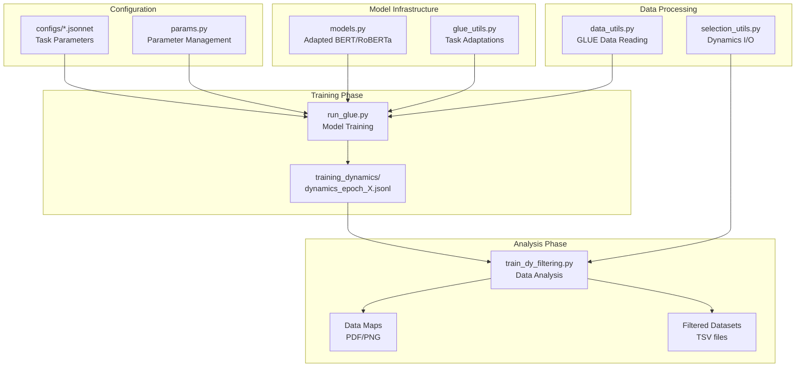
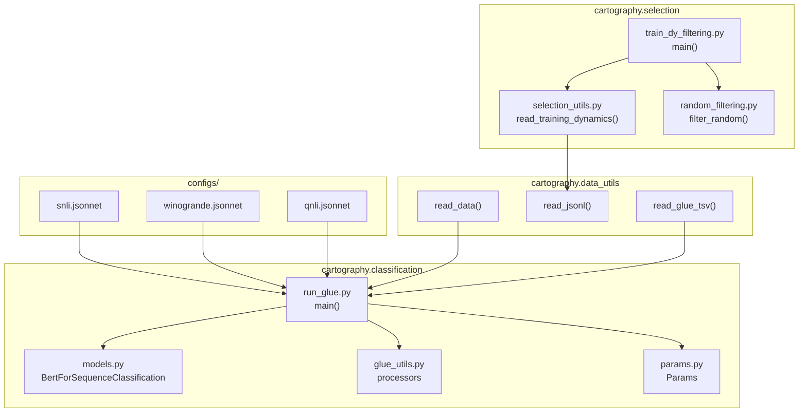
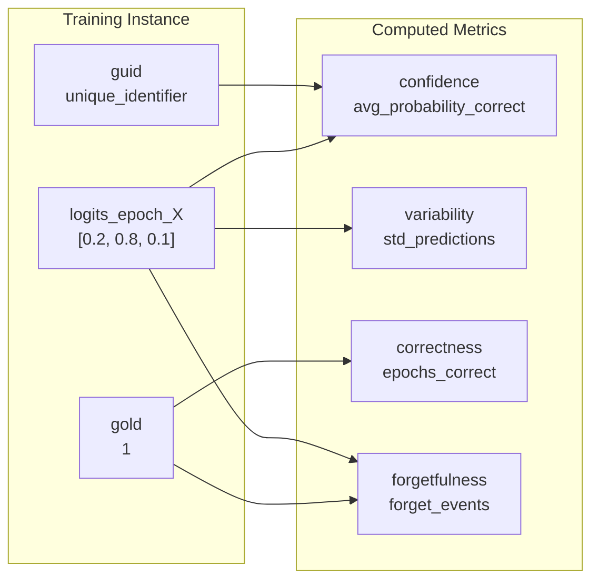
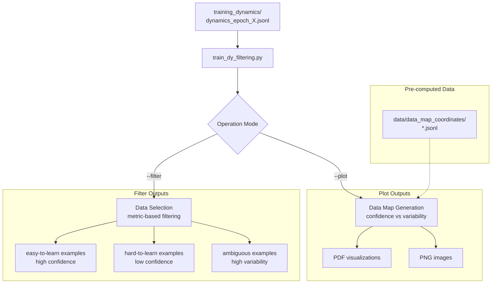
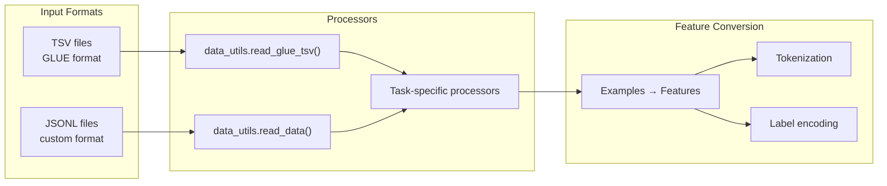

<!-- source: DeepWiki mcp.deepwiki.com · repo allenai/cartography · page 1 Overview · fetched 2026-10-26 -->

# Overview

Relevant source files

The following files were used as context for generating this wiki page:

- [README.md](README.md)

## Purpose and Scope

This document provides a comprehensive overview of the Dataset Cartography system, which enables researchers to analyze training dynamics and perform data selection for natural language processing tasks. The system implements the methodology described in "Dataset Cartography: Mapping and Diagnosing Datasets with Training Dynamics" (EMNLP 2020) and provides tools for understanding dataset characteristics through model training behavior.

Dataset Cartography allows users to train transformer-based models while collecting detailed training dynamics, visualize these dynamics as data maps, and filter datasets based on computed metrics. For specific implementation details of individual components, see [Core Systems](#3). For configuration guidance, see [Configuration Management](#4). For task-specific usage, see [Supported Tasks](#5).

## What is Dataset Cartography

Dataset Cartography is a methodology for understanding and analyzing datasets by examining how models learn from individual training examples over multiple epochs. The system tracks key metrics during training to categorize examples as easy-to-learn, hard-to-learn, or ambiguous, enabling targeted data selection and dataset analysis.

### Core Concepts

The system operates on three fundamental metrics computed from training dynamics:

| Metric | Description | Use Case |
|--------|-------------|----------|
| **Confidence** | Average probability assigned to correct label across epochs | Identifying easy vs hard examples |
| **Variability** | Standard deviation of model predictions across epochs | Finding ambiguous examples |
| **Correctness** | Number of epochs where example was predicted correctly | Measuring learning consistency |

Additional metrics include **forgetfulness** (examples learned then forgotten) and **threshold_closeness** (baseline comparison metric).

Sources: [README.md:1-115]()

## High-Level System Architecture

### Core Training and Analysis Pipeline

Sources: [README.md:26-41](), [README.md:48-68](), [README.md:70-87]()

### Code Entity Mapping

Sources: [README.md:30-36](), [README.md:52-58](), [README.md:74-81]()

## Training Dynamics Collection Workflow

The system collects training dynamics during model training by logging predictions and metrics for each training example at every epoch. This data is stored in JSONL format for subsequent analysis.

### Training Dynamics Data Format

The training dynamics files (`dynamics_epoch_X.jsonl`) contain fields specified in [README.md:42-46](). Each line represents one training instance with its learning trajectory across epochs.

### Key Training Components

- **`cartography.classification.run_glue`**: Main training script that handles model training while collecting dynamics
- **`cartography.classification.models`**: Adapted transformer models for sequence classification
- **`cartography.classification.params`**: Centralized parameter management system
- **Configuration files**: JSONNet-based task-specific parameter definitions

Sources: [README.md:26-46]()

## Data Analysis and Selection Workflow

After training dynamics collection, the system provides analysis and filtering capabilities through the `train_dy_filtering` module.

### Analysis Operations

### Selection Metrics and Strategies

The system supports multiple selection strategies based on training dynamics metrics:

| Strategy | Metric | Command Flag | Use Case |
|----------|--------|--------------|----------|
| Easy Examples | `confidence` | `--metric confidence --worst` | High-confidence instances |
| Hard Examples | `confidence` | `--metric confidence` | Low-confidence instances |
| Ambiguous Examples | `variability` | `--metric variability` | High-variability instances |
| Forgotten Examples | `forgetfulness` | `--metric forgetfulness` | Learning instability |
| Baseline Comparison | `threshold_closeness` | `--metric threshold_closeness` | Control experiments |

Sources: [README.md:48-87]()

## Supported Tasks and Data Formats

Dataset Cartography supports GLUE-style classification tasks with specialized processors for different task types:

### Task Support Matrix

| Task | Task Type | Processor | Configuration |
|------|-----------|-----------|---------------|
| **SNLI** | Natural Language Inference | `SNLIProcessor` | `configs/snli.jsonnet` |
| **MNLI** | Multi-Genre NLI | `GLUEProcessor` | `configs/mnli.jsonnet` |  
| **QNLI** | Question-answering NLI | `GLUEProcessor` | `configs/qnli.jsonnet` |
| **WINOGRANDE** | Commonsense Reasoning | `WinograndeProcessor` | `configs/winogrande.jsonnet` |

### Data Processing Pipeline

The system handles both standard GLUE TSV format and custom JSONL format, with automatic conversion to transformer-compatible features.

Sources: [README.md:37](), [README.md:50](), [README.md:77](), [README.md:83]()

## Key Components and Entry Points

### Primary Executables

- **Training**: `python -m cartography.classification.run_glue` - Train models with dynamics collection
- **Analysis**: `python -m cartography.selection.train_dy_filtering` - Generate data maps and filter datasets  
- **Configuration**: `configs/*.jsonnet` - Task-specific parameter definitions

### Core Modules

- **`cartography.classification`**: Model training, evaluation, and GLUE task handling
- **`cartography.selection`**: Data analysis, filtering, and visualization utilities
- **`cartography.data_utils`**: Data reading and processing utilities

### Output Artifacts

- **Training dynamics**: `training_dynamics/dynamics_epoch_X.jsonl` files
- **Data maps**: PDF/PNG visualizations showing confidence vs variability
- **Filtered datasets**: TSV files containing selected subsets based on metrics
- **Pre-computed coordinates**: `data/data_map_coordinates/*.jsonl` for reproduction

Sources: [README.md:30-36](), [README.md:52-58](), [README.md:74-81](), [README.md:60-68]()

---

