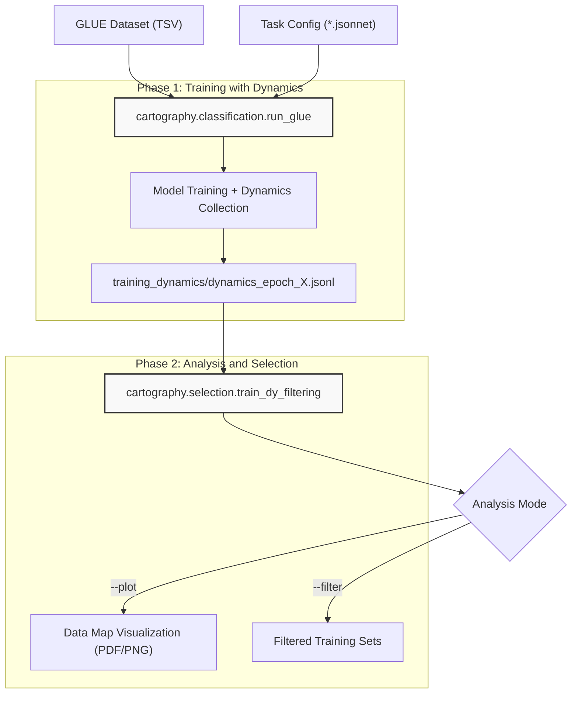
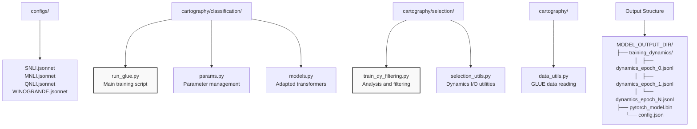

<!-- source: DeepWiki mcp.deepwiki.com · repo allenai/cartography · page 2 Getting Started · fetched 2026-10-26 -->

# Getting Started

<details>
<summary>Relevant source files</summary>

The following files were used as context for generating this wiki page:

- [.gitignore](.gitignore)
- [LICENSE](LICENSE)
- [README.md](README.md)
- [requirements.txt](requirements.txt)

</details>


This document provides step-by-step instructions for installing, configuring, and running Dataset Cartography to train models while collecting training dynamics and create data maps for analysis. It covers the essential setup requirements, basic command usage, and expected outputs to get you productive quickly.

For detailed information about specific tasks and their configurations, see [Supported Tasks](#5). For advanced analysis features and model adaptations, see [Advanced Features](#6).

## Prerequisites and Installation

Dataset Cartography is built on the HuggingFace Transformers library and requires several Python dependencies for data processing, visualization, and model training.

### Required Dependencies

The system requires the following key dependencies as specified in [requirements.txt:1-11]():

| Package | Version | Purpose |
|---------|---------|---------|
| `transformers` | Custom commit | BERT/RoBERTa model implementations |
| `torch` | 1.4.0 | PyTorch deep learning framework |
| `pandas` | 1.0.3 | Data manipulation and analysis |
| `matplotlib` | 3.2.1 | Basic plotting capabilities |
| `seaborn` | 0.10.0 | Statistical data visualization |
| `jsonnet` | 0.15.0 | Configuration file processing |
| `tensorboardx` | 2.0 | Training monitoring |
| `scikit-learn` | 0.22.2.post1 | Machine learning utilities |

### Installation

```bash
# Clone the repository
git clone https://github.com/allenai/cartography
cd cartography

# Install dependencies
pip install -r requirements.txt
```

**Note**: The system uses a specific commit of HuggingFace Transformers (`189113d8910308b9f3509c6946b2147ce57a0bf7`) to ensure compatibility with the training dynamics collection functionality.

Sources: [requirements.txt:1-11](), [README.md:22-23]()

## Core Workflow Overview

Dataset Cartography operates in a two-phase workflow where models are first trained while collecting training dynamics, then those dynamics are analyzed to create data maps and filter datasets.

### High-Level System Flow



### File Structure and Key Components



Sources: [README.md:26-46](), [README.md:48-68]()

## Basic Usage Examples

### Training a Model with Dynamics Collection

To train a model and collect training dynamics, use the `run_glue` module with a task-specific configuration:

```bash
python -m cartography.classification.run_glue \
    -c configs/SNLI.jsonnet \
    --do_train \
    --do_eval \
    -o ./output/snli_roberta
```

This command:
- Uses the SNLI configuration from [configs/SNLI.jsonnet]()
- Trains and evaluates the model (`--do_train --do_eval`)
- Outputs results to `./output/snli_roberta/`
- Creates training dynamics files in `./output/snli_roberta/training_dynamics/`

**Available Task Configurations:**
- `SNLI.jsonnet` - Stanford Natural Language Inference
- `MNLI.jsonnet` - Multi-Genre Natural Language Inference  
- `QNLI.jsonnet` - Question-answering Natural Language Inference
- `WINOGRANDE.jsonnet` - Commonsense reasoning

### Creating Data Maps

After training, visualize the training dynamics as data maps:

```bash
python -m cartography.selection.train_dy_filtering \
    --plot \
    --task_name SNLI \
    --model_dir ./output/snli_roberta \
    --model RoBERTa-Large
```

This generates visualization files showing the relationship between confidence and variability for each training example.

### Filtering Data by Training Dynamics

Select subsets of training data based on computed metrics:

```bash
python -m cartography.selection.train_dy_filtering \
    --filter \
    --task_name SNLI \
    --model_dir ./output/snli_roberta \
    --metric confidence \
    --data_dir /path/to/glue/data
```

**Available Metrics:**
- `confidence` - Average prediction probability
- `variability` - Standard deviation of predictions across epochs
- `correctness` - Number of epochs predicted correctly
- `forgetfulness` - Instances learned then forgotten
- `threshold_closeness` - Baseline comparison metric

Sources: [README.md:26-46](), [README.md:48-83]()

## Training Dynamics Data Format

The system produces training dynamics files with a specific JSON Lines format that enables analysis and filtering. Understanding this format is crucial for working with the outputs.

### Dynamics File Structure

Each `dynamics_epoch_X.jsonl` file contains one JSON object per training instance:

```json
{
  "guid": "example_12345",
  "logits_epoch_0": [0.8, 0.1, 0.1],
  "gold": 0
}
```

**Required Fields:**
- `guid` - Unique instance identifier matching the original dataset
- `logits_epoch_X` - Raw model predictions for epoch X
- `gold` - Index of the correct label (must align with logits array)

### Pre-computed Coordinates

The repository includes pre-computed data map coordinates for major tasks in [data/data_map_coordinates/](). These files contain computed metrics:

- `guid` - Instance identifier
- `index` - Position in dataset
- `confidence` - Average prediction confidence across epochs
- `variability` - Standard deviation of predictions
- `correctness` - Fraction of epochs predicted correctly

Sources: [README.md:41-46](), [README.md:60-68]()

## Expected Outputs and Next Steps

After running the basic workflow, you should have:

1. **Trained Model**: Standard transformer model files (`pytorch_model.bin`, `config.json`)
2. **Training Dynamics**: JSONL files tracking prediction changes across epochs
3. **Data Maps**: PDF/PNG visualizations showing confidence vs. variability
4. **Filtered Datasets**: TSV files with selected subsets based on metrics

### Typical Output Directory Structure

```
model_output_dir/
├── training_dynamics/
│   ├── dynamics_epoch_0.jsonl
│   ├── dynamics_epoch_1.jsonl
│   └── dynamics_epoch_N.jsonl
├── pytorch_model.bin
├── config.json
├── data_map_TASK_MODEL.pdf
└── filtered_data_METRIC/
    ├── easy_train.tsv
    ├── hard_train.tsv
    └── ambiguous_train.tsv
```

### Next Steps

- **Task-Specific Configuration**: Learn about configuring experiments for different NLP tasks in [Task Configuration Files](#4.2)
- **Advanced Analysis**: Explore diagnostic evaluation and specialized analysis tools in [Advanced Features](#6)
- **Custom Tasks**: Understand the data processing pipeline for adding new tasks in [Data Processing Utilities](#3.3)
- **API Usage**: Reference detailed function documentation in [API Reference](#7)

Sources: [README.md:39](), [README.md:17-18]()

---

