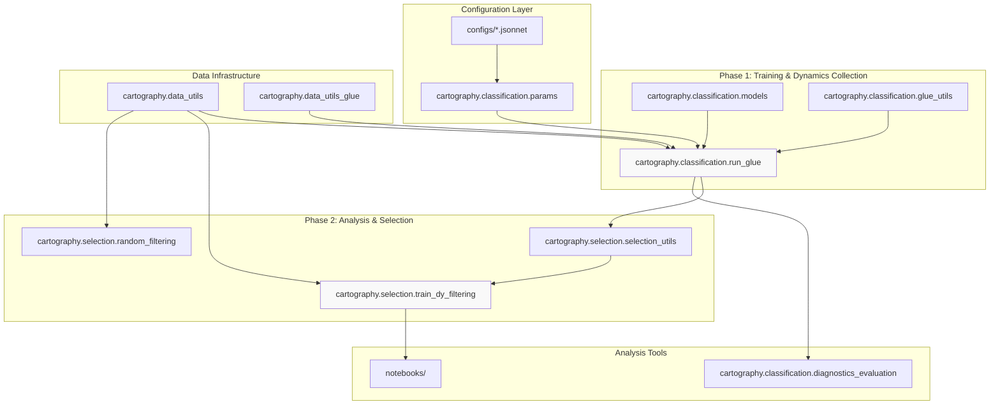
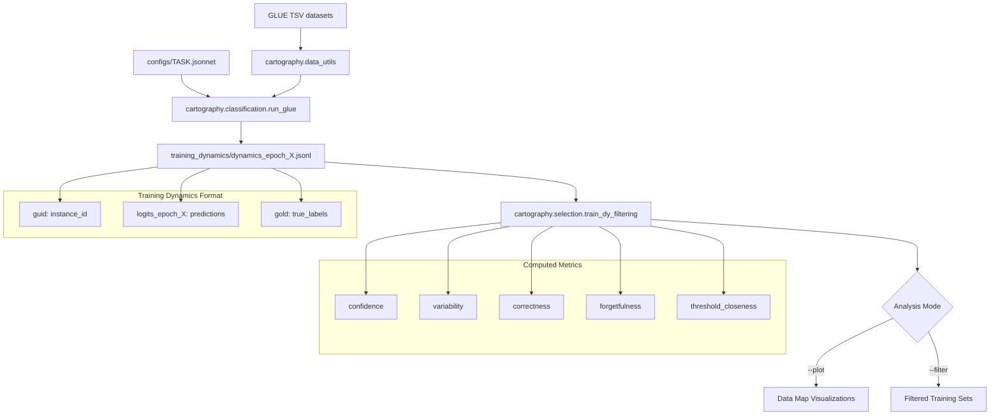
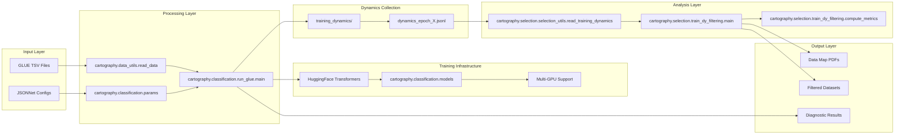

<!-- source: DeepWiki mcp.deepwiki.com · repo allenai/cartography · page 3 Core Systems · fetched 2026-10-26 -->

# Core Systems

Relevant source files

The following files were used as context for generating this wiki page:

- [README.md](README.md)
- [cartography/__init__.py](cartography/__init__.py)
- [cartography/classification/__init__.py](cartography/classification/__init__.py)
- [cartography/selection/__init__.py](cartography/selection/__init__.py)

## Purpose and Scope

This document provides a comprehensive overview of the core architectural components that make up the Dataset Cartography system and how they interact to enable training dynamics analysis and data selection. The system consists of two primary workflows: training models while collecting dynamics data, and analyzing those dynamics to create data maps and filtered datasets.

For specific implementation details of individual components, see [Training with Dynamics Collection](#3.1), [Data Analysis and Selection](#3.2), and [Data Processing Utilities](#3.3). For configuration management, see [Configuration Management](#4).

## System Overview

The Dataset Cartography system is built around a two-phase architecture that separates model training from data analysis. The core systems work together to collect training dynamics during model training, then analyze those dynamics to understand dataset characteristics.

### Primary System Components

**Sources:** [README.md:26-46](), [README.md:48-68](), [README.md:70-87]()

## Core Pipeline Architecture

The system implements a clear separation between training and analysis phases, with standardized data formats enabling interoperability between components.

### Training Dynamics Pipeline

**Sources:** [README.md:26-46](), [README.md:42-46](), [README.md:70-87]()

## Component Interactions

The core systems interact through well-defined interfaces and standardized data formats, enabling modular development and experimentation.

### Data Flow and System Integration

**Sources:** [README.md:26-36](), [README.md:48-58](), [README.md:70-81]()

## Key Architectural Patterns

### Configuration-Driven Design

The system uses a centralized configuration approach where `cartography.classification.params` manages all training parameters, while task-specific configurations are defined in JSONNet files under `configs/`. This pattern enables:

- **Reproducible Experiments**: All parameters are versioned and declarative
- **Task Extensibility**: New tasks can be added by creating new configuration files
- **Parameter Sharing**: Common settings are centralized while task-specific overrides are isolated

### Training Dynamics as First-Class Data

Training dynamics are collected and stored in a standardized JSONL format with required fields `guid`, `logits_epoch_X`, and `gold`. This design enables:

- **Cross-Model Compatibility**: Any training setup can produce compatible dynamics files
- **Offline Analysis**: Training and analysis phases are completely decoupled
- **Metric Computation**: Multiple analysis metrics can be computed from the same dynamics data

### Modular Analysis Pipeline

The `cartography.selection.train_dy_filtering` module serves as the central analysis engine, supporting both visualization (`--plot`) and data selection (`--filter`) modes. This modularity allows:

- **Flexible Workflows**: Users can run analysis without retraining models
- **Multiple Metrics**: Support for `confidence`, `variability`, `correctness`, `forgetfulness`, and `threshold_closeness`
- **Baseline Comparisons**: Integration with `cartography.selection.random_filtering` for control experiments

**Sources:** [README.md:37](), [README.md:42-46](), [README.md:75-87]()

## System Dependencies

| Component | Primary Dependencies | Purpose |
|-----------|---------------------|---------|
| `cartography.classification.run_glue` | HuggingFace Transformers, `cartography.classification.models` | Model training with dynamics collection |
| `cartography.selection.train_dy_filtering` | `cartography.selection.selection_utils`, `cartography.data_utils` | Dynamics analysis and data selection |
| `cartography.classification.params` | `configs/*.jsonnet` | Centralized parameter management |
| `cartography.data_utils` | - | GLUE-style data reading and processing |

The system's modular architecture allows components to be used independently or in combination, supporting both end-to-end workflows and specialized analysis tasks.

**Sources:** [README.md:22](), [cartography/classification/__init__.py:1](), [cartography/selection/__init__.py:1]()

---

