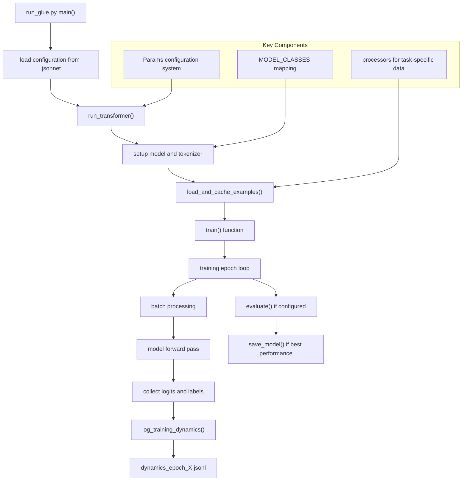
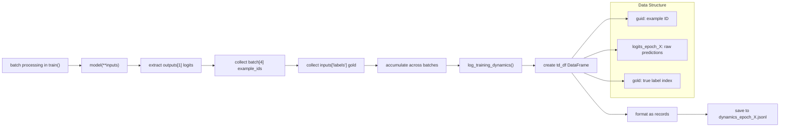
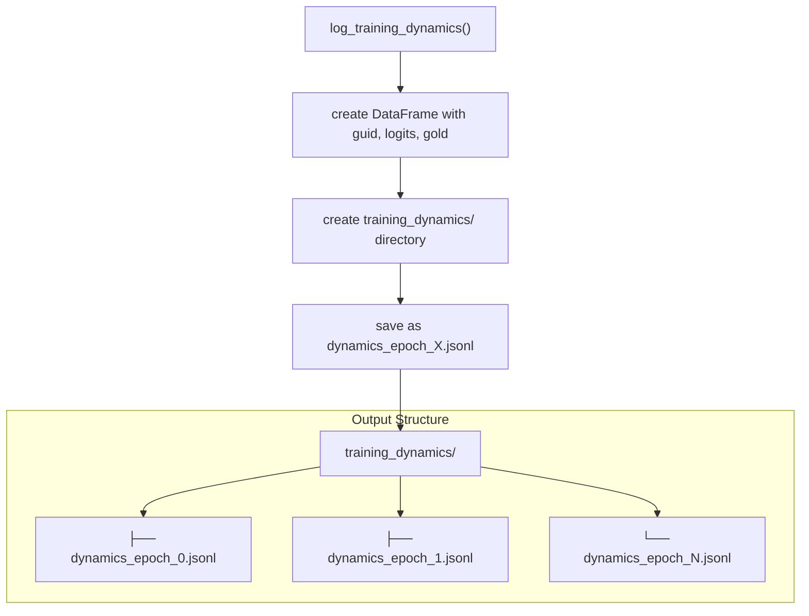
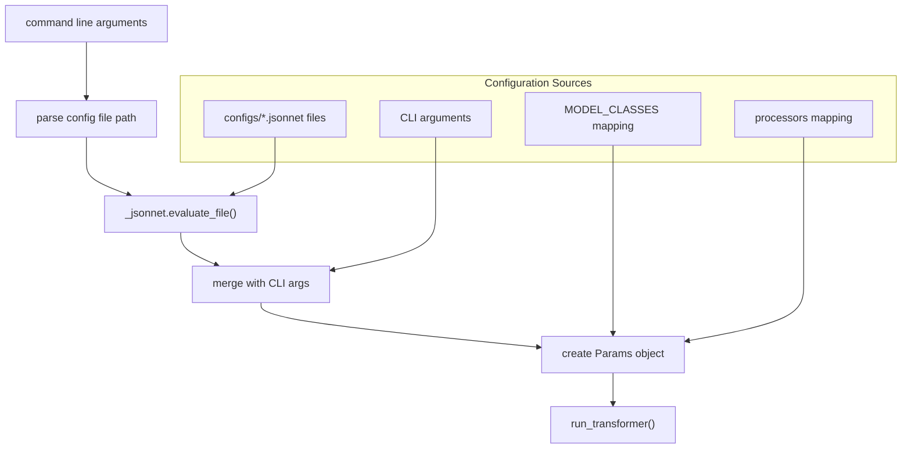
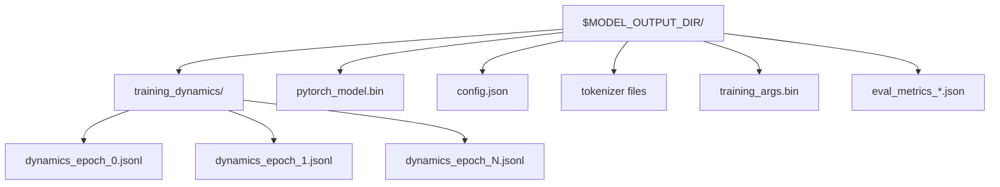
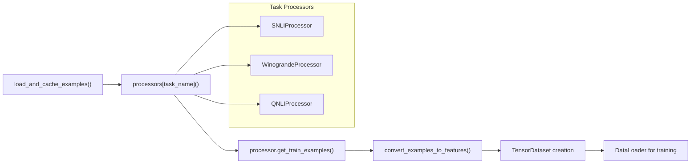

<!-- source: DeepWiki mcp.deepwiki.com · repo allenai/cartography · page 3.1 Training with Dynamics Collection · fetched 2026-10-26 -->

# Training with Dynamics Collection

<details>
<summary>Relevant source files</summary>

The following files were used as context for generating this wiki page:

- [README.md](README.md)
- [cartography/classification/run_glue.py](cartography/classification/run_glue.py)
- [cartography/selection/selection_utils.py](cartography/selection/selection_utils.py)

</details>


This document covers the core training system that simultaneously trains GLUE-style models while collecting training dynamics data. The system is implemented primarily in `cartography.classification.run_glue` and produces the essential training dynamics files used for data analysis and selection.

For information about analyzing the collected training dynamics and filtering datasets, see [Data Analysis and Selection](#3.2). For details on configuring training parameters, see [Parameter System](#4.1).

## Purpose and Scope

The training with dynamics collection system serves two primary functions:

1. **Model Training**: Fine-tunes transformer models (BERT, RoBERTa) on GLUE-style classification tasks
2. **Dynamics Collection**: Captures training dynamics (logits, predictions, losses) at each epoch for subsequent analysis

This system forms the foundation of the Dataset Cartography workflow, as the collected dynamics enable the computation of key metrics like confidence, variability, and correctness that characterize training examples.

## System Architecture

The training system integrates model training with dynamics logging through a unified pipeline:

### Core Training Pipeline



**Sources:** [cartography/classification/run_glue.py:757-794](), [cartography/classification/run_glue.py:594-755]()

### Training Dynamics Collection Flow



**Sources:** [cartography/classification/run_glue.py:232-242](), [cartography/classification/run_glue.py:322-327](), [cartography/selection/selection_utils.py:16-34]()

## Key Components

### Main Training Function

The `train()` function in `run_glue.py` orchestrates both model training and dynamics collection:

| Component | Purpose | Key Code Location |
|-----------|---------|-------------------|
| **Batch Processing Loop** | Iterates through training batches | [cartography/classification/run_glue.py:216-242]() |
| **Dynamics Accumulation** | Collects logits, IDs, and labels | [cartography/classification/run_glue.py:232-242]() |
| **Epoch Logging** | Saves dynamics after each epoch | [cartography/classification/run_glue.py:322-327]() |
| **Model Evaluation** | Optionally evaluates during training | [cartography/classification/run_glue.py:318-320]() |

### Training Dynamics Logging

The `log_training_dynamics()` function creates structured output files:



**Sources:** [cartography/selection/selection_utils.py:16-34]()

### Model and Task Configuration

The system supports multiple model types and tasks through a flexible configuration system:

| Configuration Element | Purpose | Implementation |
|----------------------|---------|----------------|
| **MODEL_CLASSES** | Maps model types to classes | [cartography/classification/run_glue.py:82-87]() |
| **processors** | Task-specific data processing | [cartography/classification/run_glue.py:49]() |
| **Params system** | Centralized parameter management | [cartography/classification/run_glue.py:58]() |

## Execution and Configuration

### Command Line Interface

The training system is executed through the main module:

```bash
python -m cartography.classification.run_glue \
    -c configs/$TASK.jsonnet \
    --do_train \
    --do_eval \
    -o $MODEL_OUTPUT_DIR
```

### Configuration Flow



**Sources:** [cartography/classification/run_glue.py:785-790](), [cartography/classification/params.py]()

## Output Data Structure

### Training Dynamics Format

Each `dynamics_epoch_X.jsonl` file contains one JSON record per training example:

| Field | Type | Description | Example |
|-------|------|-------------|---------|
| `guid` | String/Integer | Unique example identifier | `"train_1234"` |
| `logits_epoch_X` | Array[Float] | Raw model predictions for epoch X | `[0.2, -0.8, 1.1]` |
| `gold` | Integer | True label index | `2` |

### Directory Structure

The training process creates the following output structure:



**Sources:** [cartography/selection/selection_utils.py:28-33](), [cartography/classification/run_glue.py:369-374]()

## Integration Points

### Data Loading Integration

The system integrates with data processing utilities:



**Sources:** [cartography/classification/run_glue.py:518-591](), [cartography/classification/run_glue.py:480-500]()

### Model Architecture Integration

The training system works with adapted transformer models:

| Model Type | Configuration Key | Model Class |
|------------|------------------|-------------|
| **BERT Classification** | `"bert"` | `AdaptedBertForSequenceClassification` |
| **BERT Multiple Choice** | `"bert_mc"` | `AdaptedBertForMultipleChoice` |
| **RoBERTa Classification** | `"roberta"` | `AdaptedRobertaForSequenceClassification` |
| **RoBERTa Multiple Choice** | `"roberta_mc"` | `AdaptedRobertaForMultipleChoice` |

**Sources:** [cartography/classification/run_glue.py:82-87](), [cartography/classification/models.py]()

The training with dynamics collection system provides the essential foundation for Dataset Cartography by simultaneously optimizing model performance and capturing the training dynamics needed for subsequent data analysis and selection tasks.

---

