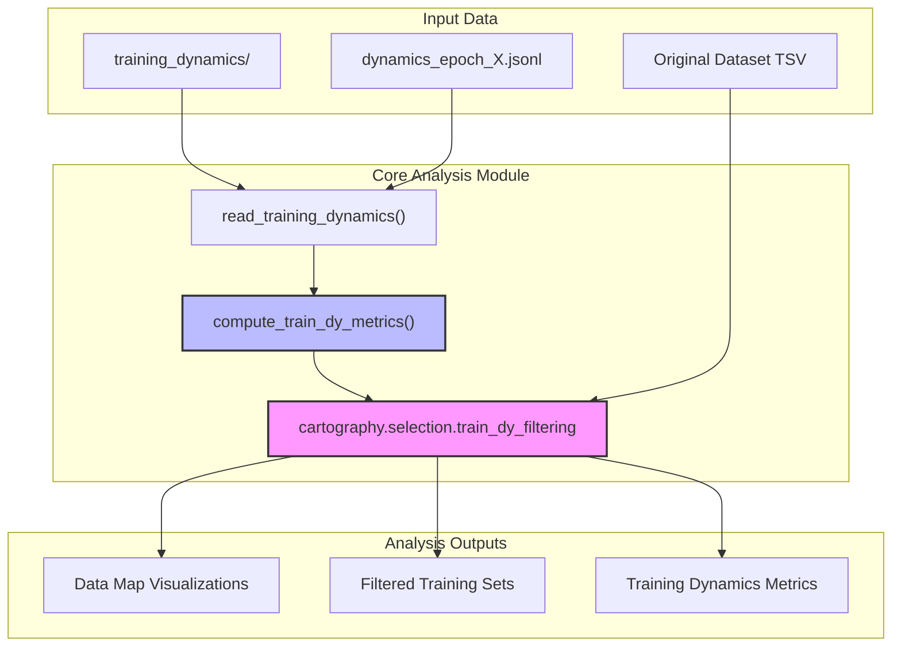
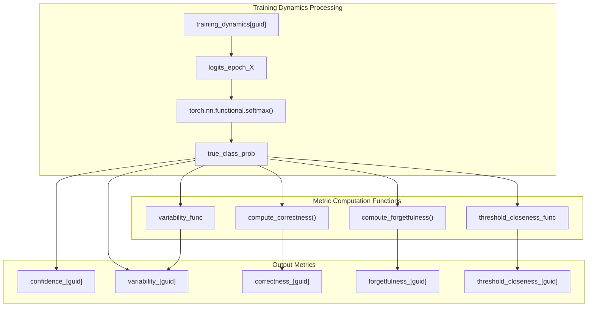
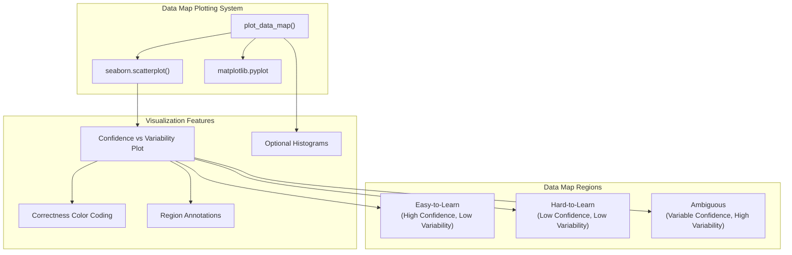
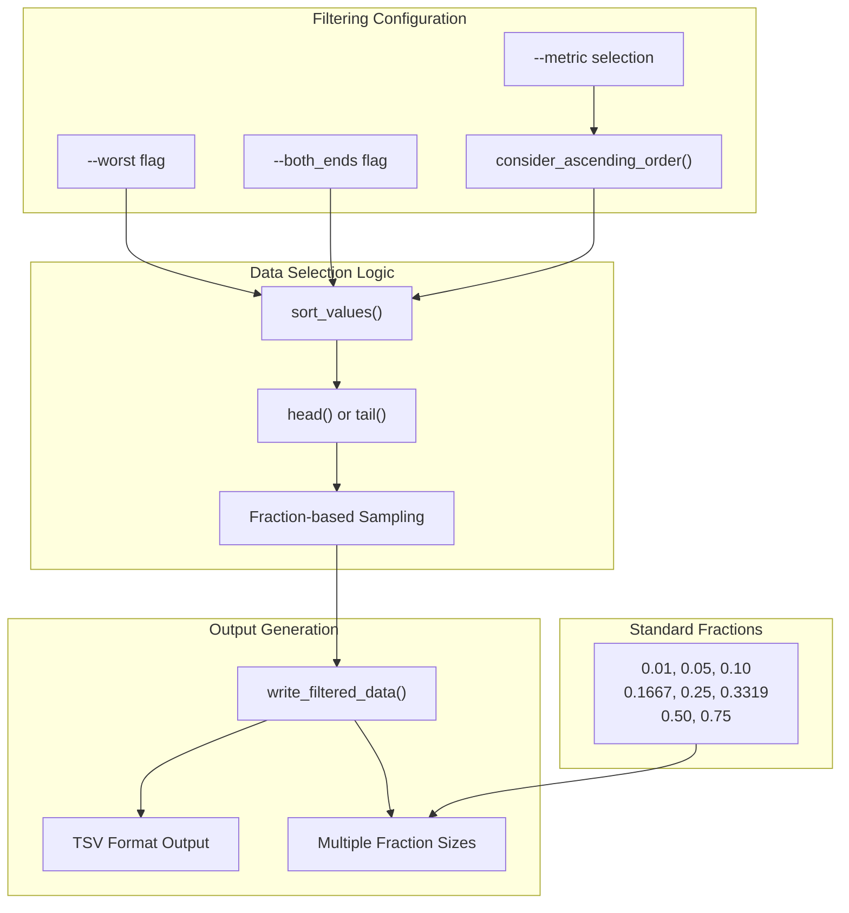
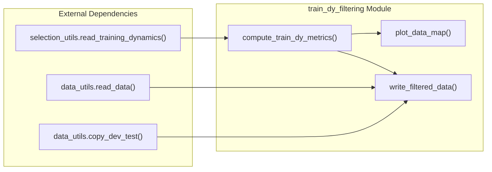

<!-- source: DeepWiki mcp.deepwiki.com · repo allenai/cartography · page 3.2 Data Analysis and Selection · fetched 2026-10-26 -->

# Data Analysis and Selection

<details>
<summary>Relevant source files</summary>

The following files were used as context for generating this wiki page:

- [README.md](README.md)
- [cartography/selection/train_dy_filtering.py](cartography/selection/train_dy_filtering.py)

</details>


This document covers the analysis of training dynamics and selection of data subsets based on computed metrics in Dataset Cartography. This system enables researchers to understand dataset characteristics through data maps and create filtered training sets for targeted experiments.

For information about training models and collecting training dynamics, see [Training with Dynamics Collection](#3.1). For data processing utilities, see [Data Processing Utilities](#3.3).

## Overview

The data analysis and selection system operates on training dynamics collected during model training to compute instance-level metrics and enable data filtering. The core functionality is implemented in the `train_dy_filtering` module, which provides both visualization capabilities through data maps and data selection capabilities through metric-based filtering.



**Data Analysis and Selection System Architecture**

Sources: [cartography/selection/train_dy_filtering.py:1-26](), [README.md:48-88]()

## Training Dynamics Metrics

The system computes five key metrics from training dynamics to characterize each training instance:

### Core Metrics

| Metric | Description | Function | Use Case |
|--------|-------------|----------|----------|
| **Confidence** | Average probability assigned to true class | `np.mean(true_probs_trend)` | Identify easy vs hard examples |
| **Variability** | Standard deviation of true class probabilities | `np.std(conf)` | Identify ambiguous examples |
| **Correctness** | Number of epochs predicted correctly | `sum(trend)` | Measure learning consistency |
| **Forgetfulness** | Times forgotten after being learned | `compute_forgetfulness()` | Detect unstable learning |
| **Threshold Closeness** | Distance from decision boundary | `conf * (1 - conf)` | Baseline metric from prior work |



**Training Dynamics Metric Computation Pipeline**

Sources: [cartography/selection/train_dy_filtering.py:66-156](), [cartography/selection/train_dy_filtering.py:35-63]()

### Metric Implementation Details

The `compute_train_dy_metrics` function processes training dynamics across all epochs to compute these metrics:

- **Confidence calculation**: Averages the softmax probability of the true class across all training epochs [cartography/selection/train_dy_filtering.py:126]()
- **Variability calculation**: Uses standard deviation by default, with optional confidence interval computation when `--include_ci` flag is set [cartography/selection/train_dy_filtering.py:85-87]()
- **Forgetfulness calculation**: Implements the algorithm from "Example Forgetting" paper, tracking learning and forgetting patterns [cartography/selection/train_dy_filtering.py:35-56]()

Sources: [cartography/selection/train_dy_filtering.py:66-156]()

## Data Map Visualization

Data maps provide visual representation of dataset characteristics by plotting confidence against variability, with correctness encoded as color/style.

### Data Map Components



**Data Map Visualization Architecture**

The `plot_data_map` function creates scatter plots with the following features:
- **X-axis**: Variability (standard deviation of predictions)
- **Y-axis**: Confidence (average true class probability)  
- **Color/Style**: Correctness fraction (normalized to 0-1 range)
- **Annotations**: Three distinct regions labeled as "easy-to-learn", "hard-to-learn", and "ambiguous"

Optional histogram panels show distributions of confidence, variability, and correctness when `show_hist=True`.

Sources: [cartography/selection/train_dy_filtering.py:238-335]()

### Region Interpretation

The data map divides the training data into three conceptual regions:

1. **Easy-to-learn** (high confidence, low variability): Examples consistently predicted correctly with high confidence
2. **Hard-to-learn** (low confidence, low variability): Examples consistently predicted incorrectly or with low confidence  
3. **Ambiguous** (high variability): Examples with inconsistent predictions across training epochs

Sources: [cartography/selection/train_dy_filtering.py:284-296]()

## Data Filtering and Selection

The system enables filtering training data based on computed metrics to create targeted training subsets.

### Filtering Process



**Data Filtering Pipeline**

### Supported Filtering Metrics

The `consider_ascending_order` function determines sort order for each metric:

| Metric | Ascending Order | Selects |
|--------|----------------|---------|
| `confidence` | `True` | High confidence (easy) first |
| `variability` | `False` | High variability (ambiguous) first |
| `correctness` | `True` | High correctness (learnable) first |  
| `forgetfulness` | `False` | High forgetfulness (unstable) first |
| `threshold_closeness` | `False` | High boundary proximity first |

The `--worst` flag inverts the selection order, while `--both_ends` selects from both extremes (70% from one end, 30% from the other).

Sources: [cartography/selection/train_dy_filtering.py:159-175](), [cartography/selection/train_dy_filtering.py:177-236]()

### Output Structure

Filtered datasets are generated at multiple fraction sizes and written in GLUE-compatible TSV format:

```
filtered/
└── cartography_{metric}_{fraction}/
    └── {task_name}/
        ├── train.tsv
        ├── dev.tsv  (copied unchanged)
        └── test.tsv (copied unchanged)
```

The system preserves development and test sets while creating filtered training sets using `copy_dev_test` utility.

Sources: [cartography/selection/train_dy_filtering.py:198-236]()

## Command-Line Interface

The `train_dy_filtering` module provides a comprehensive command-line interface for both plotting and filtering operations.

### Key Arguments

| Argument | Purpose | Example |
|----------|---------|---------|
| `--plot` | Generate data map visualizations | `--plot` |
| `--filter` | Create filtered datasets | `--filter --metric confidence` |
| `--model_dir` | Directory with training dynamics | `--model_dir ./model_output/` |
| `--data_dir` | Original GLUE data directory | `--data_dir ./glue_data/` |
| `--task_name` | Task identifier | `--task_name SNLI` |
| `--metric` | Filtering metric | `--metric variability` |
| `--burn_out` | Limit epochs for analysis | `--burn_out 10` |

### Usage Examples

**Generate data maps**:
```bash
python -m cartography.selection.train_dy_filtering \
    --plot \
    --task_name SNLI \
    --model_dir ./model_output/ \
    --model RoBERTa-Large
```

**Filter data by confidence**:
```bash
python -m cartography.selection.train_dy_filtering \
    --filter \
    --task_name SNLI \
    --model_dir ./model_output/ \
    --metric confidence \
    --data_dir ./glue_data/
```

Sources: [cartography/selection/train_dy_filtering.py:337-424](), [README.md:50-88]()

### Integration with Selection Utilities

The module integrates with `selection_utils.read_training_dynamics` to read training dynamics and `data_utils` for original dataset handling:



**Module Integration Architecture**

Sources: [cartography/selection/train_dy_filtering.py:24-25](), [cartography/selection/train_dy_filtering.py:396-403]()

---

