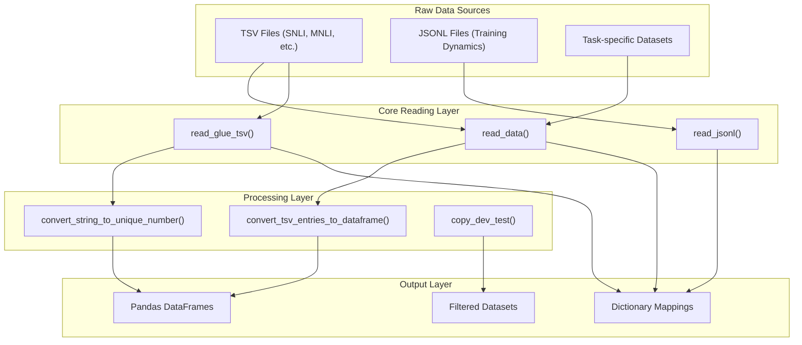
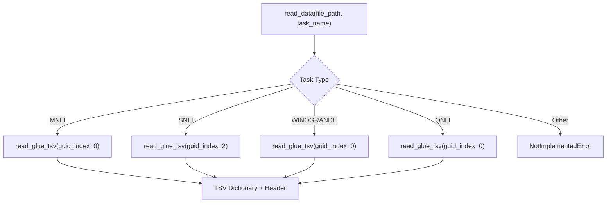
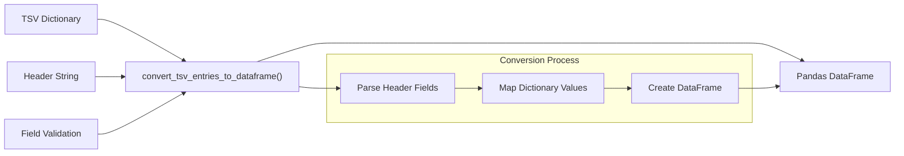
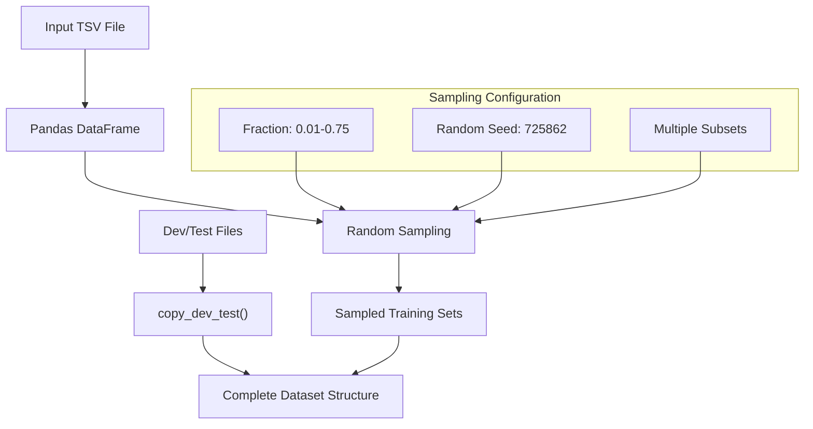
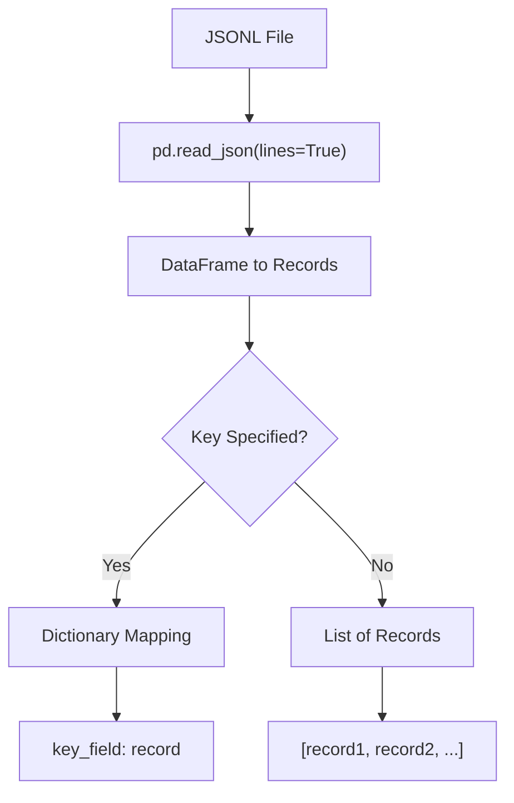

<!-- source: DeepWiki mcp.deepwiki.com · repo allenai/cartography · page 3.3 Data Processing Utilities · fetched 2026-10-26 -->

# Data Processing Utilities

Relevant source files

The following files were used as context for generating this wiki page:

- [cartography/data_utils.py](cartography/data_utils.py)
- [cartography/data_utils_glue.py](cartography/data_utils_glue.py)
- [cartography/selection/random_filtering.py](cartography/selection/random_filtering.py)

## Purpose and Scope

This document covers the data processing utilities in Dataset Cartography that handle reading, converting, and manipulating datasets in GLUE-style formats. These utilities serve as the foundation layer for data ingestion, providing standardized interfaces for reading TSV files, converting between data formats, and preparing datasets for training and analysis.

For information about training dynamics data specifically, see [Data Analysis and Selection](#3.2). For task-specific dataset configurations, see [Supported Tasks](#5).

## Data Processing Pipeline Overview

The data processing utilities form a three-layer architecture that transforms raw data files into structured formats suitable for model training and analysis.

### Data Processing Architecture

Sources: [cartography/data_utils.py:17-43](), [cartography/data_utils_glue.py:31-80](), [cartography/data_utils.py:91-105]()

## Core Data Reading Functions

### Task-Specific Data Reading

The `read_data()` function provides a unified interface for reading different GLUE-style tasks, routing to appropriate parsers based on task characteristics.

| Task | GUID Index | Special Handling |
|------|------------|------------------|
| SNLI | 2 | Multiple annotator labels |
| MNLI | 0 | Matched/mismatched splits |
| WINOGRANDE | 0 | Multiple choice format |
| QNLI | 0 | Question-answer pairs |

Sources: [cartography/data_utils.py:17-43]()

### GLUE TSV Processing

The `read_glue_tsv()` function handles the low-level parsing of TSV files with GLUE-specific formatting requirements.

**Key Features:**
- Handles variable GUID positions across tasks
- Filters out invalid labels (`"-"` or empty strings)
- Manages multiple annotator labels in SNLI/MNLI
- Converts string GUIDs to integers when needed

Sources: [cartography/data_utils_glue.py:31-80]()

## Data Format Conversion

### TSV to DataFrame Conversion

The system provides utilities to convert between TSV dictionaries and pandas DataFrames for efficient data manipulation.

Sources: [cartography/data_utils.py:45-59]()

### String ID to Integer Conversion

For tasks like SNLI with complex string identifiers, the system converts them to unique integers for tensor processing.

**SNLI ID Conversion Rules:**
- `vg_len` prefix → code `555`
- `vg_verb` prefix → code `444`  
- Other formats → code `000`
- Last character mapping: `{'e': '0', 'c': '1', 'n': '2'}`

Sources: [cartography/data_utils_glue.py:9-28]()

## Random Sampling and Filtering

### Baseline Dataset Creation

The `random_filtering.py` script creates randomly sampled subsets for baseline comparisons in data selection experiments.

**Default Sampling Fractions:**
`[0.01, 0.05, 0.10, 0.1667, 0.25, 0.33, 0.50, 0.75]`

Sources: [cartography/selection/random_filtering.py:52-83]()

## File I/O Operations

### Development and Test Set Management

The `copy_dev_test()` function handles task-specific file copying for data selection experiments, ensuring consistent evaluation sets across different training subsets.

| Task | Dev File | Test File |
|------|----------|-----------|
| MNLI | `dev_matched.tsv` | `dev_mismatched.tsv` |
| SNLI | `dev.tsv` | `test.tsv` |
| QNLI | `dev.tsv` | `test.tsv` |
| WINOGRANDE | `dev.tsv` | `test.tsv` |

Sources: [cartography/data_utils.py:62-88]()

### JSONL Reading for Training Dynamics

The `read_jsonl()` function processes training dynamics files, creating mappings between example identifiers and their dynamic properties.

**Common Usage:**
- Default key: `"pairID"` for SNLI/MNLI
- Returns mapping for quick example lookup
- Used in training dynamics analysis pipeline

Sources: [cartography/data_utils.py:91-105]()

## Integration with Core Systems

These data processing utilities serve as the foundation for the broader Dataset Cartography system, providing standardized data access patterns used throughout the codebase.

**Primary Integration Points:**
- Training pipeline (`run_glue`) uses `read_data()` for dataset loading
- Analysis tools (`train_dy_filtering`) use `read_jsonl()` for dynamics data
- Random baseline creation uses the complete utility stack
- Task processors leverage format conversion functions

The utilities maintain consistent interfaces while handling the complexity of different data formats and task-specific requirements, enabling the higher-level systems to focus on their core functionality.

Sources: [cartography/data_utils.py:1-105](), [cartography/data_utils_glue.py:1-80](), [cartography/selection/random_filtering.py:1-84]()

---

