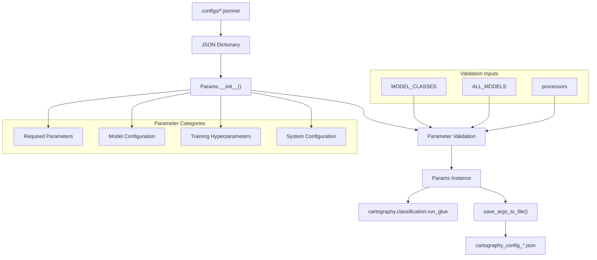
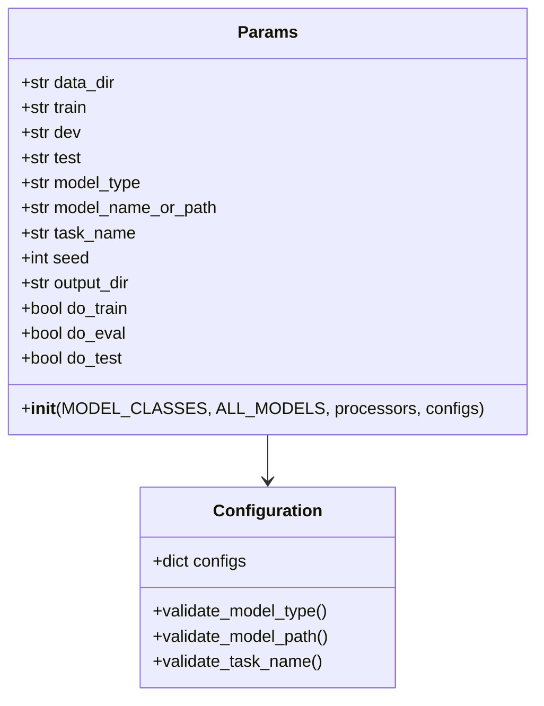
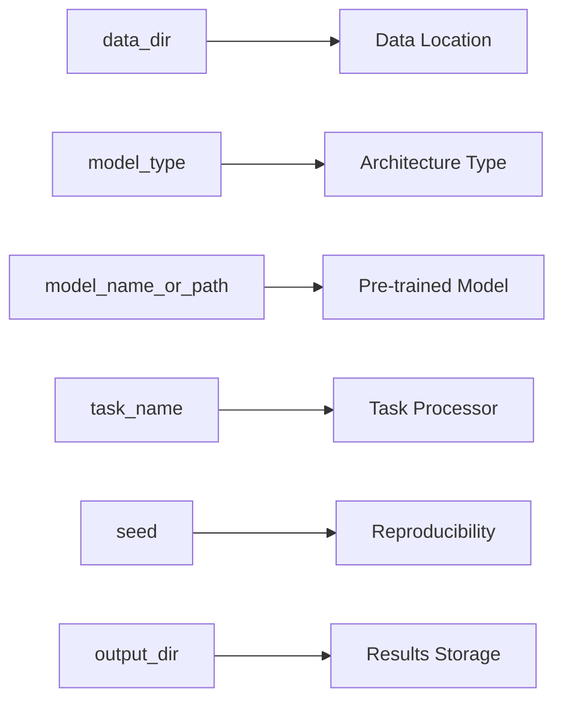
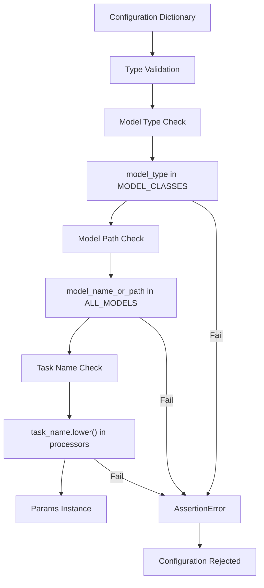
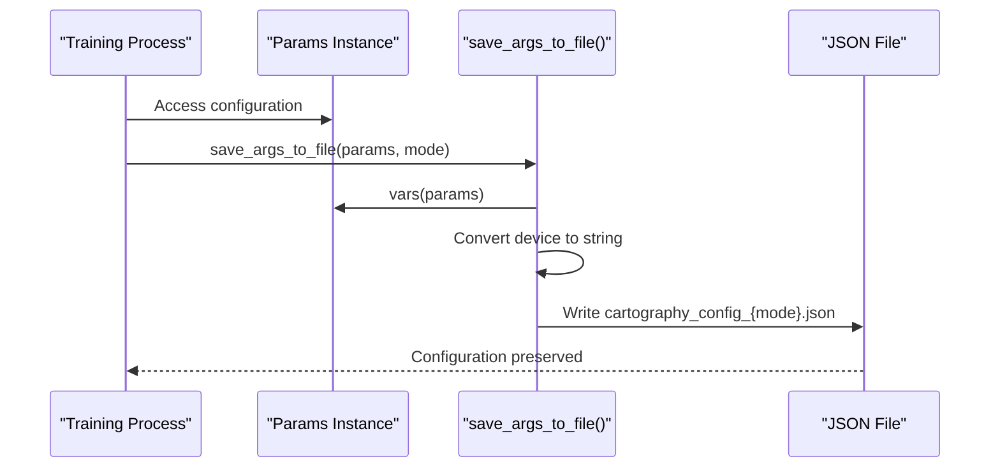
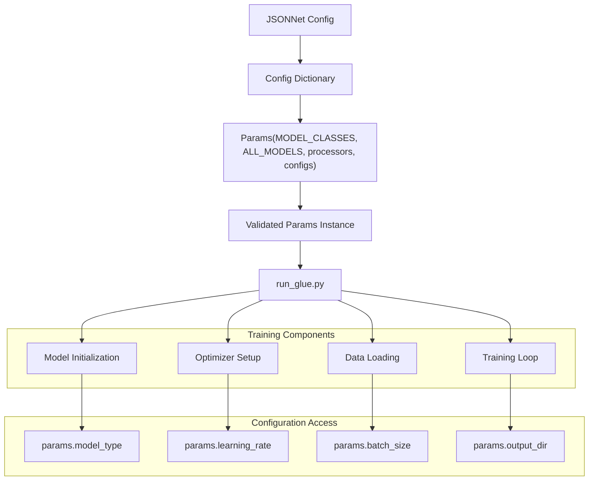

<!-- source: DeepWiki mcp.deepwiki.com · repo allenai/cartography · page 4 Configuration Management · fetched 2026-10-26 -->

# Configuration Management

Relevant source files

The following files were used as context for generating this wiki page:

- [cartography/classification/params.py](cartography/classification/params.py)

This document explains how Dataset Cartography manages configuration parameters for model training, evaluation, and data processing. The configuration system provides a centralized way to specify all parameters needed for experiments using JSONNet configuration files and a unified parameter class.

For information about specific task configurations, see [Task Configuration Files](#4.2). For details about the parameter validation system, see [Parameter System](#4.1).

## Configuration Architecture

The configuration system in Dataset Cartography follows a two-tier architecture where JSONNet configuration files define experiment parameters, which are then loaded and validated through a centralized `Params` class.

### Configuration Flow Diagram

Sources: [cartography/classification/params.py:1-159]()

## The Params Class

The `Params` class serves as the central configuration management system, consolidating all parameters required for transformer-based classification tasks. It performs validation and type checking during initialization.

### Core Configuration Structure

The `Params` class constructor takes four key inputs and performs validation against them:

| Input Parameter | Purpose | Validation |
|----------------|---------|------------|
| `MODEL_CLASSES` | Available model architectures | Validates `model_type` exists |
| `ALL_MODELS` | Supported pre-trained models | Validates `model_name_or_path` exists |
| `processors` | Task processors | Validates `task_name` is supported |
| `configs` | Configuration dictionary | Source of all parameter values |

Sources: [cartography/classification/params.py:5-31]()

## Parameter Categories

The configuration system organizes parameters into distinct categories based on their functional role in the training pipeline.

### Required Parameters

These parameters must be specified in every configuration:

- `data_dir`: Directory containing task data files
- `model_type`: Model architecture (bert, roberta, etc.)
- `model_name_or_path`: Pre-trained model identifier
- `task_name`: Task name for processor selection
- `seed`: Random seed for reproducibility
- `output_dir`: Directory for model outputs and checkpoints

Sources: [cartography/classification/params.py:14-37]()

### Training Hyperparameters

Training behavior is controlled through these parameters:

| Parameter | Default | Range/Type | Description |
|-----------|---------|------------|-------------|
| `per_gpu_train_batch_size` | 96 | int | Training batch size per GPU |
| `per_gpu_eval_batch_size` | 96 | int | Evaluation batch size per GPU |
| `learning_rate` | 1e-5 | float | Initial learning rate for Adam |
| `num_train_epochs` | 3.0 | float | Total training epochs |
| `max_steps` | -1 | int | Max training steps (overrides epochs) |
| `warmup_steps` | 0 | int | Linear warmup steps |
| `weight_decay` | 0.0 | float | L2 regularization weight |
| `max_grad_norm` | 1.0 | float | Gradient clipping threshold |

Sources: [cartography/classification/params.py:78-108]()

### Model and Data Configuration

Model-specific and data processing parameters:

| Parameter | Default | Description |
|-----------|---------|-------------|
| `max_seq_length` | 128 | Maximum input sequence length |
| `do_lower_case` | True | Whether to lowercase input text |
| `config_name` | "" | Custom config name if different from model |
| `tokenizer_name` | "" | Custom tokenizer if different from model |
| `cache_dir` | "" | Directory for downloaded model cache |
| `features_cache_dir` | `{data_dir}/cache_{seed}` | Feature preprocessing cache |

Sources: [cartography/classification/params.py:50-66]()

## Configuration Validation and Type Enforcement

The `Params` class performs strict validation during initialization to catch configuration errors early:

### Validation Process

The validation ensures:
- `model_type` corresponds to a supported architecture
- `model_name_or_path` refers to an available pre-trained model
- `task_name` has a corresponding processor implementation

Sources: [cartography/classification/params.py:23-31]()

## Configuration Persistence

The system provides configuration serialization through the `save_args_to_file` function, which creates a complete record of all parameters used in an experiment.

### Configuration Serialization

The serialization process:
1. Extracts all parameters using `vars(params)`
2. Converts non-serializable objects (like `torch.device`) to strings
3. Writes formatted JSON with sorted keys and indentation
4. Creates mode-specific files (e.g., `cartography_config_train.json`)

Sources: [cartography/classification/params.py:149-159]()

## Integration with Training Pipeline

The configuration system integrates seamlessly with the main training pipeline through dependency injection:

The configuration flows through the system by:
- Providing model architecture selection
- Setting training hyperparameters
- Defining data processing parameters
- Specifying output locations and behavior

Sources: [cartography/classification/params.py:10-147]()

---

