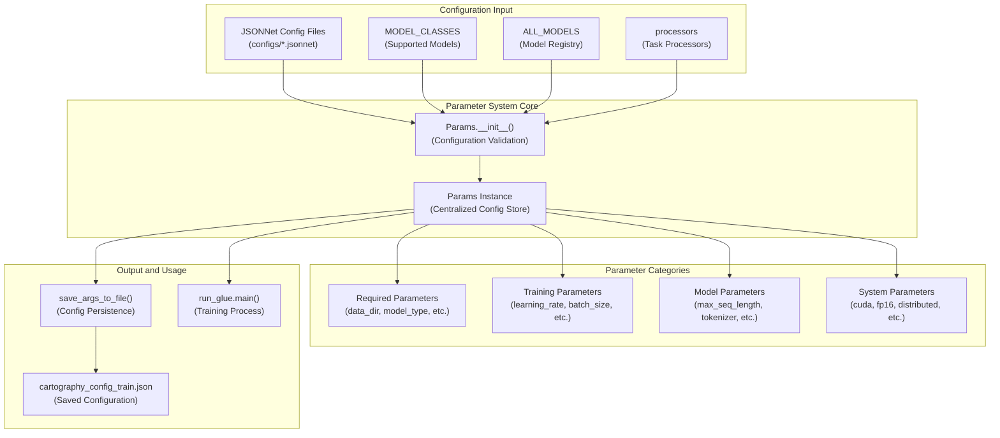
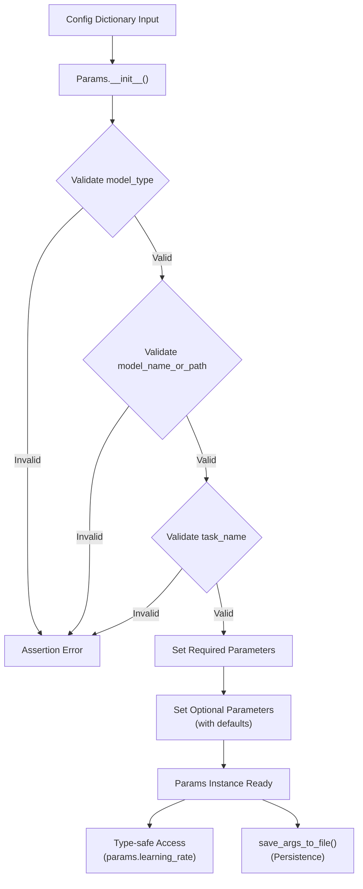
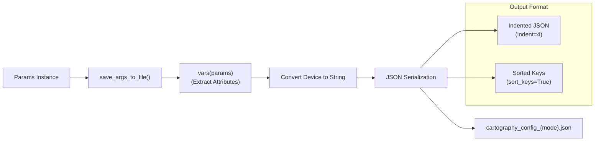

<!-- source: DeepWiki mcp.deepwiki.com · repo allenai/cartography · page 4.1 Parameter System · fetched 2026-10-26 -->

# Parameter System

Relevant source files

The following files were used as context for generating this wiki page:

- [cartography/classification/params.py](cartography/classification/params.py)

This document covers the centralized parameter management system in Dataset Cartography, specifically the `Params` class and its role in configuring transformer-based classification experiments. This system provides a unified interface for managing all configuration parameters required for training and evaluation.

For information about task-specific configuration files that feed into this parameter system, see [Task Configuration Files](#4.2). For details about the training process that uses these parameters, see [Training with Dynamics Collection](#3.1).

## Overview

The parameter system is implemented through the `Params` class in [cartography/classification/params.py](), which serves as the central configuration hub for all training and evaluation operations. It validates and stores parameters from JSONNet configuration files, providing type safety and default values for the entire system.

## Parameter System Architecture

Sources: [cartography/classification/params.py:1-159]()

## Parameter Categories

The `Params` class organizes configuration into several logical categories:

### Required Parameters

These parameters must be provided and are validated during initialization:

| Parameter | Type | Purpose | Validation |
|-----------|------|---------|------------|
| `data_dir` | str | Directory containing task data | None |
| `model_type` | str | Model architecture type | Must exist in `MODEL_CLASSES` |
| `model_name_or_path` | str | Pre-trained model identifier | Must exist in `ALL_MODELS` |
| `task_name` | str | Task identifier | Must exist in `processors` |
| `seed` | int | Random seed for reproducibility | None |
| `output_dir` | str | Output directory for results | None |

### Training Control Parameters

These parameters control the training process behavior:

| Parameter | Type | Default | Purpose |
|-----------|------|---------|---------|
| `do_train` | bool | False | Enable training mode |
| `do_eval` | bool | False | Enable evaluation on dev set |
| `do_test` | bool | False | Enable evaluation on test set |
| `evaluate_during_training` | bool | True | Run eval after each epoch |
| `evaluate_during_training_epoch` | bool | False | Run eval at each logging step |

### Model and Data Parameters

These parameters configure model behavior and data processing:

| Parameter | Type | Default | Purpose |
|-----------|------|---------|---------|
| `max_seq_length` | int | 128 | Maximum input sequence length |
| `do_lower_case` | bool | True | Use uncased tokenization |
| `config_name` | str | "" | Custom config path |
| `tokenizer_name` | str | "" | Custom tokenizer path |
| `cache_dir` | str | "" | Model cache directory |
| `features_cache_dir` | str | `{data_dir}/cache_{seed}` | Feature cache directory |

Sources: [cartography/classification/params.py:12-147]()

## Parameter Validation and Type Safety

Sources: [cartography/classification/params.py:23-31]()

## Training and Optimization Parameters

The system provides comprehensive control over the training process:

### Learning Parameters

| Parameter | Type | Default | Purpose |
|-----------|------|---------|---------|
| `learning_rate` | float | 1e-5 | Initial learning rate for Adam |
| `weight_decay` | float | 0.0 | L2 regularization strength |
| `adam_epsilon` | float | 1e-8 | Adam optimizer epsilon |
| `max_grad_norm` | float | 1.0 | Gradient clipping threshold |
| `warmup_steps` | int | 0 | Linear warmup steps |

### Training Schedule Parameters

| Parameter | Type | Default | Purpose |
|-----------|------|---------|---------|
| `num_train_epochs` | float | 3.0 | Total training epochs |
| `max_steps` | int | -1 | Override epoch limit with step limit |
| `per_gpu_train_batch_size` | int | 96 | Training batch size per GPU |
| `per_gpu_eval_batch_size` | int | 96 | Evaluation batch size per GPU |
| `gradient_accumulation_steps` | int | 1 | Steps before backward pass |

### Training Control Parameters

| Parameter | Type | Default | Purpose |
|-----------|------|---------|---------|
| `logging_steps` | int | 1000 | Logging frequency |
| `save_steps` | int | 0 | Checkpoint save frequency |
| `patience` | int | 3 | Early stopping patience |
| `eval_all_checkpoints` | bool | False | Evaluate all saved checkpoints |

Sources: [cartography/classification/params.py:88-121]()

## System and Hardware Parameters

The parameter system supports various deployment configurations:

### Hardware Configuration

| Parameter | Type | Default | Purpose |
|-----------|------|---------|---------|
| `no_cuda` | bool | False | Disable CUDA acceleration |
| `fp16` | bool | False | Enable mixed precision training |
| `fp16_opt_level` | str | "01" | Apex optimization level |
| `local_rank` | int | -1 | Distributed training rank |

### File System Configuration

| Parameter | Type | Default | Purpose |
|-----------|------|---------|---------|
| `overwrite_output_dir` | bool | False | Overwrite existing output |
| `overwrite_cache` | bool | False | Overwrite cached features |

Sources: [cartography/classification/params.py:123-147]()

## Configuration Persistence

The system provides configuration persistence through the `save_args_to_file` function:

The function handles special cases like converting `torch.device` objects to strings for JSON compatibility and provides structured output with indentation and sorted keys for readability.

Sources: [cartography/classification/params.py:149-159]()

## Integration with Training System

The parameter system integrates seamlessly with the training pipeline by providing validated configuration to the main training function. The `Params` instance serves as a single source of truth for all configuration throughout the training process, ensuring consistency and enabling configuration auditability through the saved JSON files.

Sources: [cartography/classification/params.py:5-8]()

---

