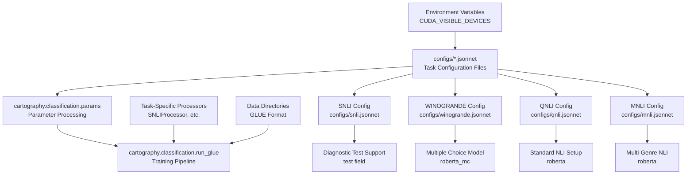
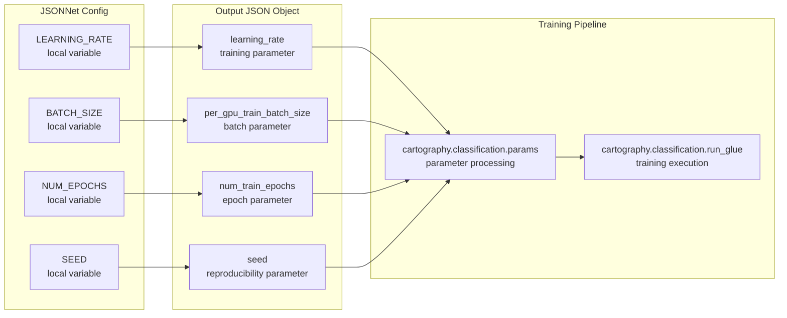

<!-- source: DeepWiki mcp.deepwiki.com · repo allenai/cartography · page 4.2 Task Configuration Files · fetched 2026-10-26 -->

# Task Configuration Files

<details>
<summary>Relevant source files</summary>

The following files were used as context for generating this wiki page:

- [cartography/classification/snli_utils.py](cartography/classification/snli_utils.py)
- [configs/mnli.jsonnet](configs/mnli.jsonnet)
- [configs/qnli.jsonnet](configs/qnli.jsonnet)
- [configs/snli.jsonnet](configs/snli.jsonnet)
- [configs/winogrande.jsonnet](configs/winogrande.jsonnet)

</details>


Task configuration files define the parameters and settings needed to train models on specific NLP tasks within the Dataset Cartography system. These JSONNet configuration files specify hyperparameters, data paths, model settings, and task-specific options that are used by the training pipeline.

For information about the underlying parameter management system that processes these configurations, see [Parameter System](#4.1). For details about specific task implementations, see [Supported Tasks](#5).

## Configuration File Structure

Dataset Cartography uses JSONNet configuration files located in the [configs/]() directory. Each task has its own configuration file that defines both global training parameters and task-specific settings.

### Configuration Flow Architecture



Sources: [configs/snli.jsonnet](), [configs/winogrande.jsonnet](), [configs/qnli.jsonnet](), [configs/mnli.jsonnet]()

## Common Configuration Parameters

All task configuration files follow a similar structure with local variable definitions followed by a configuration object:

| Parameter | Type | Purpose | Example |
|-----------|------|---------|---------|
| `LEARNING_RATE` | float | Optimizer learning rate | `1.0708609960508476e-05` |
| `BATCH_SIZE` | int | Training batch size per GPU | `96` |
| `NUM_EPOCHS` | int | Maximum training epochs | `23` |
| `SEED` | int | Random seed for reproducibility | `93078` |
| `TASK` | string | Task name identifier | `"SNLI"` |
| `DATA_DIR` | string | Path to task data directory | `"/home/swabhas/data/glue/SNLI"` |
| `FEATURES_CACHE_DIR` | string | Cache directory for processed features | `DATA_DIR + "/cache_" + SEED` |

### Environment Integration

Configuration files access environment variables through JSONNet's `std.extVar()` function:

```jsonnet
local CUDA_DEVICE = std.parseInt(std.extVar("CUDA_VISIBLE_DEVICES"));
```

This allows runtime configuration without modifying the files directly.

Sources: [configs/snli.jsonnet:1](), [configs/winogrande.jsonnet:1](), [configs/qnli.jsonnet:1](), [configs/mnli.jsonnet:1]()

## Standard Configuration Object

Each configuration file produces a JSON object with standardized fields:

```jsonnet
{
   "data_dir": DATA_DIR,
   "model_type": "roberta",
   "model_name_or_path": "roberta-large", 
   "task_name": TASK,
   "seed": SEED,
   "num_train_epochs": NUM_EPOCHS,
   "learning_rate": LEARNING_RATE,
   "features_cache_dir": FEATURES_CACHE_DIR,
   "per_gpu_train_batch_size": BATCH_SIZE,
   "do_train": true,
   "do_eval": true
}
```

These fields map directly to parameters expected by [cartography.classification.run_glue]().

Sources: [configs/snli.jsonnet:14-29](), [configs/qnli.jsonnet:12-22](), [configs/mnli.jsonnet:12-22]()

## Task-Specific Configurations

### SNLI Configuration

The SNLI configuration includes diagnostic test capabilities:

```jsonnet
local TEST = "/home/swabhas/data/glue/SNLI/diagnostic_test.tsv";

{
   // ... standard fields
   "do_test": true,
   "test": TEST,
   "patience": 3
}
```

The `test` field specifies a diagnostic test file for detailed evaluation capabilities.

Sources: [configs/snli.jsonnet:12](), [configs/snli.jsonnet:26-28]()

### WINOGRANDE Configuration  

WINOGRANDE uses a multiple-choice model variant and different data directory structure:

```jsonnet
local DATA_DIR = "/home/swabhas/data/glue/" + TASK + "/xl/" + TASK;

{
   // ... standard fields
   "model_type": "roberta_mc",
   "per_gpu_eval_batch_size": BATCH_SIZE,
   "patience": 5
}
```

The `roberta_mc` model type indicates multiple-choice task handling through [cartography.classification.models]().

Sources: [configs/winogrande.jsonnet:9](), [configs/winogrande.jsonnet:16](), [configs/winogrande.jsonnet:24](), [configs/winogrande.jsonnet:29]()

### Configuration Parameter Mapping



Sources: [configs/snli.jsonnet:3-6](), [configs/snli.jsonnet:20-23]()

## Creating New Task Configurations

To add support for a new task, create a new JSONNet file in [configs/]() following this template:

### Required Local Variables

```jsonnet
local CUDA_DEVICE = std.parseInt(std.extVar("CUDA_VISIBLE_DEVICES"));
local LEARNING_RATE = <tuned_learning_rate>;
local BATCH_SIZE = <optimal_batch_size>;
local NUM_EPOCHS = <max_epochs>;
local SEED = <random_seed>;
local TASK = "<TASK_NAME>";
local DATA_DIR = "/path/to/task/data";
local FEATURES_CACHE_DIR = DATA_DIR + "/cache_" + SEED;
```

### Required Output Object

```jsonnet
{
   "data_dir": DATA_DIR,
   "model_type": "<model_variant>",
   "model_name_or_path": "<pretrained_model>",
   "task_name": TASK,
   "seed": SEED,
   "num_train_epochs": NUM_EPOCHS,
   "learning_rate": LEARNING_RATE,
   "features_cache_dir": FEATURES_CACHE_DIR,
   "per_gpu_train_batch_size": BATCH_SIZE,
   "do_train": true,
   "do_eval": true
}
```

### Model Type Selection

| Task Type | Model Type | Purpose |
|-----------|------------|---------|
| Binary/Multi-class Classification | `"roberta"` | Standard classification |
| Multiple Choice | `"roberta_mc"` | Multiple choice tasks |
| Custom Architecture | `"custom"` | Task-specific models |

The `model_type` field determines which model class is instantiated in [cartography.classification.models]().

Sources: [configs/snli.jsonnet:16](), [configs/winogrande.jsonnet:16]()

## Hyperparameter Tuning Guidelines

Each task configuration contains pre-tuned hyperparameters optimized for the specific dataset:

| Task | Learning Rate | Batch Size | Epochs | Notes |
|------|---------------|------------|--------|-------|
| SNLI | `1.07e-05` | 96 | 23 | Includes diagnostic testing |
| WINOGRANDE | `1.12e-05` | 64 | 20 | Multiple choice format |
| QNLI | `2.47e-05` | 96 | 20 | Question-answer NLI |
| MNLI | `1.10e-05` | 96 | 24 | Multi-genre NLI |

These values represent empirically determined optimal settings for each task's dataset characteristics and complexity.

Sources: [configs/snli.jsonnet:3-6](), [configs/winogrande.jsonnet:3-6](), [configs/qnli.jsonnet:3-6](), [configs/mnli.jsonnet:3-6]()

---

