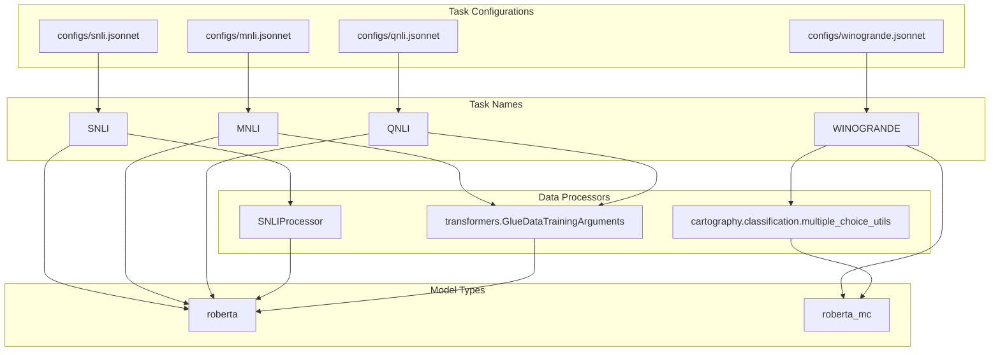
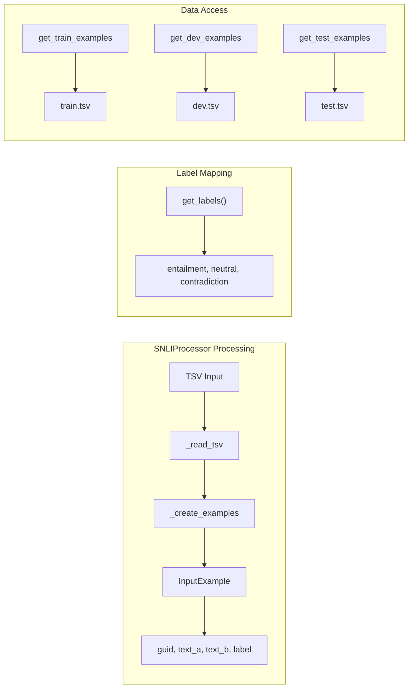
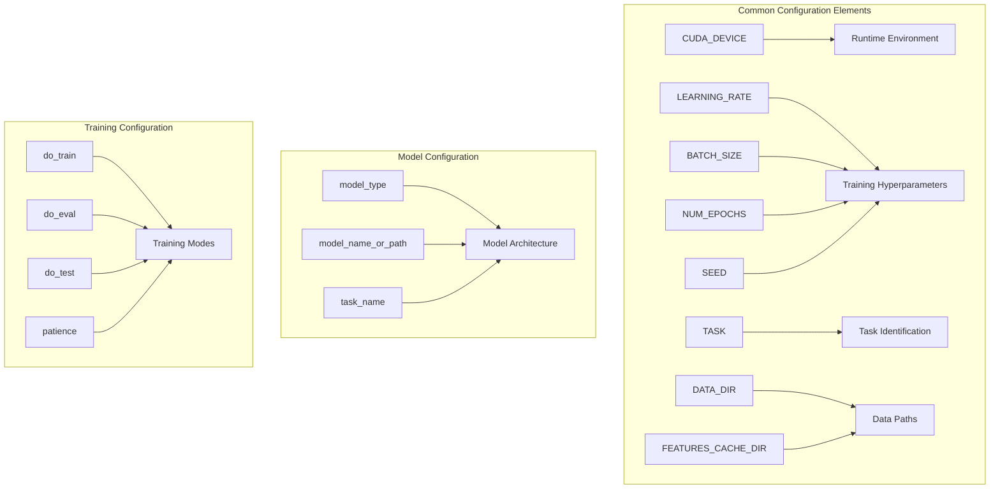
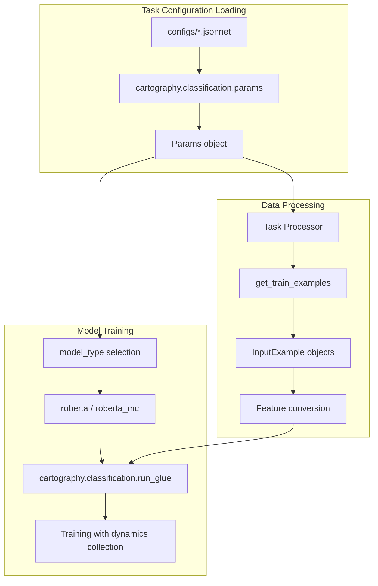

<!-- source: DeepWiki mcp.deepwiki.com · repo allenai/cartography · page 5 Supported Tasks · fetched 2026-10-26 -->

# Supported Tasks

Relevant source files

The following files were used as context for generating this wiki page:

- [cartography/classification/snli_utils.py](cartography/classification/snli_utils.py)
- [configs/mnli.jsonnet](configs/mnli.jsonnet)
- [configs/qnli.jsonnet](configs/qnli.jsonnet)
- [configs/snli.jsonnet](configs/snli.jsonnet)
- [configs/winogrande.jsonnet](configs/winogrande.jsonnet)

This document provides an overview of the NLP tasks currently supported by Dataset Cartography and their specific implementations. It covers the task configurations, data processors, and model adaptations available for training with dynamics collection and data selection.

For detailed implementation guides for specific tasks, see [SNLI](#5.1), [WINOGRANDE](#5.2), and [QNLI and MNLI Tasks](#5.3). For information about configuring these tasks, see [Task Configuration Files](#4.2).

## Overview of Supported Tasks

Dataset Cartography supports four main NLP tasks from the GLUE benchmark and related datasets. Each task has specialized data processors, configuration files, and model adaptations designed for training dynamics collection and analysis.

| Task | Type | Labels | Model Type | Configuration File |
|------|------|--------|------------|-------------------|
| SNLI | Natural Language Inference | entailment, neutral, contradiction | `roberta` | [configs/snli.jsonnet]() |
| MNLI | Multi-Genre NLI | entailment, neutral, contradiction | `roberta` | [configs/mnli.jsonnet]() |
| QNLI | Question-answering NLI | entailment, not_entailment | `roberta` | [configs/qnli.jsonnet]() |
| WINOGRANDE | Commonsense Reasoning | 0, 1 (multiple choice) | `roberta_mc` | [configs/winogrande.jsonnet]() |

## Task Implementation Architecture

The following diagram shows how tasks are implemented in the codebase, mapping from task names to their corresponding processors and configurations:

Sources: [configs/snli.jsonnet](), [configs/mnli.jsonnet](), [configs/qnli.jsonnet](), [configs/winogrande.jsonnet](), [cartography/classification/snli_utils.py]()

## Task Types and Processing

Dataset Cartography handles two primary task types with different processing approaches:

### Natural Language Inference Tasks

SNLI, MNLI, and QNLI are processed as natural language inference tasks with paired text inputs. These tasks use:

- **Model Type**: `roberta` ([configs/snli.jsonnet:16](), [configs/mnli.jsonnet:14](), [configs/qnli.jsonnet:14]())
- **Base Model**: `roberta-large` for all NLI tasks
- **Label Format**: String labels (e.g., "entailment", "neutral", "contradiction")
- **Input Format**: Two text fields (`text_a` and `text_b`) from TSV files

The `SNLIProcessor` class demonstrates the standard processing pattern:

Sources: [cartography/classification/snli_utils.py:6-41]()

### Multiple Choice Tasks

WINOGRANDE is processed as a multiple choice task with different requirements:

- **Model Type**: `roberta_mc` ([configs/winogrande.jsonnet:16]())
- **Base Model**: `roberta-large` with multiple choice adaptation
- **Label Format**: Numeric labels (0, 1) for binary choices
- **Processing**: Specialized multiple choice utilities handle option selection

## Configuration Patterns

All tasks follow consistent configuration patterns in their JSONNet files:

### Standard Configuration Structure

Sources: [configs/snli.jsonnet:1-29](), [configs/winogrande.jsonnet:1-30](), [configs/qnli.jsonnet:1-22](), [configs/mnli.jsonnet:1-22]()

### Task-Specific Variations

| Configuration Element | SNLI | MNLI | QNLI | WINOGRANDE |
|----------------------|------|------|------|------------|
| **Learning Rate** | 1.07e-05 | 1.10e-05 | 2.47e-05 | 1.12e-05 |
| **Batch Size** | 96 | 96 | 96 | 64 |
| **Epochs** | 23 | 24 | 20 | 20 |
| **Model Type** | roberta | roberta | roberta | roberta_mc |
| **Patience** | 3 | - | - | 5 |
| **Test File** | diagnostic_test.tsv | - | - | wsc_superglue_trval_test.tsv |

## Data Format Requirements

Each task expects specific data formats for training dynamics collection:

### NLI Task Format (SNLI, MNLI, QNLI)

TSV files with columns accessed by the `SNLIProcessor`:
- Column indices: `guid = line[2]`, `text_a = line[7]`, `text_b = line[8]`, `label = line[-1]` ([cartography/classification/snli_utils.py:18-21]())
- Label validation: Skips empty or "-" labels ([cartography/classification/snli_utils.py:22-23]())

### Multiple Choice Format (WINOGRANDE)

Specialized format handling through `roberta_mc` model type requiring:
- Multiple choice option processing
- Binary label encoding (0/1)
- Integration with `multiple_choice_utils` for answer selection

## Integration with Training Pipeline

All supported tasks integrate with the main training pipeline through consistent interfaces:

Sources: [configs/snli.jsonnet](), [configs/winogrande.jsonnet](), [cartography/classification/snli_utils.py]()

The modular design allows easy extension to additional GLUE-style tasks by following the established patterns for processors, configurations, and model adaptations.

---

