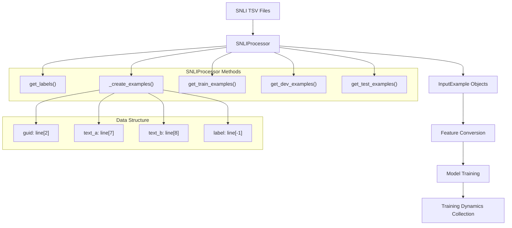
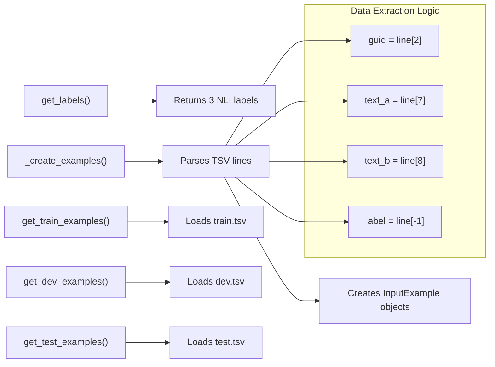
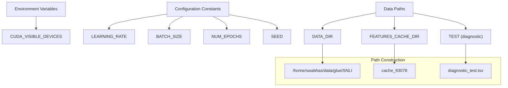
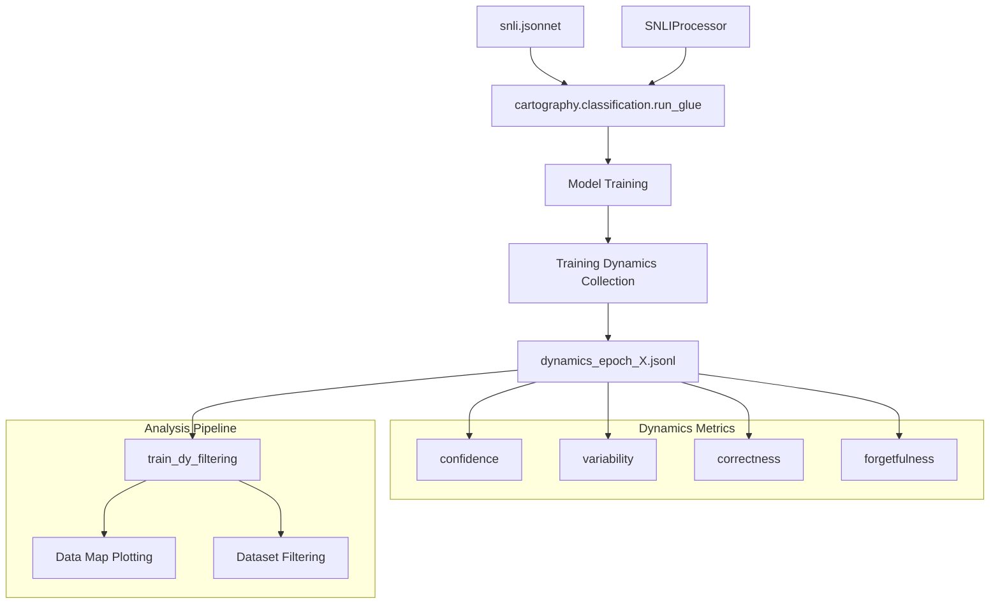

<!-- source: DeepWiki mcp.deepwiki.com · repo allenai/cartography · page 5.1 SNLI (Natural Language Inference) · fetched 2026-10-26 -->

# SNLI (Natural Language Inference)

Relevant source files

The following files were used as context for generating this wiki page:

- [cartography/classification/snli_utils.py](cartography/classification/snli_utils.py)
- [configs/snli.jsonnet](configs/snli.jsonnet)

This document covers the SNLI (Stanford Natural Language Inference) task implementation in Dataset Cartography, including the specialized data processor, configuration management, and integration with the training dynamics collection system. For information about other supported tasks, see [Supported Tasks](#5). For general training dynamics collection, see [Training with Dynamics Collection](#3.1).

## Task Overview

SNLI is a natural language inference task where models must determine the relationship between two sentences: a premise and a hypothesis. The task requires classifying the relationship as one of three categories: entailment, neutral, or contradiction.

The Dataset Cartography implementation provides specialized support for SNLI through a custom processor and task-specific configuration, enabling researchers to analyze training dynamics and data characteristics for this important NLP benchmark.

## Data Processing Architecture

The SNLI implementation follows the standard Dataset Cartography data processing pipeline with task-specific adaptations:

Sources: [cartography/classification/snli_utils.py:1-42]()

## SNLIProcessor Implementation

The `SNLIProcessor` class provides specialized handling for SNLI dataset format and structure:

| Component | Implementation | Purpose |
|-----------|----------------|---------|
| **Labels** | `["entailment", "neutral", "contradiction"]` | Three-way classification for NLI |
| **Text Fields** | `text_a` (premise), `text_b` (hypothesis) | Sentence pair processing |
| **GUID Extraction** | `line[2]` | Unique identifier from TSV |
| **Data Validation** | Skip entries with `"-"` or empty labels | Clean dataset processing |

### Key Methods

The processor implements the standard DataProcessor interface with SNLI-specific adaptations:

Sources: [cartography/classification/snli_utils.py:6-42]()

## Configuration Management

The SNLI task uses a dedicated JSONNet configuration file that integrates with the parameter management system:

### Core Configuration Parameters

| Parameter | Value | Purpose |
|-----------|-------|---------|
| `task_name` | `"SNLI"` | Task identifier |
| `model_type` | `"roberta"` | Base model architecture |
| `model_name_or_path` | `"roberta-large"` | Pre-trained model |
| `num_train_epochs` | `23` | Training duration |
| `learning_rate` | `1.0708609960508476e-05` | Optimization rate |
| `per_gpu_train_batch_size` | `96` | Batch configuration |

### Environment and Data Configuration

The configuration system supports flexible path management and experiment reproducibility:

Sources: [configs/snli.jsonnet:1-29]()

## Integration with Dataset Cartography

SNLI integrates seamlessly with the broader Dataset Cartography system for training dynamics analysis:

### Training Pipeline Integration

### Task-Specific Features

The SNLI implementation provides several specialized features:

| Feature | Implementation | Benefit |
|---------|----------------|---------|
| **Diagnostic Evaluation** | `diagnostic_test.tsv` support | Category-wise analysis |
| **Sentence Pair Processing** | Premise-hypothesis structure | NLI-specific data handling |
| **Label Validation** | Skip malformed entries | Clean training data |
| **GUID Preservation** | Use original identifiers | Traceability across experiments |

## Data Format and Structure

SNLI data processing expects TSV files with specific column mappings:

| Column Index | Field | Content | Example |
|--------------|-------|---------|---------|
| 2 | `guid` | Unique identifier | `"snli_1.0_train_1234"` |
| 7 | `text_a` | Premise sentence | `"A man is walking a dog"` |
| 8 | `text_b` | Hypothesis sentence | `"A person is outside"` |
| -1 | `label` | Relationship | `"entailment"` |

### Data Validation Logic

The processor implements robust validation to handle dataset inconsistencies:

- Skips header row (`i == 0`)
- Filters out entries with missing labels (`"-"` or `""`)
- Preserves original GUID format for experiment tracking

Sources: [cartography/classification/snli_utils.py:12-26]()

## Usage in Experiments

SNLI can be used with all Dataset Cartography analysis capabilities:

1. **Training Dynamics Collection**: Standard pipeline through `run_glue`
2. **Data Map Analysis**: Visualize confidence vs. variability patterns
3. **Dataset Filtering**: Create subsets based on training dynamics
4. **Diagnostic Evaluation**: Category-wise performance analysis

The task integrates with the parameter system and supports all standard training configurations including multi-GPU setups, early stopping, and comprehensive evaluation modes.

Sources: [configs/snli.jsonnet:24-28](), [cartography/classification/snli_utils.py:6-42]()

---

