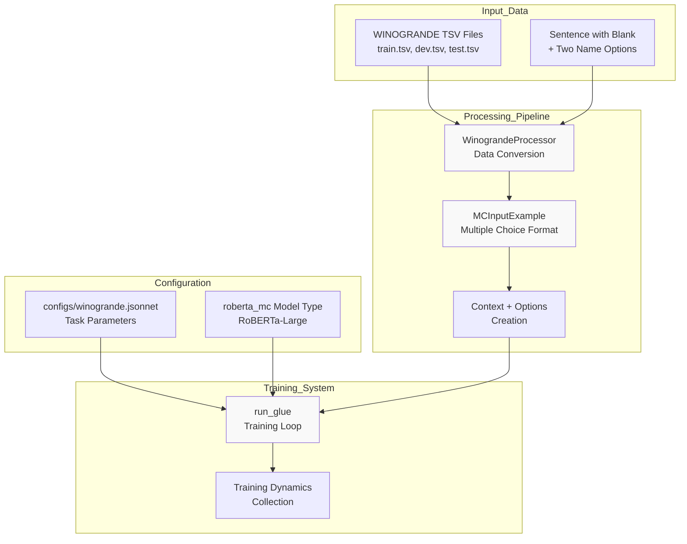
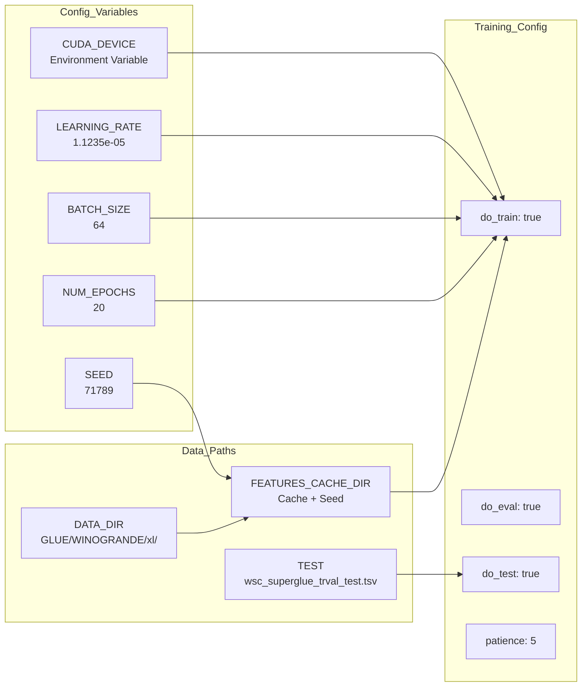
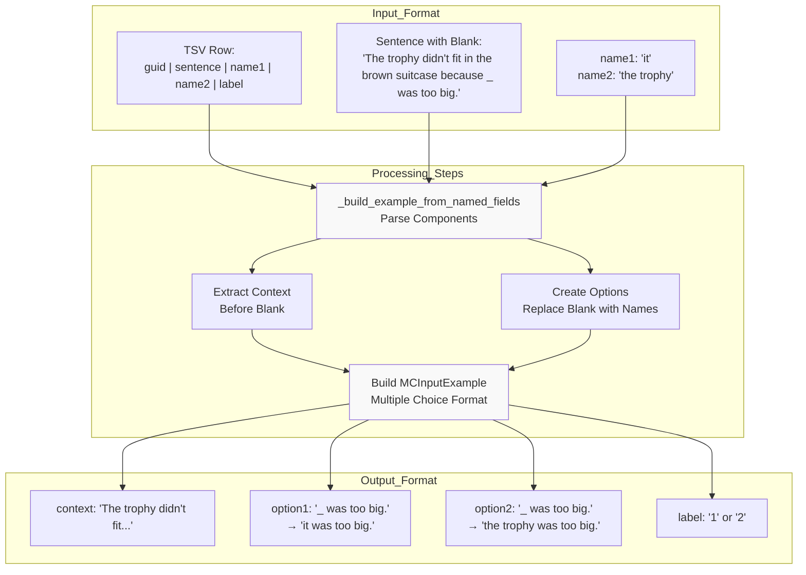
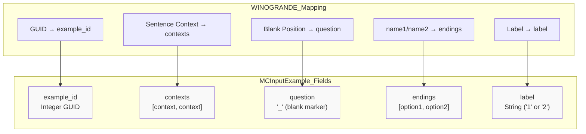
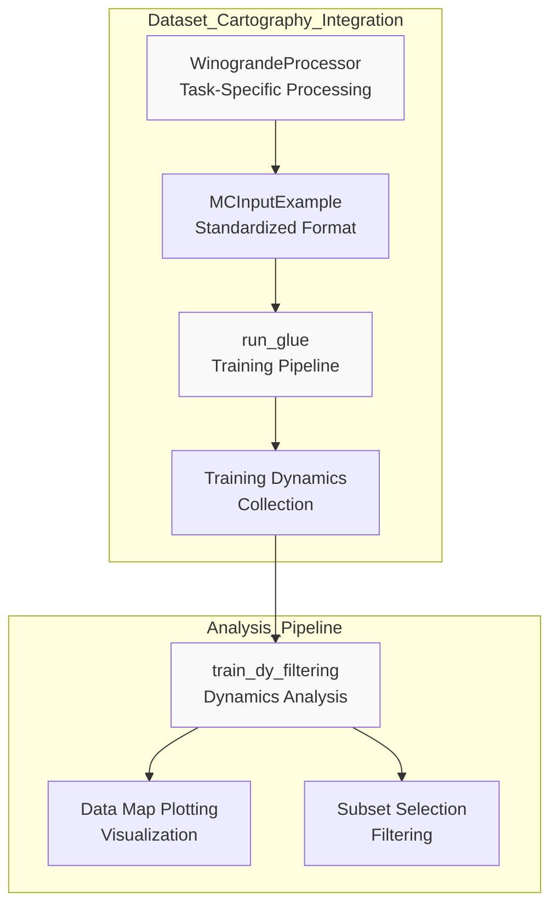

<!-- source: DeepWiki mcp.deepwiki.com · repo allenai/cartography · page 5.2 WINOGRANDE (Commonsense Reasoning) · fetched 2026-10-26 -->

# WINOGRANDE (Commonsense Reasoning)

<details>
<summary>Relevant source files</summary>

The following files were used as context for generating this wiki page:

- [cartography/classification/winogrande_utils.py](cartography/classification/winogrande_utils.py)
- [configs/winogrande.jsonnet](configs/winogrande.jsonnet)

</details>


This document covers the implementation of WINOGRANDE commonsense reasoning task support within the Dataset Cartography system. WINOGRANDE is a multiple-choice commonsense reasoning benchmark that requires models to resolve pronoun references based on commonsense knowledge.

For general multiple-choice task infrastructure, see [Multiple Choice Task Support](#6.2). For other NLP tasks like SNLI, see [SNLI (Natural Language Inference)](#5.1).

## Task Overview

WINOGRANDE is implemented as a binary multiple-choice task where models must choose between two possible pronoun referents in a sentence. The task tests commonsense reasoning capabilities by requiring understanding of implicit world knowledge to resolve ambiguous pronoun references.

The implementation leverages the multiple-choice framework with specialized data processing to handle the WINOGRANDE format, which consists of sentences with blanks that can be filled with one of two candidate options.

**WINOGRANDE System Architecture**


Sources: [configs/winogrande.jsonnet:1-31](), [cartography/classification/winogrande_utils.py:1-91]()

## Configuration

WINOGRANDE tasks are configured through JSONNet files that specify model parameters, data paths, and training settings. The configuration uses the `roberta_mc` model type specifically designed for multiple-choice tasks.

| Parameter | Value | Description |
|-----------|-------|-------------|
| `model_type` | `"roberta_mc"` | RoBERTa model adapted for multiple choice |
| `model_name_or_path` | `"roberta-large"` | Pre-trained model checkpoint |
| `task_name` | `"WINOGRANDE"` | Task identifier |
| `learning_rate` | `1.1235e-05` | Fine-tuning learning rate |
| `per_gpu_train_batch_size` | `64` | Training batch size per GPU |
| `num_train_epochs` | `20` | Maximum training epochs |

**Key Configuration Structure**


Sources: [configs/winogrande.jsonnet:1-31]()

## Data Processing Pipeline

The `WinograndeProcessor` class handles conversion from WINOGRANDE's TSV format to the internal multiple-choice representation. The processor extracts sentence contexts, option pairs, and labels to create `MCInputExample` objects.

**Data Processing Flow**


Sources: [cartography/classification/winogrande_utils.py:36-52](), [cartography/classification/winogrande_utils.py:54-71]()

## Multiple Choice Implementation

WINOGRANDE leverages the multiple-choice infrastructure through the `MCInputExample` class. The processor converts each WINOGRANDE instance into a standardized multiple-choice format with context, question placeholder, and two ending options.

### Data Format Transformation

The `WinograndeProcessor` performs the following transformation:

1. **Context Extraction**: Extracts text before the blank (`_`) as context
2. **Option Creation**: Replaces blank with each candidate name to form complete sentences
3. **Label Mapping**: Maps string labels to integer indices for training

```python
# Core transformation in _build_example_from_named_fields
conj = "_"
idx = sentence.index(conj)
context = sentence[:idx]
option_str = "_ " + sentence[idx + len(conj):].strip()

option1 = option_str.replace("_", name1)
option2 = option_str.replace("_", name2)
```

**MCInputExample Structure**


Sources: [cartography/classification/winogrande_utils.py:45-51](), [cartography/classification/multiple_choice_utils.py:1-1]()

## Integration with Dataset Cartography

WINOGRANDE integrates with the Dataset Cartography training dynamics collection system through the standard GLUE pipeline. The task supports:

- **Training Dynamics Collection**: Captures model predictions and confidence scores during training
- **Data Map Generation**: Enables visualization of example difficulty and ambiguity
- **Subset Selection**: Allows filtering based on confidence, variability, and correctness metrics

### Training Pipeline Integration

The WINOGRANDE task follows the standard Dataset Cartography workflow:

1. **Configuration Loading**: JSONNet config parsed by parameter system
2. **Data Processing**: `WinograndeProcessor` converts TSV to `MCInputExample` format
3. **Model Training**: RoBERTa-MC model trains with dynamics collection enabled
4. **Dynamics Output**: Training dynamics saved for subsequent analysis

**Integration Points**


Sources: [cartography/classification/winogrande_utils.py:15-34](), [configs/winogrande.jsonnet:14-30]()

### Label Space

WINOGRANDE uses a binary label space with string labels `"1"` and `"2"` corresponding to the first and second name options respectively. The `get_labels()` method returns this fixed label set for consistent processing across the pipeline.

Sources: [cartography/classification/winogrande_utils.py:32-34]()

---

