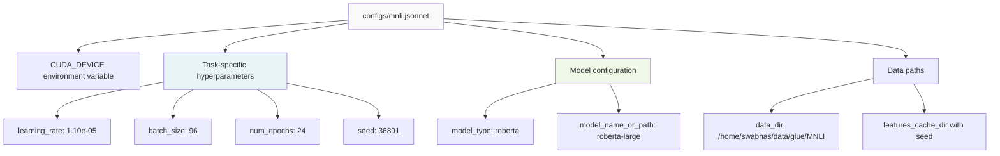
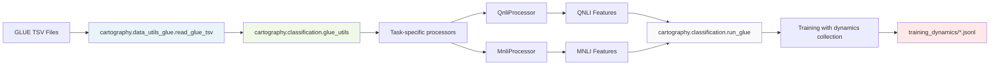
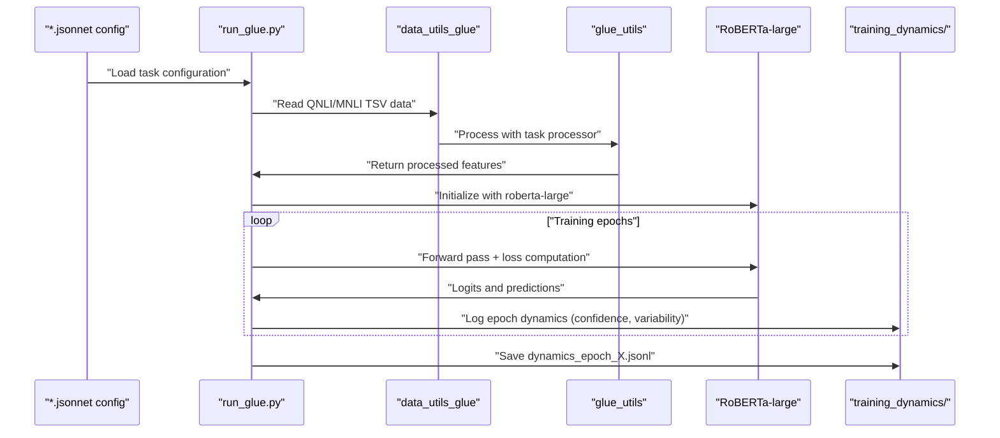

<!-- source: DeepWiki mcp.deepwiki.com · repo allenai/cartography · page 5.3 QNLI and MNLI Tasks · fetched 2026-10-26 -->

# QNLI and MNLI Tasks

Relevant source files

The following files were used as context for generating this wiki page:

- [configs/mnli.jsonnet](configs/mnli.jsonnet)
- [configs/qnli.jsonnet](configs/qnli.jsonnet)

This document covers the implementation and configuration of the Question-answering Natural Language Inference (QNLI) and Multi-Genre Natural Language Inference (MNLI) tasks within the Dataset Cartography system. These are two GLUE benchmark tasks that use standard Natural Language Inference patterns for classification.

For implementation details of other NLI tasks, see [SNLI (Natural Language Inference)](#5.1). For multiple-choice task implementations, see [WINOGRANDE (Commonsense Reasoning)](#5.2).

## Task Overview

Both QNLI and MNLI are binary/multi-class classification tasks that follow the standard GLUE benchmark format:

| Task | Type | Classes | Description |
|------|------|---------|-------------|
| **QNLI** | Binary Classification | entailment, not_entailment | Question-answering reformulated as textual entailment |
| **MNLI** | 3-class Classification | entailment, contradiction, neutral | Multi-genre natural language inference |

These tasks integrate with the Dataset Cartography pipeline using the same infrastructure as other GLUE tasks, leveraging `cartography.classification.run_glue` for training with dynamics collection and `cartography.selection.train_dy_filtering` for analysis.

## Configuration Structure

Both tasks use JSONNet configuration files that define training hyperparameters and model specifications:

### QNLI Configuration Pipeline

### MNLI Configuration Pipeline

Sources: [configs/qnli.jsonnet:1-23](), [configs/mnli.jsonnet:1-23]()

## Configuration Parameters

The configuration files specify identical structure with task-specific hyperparameters:

| Parameter | QNLI | MNLI | Purpose |
|-----------|------|------|---------|
| `learning_rate` | 2.47e-05 | 1.10e-05 | Adam optimizer learning rate |
| `per_gpu_train_batch_size` | 96 | 96 | Training batch size per GPU |
| `num_train_epochs` | 20 | 24 | Total training epochs |
| `seed` | 80965 | 36891 | Random seed for reproducibility |
| `model_type` | roberta | roberta | Transformer architecture |
| `model_name_or_path` | roberta-large | roberta-large | Pre-trained model checkpoint |

Both configurations use the `std.parseInt(std.extVar("CUDA_VISIBLE_DEVICES"))` pattern to read GPU device information from environment variables, though this value is not directly used in the configuration output.

Sources: [configs/qnli.jsonnet:3-6,14-21](), [configs/mnli.jsonnet:3-6,14-21]()

## Data Processing Integration

### GLUE Data Pipeline Integration

Both tasks follow the standard GLUE data processing pipeline where:
- Raw TSV data is read using `cartography.data_utils_glue.read_glue_tsv`
- Task-specific processors (`QnliProcessor`, `MnliProcessor`) handle format conversion
- Features are generated for model input
- Training proceeds with dynamics collection enabled

Sources: System architecture from overview diagrams

## Training and Dynamics Collection

### Task Execution Flow

Both QNLI and MNLI use the same training infrastructure provided by `cartography.classification.run_glue`, which:
- Loads the JSONNet configuration
- Initializes RoBERTa-large models
- Processes data using GLUE utilities
- Collects training dynamics during each epoch
- Outputs dynamics files for subsequent analysis

Sources: System architecture from overview diagrams, [configs/qnli.jsonnet:14-16](), [configs/mnli.jsonnet:14-16]()

## Analysis and Selection Integration

After training, both tasks generate training dynamics that can be analyzed using the standard Dataset Cartography selection pipeline:

### Metrics Computation for NLI Tasks

| Metric | Description | Application to QNLI/MNLI |
|--------|-------------|--------------------------|
| **Confidence** | Average predicted probability for true label | Identifies easy vs hard examples |
| **Variability** | Standard deviation of predictions across epochs | Detects ambiguous examples |
| **Correctness** | Fraction of epochs predicted correctly | Measures example learnability |
| **Forgetfulness** | Number of times model forgets after learning | Identifies noisy labels |

Both QNLI and MNLI dynamics can be processed using `cartography.selection.train_dy_filtering` to create data maps and filtered datasets based on these metrics.

Sources: System architecture from overview diagrams

## Usage with Dataset Cartography Pipeline

To train and analyze QNLI or MNLI:

1. **Training**: Use `cartography.classification.run_glue` with the respective JSONNet config
2. **Analysis**: Process resulting dynamics with `cartography.selection.train_dy_filtering`  
3. **Visualization**: Generate data maps showing confidence vs variability distributions
4. **Selection**: Create filtered datasets based on computed metrics

The tasks integrate seamlessly with the broader Dataset Cartography ecosystem for understanding training dynamics and data characteristics in Natural Language Inference tasks.

Sources: [configs/qnli.jsonnet:1-23](), [configs/mnli.jsonnet:1-23](), System architecture from overview diagrams

---

