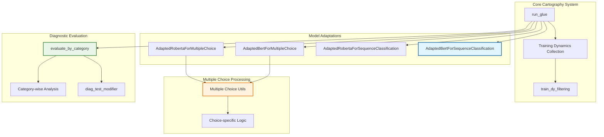
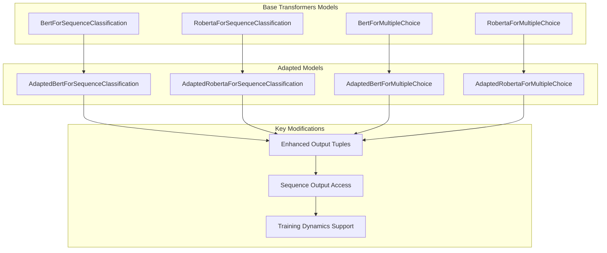
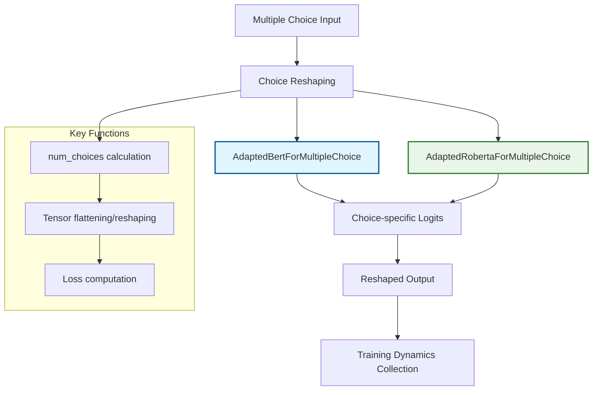

<!-- source: DeepWiki mcp.deepwiki.com · repo allenai/cartography · page 6 Advanced Features · fetched 2026-10-26 -->

# Advanced Features

Relevant source files

The following files were used as context for generating this wiki page:

- [cartography/classification/diagnostics_evaluation.py](cartography/classification/diagnostics_evaluation.py)
- [cartography/classification/models.py](cartography/classification/models.py)

This page documents specialized analysis tools, model adaptations, and advanced evaluation capabilities that extend the core Dataset Cartography functionality. These features provide deeper insights into model behavior, support for specialized task formats, and enhanced evaluation methodologies.

For basic training and data selection functionality, see [Core Systems](#3). For specific task implementations, see [Supported Tasks](#5).

## Overview of Advanced Features

Dataset Cartography provides several advanced features that go beyond basic training dynamics collection and data selection:

| Feature Category | Components | Purpose |
|------------------|------------|---------|
| **Diagnostic Evaluation** | `diagnostics_evaluation.py` | Category-wise analysis of NLI model performance |
| **Model Adaptations** | `models.py` | Modified BERT/RoBERTa models with enhanced outputs |
| **Multiple Choice Support** | Multiple choice model variants | Support for tasks like WINOGRANDE |

These advanced features integrate seamlessly with the core cartography pipeline while providing specialized capabilities for research and analysis.

### Advanced Features Architecture

**Sources:** [cartography/classification/models.py:1-341](), [cartography/classification/diagnostics_evaluation.py:1-220]()

## Diagnostic Evaluation System

The diagnostic evaluation system provides category-wise analysis of Natural Language Inference models, enabling detailed understanding of model strengths and weaknesses across different linguistic phenomena.

### Diagnostic Categories

The system evaluates models across four main categories with fine-grained subcategories:

| Coarse Category | Fine-grained Categories | Description |
|-----------------|------------------------|-------------|
| **Logic** | Negation, Conditionals, Quantifiers, etc. | Logical reasoning capabilities |
| **Lexical Semantics** | Lexical entailment, Factivity, Symmetry, etc. | Word-level semantic understanding |
| **Predicate Argument Structure** | Core args, Ellipsis, Anaphora, etc. | Syntactic structure comprehension |
| **Knowledge** | Common sense, World knowledge | External knowledge requirements |

The evaluation uses the `evaluate_by_category` function which computes accuracy and Matthews correlation coefficient for each category.

**Sources:** [cartography/classification/diagnostics_evaluation.py:22-46](), [cartography/classification/diagnostics_evaluation.py:132-203]()

## Model Adaptations

Dataset Cartography includes adapted versions of standard transformer models that provide enhanced output for training dynamics collection and analysis.

### Adapted Model Classes

**Sources:** [cartography/classification/models.py:9-341]()

### Key Adaptations

The adapted models modify the forward pass to include additional outputs needed for training dynamics collection:

- **Sequence Classification Models**: Include sequence output in addition to logits for analysis
- **Multiple Choice Models**: Preserve choice-specific logits while maintaining compatibility
- **Enhanced Output Tuples**: Modified return values to support cartography analysis

For example, `AdaptedRobertaForSequenceClassification.forward()` returns `(loss), logits, sequence_output, pooled_sequence_output, (hidden_states), (attentions)` instead of the standard transformer output format.

**Sources:** [cartography/classification/models.py:73-84](), [cartography/classification/models.py:160-167]()

## Multiple Choice Task Support

The system provides specialized support for multiple choice tasks through adapted model architectures and processing utilities.

### Multiple Choice Processing Pipeline

**Sources:** [cartography/classification/models.py:87-167](), [cartography/classification/models.py:170-256]()

The multiple choice models handle the reshaping of inputs and outputs to accommodate choice-based task formats while maintaining compatibility with the cartography training dynamics collection system.

## Integration with Core System

These advanced features integrate with the core cartography system through the standard training and analysis pipeline:

1. **Model Selection**: Choose appropriate adapted model in `run_glue` configuration
2. **Training**: Use adapted models for enhanced output during training dynamics collection  
3. **Analysis**: Apply diagnostic evaluation or choice-specific analysis as needed
4. **Evaluation**: Leverage category-wise metrics for detailed model assessment

The advanced features are designed to work transparently with existing cartography workflows while providing additional analytical capabilities.

**Sources:** [cartography/classification/diagnostics_evaluation.py:132-203](), [cartography/classification/models.py:1-341]()

---

